# 🚀 Spring Boot – Complete Interview Notes

> One self-contained reference for Full-Stack Java / Spring Boot interviews, from beginner to senior level. It covers Spring core, web/REST, JPA, security, cross-cutting concerns, production readiness, microservices, testing and Java Streams.

**How to use these notes**
- Topics run from beginner (Part I) to advanced (Parts VI–VII). Java Streams (Part IX) can be studied on its own.
- Most sections end with **Interview Questions**. Part X has questions by level, stream questions and one-liners for last-minute revision.
- **Version notes** flag differences between Spring Boot 2.x, 3.x and 4.x and between Java versions. **Correction** notes mark places where earlier versions of these notes had a mistake.
- Code targets **Java 17+ and Spring Boot 3.x** unless stated otherwise.

---

## 📌 Table of Contents

**[Part I – Spring Foundations](#part-i--spring-foundations)**
1. [Spring and Spring Boot Basics](#1-spring-and-spring-boot-basics)
2. [IoC, Dependency Injection and the Container](#2-ioc-dependency-injection-and-the-container)
3. [Spring Beans: Scopes, Lifecycle and Advanced Hooks](#3-spring-beans-scopes-lifecycle-and-advanced-hooks)
4. [Core Annotations Reference](#4-core-annotations-reference)
5. [Configuration, Profiles and Externalized Properties](#5-configuration-profiles-and-externalized-properties)

**[Part II – Web Layer and REST APIs](#part-ii--web-layer-and-rest-apis)**

6. [Request Lifecycle: Filters, Interceptors and AOP](#6-request-lifecycle-filters-interceptors-and-aop)
7. [REST API Development](#7-rest-api-development)
8. [Validation and Exception Handling](#8-validation-and-exception-handling)
9. [CORS, File Upload and Other Web Features](#9-cors-file-upload-and-other-web-features)

**[Part III – Data Access with JPA](#part-iii--data-access-with-jpa)**

10. [JPA and Hibernate Fundamentals](#10-jpa-and-hibernate-fundamentals)
11. [Entity Relationships, Fetching and Cascading](#11-entity-relationships-fetching-and-cascading)
12. [Spring Data JPA Repositories and Queries](#12-spring-data-jpa-repositories-and-queries)
13. [Transactions and Locking](#13-transactions-and-locking)
14. [Advanced JPA: Inheritance, Soft Delete, Auditing and Connection Pooling](#14-advanced-jpa-inheritance-soft-delete-auditing-and-connection-pooling)
15. [Database Migrations: Flyway and Liquibase](#15-database-migrations-flyway-and-liquibase)

**[Part IV – Security](#part-iv--security)**

16. [Spring Security Architecture](#16-spring-security-architecture)
17. [Authentication and Authorization](#17-authentication-and-authorization)
18. [JWT, Refresh Tokens and OAuth2](#18-jwt-refresh-tokens-and-oauth2)

**[Part V – Cross-Cutting Concerns](#part-v--cross-cutting-concerns)**

19. [Aspect-Oriented Programming](#19-aspect-oriented-programming)
20. [Spring Events](#20-spring-events)
21. [Caching](#21-caching)
22. [Async, Scheduling, Virtual Threads and Distributed Locking](#22-async-scheduling-virtual-threads-and-distributed-locking)
23. [Spring Batch](#23-spring-batch)
24. [Logging](#24-logging)

**[Part VI – Production Readiness](#part-vi--production-readiness)**

25. [Actuator and Monitoring](#25-actuator-and-monitoring)
26. [Deployment and Runtime: Docker, Graceful Shutdown, GraalVM](#26-deployment-and-runtime-docker-graceful-shutdown-graalvm)
27. [Performance, Common Pitfalls and Design Patterns](#27-performance-common-pitfalls-and-design-patterns)

**[Part VII – Microservices with Spring Cloud](#part-vii--microservices-with-spring-cloud)**

28. [Microservices Architecture and Spring Cloud](#28-microservices-architecture-and-spring-cloud)
29. [Resilience and Observability](#29-resilience-and-observability)
30. [Distributed Data: Saga, CQRS, Outbox and Messaging](#30-distributed-data-saga-cqrs-outbox-and-messaging)

**[Part VIII – Testing](#part-viii--testing)**

31. [Testing Spring Boot Applications](#31-testing-spring-boot-applications)
32. [Advanced Testing: Testcontainers, WireMock, Security and Contracts](#32-advanced-testing-testcontainers-wiremock-security-and-contracts)

**[Part IX – Java Streams for Spring Developers](#part-ix--java-streams-for-spring-developers)**

33. [Stream Basics and the Pipeline](#33-stream-basics-and-the-pipeline)
34. [Creating Streams](#34-creating-streams)
35. [Intermediate Operations](#35-intermediate-operations)
36. [Terminal Operations](#36-terminal-operations)
37. [Collectors – Complete Guide](#37-collectors--complete-guide)
38. [Numeric Streams – IntStream, LongStream, DoubleStream](#38-numeric-streams--intstream-longstream-doublestream)
39. [flatMap – Flattening Nested Structures](#39-flatmap--flattening-nested-structures)
40. [Optional – The Stream Companion](#40-optional--the-stream-companion)
41. [Parallel Streams](#41-parallel-streams)
42. [Streams with Collections and Maps](#42-streams-with-collections-and-maps)
43. [Custom Collectors](#43-custom-collectors)
44. [Stream Pitfalls and Best Practices](#44-stream-pitfalls-and-best-practices)
45. [Real-World Stream Examples](#45-real-world-stream-examples)

**[Part X – Interview Questions and Revision](#part-x--interview-questions-and-revision)**

46. [Spring Boot Interview Questions by Level](#46-spring-boot-interview-questions-by-level)
47. [Java Streams Interview Questions](#47-java-streams-interview-questions)
48. [Quick-Fire One-Liners](#48-quick-fire-one-liners)

---

# Part I – Spring Foundations

## 1. Spring and Spring Boot Basics

### 1.1 What is Spring Framework?

**Definition:** Spring is a lightweight, open-source Java framework for building enterprise applications. Its core strength is that it **creates and wires your objects for you** through IoC and DI ([Section 2](#2-ioc-dependency-injection-and-the-container)), so you don't manually create and connect objects. It also provides AOP, transaction management, security, data access and web support.

**Why it matters:** Before Spring, enterprise Java (EJB 2.x) was heavy, XML-driven and hard to test. Spring made plain Java objects (POJOs) the center of the application and moved "plumbing" into the framework.

### 1.2 What is Spring Boot?

Spring Boot is built **on top of** Spring Framework. Its goal is to remove the manual setup and configuration that plain Spring requires. It gives you:

- **Auto-configuration** – Spring decides sensible defaults based on what is on your classpath.
- **Embedded server** – Tomcat (default), Jetty or Undertow runs inside your app; no separate install.
- **Starters** – one dependency pulls in a tested set of libraries.
- **Production-ready features** – health checks, metrics and management endpoints via Actuator.
- **Opinionated defaults** – you override only what you need.

> **Interview one-liner:** "Spring is the framework; Spring Boot is an opinionated way to *use* Spring with auto-configuration, starters and an embedded server, so an app is production-ready with almost no setup."

### 1.3 Spring vs Spring Boot

| Feature | Spring | Spring Boot |
|---|---|---|
| Configuration | Manual XML/Java config | Auto-configuration |
| Server | External (Tomcat/Jetty) | Embedded server |
| Deployment | WAR | JAR (standalone) |
| Boilerplate | High | Minimal |
| Monitoring | Manual setup | Actuator built-in |
| Dependency management | You pick compatible versions | Starters + BOM manage versions |

### 1.4 JAR vs WAR

- **JAR (Java ARchive)** – A self-contained package that includes your application code **and** an embedded server. You run it directly with `java -jar app.jar`. Spring Boot uses JAR by default (an "executable fat JAR").
- **WAR (Web ARchive)** – A package meant to be deployed inside an external web server like Apache Tomcat. You cannot run a classic WAR directly; the server unpacks and hosts it. (Spring Boot can still build a WAR by extending `SpringBootServletInitializer`.)

> **Interview tip:** "Spring Boot prefers JAR because it packages everything including the server, making deployment simpler — especially in Docker/Kubernetes environments."

### 1.5 Spring Boot Starters

Starters are pre-packaged sets of dependencies for common use cases. Instead of manually adding 5–10 individual libraries (and finding compatible versions), you add one starter.

| Starter | What you get |
|---|---|
| `spring-boot-starter-web` | Spring MVC + embedded Tomcat + Jackson (JSON) |
| `spring-boot-starter-data-jpa` | JPA + Hibernate + Spring Data + HikariCP |
| `spring-boot-starter-security` | Spring Security |
| `spring-boot-starter-actuator` | Monitoring and management endpoints |
| `spring-boot-starter-test` | JUnit 5 + Mockito + AssertJ + Spring Test |
| `spring-boot-starter-validation` | Jakarta Bean Validation (Hibernate Validator) |
| `spring-boot-starter-webflux` | Reactive web stack (Netty + WebClient) |

> **Version note:** Since Spring Boot 2.3, validation is **not** included in `starter-web`; add `spring-boot-starter-validation` for `@Valid` to work.

### 1.6 @SpringBootApplication

This single annotation on your main class combines three annotations:

```java
@Configuration           // This class can define @Bean methods
@EnableAutoConfiguration // Enable Spring Boot's auto-config mechanism
@ComponentScan           // Scan this package and sub-packages for components
```

```java
@SpringBootApplication
public class MyApplication {
    public static void main(String[] args) {
        SpringApplication.run(MyApplication.class, args);
    }
}
```

**Common mistake:** putting the main class in a sub-package (e.g. `com.example.app.main`). `@ComponentScan` only scans the main class's package **and below**, so controllers in `com.example.app.web` would not be found. Keep the main class in the root package.

### 1.7 Auto-Configuration – How It Works

**Definition:** Auto-configuration is Spring Boot's ability to look at what's on your classpath (and what beans you already defined) and automatically set up the beans you probably need — without you writing configuration code.

**How it works internally:**
1. `@EnableAutoConfiguration` (part of `@SpringBootApplication`) starts the process.
2. Spring Boot loads the list of auto-configuration classes from a metadata file:
   - **Spring Boot 2.x:** `META-INF/spring.factories`
   - **Spring Boot 2.7+ / 3.x:** `META-INF/spring/org.springframework.boot.autoconfigure.AutoConfiguration.imports` (the `spring.factories` approach for auto-config was removed in 3.0).
3. Each auto-configuration class uses **conditions** like `@ConditionalOnClass` or `@ConditionalOnMissingBean` to decide whether to apply ([4.6](#46-conditional-bean-annotations)).
4. Your own beans are processed first, so `@ConditionalOnMissingBean` lets you **override** any default simply by defining your own bean.

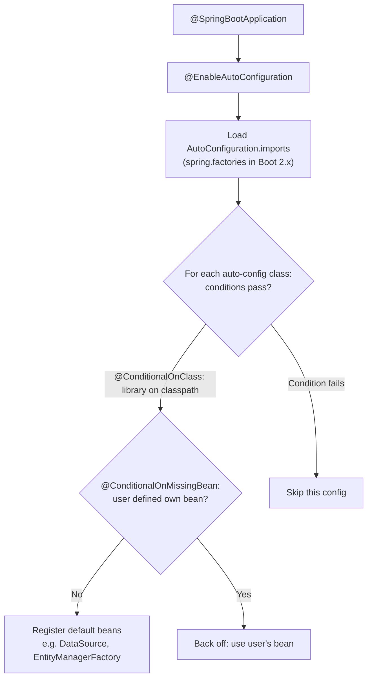

**Example:** If you add `spring-boot-starter-data-jpa`, Spring Boot sees Hibernate on the classpath and automatically configures a `DataSource`, `EntityManagerFactory`, and `TransactionManager`.

**Disable specific auto-config:**
```java
@SpringBootApplication(exclude = {DataSourceAutoConfiguration.class})
```
or in properties: `spring.autoconfigure.exclude=org.springframework.boot.autoconfigure.jdbc.DataSourceAutoConfiguration`

**Debugging tip:** Run with `--debug` (or `debug=true`) to print the **Conditions Evaluation Report**, which shows which auto-configurations matched and why others didn't.

### 1.8 Application Startup Flow

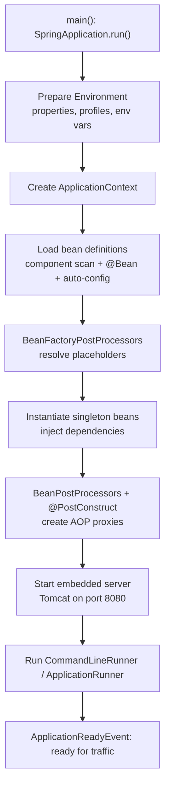

`CommandLineRunner` and `ApplicationRunner` are interfaces whose `run(...)` method executes once after startup — useful for seeding data or warm-up tasks.

### 1.9 Version Guide – What Changed Across Spring Boot Versions

| Version | Key changes interviewers ask about |
|---|---|
| **Boot 2.x** (Spring 5) | Java 8+, `javax.*` packages, `WebSecurityConfigurerAdapter`, Spring Cloud Sleuth |
| **Boot 2.6** | Circular references **prohibited by default** |
| **Boot 2.7** | New auto-config registration file (`AutoConfiguration.imports`), `WebSecurityConfigurerAdapter` deprecated |
| **Boot 3.0** (Spring 6, Nov 2022) | **Java 17 baseline**, **`javax.*` → `jakarta.*`**, Spring Security 6, GraalVM native support, Micrometer Tracing replaces Sleuth, `ProblemDetail` for errors |
| **Boot 3.1** | Testcontainers `@ServiceConnection`, Docker Compose support |
| **Boot 3.2** | **Virtual threads** (`spring.threads.virtual.enabled`), `RestClient`, `JdbcClient` |
| **Boot 3.4** | `@MockitoBean` replaces `@MockBean` (deprecated), structured logging, graceful shutdown enabled by default |
| **Boot 4.0** (Spring 7, Nov 2025) | Jakarta EE 11, Jackson 3, built-in API versioning, modularized auto-configuration, JSpecify null-safety |

> **Interview tip:** The most common upgrade question is "What breaks when moving from Boot 2 to Boot 3?" Answer: Java 17 minimum, the `javax` → `jakarta` namespace change, removal of `WebSecurityConfigurerAdapter`, `antMatchers` → `requestMatchers`, and Sleuth → Micrometer Tracing.

### 1.10 Interview Questions – Basics

**Q: What problems does Spring Boot solve over plain Spring?**
A: Manual configuration (solved by auto-configuration), dependency version conflicts (solved by starters and the managed BOM), external server setup (solved by the embedded server), and missing production features (solved by Actuator). You get a runnable app with `java -jar`.

**Q: Can you override an auto-configured bean? How?**
A: Yes. Define your own bean of the same type. Auto-configurations use `@ConditionalOnMissingBean`, so they back off when your bean exists. You can also exclude an entire auto-configuration with `exclude` or `spring.autoconfigure.exclude`.

**Q: How do you see why an auto-configuration was or wasn't applied?**
A: Start with `--debug` to print the Conditions Evaluation Report, or use the Actuator `/actuator/conditions` endpoint.

**Q: How would you change the embedded server from Tomcat to Jetty?**
A: Exclude `spring-boot-starter-tomcat` from `spring-boot-starter-web` and add `spring-boot-starter-jetty`. Auto-configuration picks the server found on the classpath.

---

## 2. IoC, Dependency Injection and the Container

### 2.1 Inversion of Control (IoC)

IoC means you **give up control of object creation** to the Spring container. Normally, if class A needs class B, A would do `new B()` itself. With IoC, Spring creates B and gives it to A. This makes your code **loosely coupled** and **easier to test** (you can pass a mock B in tests).

### 2.2 Dependency Injection (DI)

DI is the mechanism Spring uses to implement IoC. When your class needs a dependency (another object), Spring *injects* it — through the constructor, a setter method, or directly into a field. DI is a specific form of IoC.

> **Simple analogy:** IoC is the concept ("someone else manages objects"), DI is how Spring actually does it ("Spring injects them into your class").

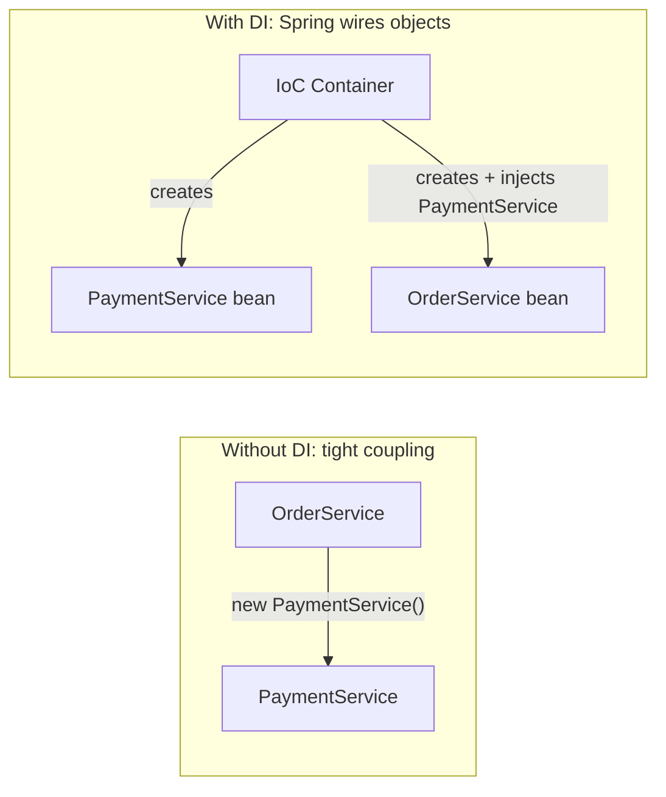

### 2.3 The IoC Container

The IoC container is the heart of Spring. It reads your bean definitions (from annotations, Java config or XML), creates all the objects (beans), injects their dependencies, and manages their entire lifecycle from creation to destruction.

Two types:
- **BeanFactory** – The basic, bare-minimum container. It uses *lazy loading*: beans are created only when you first ask for them. Good for memory-constrained environments.
- **ApplicationContext** – The full-featured container used in almost every real application. It uses *eager loading* for singletons (creates them at startup), supports AOP, event publishing, internationalization, and annotation-based config. Always prefer this.

| Feature | BeanFactory | ApplicationContext |
|---|---|---|
| Loading strategy | Lazy (bean created on first request) | Eager (all singleton beans at startup) |
| Event publishing | No | Yes |
| AOP support | Limited | Full |
| Internationalization (`MessageSource`) | No | Yes |
| Auto-registers BeanPostProcessors | No (manual) | Yes |
| Use case | Resource-constrained (rare) | Every real-world app |

**Why eager loading is good:** configuration errors (missing beans, bad properties) fail **at startup** instead of on the first user request.

### 2.4 Injection Types – Compared

**Constructor Injection (Recommended):**
```java
@Service
public class OrderService {
    private final PaymentService paymentService;

    // Spring injects automatically (no @Autowired needed in modern Spring)
    public OrderService(PaymentService paymentService) {
        this.paymentService = paymentService;
    }
}
```
✅ Dependencies are mandatory and explicit. ✅ Field is `final` (immutable). ✅ Easy to unit test (`new OrderService(mockPayment)`). ✅ Circular dependencies visible at startup.

> Since Spring 4.3, if a class has **only one constructor**, `@Autowired` is optional. With Lombok, `@RequiredArgsConstructor` generates this constructor for all `final` fields.

**Setter Injection:**
```java
@Autowired
public void setPaymentService(PaymentService paymentService) {
    this.paymentService = paymentService;
}
```
✅ Good for optional dependencies. ❌ Mutable — someone could call the setter at any time.

**Field Injection (Not Recommended):**
```java
@Autowired
private PaymentService paymentService;
```
✅ Shortest syntax. ❌ Hard to unit test (needs reflection or a Spring context). ❌ Hides dependencies. ❌ Can't make field `final`.

| | Constructor | Setter | Field |
|---|---|---|---|
| Immutability (`final`) | Yes | No | No |
| Required dependencies | Enforced | Not enforced | Not enforced |
| Unit testing without Spring | Easy | Possible | Hard |
| Best for | Mandatory deps (default choice) | Optional deps | Tests only / legacy |

### 2.5 Resolving Multiple Beans: @Qualifier vs @Primary

When two beans implement the same interface, Spring doesn't know which one to inject and throws `NoUniqueBeanDefinitionException`.

- **`@Primary`** – Set it on the bean you want as the default. Spring uses it when there's ambiguity and no `@Qualifier` is given.
- **`@Qualifier`** – More specific. Use it at the injection point to say exactly which bean you want by name. **`@Qualifier` wins over `@Primary`.**

```java
@Component @Primary
public class EmailService implements NotificationService { ... }

@Component
public class SmsService implements NotificationService { ... }

// Will inject EmailService (it's @Primary)
@Autowired
private NotificationService notificationService;

// Will inject SmsService specifically
@Autowired @Qualifier("smsService")
private NotificationService smsNotification;
```

The same works with constructor injection:
```java
public AlertService(@Qualifier("emailNotificationService") NotificationService notificationService) {
    this.notificationService = notificationService;
}
```

**Bonus:** you can inject **all** implementations: `List<NotificationService>` or `Map<String, NotificationService>` (bean name → bean). This is the basis of the Strategy pattern in Spring.

### 2.6 Circular Dependency

This happens when Bean A depends on Bean B, and Bean B depends on Bean A.

- Spring **can** resolve it with setter/field injection (creates A first, then B, then sets them into each other, using an "early reference").
- Spring **cannot** resolve it with constructor injection — throws `BeanCurrentlyInCreationException`.
- **Since Spring Boot 2.6, circular references are prohibited by default**, even with setter injection. You can re-enable with `spring.main.allow-circular-references=true`, but that hides a design problem.
- **Best fix:** redesign to break the cycle (extract shared logic into a third bean, or use events). **Workaround:** add `@Lazy` on one of the injections, which injects a proxy that resolves the real bean later.

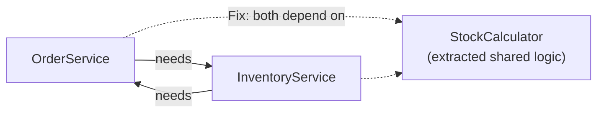

### 2.7 Injecting a Prototype Bean into a Singleton (Problem and Solution)

If you inject a prototype bean into a singleton, the singleton gets the prototype injected **once at startup** — making it effectively a singleton. To get a fresh prototype instance each time:

```java
// Solution 1: ObjectFactory
@Autowired
private ObjectFactory<PrototypeBean> factory;

public void doWork() {
    PrototypeBean bean = factory.getObject(); // fresh instance each time
}

// Solution 2: @Lookup (Spring overrides this method at runtime)
@Lookup
public PrototypeBean getPrototypeBean() {
    return null; // Spring replaces this body
}
```

Other options: `ObjectProvider<PrototypeBean>` (a richer `ObjectFactory`, also supports optional beans via `getIfAvailable()`), or a scoped proxy: `@Scope(value = "prototype", proxyMode = ScopedProxyMode.TARGET_CLASS)`.

### 2.8 Interview Questions – IoC and DI

**Q: Why is constructor injection recommended?**
A: It makes dependencies explicit and mandatory, allows `final` fields (immutability and thread safety), makes unit tests simple without Spring, and exposes circular dependencies at startup instead of hiding them.

**Q: What happens if two beans of the same type exist and you inject by type?**
A: Spring throws `NoUniqueBeanDefinitionException` unless one is `@Primary` or you use `@Qualifier` at the injection point. `@Qualifier` takes precedence over `@Primary`.

**Q: How does Spring resolve circular dependencies, and what changed in Boot 2.6?**
A: With setter/field injection Spring uses a three-level singleton cache to expose an early reference of a half-built bean. Constructor injection cycles always fail. From Boot 2.6, circular references fail by default even for setter injection; the real fix is to refactor.

**Q: Is a singleton bean thread-safe?**
A: No. Singleton only means one instance. If it has mutable instance fields shared across requests, you get race conditions. Keep singletons stateless, or use thread-safe structures, or a narrower scope.

---

## 3. Spring Beans: Scopes, Lifecycle and Advanced Hooks

### 3.1 What is a Spring Bean?

A Spring Bean is simply a Java object that is **created, configured, and managed by the Spring IoC container**. You don't create it with `new` — Spring does it for you based on your annotations (`@Component`, `@Bean`) or configuration.

### 3.2 Bean Lifecycle (Step by Step)

1. **Bean definition loaded** – Spring reads `@Component`, `@Bean`, XML, etc.
2. **Instantiated** – Spring calls the constructor
3. **Dependencies injected** – `@Autowired` fields/constructor params/setters are set
4. **Aware callbacks** – e.g. `BeanNameAware`, `ApplicationContextAware` receive container references
5. **`BeanPostProcessor.postProcessBeforeInitialization`**
6. **`@PostConstruct` runs** – your custom initialization logic (then `InitializingBean.afterPropertiesSet()`, then a custom `initMethod`)
7. **`BeanPostProcessor.postProcessAfterInitialization`** – this is where **AOP proxies** are created
8. **Bean is ready and in use** – serves requests
9. **`@PreDestroy` runs** – your cleanup logic (then `DisposableBean.destroy()`, then a custom `destroyMethod`)
10. **Bean is destroyed** – removed from container on shutdown

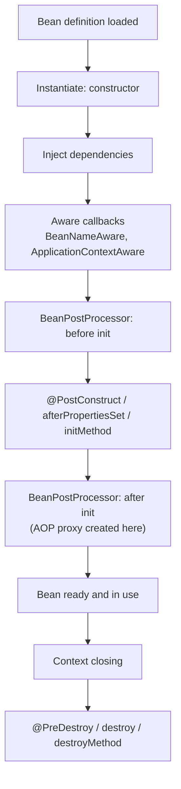

> **Important:** `@PreDestroy` is **not** called for `prototype` beans. Spring hands a prototype to you and stops tracking it, so you must clean it up yourself.

### 3.3 Lifecycle Annotations

**`@PostConstruct`** – Method runs once after the bean is created and all dependencies are injected. Use it for initialization logic (e.g., loading config, warming caches).

**`@PreDestroy`** – Method runs just before the bean is destroyed (when the application shuts down). Use it for cleanup (e.g., closing connections, flushing data).

```java
@PostConstruct
public void init() { System.out.println("Bean ready"); }

@PreDestroy
public void cleanup() { System.out.println("Bean destroyed"); }
```

> **Version note:** In Spring Boot 3 these come from `jakarta.annotation.*` (Boot 2: `javax.annotation.*`).

### 3.4 Bean Scopes – Full Explanations

**`singleton` (default)** – Only one instance of the bean exists per Spring container. Every class that injects this bean gets the same shared object. This is the most common and memory-efficient scope. Use for stateless beans (services, repositories).

**`prototype`** – Spring creates a brand-new instance every single time the bean is requested. Two classes injecting the same prototype bean get two different objects. Use for stateful beans where each caller needs their own isolated copy.

**`request`** – One instance per HTTP request. The bean is created when a request comes in and destroyed when the response is sent. Only valid in web applications. Use for things like tracking request-specific data.

**`session`** – One instance per HTTP session. The bean lives as long as the user's session (e.g., logged-in shopping cart). Only valid in web applications.

**`application`** – One instance per `ServletContext` — essentially one per deployed application. Similar to singleton but specifically scoped to the web application context (shared even across multiple Spring contexts in the same web app).

**`websocket`** – One instance per WebSocket session. Used in real-time WebSocket applications.

| Scope | Instances | Destroy callback? | Web only? |
|---|---|---|---|
| `singleton` | 1 per container | Yes | No |
| `prototype` | New per request for bean | **No** | No |
| `request` | 1 per HTTP request | Yes | Yes |
| `session` | 1 per HTTP session | Yes | Yes |
| `application` | 1 per `ServletContext` | Yes | Yes |
| `websocket` | 1 per WebSocket session | Yes | Yes |

**`@Scope`** defines the scope on a bean: `@Scope("prototype")` or `@Scope(ConfigurableBeanFactory.SCOPE_PROTOTYPE)`. For web scopes there are shortcuts: `@RequestScope`, `@SessionScope`, `@ApplicationScope`. Injecting a request/session-scoped bean into a singleton requires a **scoped proxy** (the shortcuts add `proxyMode = TARGET_CLASS` automatically).

### 3.5 @Lazy

By default, Spring creates all singleton beans at startup. `@Lazy` tells Spring to delay creation until the bean is first actually needed. Useful for expensive beans that may not always be used, and as a workaround for circular dependencies. Global option: `spring.main.lazy-initialization=true` (faster startup, but errors appear later).

### 3.6 @DependsOn

Forces Spring to initialize one bean before another, even if there's no direct dependency:

```java
@Bean
@DependsOn("databaseInitializer") // this bean must be created first
public UserService userService() {
    return new UserService();
}
```

Use case: a bean that relies on a side effect of another bean (e.g. a schema initializer or a cache warmer) without injecting it.

### 3.7 @Import

Explicitly imports a configuration class into the current context — useful when it's not in the component scan path (e.g. a config in a shared library):

```java
@Configuration
@Import({SecurityConfig.class, CacheConfig.class})
public class AppConfig { }
```

`@Import` is also how many `@Enable...` annotations work internally (e.g. `@EnableScheduling` imports a scheduling configuration).

### 3.8 Container Extension Points

**`BeanFactoryPostProcessor`** – An interface that allows you to modify bean *definitions* (the recipe for creating beans) after Spring reads them but **before** it creates any beans. Example: `PropertySourcesPlaceholderConfigurer` uses this to resolve `${...}` placeholders.

**`BeanPostProcessor`** – Called for every bean instance **before and after initialization**. It can modify or wrap the bean. This is how Spring creates AOP proxies for `@Transactional`, `@Async` and `@Cacheable`, and how `@Autowired` itself is processed (`AutowiredAnnotationBeanPostProcessor`).

| | BeanFactoryPostProcessor | BeanPostProcessor |
|---|---|---|
| Works on | Bean **definitions** (metadata) | Bean **instances** |
| When | Before any bean is created | Around each bean's initialization |
| Example | Placeholder resolution | AOP proxy creation, `@Autowired` processing |

**`ApplicationContextAware`** – An interface a bean can implement to get a reference to the `ApplicationContext` itself. Useful when you need to programmatically look up beans at runtime.

```java
@Component
public class BeanLocator implements ApplicationContextAware {
    private static ApplicationContext context;

    @Override
    public void setApplicationContext(ApplicationContext ctx) {
        context = ctx;
    }

    public static <T> T getBean(Class<T> type) {
        return context.getBean(type);
    }
}
```

**`FactoryBean`** – A special interface for beans whose creation logic is complex. The container returns whatever `getObject()` returns, **not** the `FactoryBean` itself (use `&beanName` to get the factory). Used by Spring internally (e.g., `ProxyFactoryBean` for AOP, and Spring Data repository factories).

### 3.9 Interview Questions – Beans

**Q: Explain the bean lifecycle.**
A: Definition loaded → instantiation → dependency injection → Aware callbacks → BeanPostProcessor before-init → `@PostConstruct` → BeanPostProcessor after-init (proxies created) → in use → `@PreDestroy` on shutdown → destroyed.

**Q: Why is `@PreDestroy` not called on prototype beans?**
A: The container creates the prototype, hands it over and does not keep a reference, so it has nothing to destroy. The caller owns the prototype's lifecycle.

**Q: Difference between `BeanPostProcessor` and `BeanFactoryPostProcessor`?**
A: `BeanFactoryPostProcessor` changes bean definitions before any bean exists (e.g. resolving `${...}`). `BeanPostProcessor` works on each created bean instance and can wrap it (e.g. AOP proxies).

**Q: How do you inject a request-scoped bean into a singleton controller?**
A: Use a scoped proxy (`@RequestScope` does it automatically). The singleton receives a proxy that looks up the current request's instance on every call.

---

## 4. Core Annotations Reference

This section is a quick reference. Each annotation links to the section where it is explained in depth.

### 4.1 Stereotype Annotations

These tell Spring what role a class plays and to manage it as a bean (found by `@ComponentScan`).

| Annotation | Meaning and When to Use |
|---|---|
| `@Component` | Generic Spring-managed bean. Use when the class doesn't clearly fit service or DAO role. |
| `@Service` | Business logic layer. Functionally same as `@Component` but communicates intent clearly. |
| `@Repository` | Data access layer (DAO). Same as `@Component` but also catches DB-specific exceptions and wraps them into Spring's `DataAccessException`. |
| `@Controller` | Handles web requests in an MVC app. Returns a view name (HTML/JSP/Thymeleaf). |
| `@RestController` | Combines `@Controller` + `@ResponseBody`. Every method returns data (JSON/XML) directly as the HTTP response body, not a view. |

### 4.2 Request Mapping Annotations

| Annotation | Meaning |
|---|---|
| `@RequestMapping("/path")` | Maps any HTTP method to this URL. Restrict with `method = RequestMethod.GET`. Often used at class level as a base path. |
| `@GetMapping` | Shortcut for GET — used to *read/fetch* data. |
| `@PostMapping` | Shortcut for POST — used to *create* data. |
| `@PutMapping` | Shortcut for PUT — used to *update/replace* entire resource. |
| `@DeleteMapping` | Shortcut for DELETE — used to *delete* a resource. |
| `@PatchMapping` | Shortcut for PATCH — used to *partially update* a resource. |

### 4.3 Bean and Configuration Annotations

**`@Configuration`** – Marks a class as a source of bean definitions. Spring processes this class specially — it is subclassed with CGLIB so that calling one `@Bean` method from another returns the **same singleton**, not a new object. (`@Configuration(proxyBeanMethods = false)` turns this off for faster startup when beans don't call each other.)

**`@Bean`** – Placed on a method inside a `@Configuration` class. Spring calls this method and registers the returned object as a bean. Use it when you need to configure **third-party objects** that you can't annotate directly.

```java
@Bean
public ObjectMapper objectMapper() {
    return new ObjectMapper().enable(SerializationFeature.INDENT_OUTPUT);
}
```

| | `@Component` | `@Bean` |
|---|---|---|
| Placed on | Class | Method |
| Discovered by | Component scanning | `@Configuration` class processing |
| Use for | Your own classes | Third-party classes, conditional/complex creation |

**`@Autowired`** – Tells Spring to inject a dependency automatically **by type**. Spring looks in the container for a bean matching the field/parameter type and injects it. `@Autowired(required = false)` makes it optional.

**`@Qualifier("beanName")`** – Used together with `@Autowired` when there are multiple beans of the same type. You specify exactly which one you want by name ([2.5](#25-resolving-multiple-beans-qualifier-vs-primary)).
```java
@Autowired
@Qualifier("emailNotificationService")
private NotificationService notificationService;
```

**`@Primary`** – When multiple beans of the same type exist, `@Primary` marks one as the default. If no `@Qualifier` is specified, Spring picks the `@Primary` bean.

**`@Lazy`** – Delays bean creation until first use ([3.5](#35-lazy)).

**`@Scope`** – Defines how many instances of a bean Spring creates. Default is `singleton`. Use `@Scope("prototype")` when each requester should get their own fresh copy ([3.4](#34-bean-scopes--full-explanations)).

**`@DependsOn`, `@Import`** – Control initialization order and import configs ([3.6](#36-dependson), [3.7](#37-import)).

### 4.4 Lifecycle Annotations

`@PostConstruct` and `@PreDestroy` – see [3.3](#33-lifecycle-annotations).

### 4.5 Property Injection Annotations

`@Value` and `@ConfigurationProperties` – see [5.4](#54-property-injection-value-vs-configurationproperties).

### 4.6 Conditional Bean Annotations

These power auto-configuration and let your own configs be selective.

| Annotation | Creates the bean only if... |
|---|---|
| `@ConditionalOnClass` | A specific class exists on the classpath. This is how auto-configuration is selective — e.g., only configure Redis beans if the Redis client library is present. |
| `@ConditionalOnMissingBean` | No bean of that type has already been defined by the user. This lets auto-configuration provide defaults while allowing users to override them. |
| `@ConditionalOnBean` | A bean of the given type already exists. |
| `@ConditionalOnProperty` | A property has a given value, e.g. `@ConditionalOnProperty(name = "feature.x.enabled", havingValue = "true")` — great for feature flags. |
| `@ConditionalOnMissingClass` | A class is **not** on the classpath. |
| `@ConditionalOnWebApplication` | The app is a web application. |
| `@Profile("dev")` | The given profile is active ([5.2](#52-profiles)). |

### 4.7 Web/REST Annotations

| Annotation | What it does |
|---|---|
| `@RequestBody` | Deserializes the JSON/XML from the request body into a Java object using Jackson. |
| `@PathVariable` | Extracts a value embedded in the URL path. E.g., `/users/{id}` → `@PathVariable Long id` |
| `@RequestParam` | Extracts a query string parameter. E.g., `/users?page=2` → `@RequestParam int page` |
| `@RequestHeader` | Extracts an HTTP header value. |
| `@ResponseBody` | Serializes the return value of a method to JSON/XML and writes it to the HTTP response. Already included in `@RestController`. |
| `@ResponseStatus` | Sets the HTTP status for a method or an exception class. |
| `@CrossOrigin` | Allows browsers to make requests from a different domain (CORS). E.g., React app on port 3000 calling an API on port 8080 ([9.1](#91-cors-configuration)). |
| `@ControllerAdvice` / `@RestControllerAdvice` | A global class that intercepts exceptions thrown from any controller. Used for centralized error handling ([8.3](#83-global-exception-handling)). |
| `@ExceptionHandler` | Placed inside `@ControllerAdvice` (or a controller), defines which exception type this method handles and what response to return. |

### 4.8 Validation Annotations

See [8.1](#81-bean-validation) for the full table and examples (`@Valid`, `@NotNull`, `@NotEmpty`, `@NotBlank`, `@Size`, `@Email`, `@Min`/`@Max`, `@Pattern`).

### 4.9 Scheduling and Async Annotations

**`@EnableScheduling`** – Activates Spring's task scheduling infrastructure. Without this, `@Scheduled` methods won't run.

**`@Scheduled`** – Marks a method to run automatically on a schedule:
```java
@Scheduled(fixedRate = 5000)            // Runs every 5 seconds from start of last execution
@Scheduled(fixedDelay = 5000)           // Waits 5s after last execution ENDS before running again
@Scheduled(cron = "0 30 9 * * MON-FRI")// 9:30 AM on weekdays
```

**`@EnableAsync`** – Activates Spring's async execution infrastructure. Without this, `@Async` is ignored.

**`@Async`** – Marks a method to run in a separate thread from a thread pool. The caller doesn't wait.

Full details: [Section 22](#22-async-scheduling-virtual-threads-and-distributed-locking).

### 4.10 Caching Annotations

**`@EnableCaching`** – Activates Spring's caching proxy infrastructure.

**`@Cacheable("cacheName")`** – Before executing the method, Spring checks the cache. If result exists → return it without calling the method. If not → run method, store result, return it.

**`@CacheEvict("cacheName")`** – Removes an entry from the cache. Use this when data is deleted or updated so stale data doesn't stay.

**`@CachePut("cacheName")`** – Always executes the method AND updates the cache with the new result. Use when you want to refresh cache after an update.

Full details: [Section 21](#21-caching).

---

## 5. Configuration, Profiles and Externalized Properties

### 5.1 application.properties vs application.yml

| Feature | .properties | .yml |
|---|---|---|
| Format | Flat key=value | Hierarchical/nested |
| Readability | Simple, familiar | Cleaner for complex configs |
| Example | `server.port=8080` | `server:`<br/>`  port: 8080` |
| Multiple profiles in one file | Yes (`#---` separator, Boot 2.4+) | Yes (`---` separator) |
| Pitfall | Long repeated prefixes | Indentation errors break config |

Both work the same way — use whichever your team prefers. If both exist, `.properties` wins for the same key.

### 5.2 Profiles

Profiles let you define different configurations for different environments (dev, test, prod) and activate only the relevant one at runtime.

```properties
# application-dev.properties → used in development
spring.datasource.url=jdbc:h2:mem:testdb

# application-prod.properties → used in production
spring.datasource.url=jdbc:mysql://prod-server/mydb
```

**Activate profile:**
```properties
spring.profiles.active=dev
```
```bash
java -jar app.jar --spring.profiles.active=prod
```
Or with an environment variable: `SPRING_PROFILES_ACTIVE=prod`.

**Profile-specific beans:**
```java
@Configuration
@Profile("dev")
public class DevDataSeeder { ... } // only created when "dev" is active
```

`application.properties` is always loaded; `application-{profile}.properties` is loaded **on top** of it and overrides matching keys.

### 5.3 Externalized Config and Property Source Order

Spring Boot reads properties from many sources. When the same key appears in several, the **higher** source wins.

**Spring Boot's property resolution order (1 = highest priority, wins):**

```
1. Test properties                  @TestPropertySource, @SpringBootTest(properties=...) (tests only)
2. Command-line arguments           --server.port=9090
3. SPRING_APPLICATION_JSON          env var with JSON
4. ServletConfig init parameters
5. ServletContext init parameters
6. JNDI (java:comp/env)
7. System properties                -Dserver.port=9090
8. OS environment variables         SERVER_PORT=9090
9. Profile-specific outside jar     application-{profile}.properties (outside)
10. application.properties outside jar
11. Profile-specific inside jar     application-{profile}.properties (inside)
12. application.properties inside jar
13. @PropertySource annotations
14. Default properties (SpringApplication.setDefaultProperties)
```

> **Correction note:** Some notes list "profile-specific inside jar" above "application.properties outside jar". Per the Spring Boot reference documentation, files **outside** the jar always beat files inside it, and within each location the profile-specific file beats the plain one. The order above follows the docs.

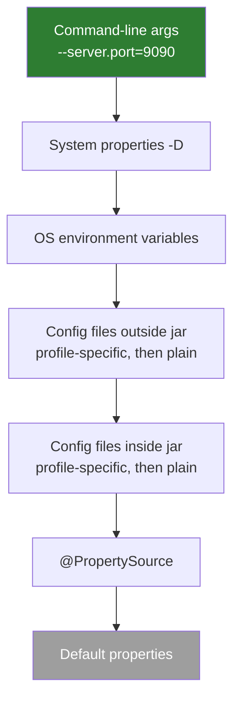
*(Top = highest priority.)*

> **Interview tip:** "Command-line arguments always win (outside of tests). This is why you can override any property at deployment time without rebuilding the app." In Kubernetes, environment variables from ConfigMaps/Secrets override what's packaged in the jar.

### 5.4 Property Injection: @Value vs @ConfigurationProperties

**`@Value`** – Injects a single property value from `application.properties`:
```java
@Value("${app.name}")
private String appName;

@Value("${app.timeout:5000}") // 5000 is default if not found
private int timeout;
```
`@Value` also supports SpEL: `@Value("#{2 * 1024}")`.

**`@ConfigurationProperties`** – Binds a group of related properties to a POJO. Cleaner and type-safe compared to multiple `@Value` annotations:
```java
@ConfigurationProperties(prefix = "app")
@Component
public class AppConfig {
    private String name;
    private int timeout;
    private String dbUrl;
    // getters and setters
}
```
Properties file:
```properties
app.name=MyApp
app.timeout=5000
app.db-url=jdbc:mysql://localhost/mydb
```

Modern alternative (Boot 2.2+/3.x) — an immutable **record** with validation, registered with `@ConfigurationPropertiesScan` or `@EnableConfigurationProperties`:
```java
@Validated
@ConfigurationProperties(prefix = "app")
public record AppProperties(@NotBlank String name, @Min(100) int timeout, String dbUrl) { }

@SpringBootApplication
@ConfigurationPropertiesScan   // finds all @ConfigurationProperties classes
public class MyApplication { ... }
```

| | `@Value` | `@ConfigurationProperties` |
|---|---|---|
| Granularity | One property | Group of properties |
| Type safety | Weak (string-based keys) | Strong (typed POJO/record) |
| Relaxed binding | Limited | Full |
| Validation | No | Yes (`@Validated`) |
| SpEL | Yes | No |
| IDE auto-completion | No | Yes (with configuration processor) |

### 5.5 Relaxed Binding

Spring Boot allows flexible property key formats for `@ConfigurationProperties`. All of these bind to the same field:

```properties
spring.datasource.url=...       # standard kebab-case (recommended)
spring.datasource.URL=...       # uppercase
SPRING_DATASOURCE_URL=...       # OS environment variable format
```

> **Correction note:** The original notes also listed `spring.datasource.url` a second time as the "underscore format", which was the same kebab-case key by mistake. Underscores only matter for multi-word names, so a clearer example is a property like `app.db-url` mapped to the field `dbUrl`:

| Format | Example | Where it's used |
|---|---|---|
| Kebab case (recommended) | `app.db-url` | `.properties` / `.yml` |
| Camel case | `app.dbUrl` | `.properties` / `.yml` |
| Underscore | `app.db_url` | `.properties` / `.yml` |
| Upper case + underscores | `APP_DBURL` | OS environment variables |

Your `@ConfigurationProperties` class just needs a standard camelCase field:
```java
private String url; // binds to all of the above
```

> **Note:** `@Value` supports relaxed binding only partially; always use the canonical kebab-case form inside `@Value("${...}")`.

### 5.6 The Spring Environment

The `Environment` object holds all properties from all sources (application.properties, env vars, system props) and knows the active profiles. Inject it to read properties programmatically:

```java
@Autowired
private Environment env;

public void doSomething() {
    String dbUrl = env.getProperty("spring.datasource.url");
    boolean isProd = env.matchesProfiles("prod");
    String[] activeProfiles = env.getActiveProfiles();
}
```

> `env.matchesProfiles(...)` is available from Spring Framework 5.3.28 / 6.0.10; older code uses `env.acceptsProfiles(Profiles.of("prod"))`.

### 5.7 Managing Secrets

Never put passwords or API keys in code or in `application.properties` committed to Git.

- **Environment variables** – Set in OS, Docker, or Kubernetes
- **Spring Cloud Vault** – Fetches secrets from HashiCorp Vault at startup
- **AWS Secrets Manager** – For AWS deployments (Spring Cloud AWS)
- **Kubernetes Secrets** – Injected as environment variables or mounted files into pods
- Reference them in config with placeholders: `spring.datasource.password=${DB_PASSWORD}`

### 5.8 Interview Questions – Configuration

**Q: How do you run the same jar with different configurations in dev and prod?**
A: Use profiles (`application-dev.yml`, `application-prod.yml`) and activate one with `--spring.profiles.active` or `SPRING_PROFILES_ACTIVE`. Override individual values with environment variables or command-line arguments, which have higher priority than packaged files.

**Q: `@Value` vs `@ConfigurationProperties`?**
A: `@Value` is fine for one or two values and supports SpEL. `@ConfigurationProperties` binds a whole prefix to a typed object, supports relaxed binding and validation, and is easier to test and document. Prefer it for groups of settings.

**Q: A property in `application.properties` is not taking effect in production. How do you debug?**
A: Check for a higher-priority source overriding it (environment variable, command-line argument, profile file). Use `/actuator/env` (or `/actuator/configprops`) to see each property's value and which source it came from.


---

# Part II – Web Layer and REST APIs

## 6. Request Lifecycle: Filters, Interceptors and AOP

### 6.1 How a Request Flows Through Spring MVC

Every HTTP request in a Spring MVC app goes through the **`DispatcherServlet`** (the "front controller"). It finds the right controller method, calls it, and turns the return value into an HTTP response.

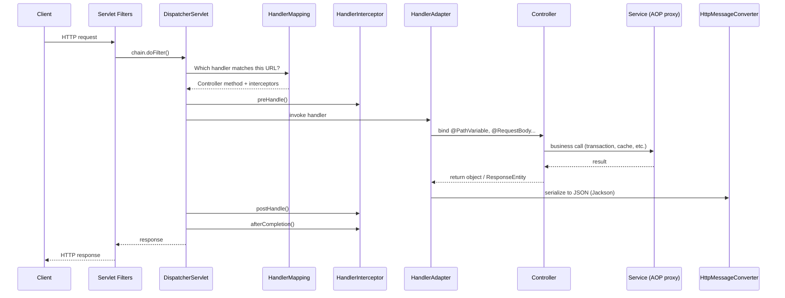

Key components:
- **`HandlerMapping`** – maps a URL + HTTP method to a controller method.
- **`HandlerAdapter`** – actually invokes the method, resolving arguments (`@RequestBody`, `@PathVariable`...).
- **`HttpMessageConverter`** – converts Java objects to/from JSON/XML (Jackson's `MappingJackson2HttpMessageConverter`).
- **`ViewResolver`** – for `@Controller` (non-REST) apps, turns a view name into an HTML template.
- **`HandlerExceptionResolver`** – routes exceptions to `@ExceptionHandler` methods.

### 6.2 Filter vs Interceptor vs AOP

This is one of the most common interview questions. You must know **where** each operates and **when** to use each.

**The request pipeline:**

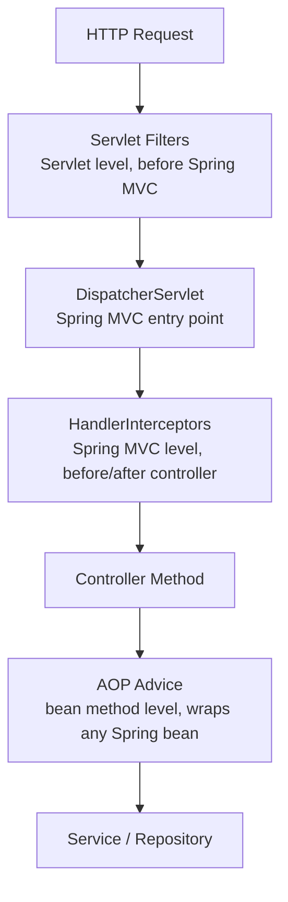

### 6.3 Servlet Filter

- Lives **outside** Spring MVC — at the raw Servlet/HTTP level.
- Intercepts **every** request/response passing through the servlet container.
- Has access to `HttpServletRequest` and `HttpServletResponse`.
- Can modify the request/response body, headers, or block the request entirely.
- Use for: **JWT authentication**, logging request/response, GZIP compression, rate limiting, MDC request IDs.

```java
@Component
public class RequestLoggingFilter implements Filter {

    @Override
    public void doFilter(ServletRequest req, ServletResponse res, FilterChain chain)
            throws IOException, ServletException {

        HttpServletRequest request = (HttpServletRequest) req;
        System.out.println("Incoming: " + request.getMethod() + " " + request.getRequestURI());

        chain.doFilter(req, res); // pass to next filter or servlet

        System.out.println("Response sent");
    }
}
```

To control filter order:
```java
@Bean
public FilterRegistrationBean<RequestLoggingFilter> loggingFilter() {
    FilterRegistrationBean<RequestLoggingFilter> bean = new FilterRegistrationBean<>();
    bean.setFilter(new RequestLoggingFilter());
    bean.setOrder(1); // lower = runs first
    return bean;
}
```

> **Tips:** Extend **`OncePerRequestFilter`** to guarantee the filter runs only once per request (even with forwards/error dispatches) — this is the standard base class for JWT filters ([18.2](#182-jwt-authentication--how-it-works)). If you register a filter with `FilterRegistrationBean`, don't also annotate it with `@Component`, or it will be registered twice.

### 6.4 HandlerInterceptor

- Lives **inside** Spring MVC — runs after `DispatcherServlet` selects the handler (controller).
- Has access to the handler method object and `ModelAndView`.
- Three hook methods: `preHandle`, `postHandle`, `afterCompletion`.
- Use for: **auth checks, role checking, logging, setting request-scoped attributes, audit trails**.

```java
@Component
public class AuditInterceptor implements HandlerInterceptor {

    @Override
    public boolean preHandle(HttpServletRequest req, HttpServletResponse res, Object handler) {
        // return false to abort request; true to continue
        System.out.println("Before controller: " + req.getRequestURI());
        return true;
    }

    @Override
    public void postHandle(HttpServletRequest req, HttpServletResponse res,
                           Object handler, ModelAndView modelAndView) {
        // Runs after controller but before view rendering
        System.out.println("After controller");
    }

    @Override
    public void afterCompletion(HttpServletRequest req, HttpServletResponse res,
                                Object handler, Exception ex) {
        // Runs after view is rendered (or after response is committed)
        System.out.println("Request complete");
    }
}

// Register it:
@Configuration
public class WebConfig implements WebMvcConfigurer {
    @Autowired AuditInterceptor auditInterceptor;

    @Override
    public void addInterceptors(InterceptorRegistry registry) {
        registry.addInterceptor(auditInterceptor)
                .addPathPatterns("/api/**")
                .excludePathPatterns("/api/public/**");
    }
}
```

> **Trap:** For `@RestController` methods, `postHandle` runs **after** the response body has already been written, so you can't change the response there. Use a `ResponseBodyAdvice` or a filter for that.

### 6.5 AOP Advice

- Operates at the **Spring bean method level** — not HTTP-aware at all.
- Can intercept **any** Spring bean's method (service, repository, etc.), not just controllers.
- Has no access to `HttpServletRequest` by default.
- Use for: **transaction management, caching, logging method calls, performance monitoring, retry logic**.

```java
@Aspect
@Component
public class PerformanceAspect {

    @Around("execution(* com.example.service.*.*(..))")
    public Object measureTime(ProceedingJoinPoint joinPoint) throws Throwable {
        long start = System.currentTimeMillis();
        Object result = joinPoint.proceed(); // calls the real method
        long elapsed = System.currentTimeMillis() - start;
        System.out.println(joinPoint.getSignature().getName() + " took " + elapsed + "ms");
        return result;
    }
}
```

Full AOP concepts are in [Section 19](#19-aspect-oriented-programming).

### 6.6 Comparison Table

| | Filter | Interceptor | AOP |
|---|---|---|---|
| Level | Servlet (outside Spring MVC) | Spring MVC | Spring Bean method |
| HTTP aware | Yes | Yes | No (unless injected) |
| Applies to | All requests (incl. static resources) | Controller requests | Any bean method |
| Access to handler | No | Yes | No (but has method signature + args) |
| Can block request | Yes (don't call `chain.doFilter`) | Yes (`preHandle` returns `false`) | Yes (don't call `proceed()`) |
| Use case | Auth, logging, GZIP | Pre/post controller logic | Transactions, caching |
| Spring context | No (unless @Component) | Yes | Yes |

> **Interview answer:** "Filters are for raw HTTP concerns before Spring sees the request — like JWT validation. Interceptors are for controller-level concerns like checking if a user has access to a resource. AOP is for cross-cutting concerns on any Spring bean — like timing a service method."

---

## 7. REST API Development

### 7.1 What is REST?

REST (Representational State Transfer) is an architectural style for building APIs over HTTP. A RESTful API:
- Exposes **resources** identified by URLs (`/api/users/42`).
- Uses standard **HTTP methods** (GET, POST, PUT, PATCH, DELETE) for actions.
- Is **stateless** — each request contains everything needed; the server keeps no session.
- Communicates via **representations**, usually JSON (or XML).
- Uses **HTTP status codes** to signal outcomes.

### 7.2 HTTP Methods, Idempotency and Status Codes

| Method | Use | Idempotent? | Safe? | Typical success code |
|---|---|---|---|---|
| GET | Read | Yes | Yes | 200 OK |
| POST | Create | **No** | No | 201 Created (+ `Location` header) |
| PUT | Replace whole resource | Yes | No | 200 OK / 204 No Content |
| PATCH | Partial update | Not guaranteed | No | 200 OK |
| DELETE | Delete | Yes | No | 204 No Content |

**Idempotent** = calling it once or many times has the same effect on the server. This matters for retries: a client can safely retry a PUT or DELETE, but retrying a POST may create duplicates (use an *idempotency key* header to make POST retries safe).

| Code | Meaning | When |
|---|---|---|
| 400 | Bad Request | Validation failed, malformed JSON |
| 401 | Unauthorized | Not authenticated (missing/invalid token) |
| 403 | Forbidden | Authenticated but not allowed |
| 404 | Not Found | Resource doesn't exist |
| 409 | Conflict | Duplicate, or optimistic lock conflict |
| 422 | Unprocessable Entity | Semantically invalid request |
| 429 | Too Many Requests | Rate limit exceeded |
| 500 | Internal Server Error | Unhandled server bug |
| 503 | Service Unavailable | Overloaded / downstream down |

### 7.3 Creating a REST API

```java
@RestController
@RequestMapping("/api/users")
public class UserController {

    @GetMapping("/{id}")
    public ResponseEntity<User> getUser(@PathVariable Long id) {
        return ResponseEntity.ok(service.findUser(id));
    }

    @PostMapping
    public ResponseEntity<User> createUser(@Valid @RequestBody User user) {
        User saved = service.save(user);
        return ResponseEntity.status(HttpStatus.CREATED).body(saved);
    }

    @DeleteMapping("/{id}")
    public ResponseEntity<Void> deleteUser(@PathVariable Long id) {
        service.delete(id);
        return ResponseEntity.noContent().build();
    }
}
```

> **Best practice:** In real code, accept and return **DTOs** (e.g. `CreateUserRequest`, `UserResponse`), not JPA entities ([10.8](#108-dto-vs-entity)), and inject the service through the constructor. The example keeps `User` for brevity.

A more production-like version with a DTO and a `Location` header:
```java
@RestController
@RequestMapping("/api/users")
@RequiredArgsConstructor
public class UserController {
    private final UserService service;

    @PostMapping
    public ResponseEntity<UserResponse> create(@Valid @RequestBody CreateUserRequest req) {
        UserResponse created = service.create(req);
        URI location = URI.create("/api/users/" + created.id());
        return ResponseEntity.created(location).body(created); // 201 + Location header
    }
}

public record CreateUserRequest(@NotBlank String name, @Email String email) { }
public record UserResponse(Long id, String name, String email) { }
```

### 7.4 @PathVariable vs @RequestParam

```java
// URL: GET /users/42  → PathVariable extracts from path
@GetMapping("/{id}")
public User get(@PathVariable Long id) { ... }

// URL: GET /users?page=2&size=10  → RequestParam extracts query params
@GetMapping
public Page<User> list(@RequestParam int page, @RequestParam int size) { ... }
```

| | `@PathVariable` | `@RequestParam` |
|---|---|---|
| Source | URL path segment | Query string (`?key=value`) |
| Typical use | Identify a resource (`/users/42`) | Filter, sort, paginate (`?status=ACTIVE`) |
| Optional? | Usually required | `required = false` or `defaultValue = "0"` |

### 7.5 ResponseEntity

`ResponseEntity<T>` gives you full control over the HTTP response — status code, headers, and body.

```java
ResponseEntity.ok(data)                          // 200 OK
ResponseEntity.status(201).body(data)            // 201 Created
ResponseEntity.noContent().build()               // 204 No Content
ResponseEntity.notFound().build()                // 404 Not Found
ResponseEntity.badRequest().body("Error msg")    // 400 Bad Request
```

Alternative: return the object directly and use `@ResponseStatus(HttpStatus.CREATED)` on the method when you don't need custom headers.

### 7.6 Pagination and Sorting

```java
@GetMapping
public Page<User> getUsers(Pageable pageable) {
    return repo.findAll(pageable);
}
// Request: GET /users?page=0&size=10&sort=name,asc
```

- `page` is **zero-based**. Set defaults with `@PageableDefault(size = 20, sort = "name")`.
- `Page<T>` runs an extra `COUNT` query to know the total; use `Slice<T>` if you only need "is there a next page" (cheaper).
- Cap the page size (`spring.data.web.pageable.max-page-size=100`) so clients can't request a million rows.
- For very large tables, **keyset (cursor) pagination** (`WHERE id > :lastId ORDER BY id LIMIT 20`) is faster than `OFFSET`.

> **Version note:** Returning `Page<T>` directly from a controller serializes Spring's internal `PageImpl` structure, which isn't a stable JSON contract. Spring Data 3.3+ warns about this; prefer mapping to your own response DTO or enable `@EnableSpringDataWebSupport(pageSerializationMode = VIA_DTO)`.

### 7.7 REST API Versioning Strategies

1. **URI versioning** (most common): `/api/v1/users`, `/api/v2/users`
2. **Request param**: `/users?version=1`
3. **Header-based**: `X-API-VERSION: 1`
4. **Content negotiation**: `Accept: application/vnd.company.v1+json`

| Strategy | Pros | Cons |
|---|---|---|
| URI | Simple, visible, cache-friendly | URL changes per version |
| Request param | Easy to add | Easy to forget, clutters URL |
| Header | Clean URLs | Not visible in browser, harder to test |
| Content negotiation | Most "RESTful" | Complex for clients |

> **Version note:** Spring Framework 7 / Spring Boot 4 adds first-class API versioning support (e.g. a `version` attribute on mapping annotations with configurable resolution from path, header or parameter). In Boot 3.x you implement versioning yourself with the strategies above.

### 7.8 HTTP Clients: RestTemplate vs WebClient vs RestClient

| | RestTemplate | WebClient | RestClient (Boot 3.2+) |
|---|---|---|---|
| Threading model | Blocking (waits for response) | Non-blocking (doesn't wait) | Blocking |
| Style | Synchronous, template methods | Asynchronous / reactive, fluent | Synchronous, fluent |
| Dependency | spring-web | spring-webflux | spring-web |
| Status | Legacy / maintenance mode (still works) | Recommended for reactive code | **Recommended for new blocking code** |

```java
// RestClient (Spring Framework 6.1 / Boot 3.2+)
RestClient client = RestClient.create("https://api.example.com");
User user = client.get()
        .uri("/users/{id}", 42)
        .retrieve()
        .body(User.class);

// WebClient (reactive)
Mono<User> mono = WebClient.create("https://api.example.com")
        .get().uri("/users/{id}", 42)
        .retrieve()
        .bodyToMono(User.class);
```

For service-to-service calls with discovery, see Feign ([28.5](#285-feign-client)) or declarative HTTP interfaces (`@HttpExchange`, Spring 6+).

> **Always configure timeouts** (connect + read) on any HTTP client. A missing timeout is a classic cause of thread exhaustion when a downstream service hangs.

### 7.9 REST vs SOAP

| | REST | SOAP |
|---|---|---|
| Format | JSON or XML | XML only |
| Protocol | HTTP | Any transport (HTTP, SMTP, JMS) |
| Flexibility | High | Rigid (WSDL contract) |
| Performance | Lightweight and fast | Heavier due to XML envelope |
| Standards | Uses HTTP semantics | WS-Security, WS-AtomicTransaction built in |
| Typical use | Web/mobile APIs, microservices | Banking, legacy enterprise integration |

### 7.10 Interview Questions – REST

**Q: PUT vs PATCH?**
A: PUT replaces the whole resource and is idempotent. PATCH changes only the given fields; it is not guaranteed to be idempotent (e.g. "increment counter").

**Q: Which status code for creating a resource, and what else should the response contain?**
A: 201 Created with a `Location` header pointing to the new resource, and usually the created representation in the body.

**Q: How do you make a POST endpoint safe to retry?**
A: Require an idempotency key header. Store the key with the result; if the same key arrives again, return the stored result instead of creating a duplicate.

**Q: RestTemplate is "deprecated" — what do you use instead?**
A: RestTemplate is in maintenance mode, not removed. For blocking code use `RestClient` (Boot 3.2+); for reactive code use `WebClient`; for declarative clients use Feign or `@HttpExchange` interfaces.

---

## 8. Validation and Exception Handling

### 8.1 Bean Validation

Spring Boot uses **Jakarta Bean Validation** (Hibernate Validator). Add `spring-boot-starter-validation`, annotate DTO fields with constraints, and put `@Valid` on the controller parameter.

| Annotation | What it validates |
|---|---|
| `@Valid` | Triggers validation on the annotated object (and nested objects). Must be present to activate constraints. |
| `@NotNull` | Field must not be `null`. Empty string `""` is allowed. |
| `@NotEmpty` | Field must not be `null` or empty string `""` (or empty collection). Whitespace `"   "` is allowed. |
| `@NotBlank` | Field must not be `null`, empty, or whitespace-only. Most strict. Use for strings. |
| `@Size(min=2, max=50)` | String length or collection size must be within the given range. |
| `@Email` | String must be a valid email format (contains `@` and domain). |
| `@Min(value)` / `@Max(value)` | Numeric value must be above/below the given number. |
| `@Pattern(regexp="")` | String must match the regular expression. |
| `@Past` / `@Future` | Date must be in the past/future. |
| `@Positive` / `@PositiveOrZero` | Number must be > 0 / >= 0. |

**`@NotNull` vs `@NotEmpty` vs `@NotBlank`:**

| Value | `@NotNull` | `@NotEmpty` | `@NotBlank` |
|---|---|---|---|
| `null` | ❌ | ❌ | ❌ |
| `""` | ✅ | ❌ | ❌ |
| `"   "` | ✅ | ✅ | ❌ |
| `"abc"` | ✅ | ✅ | ✅ |

```java
public record CreateUserRequest(
        @NotBlank @Size(min = 2, max = 50) String name,
        @NotBlank @Email String email,
        @Min(18) @Max(120) int age,
        @Valid @NotNull AddressDto address   // @Valid cascades into nested object
) { }

@PostMapping
public ResponseEntity<UserResponse> create(@Valid @RequestBody CreateUserRequest req) { ... }
```

- Invalid `@RequestBody` → `MethodArgumentNotValidException` → 400.
- To validate `@PathVariable`/`@RequestParam` constraints, add `@Validated` on the controller class (in Spring 6.1+, method validation is built in and raises `HandlerMethodValidationException`).
- **`@Valid` vs `@Validated`:** `@Valid` is the standard Jakarta annotation (supports cascading); `@Validated` is Spring's version that also supports **validation groups** (e.g. different rules for create vs update) and enables method-level validation on beans.

**Custom validator example:**
```java
@Target(ElementType.FIELD)
@Retention(RetentionPolicy.RUNTIME)
@Constraint(validatedBy = StrongPasswordValidator.class)
public @interface StrongPassword {
    String message() default "Password must be 8+ chars with a digit";
    Class<?>[] groups() default {};
    Class<? extends Payload>[] payload() default {};
}

public class StrongPasswordValidator implements ConstraintValidator<StrongPassword, String> {
    @Override
    public boolean isValid(String value, ConstraintValidatorContext ctx) {
        return value != null && value.length() >= 8 && value.chars().anyMatch(Character::isDigit);
    }
}
```

### 8.2 Exception Handling Options

| Option | Scope | Use |
|---|---|---|
| `@ExceptionHandler` inside a controller | That controller only | Controller-specific errors |
| `@ControllerAdvice` / `@RestControllerAdvice` | All controllers | **Centralized, recommended** |
| `@ResponseStatus` on an exception class | Wherever thrown | Simple mapping, no body control |
| `ResponseStatusException` | Throw site | Quick one-off errors |

### 8.3 Global Exception Handling

```java
@RestControllerAdvice
public class GlobalExceptionHandler {

    @ExceptionHandler(ResourceNotFoundException.class)
    public ResponseEntity<ErrorResponse> handleNotFound(ResourceNotFoundException ex) {
        return ResponseEntity.status(404)
            .body(new ErrorResponse("NOT_FOUND", ex.getMessage()));
    }

    @ExceptionHandler(MethodArgumentNotValidException.class)
    public ResponseEntity<ErrorResponse> handleValidation(MethodArgumentNotValidException ex) {
        String message = ex.getBindingResult().getFieldErrors()
            .stream().map(e -> e.getField() + ": " + e.getDefaultMessage())
            .collect(Collectors.joining(", "));
        return ResponseEntity.badRequest().body(new ErrorResponse("VALIDATION_FAILED", message));
    }

    @ExceptionHandler(Exception.class)               // last-resort fallback
    public ResponseEntity<ErrorResponse> handleAll(Exception ex) {
        log.error("Unexpected error", ex);           // log full details server-side
        return ResponseEntity.status(500)
            .body(new ErrorResponse("INTERNAL_ERROR", "Something went wrong")); // no stack trace to client
    }
}

public record ErrorResponse(String code, String message) { }
```

Note how the validation handler uses a **stream** to turn field errors into one message — see [Part IX](#part-ix--java-streams-for-spring-developers) for `map` and `Collectors.joining`.

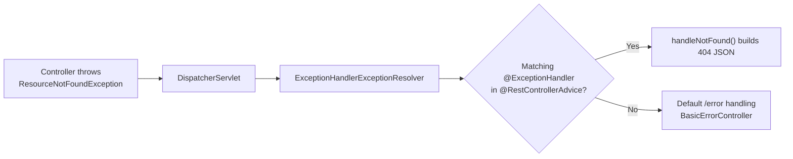

### 8.4 ProblemDetail (RFC 7807 / RFC 9457) – Spring 6 / Boot 3

Spring 6 adds a standard error body format, `ProblemDetail`:

```java
@ExceptionHandler(ResourceNotFoundException.class)
public ProblemDetail handleNotFound(ResourceNotFoundException ex) {
    ProblemDetail pd = ProblemDetail.forStatusAndDetail(HttpStatus.NOT_FOUND, ex.getMessage());
    pd.setTitle("Resource not found");
    pd.setProperty("timestamp", Instant.now());
    return pd; // serialized as application/problem+json
}
```
Enable built-in problem details for Spring MVC exceptions with `spring.mvc.problemdetails.enabled=true`.

### 8.5 Interview Questions – Validation and Errors

**Q: Difference between `@Valid` and `@Validated`?**
A: `@Valid` is the Jakarta standard and cascades into nested objects. `@Validated` is Spring's annotation that supports validation groups and turns on method-level validation for a bean.

**Q: What should a global error handler never return to clients?**
A: Stack traces, SQL errors, class names or internal IDs. Log details server-side (with a correlation ID) and return a safe, consistent error body.

**Q: How do you return all validation errors at once?**
A: Catch `MethodArgumentNotValidException` and map `getBindingResult().getFieldErrors()` to a list or a field→message map.

---

## 9. CORS, File Upload and Other Web Features

### 9.1 CORS Configuration

**What is CORS?** Browsers block JavaScript requests from one origin (e.g. `http://localhost:3000`) to another origin (e.g. `http://localhost:8080`) by default — this is the **Same-Origin Policy**. CORS (Cross-Origin Resource Sharing) is the mechanism where the **server** tells the browser which cross-origin requests are allowed. CORS is enforced by **browsers only**; tools like Postman or server-to-server calls ignore it.

#### Preflight Request

Before making a cross-origin `POST`/`PUT`/`DELETE` with custom headers (like `Authorization` or JSON `Content-Type`), the browser automatically sends an `OPTIONS` request to check if the server allows it. Your server must respond with the correct CORS headers. Spring handles this automatically when CORS is configured.

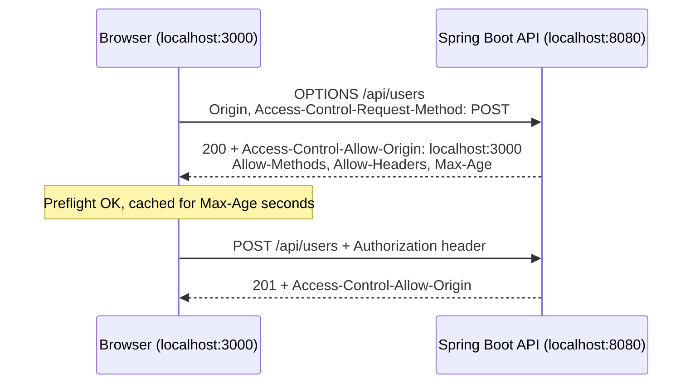

#### Option 1: Global CORS via WebMvcConfigurer

```java
@Configuration
public class CorsConfig implements WebMvcConfigurer {

    @Override
    public void addCorsMappings(CorsRegistry registry) {
        registry.addMapping("/api/**")
            .allowedOrigins("https://myfrontend.com", "http://localhost:3000")
            .allowedMethods("GET", "POST", "PUT", "DELETE", "PATCH", "OPTIONS")
            .allowedHeaders("*")
            .allowCredentials(true)   // required if sending cookies/auth headers
            .maxAge(3600);            // browser caches preflight for 1 hour
    }
}
```

#### Option 2: CORS in Spring Security Filter Chain (Recommended when using Spring Security)

```java
@Bean
public SecurityFilterChain filterChain(HttpSecurity http) throws Exception {
    return http
        .cors(cors -> cors.configurationSource(corsConfigurationSource()))
        // ... rest of config
        .build();
}

@Bean
public CorsConfigurationSource corsConfigurationSource() {
    CorsConfiguration config = new CorsConfiguration();
    config.setAllowedOrigins(List.of("https://myfrontend.com", "http://localhost:3000"));
    config.setAllowedMethods(List.of("GET","POST","PUT","DELETE","OPTIONS"));
    config.setAllowedHeaders(List.of("Authorization","Content-Type"));
    config.setAllowCredentials(true);
    config.setMaxAge(3600L);

    UrlBasedCorsConfigurationSource source = new UrlBasedCorsConfigurationSource();
    source.registerCorsConfiguration("/**", config);
    return source;
}
```

> **Important:** When using Spring Security, always configure CORS through the security filter chain, not just `WebMvcConfigurer`. Security filters run before Spring MVC — if you don't add it here, preflight `OPTIONS` requests get blocked (401/403) before reaching your MVC config.

#### Option 3: Per-controller / Per-method

```java
@CrossOrigin(origins = "http://localhost:3000", maxAge = 3600)
@RestController
@RequestMapping("/api/users")
public class UserController { ... }
```

**Common mistakes:**
- `allowedOrigins("*")` together with `allowCredentials(true)` is **rejected** (browsers forbid it). Use explicit origins or `allowedOriginPatterns("https://*.mycompany.com")`.
- Thinking CORS is a security feature for your API. It only protects **browser users**; it does not stop attackers calling your API directly. You still need authentication.

### 9.2 Multipart File Upload

```java
@RestController
@RequestMapping("/api/files")
public class FileController {

    @PostMapping("/upload")
    public ResponseEntity<String> uploadFile(@RequestParam("file") MultipartFile file) {
        if (file.isEmpty()) {
            return ResponseEntity.badRequest().body("File is empty");
        }

        String filename = StringUtils.cleanPath(file.getOriginalFilename());
        Path targetPath = Paths.get("uploads/" + filename);
        Files.copy(file.getInputStream(), targetPath, StandardCopyOption.REPLACE_EXISTING);

        return ResponseEntity.ok("Uploaded: " + filename);
    }

    // Multiple files
    @PostMapping("/upload-multiple")
    public ResponseEntity<List<String>> uploadMultiple(
            @RequestParam("files") List<MultipartFile> files) {
        List<String> names = files.stream()
            .map(MultipartFile::getOriginalFilename)
            .collect(Collectors.toList());
        // save each...
        return ResponseEntity.ok(names);
    }
}
```

> **Compile note:** `Files.copy` throws `IOException`, so `uploadFile` must declare `throws IOException` (or catch it) for this code to compile.

### 9.3 File Download

```java
@GetMapping("/download/{filename}")
public ResponseEntity<Resource> downloadFile(@PathVariable String filename) throws Exception {
    Path filePath = Paths.get("uploads/" + filename);
    Resource resource = new UrlResource(filePath.toUri());

    if (!resource.exists()) {
        return ResponseEntity.notFound().build();
    }

    String contentType = Files.probeContentType(filePath);

    return ResponseEntity.ok()
        .contentType(MediaType.parseMediaType(contentType))
        .header(HttpHeaders.CONTENT_DISPOSITION, "attachment; filename=\"" + filename + "\"")
        .body(resource);
}
```

**Security and robustness checklist for file endpoints:**
- **Path traversal:** a filename like `../../etc/passwd` can escape the folder. Normalize and check the final path stays inside the upload directory:
  ```java
  Path base = Paths.get("uploads").toAbsolutePath().normalize();
  Path target = base.resolve(filename).normalize();
  if (!target.startsWith(base)) throw new SecurityException("Invalid path");
  ```
- `Files.probeContentType` can return `null`; fall back to `application/octet-stream`.
- Generate your own stored file name (e.g. UUID) instead of trusting the client's name; validate type and size.
- For large files, store in object storage (S3) and return a pre-signed URL rather than streaming through the app.

### 9.4 Multipart Configuration

```properties
spring.servlet.multipart.max-file-size=10MB
spring.servlet.multipart.max-request-size=50MB
```
Exceeding the limit throws `MaxUploadSizeExceededException` — handle it in your `@RestControllerAdvice` to return 413 Payload Too Large.

### 9.5 Interview Questions – CORS and Files

**Q: CORS works in Postman but fails in the browser. Why?**
A: CORS is enforced only by browsers. The browser's preflight `OPTIONS` request is probably being rejected — often by Spring Security because CORS wasn't configured in the security filter chain.

**Q: How do you securely handle file uploads?**
A: Limit size, validate content type, generate server-side file names, prevent path traversal by normalizing paths, scan for malware if needed, and store files outside the web root (ideally in object storage).


---

# Part III – Data Access with JPA

## 10. JPA and Hibernate Fundamentals

### 10.1 What is JPA?

JPA (Java Persistence API, now **Jakarta Persistence**) is a *specification* — it defines standard annotations and APIs for mapping Java objects to database tables. It is not a framework itself. Implementations like **Hibernate** (Spring Boot's default) do the actual work of generating SQL, managing connections, and executing queries.

### 10.2 What is ORM?

ORM (Object-Relational Mapping) is the technique of automatically mapping Java objects to database tables and vice versa. Instead of writing `INSERT INTO users VALUES (...)`, you just call `save(user)` and ORM generates the SQL for you.

### 10.3 JDBC vs JPA vs Hibernate vs Spring Data JPA

| | JDBC | JPA | Hibernate | Spring Data JPA |
|---|---|---|---|---|
| What it is | Low-level DB API | ORM Specification | JPA Implementation | Abstraction on top of JPA |
| SQL | Manual | Auto-generated | Auto-generated | Auto-generated + derived from method names |
| Boilerplate | Very high | Low | Low | Lowest (interfaces only) |

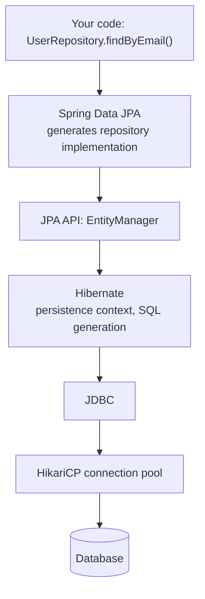

> Spring also offers `JdbcTemplate` and (Boot 3.2+) `JdbcClient` for plain SQL without ORM — useful for reporting queries or bulk operations where JPA adds overhead.

### 10.4 Entity Basics

```java
@Entity                        // Maps this class to a DB table
@Table(name = "users")         // Specifies table name (defaults to class name if omitted)
public class User {

    @Id                        // This field is the primary key
    @GeneratedValue(strategy = GenerationType.IDENTITY)
    private Long id;

    @Column(name = "email", nullable = false, unique = true, length = 100)
    private String email;

    @Enumerated(EnumType.STRING)  // Stores "ADMIN" or "USER" (not 0 or 1)
    private Role role;

    @Transient                 // NOT saved to DB
    private String displayName;
}
```

**JPA entity rules:** must have a no-arg constructor (can be `protected`), must not be `final`, needs an `@Id`. Prefer `EnumType.STRING` — `ORDINAL` breaks if someone reorders the enum.

> **Trap with Lombok:** avoid `@Data` on entities. Its generated `equals`/`hashCode`/`toString` touch lazy associations (triggering queries or `LazyInitializationException`) and can recurse infinitely on bidirectional relations. Use `@Getter`/`@Setter` and write `equals`/`hashCode` based on the ID or a business key.

### 10.5 GenerationType Strategies – Explained

**`IDENTITY`** – The database column is set to auto-increment (e.g., MySQL `AUTO_INCREMENT`). Spring inserts the row and the DB assigns the next ID. Most common strategy with MySQL. **Downside:** Hibernate must run the INSERT immediately to learn the ID, so it **disables JDBC batch inserts**.

**`SEQUENCE`** – Hibernate calls a database sequence object (a DB-managed counter) to get the next ID before inserting. Supported by PostgreSQL and Oracle. More efficient because IDs can be pre-fetched in batches (`allocationSize`), and batch inserts work.

**`AUTO`** – JPA decides which strategy to use based on the database dialect. May pick SEQUENCE or IDENTITY depending on the DB.

**`TABLE`** – Uses a separate table in the DB to maintain a counter. Works with any DB but is the slowest (requires extra query and row locking per insert). Rarely used today.

**`UUID`** (JPA 3.1 / Hibernate 6) – `@GeneratedValue(strategy = GenerationType.UUID)` generates UUID keys in the application; useful for distributed systems.

### 10.6 Persistence Context and Entity States

The **persistence context** is Hibernate's first-level cache: a map of entities loaded in the current transaction/session. Each entity is in one of four states:

| State | Meaning | How you get there |
|---|---|---|
| **Transient (new)** | Plain Java object, not tracked, no DB row | `new User()` |
| **Managed (persistent)** | Tracked by persistence context; changes auto-saved | `persist()`, `find()`, query results, `merge()` result |
| **Detached** | Was managed, but context closed; changes NOT tracked | Transaction ended, `detach()`, `clear()` |
| **Removed** | Scheduled for deletion at flush | `remove()` |

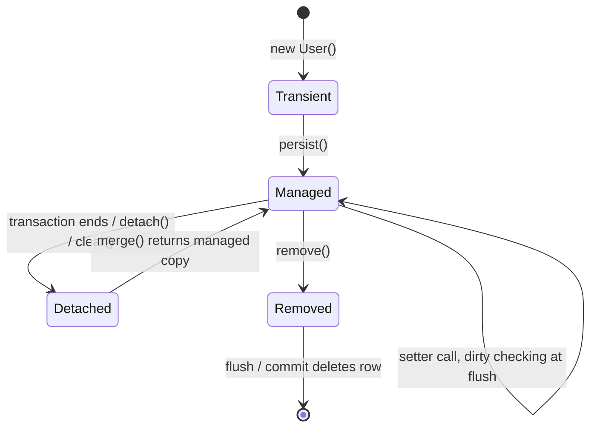

**`persist()` vs `merge()`:**
- **`persist()`** inserts a **new** entity and makes **that same object** managed. Throws if the entity is detached (has an ID that exists).
- **`merge()`** copies the state of a detached (or new) entity onto a **managed copy** and returns that copy; the object you passed in stays detached. Used to update existing/detached entities.
- Spring Data's `save()` calls `persist()` if the entity is new (ID is `null` / version is null), otherwise `merge()`.

**First-level cache:** calling `findById(1L)` twice in the same transaction hits the DB only once — the second call returns the same managed instance.

### 10.7 Dirty Checking

When an entity is in the "managed" state (inside an active `@Transactional` method), Hibernate automatically tracks every change you make to its fields. At flush time (before commit), Hibernate compares the current state with the snapshot taken at load time and generates `UPDATE` statements for changed entities. **You never need to call `save()` on a managed entity.**

```java
@Transactional
public void updateUserName(Long id, String newName) {
    User user = repo.findById(id).get(); // user is now "managed"
    user.setName(newName);               // Hibernate detects this change
    // No save() call needed — UPDATE fires automatically on commit
}
```

> **Detail:** by default Hibernate's UPDATE includes **all columns**; add `@DynamicUpdate` on the entity to update only changed columns. `@Transactional(readOnly = true)` lets Hibernate skip the snapshot and dirty check, saving memory and CPU.

### 10.8 DTO vs Entity

| | Entity | DTO (Data Transfer Object) |
|---|---|---|
| Purpose | Maps to DB table | Transfers data to/from API |
| Exposed externally | Never | Used in request/response |
| Contains | All DB fields | Only what the client needs |
| Security | May have sensitive fields (password hash) | Control exactly what's exposed |
| Coupling | Tied to DB schema | Tied to API contract |

**Why not return entities from controllers?** You leak internal fields, cause lazy-loading exceptions or N+1 queries during JSON serialization, get infinite recursion on bidirectional relations, and couple your API to your DB schema. Map with a simple method, a stream ([35.2](#352-map--transform-each-element)), or MapStruct.

```java
public record UserResponse(Long id, String name, String email) {
    public static UserResponse from(User u) {
        return new UserResponse(u.getId(), u.getName(), u.getEmail());
    }
}

List<UserResponse> dtos = users.stream().map(UserResponse::from).toList();
```

### 10.9 save() vs saveAndFlush()

- **`save()`** – Stages the entity for saving. Hibernate may batch the SQL and not write to DB until the transaction commits (or an explicit flush).
- **`saveAndFlush()`** – Forces immediate writing (flush) to DB. Use when another query in the same transaction needs to see the saved data right away, or to surface constraint violations immediately.

Note: a flush sends SQL but does **not** commit; a rollback still undoes it.

### 10.10 @Embeddable and @MappedSuperclass

**`@Embeddable`** – A class whose fields are embedded directly into the parent entity's DB table (no separate table created). Used for reusable value objects like `Address` or `Money`.
```java
@Embeddable
public class Address {
    private String street;
    private String city;
}

@Entity
public class User {
    @Embedded
    private Address address; // street, city stored in users table
}
```

**`@MappedSuperclass`** – A base class with common fields (like `id`, `createdAt`, `updatedAt`) that subclasses inherit. It is **NOT** mapped to its own DB table — the fields appear in each subclass's table, and you can't query the superclass directly.
```java
@MappedSuperclass
public abstract class BaseEntity {
    @Id @GeneratedValue
    private Long id;
    @CreatedDate
    private LocalDateTime createdAt;
}

@Entity
public class User extends BaseEntity { ... } // users table has id, created_at + user fields
```

### 10.11 Interview Questions – JPA Basics

**Q: What is the difference between JPA and Hibernate?**
A: JPA is the specification (interfaces and annotations); Hibernate is an implementation of it with extra features. Code against JPA APIs so the provider could be swapped.

**Q: Why is `IDENTITY` bad for bulk inserts?**
A: Hibernate needs the generated ID right away, so it executes each INSERT immediately and cannot batch them. `SEQUENCE` with an allocation size allows batching.

**Q: What is the persistence context?**
A: A per-transaction cache of managed entities. It guarantees one Java instance per DB row within the context, enables dirty checking, and delays writes until flush.

**Q: Explain `persist()` vs `merge()`.**
A: `persist()` makes a new object managed and schedules an INSERT. `merge()` copies a detached object's state onto a managed instance (loading it if needed) and returns that managed instance.

---

## 11. Entity Relationships, Fetching and Cascading

### 11.1 Relationships – Fully Explained

**`@OneToOne`** – One record in table A maps to exactly one record in table B.
Example: One `User` has one `UserProfile`.
```java
@OneToOne(cascade = CascadeType.ALL)
@JoinColumn(name = "profile_id")  // FK column in users table
private UserProfile profile;
```

**`@OneToMany`** – One parent record maps to many child records.
Example: One `User` has many `Orders`.
```java
@OneToMany(mappedBy = "user", cascade = CascadeType.ALL, orphanRemoval = true)
private List<Order> orders;
```

**`@ManyToOne`** – Many child records point to one parent record.
Example: Many `Orders` belong to one `User`.
```java
@ManyToOne
@JoinColumn(name = "user_id")  // FK column in orders table
private User user;
```

**`@ManyToMany`** – Multiple records on both sides relate to each other.
Example: A `Student` can enroll in many `Courses`, and a `Course` can have many `Students`.
```java
@ManyToMany
@JoinTable(name = "student_course",
    joinColumns = @JoinColumn(name = "student_id"),
    inverseJoinColumns = @JoinColumn(name = "course_id"))
private Set<Course> courses;
```

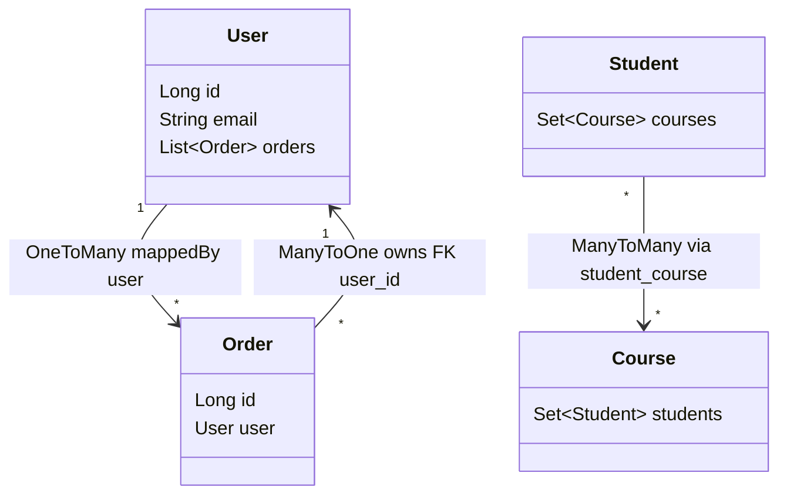

**Owning side and `mappedBy`:** In a bidirectional relationship, only one side "owns" the foreign key — the side **without** `mappedBy` (for one-to-many, always the `@ManyToOne` side). Hibernate only looks at the owning side when writing the FK. So `user.getOrders().add(order)` alone does **not** set `order.user_id`; you must also call `order.setUser(user)`. Use helper methods:

```java
public void addOrder(Order order) {
    orders.add(order);
    order.setUser(this);   // keep both sides in sync
}
```

> **Tip:** For `@ManyToMany`, prefer `Set` over `List` (Hibernate deletes and re-inserts all join rows for some `List` updates). If the join table needs extra columns (e.g. `enrolledAt`), model it as its own entity with two `@ManyToOne`s.

### 11.2 Fetch Types – Explained

**`FetchType.LAZY`** (default for collections: `@OneToMany`, `@ManyToMany`)
The related data is **NOT** loaded from DB when the parent entity is fetched. It is loaded only when you actually access the field in your code (e.g., `user.getOrders()`). Hibernate puts a proxy/placeholder in its place. This is efficient — you only pay for what you use.

**`FetchType.EAGER`** (default for single-valued: `@ManyToOne`, `@OneToOne`)
The related data **IS** loaded immediately when the parent is fetched — in the same query or an additional query. Use carefully; loading large collections eagerly can cause performance issues.

```java
@OneToMany(fetch = FetchType.LAZY)    // Load orders only when accessed
private List<Order> orders;

@ManyToOne(fetch = FetchType.EAGER)   // Load user immediately with each order
private User user;
```

> **Interview tip:** "Lazy is the preferred default. Only use EAGER when you always need the associated data and the collection is small." Many teams set **`@ManyToOne(fetch = FetchType.LAZY)` everywhere** and fetch explicitly per query with `JOIN FETCH` or `@EntityGraph`, because EAGER can't be turned off per query and often causes hidden N+1 queries.

**`LazyInitializationException`:** thrown when you access a lazy association **after** the persistence context is closed (e.g. in the controller or during JSON serialization). Fixes: fetch what you need inside the transaction (`JOIN FETCH`, `@EntityGraph`), or map to a DTO inside the service layer.

**Open Session in View (`spring.jpa.open-in-view`):** Spring Boot keeps the persistence context open until the HTTP response is rendered (default `true`, with a startup warning). It hides `LazyInitializationException` but holds a DB connection for the whole request and causes surprise queries in the view layer. **Best practice: set `spring.jpa.open-in-view=false`** in production apps.

### 11.3 Cascade Types – Every Type Explained

Cascade defines: "When I perform an operation on the parent entity, automatically apply the same operation to the child entities."

**`CascadeType.PERSIST`**
When you call `save()` or `persist()` on the parent, Spring also saves any new child entities automatically. Without this, you'd have to save each child separately before linking it to the parent.

```java
// Without PERSIST: you must save address separately first
// With PERSIST: saving user automatically saves the address
user.setAddress(new Address("123 Main St"));
userRepo.save(user); // Also inserts the Address row
```

**`CascadeType.MERGE`**
When you call `merge()` or `save()` on a detached parent entity, Spring also merges any changes made to child entities. Updates to children are propagated to the DB automatically.

**`CascadeType.REMOVE`**
When you delete the parent entity, Spring also deletes all its child entities automatically. Use carefully — this is a hard delete of all related records.

```java
// With CascadeType.REMOVE: deleting user also deletes all their orders
userRepo.delete(user);
```

**`CascadeType.REFRESH`**
When you call `refresh()` on the parent (discarding in-memory changes and reloading from DB), Spring also refreshes all child entities from the DB.

**`CascadeType.DETACH`**
When you detach the parent from the persistence context (making it unmanaged so Hibernate stops tracking it), Spring also detaches all child entities.

**`CascadeType.ALL`**
A shortcut that includes all five types: PERSIST + MERGE + REMOVE + REFRESH + DETACH. Use when the child entity's entire lifecycle is controlled by the parent and the child has no independent existence.

```java
// Example: User owns Orders. Orders cannot exist without a User.
@OneToMany(mappedBy = "user", cascade = CascadeType.ALL, orphanRemoval = true)
private List<Order> orders;
```

> **Interview tip:** "I use `CascadeType.ALL` when the child entity is fully owned by the parent — for example, order line items. If an order is deleted, all its line items should be deleted too."

> **Common mistake:** never put `CascadeType.REMOVE`/`ALL` on `@ManyToOne` or `@ManyToMany`. Deleting one order would try to delete the shared `User`, or deleting a student would delete courses other students use.

### 11.4 Orphan Removal

`orphanRemoval = true` means: if a child entity is removed from the parent's Java collection, it should also be automatically deleted from the database.

```java
user.getOrders().remove(order);
// With orphanRemoval=true → DELETE FROM orders WHERE id = ?
// Without it → nothing happens in DB, the row remains
```

The difference between `CascadeType.REMOVE` and `orphanRemoval`:
- `CascadeType.REMOVE` triggers when the **parent is deleted**
- `orphanRemoval` triggers when the **child is removed from the collection** (de-linked from the parent)

### 11.5 N+1 Problem – Explained

When you have a lazy `@OneToMany` and you fetch a list of 10 users, then loop over each to get their orders:
- **1 query** to get all users
- **10 more queries** — one per user to get their orders = **11 total queries**

This is the N+1 problem. Query count grows linearly with the number of parent rows (1,000 users → 1,001 queries), and each query adds a network round trip, so it gets very slow as data grows.

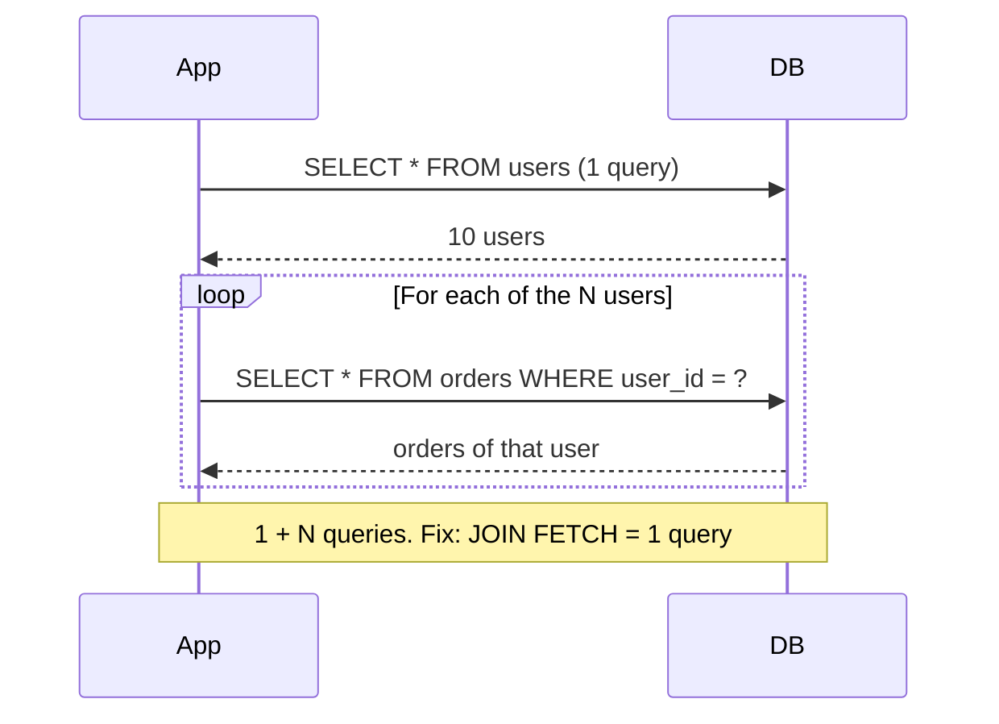

**Solutions:**
```java
// Solution 1: JOIN FETCH in JPQL — loads everything in one query
@Query("SELECT u FROM User u JOIN FETCH u.orders")
List<User> findAllWithOrders();

// Solution 2: @EntityGraph — declare what to fetch eagerly for this query
@EntityGraph(attributePaths = {"orders"})
List<User> findAll();

// Solution 3: @BatchSize — fetches children in batches instead of one-by-one
@OneToMany(mappedBy = "user")
@BatchSize(size = 10)
private List<Order> orders;
```

| Fix | Queries | Watch out for |
|---|---|---|
| `JOIN FETCH` | 1 | Duplicate parents (use `DISTINCT`, automatic in Hibernate 6); can't paginate a fetched collection in SQL (Hibernate paginates in memory with a warning) |
| `@EntityGraph` | 1 | Same as JOIN FETCH; reusable per repository method |
| `@BatchSize` / `hibernate.default_batch_fetch_size` | 1 + N/batch | Simple global fix, works with pagination |
| DTO projection | 1 | Read-only; best for APIs |

**How to detect N+1:** enable SQL logging (`spring.jpa.show-sql=true` or `logging.level.org.hibernate.SQL=DEBUG`), Hibernate statistics (`spring.jpa.properties.hibernate.generate_statistics=true`), or tools that assert query counts in tests.

### 11.6 Interview Questions – Relationships

**Q: What is the owning side of a relationship?**
A: The side that holds the foreign key and has no `mappedBy`. Hibernate writes the FK based only on the owning side, so you must set it (usually the `@ManyToOne`).

**Q: `CascadeType.REMOVE` vs `orphanRemoval`?**
A: REMOVE deletes children when the parent is deleted. `orphanRemoval` also deletes a child when it is removed from the parent's collection.

**Q: How do you find and fix N+1 queries?**
A: Detect with SQL logs or Hibernate statistics. Fix with `JOIN FETCH`, `@EntityGraph`, batch fetching, or DTO projections, and keep associations LAZY by default.

**Q: Why disable Open Session in View?**
A: It keeps a DB connection for the whole request, hides lazy-loading problems, and triggers unplanned queries during serialization. Turning it off forces explicit fetching in the service layer.

---

## 12. Spring Data JPA Repositories and Queries

### 12.1 Repository Interfaces

| Interface | What you get |
|---|---|
| `CrudRepository` | `save()`, `findById()`, `findAll()`, `delete()` |
| `PagingAndSortingRepository` | Everything above + `findAll(Pageable)`, `findAll(Sort)` |
| `JpaRepository` | Everything above + `flush()`, `saveAndFlush()`, `deleteAllInBatch()`, returns `List` |

In practice, extend `JpaRepository` — it gives you everything.

> **Version note (Spring Data 3 / Boot 3):** `PagingAndSortingRepository` **no longer extends** `CrudRepository`, and new `ListCrudRepository` / `ListPagingAndSortingRepository` return `List` instead of `Iterable`. `JpaRepository` still includes all of them. `deleteInBatch()` was renamed `deleteAllInBatch()`.

```java
public interface UserRepository extends JpaRepository<User, Long> {
    Optional<User> findByEmail(String email);
}
```

You only write the interface; Spring Data generates the implementation at startup (a proxy backed by `SimpleJpaRepository`). Its methods are `@Transactional` by default (read-only for find methods).

### 12.2 Custom Queries

```java
// Derived method — Spring generates SQL from method name
List<User> findByEmailAndStatus(String email, String status);

// JPQL — uses entity/field names (not table/column names)
@Query("SELECT u FROM User u WHERE u.email = :email AND u.active = true")
User findActiveByEmail(@Param("email") String email);

// Native SQL — raw database SQL
@Query(value = "SELECT * FROM users WHERE email = :email", nativeQuery = true)
User findByEmailNative(@Param("email") String email);
```

More derived-query keywords: `findTop10ByOrderBySalaryDesc`, `countByStatus`, `existsByEmail`, `findByNameContainingIgnoreCase`, `findByCreatedAtBetween`, `deleteByStatus`.

**Update/delete queries** need `@Modifying` (and a transaction):
```java
@Modifying
@Transactional
@Query("UPDATE User u SET u.active = false WHERE u.lastLogin < :cutoff")
int deactivateInactiveUsers(@Param("cutoff") LocalDateTime cutoff);
```
Bulk updates bypass the persistence context, so already-loaded entities become stale; use `@Modifying(clearAutomatically = true)` if needed.

| Query type | Pros | Cons |
|---|---|---|
| Derived method | Zero code, type-checked names at startup | Long ugly names for complex queries |
| JPQL `@Query` | Portable, entity-based, validated at startup | Limited to JPA features |
| Native query | Full DB features (window functions, hints) | DB-specific, not validated, returns columns |
| Specification / Criteria | Dynamic filters | Verbose |

### 12.3 JPA Projections

**What are projections?** Instead of loading a full entity (all columns), projections let you fetch only the fields you need — reducing memory usage and query payload. They act as read-only, lightweight DTOs directly from the repository.

#### Interface-Based Projection (Closed)

```java
// Define an interface with only the fields you need
public interface UserSummary {
    String getName();
    String getEmail();
}

// Use it in the repository
public interface UserRepository extends JpaRepository<User, Long> {
    List<UserSummary> findByActive(boolean active);
}

// Spring generates a proxy — only name and email are fetched from DB
```

#### Interface-Based Projection (Open — with SpEL)

```java
public interface UserSummary {
    String getFirstName();
    String getLastName();

    @Value("#{target.firstName + ' ' + target.lastName}") // computed field
    String getFullName();
}
```

> **Trap:** open projections can't be optimized — Spring Data must load the **full entity** because it doesn't know which fields the SpEL expression needs.

#### Class-Based Projection (DTO Projection)

```java
public class UserSummaryDto {
    private final String name;
    private final String email;

    // Spring maps constructor by matching parameter names to entity fields
    public UserSummaryDto(String name, String email) {
        this.name = name;
        this.email = email;
    }

    // getters...
}

// In repository:
@Query("SELECT new com.example.dto.UserSummaryDto(u.name, u.email) FROM User u WHERE u.active = true")
List<UserSummaryDto> findActiveSummaries();
```

A Java **record** works nicely as a class-based projection: `public record UserSummaryDto(String name, String email) {}`. **Dynamic projections** let the caller choose the type: `<T> List<T> findByActive(boolean active, Class<T> type);`

#### Projection vs DTO vs Entity — When to Use Which

| | Interface Projection | Class-Based Projection | Full Entity |
|---|---|---|---|
| Fields loaded | Only specified | Only specified | All columns |
| Usage | Read-only views | Read-only views | Read + write |
| Custom logic | SpEL only | Constructor only | Full object |
| Best for | Simple read APIs | API responses | CRUD operations |

### 12.4 JPA Specifications (Dynamic Queries)

**What is the problem?** When building a search endpoint with optional filters (name, status, date range), you'd end up with many conditional query methods or a growing list of `@Query` methods:

```java
// Bad — combinatorial explosion of methods
findByName(String name);
findByStatus(String status);
findByNameAndStatus(String name, String status);
findByNameAndStatusAndCreatedAfter(String name, String status, LocalDate date);
// ... and so on
```

**Solution: JPA Specification** (built on the JPA Criteria API):

```java
// 1. Extend JpaSpecificationExecutor in repository
public interface UserRepository
    extends JpaRepository<User, Long>, JpaSpecificationExecutor<User> { }

// 2. Build dynamic specifications
public class UserSpecifications {

    public static Specification<User> hasName(String name) {
        return (root, query, cb) ->
            name == null ? null : cb.like(cb.lower(root.get("name")), "%" + name.toLowerCase() + "%");
    }

    public static Specification<User> hasStatus(String status) {
        return (root, query, cb) ->
            status == null ? null : cb.equal(root.get("status"), status);
    }

    public static Specification<User> createdAfter(LocalDate date) {
        return (root, query, cb) ->
            date == null ? null : cb.greaterThanOrEqualTo(root.get("createdAt"), date);
    }
}

// 3. Combine and execute dynamically
@GetMapping("/search")
public List<User> search(
        @RequestParam(required = false) String name,
        @RequestParam(required = false) String status,
        @RequestParam(required = false) LocalDate from) {

    Specification<User> spec = Specification
        .where(UserSpecifications.hasName(name))
        .and(UserSpecifications.hasStatus(status))
        .and(UserSpecifications.createdAfter(from));

    return userRepository.findAll(spec);
}
```

When a parameter is `null`, the corresponding specification returns a `null` predicate, which Spring Data ignores — so only the provided filters are applied. `findAll(spec, pageable)` adds pagination.

> **Alternatives:** Querydsl (type-safe generated query classes) or Query by Example (`Example.of(probe)`) for simple equality filters.

### 12.5 Interview Questions – Repositories

**Q: How does Spring Data create an implementation from an interface?**
A: At startup it creates a JDK dynamic proxy for each repository interface, backed by `SimpleJpaRepository`. Derived method names are parsed into JPQL queries; `@Query` methods are validated.

**Q: Interface projection vs DTO projection?**
A: Both load only selected columns. Interface projections are proxies (simple, can nest); DTO/record projections are concrete objects created via a JPQL constructor expression (type-safe, easy to serialize). Open (SpEL) interface projections lose the optimization.

**Q: How would you build a search API with 8 optional filters?**
A: Use JPA Specifications (or Querydsl): one small specification per filter that returns `null` when the filter is absent, combined with `and()`, plus `Pageable` for paging.

---

## 13. Transactions and Locking

### 13.1 @Transactional – Explained

Marks a method (or all public methods of a class) as transactional. Spring wraps it in a DB transaction: if the method completes normally → **commits**. If an **unchecked** exception (`RuntimeException` or `Error`) is thrown → **rolls back** automatically. Checked exceptions do **not** roll back by default.

```java
@Transactional                                         // Rollback on RuntimeException
@Transactional(rollbackFor = Exception.class)          // Also rollback on checked exceptions
@Transactional(noRollbackFor = IllegalArgumentException.class) // Don't rollback for this
@Transactional(readOnly = true)                        // Optimization hint for read-only queries
@Transactional(propagation = Propagation.REQUIRES_NEW) // Always start a fresh transaction
@Transactional(timeout = 5)                            // Roll back if it runs longer than 5 seconds
@Transactional(isolation = Isolation.REPEATABLE_READ)  // Set isolation level
```

### 13.2 How It Works Internally

Spring creates a **proxy** around your bean. When the annotated method is called **through the proxy**, the proxy begins a DB transaction, calls your real method, then commits or rolls back based on the outcome. The transaction is bound to the current **thread** (via `TransactionSynchronizationManager`).

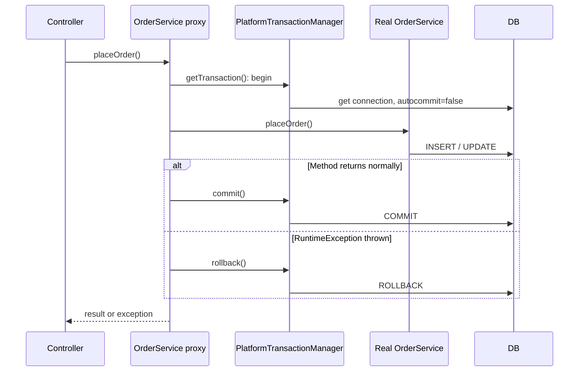

### 13.3 @Transactional Pitfalls (Very Common Interview Topic)

| Pitfall | Why it happens | Fix |
|---|---|---|
| **Self-invocation** – calling a `@Transactional` method from another method in the **same class** | The call uses `this`, bypassing the proxy, so no transaction starts | Move the method to another bean, or inject self / use `TransactionTemplate` |
| Method is `private` (or `final`) | Proxies can't intercept private/final methods | Make it public (Spring 6 also supports protected/package-private with CGLIB) |
| Checked exception thrown | Default rollback is only for unchecked exceptions | `rollbackFor = Exception.class` |
| Exception caught inside the method | Proxy never sees it, so it commits | Re-throw, or call `TransactionAspectSupport.currentTransactionStatus().setRollbackOnly()` |
| New thread / `@Async` inside transaction | Transactions are thread-bound | The async work runs in its own transaction |
| Long transaction with HTTP calls inside | Holds DB connection and locks while waiting | Do remote calls outside the transaction |
| `UnexpectedRollbackException` | Inner `REQUIRED` method marked tx rollback-only, outer caught and tried to commit | Use `REQUIRES_NEW` for independent work, or don't swallow the exception |

The same proxy rules apply to `@Async` and `@Cacheable` ([19.5](#195-proxies-jdk-vs-cglib-and-self-invocation)).

### 13.4 Transaction Propagation Types – Explained

Propagation answers: "What should happen when a transactional method is called while a transaction already exists?"

**`REQUIRED` (default)** – If there's already an active transaction, join it. If not, create a new one. This is the standard behavior for most methods.

**`REQUIRES_NEW`** – Always create a brand-new transaction, regardless of whether one already exists. If an existing transaction is running, it is *suspended* until this one completes. Use when you need a method to commit independently (e.g., logging an audit record even if the main transaction rolls back).

**`SUPPORTS`** – If there's an active transaction, join it. If not, run without a transaction. Use for read operations that work fine either way.

**`NOT_SUPPORTED`** – Always run without a transaction. If one exists, suspend it. Use for operations that must not run in a transaction.

**`MANDATORY`** – Must run within an existing transaction. Throws an exception if called without one. Use to enforce that a method is only called from a transactional context.

**`NEVER`** – Must NOT run within a transaction. Throws an exception if one exists. Use for operations that are explicitly non-transactional.

**`NESTED`** – Runs inside the existing transaction using a **savepoint**; if the nested part fails, only it rolls back to the savepoint, while the outer transaction can continue. Requires JDBC savepoint support (works with `DataSourceTransactionManager`; not supported by JPA's `JpaTransactionManager` for nested JPA work).

| Propagation | Existing transaction | No transaction |
|---|---|---|
| `REQUIRED` | Join | Create new |
| `REQUIRES_NEW` | Suspend it, create new | Create new |
| `SUPPORTS` | Join | Run without |
| `NOT_SUPPORTED` | Suspend it, run without | Run without |
| `MANDATORY` | Join | **Throw exception** |
| `NEVER` | **Throw exception** | Run without |
| `NESTED` | Savepoint inside it | Create new |

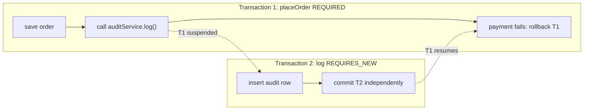
*The audit row survives even though the order rolls back.*

### 13.5 Isolation Levels

Isolation controls what one transaction can see of other concurrent transactions' changes.

| Problem | Meaning |
|---|---|
| **Dirty read** | Reading another transaction's **uncommitted** data |
| **Non-repeatable read** | Reading the same row twice gives different values (another tx updated it) |
| **Phantom read** | Running the same query twice returns new/missing rows (another tx inserted/deleted) |

| Isolation level | Dirty read | Non-repeatable read | Phantom read |
|---|---|---|---|
| `READ_UNCOMMITTED` | Possible | Possible | Possible |
| `READ_COMMITTED` (PostgreSQL/Oracle/SQL Server default) | Prevented | Possible | Possible |
| `REPEATABLE_READ` (MySQL InnoDB default) | Prevented | Prevented | Possible (InnoDB mostly prevents) |
| `SERIALIZABLE` | Prevented | Prevented | Prevented |

`Isolation.DEFAULT` uses the database's default. Higher isolation = more correctness, less concurrency.

### 13.6 Optimistic vs Pessimistic Locking

**Optimistic Locking** – Assumes conflicts are rare. Doesn't lock the DB row. Adds a `@Version` field (a counter). When updating, JPA adds `WHERE version = ?` to the UPDATE and increments it. If another transaction changed it first, zero rows are updated and it throws `OptimisticLockException` (Spring: `ObjectOptimisticLockingFailureException`). Good for read-heavy apps with low conflict.
```java
@Version
private int version; // JPA auto-increments this on every update
```

**Pessimistic Locking** – Assumes conflicts are frequent. Locks the DB row (`SELECT ... FOR UPDATE`) for the entire transaction duration — no other transaction can modify it. Prevents conflicts but reduces concurrency and risks deadlocks. Good for write-heavy, high-contention scenarios (e.g., inventory reservation, account balance).
```java
public interface ProductRepository extends JpaRepository<Product, Long> {
    @Lock(LockModeType.PESSIMISTIC_WRITE)               // SELECT ... FOR UPDATE
    @Query("SELECT p FROM Product p WHERE p.id = :id")
    Optional<Product> findByIdForUpdate(@Param("id") Long id);
}
```

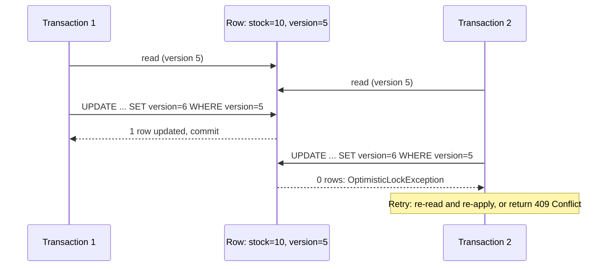

| | Optimistic | Pessimistic |
|---|---|---|
| Locks rows? | No | Yes (`FOR UPDATE`) |
| Conflict detection | At commit (version check) | Prevented up front |
| Best for | Low contention, web apps, long user "think time" | High contention, short critical sections |
| Failure handling | Retry or 409 to the client | Waiting / lock timeouts / deadlocks |

> These are **single-database** locks. To coordinate across multiple app instances for non-DB work (e.g. scheduled jobs), see distributed locking ([22.6](#226-distributed-locking)).

### 13.7 Interview Questions – Transactions

**Q: Why doesn't my `@Transactional` method roll back?**
A: Common causes: the exception is checked (needs `rollbackFor`), the exception is caught inside the method, the method was called from the same class (self-invocation bypasses the proxy), the method is private, or the table engine doesn't support transactions (e.g. MySQL MyISAM).

**Q: `REQUIRED` vs `REQUIRES_NEW`?**
A: `REQUIRED` joins the caller's transaction, so everything commits or rolls back together. `REQUIRES_NEW` suspends the caller's transaction and runs in its own, so it commits or rolls back independently (e.g. audit logs).

**Q: What does `readOnly = true` do?**
A: It's a hint: Hibernate sets flush mode to manual and skips dirty-checking snapshots; some drivers/DBs route to read replicas or optimize. It does not by itself prevent writes in all databases.

**Q: How would you prevent two users from buying the last item in stock?**
A: Use optimistic locking with `@Version` and retry/409 on conflict, or a pessimistic `SELECT ... FOR UPDATE` for high contention, or an atomic conditional update: `UPDATE product SET stock = stock - 1 WHERE id = ? AND stock > 0` and check the affected row count.

---

## 14. Advanced JPA: Inheritance, Soft Delete, Auditing and Connection Pooling

### 14.1 Inheritance Strategies

**`SINGLE_TABLE`** (default) – All classes in the hierarchy go into one table. A discriminator column (`dtype`) tells which type each row represents. Fastest queries (no joins) but has nullable columns for subclass-specific fields (you can't add `NOT NULL` constraints on them).

**`TABLE_PER_CLASS`** – Each concrete class gets its own table with all fields (including inherited ones). No joins needed to fetch a single type, but data duplication and `UNION` queries needed to find all records of the parent type.

**`JOINED`** – Parent class has one table, each subclass has its own table with only the extra fields. A `JOIN` is needed to assemble the full object. Most normalized but slower due to joins.

```java
@Entity
@Inheritance(strategy = InheritanceType.JOINED)
public abstract class Payment { @Id @GeneratedValue Long id; BigDecimal amount; }

@Entity public class CardPayment extends Payment { String cardLast4; }
@Entity public class UpiPayment  extends Payment { String upiId; }
```

| Strategy | Tables | Polymorphic query | Nullable columns | Normalized |
|---|---|---|---|---|
| `SINGLE_TABLE` | 1 | Fast (no join) | Yes | No |
| `JOINED` | 1 + per subclass | Joins | No | Yes |
| `TABLE_PER_CLASS` | Per concrete class | `UNION` (slow) | No | No (duplicated columns) |
| `@MappedSuperclass` | Per subclass | Not possible | No | — (just shared fields) |

### 14.2 Soft Delete

Instead of physically deleting the DB row, you mark it as deleted with a flag. Historical data is preserved for auditing and recovery.
```java
@SQLDelete(sql = "UPDATE users SET deleted = true WHERE id = ?")
@Where(clause = "deleted = false")  // All queries automatically filter deleted rows
@Entity
public class User {
    private boolean deleted = false;
}
```

> **Version note:** `@Where` is **deprecated in Hibernate 6.3+** (Spring Boot 3.2+). Use `@SQLRestriction("deleted = false")` instead. Hibernate 6.4 also adds a dedicated `@SoftDelete` annotation. Remember that unique constraints (e.g. email) still see soft-deleted rows, and native queries don't apply the filter automatically.

### 14.3 Auditing

Automatically track when records are created/modified and by whom:
```java
@EntityListeners(AuditingEntityListener.class)
@MappedSuperclass
public class Auditable {
    @CreatedDate
    private LocalDateTime createdAt;

    @LastModifiedDate
    private LocalDateTime updatedAt;

    @CreatedBy
    private String createdBy;

    @LastModifiedBy
    private String modifiedBy;
}
// Must also add @EnableJpaAuditing to a @Configuration class
```

`@CreatedBy`/`@LastModifiedBy` need an `AuditorAware` bean that tells Spring who the current user is:
```java
@Bean
public AuditorAware<String> auditorAware() {
    return () -> Optional.ofNullable(SecurityContextHolder.getContext().getAuthentication())
                         .map(Authentication::getName);
}
```
For full change history (old and new values), use **Hibernate Envers** (`@Audited`).

### 14.4 HikariCP – Connection Pool

HikariCP is the default and fastest JDBC connection pool in Spring Boot. Instead of creating a new DB connection for every request (expensive — involves network handshake, auth), it maintains a pool of reusable connections. Requests borrow a connection, use it, and return it to the pool.

```properties
spring.datasource.hikari.maximum-pool-size=20     # Max connections in pool
spring.datasource.hikari.minimum-idle=5           # Keep at least 5 connections ready
spring.datasource.hikari.connection-timeout=30000 # Wait up to 30s for a connection
```

**Sizing tip:** bigger is not better. A common starting point is `connections ≈ (CPU cores × 2) + effective disk spindles`, then tune with metrics (`hikaricp_connections_pending`, `hikaricp_connections_usage`). Remember the DB has a global limit: 10 instances × 20 connections = 200 DB connections. Other useful settings: `max-lifetime` (shorter than the DB/firewall idle timeout) and `leak-detection-threshold` (logs connections held too long).

### 14.5 JPA Performance Tips

- Enable JDBC batching: `spring.jpa.properties.hibernate.jdbc.batch_size=50` plus `order_inserts=true` / `order_updates=true` (needs `SEQUENCE` IDs, not `IDENTITY`).
- Use DTO projections for read APIs; use `readOnly = true` transactions for queries.
- Fix N+1 ([11.5](#115-n1-problem--explained)) and keep associations LAZY.
- For huge result sets, use pagination or `Stream<T>` repository methods inside a transaction (and close the stream).
- Add indexes for columns in `WHERE`, `JOIN` and `ORDER BY`.
- Set `spring.jpa.hibernate.ddl-auto=validate` (or `none`) in production and manage schema with migrations ([Section 15](#15-database-migrations-flyway-and-liquibase)). Never use `update`/`create-drop` in prod.

---

## 15. Database Migrations: Flyway and Liquibase

### 15.1 Why Migrations?

The database schema must evolve with the code, in a repeatable, versioned way across dev, test and prod. Migration tools run scripts **in order**, **exactly once**, and record which ones were applied.

### 15.2 Flyway

Flyway tracks and applies SQL migration scripts in version order. Every script runs exactly once and is recorded in a `flyway_schema_history` table (with a checksum). If the DB already has the schema at a certain version, Flyway only runs newer scripts.

```sql
-- src/main/resources/db/migration/V1__create_users.sql
CREATE TABLE users (id BIGINT AUTO_INCREMENT PRIMARY KEY, email VARCHAR(100) NOT NULL);

-- V2__add_name_column.sql
ALTER TABLE users ADD COLUMN name VARCHAR(100);
```
Spring Boot runs migrations automatically on startup (before JPA initializes).

**Rules:** file name format `V<version>__<description>.sql` (two underscores). **Never edit an applied migration** — the checksum changes and Flyway fails validation; add a new version instead. `R__` scripts are *repeatable* (re-run when changed, e.g. views).

### 15.3 Liquibase vs Flyway

Both tools manage database schema version control. They run migration scripts in order and track which ones have already been applied.

| | Flyway | Liquibase |
|---|---|---|
| Script format | SQL (Java migrations also possible) | SQL, XML, YAML, JSON |
| Change tracking | `flyway_schema_history` table | `databasechangelog` table (+ `databasechangeloglock`) |
| Rollback | Manual (write undo scripts; undo is a paid feature) | Built-in rollback support |
| Simplicity | Simpler — easier to start | More powerful — more complex |
| Conditional logic | No | Yes (preconditions) |
| DB-agnostic changes | No (SQL is DB-specific) | Yes (XML/YAML changesets generate SQL per DB) |
| Spring Boot support | Auto-configured when on classpath (more common) | Auto-configured when on classpath |

```properties
# Enable Flyway (default: auto-detects if on classpath)
spring.flyway.enabled=true
spring.flyway.locations=classpath:db/migration

# Enable Liquibase
spring.liquibase.enabled=true
spring.liquibase.change-log=classpath:db/changelog/master.xml
```

> **Interview tip:** "I prefer Flyway for simplicity — plain SQL scripts are easy for the whole team to read. I'd choose Liquibase if I needed rollback support or multi-DB format flexibility."

**Zero-downtime migrations** (senior topic): with rolling deployments, old and new app versions run against the same schema at the same time. Use the **expand/contract** pattern: (1) add new nullable column, (2) deploy code that writes both, (3) backfill, (4) switch reads, (5) drop the old column in a later release. Never rename or drop a column in the same release that stops using it.


---

# Part IV – Security

## 16. Spring Security Architecture

### 16.1 What is Spring Security?

Spring Security is a framework that handles **authentication** (who are you?) and **authorization** (what can you do?) for Spring applications. It also protects against common attacks (CSRF, session fixation, clickjacking headers). It works by inserting a **chain of security filters** in front of every HTTP request — before the request reaches `DispatcherServlet`.

Adding `spring-boot-starter-security` alone secures **every** endpoint with HTTP Basic/form login and a generated password printed at startup.

### 16.2 Security Filter Chain

Every request passes through a series of filters. Each filter checks something — is the user authenticated? Do they have the right role? Is the CSRF token valid? You configure the chain by defining a `SecurityFilterChain` bean.

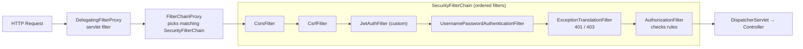

```java
@Bean
SecurityFilterChain filterChain(HttpSecurity http) throws Exception {
    return http
        .authorizeHttpRequests(auth -> auth
            .requestMatchers("/public/**").permitAll()
            .requestMatchers("/admin/**").hasRole("ADMIN")
            .anyRequest().authenticated())
        .sessionManagement(s -> s.sessionCreationPolicy(SessionCreationPolicy.STATELESS))
        .addFilterBefore(jwtAuthFilter, UsernamePasswordAuthenticationFilter.class)
        .build();
}
```

- Rules are checked **top to bottom; first match wins** — put specific matchers before general ones and `anyRequest()` last.
- `SessionCreationPolicy.STATELESS` – never create an HTTP session (typical for JWT APIs).
- `addFilterBefore(...)` – inserts your custom filter at a specific position.

**Key classes:**

| Class | Role |
|---|---|
| `SecurityContextHolder` | Holds the `SecurityContext` for the current thread (a `ThreadLocal` by default) |
| `Authentication` | Who the user is: principal, credentials, authorities, `isAuthenticated()` |
| `AuthenticationManager` (`ProviderManager`) | Entry point for authenticating; delegates to providers |
| `AuthenticationProvider` (`DaoAuthenticationProvider`) | Does the actual check (e.g. loads user + compares password) |
| `UserDetailsService` | Loads a user by username from your store |
| `PasswordEncoder` | Hashes and verifies passwords |
| `GrantedAuthority` | A permission or role (`ROLE_ADMIN`, `READ_DATA`) |

### 16.3 Version Changes (Spring Security 5 → 6)

| Old (Security 5 / Boot 2) | New (Security 6 / Boot 3) |
|---|---|
| `extends WebSecurityConfigurerAdapter` | `@Bean SecurityFilterChain` (adapter **removed**) |
| `authorizeRequests()` | `authorizeHttpRequests()` |
| `antMatchers()`, `mvcMatchers()` | `requestMatchers()` |
| `@EnableGlobalMethodSecurity(prePostEnabled = true)` | `@EnableMethodSecurity` (pre/post enabled by default) |
| Chained `.and()` calls | Lambda DSL (`http.csrf(csrf -> ...)`) — `.and()` deprecated |
| `javax.servlet` | `jakarta.servlet` |

### 16.4 CSRF (Cross-Site Request Forgery)

An attack where a malicious website tricks a logged-in user's browser into making a request to your server — **using the user's cookies**, which the browser sends automatically. Spring Security enables CSRF protection by default by requiring a CSRF token in every state-changing request (POST/PUT/DELETE); a malicious site can't read that token.

For stateless REST APIs using JWT in the `Authorization` header (no cookies), CSRF is not a concern, so you disable it:
```java
http.csrf(csrf -> csrf.disable());
```

> **Careful:** if your SPA stores the JWT or session in a **cookie**, the browser sends it automatically again — so CSRF protection is needed. Use `CookieCsrfTokenRepository.withHttpOnlyFalse()` so the SPA can read the token and send it back in a header, or `SameSite` cookies.

### 16.5 Interview Questions – Security Architecture

**Q: How does Spring Security plug into a Spring Boot app?**
A: A `DelegatingFilterProxy` servlet filter hands requests to `FilterChainProxy`, which runs the matching `SecurityFilterChain`'s filters before the `DispatcherServlet`. You configure it with a `SecurityFilterChain` bean.

**Q: 401 vs 403?**
A: 401 Unauthorized means not authenticated (no or invalid credentials). 403 Forbidden means authenticated but lacking permission. `ExceptionTranslationFilter` produces them via the `AuthenticationEntryPoint` and `AccessDeniedHandler`.

**Q: Why can you disable CSRF for a JWT API?**
A: CSRF relies on the browser auto-sending credentials (cookies). A token sent manually in the `Authorization` header is not auto-sent, so a malicious site can't forge an authenticated request. If the token is in a cookie, keep CSRF on.

**Q: Where is the logged-in user stored, and what about `@Async` threads?**
A: In `SecurityContextHolder`, which uses a `ThreadLocal`. New threads don't see it unless you use `DelegatingSecurityContextExecutor` / `MODE_INHERITABLETHREADLOCAL` or pass the user explicitly.

---

## 17. Authentication and Authorization

### 17.1 How Spring Security Authenticates a User (Full Flow)

```
1. Request arrives with credentials (username + password, or JWT)
2. AuthenticationFilter extracts credentials
3. Creates an Authentication object (e.g. UsernamePasswordAuthenticationToken)
4. Passes it to AuthenticationManager
5. AuthenticationManager delegates to AuthenticationProvider
6. AuthenticationProvider calls UserDetailsService.loadUserByUsername()
7. You return a UserDetails object from your DB
8. Spring compares the submitted password with stored hash (BCrypt)
9. If match → creates authenticated token → stores in SecurityContextHolder
10. Request proceeds to controller
```

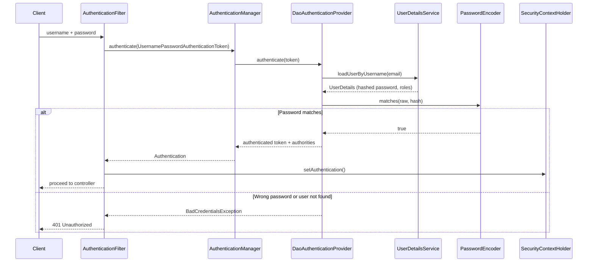

### 17.2 Implementing a Custom UserDetailsService

```java
@Service
public class CustomUserDetailsService implements UserDetailsService {

    @Autowired
    private UserRepository userRepository;

    @Override
    public UserDetails loadUserByUsername(String email) throws UsernameNotFoundException {
        // Load user from YOUR database
        User user = userRepository.findByEmail(email)
            .orElseThrow(() -> new UsernameNotFoundException("User not found: " + email));

        // Convert your User entity to Spring's UserDetails
        return org.springframework.security.core.userdetails.User
            .withUsername(user.getEmail())
            .password(user.getPassword()) // already BCrypt-hashed in DB
            .roles(user.getRole().name()) // e.g. "USER", "ADMIN"
            .accountExpired(!user.isActive())
            .build();
    }
}
```

> Security best practice: return the **same** generic "Bad credentials" error for unknown user and wrong password, so attackers can't discover which emails exist (Spring does this by default via `hideUserNotFoundExceptions`).

### 17.3 Custom UserDetails (If You Need Extra Fields)

```java
public class CustomUserDetails implements UserDetails {

    private final User user; // your entity

    public CustomUserDetails(User user) { this.user = user; }

    public Long getUserId() { return user.getId(); } // extra method

    @Override
    public Collection<? extends GrantedAuthority> getAuthorities() {
        return List.of(new SimpleGrantedAuthority("ROLE_" + user.getRole().name()));
    }

    @Override public String getPassword() { return user.getPassword(); }
    @Override public String getUsername() { return user.getEmail(); }
    @Override public boolean isAccountNonExpired() { return true; }
    @Override public boolean isAccountNonLocked() { return !user.isLocked(); }
    @Override public boolean isCredentialsNonExpired() { return true; }
    @Override public boolean isEnabled() { return user.isActive(); }
}
```

Then access it in a controller with `@AuthenticationPrincipal CustomUserDetails me` and call `me.getUserId()`.

### 17.4 Wire It into SecurityConfig

```java
@Configuration
@EnableWebSecurity
public class SecurityConfig {

    @Autowired private CustomUserDetailsService userDetailsService;
    @Autowired private JwtAuthFilter jwtAuthFilter;

    @Bean
    public AuthenticationProvider authenticationProvider() {
        DaoAuthenticationProvider provider = new DaoAuthenticationProvider();
        provider.setUserDetailsService(userDetailsService);
        provider.setPasswordEncoder(passwordEncoder());
        return provider;
    }

    @Bean
    public AuthenticationManager authenticationManager(AuthenticationConfiguration config)
            throws Exception {
        return config.getAuthenticationManager();
    }

    @Bean
    public PasswordEncoder passwordEncoder() {
        return new BCryptPasswordEncoder();
    }

    @Bean
    public SecurityFilterChain filterChain(HttpSecurity http) throws Exception {
        return http
            .csrf(csrf -> csrf.disable())
            .authorizeHttpRequests(auth -> auth
                .requestMatchers("/api/auth/**").permitAll()
                .anyRequest().authenticated())
            .sessionManagement(s -> s.sessionCreationPolicy(SessionCreationPolicy.STATELESS))
            .authenticationProvider(authenticationProvider())
            .addFilterBefore(jwtAuthFilter, UsernamePasswordAuthenticationFilter.class)
            .build();
    }
}
```

> **Version notes:** In recent Spring Security versions, `DaoAuthenticationProvider`'s no-arg constructor and `setUserDetailsService()` are deprecated in favour of `new DaoAuthenticationProvider(userDetailsService)` (and removed in Spring Security 7). Also, if you simply expose a `UserDetailsService` bean and a `PasswordEncoder` bean, Spring Boot builds the `DaoAuthenticationProvider` for you — the explicit provider bean is optional.

### 17.5 BCryptPasswordEncoder

BCrypt is a strong one-way hashing algorithm designed specifically for passwords. It automatically adds a random *salt* to each password (preventing rainbow table attacks) and applies many rounds of hashing (a configurable "work factor" that makes brute-force attacks slow).

```java
@Bean
PasswordEncoder passwordEncoder() {
    return new BCryptPasswordEncoder(); // Default strength 10 (2^10 hashing rounds)
}

String hashed = passwordEncoder.encode("myPassword"); // One-way hash
boolean matches = passwordEncoder.matches("myPassword", hashed); // Verify
// Note: You never decode — you only compare
```

- Hashing is **not** encryption: there's no key and no way to decrypt.
- Encoding the same password twice gives **different** hashes (different salts) — so you must use `matches()`, never compare hashes with `equals()`.
- `PasswordEncoderFactories.createDelegatingPasswordEncoder()` stores hashes like `{bcrypt}$2a$10$...`, letting you migrate algorithms (e.g. to Argon2) later.

### 17.6 Role-Based Access Control

```java
.requestMatchers("/admin/**").hasRole("ADMIN")          // Must have ADMIN role
.requestMatchers("/user/**").hasAnyRole("USER","ADMIN") // Either role works
.requestMatchers("/api/**").hasAuthority("READ_DATA")   // Specific permission
```

**Role vs authority:** a role is just an authority with the `ROLE_` prefix. `hasRole("ADMIN")` checks for the authority `ROLE_ADMIN`; `hasAuthority("ROLE_ADMIN")` is equivalent. Use roles for coarse groups and authorities for fine-grained permissions (`order:write`).

### 17.7 Method Security: @PreAuthorize, @PostAuthorize, @Secured

Enable with `@EnableMethodSecurity` on a configuration class (Spring Security 6; older: `@EnableGlobalMethodSecurity(prePostEnabled = true)`).

- **`@PreAuthorize`** – Runs the security check BEFORE the method executes. If the user doesn't have the right role/permission, the method is never called. Most commonly used.
- **`@PostAuthorize`** – Runs the check AFTER the method executes, using the return value in the expression. Used to ensure users can only see their own data.

```java
@PreAuthorize("hasRole('ADMIN')")
public List<User> getAllUsers() { ... }  // Only admins can call this

@PostAuthorize("returnObject.username == principal.username")
public User getUser(Long id) { ... }  // Runs, but result only returned if it's the caller's own data
```

More SpEL examples:
```java
@PreAuthorize("hasRole('ADMIN') or #userId == authentication.principal.userId")
public UserResponse getProfile(Long userId) { ... }   // admins, or the user themself

@PreAuthorize("@orderSecurity.isOwner(#orderId, authentication)") // call a bean for complex rules
public void cancelOrder(Long orderId) { ... }
```

#### @Secured vs @PreAuthorize

| | `@Secured` | `@PreAuthorize` |
|---|---|---|
| Expression language | No (just role names) | Yes (SpEL — full expressions) |
| Example | `@Secured("ROLE_ADMIN")` | `@PreAuthorize("hasRole('ADMIN') and #id == principal.id")` |
| Flexibility | Low | High |
| Recommended | Legacy | Modern standard |

> Method security is also proxy-based, so calling a secured method from **the same class** skips the check (same self-invocation trap as `@Transactional`).

### 17.8 Interview Questions – Authentication

**Q: Walk me through what happens when a user logs in.**
A: The filter builds an unauthenticated `UsernamePasswordAuthenticationToken` → `AuthenticationManager` → `DaoAuthenticationProvider` → `UserDetailsService.loadUserByUsername()` → `PasswordEncoder.matches()` → on success an authenticated token with authorities is stored in `SecurityContextHolder`.

**Q: Why BCrypt and not SHA-256?**
A: SHA-256 is designed to be fast, so attackers can try billions of guesses per second. BCrypt is deliberately slow, salted and tunable, which makes brute-force and rainbow-table attacks impractical.

**Q: `hasRole` vs `hasAuthority`?**
A: `hasRole("X")` checks for authority `ROLE_X`; `hasAuthority("X")` checks the exact string. Roles are a naming convention on top of authorities.

**Q: URL security or method security — which do you use?**
A: Both. URL rules give coarse protection at the edge; `@PreAuthorize` on service methods enforces business rules (e.g. ownership) close to the data and protects non-HTTP entry points too.

---

## 18. JWT, Refresh Tokens and OAuth2

### 18.1 JWT Structure

A JWT (JSON Web Token) is a compact, signed token with three Base64URL parts separated by dots: `header.payload.signature`.
- **Header** – algorithm and type, e.g. `{"alg":"HS256","typ":"JWT"}`
- **Payload (claims)** – `sub` (user), `exp` (expiry), `iat`, roles, etc. **Readable by anyone** — never put secrets in it.
- **Signature** – proves the token wasn't modified. HS256 uses a shared secret; RS256 uses a private key to sign and a public key to verify (better for microservices — services only need the public key).

### 18.2 JWT Authentication – How It Works

1. User sends `POST /login` with username and password
2. Server validates credentials and generates a signed JWT token
3. Client receives the JWT and stores it (in memory, or an HttpOnly cookie — see [18.5](#185-jwt-refresh-token-flow))
4. On every subsequent request, client sends: `Authorization: Bearer <token>`
5. A custom JWT filter intercepts the request and validates the token (signature + expiry)
6. If valid, sets the user in Spring Security context → request proceeds
7. If invalid/expired → returns 401 Unauthorized

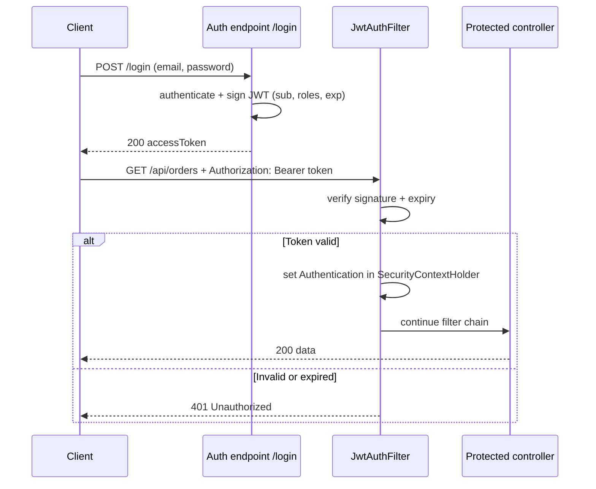

**The JWT filter (referenced in the security config above):**
```java
@Component
@RequiredArgsConstructor
public class JwtAuthFilter extends OncePerRequestFilter {

    private final JwtService jwtService;                 // your helper: parse, validate, extract username
    private final UserDetailsService userDetailsService;

    @Override
    protected void doFilterInternal(HttpServletRequest request, HttpServletResponse response,
                                    FilterChain chain) throws ServletException, IOException {
        String header = request.getHeader("Authorization");
        if (header == null || !header.startsWith("Bearer ")) {
            chain.doFilter(request, response);           // no token: let other filters decide
            return;
        }

        String token = header.substring(7);
        String username = jwtService.extractUsername(token);

        if (username != null && SecurityContextHolder.getContext().getAuthentication() == null) {
            UserDetails user = userDetailsService.loadUserByUsername(username);
            if (jwtService.isTokenValid(token, user)) {
                var auth = new UsernamePasswordAuthenticationToken(
                        user, null, user.getAuthorities());
                auth.setDetails(new WebAuthenticationDetailsSource().buildDetails(request));
                SecurityContextHolder.getContext().setAuthentication(auth);
            }
        }
        chain.doFilter(request, response);
    }
}
```

> Instead of a hand-written filter, Spring Security's **OAuth2 Resource Server** support ([18.8](#188-oauth2-and-oauth2-resource-server-jwt)) can validate JWTs for you — including your own self-issued tokens (`NimbusJwtDecoder.withSecretKey(...)` / `withPublicKey(...)`).

### 18.3 JWT vs Session-Based Authentication

| | Session-Based | JWT |
|---|---|---|
| Server state | Stateful (stores session in memory/DB) | Stateless (no server storage) |
| Scalability | Harder — servers must share a session store (Spring Session + Redis) | Easy — any server can validate the token |
| Client storage | Session cookie | Token in Authorization header (or cookie) |
| Expiry | Server-controlled | Encoded in the token (`exp`) |
| Logout / revocation | Easy — delete the session | Hard — token valid until expiry (needs blocklist or short expiry) |
| Size per request | Small cookie ID | Larger token |

### 18.4 Why Refresh Tokens?

Access tokens are short-lived (15–30 min) for security. If stolen, the damage window is small. But you don't want users to log in every 15 minutes. Refresh tokens solve this — they are long-lived (7–30 days), stored securely, and used **only** to get a new access token.

### 18.5 JWT Refresh Token Flow

```
1. User logs in → server returns:
   {
     "accessToken": "eyJ...",        // expires in 15 min
     "refreshToken": "abc123xyz"     // expires in 7 days
   }

2. Client stores:
   - accessToken in memory (not localStorage — XSS risk)
   - refreshToken in HttpOnly cookie (can't be read by JS)

3. Client sends accessToken in every request:
   Authorization: Bearer eyJ...

4. When accessToken expires → server returns 401

5. Client automatically calls POST /api/auth/refresh
   with the refreshToken (sent automatically via cookie)

6. Server:
   a. Validates refreshToken against DB (it's stored there)
   b. If valid → issue new accessToken (and optionally rotate refreshToken)
   c. If expired/invalid → return 401, force re-login

7. Client receives new accessToken and retries the original request
```

```mermaid
sequenceDiagram
    participant C as Client (SPA)
    participant API as Spring Boot API
    participant DB as Refresh token table
    C->>API: POST /login
    API->>DB: store refresh token (expiry 7d)
    API-->>C: accessToken (15 min) + refreshToken in HttpOnly cookie
    C->>API: GET /api/data + Bearer accessToken
    API-->>C: 200 OK
    Note over C,API: 15 minutes later, access token expired
    C->>API: GET /api/data + expired token
    API-->>C: 401 Unauthorized
    C->>API: POST /api/auth/refresh (cookie sent automatically)
    API->>DB: find token, check expiry
    alt Valid
        API->>DB: delete old token, save rotated token
        API-->>C: new accessToken + new refresh cookie
        C->>API: retry GET /api/data
    else Expired, revoked or unknown
        API-->>C: 401: force re-login
    end
```

### 18.6 Refresh Token Entity and Service

```java
@Entity
public class RefreshToken {
    @Id @GeneratedValue
    private Long id;

    @OneToOne
    @JoinColumn(name = "user_id")
    private User user;

    @Column(nullable = false, unique = true)
    private String token;

    @Column(nullable = false)
    private Instant expiryDate;

    public boolean isExpired() {
        return expiryDate.isBefore(Instant.now());
    }
}
```

```java
@Service
public class RefreshTokenService {

    @Value("${app.refresh-token.expiry-ms:604800000}") // 7 days
    private long expiryMs;

    @Autowired private RefreshTokenRepository repo;
    @Autowired private UserRepository userRepo;

    public RefreshToken createRefreshToken(Long userId) {
        RefreshToken token = new RefreshToken();
        token.setUser(userRepo.findById(userId).get());
        token.setToken(UUID.randomUUID().toString());
        token.setExpiryDate(Instant.now().plusMillis(expiryMs));
        return repo.save(token);
    }

    public RefreshToken verifyExpiration(RefreshToken token) {
        if (token.isExpired()) {
            repo.delete(token);
            throw new RuntimeException("Refresh token expired. Please log in again.");
        }
        return token;
    }
}
```

**Production improvements:**
- Store a **hash** of the refresh token (like a password), not the raw value, so a DB leak doesn't leak usable tokens.
- `@OneToOne` allows only one session per user; use `@ManyToOne` to support multiple devices.
- Throw a dedicated exception (e.g. `TokenRefreshException`) mapped to 401/403 instead of a generic `RuntimeException`.

### 18.7 Token Rotation

Best practice: every time a refresh token is used, issue a **new** refresh token and invalidate the old one. This limits the damage window if a refresh token is stolen. **Reuse detection:** if an already-used (rotated) refresh token is presented again, it was probably stolen — revoke the whole token family and force re-login.

### 18.8 OAuth2 and OAuth2 Resource Server (JWT)

**OAuth2** is an authorization framework that allows a user to grant a third-party application limited access to their data on another service — without sharing their password. Example: "Sign in with Google" — you authorize the app to see your Google profile, but you never give your Google password to the app. **OpenID Connect (OIDC)** adds an identity layer (an ID token) on top of OAuth2 for login.

#### OAuth2 Roles Clarified

| Role | Meaning |
|---|---|
| **Resource Owner** | The user (owns their data) |
| **Client** | The app requesting access (React frontend, mobile app) |
| **Authorization Server** | Issues tokens after user consents (Keycloak, Auth0, Okta, Spring Authorization Server) |
| **Resource Server** | Your Spring Boot API — validates tokens and serves protected data |

```mermaid
sequenceDiagram
    participant U as User (Resource Owner)
    participant App as Client app
    participant AS as Authorization Server (Keycloak)
    participant RS as Spring Boot API (Resource Server)
    App->>AS: redirect user to login (Authorization Code + PKCE)
    U->>AS: login + consent
    AS-->>App: authorization code
    App->>AS: exchange code for tokens
    AS-->>App: access token (JWT)
    App->>RS: API call + Bearer access token
    RS->>AS: fetch public keys from JWK Set URI (cached)
    RS->>RS: verify signature, issuer, expiry, map roles
    RS-->>App: protected data
```

**Common grant types:** *Authorization Code + PKCE* (web/mobile apps with users — recommended), *Client Credentials* (service-to-service, no user). The *Implicit* and *Password* grants are deprecated.

#### What is an OAuth2 Resource Server?

Your Spring Boot API acts as a **Resource Server** — it protects resources (endpoints) and validates JWT tokens issued by an external **Authorization Server** (e.g. Keycloak, Auth0, Okta, Spring Authorization Server). Your API never sees user passwords.

#### Configuration

```xml
<dependency>
    <groupId>org.springframework.boot</groupId>
    <artifactId>spring-boot-starter-oauth2-resource-server</artifactId>
</dependency>
```

```properties
# Point to your authorization server's JWK endpoint (public keys for JWT verification)
spring.security.oauth2.resourceserver.jwt.jwk-set-uri=https://auth.mycompany.com/auth/realms/myrealm/protocol/openid-connect/certs
```
(Alternatively set `spring.security.oauth2.resourceserver.jwt.issuer-uri`, which discovers the JWK URI and also validates the `iss` claim.)

```java
@Bean
public SecurityFilterChain filterChain(HttpSecurity http) throws Exception {
    return http
        .authorizeHttpRequests(auth -> auth
            .requestMatchers("/public/**").permitAll()
            .anyRequest().authenticated())
        .oauth2ResourceServer(oauth2 -> oauth2
            .jwt(jwt -> jwt.jwtAuthenticationConverter(jwtAuthConverter())))
        .build();
}

// Extract roles from JWT claims (Keycloak format)
@Bean
public JwtAuthenticationConverter jwtAuthConverter() {
    JwtGrantedAuthoritiesConverter converter = new JwtGrantedAuthoritiesConverter();
    converter.setAuthoritiesClaimName("realm_access.roles");
    converter.setAuthorityPrefix("ROLE_");

    JwtAuthenticationConverter jwtConverter = new JwtAuthenticationConverter();
    jwtConverter.setJwtGrantedAuthoritiesConverter(converter);
    return jwtConverter;
}
```

> **Accuracy note:** `JwtGrantedAuthoritiesConverter.setAuthoritiesClaimName()` expects a **top-level** claim name. Keycloak puts roles in a nested object (`realm_access.roles`); depending on your Spring Security version this dotted path may not be resolved, so many projects write a small custom `Converter<Jwt, Collection<GrantedAuthority>>` that reads `jwt.getClaimAsMap("realm_access").get("roles")`. Verify with a test token.

### 18.9 Security Checklist (Senior Level)

- HTTPS everywhere; HSTS header.
- Short-lived access tokens; rotated refresh tokens in HttpOnly, Secure, SameSite cookies.
- Validate `iss`, `aud`, `exp` on JWTs; use asymmetric keys (RS256/ES256) across services.
- Rate-limit login and refresh endpoints; lock accounts after repeated failures.
- Use parameterized queries (JPA does this) to prevent SQL injection; validate all input.
- Never log tokens, passwords or full card numbers.
- Keep dependencies patched (OWASP dependency check / Dependabot).
- Restrict Actuator endpoints ([25.3](#253-expose-and-secure-endpoints)).

### 18.10 Interview Questions – JWT and OAuth2

**Q: How do you log out a user with stateless JWT?**
A: You can't invalidate a JWT itself. Keep access tokens short-lived, delete/revoke the refresh token on logout, and if immediate revocation is required, keep a blocklist of token IDs (`jti`) in Redis until they expire.

**Q: Where should a SPA store tokens?**
A: Access token in memory; refresh token in an HttpOnly, Secure, SameSite cookie. `localStorage` is readable by any injected script (XSS).

**Q: Difference between authentication server and resource server?**
A: The authorization server authenticates users and issues tokens. The resource server (your API) only validates tokens (signature, issuer, expiry, scopes) and serves data.

**Q: HS256 vs RS256?**
A: HS256 uses one shared secret for signing and verifying, so every verifier could also forge tokens. RS256 signs with a private key and verifies with a public key, so many services can verify safely. Prefer RS256 in microservices.


---

# Part V – Cross-Cutting Concerns

## 19. Aspect-Oriented Programming

### 19.1 What is AOP?

AOP lets you add **cross-cutting concerns** (logging, security, transaction management, caching, metrics) to methods **without modifying their code**. Spring wraps your bean in a **proxy** at startup. When you call a `@Transactional` method, you're actually calling the proxy, which starts a transaction → calls your real method → commits or rolls back.

Without AOP, every service method would repeat the same boilerplate (start timer, try/catch, log, commit...). AOP keeps that in one place.

### 19.2 Key Terms

- **Aspect** – The cross-cutting concern module (e.g., transaction management, logging). In code: a class annotated with `@Aspect`.
- **Advice** – The code that runs (e.g., begin transaction, log request) and *when* it runs.
- **Pointcut** – Expression specifying which methods to intercept (e.g., all methods in service layer).
- **JoinPoint** – The specific method execution being intercepted (Spring AOP supports only method-execution join points).
- **Target** – The original object being advised.
- **Proxy** – The wrapper object Spring creates around the target.
- **Weaving** – Linking aspects with targets. Spring AOP weaves at **runtime** using proxies; full AspectJ can weave at compile/load time.

### 19.3 Advice Types

| Advice | Runs | Typical use |
|---|---|---|
| `@Before` | Before the method | Logging, auth checks |
| `@AfterReturning` | After a successful return (can read the return value) | Audit results |
| `@AfterThrowing` | When the method throws | Error metrics, alerting |
| `@After` | Always, like `finally` | Cleanup |
| `@Around` | Wraps the call; you decide whether/when to call `proceed()` | Timing, retries, transactions, caching |

```java
@Aspect
@Component
public class LoggingAspect {

    @Pointcut("within(com.example.service..*)")          // reusable pointcut
    public void serviceLayer() { }

    @Before("serviceLayer()")
    public void logEntry(JoinPoint jp) {
        log.info("Entering {} with args {}", jp.getSignature().toShortString(), jp.getArgs());
    }

    @AfterThrowing(pointcut = "serviceLayer()", throwing = "ex")
    public void logError(JoinPoint jp, Exception ex) {
        log.error("{} failed: {}", jp.getSignature().toShortString(), ex.getMessage());
    }
}
```

**Annotation-based pointcut** (very common for custom features):
```java
@Retention(RetentionPolicy.RUNTIME)
@Target(ElementType.METHOD)
public @interface LogExecutionTime { }

@Around("@annotation(com.example.LogExecutionTime)")
public Object time(ProceedingJoinPoint pjp) throws Throwable {
    long start = System.nanoTime();
    try {
        return pjp.proceed();
    } finally {
        log.info("{} took {} ms", pjp.getSignature().getName(), (System.nanoTime() - start) / 1_000_000);
    }
}
```

The `PerformanceAspect` example in [6.5](#65-aop-advice) shows an `@Around` advice with an `execution(...)` pointcut. Pointcut syntax: `execution(* com.example.service.*.*(..))` = any return type, any class in `service`, any method, any arguments.

### 19.4 Proxy-Based AOP

```mermaid
sequenceDiagram
    participant Caller as OrderController
    participant Proxy as OrderService proxy
    participant Advice as Aspects (tx, cache, logging)
    participant Target as Real OrderService
    Caller->>Proxy: placeOrder()
    Proxy->>Advice: before advice
    Advice->>Target: proceed(): placeOrder()
    Target-->>Advice: result
    Advice-->>Proxy: after advice (commit, cache put, log)
    Proxy-->>Caller: result
```

### 19.5 Proxies: JDK vs CGLIB and Self-Invocation

| | JDK dynamic proxy | CGLIB proxy |
|---|---|---|
| How | Implements the bean's **interfaces** | Creates a **subclass** of the bean class |
| Requires | An interface | Non-final class and methods |
| Spring Boot default | — | **CGLIB** (`spring.aop.proxy-target-class=true`) |

**Self-invocation problem:** when a method inside a bean calls another method of the **same bean**, the call goes through `this`, not through the proxy, so **no advice runs**. This is why `@Transactional`, `@Async`, `@Cacheable` and `@PreAuthorize` silently don't work for internal calls.

```java
@Service
public class ReportService {
    public void generateAll() {
        generate(1L);              // ❌ calls this.generate() → no transaction, no async
    }

    @Transactional
    public void generate(Long id) { ... }
}
```
**Fixes:** move the advised method into another bean (cleanest), inject the bean into itself with `@Lazy` and call through that reference, or use programmatic APIs (`TransactionTemplate`).

### 19.6 Interview Questions – AOP

**Q: Spring AOP vs AspectJ?**
A: Spring AOP is proxy-based, runtime, supports method execution on Spring beans only, and is simple. AspectJ weaves bytecode at compile/load time, supports fields, constructors and non-Spring objects, and avoids the self-invocation problem, but needs extra build setup.

**Q: Why doesn't `@Transactional` work when I call the method from the same class?**
A: Because the call bypasses the proxy (self-invocation). Only calls coming through the proxy get advice.

**Q: Which advice type would you use for retry logic?**
A: `@Around`, because it controls whether and how many times `proceed()` is called. (Or use Spring Retry / Resilience4j instead of writing it.)

---

## 20. Spring Events

### 20.1 What are Spring Events?

Spring has a built-in event/listener mechanism (the **Observer pattern**). One component publishes an event; any number of listeners react to it — without the publisher knowing who's listening. Great for decoupling: the `UserService` shouldn't need to know about emails, audit logs and analytics.

### 20.2 Publishing an Event

```java
// 1. Define your custom event
public class UserRegisteredEvent {
    private final User user;
    public UserRegisteredEvent(User user) { this.user = user; }
    public User getUser() { return user; }
}

// 2. Publish it from a service
@Service
public class UserService {

    @Autowired
    private ApplicationEventPublisher eventPublisher;

    public User register(User user) {
        User saved = userRepository.save(user);
        eventPublisher.publishEvent(new UserRegisteredEvent(saved)); // fire and continue
        return saved;
    }
}
```
Since Spring 4.2, events can be any object (no need to extend `ApplicationEvent`); a Java `record` is ideal: `public record UserRegisteredEvent(User user) {}`.

### 20.3 Listening to an Event

```java
// 3. Handle it in any bean
@Component
public class EmailNotificationListener {

    @EventListener
    public void onUserRegistered(UserRegisteredEvent event) {
        emailService.sendWelcomeEmail(event.getUser().getEmail());
    }
}

@Component
public class AuditListener {

    @EventListener
    public void onUserRegistered(UserRegisteredEvent event) {
        auditService.log("New user registered: " + event.getUser().getEmail());
    }
}
```

```mermaid
flowchart LR
    US["UserService.register()"] -->|"publishEvent(UserRegisteredEvent)"| P["ApplicationEventPublisher"]
    P --> L1["EmailNotificationListener"]
    P --> L2["AuditListener"]
    P --> L3["AnalyticsListener (add later, no change to UserService)"]
```

Listener ordering: `@Order(1)`. Conditional listening: `@EventListener(condition = "#event.user.premium")`.

### 20.4 Async Events

By default, event listeners run **synchronously in the same thread** (and same transaction) as the publisher — if a listener throws, the publisher sees the exception. Add `@Async` to run them in a background thread:

```java
@Async
@EventListener
public void onUserRegistered(UserRegisteredEvent event) {
    emailService.sendWelcomeEmail(event.getUser().getEmail()); // runs in background
}
// Don't forget @EnableAsync on a @Configuration class
```

### 20.5 @TransactionalEventListener

A problem with plain `@EventListener`: the welcome email is sent **before** the transaction commits — if the transaction then rolls back, you've emailed a user who doesn't exist. `@TransactionalEventListener` runs the listener only at a given transaction phase:

```java
@TransactionalEventListener(phase = TransactionPhase.AFTER_COMMIT) // default phase
public void onUserRegistered(UserRegisteredEvent event) {
    emailService.sendWelcomeEmail(event.getUser().getEmail()); // only if the user was really saved
}
```
Phases: `BEFORE_COMMIT`, `AFTER_COMMIT`, `AFTER_ROLLBACK`, `AFTER_COMPLETION`.

> In-memory events are **lost if the app crashes** after commit but before the listener runs. For guaranteed delivery across services, use the Outbox pattern ([30.3](#303-outbox-pattern)).

### 20.6 Built-in Spring Events

| Event | When it fires |
|---|---|
| `ContextRefreshedEvent` | ApplicationContext initialized or refreshed |
| `ContextStartedEvent` | ApplicationContext started (explicit `start()`) |
| `ContextStoppedEvent` | ApplicationContext stopped |
| `ContextClosedEvent` | ApplicationContext closed / app shutting down |
| `ApplicationStartedEvent` | Context refreshed, before runners are called |
| `ApplicationReadyEvent` | App fully started and ready to serve requests |
| `ApplicationFailedEvent` | Startup failed |

```java
@EventListener(ApplicationReadyEvent.class)
public void onStartup() {
    System.out.println("Application is ready!");
}
```

### 20.7 Interview Questions – Events

**Q: Are Spring events synchronous or asynchronous?**
A: Synchronous by default, in the publisher's thread and transaction. Make a listener async with `@Async` + `@EnableAsync`.

**Q: How do you make sure a listener runs only if the transaction committed?**
A: Use `@TransactionalEventListener(phase = AFTER_COMMIT)`.

**Q: Spring events vs Kafka?**
A: Spring events are in-process and in-memory — fast but lost on crash and invisible to other services. Kafka is durable, distributed and replayable — for cross-service communication.

---

## 21. Caching

### 21.1 Why Cache?

Every DB call has latency. If the same data is requested frequently and doesn't change often (user profile, product catalog, configuration), caching stores the result in fast memory so subsequent requests don't hit the DB at all. It reduces latency **and** database load.

Enable with `@EnableCaching`. Spring's cache abstraction works with many providers: `ConcurrentHashMap` (default), Caffeine, Redis, Hazelcast, Ehcache.

### 21.2 Spring Cache Annotations

**`@Cacheable(value = "users", key = "#id")`**
First call: runs the method, stores result in cache under the key. Subsequent calls with the same key: returns cached result without running the method. Ideal for expensive read operations.

**`@CachePut(value = "users", key = "#user.id")`**
Always runs the method AND updates the cache with the result. Use this after an update operation to keep the cache in sync. Unlike `@Cacheable`, it never skips the method.

**`@CacheEvict(value = "users", key = "#id")`**
Removes a specific entry from the cache. Use after a delete operation to prevent stale data. You can also use `allEntries = true` to clear the entire cache.

```java
@Cacheable(value = "users", key = "#id")
public User getUserById(Long id) { return repo.findById(id).get(); }

@CachePut(value = "users", key = "#user.id")
public User updateUser(User user) { return repo.save(user); }

@CacheEvict(value = "users", key = "#id")
public void deleteUser(Long id) { repo.deleteById(id); }
```

Useful attributes: `condition = "#id > 10"` (cache only if true before the call), `unless = "#result == null"` (don't cache if true after the call), `sync = true` (only one thread computes a missing value). `@Caching` groups multiple cache annotations on one method.

```mermaid
flowchart TD
    A["Call getUserById(42)"] --> B["Cache proxy"]
    B --> C{"Key 42 in 'users' cache?"}
    C -->|"Hit"| D["Return cached User<br/>method NOT executed"]
    C -->|"Miss"| E["Execute method: DB query"]
    E --> F["Store result under key 42"]
    F --> G["Return User"]
```

| | `@Cacheable` | `@CachePut` | `@CacheEvict` |
|---|---|---|---|
| Runs method? | Only on cache miss | Always | Always |
| Cache effect | Store result on miss | Overwrite with result | Remove entry/entries |
| Typical method | `get` / `find` | `update` | `delete` |

### 21.3 In-memory vs Distributed Cache

| | In-memory (Caffeine) | Distributed (Redis) |
|---|---|---|
| Scope | Single JVM instance only | All instances in cluster |
| Speed | Fastest (local memory, no network) | Fast (small network roundtrip) |
| Persistence | Lost on app restart | Survives app restarts (Redis persistence optional) |
| Consistency across instances | Each instance has its own copy (can diverge) | One shared copy |
| Use case | Single-node apps, small hot reference data | Microservices, clustered apps, sessions |

```yaml
spring:
  cache:
    type: redis
    redis:
      time-to-live: 10m      # always set a TTL to bound staleness
  data:
    redis:
      host: localhost
      port: 6379
```

### 21.4 Caching Best Practices and Pitfalls

- **Always set a TTL** / max size — unbounded caches cause memory leaks and stale data.
- Cache only data that is read often and changes rarely; don't cache per-user sensitive data in shared caches without careful keys.
- Cached objects in Redis must be serializable (configure a JSON serializer).
- **Self-invocation** skips the cache proxy, like `@Transactional` ([19.5](#195-proxies-jdk-vs-cglib-and-self-invocation)).
- **Cache stampede:** many requests miss at once and all hit the DB — use `sync = true`, locking, or staggered TTLs.
- **Consistency:** with cache-aside, evict *after* the DB commit; consider short TTLs as a safety net.

### 21.5 Interview Questions – Caching

**Q: `@Cacheable` vs `@CachePut`?**
A: `@Cacheable` skips the method when the value is cached. `@CachePut` always runs the method and refreshes the cache with its result.

**Q: How do you keep a cache consistent with the database?**
A: Evict or update on writes (`@CacheEvict`/`@CachePut`), use TTLs to bound staleness, and with multiple instances use a distributed cache (or pub/sub invalidation) so all instances see the same data.

**Q: When would you choose Caffeine over Redis?**
A: For a single instance or per-instance hot data where network latency matters and slight inconsistency between instances is acceptable. Redis when multiple instances must share the cache.

---

## 22. Async, Scheduling, Virtual Threads and Distributed Locking

### 22.1 @Async – How It Works

Without `@Async`: the caller thread runs the method and waits for it to finish before moving on.
With `@Async`: Spring hands the work to a thread pool. The caller gets back immediately, and the method runs in the background.

```java
@Async
public CompletableFuture<String> sendEmail(String to) {
    emailClient.send(to); // runs in background thread
    return CompletableFuture.completedFuture("Sent");
}
```

> **Important:** `@Async` uses Spring's proxy mechanism. If you call an `@Async` method from *within the same class*, it bypasses the proxy and runs synchronously. Always call from a different bean.

**Rules and gotchas:**
- Requires `@EnableAsync` on a configuration class.
- Return `void` or `CompletableFuture<T>` (`Future` also works).
- Exceptions from `void` async methods are **not** seen by the caller — configure an `AsyncUncaughtExceptionHandler`.
- The async thread does not inherit the caller's transaction or (by default) its `SecurityContext` or MDC.
- **Configure your own executor** for production instead of relying on defaults:

```java
@Configuration
@EnableAsync
public class AsyncConfig {
    @Bean(name = "taskExecutor")
    public ThreadPoolTaskExecutor taskExecutor() {
        ThreadPoolTaskExecutor ex = new ThreadPoolTaskExecutor();
        ex.setCorePoolSize(4);
        ex.setMaxPoolSize(16);
        ex.setQueueCapacity(500);              // bounded queue prevents memory blow-up
        ex.setThreadNamePrefix("async-");
        ex.initialize();
        return ex;
    }
}
// Use a specific pool: @Async("taskExecutor")
```

Combining async calls with `CompletableFuture`:
```java
CompletableFuture<User> user = userService.fetchUser(id);         // @Async
CompletableFuture<List<Order>> orders = orderService.fetchOrders(id); // @Async
CompletableFuture.allOf(user, orders).join();                       // run both in parallel
Dashboard d = new Dashboard(user.join(), orders.join());
```

### 22.2 @Scheduled – Options Explained

```java
@Scheduled(fixedRate = 5000)
// Runs every 5 seconds measured from START of previous execution.
// If the task takes 3s, next run starts 2s after it finishes.

@Scheduled(fixedDelay = 5000)
// Waits 5 seconds after END of previous execution before running again.
// Guarantees a minimum gap between executions.

@Scheduled(cron = "0 30 9 * * MON-FRI")
// Cron syntax: second(0) minute(30) hour(9) day(*) month(*) weekday(MON-FRI)
// Runs at 9:30 AM every weekday.
```

```mermaid
flowchart LR
    subgraph FR["fixedRate = 5s, task takes 3s"]
        A1["0s: start run 1"] --> A2["3s: end"] --> A3["5s: start run 2"] --> A4["8s: end"] --> A5["10s: start run 3"]
    end
    subgraph FD["fixedDelay = 5s, task takes 3s"]
        B1["0s: start run 1"] --> B2["3s: end"] --> B3["8s: start run 2"] --> B4["11s: end"] --> B5["16s: start run 3"]
    end
```

| | `fixedRate` | `fixedDelay` | `cron` |
|---|---|---|---|
| Measured from | Start of previous run | End of previous run | Calendar time |
| Good for | Regular polling/heartbeats | Jobs that must not overlap | "Every day at 2 AM" |

**Details:**
- Spring cron has **6 fields** (seconds first), unlike Unix cron (5 fields). Example: `"0 0 2 * * *"` = 2 AM daily. Use `zone = "Asia/Kolkata"` to pin a timezone.
- `initialDelay = 10000` delays the first run. Durations can come from config: `fixedRateString = "${jobs.poll-rate}"`.
- By default all `@Scheduled` methods share **one thread** — a slow job delays others. Increase with `spring.task.scheduling.pool.size=5`.
- If a `fixedRate` run takes longer than the rate, the next run waits (runs don't overlap on the same single thread) — use `@Async` to allow overlap.
- In a cluster, every instance runs the job — see distributed locking ([22.6](#226-distributed-locking)).

### 22.3 Virtual Threads (Java 21 + Spring Boot 3.2)

**What are virtual threads?** Traditional Java threads ("platform threads") are wrappers around OS threads — heavy (about 1 MB stack each), limited in number (thousands), and expensive to create. Virtual threads (Project Loom, final in **Java 21**) are lightweight JVM-managed threads — you can have **millions** of them. They are ideal for **I/O-bound** work (DB calls, HTTP calls) where threads spend most time waiting: when a virtual thread blocks on I/O, the JVM unmounts it from its carrier OS thread, which is then free to run another virtual thread.

```mermaid
flowchart LR
    subgraph VT["Millions of virtual threads"]
        V1["VT 1: waiting on DB"]
        V2["VT 2: running"]
        V3["VT 3: waiting on HTTP"]
        V4["VT 4: running"]
    end
    subgraph Carriers["Few carrier OS threads (about CPU cores)"]
        C1["Carrier 1"]
        C2["Carrier 2"]
    end
    V2 -->|"mounted"| C1
    V4 -->|"mounted"| C2
    V1 -.->|"unmounted while blocked"| H["Heap"]
    V3 -.->|"unmounted while blocked"| H
```

**Enable in Spring Boot (one line):**
```properties
spring.threads.virtual.enabled=true
```

That's it. Spring Boot automatically configures:
- Embedded Tomcat (and Jetty) to use virtual threads for request handling
- The `@Async` task executor to use virtual threads
- Scheduled tasks to use virtual threads (plus Kafka/RabbitMQ listener containers, etc.)

**Why it matters:** Before virtual threads, scaling to many concurrent I/O-bound requests required reactive programming (WebFlux, Mono/Flux) — complex and hard to debug. Virtual threads give you similar scalability with the simple imperative/blocking code you're already writing.

```java
// This blocking code now scales like reactive code — thanks to virtual threads
@GetMapping("/users/{id}")
public User getUser(@PathVariable Long id) {
    return userRepository.findById(id).orElseThrow(); // blocks virtual thread, not OS thread
}
```

> **Interview tip:** "Virtual threads eliminate the need for reactive programming in most cases. With `spring.threads.virtual.enabled=true` in Spring Boot 3.2+, standard blocking code handles the same concurrency as WebFlux."

**Caveats (senior-level):**
- They help **I/O-bound** workloads, not CPU-bound ones (you still only have N cores).
- **Pinning:** in Java 21–23, blocking inside a `synchronized` block pins the virtual thread to its carrier, reducing scalability (prefer `ReentrantLock`). Java 24 (JEP 491) removes most `synchronized` pinning.
- Your **downstream limits don't disappear**: 10,000 concurrent requests still share a HikariCP pool of 20 connections. Add bulkheads/semaphores for scarce resources.
- Don't pool virtual threads, and be careful with large `ThreadLocal` usage (millions of copies).
- Reactive (WebFlux) is still useful for streaming and backpressure.

| | Platform threads | Virtual threads | WebFlux (reactive) |
|---|---|---|---|
| Code style | Blocking, simple | Blocking, simple | Non-blocking, Mono/Flux |
| Max concurrency | Thousands | Millions | Very high |
| Debugging | Easy | Easy (normal stack traces) | Harder |
| Best for | CPU-bound, low concurrency | I/O-bound, high concurrency | Streaming, backpressure |

### 22.4 Interview Questions – Async and Scheduling

**Q: `fixedRate` vs `fixedDelay`?**
A: `fixedRate` schedules from the start of the previous run (fixed frequency); `fixedDelay` waits a fixed gap after the previous run ends.

**Q: Why might `@Async` not run asynchronously?**
A: Missing `@EnableAsync`, calling from the same class (self-invocation), a private method, or the bean not being a Spring bean.

**Q: Do virtual threads make my app faster?**
A: They improve **throughput** for I/O-bound workloads by allowing many more concurrent blocking operations. They don't make individual requests or CPU-bound code faster, and shared limits like connection pools still apply.

### 22.5 The Duplicate-Execution Problem in Clusters

In a clustered app (multiple instances), a `@Scheduled` job runs on **every** instance simultaneously — leading to duplicate processing (e.g. sending the daily report email three times). You need a way to ensure only one instance executes a critical section at a time.

### 22.6 Distributed Locking

```mermaid
sequenceDiagram
    participant I1 as Instance 1
    participant I2 as Instance 2
    participant L as Lock store (Redis / DB)
    Note over I1,I2: 02:00 cron fires on both instances
    I1->>L: tryLock("daily-report-lock")
    L-->>I1: acquired
    I2->>L: tryLock("daily-report-lock")
    L-->>I2: already locked
    I2->>I2: skip job
    I1->>I1: generate report
    I1->>L: unlock
```

#### Using Redis (Redisson)

```xml
<dependency>
    <groupId>org.redisson</groupId>
    <artifactId>redisson-spring-boot-starter</artifactId>
</dependency>
```

```java
@Service
public class ReportScheduler {

    @Autowired
    private RedissonClient redisson;

    @Scheduled(cron = "0 0 2 * * *") // 2 AM daily
    public void generateDailyReport() {
        RLock lock = redisson.getLock("daily-report-lock");

        boolean acquired = lock.tryLock(); // non-blocking — return false if already locked
        if (!acquired) {
            log.info("Another instance is running the report job. Skipping.");
            return;
        }

        try {
            reportService.generateDailyReport();
        } finally {
            lock.unlock(); // always release
        }
    }
}
```

> Redisson's lock has a **watchdog** that auto-extends the lock while the holder is alive, so a crashed instance's lock expires (default 30 s lease). For strict correctness under network partitions, combine locks with **fencing tokens** or idempotent processing.

#### Using ShedLock (Simpler, DB-based)

```java
@Scheduled(cron = "0 0 2 * * *")
@SchedulerLock(name = "daily-report-lock", lockAtMostFor = "10m", lockAtLeastFor = "1m")
public void generateDailyReport() {
    reportService.generateDailyReport();
}
// ShedLock stores the lock in a DB table — no Redis needed
```

ShedLock setup: add `@EnableSchedulerLock(defaultLockAtMostFor = "10m")` and a `LockProvider` bean (e.g. `JdbcTemplateLockProvider`) plus a `shedlock` table.
- `lockAtMostFor` – safety net: lock is released after this even if the node dies.
- `lockAtLeastFor` – keeps the lock for a minimum time so that a fast job isn't re-run by another node whose clock is slightly behind.

| | Redisson (Redis) | ShedLock (DB/Redis/Mongo...) |
|---|---|---|
| Use | General-purpose distributed locks in code | Specifically for `@Scheduled` jobs |
| Infra | Redis | Usually the existing DB |
| API | `RLock` (tryLock, lock, fair locks...) | One annotation |

Other options: Spring Integration `JdbcLockRegistry`/`RedisLockRegistry`, ZooKeeper/etcd, or a DB row lock (`SELECT ... FOR UPDATE`) — or avoid the problem by running jobs in a single dedicated worker / Kubernetes CronJob.

---

## 23. Spring Batch

### 23.1 What is Spring Batch?

A framework for processing **large volumes of data** in scheduled bulk operations — reading from a source (DB, CSV, API), transforming it, and writing to a destination. It handles restartability, chunk processing, retry/skip error handling, and job monitoring. Examples: end-of-day bank settlement, monthly invoice generation, nightly data migration.

### 23.2 Core Concepts

| Concept | Meaning |
|---|---|
| **Job** | The entire batch process (e.g., "process monthly reports") |
| **Step** | A phase within a Job (e.g., "read CSV", "transform", "write to DB") |
| **ItemReader** | Reads data one item at a time (from DB, file, API) |
| **ItemProcessor** | Transforms/validates each item (optional); return `null` to skip an item |
| **ItemWriter** | Writes processed items to destination |
| **Chunk** | Spring reads N items, processes them, then writes all at once (atomic: one transaction per chunk) |
| **JobRepository** | Stores job execution metadata in DB (enables restart from failure point) |
| **JobLauncher** | Starts a job with `JobParameters` |
| **Tasklet** | A single-task step (e.g. delete temp files) instead of read-process-write |

```mermaid
flowchart LR
    subgraph Job["Job: generateReportsJob"]
        subgraph Step["Step: processStep (chunk = 100)"]
            R["ItemReader<br/>read 1 item at a time"] --> P["ItemProcessor<br/>transform / filter"]
            P --> B["Buffer until 100 items"]
            B --> W["ItemWriter<br/>write 100 in one transaction"]
        end
    end
    W -->|"commit + save progress"| JR[("JobRepository<br/>BATCH_* tables")]
    JR -->|"on restart: resume from last committed chunk"| R
```

### 23.3 Simple Example

```java
@Configuration
@EnableBatchProcessing
public class ReportJobConfig {

    @Bean
    public Job generateReportsJob(JobRepository jobRepository, Step processStep) {
        return new JobBuilder("generateReportsJob", jobRepository)
            .start(processStep)
            .build();
    }

    @Bean
    public Step processStep(JobRepository jobRepository,
                            PlatformTransactionManager txManager) {
        return new StepBuilder("processStep", jobRepository)
            .<User, ReportRow>chunk(100, txManager) // process 100 items at a time
            .reader(userReader())
            .processor(userToReportProcessor())
            .writer(reportWriter())
            .build();
    }

    @Bean
    public JpaPagingItemReader<User> userReader() {
        return new JpaPagingItemReaderBuilder<User>()
            .name("userReader")
            .queryString("SELECT u FROM User u WHERE u.active = true")
            .pageSize(100)
            .entityManagerFactory(entityManagerFactory)
            .build();
    }
}
```

> **Corrections / version notes:**
> - The `entityManagerFactory` used in `userReader()` must be available — inject it, e.g. `public JpaPagingItemReader<User> userReader(EntityManagerFactory entityManagerFactory)`.
> - **Spring Boot 3 / Spring Batch 5:** `JobBuilderFactory`/`StepBuilderFactory` were removed (use `JobBuilder`/`StepBuilder` with a `JobRepository`, as above). Also, adding **`@EnableBatchProcessing` now turns off Spring Boot's batch auto-configuration** (e.g. automatic schema creation and running jobs at startup). In Boot 3, you normally **omit** it unless you want full manual control.
> - Spring Batch 5.1+ also offers `chunk(int)` with the transaction manager passed separately; the `(int, PlatformTransactionManager)` form shown is valid in Batch 5.

**Fault tolerance:**
```java
.<User, ReportRow>chunk(100, txManager)
.reader(userReader()).processor(userToReportProcessor()).writer(reportWriter())
.faultTolerant()
.skip(ValidationException.class).skipLimit(10)   // skip up to 10 bad records
.retry(TransientDataAccessException.class).retryLimit(3)
.build();
```

**Running jobs:** by default Boot runs jobs at startup (`spring.batch.job.enabled`); in production, jobs are usually triggered by a scheduler (`@Scheduled` + `JobLauncher`), a Kubernetes CronJob, or an orchestrator. Each run needs unique `JobParameters` (e.g. a run date), otherwise Spring Batch treats it as the same already-completed job instance.

### 23.4 Interview Questions – Batch

**Q: What is chunk-oriented processing?**
A: Read and process items one by one, buffer N of them, and write the chunk in one transaction. Progress is saved per chunk, so a failure only redoes the current chunk and restarts continue from the last commit.

**Q: How does Spring Batch restart a failed job?**
A: The `JobRepository` stores execution state (step status, read/write counts, execution context). Re-launching the same job instance (same parameters) resumes from the failed step and last committed chunk.

**Q: Spring Batch vs `@Scheduled`?**
A: `@Scheduled` only triggers code on a timetable. Spring Batch provides the processing framework: chunking, transactions, restart, skip/retry and metadata. They're often used together.

---

## 24. Logging

### 24.1 What is SLF4J?

SLF4J (Simple Logging Facade for Java) is an abstraction/API for logging. Your code calls SLF4J methods, and at runtime a real logging framework (Logback, Log4j2) does the actual work. This means you can switch logging implementations without changing any application code — just swap the dependency.

### 24.2 Logback

The default logging implementation in Spring Boot. Configured via `application.properties` or `logback-spring.xml` (the `-spring` variant supports `<springProfile>` blocks).

```java
private static final Logger log = LoggerFactory.getLogger(UserService.class);

log.trace("Most detailed — every tiny step");
log.debug("Variable values, method entry/exit");
log.info("Normal flow: user logged in, order placed");
log.warn("Unexpected but recoverable: retry attempt");
log.error("Something failed: DB connection lost", exception);
```

With Lombok, `@Slf4j` on the class generates the `log` field.

**Use placeholders, not string concatenation:**
```java
log.debug("Processing order {} for user {}", orderId, userId); // ✅ message built only if DEBUG enabled
log.debug("Processing order " + orderId);                      // ❌ string built even when DEBUG is off
```

### 24.3 Log Levels – When to Use Each

| Level | When to use |
|---|---|
| `TRACE` | Every tiny step in a loop or process. Only for deep debugging. Never in production. |
| `DEBUG` | Variable values, which branch was taken. Useful during development. Turn off in prod. |
| `INFO` | Significant normal events: app started, user logged in, order processed. Always on in prod. |
| `WARN` | Something unexpected but the app continues: deprecated API called, retry attempt, near capacity. |
| `ERROR` | A failure occurred that needs attention: DB down, API failed, exception caught. Always on in prod. |

Setting `logging.level.root=INFO` means INFO, WARN, and ERROR are shown; DEBUG and TRACE are suppressed.

```properties
logging.level.root=INFO
logging.level.com.example=DEBUG                 # your packages
logging.level.org.hibernate.SQL=DEBUG           # see generated SQL
logging.file.name=logs/app.log
```
Levels can be changed at runtime via `/actuator/loggers` ([25.2](#252-key-endpoints)).

### 24.4 MDC (Mapped Diagnostic Context)

MDC lets you attach contextual data (like a request ID or user ID) to the current thread. Every log line printed in that thread automatically includes this data (add `%X{requestId}` to the log pattern). Essential in microservices to trace all logs belonging to a single request.

```java
// In a servlet filter:
MDC.put("requestId", UUID.randomUUID().toString());
MDC.put("userId", currentUser.getId().toString());

log.info("Processing order");
// Output: 2024-01-01 [req-abc123] [user-42] Processing order

MDC.clear(); // Always clear at the end of the request thread
```

Production-safe version in a filter (clear in `finally`, because servlet threads are **reused** — otherwise the next request on that thread logs the wrong user):
```java
@Component
public class MdcFilter extends OncePerRequestFilter {
    @Override
    protected void doFilterInternal(HttpServletRequest req, HttpServletResponse res, FilterChain chain)
            throws ServletException, IOException {
        String requestId = Optional.ofNullable(req.getHeader("X-Request-Id"))
                                   .orElse(UUID.randomUUID().toString());
        MDC.put("requestId", requestId);
        try {
            res.setHeader("X-Request-Id", requestId);
            chain.doFilter(req, res);
        } finally {
            MDC.clear();
        }
    }
}
```

> MDC is `ThreadLocal`-based: it does not automatically flow to `@Async` threads or `CompletableFuture` — use a `TaskDecorator` to copy it. With Micrometer Tracing ([29.3](#293-distributed-tracing)), `traceId`/`spanId` are added to the MDC automatically.

### 24.5 Structured Logging

For log aggregation, JSON logs are easier to search than plain text. Spring Boot 3.4+ has built-in structured logging: `logging.structured.format.console=ecs` (or `logstash`, `gelf`). Older versions use `logstash-logback-encoder`.

### 24.6 ELK Stack – Centralized Logging

When you have 20 microservices each writing to their own log files, debugging is impossible. ELK aggregates everything:

- **Logstash** – Collects logs from all services (via file watchers, TCP, or Filebeat) and transforms/normalizes them
- **Elasticsearch** – Stores and indexes all log entries with extremely fast full-text search
- **Kibana** – Web dashboard to search, filter, and visualize logs across all services in one place

```mermaid
flowchart LR
    S1["order-service logs"] --> FB["Filebeat / log shipper"]
    S2["user-service logs"] --> FB
    S3["payment-service logs"] --> FB
    FB --> LS["Logstash<br/>parse, enrich, normalize"]
    LS --> ES[("Elasticsearch<br/>index + search")]
    ES --> KB["Kibana<br/>search by traceId, dashboards"]
```

Alternatives: EFK (Fluentd/Fluent Bit instead of Logstash), Grafana Loki, Splunk, Datadog.

### 24.7 Interview Questions – Logging

**Q: Why use SLF4J instead of Logback directly?**
A: SLF4J is a facade, so application and library code doesn't depend on a specific implementation; you can switch to Log4j2 by changing dependencies only.

**Q: How do you trace one request across many log lines and services?**
A: Put a correlation/request ID (or trace ID) in the MDC in a filter, include it in the log pattern, propagate it in headers to downstream services, and search for it in the central log system.

**Q: What should you never log?**
A: Passwords, tokens, full card numbers, secrets and unnecessary personal data. Mask sensitive fields.


---

# Part VI – Production Readiness

## 25. Actuator and Monitoring

### 25.1 What is Spring Boot Actuator?

Actuator is a Spring Boot module that automatically exposes HTTP (and JMX) endpoints giving you visibility into the internals of your running application — without writing any code. You can check health, view metrics, see environment properties, change log levels and more.

```xml
<dependency>
    <groupId>org.springframework.boot</groupId>
    <artifactId>spring-boot-starter-actuator</artifactId>
</dependency>
```

### 25.2 Key Endpoints

| Endpoint | What it shows |
|---|---|
| `/actuator/health` | App health: UP/DOWN. Also shows DB connectivity, disk space, etc. |
| `/actuator/metrics` | JVM memory, GC stats, HTTP request counts, thread counts |
| `/actuator/info` | Custom app info you define (version, name, build info) |
| `/actuator/env` | All environment properties, system variables, config values |
| `/actuator/loggers` | View current log levels; change them at runtime without restart |
| `/actuator/threaddump` | Snapshot of all running threads — useful for debugging deadlocks |
| `/actuator/heapdump` | Downloads a JVM heap dump (memory leak analysis) |
| `/actuator/prometheus` | Metrics in Prometheus scraping format |
| `/actuator/beans`, `/actuator/conditions`, `/actuator/configprops`, `/actuator/mappings` | Beans, auto-config report, bound properties, URL mappings |

Change a log level at runtime:
```bash
curl -X POST localhost:8080/actuator/loggers/com.example \
     -H "Content-Type: application/json" -d '{"configuredLevel":"DEBUG"}'
```

### 25.3 Expose and Secure Endpoints

By default, only `/health` is exposed over HTTP (Boot 2.x also exposed `/info`; since Boot 2.5 `info` must be added explicitly). To expose more:
```properties
management.endpoints.web.exposure.include=health,info,metrics,loggers
# Restrict health endpoint to ADMIN role:
management.endpoint.health.roles=ADMIN
```

Production best practices:
- Expose only what you need; never expose `env`, `heapdump` or `threaddump` publicly — they can leak secrets and internals.
- Protect actuator endpoints with Spring Security (e.g. `requestMatchers("/actuator/**").hasRole("OPS")`), or run them on a separate internal port: `management.server.port=9090`.
- `management.endpoint.health.show-details=when-authorized` shows component details only to authorized users (and `roles` lists which roles count as authorized).

### 25.4 Health Checks and Kubernetes Probes

Spring Boot provides **liveness** and **readiness** health groups (auto-enabled on Kubernetes):
- `/actuator/health/liveness` – "Is the app alive?" If DOWN, Kubernetes **restarts** the pod.
- `/actuator/health/readiness` – "Can it take traffic?" If DOWN, Kubernetes **stops routing** traffic to it (e.g. during startup or shutdown).

Custom health indicator:
```java
@Component
public class PaymentGatewayHealthIndicator implements HealthIndicator {
    @Override
    public Health health() {
        boolean reachable = pingGateway();
        return reachable ? Health.up().build()
                         : Health.down().withDetail("gateway", "unreachable").build();
    }
}
```

> **Trap:** don't make **liveness** depend on external systems (DB, other services). If the DB goes down, every pod would be restarted in a loop without fixing anything. External dependencies belong in **readiness** at most.

### 25.5 Micrometer

Micrometer is the metrics collection library built into Spring Boot Actuator. It acts as a **vendor-neutral facade** (like SLF4J for metrics) — you write metrics code once, and it exports to any monitoring system (Prometheus, Datadog, New Relic, CloudWatch) by just changing a dependency.

Custom business metrics:
```java
@Service
public class OrderService {
    private final Counter ordersPlaced;
    private final Timer checkoutTimer;

    public OrderService(MeterRegistry registry) {
        this.ordersPlaced = Counter.builder("orders.placed").tag("channel", "web").register(registry);
        this.checkoutTimer = Timer.builder("orders.checkout.time").register(registry);
    }

    public void placeOrder(Order o) {
        checkoutTimer.record(() -> process(o));
        ordersPlaced.increment();
    }
}
```
Metric types: **Counter** (only goes up), **Gauge** (current value, e.g. queue size), **Timer** (count + duration + percentiles), **DistributionSummary** (sizes). You can also annotate methods with `@Timed` / `@Counted` (needs the corresponding aspect bean).

### 25.6 Prometheus + Grafana Integration

1. Add `micrometer-registry-prometheus` to `pom.xml`
2. Spring exposes metrics at `/actuator/prometheus` in Prometheus format (add `prometheus` to the exposure list)
3. Configure Prometheus to scrape that endpoint
4. Connect Grafana to Prometheus as a data source
5. Import Spring Boot dashboards to visualize CPU, memory, HTTP latency, etc.

```mermaid
flowchart LR
    A["Spring Boot app<br/>Micrometer"] -->|"exposes"| B["/actuator/prometheus"]
    C["Prometheus"] -->|"scrapes every 15s"| B
    C -->|"stores time series"| C
    D["Grafana"] -->|"PromQL queries"| C
    C -->|"alert rules"| E["Alertmanager<br/>Slack / PagerDuty"]
```

**What to monitor (the "golden signals"):** latency (p95/p99), traffic (requests/sec), errors (5xx rate), saturation (CPU, heap, DB pool usage, thread pool queue).

### 25.7 Custom Actuator Endpoint

```java
@Endpoint(id = "appinfo")  // Accessible at /actuator/appinfo
@Component
public class AppInfoEndpoint {
    @ReadOperation  // HTTP GET
    public Map<String, String> info() {
        return Map.of("status", "running", "version", "1.0");
    }
}
```
`@WriteOperation` maps to POST and `@DeleteOperation` to DELETE. Remember to add `appinfo` to `management.endpoints.web.exposure.include`.

### 25.8 Interview Questions – Actuator

**Q: Liveness vs readiness probe?**
A: Liveness says whether the process should be restarted; readiness says whether it should receive traffic. A temporarily overloaded or warming-up app should be "not ready", not "not alive".

**Q: How would you secure Actuator in production?**
A: Expose a minimal set of endpoints, put them behind Spring Security with an ops role, or on a separate management port reachable only internally, and never expose `env`/`heapdump` publicly.

**Q: What is Micrometer and why use it?**
A: A metrics facade. Code records counters/timers once; a registry dependency decides where they go (Prometheus, Datadog...). Boot auto-instruments JVM, HTTP, DB pool and more.

---

## 26. Deployment and Runtime: Docker, Graceful Shutdown, GraalVM

### 26.1 Docker Deployment

```dockerfile
FROM openjdk:17-slim
WORKDIR /app
COPY target/app.jar app.jar
EXPOSE 8080
ENTRYPOINT ["java", "-jar", "app.jar"]
```
```bash
docker build -t myapp:1.0 .
docker run -p 8080:8080 -e SPRING_PROFILES_ACTIVE=prod myapp:1.0
```

> **Version note:** the official `openjdk` Docker images are **deprecated** and no longer updated. Use a maintained JDK/JRE image such as `eclipse-temurin:21-jre` (or Amazon Corretto, Liberica).

A more production-ready multi-stage build using Spring Boot **layered jars** (dependencies change rarely, so Docker caches those layers and rebuilds are fast):
```dockerfile
# Stage 1: build
FROM eclipse-temurin:21-jdk AS build
WORKDIR /workspace
COPY . .
RUN ./mvnw -q package -DskipTests
RUN java -Djarmode=tools -jar target/app.jar extract --layers --launcher --destination extracted

# Stage 2: run (smaller JRE image, non-root user)
FROM eclipse-temurin:21-jre
WORKDIR /app
RUN useradd -r spring
USER spring
COPY --from=build /workspace/extracted/dependencies/ ./
COPY --from=build /workspace/extracted/spring-boot-loader/ ./
COPY --from=build /workspace/extracted/snapshot-dependencies/ ./
COPY --from=build /workspace/extracted/application/ ./
EXPOSE 8080
ENTRYPOINT ["java", "org.springframework.boot.loader.launch.JarLauncher"]
```
(Boot 3.3+ uses `-Djarmode=tools ... extract`; older versions use `-Djarmode=layertools ... extract`.) Alternatively, `./mvnw spring-boot:build-image` builds an optimized image with Cloud Native Buildpacks and **no Dockerfile**.

**JVM in containers:** modern JVMs respect container memory limits. Set heap as a percentage, e.g. `JAVA_TOOL_OPTIONS="-XX:MaxRAMPercentage=75"`, leaving room for metaspace, threads and native memory.

### 26.2 Graceful Shutdown

**What is it?** When you stop a Spring Boot app (e.g. during a deployment), in-flight requests may be abruptly terminated. Graceful shutdown waits for active requests to complete before shutting down — preventing data corruption and 500 errors for users.

**Enable it (one line):**
```properties
# application.properties
server.shutdown=graceful
spring.lifecycle.timeout-per-shutdown-phase=30s  # wait up to 30 seconds
```

That's it. Spring Boot will:
1. Stop accepting new requests immediately.
2. Wait up to 30 seconds for ongoing requests to finish.
3. Then shut down.

> **Version note:** graceful shutdown was added in Spring Boot 2.3, and since **Spring Boot 3.4 it is enabled by default** (`server.shutdown=graceful`). Set `server.shutdown=immediate` to opt out.

**How it works internally:** Spring Boot uses `SmartLifecycle` beans that have a phase order. On shutdown, Spring calls `stop()` on each lifecycle bean in reverse phase order. The graceful-shutdown lifecycle for the embedded web server has a very high phase (the original notes give 2147483646, i.e. `Integer.MAX_VALUE - 1`; the exact constant differs between Boot versions), so it stops accepting connections **first**, and other beans are stopped after in-flight requests finish.

```mermaid
sequenceDiagram
    participant K8s as Kubernetes
    participant App as Spring Boot app
    participant Req as In-flight requests
    K8s->>App: SIGTERM (pod terminating)
    App->>App: readiness = REFUSING_TRAFFIC
    App->>App: web server stops accepting new connections
    App->>Req: wait for active requests (up to 30s)
    Req-->>App: all completed
    App->>App: stop SmartLifecycle beans, @PreDestroy callbacks
    App->>App: close connection pools, exit
```

**`@PreDestroy` for cleanup:**
```java
@Component
public class KafkaConsumerManager {

    @PreDestroy
    public void shutdownConsumer() {
        kafkaConsumer.close(Duration.ofSeconds(10)); // flush and close
        log.info("Kafka consumer closed gracefully");
    }
}
```

> **Kubernetes tip:** set `terminationGracePeriodSeconds` larger than `timeout-per-shutdown-phase`, and consider a small `preStop` sleep so the load balancer removes the pod before the app stops accepting connections.

### 26.3 GraalVM Native Image

**What is it?** GraalVM compiles your Spring Boot app **ahead of time (AOT)** into a native executable (no JVM needed at runtime). The result starts in milliseconds and uses far less memory — ideal for serverless (AWS Lambda) and scale-to-zero containerized deployments.

| | JVM App | Native Image |
|---|---|---|
| Startup time | 2–10 seconds | 50–100 milliseconds |
| Memory usage | 200–500 MB | 50–100 MB |
| Throughput | High (JIT optimized at runtime) | Slightly lower (no runtime JIT; PGO helps) |
| Build time | Fast | Very slow (5–20 min), memory-hungry |
| Reflection / dynamic proxies | Free | Must be known at build time (hints) |
| Best for | Long-running services | Serverless, CLI tools, scale-to-zero |

**How to build:**
```xml
<!-- pom.xml -->
<plugin>
    <groupId>org.graalvm.buildtools</groupId>
    <artifactId>native-maven-plugin</artifactId>
</plugin>
```

```bash
./mvnw -Pnative native:compile
./target/myapp  # runs natively, no java command needed
```

**With Spring Boot's Buildpacks (no GraalVM installed locally):**
```bash
./mvnw spring-boot:build-image -Pnative
docker run myapp:latest
```

**Limitations ("closed-world assumption"):** all classes must be known at build time. Reflection, dynamic proxies, resources and serialization need **hints** (Spring's AOT engine generates most of them; add `@RegisterReflectionForBinding` or `RuntimeHintsRegistrar` for your own). Beans can't be decided at runtime with `@Profile`/`@ConditionalOnProperty` changes after build. Some libraries aren't native-compatible.

**Alternative for faster startup on the JVM:** Class Data Sharing (CDS, Boot 3.3+) and CRaC (checkpoint/restore) reduce startup without leaving the JVM.

### 26.4 Interview Questions – Deployment

**Q: How do you achieve zero-downtime deployments with Spring Boot on Kubernetes?**
A: Rolling updates with readiness probes, graceful shutdown with a suitable timeout, a `preStop` delay, backward-compatible DB migrations (expand/contract), and backward-compatible APIs.

**Q: When would you choose a native image?**
A: When startup time and memory dominate cost — serverless functions, CLI tools, scale-to-zero services. For long-running, high-throughput services, the JVM with JIT is usually better.

**Q: Why use layered jars in Docker?**
A: Dependencies rarely change, so putting them in separate image layers lets Docker reuse cached layers and only rebuild/push the small application layer.

---

## 27. Performance, Common Pitfalls and Design Patterns

### 27.1 Performance Tuning Checklist

- Add DB **indexes** on columns used in `WHERE`, `JOIN`, `ORDER BY`
- Fix **N+1 queries** with JOIN FETCH or `@EntityGraph` ([11.5](#115-n1-problem--explained))
- Tune **HikariCP** pool size for your load ([14.4](#144-hikaricp--connection-pool))
- Use `@Cacheable` for repeated **read-only** data ([Section 21](#21-caching))
- Use **DTO projections** instead of loading full entities for read APIs ([12.3](#123-jpa-projections))
- Use `@Async` for **non-critical background tasks** (email, notifications)
- Always use **pagination** — never `findAll()` on large tables
- Use `@Transactional(readOnly = true)` for query methods — Hibernate skips dirty checking
- Enable **JDBC batching** for bulk inserts/updates
- Enable **HTTP compression** (`server.compression.enabled=true`) for large JSON responses
- Set **timeouts** on every outbound HTTP/DB call; add circuit breakers ([29.1](#291-circuit-breaker-pattern-resilience4j))
- Consider **virtual threads** for I/O-heavy services ([22.3](#223-virtual-threads-java-21--spring-boot-32))
- Keep transactions short; never call remote services inside a DB transaction
- Measure first: use Actuator metrics, APM/tracing, profilers (JFR, async-profiler) and load tests (Gatling, k6, JMeter)

### 27.2 Common Pitfalls

| Pitfall | Fix |
|---|---|
| N+1 query problem | Use JOIN FETCH or @EntityGraph |
| `@SpringBootTest` in every unit test | Use `@WebMvcTest` or `@DataJpaTest` (or plain JUnit + Mockito) |
| Field injection everywhere | Use constructor injection |
| Hardcoded passwords/secrets | Use env vars or Vault |
| No global exception handling | Use `@RestControllerAdvice` |
| Not using profiles | Use `application-{profile}.yml` per env |
| Returning entities directly in API | Use DTOs |
| `findAll()` without pagination | Always use `Pageable` |
| Self-invocation of `@Transactional`/`@Async`/`@Cacheable` | Call through another bean |
| `spring.jpa.open-in-view=true` (default) | Set to `false`, fetch explicitly |
| `ddl-auto=update` in production | Use Flyway/Liquibase, `ddl-auto=validate` |
| No timeouts on HTTP clients | Configure connect/read timeouts |
| Catching and swallowing exceptions | Log with context and re-throw or map to an error response |
| Mutable state in singleton beans | Keep beans stateless |

### 27.3 Design Patterns in Spring Boot

| Pattern | Where Spring uses it |
|---|---|
| **Singleton** | Every `@Component`, `@Service`, `@Repository` bean (one per container, not per JVM) |
| **Factory** | `@Bean` methods in `@Configuration`, `FactoryBean`, `BeanFactory` |
| **Proxy** | AOP — `@Transactional`, `@Cacheable`, `@Async`, Spring Data repositories |
| **Observer** | `ApplicationEventPublisher` + `@EventListener` ([Section 20](#20-spring-events)) |
| **Template Method** | `JdbcTemplate`, `RestTemplate`, `KafkaTemplate`, `TransactionTemplate` |
| **Strategy** | `PasswordEncoder` (BCrypt, SCrypt), `AuthenticationProvider`, injecting `List<Strategy>` |
| **Front Controller** | `DispatcherServlet` ([6.1](#61-how-a-request-flows-through-spring-mvc)) |
| **Chain of Responsibility** | Servlet filters, Spring Security filter chain |
| **Adapter** | `HandlerAdapter`, `WebMvcConfigurer` |
| **Decorator** | `BeanPostProcessor` wrapping beans, `TaskDecorator` |
| **Builder** | `ResponseEntity.ok()...`, `UriComponentsBuilder`, `JobBuilder` |

**Strategy pattern with Spring (common interview coding question):**
```java
public interface PaymentProcessor {
    String type();                  // "CARD", "UPI", ...
    void pay(BigDecimal amount);
}

@Service
public class PaymentService {
    private final Map<String, PaymentProcessor> processors;

    public PaymentService(List<PaymentProcessor> all) {        // Spring injects every implementation
        this.processors = all.stream()
            .collect(Collectors.toMap(PaymentProcessor::type, p -> p));
    }

    public void pay(String type, BigDecimal amount) {
        Optional.ofNullable(processors.get(type))
                .orElseThrow(() -> new IllegalArgumentException("Unsupported: " + type))
                .pay(amount);
    }
}
```
Adding a new payment type = adding one new `@Component`; no `if/else` changes (Open/Closed principle).

---

# Part VII – Microservices with Spring Cloud

## 28. Microservices Architecture and Spring Cloud

### 28.1 What are Microservices?

An architectural approach where a large application is split into many small, independent services — each responsible for a **single business capability** (orders, payments, users). Each service has its own codebase, **its own database**, and its own deployment pipeline. They communicate via HTTP (REST/gRPC) or messaging (Kafka/RabbitMQ).

### 28.2 Monolithic vs Microservices

| | Monolithic | Microservices |
|---|---|---|
| Codebase | Single large app | Many small services |
| Deployment | Entire app for any change | Only the changed service |
| Scaling | Must scale entire app | Scale individual services |
| Failure impact | One bug can crash everything | Failures are isolated (if designed well) |
| Complexity | Simpler initially | Needs more infrastructure (discovery, tracing, CI/CD) |
| Data | One shared DB, ACID transactions | DB per service, eventual consistency |
| Team model | Shared codebase, coordination | Independent teams per service |

> **Senior perspective:** microservices trade **code complexity for operational complexity**. A "modular monolith" is often the better starting point; split out services when team size, scaling or deployment independence actually require it.

### 28.3 Typical Spring Cloud Architecture

```mermaid
flowchart TD
    Client["Web / Mobile client"] --> GW["API Gateway<br/>Spring Cloud Gateway: routing, auth, rate limiting"]
    GW --> US["user-service"]
    GW --> OS["order-service"]
    GW --> PS["payment-service"]
    OS -->|"Feign / RestClient + circuit breaker"| PS
    OS -->|"publish OrderPlaced"| K[("Kafka")]
    K --> NS["notification-service"]
    US --> UDB[("users DB")]
    OS --> ODB[("orders DB")]
    PS --> PDB[("payments DB")]
    REG["Service Registry (Eureka)"] -.-> US
    REG -.-> OS
    REG -.-> PS
    CFG["Config Server (Git)"] -.-> US
    CFG -.-> OS
    CFG -.-> PS
    OBS["Observability: Prometheus, Grafana, Zipkin, ELK"] -.-> OS
```

### 28.4 Service Discovery (Eureka)

In microservices, services are deployed dynamically — their IP addresses and ports change (auto-scaling, restarts). Service discovery solves this: each service **registers** itself with a central registry (Eureka Server) and sends heartbeats. Other services ask the registry "where is the user-service?" instead of hardcoding the address. The client then load-balances across instances (Spring Cloud LoadBalancer).

```yaml
# Client registers with:
eureka:
  client:
    service-url:
      defaultZone: http://localhost:8761/eureka
```
Eureka server: a Spring Boot app with `spring-cloud-starter-netflix-eureka-server` and `@EnableEurekaServer`.

> **Kubernetes note:** on Kubernetes, the platform already provides service discovery (DNS + `Service` objects), so Eureka is often unnecessary — call `http://user-service` directly.

### 28.5 Feign Client

A **declarative HTTP client** — you define an interface with annotations and Spring generates the implementation at runtime. Makes inter-service calls look like local method calls.

```java
@FeignClient(name = "user-service")  // Looks up "user-service" in Eureka
public interface UserServiceClient {
    @GetMapping("/users/{id}")
    User getUserById(@PathVariable Long id);
}

// Usage in another service:
User user = userClient.getUserById(1L);  // Spring handles the HTTP call
```
Enable with `@EnableFeignClients`. Configure timeouts (`spring.cloud.openfeign.client.config.default.read-timeout`), retries, and a fallback via Resilience4j.

> **Version note:** OpenFeign is now feature-complete/maintenance-mode in Spring Cloud. For new code, Spring Framework 6's **HTTP interface clients** (`@HttpExchange` interfaces backed by `RestClient`/`WebClient`) offer the same declarative style natively.

### 28.6 API Gateway

A single entry point that sits in front of all your microservices. It handles routing, authentication (validates JWT before forwarding), rate limiting, load balancing, SSL termination, request/response transformation and other cross-cutting concerns — so individual services don't have to. It also hides internal service topology from clients.

```yaml
spring:
  cloud:
    gateway:
      routes:
        - id: orders
          uri: lb://order-service          # lb:// = load-balanced via discovery
          predicates:
            - Path=/api/orders/**
          filters:
            - StripPrefix=1
            - name: RequestRateLimiter     # Redis-based rate limiting
```
(In the newest Spring Cloud releases the property prefix is `spring.cloud.gateway.server.webflux.routes`; older versions use `spring.cloud.gateway.routes`.)

### 28.7 Zuul vs Spring Cloud Gateway

| | Zuul 1 (legacy) | Spring Cloud Gateway |
|---|---|---|
| I/O model | Blocking (thread-per-request, Servlet) | Non-blocking (reactive, Netty/WebFlux); a Servlet/MVC variant also exists |
| Performance | Lower under high load | Higher, handles more connections |
| Status | Netflix maintenance mode, removed from Spring Cloud | Actively developed |

### 28.8 Config Server

Centralizes all microservice configurations in one place (usually a Git repo). Instead of each service having its own `application.properties`, they all fetch config from the Config Server at startup. You can update config in Git and trigger a refresh without redeploying (`@RefreshScope` beans + `/actuator/refresh`, or Spring Cloud Bus to refresh all instances).

```properties
# In each client service (Boot 2.4+ style)
spring.application.name=order-service
spring.config.import=optional:configserver:http://config-server:8888
```
Config Server can also decrypt `{cipher}...` values, or integrate with Vault for secrets. On Kubernetes, ConfigMaps/Secrets are a common alternative.

### 28.9 Interview Questions – Microservices Architecture

**Q: How do microservices find each other?**
A: Client-side discovery (register with Eureka, look up by name, load-balance with Spring Cloud LoadBalancer) or server-side/platform discovery (Kubernetes DNS + Services).

**Q: Why an API gateway?**
A: One public entry point for routing, authentication, rate limiting, CORS, TLS termination and aggregation; clients don't need to know internal service addresses.

**Q: Should services share a database?**
A: No. Sharing a DB couples services' schemas and deployments. Each service owns its data and exposes it via APIs or events; consistency across services is handled with Saga/Outbox patterns.

---

## 29. Resilience and Observability

### 29.1 Circuit Breaker Pattern (Resilience4j)

When a service is failing or slow, repeatedly calling it wastes resources (threads blocked waiting) and can cause **cascading failures** across the system. The Circuit Breaker prevents this by "opening" after a threshold of failures, immediately returning a fallback response.

**States:**
- **CLOSED** – Normal operation. All calls go through; failures are counted in a sliding window.
- **OPEN** – Failure threshold reached (e.g. 50% failures). All calls immediately return fallback without calling the service.
- **HALF-OPEN** – After a wait, allows a limited number of test calls. Success → CLOSED. Failure → OPEN again.

```mermaid
stateDiagram-v2
    [*] --> CLOSED
    CLOSED --> OPEN: failure rate above threshold
    OPEN --> HALF_OPEN: wait duration elapsed
    HALF_OPEN --> CLOSED: test calls succeed
    HALF_OPEN --> OPEN: test calls fail
    note right of OPEN
        Calls fail fast,
        fallback is returned
    end note
```

```java
@CircuitBreaker(name = "userService", fallbackMethod = "fallbackUser")
public User getUser(Long id) {
    return userServiceClient.getUserById(id);
}

public User fallbackUser(Long id, Exception ex) {
    return new User(id, "Default User");
}
```
The fallback method must have the **same parameters plus an exception** parameter, and the same return type.

```yaml
resilience4j:
  circuitbreaker:
    instances:
      userService:
        sliding-window-size: 10
        failure-rate-threshold: 50          # open if 50% of last 10 calls failed
        wait-duration-in-open-state: 10s
        permitted-number-of-calls-in-half-open-state: 3
```

### 29.2 Resilience4j Additional Patterns

- **Retry** – Automatically retry a failed call N times with a backoff delay (only for idempotent operations and transient errors; use exponential backoff + jitter)
- **RateLimiter** – Limit how many calls can be made in a time period
- **Bulkhead** – Limit concurrent calls to prevent one slow dependency from exhausting all threads
- **TimeLimiter** – Cancel calls that take longer than a configured timeout

| Pattern | Protects against | Example config |
|---|---|---|
| Circuit Breaker | Repeatedly calling a broken service | Open at 50% failures |
| Retry | Transient blips | 3 attempts, exponential backoff |
| TimeLimiter | Hanging calls | 2s timeout |
| Bulkhead | One dependency consuming all threads | Max 20 concurrent calls |
| RateLimiter | Overloading a service / quota | 100 calls per second |

Order matters when combining them; Resilience4j's default aspect order is: `Retry ( CircuitBreaker ( RateLimiter ( TimeLimiter ( Bulkhead ( call ) ) ) ) )`.

> **Spring Cloud CircuitBreaker** is an abstraction over Resilience4j (and others), so the same code can switch implementations. Hystrix is dead (maintenance mode since 2018) — use Resilience4j.

### 29.3 Distributed Tracing

In microservices, a single user request may flow through 5+ services. If something fails or is slow, you need to trace the full journey. Each request gets a unique **`traceId`** (same across all services), and each service hop (unit of work) gets a **`spanId`**. IDs are propagated in HTTP headers (W3C `traceparent` or B3).

- **Spring Cloud Sleuth** (Boot 2.x) – Automatically adds `traceId` and `spanId` to all log messages and propagates them
- **Zipkin** – Collects trace data and provides a UI to visualize the full request path, timing per service, and where failures occurred

> **Version note (important):** **Spring Cloud Sleuth does not support Spring Boot 3.** Its functionality moved to **Micrometer Tracing** (with a Brave or OpenTelemetry bridge). In Boot 3, add `micrometer-tracing-bridge-brave` (or `-otel`) + a reporter (e.g. `zipkin-reporter-brave`) and Actuator; trace IDs appear in logs via MDC automatically. Configure sampling with `management.tracing.sampling.probability=1.0` (100% in dev; lower in prod).

```mermaid
sequenceDiagram
    participant GW as API Gateway
    participant O as order-service
    participant P as payment-service
    participant I as inventory-service
    participant Z as Zipkin / Tempo
    GW->>O: traceId=abc, span=1
    O->>P: traceId=abc, span=2 (parent 1)
    P-->>O: 200 (120 ms)
    O->>I: traceId=abc, span=3 (parent 1)
    I-->>O: 200 (900 ms) slow!
    O-->>GW: 200
    O-)Z: report spans
    P-)Z: report spans
    I-)Z: report spans
    Note over Z: UI shows all spans of trace abc as a timeline
```

**Three pillars of observability:** **logs** (what happened, with traceId — [Section 24](#24-logging)), **metrics** (how much/how fast — [Section 25](#25-actuator-and-monitoring)), **traces** (where the time went across services). OpenTelemetry is the vendor-neutral standard tying them together.

### 29.4 Interview Questions – Resilience

**Q: Explain the circuit breaker states.**
A: CLOSED (calls pass, failures counted), OPEN (fail fast with fallback after the threshold), HALF-OPEN (after a wait, allow a few trial calls; success closes, failure re-opens).

**Q: When is retry dangerous?**
A: For non-idempotent operations (could duplicate payments) and during an outage (retries multiply load — a "retry storm"). Use backoff with jitter, limit attempts, combine with a circuit breaker, and make operations idempotent.

**Q: What replaced Sleuth in Spring Boot 3?**
A: Micrometer Tracing with a Brave or OpenTelemetry bridge, exporting to Zipkin, Jaeger, Tempo or an OTel collector.

---

## 30. Distributed Data: Saga, CQRS, Outbox and Messaging

### 30.1 Saga Pattern

Handles **distributed transactions** across multiple microservices. Since each service has its own DB, a single ACID DB transaction isn't possible (and 2PC/XA is slow and fragile). A Saga chains **local transactions**: each step commits locally and publishes an event; if a step fails, **compensating transactions** undo previous steps.

**Example:** Place order → (1) Reserve inventory → (2) Charge payment → (3) Confirm shipment. If payment fails, compensate step 1 by releasing the reservation.

```mermaid
sequenceDiagram
    participant O as Order Service
    participant I as Inventory Service
    participant P as Payment Service
    O->>O: create order (PENDING)
    O->>I: OrderCreated event
    I->>I: reserve stock (local tx)
    I->>P: StockReserved event
    P->>P: charge card
    alt Payment succeeds
        P->>O: PaymentCompleted
        O->>O: order CONFIRMED
    else Payment fails
        P->>I: PaymentFailed
        I->>I: compensate: release stock
        I->>O: StockReleased
        O->>O: order CANCELLED
    end
```

| Style | How | Pros | Cons |
|---|---|---|---|
| **Choreography** | Services react to each other's events | No central coordinator, loose coupling | Flow is hard to see/debug as it grows |
| **Orchestration** | A central orchestrator tells each service what to do | Clear flow, easier error handling | Orchestrator is extra component/coupling point |

Tools: Axon, Eventuate Tram, Camunda/Temporal (orchestration). Sagas give **eventual consistency**, not isolation — design for intermediate states (e.g. `PENDING` orders) and idempotent steps.

### 30.2 CQRS (Command Query Responsibility Segregation)

Separate the model used for **writing** (commands: create/update/delete) from the model used for **reading** (queries). This allows you to optimize each side independently — for example, a normalized relational DB for writes and a denormalized cache, Elasticsearch index or read-replica for fast reads. The read model is updated from events, so it is **eventually consistent**.

```mermaid
flowchart LR
    C["Client"] -->|"Commands: POST/PUT"| CS["Command side<br/>validation + business rules"]
    CS --> WDB[("Write DB<br/>normalized")]
    CS -->|"events"| K[("Kafka")]
    K --> PR["Projector"]
    PR --> RDB[("Read DB<br/>denormalized / Elasticsearch")]
    C -->|"Queries: GET"| QS["Query side"]
    QS --> RDB
```

Use CQRS when reads and writes have very different shapes or scale; it adds complexity, so don't use it for simple CRUD. Often paired with **Event Sourcing** (storing the sequence of events as the source of truth).

### 30.3 Outbox Pattern

**What problem does it solve?** In microservices, you often need to save data to your DB **and** publish an event to Kafka/RabbitMQ atomically. If you save to DB and then the Kafka publish fails (or the app crashes in between), you have data without the event (inconsistency). Publishing first and then failing the DB write is just as bad. This is the **dual-write problem**. The Outbox Pattern guarantees both happen together.

**How it works:**
```
1. Within a single DB transaction:
   a. Save your domain entity (e.g. Order)
   b. Save an OutboxEvent record in the same DB

2. A separate process (poller or Debezium CDC) reads OutboxEvent records
3. It publishes them to Kafka/RabbitMQ
4. After successful publish, marks OutboxEvent as processed

Result: DB write and event publish are effectively atomic
```

```mermaid
flowchart LR
    subgraph TX["One local DB transaction"]
        A["INSERT order"] --> B["INSERT outbox_events row"]
    end
    B --> C["Outbox relay<br/>@Scheduled poller or Debezium CDC"]
    C -->|"publish"| K[("Kafka topic")]
    C -->|"mark processed"| B
    K --> D["Consumers<br/>must be idempotent"]
```

**Outbox entity:**
```java
@Entity
@Table(name = "outbox_events")
public class OutboxEvent {
    @Id @GeneratedValue
    private Long id;

    private String aggregateType;   // e.g. "ORDER"
    private String aggregateId;     // e.g. "order-123"
    private String eventType;       // e.g. "ORDER_PLACED"

    @Column(columnDefinition = "JSON")
    private String payload;         // serialized event data

    private boolean processed = false;
    private LocalDateTime createdAt = LocalDateTime.now();
}
```

**Writing both in one transaction:**
```java
@Transactional
public Order placeOrder(CreateOrderRequest req) {
    Order order = orderRepository.save(new Order(req));
    outboxRepository.save(OutboxEvent.of("ORDER", order.getId().toString(),
                                         "ORDER_PLACED", toJson(order)));
    return order;   // both rows commit or roll back together
}
```

**Delivery guarantee:** the relay may publish an event and crash before marking it processed, so the event can be sent **twice** → this is **at-least-once** delivery. Consumers must be **idempotent** (e.g. store processed event IDs, or use upserts). Debezium CDC reads the DB transaction log instead of polling, giving lower latency and less DB load.

### 30.4 Kafka – Key Concepts

- **Topic** – Named channel where messages are published (like a table in DB)
- **Producer** – Sends messages to a topic
- **Consumer** – Reads messages from a topic
- **Consumer Group** – Multiple consumers share the work; each message (partition) goes to one consumer in the group
- **Partition** – A topic is split into partitions for parallel processing; messages within a partition are ordered
- **Offset** – Position of a message in a partition; consumers track this to know what they've read
- **Broker** – A Kafka server; a cluster has several, and partitions are replicated across them
- **Message key** – Messages with the same key go to the same partition, which preserves per-key ordering (e.g. key = orderId)

```mermaid
flowchart LR
    P1["Producer: order-service"] -->|"key = orderId"| T
    subgraph T["Topic: orders (3 partitions)"]
        Part0["Partition 0: offsets 0,1,2..."]
        Part1["Partition 1"]
        Part2["Partition 2"]
    end
    subgraph G1["Consumer group: notification"]
        C1["Consumer A"]
        C2["Consumer B"]
    end
    subgraph G2["Consumer group: analytics"]
        C3["Consumer C"]
    end
    Part0 --> C1
    Part1 --> C1
    Part2 --> C2
    Part0 --> C3
    Part1 --> C3
    Part2 --> C3
```
*Each group gets every message; within a group, each partition is read by exactly one consumer. Max useful consumers per group = number of partitions.*

**Spring Kafka:**
```java
@Service
@RequiredArgsConstructor
public class OrderEventPublisher {
    private final KafkaTemplate<String, OrderPlacedEvent> kafkaTemplate;

    public void publish(OrderPlacedEvent event) {
        kafkaTemplate.send("orders", event.orderId(), event);   // key keeps per-order ordering
    }
}

@Component
public class OrderEventListener {
    @KafkaListener(topics = "orders", groupId = "notification-service")
    public void onOrderPlaced(OrderPlacedEvent event) {
        notificationService.sendConfirmation(event);           // must be idempotent
    }
}
```

**Delivery semantics:** at-most-once (commit offset before processing), **at-least-once** (process then commit — default with Spring Kafka; requires idempotent consumers), exactly-once (Kafka transactions + idempotent producer, within Kafka). Failed messages after retries go to a **dead-letter topic** (`DefaultErrorHandler` + `DeadLetterPublishingRecoverer`).

### 30.5 Kafka vs RabbitMQ

| | Kafka | RabbitMQ |
|---|---|---|
| Model | Append-only event log (messages persist after read) | Message queue (messages deleted after consumed/acked) |
| Throughput | Millions of messages/sec | Thousands to tens of thousands |
| Message ordering | Guaranteed per partition | Per queue (single consumer); not across competing consumers |
| Replay | Yes (reset offsets, retention-based) | No (once acked, gone) |
| Routing | Simple (topic + partition key) | Rich (exchanges: direct, topic, fanout, headers) |
| Best for | Event sourcing, audit logs, stream processing | Task queues, RPC, complex routing |

### 30.6 Interview Questions – Distributed Data

**Q: How do you keep data consistent across microservices without distributed transactions?**
A: Use Sagas (local transactions + compensations) with eventual consistency, publish events reliably with the Outbox pattern, and make consumers idempotent.

**Q: What is the dual-write problem and how does the Outbox pattern solve it?**
A: Writing to the DB and a message broker separately can't be atomic; one can fail after the other succeeds. Outbox writes the event into the same DB transaction as the data, and a relay publishes it afterwards, so the event is never lost (at-least-once).

**Q: How does Kafka guarantee ordering?**
A: Only within a partition. Use a message key (e.g. orderId) so all events for one entity go to the same partition and are consumed in order by one consumer.

**Q: How do you handle a "poison" message that always fails?**
A: Retry a limited number of times with backoff, then send it to a dead-letter topic/queue for inspection, so it doesn't block the partition.


---

# Part VIII – Testing

## 31. Testing Spring Boot Applications

### 31.1 The Testing Pyramid

```mermaid
flowchart TD
    E2E["E2E / UI tests<br/>few, slow, brittle"] --> INT["Integration tests<br/>@SpringBootTest, Testcontainers, WireMock, contracts"]
    INT --> SLICE["Slice tests<br/>@WebMvcTest, @DataJpaTest"]
    SLICE --> UNIT["Unit tests<br/>plain JUnit 5 + Mockito, no Spring<br/>many, fast"]
```

Most tests should be fast **unit tests** of services with mocked dependencies (constructor injection makes this trivial — no Spring context needed). Use slices for each layer and a smaller number of full integration tests.

```java
// Plain unit test: no Spring at all (fastest)
@ExtendWith(MockitoExtension.class)
class OrderServiceTest {
    @Mock PaymentService paymentService;
    @InjectMocks OrderService orderService;

    @Test
    void placeOrder_chargesPayment() {
        orderService.placeOrder(new Order(1L, BigDecimal.TEN));
        verify(paymentService).charge(BigDecimal.TEN);
    }
}
```

### 31.2 Why Different Test Annotations?

Loading the full Spring context (`@SpringBootTest`) for every test is slow. Spring provides *test slice* annotations that load only the parts of the context needed for that test type. (Spring also **caches** contexts between test classes with identical configuration — avoid needless `@MockBean`/`@DirtiesContext` variations, which create new contexts.)

### 31.3 Test Annotations Explained

**`@SpringBootTest`**
Loads the complete application context — all beans, configs, DB connections, security. Use for full end-to-end integration tests. Slowest but most realistic. Good for testing the whole flow. With `webEnvironment = RANDOM_PORT` it starts a real server (use `TestRestTemplate`/`WebTestClient`).

**`@WebMvcTest(UserController.class)`**
Loads only the web layer: controllers, filters, `@ControllerAdvice`, `MockMvc`. No service or repository beans are loaded. You mock the service layer with `@MockBean`. Fast. Use for testing URL mapping, request/response format, validation, HTTP status codes. (Spring Security filters are included if Security is on the classpath.)

**`@DataJpaTest`**
Loads only JPA-related beans: repositories, entity classes, and an in-memory database (H2) by default. No web layer or service beans. Each test is **transactional and rolls back automatically**. Use for testing repository queries, derived methods, and custom `@Query`.

**`@MockBean`**
Creates a Mockito mock and registers it as a Spring bean in the test context. Any existing bean of that type is replaced by the mock. Used in `@WebMvcTest` to mock the service that the controller depends on.

> **Version note:** In **Spring Boot 3.4**, `@MockBean` and `@SpyBean` are **deprecated** in favour of Spring Framework's **`@MockitoBean`** and **`@MockitoSpyBean`** (`org.springframework.test.context.bean.override.mockito`). They behave the same way for typical use.

**`@ActiveProfiles("test")`**
Activates the "test" Spring profile, so `application-test.properties` or `application-test.yml` is loaded. Use to point tests at an in-memory DB or test-specific configuration.

| Annotation | Loads | Speed | Use for |
|---|---|---|---|
| (none) + Mockito | Nothing from Spring | Fastest | Business logic |
| `@WebMvcTest` | MVC layer only | Fast | Controllers, validation, JSON, status codes |
| `@DataJpaTest` | JPA layer + test DB | Fast | Repositories, queries, mappings |
| `@JsonTest` | Jackson only | Fast | JSON serialization |
| `@RestClientTest` | REST client + mock server | Fast | Outbound HTTP clients |
| `@SpringBootTest` | Everything | Slow | End-to-end flows |

### 31.4 Example: Controller Test

```java
@WebMvcTest(UserController.class)
class UserControllerTest {

    @Autowired
    private MockMvc mockMvc;

    @MockBean
    private UserService userService;

    @Test
    void getUser_shouldReturn200() throws Exception {
        when(userService.findUser(1L)).thenReturn(new User(1L, "Alice", "alice@test.com"));

        mockMvc.perform(get("/api/users/1"))
               .andExpect(status().isOk())
               .andExpect(jsonPath("$.name").value("Alice"));
    }

    @Test
    void createUser_withInvalidEmail_shouldReturn400() throws Exception {
        String body = "{\"name\":\"Bob\", \"email\":\"not-an-email\"}";

        mockMvc.perform(post("/api/users")
                .contentType(MediaType.APPLICATION_JSON).content(body))
               .andExpect(status().isBadRequest());
    }
}
```
(On Boot 3.4+, write `@MockitoBean private UserService userService;` instead of `@MockBean`.)

### 31.5 Example: Repository Test

```java
@DataJpaTest
class UserRepositoryTest {

    @Autowired
    private UserRepository repo;

    @Test
    void findByEmail_shouldReturnUser() {
        repo.save(new User("Alice", "alice@test.com"));

        Optional<User> found = repo.findByEmail("alice@test.com");

        assertThat(found).isPresent();
        assertThat(found.get().getName()).isEqualTo("Alice");
    }
}
```

### 31.6 Interview Questions – Testing Basics

**Q: `@WebMvcTest` vs `@SpringBootTest`?**
A: `@WebMvcTest` loads only the MVC layer (fast, services mocked) to test HTTP behaviour. `@SpringBootTest` loads the full context to test real integration between layers.

**Q: Why do `@DataJpaTest` tests not leave data behind?**
A: Each test runs in a transaction that is rolled back at the end.

**Q: How do you speed up a slow Spring test suite?**
A: Prefer unit tests and slices, avoid unique context configurations so the context cache is reused, share Testcontainers containers, avoid `@DirtiesContext`, and run tests in parallel where safe.

---

## 32. Advanced Testing: Testcontainers, WireMock, Security and Contracts

### 32.1 Testcontainers

**What is it?** A Java library that spins up **real Docker containers** during tests — giving you an actual MySQL, PostgreSQL, Redis, Kafka instance rather than an H2 in-memory fake. Tests run against the real technology, catching bugs that H2 would miss (e.g. MySQL-specific SQL, JSON columns, Redis commands, Kafka consumer groups).

**Dependency:**
```xml
<dependency>
    <groupId>org.springframework.boot</groupId>
    <artifactId>spring-boot-testcontainers</artifactId>
    <scope>test</scope>
</dependency>
<dependency>
    <groupId>org.testcontainers</groupId>
    <artifactId>mysql</artifactId>
    <scope>test</scope>
</dependency>
```

**Basic usage (JPA test with real MySQL):**
```java
@DataJpaTest
@AutoConfigureTestDatabase(replace = AutoConfigureTestDatabase.Replace.NONE) // don't replace with H2
@Testcontainers
class UserRepositoryTest {

    @Container
    static MySQLContainer<?> mysql = new MySQLContainer<>("mysql:8.0")
        .withDatabaseName("testdb")
        .withUsername("test")
        .withPassword("test");

    @DynamicPropertySource
    static void configureProperties(DynamicPropertyRegistry registry) {
        registry.add("spring.datasource.url", mysql::getJdbcUrl);
        registry.add("spring.datasource.username", mysql::getUsername);
        registry.add("spring.datasource.password", mysql::getPassword);
    }

    @Autowired
    private UserRepository userRepository;

    @Test
    void shouldSaveAndFindUser() {
        userRepository.save(new User("Alice", "alice@test.com"));
        assertThat(userRepository.findByEmail("alice@test.com")).isPresent();
    }
}
```

**Shared container (performance optimization):** Starting a container per test class is slow. Use `@TestConfiguration` to share one container across the whole test suite:

```java
@TestConfiguration(proxyBeanMethods = false)
public class TestcontainersConfig {

    @Bean
    @ServiceConnection // Spring Boot 3.1+ — auto-configures datasource
    MySQLContainer<?> mysqlContainer() {
        return new MySQLContainer<>("mysql:8.0");
    }
}
```
Then use it with `@Import(TestcontainersConfig.class)` on test classes. `@ServiceConnection` replaces the manual `@DynamicPropertySource` wiring. Bonus: the same config can run the app locally with real dependencies via a `TestApplication` main method (`SpringApplication.from(MyApplication::main).with(TestcontainersConfig.class).run(args)`).

> **Interview tip:** "I use Testcontainers for integration tests because it tests against the real database engine. H2 doesn't support all MySQL/PostgreSQL features, so tests that pass with H2 can fail in production."

### 32.2 WireMock

**What is it?** WireMock stubs **external HTTP APIs** during tests. When your service calls another service (e.g. a payment gateway, a third-party API), WireMock runs a fake HTTP server that returns a configured response — no real network call to the real system is made. You can also simulate errors and slow responses.

**Dependency:**
```xml
<dependency>
    <groupId>org.springframework.cloud</groupId>
    <artifactId>spring-cloud-contract-wiremock</artifactId>
    <scope>test</scope>
</dependency>
```

**Usage:**
```java
@SpringBootTest(webEnvironment = SpringBootTest.WebEnvironment.RANDOM_PORT)
@AutoConfigureWireMock(port = 0) // starts WireMock on a random port
class PaymentServiceTest {

    @Value("${wiremock.server.port}")
    private int wireMockPort;

    @Autowired
    private PaymentService paymentService;

    @Test
    void shouldProcessPayment_whenGatewayReturnsSuccess() {
        // Stub the external API
        stubFor(post(urlEqualTo("/payments"))
            .willReturn(aResponse()
                .withStatus(200)
                .withHeader("Content-Type", "application/json")
                .withBody("{\"status\": \"APPROVED\", \"transactionId\": \"tx-123\"}")));

        // Call your service (which internally calls the stubbed HTTP endpoint)
        PaymentResult result = paymentService.processPayment(new PaymentRequest(100.0, "USD"));

        assertThat(result.getStatus()).isEqualTo("APPROVED");
    }

    @Test
    void shouldHandleGatewayTimeout() {
        stubFor(post(urlEqualTo("/payments"))
            .willReturn(aResponse().withFixedDelay(5000))); // simulates timeout

        assertThrows(TimeoutException.class,
            () -> paymentService.processPayment(new PaymentRequest(100.0, "USD")));
    }
}
```

> **Notes:** the service's base URL must point at WireMock in tests, e.g. `payment.gateway.url=http://localhost:${wiremock.server.port}` in `application-test.properties`. The timeout test only passes if the client's read timeout is shorter than 5 s, and the exception type depends on the HTTP client (often a `ResourceAccessException` wrapping `SocketTimeoutException`) — assert on what your client actually throws. You can also use WireMock directly (`WireMockExtension`) without Spring Cloud.

### 32.3 Security Testing (@WithMockUser)

#### @WithMockUser — Simulate a Logged-In User

```java
@WebMvcTest(UserController.class)
class UserControllerSecurityTest {

    @Autowired private MockMvc mockMvc;

    @Test
    @WithMockUser(username = "alice", roles = "USER")
    void getProfile_asUser_shouldReturn200() throws Exception {
        mockMvc.perform(get("/api/profile"))
               .andExpect(status().isOk());
    }

    @Test
    @WithMockUser(roles = "ADMIN")
    void getAllUsers_asAdmin_shouldReturn200() throws Exception {
        mockMvc.perform(get("/api/admin/users"))
               .andExpect(status().isOk());
    }

    @Test
    void getProfile_notAuthenticated_shouldReturn401() throws Exception {
        mockMvc.perform(get("/api/profile"))
               .andExpect(status().isUnauthorized());
    }

    @Test
    @WithMockUser(roles = "USER") // not admin
    void getAllUsers_asUser_shouldReturn403() throws Exception {
        mockMvc.perform(get("/api/admin/users"))
               .andExpect(status().isForbidden());
    }
}
```

> **Note:** `@WebMvcTest` doesn't load your `SecurityFilterChain` `@Configuration` automatically in every Boot version — `@Import(SecurityConfig.class)` it so the test uses your real rules, and mock the beans it needs (e.g. `JwtAuthFilter`'s dependencies). For POST/PUT/DELETE with CSRF enabled, add `.with(csrf())`.

#### @WithUserDetails — Use Your Custom UserDetailsService

```java
@Test
@WithUserDetails(value = "alice@test.com", userDetailsServiceBeanName = "customUserDetailsService")
void getProfile_withRealUser_shouldReturn200() throws Exception {
    mockMvc.perform(get("/api/profile"))
           .andExpect(status().isOk())
           .andExpect(jsonPath("$.email").value("alice@test.com"));
}
```

#### Testing JWT Endpoints

```java
@Test
void getProfile_withValidJwt_shouldReturn200() throws Exception {
    String token = jwtService.generateToken("alice@test.com");

    mockMvc.perform(get("/api/profile")
            .header("Authorization", "Bearer " + token))
           .andExpect(status().isOk());
}
```
For OAuth2 resource servers, Spring Security Test can fake a JWT without a real token: `mockMvc.perform(get("/api/profile").with(jwt().authorities(new SimpleGrantedAuthority("ROLE_USER"))))`.

### 32.4 Spring Cloud Contract

**What is contract testing?** In microservices, Service A calls Service B. If Service B changes its API without telling Service A, things break silently — and each team's own tests still pass. Contract testing defines a **shared contract** between consumer and provider, verified by automated tests on both sides.

**How it works:**
```
1. Consumer (Service A) writes a contract describing what response it expects
2. Contract is shared with Provider (Service B)
3. Provider's tests verify its API matches the contract
4. Consumer's tests use WireMock stubs generated from the contract
```

```mermaid
flowchart LR
    C["Consumer team<br/>order-service"] -->|"writes contract"| CT["Contract<br/>get_user.groovy"]
    CT --> P["Provider build<br/>user-service"]
    P -->|"generates + runs tests<br/>against real API"| V{"Provider matches contract?"}
    V -->|"Yes"| S["Publish stubs jar<br/>WireMock mappings"]
    V -->|"No"| F["Provider build fails<br/>breaking change caught"]
    S --> CC["Consumer tests run<br/>against the stubs"]
```

**Example contract (Groovy DSL):**
```groovy
// src/test/resources/contracts/get_user.groovy
org.springframework.cloud.contract.spec.Contract.make {
    description "should return user by ID"
    request {
        method GET()
        url '/api/users/1'
        headers { header('Authorization', 'Bearer token123') }
    }
    response {
        status OK()
        headers { contentType(applicationJson()) }
        body([
            id: 1,
            name: "Alice",
            email: "alice@example.com"
        ])
    }
}
```
Contracts can also be written in YAML or Kotlin. On the consumer side, `@AutoConfigureStubRunner(ids = "com.example:user-service:+:stubs:8090")` starts WireMock with the provider's published stubs. **Pact** is a popular alternative (consumer-driven, language-agnostic, with a Pact Broker).

### 32.5 Interview Questions – Advanced Testing

**Q: Why Testcontainers over H2?**
A: H2 is a different database engine; SQL dialect, constraints, JSON types and locking can differ, so tests may pass on H2 but fail in production. Testcontainers runs the real engine in Docker.

**Q: How do you test code that calls a third-party API?**
A: Unit-test with a mocked client interface; integration-test with WireMock stubbing the HTTP API, including error codes, slow responses and malformed bodies.

**Q: What problem does contract testing solve that integration tests don't?**
A: It catches breaking API changes between independently deployed services at build time, without needing all services running together in a shared environment.

**Q: How do you test that an endpoint is forbidden for normal users?**
A: Use `@WithMockUser(roles = "USER")` and expect 403; with no user expect 401; with `ADMIN` expect 200.


---

# Part IX – Java Streams for Spring Developers

Streams (Java 8+) appear everywhere in Spring Boot code: mapping entities to DTOs, building validation error messages, grouping data for reports, transforming Kafka messages, and processing query results. Interviewers for Java/Spring roles almost always include stream coding questions. This part covers the Stream API, Collectors, the stream pipeline, and integration with collections — with real examples.

## 33. Stream Basics and the Pipeline

### 33.1 What is a Stream?

**Definition:** A **Stream** is a sequence of elements from a source (collection, array, I/O channel) that supports aggregate operations. It is NOT a data structure — it does not store data. It describes a pipeline of computations to be performed on data.

```
Source → [intermediate op 1] → [intermediate op 2] → terminal op → result
```

### 33.2 Stream vs Collection

| Feature | Collection | Stream |
|---|---|---|
| Purpose | **Stores** data | **Processes** data |
| Iteration | External (you write the loop) | Internal (Stream handles it) |
| Reusability | Can iterate multiple times | **One-time use** — consumed after terminal op |
| Modification | You can add/remove elements | **Never modifies** the source |
| Evaluation | Eager — data exists immediately | **Lazy** — computed only when needed |
| Size | Always finite | Can be **infinite** |

```java
// Collection — you control iteration
List<String> names = List.of("Alice", "Bob", "Charlie");
for (String name : names) {   // external iteration — YOU write the loop
    if (name.startsWith("A")) System.out.println(name.toUpperCase());
}

// Stream — stream controls iteration
names.stream()                         // create stream from collection
     .filter(name -> name.startsWith("A"))  // internal iteration — Stream handles it
     .map(String::toUpperCase)
     .forEach(System.out::println);
```

### 33.3 Key Characteristics of Streams

1. **Not a data structure** — doesn't store elements; computes on demand
2. **Lazy evaluation** — intermediate operations don't execute until a terminal operation is called
3. **One-time use** — once a stream is consumed (terminal op called), it cannot be reused
4. **Does not modify source** — the original collection is never changed
5. **Can be infinite** — `Stream.generate()` or `Stream.iterate()` produce endless streams
6. **Optionally parallel** — `.parallelStream()` processes elements concurrently

```java
// Stream is one-time use:
Stream<String> stream = names.stream();
stream.forEach(System.out::println);  // OK — consumes stream
stream.forEach(System.out::println);  // ❌ IllegalStateException: stream already operated upon
```

### 33.4 Where Streams Come From — The `java.util.stream` Package

```
java.util.stream
├── Stream<T>           — generic object stream
├── IntStream           — stream of int primitives (avoids boxing)
├── LongStream          — stream of long primitives
├── DoubleStream        — stream of double primitives
├── Collectors          — factory for Collector implementations
└── Collector<T,A,R>   — interface for custom collectors
```

### 33.5 Anatomy of a Stream Pipeline

A pipeline has exactly **three parts**:

```
[Source] → [0 or more Intermediate Operations] → [1 Terminal Operation]
```

```mermaid
flowchart LR
    S["Source<br/>list.stream()"] --> I1["filter(n -> n % 2 == 0)<br/>intermediate, lazy"]
    I1 --> I2["map(n -> n * n)<br/>intermediate, lazy"]
    I2 --> T["reduce(0, Integer::sum)<br/>terminal: triggers execution"]
    T --> R["Result: 220"]
```

```java
List<Integer> numbers = List.of(1, 2, 3, 4, 5, 6, 7, 8, 9, 10);

int result = numbers.stream()          // 1️⃣ SOURCE
    .filter(n -> n % 2 == 0)          // 2️⃣ INTERMEDIATE — keep even numbers
    .map(n -> n * n)                   // 2️⃣ INTERMEDIATE — square each
    .reduce(0, Integer::sum);          // 3️⃣ TERMINAL — sum all

// result = 4 + 16 + 36 + 64 + 100 = 220
```

### 33.6 Lazy Evaluation — The Most Important Concept

Intermediate operations do NOT execute when you call them. They build a **recipe**. The recipe executes only when a terminal operation is called.

```java
List<String> names = List.of("Alice", "Bob", "Charlie", "Anna");

// Nothing executes yet — just building the pipeline:
Stream<String> pipeline = names.stream()
    .filter(n -> {
        System.out.println("filter: " + n);  // NOT printed yet
        return n.startsWith("A");
    })
    .map(n -> {
        System.out.println("map: " + n);      // NOT printed yet
        return n.toUpperCase();
    });

System.out.println("--- Terminal operation called ---");
pipeline.forEach(System.out::println);  // NOW everything executes

// Output:
// --- Terminal operation called ---
// filter: Alice
// map: Alice
// ALICE
// filter: Bob
// filter: Charlie
// filter: Anna
// map: Anna
// ANNA
```

**Key insight:** Elements flow through the pipeline **one at a time** — not batch by batch. `filter` and `map` are applied to "Alice" before processing "Bob". This enables **short-circuiting**.

### 33.7 Short-Circuit Operations

Some operations stop the pipeline early without processing all elements:

```java
// findFirst — stops as soon as first matching element is found
Optional<String> first = names.stream()
    .filter(n -> {
        System.out.println("checking: " + n);
        return n.startsWith("A");
    })
    .findFirst();
// Prints "checking: Alice" then STOPS — doesn't check Bob, Charlie, Anna
// Because Alice already satisfies the condition

// limit — stops after N elements
List<Integer> first5 = Stream.iterate(1, n -> n + 1)  // infinite stream: 1,2,3,...
    .limit(5)    // stops after 5 elements — makes infinite stream usable
    .collect(Collectors.toList()); // [1, 2, 3, 4, 5]

// anyMatch — stops as soon as one match is found
boolean hasEven = numbers.stream()
    .anyMatch(n -> n % 2 == 0); // stops at first even number found
```

### 33.8 Pipeline Execution Order — Vertical vs Horizontal

Streams process elements **vertically** (one element through all ops), not **horizontally** (all elements through each op).

```java
List.of(1, 2, 3).stream()
    .filter(n -> n > 1)
    .map(n -> n * 10)
    .forEach(System.out::println);

// Execution order (VERTICAL — each element goes all the way through):
// filter(1) → false → skip
// filter(2) → true → map(2) → 20 → print(20)
// filter(3) → true → map(3) → 30 → print(30)

// NOT horizontal like:
// filter: 1,2,3 → [2,3]
// map: 2,3 → [20,30]
// forEach: 20,30
```

```mermaid
flowchart LR
    subgraph E1["Element 1"]
        A1["filter(1): false"] --> X1["dropped"]
    end
    subgraph E2["Element 2"]
        A2["filter(2): true"] --> B2["map: 20"] --> C2["print 20"]
    end
    subgraph E3["Element 3"]
        A3["filter(3): true"] --> B3["map: 30"] --> C3["print 30"]
    end
    E1 --> E2 --> E3
```

> **Exception:** *stateful* operations like `sorted()` (and to some extent `distinct()`) must see **all** elements before passing any downstream, so they act as a barrier in the pipeline ([47.4](#474-advanced)).

---

## 34. Creating Streams

### 34.1 From Collections

```java
// List, Set, Queue — any Collection
List<String> list = List.of("a", "b", "c");
Stream<String> stream1 = list.stream();
Stream<String> stream2 = list.parallelStream();  // parallel

// Map — must convert first
Map<String, Integer> map = Map.of("a", 1, "b", 2);
Stream<Map.Entry<String,Integer>> entryStream = map.entrySet().stream();
Stream<String> keyStream = map.keySet().stream();
Stream<Integer> valueStream = map.values().stream();
```

### 34.2 From Arrays

```java
String[] arr = {"Alice", "Bob", "Charlie"};
Stream<String> stream = Arrays.stream(arr);

// With range (not all elements):
Stream<String> partial = Arrays.stream(arr, 1, 3);  // "Bob", "Charlie"

// Primitive arrays:
int[] ints = {1, 2, 3, 4, 5};
IntStream intStream = Arrays.stream(ints);  // returns IntStream, not Stream<Integer>
```

### 34.3 Stream.of() — Direct Values

```java
Stream<String> s1 = Stream.of("A", "B", "C");
Stream<Integer> s2 = Stream.of(1, 2, 3);

// Empty stream (useful as a default return value):
Stream<String> empty = Stream.empty();
```
`Stream.ofNullable(x)` (Java 9+) returns an empty stream for `null` or a one-element stream otherwise.

### 34.4 Stream.builder() — Build Incrementally

```java
Stream.Builder<String> builder = Stream.builder();
builder.add("A");
builder.add("B");
if (condition) builder.add("C");
Stream<String> stream = builder.build();
```

### 34.5 Stream.generate() — Infinite Streams (Lazy, Stateless)

```java
// Produces infinite stream — must use limit() or findFirst() etc.
Stream<Double> randoms = Stream.generate(Math::random).limit(5);

Stream<String> hellos = Stream.generate(() -> "Hello").limit(3);
// ["Hello", "Hello", "Hello"]

// Generate UUIDs:
Stream<String> ids = Stream.generate(() -> UUID.randomUUID().toString()).limit(10);
```

### 34.6 Stream.iterate() — Infinite Sequences

```java
// iterate(seed, function) — each element computed from previous
Stream<Integer> naturals = Stream.iterate(1, n -> n + 1); // 1,2,3,4,...
naturals.limit(10).forEach(System.out::println); // 1 through 10

// Powers of 2:
Stream.iterate(1, n -> n * 2).limit(10).forEach(System.out::println);
// 1, 2, 4, 8, 16, 32, 64, 128, 256, 512

// Java 9+ — iterate with predicate (like a for loop):
Stream.iterate(0, n -> n < 100, n -> n + 10)
      .forEach(System.out::println); // 0, 10, 20, ..., 90
```

| | `Stream.generate(supplier)` | `Stream.iterate(seed, f)` |
|---|---|---|
| Each element | Independent (from a Supplier) | Computed from the previous one |
| Example | Random numbers, UUIDs | Counters, powers, sequences |
| Ends? | Never (use `limit`) | Never, unless the Java 9 predicate form is used |

### 34.7 From String

```java
// Stream of characters (as IntStream):
"Hello".chars().forEach(c -> System.out.print((char)c));

// Stream of lines in a string (Java 11+):
"line1\nline2\nline3".lines().forEach(System.out::println);
```
Also: `Pattern.compile(",").splitAsStream("a,b,c")`.

### 34.8 From Files (I/O)

```java
// Stream of lines from a file — auto-closed when stream is closed
try (Stream<String> lines = Files.lines(Path.of("data.txt"), StandardCharsets.UTF_8)) {
    lines.filter(line -> !line.isBlank())
         .map(String::trim)
         .forEach(System.out::println);
}

// Stream of file paths:
try (Stream<Path> paths = Files.walk(Path.of("src"))) {
    paths.filter(p -> p.toString().endsWith(".java"))
         .forEach(System.out::println);
}
```
I/O-backed streams hold an open file handle, so always use **try-with-resources**. (They read lazily, so even a huge file isn't loaded into memory at once.)

### 34.9 Combining Streams — Stream.concat()

```java
Stream<String> s1 = Stream.of("A", "B");
Stream<String> s2 = Stream.of("C", "D");
Stream<String> combined = Stream.concat(s1, s2);
// A, B, C, D
```
For more than two streams, use `Stream.of(s1, s2, s3).flatMap(s -> s)` instead of nested `concat` calls (deep nesting can cause a `StackOverflowError`).

---

## 35. Intermediate Operations

Intermediate operations return a **new Stream**. They are **lazy** — they don't run until a terminal op is called. They can be chained.

### 35.1 filter – Keep Elements Matching a Condition

```java
// Predicate<T>: T → boolean
List<Integer> numbers = List.of(1, 2, 3, 4, 5, 6, 7, 8, 9, 10);

// Keep even numbers:
numbers.stream().filter(n -> n % 2 == 0).collect(Collectors.toList());
// [2, 4, 6, 8, 10]

// Keep non-null, non-empty strings:
list.stream()
    .filter(Objects::nonNull)        // remove nulls
    .filter(s -> !s.isBlank())       // remove blanks
    .collect(Collectors.toList());

// Chaining multiple filters (each is an AND condition):
employees.stream()
    .filter(e -> e.getDepartment().equals("Engineering"))
    .filter(e -> e.getSalary() > 80000)
    .filter(e -> e.getYearsExp() >= 3)
    .collect(Collectors.toList());

// Equivalent using single filter with &&:
employees.stream()
    .filter(e -> e.getDepartment().equals("Engineering")
             && e.getSalary() > 80000
             && e.getYearsExp() >= 3)
    .collect(Collectors.toList());
```
Predicates can also be combined: `isEngineer.and(isSenior).negate()`, and `Predicate.not(String::isBlank)` (Java 11+).

### 35.2 map – Transform Each Element

```java
// Function<T, R>: T → R (transforms each element to a different type/value)
List<String> names = List.of("alice", "bob", "charlie");

// String → String transformation:
names.stream().map(String::toUpperCase).collect(Collectors.toList());
// ["ALICE", "BOB", "CHARLIE"]

// String → Integer transformation (change type):
names.stream().map(String::length).collect(Collectors.toList());
// [5, 3, 7]

// Object → field extraction:
List<String> emails = employees.stream()
    .map(Employee::getEmail)
    .collect(Collectors.toList());

// Object → object transformation:
List<EmployeeDTO> dtos = employees.stream()
    .map(e -> new EmployeeDTO(e.getId(), e.getName(), e.getEmail()))
    .collect(Collectors.toList());

// Nested object access:
List<String> cities = orders.stream()
    .map(Order::getShippingAddress)
    .map(Address::getCity)
    .collect(Collectors.toList());
```
The entity → DTO mapping above is exactly how Spring services build API responses ([10.8](#108-dto-vs-entity)).

### 35.3 flatMap – Transform and Flatten

```java
// Function<T, Stream<R>>: each element T becomes a Stream<R>, then all streams merged into one
// Use when each element maps to multiple elements

// Example: each sentence → stream of words
List<String> sentences = List.of("Hello World", "Java Streams", "are powerful");
List<String> words = sentences.stream()
    .flatMap(sentence -> Arrays.stream(sentence.split(" ")))
    .collect(Collectors.toList());
// ["Hello", "World", "Java", "Streams", "are", "powerful"]

// Example: each order → stream of items
List<List<String>> nested = List.of(
    List.of("A", "B"),
    List.of("C", "D"),
    List.of("E")
);
List<String> flat = nested.stream()
    .flatMap(Collection::stream)  // List::stream also works
    .collect(Collectors.toList());
// ["A", "B", "C", "D", "E"]

// Real example: get all unique skills from all employees
Set<String> allSkills = employees.stream()
    .flatMap(e -> e.getSkills().stream())  // each employee has a List<String> skills
    .collect(Collectors.toSet());
```
More examples and the map-vs-flatMap rule: [Section 39](#39-flatmap--flattening-nested-structures). Java 16 also adds `mapMulti` as an alternative for small one-to-many expansions.

### 35.4 distinct – Remove Duplicates

```java
// Uses equals() to determine duplicates — must override equals() for custom objects
List<Integer> nums = List.of(1, 2, 2, 3, 3, 3, 4);
nums.stream().distinct().collect(Collectors.toList());
// [1, 2, 3, 4]

// Unique first characters:
List<String> names = List.of("Alice", "Anna", "Bob", "Brian", "Charlie");
names.stream()
     .map(n -> n.charAt(0))
     .distinct()
     .sorted()
     .collect(Collectors.toList());
// ['A', 'B', 'C']
```
`distinct()` keeps the **first** occurrence and preserves encounter order (for ordered streams). It must also override `hashCode()` consistently with `equals()` (it uses a hash set internally). To dedupe by one field, use a `toMap` with a merge function or a "seen keys" set.

### 35.5 sorted – Sort Elements

```java
List<Integer> nums = List.of(5, 3, 1, 4, 2);

// Natural order (Comparable):
nums.stream().sorted().collect(Collectors.toList()); // [1, 2, 3, 4, 5]

// Reverse order:
nums.stream().sorted(Comparator.reverseOrder()).collect(Collectors.toList()); // [5,4,3,2,1]

// Sort objects by field:
employees.stream()
    .sorted(Comparator.comparing(Employee::getSalary))  // ascending
    .collect(Collectors.toList());

// Sort descending:
employees.stream()
    .sorted(Comparator.comparing(Employee::getSalary).reversed())
    .collect(Collectors.toList());

// Sort by multiple fields (primary: department, secondary: salary desc):
employees.stream()
    .sorted(Comparator.comparing(Employee::getDepartment)
        .thenComparing(Comparator.comparing(Employee::getSalary).reversed()))
    .collect(Collectors.toList());

// Null-safe sorting (nulls last):
employees.stream()
    .sorted(Comparator.comparing(Employee::getName, Comparator.nullsLast(Comparator.naturalOrder())))
    .collect(Collectors.toList());
```

> **Tips:** `sorted()` with no comparator requires elements to implement `Comparable` (otherwise `ClassCastException`). Prefer `Comparator.comparingInt/comparingDouble` for primitives to avoid boxing. `sorted()` is **stable**: equal elements keep their original order. In a lambda chain, `.reversed()` sometimes needs an explicit type: `Comparator.comparing((Employee e) -> e.getSalary()).reversed()`.

### 35.6 limit – Take First N Elements

```java
// Take first 5:
Stream.iterate(1, n -> n + 1).limit(5).collect(Collectors.toList()); // [1,2,3,4,5]

// Pagination — page 2, size 10:
int page = 2, size = 10;
list.stream()
    .skip((page - 1) * size)  // skip page 1's elements
    .limit(size)               // take page 2's elements
    .collect(Collectors.toList());
```
In-memory pagination like this is fine for small lists; for database data, paginate **in the query** (`Pageable`, [7.6](#76-pagination-and-sorting)) instead of loading everything.

### 35.7 skip – Skip First N Elements

```java
// Skip first 3:
List.of(1,2,3,4,5).stream().skip(3).collect(Collectors.toList()); // [4, 5]

// Skip header in CSV lines:
Files.lines(Path.of("data.csv"))
     .skip(1)        // skip header row
     .map(line -> line.split(","))
     .collect(Collectors.toList());
```
(In real code, wrap `Files.lines` in try-with-resources — see [34.8](#348-from-files-io).)

### 35.8 peek – Debug Without Consuming

```java
// peek lets you see elements without stopping the pipeline — for logging/debugging
List<Integer> result = numbers.stream()
    .peek(n -> System.out.println("Before filter: " + n))
    .filter(n -> n > 3)
    .peek(n -> System.out.println("After filter:  " + n))
    .map(n -> n * 10)
    .peek(n -> System.out.println("After map:     " + n))
    .collect(Collectors.toList());

// Output:
// Before filter: 1
// Before filter: 2
// Before filter: 3
// Before filter: 4
// After filter:  4
// After map:     40
// ...
```

> **Important:** `peek` should only be used for debugging. Don't rely on it for business logic — it may not execute in certain cases (e.g., with short-circuit terminals like `findFirst`, or since Java 9 with `count()` when the size can be computed directly from the source, in which case the pipeline is skipped entirely).

### 35.9 mapToInt / mapToLong / mapToDouble – Convert to Numeric Stream

```java
// Converts Stream<T> to IntStream (avoids boxing overhead)
int totalSalary = employees.stream()
    .mapToInt(Employee::getSalary)  // Stream<Employee> → IntStream
    .sum();                          // IntStream has sum(), average(), min(), max()

double avgAge = employees.stream()
    .mapToDouble(Employee::getAge)
    .average()
    .orElse(0.0);
```

### 35.10 takeWhile – Java 9+

```java
// Takes elements while condition is true, stops at first false (like break)
// Only meaningful on ordered streams
List.of(1, 2, 3, 4, 5, 1, 2).stream()
    .takeWhile(n -> n < 4)
    .collect(Collectors.toList()); // [1, 2, 3] — stops at 4
```

### 35.11 dropWhile – Java 9+

```java
// Drops elements while condition is true, keeps the rest from first false
List.of(1, 2, 3, 4, 5, 1, 2).stream()
    .dropWhile(n -> n < 4)
    .collect(Collectors.toList()); // [4, 5, 1, 2] — drops 1,2,3
```

**`takeWhile` vs `filter`:** `filter(n -> n < 4)` on the same list gives `[1, 2, 3, 1, 2]` (checks every element); `takeWhile` stops at the first failure.

### 35.12 Intermediate Operations Summary Table

| Operation | Input → Output | What it does | Short-circuits? | Stateful? |
|---|---|---|---|---|
| `filter(pred)` | `Stream<T>` → `Stream<T>` | Keep elements matching predicate | No | No |
| `map(func)` | `Stream<T>` → `Stream<R>` | Transform each element | No | No |
| `flatMap(func)` | `Stream<T>` → `Stream<R>` | Transform + flatten nested streams | No | No |
| `distinct()` | `Stream<T>` → `Stream<T>` | Remove duplicates | No | **Yes** |
| `sorted()` | `Stream<T>` → `Stream<T>` | Sort elements | No | **Yes** |
| `sorted(comp)` | `Stream<T>` → `Stream<T>` | Sort with custom comparator | No | **Yes** |
| `limit(n)` | `Stream<T>` → `Stream<T>` | Take first N elements | **Yes** | Yes (counts) |
| `skip(n)` | `Stream<T>` → `Stream<T>` | Skip first N elements | No | Yes (counts) |
| `peek(cons)` | `Stream<T>` → `Stream<T>` | Side effect (debug), pass through | No | No |
| `mapToInt(func)` | `Stream<T>` → `IntStream` | Map to int primitive stream | No | No |
| `mapToLong(func)` | `Stream<T>` → `LongStream` | Map to long primitive stream | No | No |
| `mapToDouble(func)` | `Stream<T>` → `DoubleStream` | Map to double primitive stream | No | No |
| `takeWhile(pred)` | `Stream<T>` → `Stream<T>` | Take while true (Java 9+) | **Yes** | No |
| `dropWhile(pred)` | `Stream<T>` → `Stream<T>` | Drop while true (Java 9+) | No | No |

*Stateful operations need to remember previous elements (or all of them); they are more expensive, especially in parallel.*

---

## 36. Terminal Operations

Terminal operations **consume the stream** and produce a result or side effect. After a terminal operation, the stream is closed and cannot be reused.

### 36.1 forEach / forEachOrdered – Consume Each Element

```java
// forEach — no guaranteed order (especially in parallel streams)
names.stream().forEach(System.out::println);

// forEachOrdered — maintains encounter order even in parallel streams
names.parallelStream().forEachOrdered(System.out::println); // always in original order
```
For a plain collection, `names.forEach(...)` (from `Iterable`) works without creating a stream.

### 36.2 collect – Gather Into a Container

The most powerful terminal operation. See [Section 37](#37-collectors--complete-guide) for all Collectors in detail.

```java
List<String> list = stream.collect(Collectors.toList());
Set<String> set = stream.collect(Collectors.toSet());
String joined = stream.collect(Collectors.joining(", "));
Map<String, Integer> map = stream.collect(Collectors.toMap(k -> k, String::length));
```
(Each line needs its own fresh stream — a stream can only be collected once.)

### 36.3 toList() – Java 16+

```java
// Shorthand for collect(Collectors.toList()) — returns unmodifiable list
List<String> list = stream.toList(); // Java 16+
```

### 36.4 count – Count Elements

```java
long count = employees.stream()
    .filter(e -> e.getDepartment().equals("Engineering"))
    .count(); // number of engineers
```

### 36.5 findFirst / findAny – Find an Element

```java
// findFirst — returns first element (in encounter order), Optional<T>
Optional<String> first = names.stream()
    .filter(n -> n.startsWith("A"))
    .findFirst(); // Optional["Alice"] or Optional.empty()

first.ifPresent(System.out::println); // prints if present

// findAny — returns any element (faster in parallel, non-deterministic)
Optional<String> any = names.parallelStream()
    .filter(n -> n.startsWith("A"))
    .findAny();
```

### 36.6 anyMatch / allMatch / noneMatch – Check Conditions

```java
List<Integer> numbers = List.of(2, 4, 6, 7, 8, 10);

// anyMatch — true if AT LEAST ONE element matches (short-circuits)
boolean hasOdd = numbers.stream().anyMatch(n -> n % 2 != 0); // true (7 is odd)

// allMatch — true if ALL elements match (short-circuits on first false)
boolean allEven = numbers.stream().allMatch(n -> n % 2 == 0); // false (7 fails)

// noneMatch — true if NO elements match (short-circuits on first match)
boolean noNegative = numbers.stream().noneMatch(n -> n < 0); // true

// With empty stream:
// anyMatch → false (no elements, so none match)
// allMatch → true (vacuously true — no element fails)
// noneMatch → true (no elements match)
Stream.<Integer>empty().allMatch(n -> n > 0); // true — vacuous truth
```

### 36.7 min / max – Find Extremes

```java
// Returns Optional<T> — empty if stream is empty
Optional<Integer> min = numbers.stream().min(Comparator.naturalOrder()); // Optional[1]
Optional<Integer> max = numbers.stream().max(Comparator.naturalOrder()); // Optional[10]

// Find employee with highest salary:
Optional<Employee> highestPaid = employees.stream()
    .max(Comparator.comparing(Employee::getSalary));

highestPaid.ifPresent(e -> System.out.println(e.getName() + ": " + e.getSalary()));

// Find shortest string:
Optional<String> shortest = names.stream()
    .min(Comparator.comparingInt(String::length));
```
(The `Optional[1]`/`Optional[10]` comments assume `numbers` is 1–10.)

### 36.8 reduce – Fold Elements Into a Single Value

```java
// reduce(identity, BinaryOperator) — starts with identity, applies op cumulatively
int sum = IntStream.rangeClosed(1, 10).reduce(0, Integer::sum); // 55
int product = IntStream.rangeClosed(1, 5).reduce(1, (a, b) -> a * b); // 120 (5!)

// reduce(BinaryOperator) — no identity, returns Optional
Optional<Integer> max = numbers.stream()
    .reduce((a, b) -> a > b ? a : b); // same as max()

// reduce(identity, BiFunction, BinaryOperator) — for parallel reduction with type change
// Used when accumulating different types:
int totalLength = names.stream()
    .reduce(0,
        (acc, name) -> acc + name.length(),  // accumulator
        Integer::sum);                        // combiner (for parallel)
// 0 + 5 + 3 + 7 = 15

// Custom object accumulation:
int totalSalary = employees.stream()
    .reduce(0,
        (acc, emp) -> acc + emp.getSalary(),
        Integer::sum);
// Better: use mapToInt().sum()
int totalSalary2 = employees.stream().mapToInt(Employee::getSalary).sum();
```

**Rules for `reduce`:** the identity must be a true identity for the operation (`0` for `+`, `1` for `*`), and the operation must be **associative** (`(a op b) op c == a op (b op c)`), otherwise parallel results are wrong. Subtraction is not associative, for example.

```mermaid
flowchart LR
    I["identity 0"] --> A["0 + 1 = 1"]
    A --> B["1 + 2 = 3"]
    B --> C["3 + 3 = 6"]
    C --> D["6 + 4 = 10"]
    D --> R["result 10"]
```

### 36.9 toArray – Convert to Array

```java
Object[] arr = names.stream().toArray(); // Object[]

String[] strArr = names.stream().toArray(String[]::new); // String[]

int[] intArr = IntStream.rangeClosed(1, 5).toArray(); // int[]
```

### 36.10 iterator / spliterator – Get an Iterator

```java
// Convert stream to Iterator for external use
Iterator<String> it = names.stream().iterator();
while (it.hasNext()) {
    System.out.println(it.next());
}
```
`spliterator()` returns a `Spliterator` — the "splittable iterator" that parallel streams use to divide the source between threads.

### 36.11 Terminal Operations Summary Table

| Operation | Returns | Description | Short-circuits? |
|---|---|---|---|
| `forEach(cons)` | `void` | Apply action to each element | No |
| `forEachOrdered(cons)` | `void` | Apply action, maintain order | No |
| `collect(coll)` | `R` | Gather into a container | No |
| `toList()` | `List<T>` | Unmodifiable list (Java 16+) | No |
| `count()` | `long` | Count elements | No |
| `findFirst()` | `Optional<T>` | First element | **Yes** |
| `findAny()` | `Optional<T>` | Any element | **Yes** |
| `anyMatch(pred)` | `boolean` | At least one match | **Yes** |
| `allMatch(pred)` | `boolean` | All elements match | **Yes** |
| `noneMatch(pred)` | `boolean` | No elements match | **Yes** |
| `min(comp)` | `Optional<T>` | Minimum element | No |
| `max(comp)` | `Optional<T>` | Maximum element | No |
| `reduce(...)` | `T` or `Optional<T>` | Fold to single value | No |
| `toArray()` | `Object[]` or `T[]` | Convert to array | No |
| `iterator()` | `Iterator<T>` | Get external iterator | — |

---

## 37. Collectors – Complete Guide

`Collectors` is a utility class with static factory methods that produce `Collector` implementations. A `Collector` describes how to accumulate stream elements into a result container.

```java
import static java.util.stream.Collectors.*;
// Allows: toList() instead of Collectors.toList()
```

### 37.1 Basic Collectors

#### toList() — Collect to List
```java
List<String> list = names.stream()
    .filter(n -> n.length() > 3)
    .collect(Collectors.toList()); // mutable, allows nulls

// Java 16+ shorthand (unmodifiable):
List<String> list2 = names.stream().filter(n -> n.length() > 3).toList();
```
> **Precision:** the Javadoc for `Collectors.toList()` gives **no guarantee** about the list type or mutability. In practice it returns an `ArrayList`, but if you need to modify the result, the safe choice is `Collectors.toCollection(ArrayList::new)`.

#### toSet() — Collect to Set (No Duplicates)
```java
Set<String> departments = employees.stream()
    .map(Employee::getDepartment)
    .collect(Collectors.toSet()); // HashSet — no guaranteed order
```

#### toUnmodifiableList() / toUnmodifiableSet() — Java 10+
```java
List<String> immutable = names.stream()
    .collect(Collectors.toUnmodifiableList()); // throws UnsupportedOperationException on modification
```
(Unlike `stream.toList()`, `toUnmodifiableList()` throws `NullPointerException` if any element is `null`.)

#### toCollection(Supplier) — Collect to Specific Collection Type
```java
// Collect to LinkedList:
LinkedList<String> linkedList = names.stream()
    .collect(Collectors.toCollection(LinkedList::new));

// Collect to TreeSet (sorted, no duplicates):
TreeSet<String> sortedSet = names.stream()
    .collect(Collectors.toCollection(TreeSet::new));

// Collect to ArrayDeque:
ArrayDeque<String> deque = names.stream()
    .collect(Collectors.toCollection(ArrayDeque::new));
```

### 37.2 String Collectors

#### joining() — Concatenate Strings
```java
List<String> words = List.of("Java", "is", "awesome");

// No delimiter:
words.stream().collect(Collectors.joining()); // "Javaisawesome" — no separator

// With delimiter:
words.stream().collect(Collectors.joining(" ")); // "Java is awesome"

// With delimiter + prefix + suffix:
words.stream().collect(Collectors.joining(", ", "[", "]")); // "[Java, is, awesome]"

// Common use: comma-separated IDs
String ids = employees.stream()
    .map(e -> String.valueOf(e.getId()))
    .collect(Collectors.joining(", ")); // "1, 2, 3, 4"
```
(Correction: the original notes showed `"Javaawesome"` for `joining()`; the correct result is `"Javaisawesome"`.) `joining` works only on `CharSequence` streams — map numbers to strings first, as above.

### 37.3 Map Collectors

#### toMap(keyMapper, valueMapper) — Collect to Map
```java
// Map from name → age:
Map<String, Integer> nameToAge = employees.stream()
    .collect(Collectors.toMap(
        Employee::getName,    // key extractor
        Employee::getAge      // value extractor
    ));
// ⚠️ Throws IllegalStateException on DUPLICATE KEYS

// Handle duplicate keys with merge function:
Map<String, Integer> nameToSalary = employees.stream()
    .collect(Collectors.toMap(
        Employee::getName,
        Employee::getSalary,
        (existing, newValue) -> existing  // keep first on duplicate
        // or: Integer::sum — sum salaries of same-named employees
    ));

// Specify map type (LinkedHashMap to maintain insertion order):
Map<String, Integer> ordered = employees.stream()
    .collect(Collectors.toMap(
        Employee::getName,
        Employee::getAge,
        (e, n) -> e,
        LinkedHashMap::new   // map factory
    ));

// Map ID → whole object:
Map<Long, Employee> byId = employees.stream()
    .collect(Collectors.toMap(Employee::getId, e -> e));
// Or: .collect(Collectors.toMap(Employee::getId, Function.identity()));
```

#### toUnmodifiableMap() — Java 10+
```java
Map<String, Integer> immutableMap = employees.stream()
    .collect(Collectors.toUnmodifiableMap(Employee::getName, Employee::getAge));
```

### 37.4 Grouping Collectors

#### groupingBy(classifier) — Group Into Map<K, List<V>>
This is one of the most powerful and frequently used collectors.

```java
// Group employees by department:
Map<String, List<Employee>> byDept = employees.stream()
    .collect(Collectors.groupingBy(Employee::getDepartment));
// { "Engineering": [emp1, emp3], "Sales": [emp2, emp4], ... }

// Group by string length:
Map<Integer, List<String>> byLength = names.stream()
    .collect(Collectors.groupingBy(String::length));
// { 3: ["Bob"], 5: ["Alice", "Carol"], 7: ["Charlie"] }

// Group by custom condition:
Map<String, List<Employee>> bySeniority = employees.stream()
    .collect(Collectors.groupingBy(e -> {
        if (e.getYearsExp() < 2) return "Junior";
        else if (e.getYearsExp() < 5) return "Mid";
        else return "Senior";
    }));

// Group by enum:
Map<Department, List<Employee>> byDeptEnum = employees.stream()
    .collect(Collectors.groupingBy(Employee::getDepartmentEnum));
```

```mermaid
flowchart LR
    S["Stream of employees"] --> G{"groupingBy(department)"}
    G -->|"Engineering"| E["List: Alice, Bob, Eve"]
    G -->|"Sales"| SA["List: Carol, Frank"]
    G -->|"HR"| H["List: Dave"]
    E --> D1["downstream collector<br/>counting(): 3"]
    SA --> D2["counting(): 2"]
    H --> D3["counting(): 1"]
```
*The classifier must not return `null` (it throws `NullPointerException`).*

#### groupingBy with Downstream Collector
The second argument to `groupingBy` is a **downstream collector** applied to each group.

```java
// Count per group:
Map<String, Long> countByDept = employees.stream()
    .collect(Collectors.groupingBy(
        Employee::getDepartment,
        Collectors.counting()       // downstream: count elements in each group
    ));
// { "Engineering": 5, "Sales": 3, "HR": 2 }

// Average salary per department:
Map<String, Double> avgSalaryByDept = employees.stream()
    .collect(Collectors.groupingBy(
        Employee::getDepartment,
        Collectors.averagingInt(Employee::getSalary)
    ));

// Sum salaries per department:
Map<String, Integer> totalSalaryByDept = employees.stream()
    .collect(Collectors.groupingBy(
        Employee::getDepartment,
        Collectors.summingInt(Employee::getSalary)
    ));

// Collect to Set per group (no duplicates in each group):
Map<String, Set<String>> skillsByDept = employees.stream()
    .collect(Collectors.groupingBy(
        Employee::getDepartment,
        Collectors.mapping(Employee::getName, Collectors.toSet())
    ));

// Max salary employee per department:
Map<String, Optional<Employee>> highestPaidByDept = employees.stream()
    .collect(Collectors.groupingBy(
        Employee::getDepartment,
        Collectors.maxBy(Comparator.comparing(Employee::getSalary))
    ));

// Join names per department:
Map<String, String> namesByDept = employees.stream()
    .collect(Collectors.groupingBy(
        Employee::getDepartment,
        Collectors.mapping(Employee::getName, Collectors.joining(", "))
    ));
// { "Engineering": "Alice, Bob, Charlie", "Sales": "Dave, Eve" }

// Collect to TreeSet (sorted) per group:
Map<String, TreeSet<String>> sortedByDept = employees.stream()
    .collect(Collectors.groupingBy(
        Employee::getDepartment,
        Collectors.mapping(Employee::getName, Collectors.toCollection(TreeSet::new))
    ));
```
(Note: the `skillsByDept` variable above actually collects employee **names** per department; for real skills per department, see `flatMapping` in [37.7](#377-transformation-collectors).)

**Tip:** to get the top earner per department **without** `Optional` wrappers, combine `toMap` with a merge function:
```java
Map<String, Employee> topEarner = employees.stream()
    .collect(Collectors.toMap(Employee::getDepartment, e -> e,
             BinaryOperator.maxBy(Comparator.comparing(Employee::getSalary))));
```

#### groupingBy with Map Type Specification
```java
// Use TreeMap to have departments in sorted order:
TreeMap<String, List<Employee>> sorted = employees.stream()
    .collect(Collectors.groupingBy(
        Employee::getDepartment,
        TreeMap::new,              // map factory
        Collectors.toList()        // downstream
    ));
```

#### Multi-Level Grouping (Nested groupingBy)
```java
// Group by department, then by seniority level:
Map<String, Map<String, List<Employee>>> byDeptAndLevel = employees.stream()
    .collect(Collectors.groupingBy(
        Employee::getDepartment,
        Collectors.groupingBy(e -> e.getYearsExp() >= 5 ? "Senior" : "Junior")
    ));
// { "Engineering": { "Senior": [...], "Junior": [...] }, "Sales": { ... } }
```

### 37.5 Partitioning

#### partitioningBy(predicate) — Split Into Two Groups (true/false)
```java
// Partition employees: passing salary threshold or not
Map<Boolean, List<Employee>> partitioned = employees.stream()
    .collect(Collectors.partitioningBy(e -> e.getSalary() > 80000));

List<Employee> highPaid = partitioned.get(true);
List<Employee> lowPaid = partitioned.get(false);

// Partition with downstream collector:
Map<Boolean, Long> countPartitioned = employees.stream()
    .collect(Collectors.partitioningBy(
        e -> e.getSalary() > 80000,
        Collectors.counting()
    ));
// { true: 12, false: 8 }

// Partition students: pass/fail
Map<Boolean, List<String>> results = students.stream()
    .collect(Collectors.partitioningBy(
        s -> s.getGrade() >= 60,
        Collectors.mapping(Student::getName, Collectors.toList())
    ));
// { true: ["Alice", "Bob", ...], false: ["Charlie", ...] }
```
`partitioningBy` **always** contains both `true` and `false` keys (empty lists if no match), while `groupingBy(e -> condition)` only contains keys that occurred.

### 37.6 Statistics Collectors

#### counting() — Count Elements
```java
long count = employees.stream().collect(Collectors.counting());
// Same as: stream.count()
```

#### summingInt / summingLong / summingDouble
```java
int totalSalary = employees.stream().collect(Collectors.summingInt(Employee::getSalary));
double totalGpa = students.stream().collect(Collectors.summingDouble(Student::getGpa));
```

#### averagingInt / averagingLong / averagingDouble
```java
// Always returns Double (never int/long)
Double avgSalary = employees.stream().collect(Collectors.averagingInt(Employee::getSalary));
```
(For an empty stream, `averagingInt` returns `0.0`, not empty.)

#### summarizingInt / summarizingLong / summarizingDouble
Computes count, sum, min, max, average in a single pass:

```java
IntSummaryStatistics stats = employees.stream()
    .collect(Collectors.summarizingInt(Employee::getSalary));

System.out.println("Count: " + stats.getCount());    // 20
System.out.println("Sum:   " + stats.getSum());      // 1600000
System.out.println("Min:   " + stats.getMin());      // 45000
System.out.println("Max:   " + stats.getMax());      // 150000
System.out.println("Avg:   " + stats.getAverage());  // 80000.0

DoubleSummaryStatistics gpaStats = students.stream()
    .collect(Collectors.summarizingDouble(Student::getGpa));
```

#### maxBy / minBy — Find Extreme Elements
```java
Optional<Employee> richest = employees.stream()
    .collect(Collectors.maxBy(Comparator.comparing(Employee::getSalary)));

Optional<Employee> youngest = employees.stream()
    .collect(Collectors.minBy(Comparator.comparing(Employee::getAge)));
```

### 37.7 Transformation Collectors

#### mapping(mapper, downstream) — Transform Then Collect
```java
// Get just the names of Engineering employees as a Set:
Set<String> engineerNames = employees.stream()
    .filter(e -> e.getDepartment().equals("Engineering"))
    .collect(Collectors.mapping(Employee::getName, Collectors.toSet()));

// More useful inside groupingBy (shown above)
```

#### flatMapping(mapper, downstream) — Java 9+
```java
// Get all unique skills from all employees in each department:
Map<String, Set<String>> skillsByDept = employees.stream()
    .collect(Collectors.groupingBy(
        Employee::getDepartment,
        Collectors.flatMapping(
            e -> e.getSkills().stream(),  // each employee has List<String> skills
            Collectors.toSet()
        )
    ));
```

#### filtering(predicate, downstream) — Java 9+
```java
// Inside groupingBy: only include senior employees in each department's list
Map<String, List<Employee>> seniorByDept = employees.stream()
    .collect(Collectors.groupingBy(
        Employee::getDepartment,
        Collectors.filtering(
            e -> e.getYearsExp() >= 5,  // filter within each group
            Collectors.toList()
        )
    ));
```
**Why not just `filter()` before grouping?** Filtering first removes departments with zero seniors entirely; `filtering` inside `groupingBy` keeps every department as a key (with an empty list).

#### collectingAndThen(downstream, finisher) — Apply a Function After Collection
```java
// Collect then wrap in unmodifiable list:
List<String> unmodifiable = names.stream()
    .collect(Collectors.collectingAndThen(
        Collectors.toList(),
        Collections::unmodifiableList
    ));

// Collect then get size:
int count = names.stream()
    .collect(Collectors.collectingAndThen(Collectors.toList(), List::size));

// Collect then return Optional (useful in groupingBy):
Map<String, Optional<Integer>> maxSalaryByDept = employees.stream()
    .collect(Collectors.groupingBy(
        Employee::getDepartment,
        Collectors.collectingAndThen(
            Collectors.mapping(Employee::getSalary, Collectors.toList()),
            list -> list.stream().max(Comparator.naturalOrder())
        )
    ));
```
A very common use is unwrapping `maxBy`'s `Optional` inside a group: `collectingAndThen(maxBy(comparator), Optional::get)` (safe there, because a group is never empty).

#### teeing(collector1, collector2, merger) — Java 12+
Applies two collectors to the same stream, then merges the results:

```java
// Get both the sum and the count in one pass:
record SumAndCount(int sum, long count) {}

SumAndCount result = numbers.stream()
    .collect(Collectors.teeing(
        Collectors.summingInt(Integer::intValue),  // collector 1: sum
        Collectors.counting(),                      // collector 2: count
        (sum, count) -> new SumAndCount(sum, count) // merge both results
    ));

// Average using teeing:
double average = numbers.stream()
    .collect(Collectors.teeing(
        Collectors.summingDouble(Integer::doubleValue),
        Collectors.counting(),
        (sum, count) -> sum / count
    ));

// Min and Max in one pass:
record MinMax(Optional<Integer> min, Optional<Integer> max) {}
MinMax minMax = numbers.stream()
    .collect(Collectors.teeing(
        Collectors.minBy(Comparator.naturalOrder()),
        Collectors.maxBy(Comparator.naturalOrder()),
        MinMax::new
    ));
```
(Correction: the original average example used `Double::doubleValue` on a stream of `Integer`, which does not compile; `Integer::doubleValue` is correct.)

### 37.8 Collectors Summary Table

| Collector | Returns | Description |
|---|---|---|
| `toList()` | `List<T>` | List (in practice mutable `ArrayList`) |
| `toUnmodifiableList()` | `List<T>` | Immutable list (Java 10+) |
| `toSet()` | `Set<T>` | Set (in practice `HashSet`) |
| `toCollection(sup)` | `C extends Collection<T>` | Specific collection type |
| `toMap(k,v)` | `Map<K,V>` | Map with key/value extractors |
| `toMap(k,v,merge)` | `Map<K,V>` | Map with duplicate key handling |
| `joining()` | `String` | Concatenate strings |
| `joining(delim)` | `String` | Join with delimiter |
| `joining(d,pre,suf)` | `String` | Join with delimiter, prefix, suffix |
| `groupingBy(cls)` | `Map<K,List<T>>` | Group by classifier |
| `groupingBy(cls,down)` | `Map<K,R>` | Group + apply downstream |
| `partitioningBy(pred)` | `Map<Boolean,List<T>>` | Split into true/false groups |
| `counting()` | `Long` | Count elements |
| `summingInt(func)` | `Integer` | Sum int values |
| `averagingInt(func)` | `Double` | Average of int values |
| `summarizingInt(func)` | `IntSummaryStatistics` | All stats in one pass |
| `maxBy(comp)` | `Optional<T>` | Maximum element |
| `minBy(comp)` | `Optional<T>` | Minimum element |
| `mapping(map,down)` | `R` | Transform then collect |
| `flatMapping(map,down)` | `R` | FlatMap then collect (Java 9+) |
| `filtering(pred,down)` | `R` | Filter within group (Java 9+) |
| `collectingAndThen(d,f)` | `R` | Collect then apply finisher |
| `teeing(c1,c2,merge)` | `R` | Two collectors, merge results (Java 12+) |

---

## 38. Numeric Streams – IntStream, LongStream, DoubleStream

### 38.1 Why Numeric Streams?

`Stream<Integer>` requires **boxing** every int into an `Integer` object — expensive (heap allocation, GC pressure). `IntStream` works directly with the `int` primitive — no boxing, less memory, faster.

```java
// Stream<Integer> — boxing overhead
Stream<Integer> boxed = Stream.of(1, 2, 3, 4, 5);
int sum = boxed.mapToInt(Integer::intValue).sum(); // must unbox to add

// IntStream — no boxing
IntStream intStream = IntStream.of(1, 2, 3, 4, 5);
int sum2 = intStream.sum(); // works directly on primitives
```

### 38.2 Creating Numeric Streams

```java
// IntStream
IntStream.of(1, 2, 3, 4, 5)                     // from values
IntStream.range(0, 10)                            // 0,1,2,...,9 (exclusive end)
IntStream.rangeClosed(1, 10)                      // 1,2,...,10 (inclusive end)
IntStream.iterate(0, n -> n + 2).limit(5)        // 0,2,4,6,8
IntStream.generate(() -> 0).limit(5)             // 0,0,0,0,0

// LongStream
LongStream.rangeClosed(1L, 1_000_000_000L)       // 1 to 1 billion

// DoubleStream
DoubleStream.of(1.1, 2.2, 3.3)
DoubleStream.generate(Math::random).limit(5)     // 5 random doubles
```

### 38.3 Converting Between Stream Types

```java
// Object Stream → Numeric Stream (mapToInt/Long/Double)
Stream<String> names = Stream.of("Alice", "Bob", "Charlie");
IntStream lengths = names.mapToInt(String::length);  // IntStream of [5, 3, 7]

Stream<Employee> emps = employees.stream();
IntStream salaries = emps.mapToInt(Employee::getSalary); // IntStream

// Numeric Stream → Object Stream (boxed() or mapToObj())
IntStream ints = IntStream.range(1, 6);
Stream<Integer> boxed = ints.boxed();                    // IntStream → Stream<Integer>
Stream<String> strs = IntStream.range(1, 6)
    .mapToObj(i -> "item-" + i);                         // IntStream → Stream<String>

// Convert between numeric types:
IntStream.of(1, 2, 3).asLongStream()    // IntStream → LongStream
IntStream.of(1, 2, 3).asDoubleStream()  // IntStream → DoubleStream
```

```mermaid
flowchart LR
    S["Stream of T objects"] -->|"mapToInt / mapToLong / mapToDouble"| N["IntStream / LongStream / DoubleStream"]
    N -->|"boxed()"| B["Stream of Integer"]
    N -->|"mapToObj(f)"| O["Stream of R objects"]
    N -->|"asLongStream / asDoubleStream"| W["wider numeric stream"]
```

### 38.4 Numeric Stream Operations (Only on Numeric Streams)

```java
IntStream nums = IntStream.rangeClosed(1, 10);

// Aggregate operations (not on Stream<Integer>!):
int sum     = nums.sum();              // 55
OptionalDouble avg = nums.average();   // OptionalDouble[5.5]
OptionalInt max = nums.max();          // OptionalInt[10]
OptionalInt min = nums.min();          // OptionalInt[1]
long count  = nums.count();            // 10
IntSummaryStatistics stats = nums.summaryStatistics(); // all above in one call

// summaryStatistics():
IntSummaryStatistics s = IntStream.of(3, 1, 4, 1, 5, 9).summaryStatistics();
s.getCount();    // 6
s.getSum();      // 23
s.getMin();      // 1
s.getMax();      // 9
s.getAverage();  // 3.8333...
```

> **Correction:** the block above reuses the same `nums` stream for every call, which would throw `IllegalStateException` after the first terminal operation. Each aggregate needs a fresh stream, e.g. `IntStream.rangeClosed(1, 10).sum()`, `IntStream.rangeClosed(1, 10).average()`, … — or call `summaryStatistics()` once to get all values in a single pass.

Note the return types: `sum()` returns a primitive (0 for empty), while `average()`, `max()` and `min()` return `OptionalDouble`/`OptionalInt` because an empty stream has no average/max/min.

### 38.5 Practical Examples with Numeric Streams

```java
// Sum of first 100 natural numbers:
int sum = IntStream.rangeClosed(1, 100).sum(); // 5050

// Factorial of 10:
long factorial = LongStream.rangeClosed(1, 10).reduce(1L, (a, b) -> a * b); // 3628800

// Sum of squares of even numbers 1-20:
int sumOfEvenSquares = IntStream.rangeClosed(1, 20)
    .filter(n -> n % 2 == 0)
    .map(n -> n * n)
    .sum();

// Average salary by department (using numeric stream):
Map<String, Double> avgSalaryByDept = employees.stream()
    .collect(Collectors.groupingBy(
        Employee::getDepartment,
        Collectors.averagingInt(Employee::getSalary) // uses IntStream internally
    ));

// Generate multiplication table (streams within streams):
IntStream.rangeClosed(1, 10)
    .mapToObj(i -> IntStream.rangeClosed(1, 10)
                            .mapToObj(j -> String.format("%3d", i * j))
                            .collect(Collectors.joining(" ")))
    .forEach(System.out::println);

// Find prime numbers up to N:
IntStream.rangeClosed(2, 100)
    .filter(n -> IntStream.rangeClosed(2, (int) Math.sqrt(n)).allMatch(i -> n % i != 0))
    .forEach(System.out::println);
```
(Correction: the original multiplication-table example used a `|>` "pipe" operator, which does not exist in Java and would not compile; the version above is valid Java.)


---

## 39. flatMap – Flattening Nested Structures

### 39.1 The Problem flatMap Solves

`map` transforms each element to ONE new element. `flatMap` transforms each element to ZERO or MORE elements — perfect for nested collections.

```
map:     [a, b, c] → [f(a), f(b), f(c)]      — one-to-one
flatMap: [a, b, c] → [f1(a), f2(a), f1(b)]   — one-to-many, then flattened
```

```mermaid
flowchart LR
    subgraph In["Stream of List of String"]
        L1["[A, B]"]
        L2["[C, D]"]
        L3["[E]"]
    end
    In -->|"map(list -> list)"| M["Still nested:<br/>[A,B], [C,D], [E]"]
    In -->|"flatMap(List::stream)"| F["Flat Stream of String:<br/>A, B, C, D, E"]
```

```java
// Without flatMap — map gives nested structure:
List<List<String>> nested = List.of(
    List.of("A", "B"),
    List.of("C", "D"),
    List.of("E")
);
Stream<List<String>> mapped = nested.stream().map(list -> list);  // Stream<List<String>>
// still nested — not what we want

// With flatMap — flattens one level:
Stream<String> flat = nested.stream().flatMap(List::stream);
// Stream<String>: A, B, C, D, E
```

### 39.2 flatMap Examples

```java
// 1. Flatten list of lists:
List<String> allWords = sentences.stream()
    .flatMap(sentence -> Arrays.stream(sentence.split("\\s+")))
    .collect(Collectors.toList());

// 2. All skills from all employees:
List<String> allSkills = employees.stream()
    .flatMap(e -> e.getSkills().stream())
    .distinct()
    .sorted()
    .collect(Collectors.toList());

// 3. All order items across all orders:
List<OrderItem> allItems = orders.stream()
    .flatMap(order -> order.getItems().stream())
    .collect(Collectors.toList());

// 4. Expand each number to itself and its double:
List<Integer> expanded = List.of(1, 2, 3).stream()
    .flatMap(n -> Stream.of(n, n * 2))
    .collect(Collectors.toList());
// [1, 2, 2, 4, 3, 6]

// 5. Optional → Stream (handle null/empty in flatMap pipeline):
List<Optional<String>> optionals = List.of(
    Optional.of("Alice"),
    Optional.empty(),
    Optional.of("Bob")
);
List<String> present = optionals.stream()
    .flatMap(Optional::stream)  // Optional.stream() returns Stream of 0 or 1 elements (Java 9+)
    .collect(Collectors.toList());
// ["Alice", "Bob"]

// 6. Split CSV into individual values across all rows:
List<String> allValues = csvRows.stream()
    .flatMap(row -> Arrays.stream(row.split(",")))
    .map(String::trim)
    .filter(s -> !s.isEmpty())
    .collect(Collectors.toList());
```

### 39.3 flatMapToInt / flatMapToLong / flatMapToDouble

```java
// Get total number of items across all orders:
int totalItems = orders.stream()
    .flatMapToInt(order -> order.getItems().stream().mapToInt(OrderItem::getQuantity))
    .sum();

// All character codes from all strings:
IntStream allChars = words.stream()
    .flatMapToInt(String::chars);
```

### 39.4 map vs flatMap Decision Rule

```
Ask: Does each element produce ONE result → use map
     Does each element produce MULTIPLE (or zero) results → use flatMap
     Does each element produce a nested stream → use flatMap
```

| | `map` | `flatMap` |
|---|---|---|
| Function type | `T → R` | `T → Stream<R>` |
| Output per input | Exactly 1 | 0, 1 or many |
| Result for nested lists | `Stream<List<R>>` | `Stream<R>` |
| Same idea on `Optional` | `Optional.map` | `Optional.flatMap` (function returns `Optional`) |

---

## 40. Optional – The Stream Companion

### 40.1 What is Optional?

`Optional<T>` (Java 8) is a container that either holds a value or is empty. It makes it explicit in the API that a value might not be present, forcing callers to handle both cases and reducing `NullPointerException`s. Spring Data repositories return `Optional` from `findById`.

```java
// Without Optional — implicit null, easy to forget null check:
String name = findName(id); // might return null
System.out.println(name.toUpperCase()); // NPE if null

// With Optional — explicit emptiness:
Optional<String> name = findName(id); // clearly might be empty
name.ifPresent(n -> System.out.println(n.toUpperCase())); // safe
```

### 40.2 Creating Optional

```java
Optional<String> empty   = Optional.empty();          // no value
Optional<String> present = Optional.of("Hello");      // has value, throws NPE if null
Optional<String> nullable= Optional.ofNullable(null); // null-safe, returns empty
Optional<String> nullable2 = Optional.ofNullable("Hi"); // has value
```

### 40.3 Checking and Getting Values

```java
Optional<String> opt = Optional.of("Hello");

// ❌ Don't use get() without checking — throws NoSuchElementException if empty:
String val = opt.get(); // BAD — never do this without isPresent() check

// ✅ Safe ways to get values:
opt.isPresent()                              // true if has value
opt.isEmpty()                                // true if empty (Java 11+)

opt.orElse("default")                        // return default if empty
opt.orElseGet(() -> computeDefault())         // lazy default — compute only if needed
opt.orElseThrow()                            // throw NoSuchElementException if empty (Java 10+)
opt.orElseThrow(() -> new RuntimeException()) // throw custom exception if empty

// React to presence/absence:
opt.ifPresent(v -> System.out.println(v))    // action if present
opt.ifPresentOrElse(                          // (Java 9+)
    v -> System.out.println(v),               // if present
    () -> System.out.println("empty")         // if empty
);
```

**`orElse` vs `orElseGet` (classic trap):** the argument to `orElse(...)` is **always evaluated**, even when the Optional has a value. `orElse(createExpensiveDefault())` or `orElse(repo.save(newUser))` runs that code every time. Use `orElseGet(() -> ...)` for anything expensive or with side effects.

The Spring idiom for "find or 404":
```java
User user = userRepository.findById(id)
        .orElseThrow(() -> new ResourceNotFoundException("User " + id + " not found"));
```

### 40.4 Transforming Optional (Chaining)

```java
// map — transform value if present
Optional<String> opt = Optional.of("hello");
Optional<String> upper = opt.map(String::toUpperCase); // Optional["HELLO"]
Optional<String> empty = Optional.<String>empty().map(String::toUpperCase); // Optional.empty

// filter — keep value only if it matches condition
Optional<String> filtered = opt.filter(s -> s.length() > 3); // Optional["hello"]
Optional<String> filtered2 = opt.filter(s -> s.length() > 10); // Optional.empty

// flatMap — when the function itself returns Optional
Optional<String> city = Optional.ofNullable(user)
    .flatMap(u -> Optional.ofNullable(u.getAddress())) // getAddress() may return null → wrap it
    .flatMap(a -> Optional.ofNullable(a.getCity()))    // getCity() may return null → wrap it
    .map(String::toUpperCase);

// or — Java 9+ — provide alternative Optional if empty
Optional<String> result = opt
    .filter(s -> s.startsWith("Z"))
    .or(() -> Optional.of("default")); // if filter made it empty, use this
```
(If `getAddress()` itself returned `Optional<Address>`, you would write `.flatMap(User::getAddress)` directly. With plain nullable getters, `.map(User::getAddress)` also works, because `map` turns a `null` result into an empty `Optional`.)

### 40.5 Optional in Streams

```java
// Stream → Optional (terminal ops that return Optional):
Optional<String> first = names.stream().filter(n -> n.startsWith("A")).findFirst();
Optional<String> any   = names.stream().filter(n -> n.startsWith("A")).findAny();
Optional<Integer> max  = numbers.stream().max(Comparator.naturalOrder());
Optional<Integer> min  = numbers.stream().min(Comparator.naturalOrder());
Optional<Integer> reduced = numbers.stream().reduce(Integer::sum);

// Optional → Stream (Java 9+):
// Use to filter out empty optionals in a stream of optionals:
List<Optional<String>> opts = List.of(Optional.of("A"), Optional.empty(), Optional.of("B"));
List<String> values = opts.stream()
    .flatMap(Optional::stream) // Optional.stream() → Stream of 0 or 1 elements
    .collect(Collectors.toList()); // ["A", "B"]
```

### 40.6 Optional Best Practices

```java
// ✅ Return Optional from methods that may have no result:
public Optional<Employee> findByEmail(String email) {
    return employees.stream()
        .filter(e -> e.getEmail().equals(email))
        .findFirst();
}

// ✅ Chain operations safely:
String city = findEmployee(id)
    .map(Employee::getAddress)
    .map(Address::getCity)
    .orElse("Unknown");

// ❌ Don't use Optional as method parameter:
// BAD: public void process(Optional<String> name) { ... }
// GOOD: public void process(String name) { ... } // caller passes null or actual value

// ❌ Don't use Optional as field:
// BAD: private Optional<String> middleName;
// GOOD: private String middleName; // nullable field is fine

// ❌ Don't use Optional with collections:
// BAD: return Optional<List<String>> — use empty list instead
// GOOD: return Collections.emptyList();

// ❌ Don't call get() directly:
// BAD: opt.get() — throws exception if empty
// GOOD: opt.orElse(default) or opt.ifPresent(action)
```

More rules: never return `null` from a method declared to return `Optional`; `Optional` is not `Serializable` (another reason not to use it in fields/DTOs); use `OptionalInt`/`OptionalDouble` for primitives.

---

## 41. Parallel Streams

### 41.1 What are Parallel Streams?

Parallel streams split the work across multiple threads using the **ForkJoinPool** (the shared common pool). The source is split (via its `Spliterator`) into chunks, each thread processes a portion of the data, then results are combined.

```mermaid
flowchart TD
    S["Source: 1..8"] --> SP["Split (Spliterator)"]
    SP --> A["Chunk 1..4"]
    SP --> B["Chunk 5..8"]
    A --> A1["Thread 1: 1..2"]
    A --> A2["Thread 2: 3..4"]
    B --> B1["Thread 3: 5..6"]
    B --> B2["Thread 4: 7..8"]
    A1 --> C1["combine"]
    A2 --> C1
    B1 --> C2["combine"]
    B2 --> C2
    C1 --> R["final result"]
    C2 --> R
```

```java
// Sequential stream — single thread
long count = names.stream().filter(n -> n.startsWith("A")).count();

// Parallel stream — multiple threads
long count = names.parallelStream().filter(n -> n.startsWith("A")).count();

// Make any existing stream parallel:
long count = names.stream().parallel().filter(n -> n.startsWith("A")).count();

// Make a parallel stream sequential again:
stream.parallel().sequential()  // switches back to sequential
```
(The whole pipeline is either parallel or sequential — the **last** `parallel()`/`sequential()` call wins.)

### 41.2 When to Use Parallel Streams

**✅ Good candidates for parallel:**
- Large datasets (thousands+ of elements — overhead not worth it for small lists)
- CPU-intensive operations (heavy computation per element)
- Operations that are stateless and don't depend on order
- No shared mutable state
- Sources that split well: `ArrayList`, arrays, `IntStream.range` (not `LinkedList` or `Stream.iterate`)

**❌ Poor candidates for parallel:**
- Small datasets (thread overhead > benefit)
- I/O-bound operations (threads just wait — no CPU benefit)
- Operations requiring synchronization (defeats the purpose)
- Ordered operations where order matters and you need `forEachOrdered`
- Operations with side effects on shared state (race conditions)
- **Inside a web server request** — all requests share the same common ForkJoinPool, so one heavy parallel stream can slow every other request

```java
// GOOD — CPU intensive, large data, no state:
long primeCount = LongStream.rangeClosed(2, 1_000_000)
    .parallel()
    .filter(n -> isPrime(n))
    .count();

// BAD — shared mutable state (race condition):
List<String> results = new ArrayList<>(); // NOT thread-safe
names.parallelStream().forEach(results::add); // ❌ random order, potential data loss

// GOOD — collect into thread-safe result:
List<String> results = names.parallelStream()
    .filter(n -> n.length() > 3)
    .collect(Collectors.toList()); // ✅ Collectors are thread-safe
```
(More precisely: `collect` is safe because each thread fills its **own** container and the containers are merged with the collector's combiner — the `ArrayList` itself is never shared between threads.)

### 41.3 Parallel Stream Ordering

```java
// Unordered (faster in parallel — no ordering cost):
names.parallelStream()
     .unordered()         // tell stream ordering doesn't matter
     .filter(...)
     .collect(Collectors.toList()); // faster

// forEachOrdered — maintains original order in parallel:
names.parallelStream()
     .forEachOrdered(System.out::println); // slower but preserves order
```

### 41.4 ForkJoinPool — Customizing Thread Count

```java
// Default: Runtime.getRuntime().availableProcessors() threads

// Custom thread pool (don't pollute common pool):
ForkJoinPool customPool = new ForkJoinPool(4);
List<String> result = customPool.submit(() ->
    names.parallelStream()
         .filter(n -> n.startsWith("A"))
         .collect(Collectors.toList())
).get();
customPool.shutdown();
```
(Precisely: the common pool has `availableProcessors() - 1` worker threads, plus the calling thread also does work. Running a parallel stream inside a custom `ForkJoinPool` works in practice but relies on an implementation detail rather than a documented guarantee. The common pool size can also be set with `-Djava.util.concurrent.ForkJoinPool.common.parallelism=N`.)

### 41.5 Parallel Stream Performance Considerations

```java
// Benchmark: sequential vs parallel
// Small list (100 elements) — sequential wins (thread overhead)
// Large list (1M+ elements) with CPU work — parallel wins

// This is fast in parallel:
long sum = LongStream.rangeClosed(1, 100_000_000L)
    .parallel()
    .sum();

// This does NOT benefit from parallel (I/O bound):
List<String> data = urls.parallelStream()
    .map(url -> downloadContent(url)) // threads block waiting for network
    .collect(Collectors.toList());
// Use CompletableFuture instead for I/O bound async work
```
For I/O-bound fan-out in Java 21+, **virtual threads** are an even simpler option: `try (var ex = Executors.newVirtualThreadPerTaskExecutor()) { ... }` ([22.3](#223-virtual-threads-java-21--spring-boot-32)). Always **measure** (e.g. with JMH) before choosing parallel.

---

## 42. Streams with Collections and Maps

### 42.1 Converting Between Streams and Collections

```java
// Collection → Stream:
list.stream()
list.parallelStream()
set.stream()
map.entrySet().stream()
map.keySet().stream()
map.values().stream()

// Stream → Collection:
stream.collect(Collectors.toList())
stream.collect(Collectors.toSet())
stream.collect(Collectors.toCollection(LinkedList::new))
stream.toList()                            // Java 16+ unmodifiable

// Stream → Array:
stream.toArray(String[]::new)             // typed array
stream.toArray()                          // Object[]

// Stream → Map:
stream.collect(Collectors.toMap(k -> k, v -> v))
```

### 42.2 Common Collection Operations via Streams

```java
List<Employee> employees = /* ... */;

// 1. FILTER — get a sub-list
List<Employee> engineers = employees.stream()
    .filter(e -> "Engineering".equals(e.getDepartment()))
    .collect(Collectors.toList());

// 2. TRANSFORM — map to different type
List<String> names = employees.stream()
    .map(Employee::getName)
    .collect(Collectors.toList());

// 3. SORT — sorted copy (original unchanged)
List<Employee> sorted = employees.stream()
    .sorted(Comparator.comparing(Employee::getSalary).reversed())
    .collect(Collectors.toList());

// 4. DEDUPLICATE — unique values
List<String> uniqueDepts = employees.stream()
    .map(Employee::getDepartment)
    .distinct()
    .sorted()
    .collect(Collectors.toList());

// 5. SEARCH — find by condition
Optional<Employee> manager = employees.stream()
    .filter(e -> e.getTitle().equals("Manager"))
    .findFirst();

// 6. EXISTS — check condition
boolean hasVP = employees.stream().anyMatch(e -> e.getTitle().equals("VP"));

// 7. COUNT — count matching elements
long seniorCount = employees.stream().filter(e -> e.getYearsExp() >= 5).count();

// 8. SUM / AVG — aggregate
int totalSalary = employees.stream().mapToInt(Employee::getSalary).sum();
double avgSalary = employees.stream().mapToDouble(Employee::getSalary).average().orElse(0);

// 9. GROUP — group by field
Map<String, List<Employee>> byDept = employees.stream()
    .collect(Collectors.groupingBy(Employee::getDepartment));

// 10. INDEX — find position (no built-in, use iterate):
OptionalInt index = IntStream.range(0, employees.size())
    .filter(i -> employees.get(i).getId() == targetId)
    .findFirst();

// 11. PARTITION — split into two groups
Map<Boolean, List<Employee>> partitioned = employees.stream()
    .collect(Collectors.partitioningBy(e -> e.getSalary() > 80000));

// 12. FLATTEN — merge nested lists
List<String> allSkills = employees.stream()
    .flatMap(e -> e.getSkills().stream())
    .distinct()
    .collect(Collectors.toList());
```
Tip for #5/#6: writing `"Engineering".equals(e.getDepartment())` (constant first) is null-safe; `e.getTitle().equals("Manager")` throws NPE if a title is `null`. For #10, if `getId()` returns a boxed `Long`, compare with `.equals()`, not `==`.

**Non-stream collection methods worth knowing** (often simpler than a stream): `list.removeIf(pred)`, `list.replaceAll(op)`, `list.sort(comparator)` (in place), `map.computeIfAbsent(k, f)`, `map.merge(k, v, Integer::sum)`, `map.getOrDefault(k, d)`, `map.forEach((k, v) -> ...)`.

### 42.3 Working with Maps Using Streams

```java
Map<String, Integer> scores = Map.of("Alice", 85, "Bob", 92, "Charlie", 78, "Dave", 95);

// Filter map entries:
Map<String, Integer> highScorers = scores.entrySet().stream()
    .filter(e -> e.getValue() >= 90)
    .collect(Collectors.toMap(Map.Entry::getKey, Map.Entry::getValue));
// {"Bob": 92, "Dave": 95}

// Transform values:
Map<String, String> grades = scores.entrySet().stream()
    .collect(Collectors.toMap(
        Map.Entry::getKey,
        e -> e.getValue() >= 90 ? "A" : e.getValue() >= 80 ? "B" : "C"
    ));

// Sort map by value:
Map<String, Integer> sortedByScore = scores.entrySet().stream()
    .sorted(Map.Entry.comparingByValue(Comparator.reverseOrder()))
    .collect(Collectors.toMap(
        Map.Entry::getKey,
        Map.Entry::getValue,
        (e1, e2) -> e1,
        LinkedHashMap::new  // maintain sort order
    ));

// Invert a Map (swap key and value):
Map<Integer, String> inverted = scores.entrySet().stream()
    .collect(Collectors.toMap(Map.Entry::getValue, Map.Entry::getKey));

// Sum all values:
int totalScore = scores.values().stream().mapToInt(Integer::intValue).sum();

// Get key with max value:
Optional<String> topStudent = scores.entrySet().stream()
    .max(Map.Entry.comparingByValue())
    .map(Map.Entry::getKey);

// Convert Map to List of formatted strings:
List<String> summaries = scores.entrySet().stream()
    .map(e -> e.getKey() + ": " + e.getValue())
    .collect(Collectors.toList());
```
**Traps:** sorting by value only "sticks" if you collect into a `LinkedHashMap` (a `HashMap` loses the order). Inverting a map throws `IllegalStateException` if two keys share a value — add a merge function.

### 42.4 Stream-Based Collection Manipulation Patterns

```java
// Remove duplicates while preserving order (LinkedHashSet trick):
List<String> deduped = new ArrayList<>(
    new LinkedHashSet<>(originalList)  // converts to set (remove dups), then back to list
);
// OR with streams:
List<String> deduped2 = originalList.stream().distinct().collect(Collectors.toList());

// Find duplicates:
Set<String> seen = new HashSet<>();
List<String> duplicates = names.stream()
    .filter(n -> !seen.add(n))  // add() returns false if already present
    .collect(Collectors.toList());

// Frequency map (count occurrences):
Map<String, Long> freq = names.stream()
    .collect(Collectors.groupingBy(n -> n, Collectors.counting()));

// Most frequent element:
String mostFrequent = freq.entrySet().stream()
    .max(Map.Entry.comparingByValue())
    .map(Map.Entry::getKey)
    .orElse(null);

// Rotate / chunk a list into batches of size N:
int batchSize = 3;
List<List<String>> batches = IntStream.range(0, (names.size() + batchSize - 1) / batchSize)
    .mapToObj(i -> names.subList(i * batchSize, Math.min((i + 1) * batchSize, names.size())))
    .collect(Collectors.toList());

// Zip two lists together (no built-in, use IntStream):
List<String> keys = List.of("a", "b", "c");
List<Integer> vals = List.of(1, 2, 3);
Map<String, Integer> zipped = IntStream.range(0, keys.size())
    .boxed()
    .collect(Collectors.toMap(keys::get, vals::get));
// {a=1, b=2, c=3}
```
The "find duplicates" trick uses a stateful lambda with an external `HashSet` — fine for sequential streams, **wrong for parallel**. A side-effect-free alternative: `freq.entrySet().stream().filter(e -> e.getValue() > 1).map(Map.Entry::getKey).toList()`. Batching (chunking) like this is handy for sending DB inserts or API calls in groups.

---

## 43. Custom Collectors

### 43.1 Collector Interface — Anatomy

```java
public interface Collector<T, A, R> {
    Supplier<A>          supplier();     // Creates the mutable container
    BiConsumer<A, T>     accumulator();  // Adds element to container
    BinaryOperator<A>    combiner();     // Merges two containers (for parallel)
    Function<A, R>       finisher();     // Converts container to final result
    Set<Characteristics> characteristics(); // Hints to runtime
}
```

```
T = type of input elements
A = type of accumulator (mutable container)
R = type of result
```

```mermaid
flowchart LR
    SUP["supplier()<br/>new container"] --> ACC["accumulator()<br/>add each element"]
    ACC --> COMB["combiner()<br/>merge partial containers (parallel)"]
    COMB --> FIN["finisher()<br/>container to result"]
```

### 43.2 Building a Custom Collector with Collector.of()

```java
// Custom collector: collect into an unmodifiable List
Collector<String, List<String>, List<String>> unmodifiableListCollector =
    Collector.of(
        ArrayList::new,                    // supplier: create new ArrayList
        List::add,                         // accumulator: add element
        (l1, l2) -> { l1.addAll(l2); return l1; }, // combiner: merge two lists
        Collections::unmodifiableList,     // finisher: wrap in unmodifiable
        Collector.Characteristics.UNORDERED // optional characteristics
    );

List<String> result = names.stream().collect(unmodifiableListCollector);
```
(Note: marking a list collector `UNORDERED` tells the runtime it may ignore encounter order in parallel, so element order in the result is no longer guaranteed. Leave it out if order matters.)

### 43.3 Custom Collector: Statistics Object

```java
// Custom collector that computes running average
public class AverageCollector implements Collector<Integer, int[], Double> {
    // int[0] = sum, int[1] = count

    @Override
    public Supplier<int[]> supplier() {
        return () -> new int[]{0, 0};        // {sum=0, count=0}
    }

    @Override
    public BiConsumer<int[], Integer> accumulator() {
        return (acc, n) -> {
            acc[0] += n;  // add to sum
            acc[1]++;     // increment count
        };
    }

    @Override
    public BinaryOperator<int[]> combiner() {
        return (acc1, acc2) -> new int[]{acc1[0] + acc2[0], acc1[1] + acc2[1]};
    }

    @Override
    public Function<int[], Double> finisher() {
        return acc -> acc[1] == 0 ? 0.0 : (double) acc[0] / acc[1];
    }

    @Override
    public Set<Characteristics> characteristics() {
        return Set.of(Characteristics.UNORDERED);
    }
}

// Usage:
double avg = Stream.of(1, 2, 3, 4, 5).collect(new AverageCollector()); // 3.0
```
(For large sums, use a `long[]` accumulator to avoid `int` overflow.)

### 43.4 Custom Collector: StringBuilder (Practical)

```java
// Custom joining collector with first-element special handling:
Collector<String, StringBuilder, String> firstUpperRestLower =
    Collector.of(
        StringBuilder::new,
        (sb, s) -> {
            if (sb.length() == 0) sb.append(s.toUpperCase());
            else sb.append(", ").append(s.toLowerCase());
        },
        (sb1, sb2) -> sb1.append(sb2),
        StringBuilder::toString
    );

String result = Stream.of("alice","BOB","CHARLIE").collect(firstUpperRestLower);
// "ALICE, bob, charlie"
```
(This combiner is only correct for sequential streams — in parallel, `sb2` would start without the `", "` separator. Custom collectors must produce the same result sequentially and in parallel.)

### 43.5 Characteristics

```java
// CONCURRENT — accumulator can be called from multiple threads concurrently
// UNORDERED — result doesn't depend on encounter order (can skip ordering)
// IDENTITY_FINISH — finisher is identity function (can skip finisher call)
Collector.Characteristics.CONCURRENT
Collector.Characteristics.UNORDERED
Collector.Characteristics.IDENTITY_FINISH
```

---

## 44. Stream Pitfalls and Best Practices

### 44.1 Pitfall 1: Reusing a Consumed Stream

```java
Stream<String> stream = names.stream().filter(n -> n.length() > 3);
List<String> list1 = stream.collect(Collectors.toList()); // OK
List<String> list2 = stream.collect(Collectors.toList()); // ❌ IllegalStateException

// Fix: create new stream each time
List<String> list2 = names.stream().filter(n -> n.length() > 3).collect(Collectors.toList());
```
To reuse a pipeline definition, store a `Supplier<Stream<String>> s = () -> names.stream().filter(...)` and call `s.get()` each time.

### 44.2 Pitfall 2: Stateful Lambda in Parallel Streams

```java
// BAD: shared mutable state — race condition in parallel
List<String> results = new ArrayList<>();
names.parallelStream().forEach(results::add); // data loss, wrong order

// GOOD: use collect — thread-safe result building
List<String> results = names.parallelStream().collect(Collectors.toList());
```

### 44.3 Pitfall 3: Forgetting Streams Are Lazy

```java
// This does NOTHING — no terminal operation:
names.stream()
    .filter(n -> n.length() > 3)
    .map(String::toUpperCase);
// No result, no execution — just built a pipeline that is discarded

// GOOD: always end with terminal operation
names.stream()
    .filter(n -> n.length() > 3)
    .map(String::toUpperCase)
    .forEach(System.out::println); // terminal — now it executes
```

### 44.4 Pitfall 4: Side Effects in map/filter

```java
// BAD: side effects in intermediate operations — unpredictable in parallel
int[] counter = {0};
names.stream().map(n -> { counter[0]++; return n; }); // don't modify state

// BAD: calling println in filter — confusing debug artifact
names.stream().filter(n -> { System.out.println(n); return n.length() > 3; });

// GOOD: use peek for debugging, not filter/map
names.stream()
    .peek(n -> System.out.println("before: " + n))
    .filter(n -> n.length() > 3)
    .peek(n -> System.out.println("after: " + n))
    .collect(Collectors.toList());
```
(Lambdas can only capture **effectively final** local variables — that's why the bad example uses an `int[]` trick. Needing that trick is a sign you should use `count()`, `reduce` or a collector instead.)

### 44.5 Pitfall 5: NullPointerException in Streams

```java
// NPE when element is null:
List<String> withNulls = Arrays.asList("Alice", null, "Bob");
withNulls.stream().map(String::toUpperCase).collect(Collectors.toList()); // NPE at null

// Fix: filter nulls out:
withNulls.stream()
    .filter(Objects::nonNull)
    .map(String::toUpperCase)
    .collect(Collectors.toList());

// Fix: use Optional.ofNullable:
withNulls.stream()
    .map(n -> Optional.ofNullable(n).map(String::toUpperCase).orElse("UNKNOWN"))
    .collect(Collectors.toList());

// toMap() NPE — toMap does not allow null values!
Map<String, Integer> map = names.stream()
    .collect(Collectors.toMap(n -> n, n -> null)); // ❌ NPE in HashMap

// Fix: use HashMap directly or handle nulls
```
Fix for null values in a map: `names.stream().collect(HashMap::new, (m, n) -> m.put(n, null), HashMap::putAll)` — the three-argument `collect` uses `put`, which allows nulls. Also note: `List.of(...)`/`Map.of(...)` themselves reject `null` elements.

### 44.6 Pitfall 6: collect(toList()) vs toList()

```java
Collectors.toList()   // mutable, allows null, can add/remove elements
stream.toList()       // Java 16+, UNMODIFIABLE, throws on modification
                      // Use Collectors.toList() if you need to modify result
```

| | `collect(Collectors.toList())` | `stream.toList()` (16+) | `collect(Collectors.toUnmodifiableList())` (10+) |
|---|---|---|---|
| Modifiable? | In practice yes (no guarantee) | No | No |
| Allows `null` elements? | Yes | **Yes** | No (NPE) |
| Guaranteed mutable alternative | `toCollection(ArrayList::new)` | — | — |

### 44.7 Pitfall 7: Infinite Stream Without Limit

```java
Stream.generate(() -> "A").forEach(System.out::println); // ❌ runs forever

Stream.generate(() -> "A").limit(10).forEach(System.out::println); // ✅
```
Also beware: `Stream.iterate(1, n -> n + 1).filter(n -> n < 10).forEach(...)` never ends either — `filter` doesn't know no more matches will come. Use `takeWhile(n -> n < 10)` or the Java 9 three-argument `iterate`.

### 44.8 Pitfall 8: Wrong Use of Parallel for Ordered Operations

```java
// This is slower than sequential — parallel + ordered = expensive:
names.parallelStream()
    .sorted()            // sorting requires seeing ALL elements first
    .limit(5)            // then ordered limit
    .collect(Collectors.toList()); // worse than names.stream().sorted().limit(5)
```

### 44.9 Pitfall 9: Using peek for Production Logic

```java
// peek is NOT guaranteed to execute if terminal is short-circuit:
Optional<String> first = names.stream()
    .peek(n -> saveToDatabase(n)) // ❌ may not run for all elements
    .filter(n -> n.startsWith("A"))
    .findFirst();

// GOOD: don't use peek for real business logic — only debugging
```

### 44.10 Pitfall 10: Checked Exceptions in Lambdas

Standard functional interfaces (`Function`, `Predicate`...) can't throw checked exceptions, so code like `.map(path -> Files.readString(path))` doesn't compile.
```java
List<String> contents = paths.stream()
    .map(p -> {
        try {
            return Files.readString(p);
        } catch (IOException e) {
            throw new UncheckedIOException(e);   // wrap and rethrow unchecked
        }
    })
    .toList();
```
Extract the try/catch into a small helper method to keep the pipeline readable.

### 44.11 Best Practices

```java
// 1. Prefer method references over lambdas when clear:
.map(s -> s.toUpperCase())  →  .map(String::toUpperCase)
.filter(s -> s != null)     →  .filter(Objects::nonNull)

// 2. Use numeric streams for primitives (avoids boxing):
employees.stream().map(Employee::getSalary).reduce(0, Integer::sum) // boxing
employees.stream().mapToInt(Employee::getSalary).sum()              // no boxing ✅

// 3. Put expensive operations after cheap filters:
stream.filter(cheap)      // filter first — reduces elements
      .filter(expensive)  // then expensive check on fewer elements ✅

// 4. Avoid stream of streams — use flatMap:
stream.map(list -> list.stream())  // BAD: Stream<Stream<T>>
      .flatMap(List::stream)       // GOOD: Stream<T>

// 5. Use collect over manual forEach+add:
List<String> result = new ArrayList<>();
names.forEach(result::add);              // BAD: imperative, not idiomatic

List<String> result = names.stream()
    .collect(Collectors.toList());       // GOOD: declarative ✅

// 6. Prefer lazy evaluation — don't convert to list before streaming again:
list.stream().collect(toList()).stream() // BAD: collect then re-stream
list.stream()                           // GOOD: keep as stream ✅

// 7. Close I/O streams after use:
try (Stream<String> lines = Files.lines(path)) {
    lines.filter(...).forEach(...);
} // auto-closed ✅
```
(The snippets in item 1 and item 4 are "before → after" illustrations, not compilable code. For item 5, when you only need a copy, `new ArrayList<>(names)` is simplest of all.)

8. **Filter before sorting** — `sorted()` is stateful and expensive ([47.4](#474-advanced)).
9. **Keep pipelines short and readable** — extract complex lambdas into named methods; a plain `for` loop is fine when it's clearer (e.g. early `return`, checked exceptions, index-based logic).
10. **Don't use streams for tiny hot loops** in performance-critical code without measuring — streams have some overhead.

---

## 45. Real-World Stream Examples

### 45.1 Employee Management System — All Patterns

```java
// Domain:
record Employee(long id, String name, String department,
                double salary, int yearsExp, List<String> skills) {}

List<Employee> employees = List.of(
    new Employee(1, "Alice", "Engineering", 95000, 6, List.of("Java", "Python", "SQL")),
    new Employee(2, "Bob",   "Engineering", 75000, 2, List.of("Java", "JavaScript")),
    new Employee(3, "Carol", "Sales",       65000, 4, List.of("CRM", "Excel")),
    new Employee(4, "Dave",  "HR",          70000, 8, List.of("Recruiting", "Excel")),
    new Employee(5, "Eve",   "Engineering", 110000,10, List.of("Java", "Kubernetes", "SQL")),
    new Employee(6, "Frank", "Sales",       80000, 5, List.of("CRM", "Python"))
);
```

```java
// 1. Get names of senior engineers sorted alphabetically:
List<String> seniorEngineers = employees.stream()
    .filter(e -> "Engineering".equals(e.department()))
    .filter(e -> e.yearsExp() >= 5)
    .sorted(Comparator.comparing(Employee::name))
    .map(Employee::name)
    .collect(Collectors.toList());
// ["Alice", "Eve"]

// 2. Total salary bill per department:
Map<String, Double> salaryByDept = employees.stream()
    .collect(Collectors.groupingBy(
        Employee::department,
        Collectors.summingDouble(Employee::salary)
    ));
// {Engineering=280000, Sales=145000, HR=70000}

// 3. Highest paid employee per department:
Map<String, Optional<Employee>> topPaidByDept = employees.stream()
    .collect(Collectors.groupingBy(
        Employee::department,
        Collectors.maxBy(Comparator.comparingDouble(Employee::salary))
    ));

// 4. Average salary across all departments:
double avgSalary = employees.stream()
    .mapToDouble(Employee::salary)
    .average()
    .orElse(0.0); // 82500.0

// 5. All unique skills in the company (sorted):
List<String> allSkills = employees.stream()
    .flatMap(e -> e.skills().stream())
    .distinct()
    .sorted()
    .collect(Collectors.toList());
// [CRM, Excel, Java, JavaScript, Kubernetes, Python, Recruiting, SQL]

// 6. Skills used by more than one department:
Map<String, Set<String>> skillToDepts = employees.stream()
    .flatMap(e -> e.skills().stream().map(s -> Map.entry(s, e.department())))
    .collect(Collectors.groupingBy(
        Map.Entry::getKey,
        Collectors.mapping(Map.Entry::getValue, Collectors.toSet())
    ));
List<String> crossDeptSkills = skillToDepts.entrySet().stream()
    .filter(e -> e.getValue().size() > 1)
    .map(Map.Entry::getKey)
    .sorted()
    .collect(Collectors.toList());
// [Excel, Python]

// 7. Salary report: name, department, formatted salary (sorted by salary desc):
String report = employees.stream()
    .sorted(Comparator.comparingDouble(Employee::salary).reversed())
    .map(e -> String.format("%-10s %-15s $%,.0f", e.name(), e.department(), e.salary()))
    .collect(Collectors.joining("\n", "Name       Department      Salary\n", ""));

// 8. Employee count by seniority level:
Map<String, Long> countBySeniority = employees.stream()
    .collect(Collectors.groupingBy(
        e -> e.yearsExp() < 3 ? "Junior" : e.yearsExp() < 7 ? "Mid" : "Senior",
        Collectors.counting()
    ));
// {Junior=1, Mid=3, Senior=2}

// 9. Employees who know Java, grouped by department:
Map<String, List<String>> javaDevsByDept = employees.stream()
    .filter(e -> e.skills().contains("Java"))
    .collect(Collectors.groupingBy(
        Employee::department,
        Collectors.mapping(Employee::name, Collectors.toList())
    ));
// {Engineering=[Alice, Bob, Eve]}

// 10. Top N earners:
int N = 3;
List<Employee> top3 = employees.stream()
    .sorted(Comparator.comparingDouble(Employee::salary).reversed())
    .limit(N)
    .collect(Collectors.toList());

// 11. Check if all engineers know Java:
boolean allEngineersKnowJava = employees.stream()
    .filter(e -> "Engineering".equals(e.department()))
    .allMatch(e -> e.skills().contains("Java"));

// 12. Department with highest average salary:
Optional<Map.Entry<String, Double>> richestDept = employees.stream()
    .collect(Collectors.groupingBy(
        Employee::department,
        Collectors.averagingDouble(Employee::salary)
    ))
    .entrySet().stream()
    .max(Map.Entry.comparingByValue());
```
(Correction: the original notes gave `{Junior=1, Mid=2, Senior=3}` for example 8. With this data — years 6, 2, 4, 8, 10, 5 — Junior (<3) is Bob, Mid (3–6) is Alice, Carol and Frank, and Senior (7+) is Dave and Eve, so the correct result is `{Junior=1, Mid=3, Senior=2}`. Example 6's result `[Excel, Python]` was not given in the original and is added for completeness: Excel is used by Sales and HR, Python by Engineering and Sales. Example 11 is `true`; example 12 is `Engineering≈93333.3`.)

### 45.2 Word Frequency Analysis

```java
String text = "the quick brown fox jumps over the lazy dog the fox";

// Word frequency map:
Map<String, Long> wordFreq = Arrays.stream(text.split("\\s+"))
    .collect(Collectors.groupingBy(w -> w, Collectors.counting()));
// {the=3, fox=2, quick=1, ...}

// Top 3 most frequent words:
List<String> top3Words = wordFreq.entrySet().stream()
    .sorted(Map.Entry.<String, Long>comparingByValue().reversed())
    .limit(3)
    .map(Map.Entry::getKey)
    .collect(Collectors.toList());
// [the, fox, quick]

// All unique words sorted:
List<String> uniqueWords = Arrays.stream(text.split("\\s+"))
    .distinct()
    .sorted()
    .collect(Collectors.toList());

// Words longer than 4 chars:
long longWords = Arrays.stream(text.split("\\s+"))
    .filter(w -> w.length() > 4)
    .distinct()
    .count();

// Character frequency:
Map<Character, Long> charFreq = text.chars()
    .filter(c -> c != ' ')
    .mapToObj(c -> (char) c)
    .collect(Collectors.groupingBy(c -> c, Collectors.counting()));
```
(Note: "the" and "fox" are deterministic, but the third word is one of several words that appear once, so it depends on `HashMap` iteration order — add a tie-breaker such as `.thenComparing(Map.Entry.comparingByKey())` for stable output. `longWords` = 3: quick, brown, jumps.)

**Classic interview variants** (same building blocks):
```java
// First non-repeated character:
Character firstUnique = "swiss".chars().mapToObj(c -> (char) c)
    .collect(Collectors.groupingBy(Function.identity(), LinkedHashMap::new, Collectors.counting()))
    .entrySet().stream()
    .filter(e -> e.getValue() == 1)
    .map(Map.Entry::getKey)
    .findFirst().orElse(null);                    // 'w'

// Second highest salary:
Optional<Double> secondHighest = employees.stream()
    .map(Employee::salary).distinct()
    .sorted(Comparator.reverseOrder())
    .skip(1).findFirst();                         // Optional[95000.0]
```

### 45.3 Data Transformation Pipeline

```java
// E-commerce: Order processing pipeline
record Order(long id, String customer, String status, List<OrderItem> items) {}
record OrderItem(String product, int quantity, double price) {}

List<Order> orders = /* ... */;

// 1. Revenue by customer (only from completed orders):
Map<String, Double> revenueByCustomer = orders.stream()
    .filter(o -> "COMPLETED".equals(o.status()))
    .collect(Collectors.groupingBy(
        Order::customer,
        Collectors.flatMapping(
            o -> o.items().stream(),
            Collectors.summingDouble(item -> item.quantity() * item.price())
        )
    ));

// 2. Products ordered more than 10 times total:
Map<String, Integer> productTotals = orders.stream()
    .flatMap(o -> o.items().stream())
    .collect(Collectors.groupingBy(
        OrderItem::product,
        Collectors.summingInt(OrderItem::quantity)
    ));

List<String> popularProducts = productTotals.entrySet().stream()
    .filter(e -> e.getValue() > 10)
    .map(Map.Entry::getKey)
    .collect(Collectors.toList());

// 3. Average order value:
OptionalDouble avgOrderValue = orders.stream()
    .mapToDouble(o -> o.items().stream()
        .mapToDouble(item -> item.quantity() * item.price())
        .sum())
    .average();
```
> **Money tip:** these examples use `double` for brevity, but real monetary values should use `BigDecimal` (e.g. `reduce(BigDecimal.ZERO, BigDecimal::add)`) to avoid floating-point rounding errors.

### 45.4 Stream Chaining — Complex Pipeline

```java
// Find the department that has the most employees who know SQL,
// and return their names sorted alphabetically:
String result = employees.stream()
    .filter(e -> e.skills().contains("SQL"))
    .collect(Collectors.groupingBy(Employee::department))
    .entrySet().stream()
    .max(Comparator.comparingInt(e -> e.getValue().size()))
    .map(e -> e.getValue().stream()
        .map(Employee::name)
        .sorted()
        .collect(Collectors.joining(", ")))
    .orElse("None");
// "Alice, Eve"
```

### 45.5 Streams in a Spring Service (Putting It Together)

```java
@Service
@RequiredArgsConstructor
@Transactional(readOnly = true)
public class ReportService {
    private final OrderRepository orderRepository;

    public List<CustomerRevenue> topCustomers(int limit) {
        return orderRepository.findByStatus("COMPLETED").stream()      // List<Order> from JPA
            .collect(Collectors.groupingBy(Order::getCustomer,
                     Collectors.reducing(BigDecimal.ZERO, Order::getTotal, BigDecimal::add)))
            .entrySet().stream()
            .sorted(Map.Entry.<String, BigDecimal>comparingByValue().reversed())
            .limit(limit)
            .map(e -> new CustomerRevenue(e.getKey(), e.getValue()))    // entity data → DTO
            .toList();
    }
}
```
> **Senior tip:** aggregations like this are fine in memory for small result sets, but for large tables push them into the database (`GROUP BY` in a JPQL/native query or a projection) — moving millions of rows into the JVM just to group them is a classic performance mistake.


---

# Part X – Interview Questions and Revision

## 46. Spring Boot Interview Questions by Level

These questions complement the per-section "Interview Questions" blocks. Each answer links to the detailed section.

### 46.1 Beginner

**Q1. What is the difference between Spring and Spring Boot?**
Spring is the core framework (IoC, DI, AOP, MVC, data access). Spring Boot sits on top and adds auto-configuration, starters, an embedded server and Actuator, so you can build a runnable, production-ready app with minimal setup. ([1.3](#13-spring-vs-spring-boot))

**Q2. What does `@SpringBootApplication` do?**
It combines `@Configuration`, `@EnableAutoConfiguration` and `@ComponentScan`. ([1.6](#16-springbootapplication))

**Q3. What is IoC and what is DI?**
IoC: the container, not your code, creates and manages objects. DI: the way Spring does IoC — it passes dependencies into your objects through constructors, setters or fields. ([2.1](#21-inversion-of-control-ioc))

**Q4. What is a Spring bean, and what is the default scope?**
An object created and managed by the Spring container. The default scope is `singleton` (one instance per container). ([3.1](#31-what-is-a-spring-bean))

**Q5. `@Component` vs `@Service` vs `@Repository` vs `@Controller`?**
All register beans. `@Service` and `@Component` are functionally identical (intent only). `@Repository` adds translation of persistence exceptions into `DataAccessException`. `@Controller` handles web requests and returns views; `@RestController` returns data. ([4.1](#41-stereotype-annotations))

**Q6. `@Controller` vs `@RestController`?**
`@RestController` = `@Controller` + `@ResponseBody`: return values are serialized (JSON) into the response body instead of being resolved as view names.

**Q7. `@PathVariable` vs `@RequestParam`?**
`@PathVariable` reads from the URL path (`/users/42`); `@RequestParam` reads from the query string (`?page=2`). ([7.4](#74-pathvariable-vs-requestparam))

**Q8. How do you change the server port?**
`server.port=9090` in properties, `--server.port=9090` on the command line, or `SERVER_PORT=9090` as an environment variable. `server.port=0` picks a random port.

**Q9. What are profiles?**
Named sets of configuration (`application-dev.yml`, `application-prod.yml`) activated with `spring.profiles.active`. ([5.2](#52-profiles))

**Q10. What is Spring Boot Actuator?**
A module that exposes operational endpoints like `/actuator/health`, `/metrics`, `/loggers`. ([25.1](#251-what-is-spring-boot-actuator))

**Q11. What is JPA? What is Hibernate?**
JPA is the persistence specification; Hibernate is the default implementation in Spring Boot. ([10.1](#101-what-is-jpa))

**Q12. `CrudRepository` vs `JpaRepository`?**
`JpaRepository` extends the CRUD and paging/sorting repositories and adds JPA-specific methods like `flush()`, `saveAndFlush()` and batch deletes. ([12.1](#121-repository-interfaces))

**Q13. What does `@Transactional` do?**
Runs the method in a DB transaction: commit on success, roll back on unchecked exceptions. ([13.1](#131-transactional--explained))

**Q14. How do you validate a request body?**
Add constraint annotations (`@NotBlank`, `@Email`...) to the DTO and `@Valid` to the `@RequestBody` parameter; handle `MethodArgumentNotValidException` globally. ([8.1](#81-bean-validation))

**Q15. JAR vs WAR?**
JAR includes an embedded server and runs with `java -jar`; WAR is deployed into an external server. ([1.4](#14-jar-vs-war))

### 46.2 Intermediate

**Q16. How does auto-configuration work internally?**
`@EnableAutoConfiguration` loads candidate configuration classes from `AutoConfiguration.imports` (Boot 2.7+/3) or `spring.factories` (Boot 2.x). Each is guarded by conditions (`@ConditionalOnClass`, `@ConditionalOnMissingBean`, `@ConditionalOnProperty`); matching ones register beans, and user-defined beans take precedence. ([1.7](#17-auto-configuration--how-it-works))

**Q17. Constructor vs setter vs field injection — which and why?**
Constructor injection: immutable `final` fields, mandatory dependencies, easy unit tests, cycles detected early. Setter for optional dependencies. Avoid field injection. ([2.4](#24-injection-types--compared))

**Q18. Explain the bean lifecycle.**
Instantiate → inject → Aware callbacks → BeanPostProcessor (before) → `@PostConstruct` → BeanPostProcessor (after, proxies) → ready → `@PreDestroy` → destroyed. ([3.2](#32-bean-lifecycle-step-by-step))

**Q19. How do you inject a prototype bean into a singleton correctly?**
`ObjectFactory`/`ObjectProvider`, `@Lookup` method, or a scoped proxy. Plain injection gives the singleton one prototype forever. ([2.7](#27-injecting-a-prototype-bean-into-a-singleton-problem-and-solution))

**Q20. Filter vs Interceptor vs AOP?**
Filter: servlet level, all requests, raw HTTP (JWT, logging). Interceptor: Spring MVC level around controllers (`preHandle`/`postHandle`/`afterCompletion`). AOP: any bean method, not HTTP-aware (transactions, caching, timing). ([6.6](#66-comparison-table))

**Q21. How does global exception handling work?**
A `@RestControllerAdvice` class with `@ExceptionHandler` methods maps exceptions to HTTP responses for all controllers; Spring 6 adds `ProblemDetail` as a standard error body. ([8.3](#83-global-exception-handling))

**Q22. What is the N+1 problem and how do you fix it?**
Loading N parents and then lazily loading each one's children causes 1 + N queries. Fix with `JOIN FETCH`, `@EntityGraph`, batch fetching, or DTO projections. ([11.5](#115-n1-problem--explained))

**Q23. LAZY vs EAGER fetching? What is `LazyInitializationException`?**
LAZY loads associations on access; EAGER loads them immediately. Accessing a LAZY association after the persistence context closes throws `LazyInitializationException`. ([11.2](#112-fetch-types--explained))

**Q24. `CascadeType.ALL` and `orphanRemoval` — when?**
When the child's lifecycle fully belongs to the parent (order → order lines). `orphanRemoval` deletes children removed from the collection. Never cascade REMOVE from the many side. ([11.3](#113-cascade-types--every-type-explained))

**Q25. What is dirty checking?**
Hibernate snapshots managed entities and, at flush, issues UPDATEs for changed fields — no explicit `save()` needed inside a transaction. ([10.7](#107-dirty-checking))

**Q26. `save()` vs `saveAndFlush()`; `persist()` vs `merge()`?**
`save()` may defer SQL until flush; `saveAndFlush()` flushes immediately. `persist()` makes a new object managed; `merge()` copies a detached object's state onto a managed copy and returns it. ([10.6](#106-persistence-context-and-entity-states), [10.9](#109-save-vs-saveandflush))

**Q27. Explain transaction propagation `REQUIRED` vs `REQUIRES_NEW`, with a use case.**
`REQUIRED` joins the existing transaction; `REQUIRES_NEW` suspends it and runs independently — e.g. an audit log that must be saved even if the business transaction rolls back. ([13.4](#134-transaction-propagation-types--explained))

**Q28. Optimistic vs pessimistic locking?**
Optimistic: `@Version` column, detect conflicts at update time, retry or 409 — good for low contention. Pessimistic: `SELECT ... FOR UPDATE` row locks — good for high contention, costs concurrency. ([13.6](#136-optimistic-vs-pessimistic-locking))

**Q29. How does Spring Security authenticate a request?**
Filter → `AuthenticationManager` → `AuthenticationProvider` → `UserDetailsService` + `PasswordEncoder` → authenticated `Authentication` stored in `SecurityContextHolder`. ([17.1](#171-how-spring-security-authenticates-a-user-full-flow))

**Q30. JWT vs session authentication?**
Sessions are stateful (server stores them) and easy to revoke; JWTs are stateless, scale horizontally, but are hard to revoke before expiry. ([18.3](#183-jwt-vs-session-based-authentication))

**Q31. `@PreAuthorize` vs `@Secured`?**
`@PreAuthorize` supports SpEL (roles, parameters, beans); `@Secured` only accepts role names. ([17.7](#177-method-security-preauthorize-postauthorize-secured))

**Q32. How do you configure CORS with Spring Security?**
Through `http.cors(...)` with a `CorsConfigurationSource` bean, so preflight `OPTIONS` requests are handled before authentication. ([9.1](#91-cors-configuration))

**Q33. `@Cacheable` vs `@CachePut` vs `@CacheEvict`?**
Skip method on hit / always run and update / remove entries. ([21.2](#212-spring-cache-annotations))

**Q34. `fixedRate` vs `fixedDelay` vs `cron`?**
From start of previous run / after end of previous run / calendar expression with 6 fields. ([22.2](#222-scheduled--options-explained))

**Q35. `@WebMvcTest` vs `@DataJpaTest` vs `@SpringBootTest`?**
Web slice with mocked services / JPA slice with test DB and rollback / full context. ([31.3](#313-test-annotations-explained))

**Q36. What are Spring events and when would you use them?**
In-process publish/subscribe with `ApplicationEventPublisher` and `@EventListener` to decouple side effects (emails, audit). Use `@TransactionalEventListener` to act only after commit. ([Section 20](#20-spring-events))

**Q37. What is the property source order?**
Command-line args > system properties > OS env vars > config files outside the jar > inside the jar > `@PropertySource` > defaults (test properties highest in tests). ([5.3](#53-externalized-config-and-property-source-order))

### 46.3 Senior and Scenario-Based

**Q38. Your `@Transactional` method isn't rolling back. Walk through your debugging.**
Check: is the exception checked (needs `rollbackFor`)? Is it caught and swallowed? Is the method called from the same class (self-invocation)? Is it private/final? Is the bean actually a Spring proxy? Is the DB engine transactional? Is the work done in another thread (`@Async`)? ([13.3](#133-transactional-pitfalls-very-common-interview-topic))

**Q39. An API endpoint is slow under load. How do you investigate?**
Measure first: Actuator/Micrometer latency percentiles, tracing to find the slow span, SQL logs/Hibernate statistics for N+1 or missing indexes, HikariCP pending-connection metrics, thread dumps for blocked threads, GC/heap metrics. Then fix the bottleneck: indexes, fetch strategy, caching, pagination, connection pool sizing, timeouts, async offloading. ([27.1](#271-performance-tuning-checklist))

**Q40. How do you design a reliable "place order" flow across order, payment and inventory services?**
Each service owns its DB. Use a Saga (orchestrated or choreographed) with compensations, publish events via the Outbox pattern, make consumers idempotent, add circuit breakers/timeouts on synchronous calls, and use idempotency keys on the public API so client retries don't create duplicate orders. ([30.1](#301-saga-pattern), [30.3](#303-outbox-pattern))

**Q41. A `@Scheduled` job sends duplicate emails after scaling to 3 pods. Fix?**
Every instance runs the schedule. Use ShedLock or a Redis lock so only one instance runs it, or move the job to a single worker/Kubernetes CronJob, and make the job idempotent (record what was sent). ([22.6](#226-distributed-locking))

**Q42. How do you handle a downstream service that is intermittently slow?**
Timeouts on the client, a circuit breaker with fallback, limited retries with exponential backoff + jitter (idempotent calls only), a bulkhead to cap concurrent calls, and caching where stale data is acceptable. Monitor with metrics and traces. ([29.2](#292-resilience4j-additional-patterns))

**Q43. How would you migrate a Spring Boot 2.7 app to 3.x?**
Upgrade to Java 17+, move to the latest 2.7 and fix deprecations, replace `javax.*` with `jakarta.*` (OpenRewrite recipes help), rewrite security config to `SecurityFilterChain` + `requestMatchers`, replace Sleuth with Micrometer Tracing, check Hibernate 6 query/ID changes, update third-party libraries to Jakarta-compatible versions, and run the full test suite. ([1.9](#19-version-guide--what-changed-across-spring-boot-versions))

**Q44. Virtual threads or WebFlux for a new high-concurrency I/O service?**
For typical request/response services with blocking libraries (JDBC, JPA), virtual threads give high concurrency with simple code. Choose WebFlux when you need streaming, backpressure or an end-to-end reactive stack. Either way, downstream limits (DB pool) still cap throughput. ([22.3](#223-virtual-threads-java-21--spring-boot-32))

**Q45. How do you achieve zero-downtime deployments?**
Rolling updates with readiness probes, graceful shutdown, a `preStop` delay, backward-compatible API changes and expand/contract DB migrations. ([26.2](#262-graceful-shutdown), [15.3](#153-liquibase-vs-flyway))

**Q46. How do you secure a microservices system end to end?**
External identity provider (OAuth2/OIDC) issuing short-lived JWTs; gateway validates tokens and rate-limits; each service is a resource server validating issuer/audience/scopes; service-to-service via client credentials or mTLS; secrets in Vault/K8s Secrets; method-level authorization for business rules; Actuator locked down. ([18.8](#188-oauth2-and-oauth2-resource-server-jwt), [18.9](#189-security-checklist-senior-level))

**Q47. How do you make an API idempotent?**
Natural idempotency for PUT/DELETE; for POST, accept an `Idempotency-Key` header, store key + response atomically (unique constraint), and replay the stored response on repeats. Consumers of events dedupe on event ID. ([7.2](#72-http-methods-idempotency-and-status-codes))

**Q48. How do you trace a single request across 10 services?**
Micrometer Tracing (or OpenTelemetry) propagates `traceId`/`spanId` in headers, puts them in MDC for logs, and exports spans to Zipkin/Tempo; centralized logs (ELK/Loki) are searched by `traceId`. ([29.3](#293-distributed-tracing), [24.6](#246-elk-stack--centralized-logging))

**Q49. A batch job processing 10 million rows fails at row 6 million. What happens?**
With Spring Batch chunk processing, each chunk commits separately and progress is stored in the `JobRepository`; restarting the same job instance resumes after the last committed chunk. Configure skip/retry for bad records. ([23.2](#232-core-concepts))

**Q50. Explain how Spring proxies affect `@Transactional`, `@Async`, `@Cacheable` and `@PreAuthorize`.**
All four are implemented by proxies (CGLIB by default). Advice runs only for calls that go through the proxy: external calls to public methods. Self-invocation, private/final methods and objects not managed by Spring bypass it. ([19.5](#195-proxies-jdk-vs-cglib-and-self-invocation))

---

## 47. Java Streams Interview Questions

### 47.1 Core Concepts

**Q: What is the difference between Collection and Stream?**
A: A Collection stores data and can be iterated multiple times. A Stream does NOT store data — it processes elements from a source in a pipeline. Streams are single-use (consumed after terminal op), lazy (intermediate ops don't execute until terminal), and never modify the source. Collections support external iteration; Streams use internal iteration.

**Q: What does "lazy evaluation" mean in streams?**
A: Intermediate operations like `filter()`, `map()`, `sorted()` do not execute when called — they just register the operation in the pipeline. Execution only happens when a terminal operation (`collect`, `count`, `findFirst`, etc.) is invoked. This enables optimizations like short-circuiting (stopping early when result is found).

**Q: What is the difference between intermediate and terminal operations?**
A: Intermediate operations return a new Stream and are lazy (e.g., `filter`, `map`, `sorted`). Terminal operations consume the stream, produce a result or side effect, and close the stream (e.g., `collect`, `count`, `forEach`, `reduce`). After a terminal op, the stream cannot be reused.

**Q: What is a short-circuit operation?**
A: An operation that may not process all elements — it stops early when the result can be determined. Short-circuit intermediate: `limit`, `takeWhile`. Short-circuit terminal: `findFirst`, `findAny`, `anyMatch`, `allMatch`, `noneMatch`.

**Q: What is the difference between map and flatMap?**
A: `map` transforms each element to exactly one new element (1-to-1 transformation). `flatMap` transforms each element to zero or more elements — it takes a function that returns a Stream and merges all those streams into one (1-to-many + flatten). Use `flatMap` when you have nested collections or each element produces multiple results.

**Q: Difference between findFirst() and findAny()?**
A: Both return `Optional<T>`. `findFirst()` always returns the first element in encounter order — consistent in both sequential and parallel streams. `findAny()` returns any element — in parallel streams it may return a different element each time, but is potentially faster. For sequential streams, both usually return the same element.

**Q: What does reduce() do?**
A: `reduce` is a terminal operation that combines all stream elements into a single value using a binary operator. Example: `stream.reduce(0, Integer::sum)` sums all elements starting from 0. Without identity value, it returns `Optional<T>` (empty if stream is empty). The operator must be associative for correct parallel results.

**Q: What is the difference between forEach and forEachOrdered?**
A: `forEach` processes elements without guaranteeing order (in parallel, elements may be processed in any order). `forEachOrdered` processes in the stream's encounter order even in parallel streams — but is slower in parallel.

**Q: Stateless vs stateful intermediate operations?**
A: Stateless ops (`filter`, `map`, `flatMap`, `peek`) handle each element independently. Stateful ops (`sorted`, `distinct`, `limit`, `skip`) need information about other elements; `sorted` must buffer the entire stream, which costs memory and hurts parallel performance.

### 47.2 Collectors

**Q: What is the difference between groupingBy and partitioningBy?**
A: Both produce a `Map`. `groupingBy` groups elements by any key (result: `Map<K, List<T>>`). `partitioningBy` divides elements into exactly two groups based on a boolean predicate (result: `Map<Boolean, List<T>>`), and always contains both keys. `partitioningBy` is more efficient for true/false splits.

**Q: What is a downstream collector in groupingBy?**
A: The second argument to `groupingBy`. Instead of collecting each group into `List<T>` (default), a downstream collector transforms each group. Examples: `counting()` counts elements per group, `summingInt(func)` sums values, `joining()` joins strings, `mapping(func, downstream)` transforms then collects.

**Q: How does toMap handle duplicate keys?**
A: `Collectors.toMap(k, v)` throws `IllegalStateException` on duplicate keys. To handle duplicates, use the 3-argument form: `Collectors.toMap(k, v, mergeFunction)` where `mergeFunction` decides which value to keep (e.g., `(existing, newVal) -> existing` keeps first, `Integer::sum` sums them). It also throws `NullPointerException` for `null` values.

**Q: What is collectingAndThen used for?**
A: Applies a "finisher" function after a collector completes. Common uses: wrap result in `Collections.unmodifiableList()`, apply `Optional.of()`, get the size, or any post-processing of the collected result.

**Q: What is teeing()?**
A: Java 12+ collector that applies two independent collectors to the same stream simultaneously, then merges both results. Useful when you need two different aggregations in one pass: e.g., sum and count at the same time to compute average.

**Q: `Collectors.toList()` vs `Stream.toList()`?**
A: `Stream.toList()` (Java 16+) returns an unmodifiable list that allows nulls. `Collectors.toList()` returns a list with no mutability guarantee (an `ArrayList` in practice). Use `toCollection(ArrayList::new)` when you must modify the result. ([44.6](#446-pitfall-6-collecttolist-vs-tolist))

### 47.3 Optional and Parallel Streams

**Q: When should you use parallel streams?**
A: When: dataset is large (1000+ elements), computation per element is CPU-intensive (not I/O-bound), operations are stateless (no shared mutable state), and order doesn't matter. Avoid for small data, I/O operations, or operations needing synchronization — thread overhead will hurt performance. Be careful in web servers, since all parallel streams share the common ForkJoinPool.

**Q: `orElse` vs `orElseGet`?**
A: `orElse(x)` always evaluates `x`, even if a value is present; `orElseGet(supplier)` only calls the supplier when empty. Use `orElseGet` for expensive defaults or side effects. ([40.3](#403-checking-and-getting-values))

**Q: Should you use `Optional` for fields or method parameters?**
A: No. It's designed as a return type for "maybe no result". It isn't serializable, adds allocation, and complicates callers when used for fields/parameters. ([40.6](#406-optional-best-practices))

### 47.4 Advanced

**Q: Why are numeric streams (IntStream, etc.) preferred over Stream<Integer>?**
A: `Stream<Integer>` requires boxing every `int` into an `Integer` object (heap allocation, GC pressure). `IntStream` operates directly on primitive `int` values — faster, less memory, no boxing. Also provides aggregate methods like `sum()`, `average()`, `summaryStatistics()` that aren't on `Stream<Integer>`.

**Q: Can a stream be infinite? How do you use it safely?**
A: Yes — `Stream.generate()` and `Stream.iterate()` produce infinite streams. Use `limit(n)` to take the first N elements, or short-circuit terminals like `findFirst()`, `takeWhile()` that stop when their condition is met.

**Q: What is the Collector interface contract?**
A: It has four components: `supplier()` creates the mutable result container, `accumulator()` adds one element to the container, `combiner()` merges two containers (for parallel execution), and `finisher()` converts the container to the final result type. The `characteristics()` method provides hints like `CONCURRENT` or `UNORDERED`.

**Q: Explain the Stream pipeline execution model with lazy evaluation.**
A: When you chain intermediate operations, each operation creates a new `Stream` that wraps the previous with the new operation attached. No processing happens. When a terminal op is called, the JVM "pulls" elements one at a time through the entire pipeline — each element goes through `filter` → `map` → etc. before the next element is pulled. This vertical processing (vs batch horizontal) enables short-circuiting and infinite stream support.

**Q: What happens if you put sorted() before filter() vs after?**
A: `sorted()` requires seeing ALL elements before it can produce any (it's a "stateful" operation that buffers). If `sorted()` comes before `filter()`, it processes all N elements before filtering. If `sorted()` comes after `filter()`, only the filtered subset (smaller set) is sorted — much faster. **Always filter before sorting.**

```java
// Slow: sort 1M elements then filter to 100:
stream.sorted().filter(condition).collect(...)

// Fast: filter to 100 then sort just those:
stream.filter(condition).sorted().collect(...)
```

### 47.5 Common Stream Coding Problems

| Problem | One-line idea | See |
|---|---|---|
| Frequency of each word/char | `groupingBy(identity(), counting())` | [45.2](#452-word-frequency-analysis) |
| First non-repeated character | `groupingBy` into `LinkedHashMap`, find first count 1 | [45.2](#452-word-frequency-analysis) |
| Second highest salary | `distinct().sorted(reverseOrder()).skip(1).findFirst()` | [45.2](#452-word-frequency-analysis) |
| Find duplicates | frequency map, filter count > 1 | [42.4](#424-stream-based-collection-manipulation-patterns) |
| Top N per group | `groupingBy` + `collectingAndThen` with sorted/limit | [37.7](#377-transformation-collectors) |
| Highest paid per department | `groupingBy(dept, maxBy(...))` or `toMap` with `BinaryOperator.maxBy` | [37.4](#374-grouping-collectors) |
| Sort map by value | `entrySet().stream().sorted(comparingByValue())` into `LinkedHashMap` | [42.3](#423-working-with-maps-using-streams) |
| Flatten nested lists | `flatMap(List::stream)` | [39.2](#392-flatmap-examples) |
| Partition even/odd | `partitioningBy(n -> n % 2 == 0)` | [37.5](#375-partitioning) |
| Chunk a list into batches | `IntStream.range` over batch indexes + `subList` | [42.4](#424-stream-based-collection-manipulation-patterns) |

---

## 48. Quick-Fire One-Liners

### 48.1 Spring Core and Configuration

| Concept | Interview Answer |
|---|---|
| **IoC** | Spring manages object creation; you give up control to the container |
| **DI** | Spring automatically injects dependencies into your class |
| **`@SpringBootApplication`** | `@Configuration` + `@EnableAutoConfiguration` + `@ComponentScan` |
| **Auto-configuration** | Spring reads classpath and uses conditions to set up beans automatically |
| **Singleton scope** | One shared instance per Spring container |
| **Prototype scope** | New instance every time the bean is requested |
| **Request scope** | One instance per HTTP request |
| **Session scope** | One instance per user HTTP session |
| **`@PostConstruct`** | Runs initialization logic after bean creation and injection |
| **`@PreDestroy`** | Runs cleanup logic before bean is destroyed |
| **`@DependsOn`** | Forces one bean to be created before another regardless of injection |
| **`@Import`** | Pulls an extra `@Configuration` class into the context |
| **Property source order** | CLI args > env vars > profile props > application.properties > defaults |
| **Relaxed binding** | `MY_APP_URL`, `my.app.url`, `my-app-url` all bind to the same `@ConfigurationProperties` field |

### 48.2 Web, REST and Cross-Cutting

| Concept | Interview Answer |
|---|---|
| **`@RestController`** | `@Controller` + `@ResponseBody` — returns JSON/XML, not views |
| **Filter** | Servlet-level HTTP interception — before Spring; use for JWT, GZIP, rate limiting |
| **Interceptor** | Spring MVC level — pre/post controller; use for auth checks, audit logging |
| **AOP** | Bean method level — any Spring bean; use for transactions, caching, performance |
| **CORS** | Server tells browser which cross-origins are allowed; configure in Security filter chain |
| **Spring Events** | `ApplicationEventPublisher` publishes; `@EventListener` listens; decouples components |
| **`@Cacheable`** | Returns cached result if available; calls method only on cache miss |
| **`@CachePut`** | Always runs method AND updates cache |
| **`@CacheEvict`** | Removes entry from cache |
| **`@Async`** | Runs method in background thread; caller doesn't wait |
| **`@Scheduled(fixedRate)`** | Runs every N ms from start of last execution |
| **`@Scheduled(fixedDelay)`** | Waits N ms after last execution ends, then runs |
| **Virtual threads** | `spring.threads.virtual.enabled=true`; millions of lightweight threads; Java 21+ |
| **Distributed locking** | Redis/ShedLock prevents duplicate `@Scheduled` execution across instances |
| **Spring Batch chunk** | Read N → process N → write N atomically; restart picks up from failure point |
| **MDC** | Attaches requestId/userId to all log lines in a thread |
| **ELK Stack** | Elasticsearch + Logstash + Kibana; centralized log aggregation |

### 48.3 Data and Transactions

| Concept | Interview Answer |
|---|---|
| **`@Transactional`** | Wraps method in DB transaction; auto commits or rolls back |
| **Propagation REQUIRED** | Join existing transaction or create new one (default) |
| **Propagation REQUIRES_NEW** | Always start fresh transaction, suspend existing |
| **Dirty checking** | Hibernate auto-detects managed entity changes, generates UPDATE automatically |
| **N+1 problem** | 1 parent query + N child queries; fix with JOIN FETCH |
| **`CascadeType.PERSIST`** | Saving parent also saves new child entities |
| **`CascadeType.MERGE`** | Updating parent also updates child entities |
| **`CascadeType.REMOVE`** | Deleting parent also deletes child entities |
| **`CascadeType.ALL`** | All cascade operations; use when child lifecycle is owned by parent |
| **`orphanRemoval=true`** | Child removed from collection → automatically deleted from DB |
| **LAZY fetch** | Related data loaded only when accessed in code |
| **EAGER fetch** | Related data loaded immediately with the parent |
| **Optimistic locking** | `@Version` field detects concurrent update conflicts |
| **Pessimistic locking** | Locks DB row for entire transaction duration |
| **`save()` vs `saveAndFlush()`** | save() may defer DB write; saveAndFlush() writes immediately |
| **`persist()` vs `merge()`** | persist() inserts new; merge() updates existing/detached |
| **Interface projection** | Repository returns only specific fields via an interface; Spring generates proxy |
| **Class-based projection** | DTO populated via JPQL constructor expression; type-safe read-only result |
| **JPA Specification** | Dynamic `WHERE` clauses via `Specification<T>`; combine with `and()`/`or()` |
| **HikariCP** | Default connection pool; reuses DB connections for performance |
| **Liquibase vs Flyway** | Liquibase has rollback + multi-format; Flyway is simpler plain-SQL |

### 48.4 Security

| Concept | Interview Answer |
|---|---|
| **JWT** | Stateless signed token; server stores nothing |
| **Refresh token** | Long-lived token to get new access tokens; stored in DB; rotated on each use |
| **UserDetailsService** | Interface to load user from your DB; `loadUserByUsername()` returns `UserDetails` |
| **CSRF** | Attack using cookies; disable for stateless JWT REST APIs |
| **BCrypt** | One-way password hashing with salt; cannot be decoded |
| **OAuth2** | Delegated authorization (Sign in with Google) |
| **OAuth2 Resource Server** | Your API validates tokens from external auth server (Keycloak/Auth0) |
| **`@PreAuthorize`** | Checks role/permission before method runs |
| **`@PostAuthorize`** | Checks return value after method runs |

### 48.5 Production, Microservices and Testing

| Concept | Interview Answer |
|---|---|
| **Actuator** | Exposes health, metrics, env, and management endpoints |
| **Micrometer** | Metrics facade; exports to Prometheus, Grafana, Datadog |
| **Graceful shutdown** | `server.shutdown=graceful`; waits for in-flight requests before stopping |
| **GraalVM native** | Compiles to binary; 50ms startup; ideal for serverless; slow build time |
| **Circuit breaker** | Opens after failures, returns fallback; prevents cascading failures |
| **Service discovery** | Services register with Eureka; others look them up by name |
| **Feign Client** | Declarative HTTP client; define interface, Spring handles calls |
| **Kafka** | Distributed event log; high throughput; ordered per partition |
| **Saga pattern** | Distributed transaction via local transactions + compensations |
| **CQRS** | Separate read and write models for independent optimization |
| **Outbox pattern** | Write domain entity + event to DB atomically; poller publishes to Kafka |
| **`@WebMvcTest`** | Tests controller layer only; fast; mock services |
| **`@DataJpaTest`** | Tests repository layer with in-memory DB; auto rollback |
| **`@MockBean`** | Creates Mockito mock and registers it as Spring bean in test (`@MockitoBean` in Boot 3.4+) |
| **Testcontainers** | Real Docker containers in tests; catches bugs H2 misses; `@Container` annotation |
| **WireMock** | Stubs external HTTP calls in tests; `stubFor(get(...).willReturn(...))` |
| **@WithMockUser** | Simulates authenticated user in `@WebMvcTest`; sets security context |
| **Contract testing** | Consumer writes contract; provider verifies; catches API breakage at build time |

### 48.6 Java Streams

| Concept | One-Liner |
|---|---|
| **Stream** | Pipeline to process data — doesn't store it |
| **Lazy evaluation** | Intermediate ops don't run until terminal op is called |
| **Short-circuit** | Stops pipeline early when result is determined |
| **filter** | Keep elements matching predicate |
| **map** | Transform each element 1-to-1 |
| **flatMap** | Transform each element to 0-many, then flatten |
| **distinct** | Remove duplicates using equals() |
| **sorted** | Sort; stateful — must see all elements |
| **limit(n)** | Take first N (short-circuits) |
| **skip(n)** | Skip first N |
| **peek** | Debug side-effect, passes elements through unchanged |
| **collect** | Terminal — gather elements into container |
| **count** | Terminal — count elements |
| **reduce** | Terminal — fold elements to single value |
| **findFirst** | Terminal — first element, short-circuits |
| **anyMatch** | Terminal — true if any matches, short-circuits |
| **allMatch** | Terminal — true if all match, short-circuits |
| **noneMatch** | Terminal — true if none match, short-circuits |
| **Collectors.toList()** | Mutable List (in practice) |
| **Collectors.toSet()** | Deduplicated Set |
| **Collectors.joining()** | Concatenate strings with optional delimiter |
| **Collectors.toMap()** | Key-value map; throws on duplicate keys |
| **groupingBy** | Group by key → Map<K, List<T>> |
| **partitioningBy** | Split by boolean → Map<Boolean, List<T>> |
| **counting** | Count per group |
| **summingInt** | Sum per group |
| **averagingInt** | Average per group |
| **summarizingInt** | All stats (count, sum, min, max, avg) per group |
| **mapping** | Transform elements within a collector |
| **collectingAndThen** | Collect then apply finisher function |
| **teeing** | Two collectors in one pass, merged (Java 12+) |
| **IntStream** | Primitive int stream — no boxing, has sum/avg/etc. |
| **Optional** | Container for possibly-absent value; avoids NPE |
| **parallelStream** | ForkJoinPool multi-threaded processing |
| **Stream.generate** | Infinite stream from Supplier |
| **Stream.iterate** | Infinite sequence from seed + function |
| **Stream.concat** | Merge two streams into one |

---

*Good luck with your interview! Master Spring Boot internals, think in terms of trade-offs, and practise streams until they feel natural. 🚀*
