# System Design Fundamentals

> **Part 1 of 10** in the System Design interview notes — see [README](README.md) for the roadmap.
> **What you'll learn:** the vocabulary (scalability, availability, latency, consistency…), how to estimate capacity, how CAP/PACELC really work, and a repeatable 10-step framework for any system design interview — with a full worked example.
> **Level legend:** 🟢 Essential (asked in almost every interview) · 🟡 Intermediate · 🔴 Advanced / senior
> **Related:** [Networking and Communication](02_networking_and_communication.md) · [Databases and Storage](03_databases_and_storage.md) · [Caching](04_caching.md) · [Interview Prep and Cheat Sheet](09_interview_prep_and_cheatsheet.md)

---

## Table of Contents

1. [What Is System Design](#1-what-is-system-design)
2. [Requirements](#2-requirements)
   - [2.1 Functional Requirements](#21-functional-requirements)
   - [2.2 Non-Functional Requirements](#22-non-functional-requirements)
   - [2.3 Constraints and Assumptions](#23-constraints-and-assumptions)
3. [Core Quality Attributes](#3-core-quality-attributes)
   - [3.1 Scalability](#31-scalability)
   - [3.2 Availability](#32-availability)
   - [3.3 Reliability vs Availability](#33-reliability-vs-availability)
   - [3.4 Durability](#34-durability)
   - [3.5 Fault Tolerance vs High Availability](#35-fault-tolerance-vs-high-availability)
   - [3.6 Maintainability and Other Attributes](#36-maintainability-and-other-attributes)
4. [Latency, Throughput and Performance](#4-latency-throughput-and-performance)
5. [Vertical vs Horizontal Scaling](#5-vertical-vs-horizontal-scaling)
6. [Capacity Estimation](#6-capacity-estimation)
7. [CAP Theorem and PACELC](#7-cap-theorem-and-pacelc)
8. [Consistency Models](#8-consistency-models)
9. [The Trade-off Mindset](#9-the-trade-off-mindset)
10. [The System Design Interview Framework](#10-the-system-design-interview-framework)
11. [Worked Example Applying the Framework](#11-worked-example-applying-the-framework)
12. [Quick Revision](#12-quick-revision)

---

## 1. What Is System Design

> **Level:** 🟢 Essential

**What is it?**
System design is the process of deciding **which components a software system needs, how they talk to each other, and how data flows between them** so the system meets its requirements — today and as it grows. It answers questions like: *Where is the data stored? What happens when a server dies? How do we serve 10× more users next year?*

**Why do we need it?**
Writing code that works for one user on a laptop is easy. Making it work for **millions of users, across many machines, while some of those machines are failing**, is hard. Without deliberate design you get:
- A single database that melts under load.
- One crashed server taking the whole product down.
- Data that is lost or inconsistent.
- Costs that grow faster than users.

**Two levels of design**

| | High-Level Design (HLD) | Low-Level Design (LLD) |
|---|---|---|
| Question answered | *What boxes exist and how do they connect?* | *How is each box implemented in code?* |
| Artifacts | Architecture diagram, data flow, APIs, DB choice, scaling plan | Classes, interfaces, design patterns, method signatures |
| Typical topics | Load balancers, caches, queues, sharding, replication | SOLID, Strategy, Factory, Observer |
| Interview name | "System design" round | "Machine coding" / "Object-oriented design" round |
| In these notes | Files 01–09 | [File 10 — Low-Level Design and Patterns](10_low_level_design_and_patterns.md) |

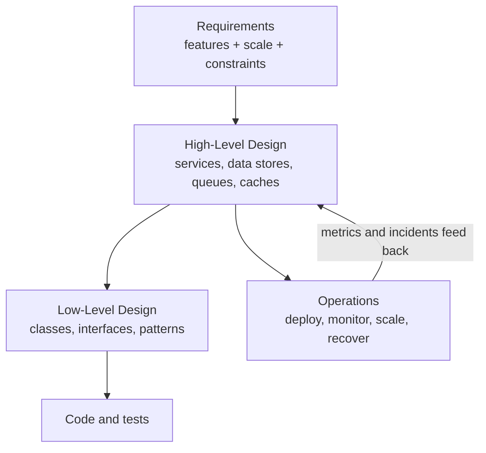

**Diagram walkthrough**
1. Everything starts from **requirements** — what the system must do and at what scale.
2. **HLD** picks the big building blocks (e.g., "API servers behind a load balancer, Postgres primary with read replicas, Redis cache").
3. **LLD** decides how each block is coded internally.
4. **Operations** (monitoring, incidents) reveal bottlenecks that feed back into the HLD. Design is a loop, not a one-time event.

**Real-world example:** Instagram started as a Django monolith on a handful of servers with Postgres. As usage grew, they added read replicas, then sharded Postgres by user ID, added Memcached/Redis, and moved feeds to precomputed timelines. Each step was a *system design decision driven by a specific bottleneck*.

**Interview perspective**
> **Q: What is the interviewer actually testing in a system design round?**
> "Not whether I know a 'correct' architecture — there isn't one. They're testing whether I can turn a vague problem into clear requirements, make reasonable estimates, propose a working design, find its weak points, and justify trade-offs. Communication and structured thinking matter as much as technical knowledge."

**Common mistakes**
- Jumping straight to drawing boxes (Kafka! Kubernetes!) before understanding the problem.
- Treating it as a trivia quiz instead of a collaborative design conversation.
- Designing for Google scale when the stated scale is 10,000 users.

**Quick revision**
- System design = components + interactions + data flow that satisfy requirements at scale.
- HLD = boxes and arrows; LLD = classes and patterns.
- Requirements drive every decision; there is no universally correct design, only justified trade-offs.

---

## 2. Requirements

> **Theme:** Think before you draw. Requirements drive everything.

This is the **most important first step** in any design. Never skip it — a brilliant design for the wrong problem scores poorly.

### 2.1 Functional Requirements

> **Level:** 🟢 Essential

**What is it?** Functional requirements (FRs) describe **what the system does** — its features and behaviours, from the user's point of view.

**Example — URL shortener:**
- A user submits a long URL and receives a short URL.
- Visiting the short URL redirects to the original.
- Users can optionally set a custom alias.
- Links expire after 1 year by default.

**How to gather them in an interview**
1. Ask: *"Who are the users and what are the core things they need to do?"*
2. List **3–5 core features**. Write them down visibly.
3. Explicitly mark some features **out of scope** ("I'll skip analytics dashboards unless you want them").
4. Confirm: *"Should I focus on the shortening and redirect flow?"*

> **Interview tip:** Prioritise. Interviewers prefer a deep design of 3 features over a shallow design of 12.

### 2.2 Non-Functional Requirements

> **Level:** 🟢 Essential

**What is it?** Non-functional requirements (NFRs) describe **how well** the system must behave — its quality attributes. NFRs usually drive the *architecture* far more than FRs do. Two systems with identical features (a chat app for 50 people vs. WhatsApp) can have completely different designs because of NFRs.

| NFR | Description | Example (URL shortener) |
|---|---|---|
| **Availability** | Fraction of time the system is usable | 99.99% ≈ 52 min downtime/year |
| **Latency** | How long one request takes | Redirect p99 < 50 ms |
| **Throughput** | How many requests per second (QPS/RPS) | 10,000+ redirect QPS |
| **Durability** | Committed data is never lost | URLs kept for 5 years |
| **Consistency** | Do all readers see the latest write? | Eventual is OK for redirects |
| **Scalability** | Handles growth without redesign | 100M users without a rewrite |
| **Security / Privacy** | Access control, abuse prevention | Block malicious URLs, rate-limit creation |
| **Cost** | Infra budget | Cheap storage for cold links |

> **Interview tip:** Call out the **top 2–3 NFRs that will drive your design.** For example: *"This is a read-heavy system, so I'll optimise for low-latency reads over write throughput, and eventual consistency is acceptable."*

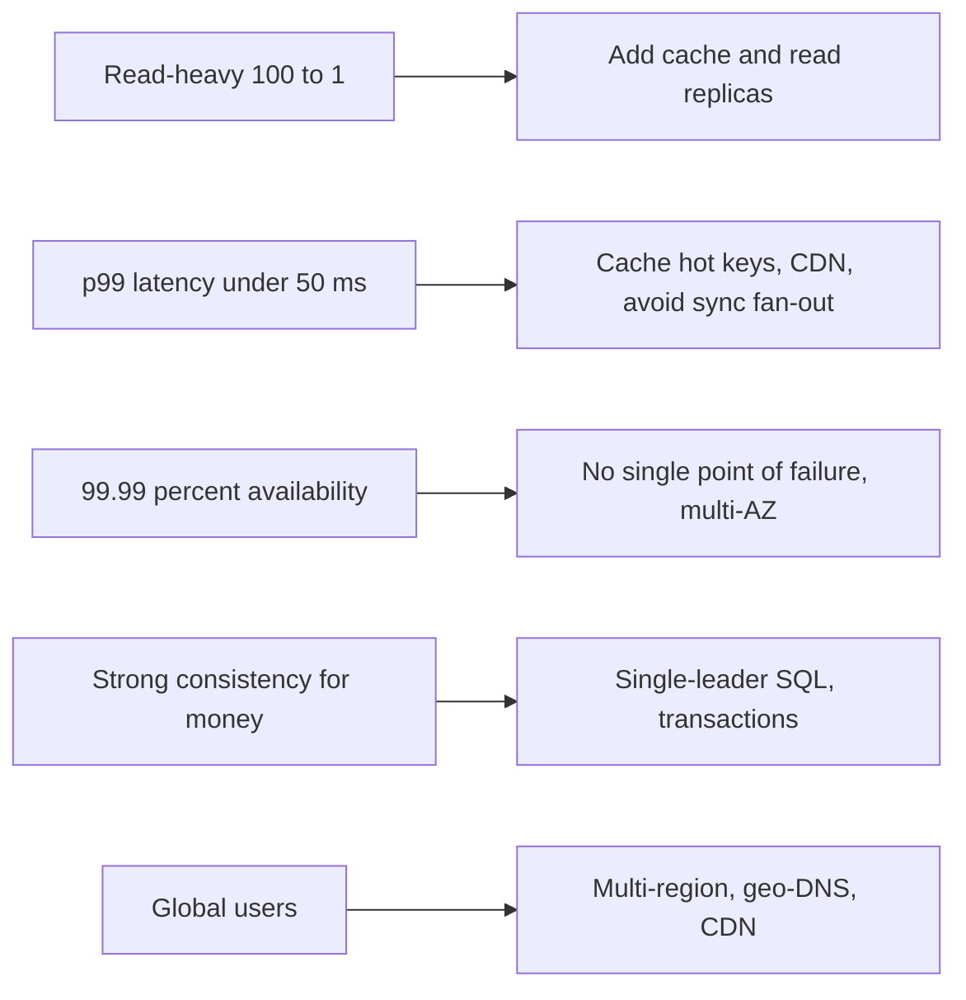

**Diagram walkthrough:** each NFR on the left forces a concrete architectural choice on the right. This is why you clarify NFRs *before* drawing — they decide whether you need a cache, a CDN, multi-region deployment, or strong transactions.

### 2.3 Constraints and Assumptions

> **Level:** 🟢 Essential

**Constraints** are facts you must work within; **assumptions** are things you decide to be true so you can proceed. State both explicitly — this is senior-level behaviour.

| Constraint to clarify | Why it matters |
|---|---|
| Read vs write ratio | Drives caching, replicas, DB choice |
| Global vs regional users | Drives CDN, multi-region replication |
| Consistency requirement | Drives replication mode and DB choice (along with data shape and access patterns) |
| Data size and growth | Drives sharding, storage tier |
| Latency budget | Drives caching, sync vs async |
| Budget / team size | Limits operational complexity (e.g., microservices) |
| Existing tech stack | May limit choices |

**Good assumptions to state out loud**
- "I'll assume 100M daily active users."
- "I'll assume reads are ~100× more frequent than writes."
- "I'll assume eventual consistency is acceptable for analytics counters."
- "I'll assume we're designing for global scale, starting in one region."

> **Interviewers reward explicit assumptions.** Unstated assumptions lead to a design that solves the wrong problem — and stating them gives the interviewer a chance to correct you early.

**Common mistakes (Section 2)**
- Listing NFRs generically ("it should be scalable and fast") without numbers.
- Forgetting the read/write ratio — the single most useful number in most designs.
- Not writing scope down, then drifting into unrelated features.

**Quick revision**
- FR = *what*; NFR = *how well*; NFRs drive architecture.
- Always quantify: users, QPS, latency targets, availability target, data retention.
- State assumptions and out-of-scope items explicitly.

---

## 3. Core Quality Attributes

These words are used loosely in industry, but interviewers expect precise meanings.

### 3.1 Scalability

> **Level:** 🟢 Essential

**What is it?** Scalability is the system's ability to **handle more load (users, data, requests) by adding resources**, ideally with performance staying acceptable and cost growing roughly linearly.

**Why it matters:** load grows unevenly — a viral post, a sale, a new market. A scalable system absorbs growth by adding machines, not by rewriting code.

**Dimensions of scale**
- **Load scalability** — more requests per second.
- **Data scalability** — more stored data (TBs → PBs).
- **Geographic scalability** — users spread across continents.
- **Organisational scalability** — more teams working independently (one reason for microservices — see [Architecture Styles](06_architecture_reliability_and_security.md#1-architecture-styles)).

**Key idea — performance problem vs scalability problem**
- *Performance problem:* the system is slow for **one** user (fix the code, add an index).
- *Scalability problem:* the system is fast for one user but slow **under load** (fix the architecture: cache, replicate, shard, scale out).

How to scale is covered in [Section 5](#5-vertical-vs-horizontal-scaling).

### 3.2 Availability

> **Level:** 🟢 Essential

**What is it?** Availability is the **percentage of time a system is operational and able to serve requests**.

```
Availability = uptime / (uptime + downtime)
             ≈ MTBF / (MTBF + MTTR)
MTBF = mean time between failures, MTTR = mean time to recovery
```

The second formula shows **two levers**: fail less often (higher MTBF) or **recover faster (lower MTTR)**. In practice, reducing MTTR — automatic failover, fast rollbacks, good alerts — is usually cheaper than preventing every failure.

**The "nines" table — memorise the bold rows**

| Availability | Downtime per year | Downtime per month | Typical for |
|---|---|---|---|
| 99% ("two nines") | 3.65 days | 7.3 hours | Internal tools |
| **99.9% ("three nines")** | **8.77 hours** | **43.8 minutes** | Most SaaS products |
| 99.95% | 4.38 hours | 21.9 minutes | Many cloud SLAs |
| **99.99% ("four nines")** | **52.6 minutes** | **4.4 minutes** | Payments, core platforms |
| 99.999% ("five nines") | 5.26 minutes | 26 seconds | Telecom, critical infra |

**Availability of combined components**

- **In series** (request needs A *and* B): `A_total = A1 × A2`. Two 99.9% components in series → 99.8%. *Every dependency you add lowers availability.*
- **In parallel** (request needs A *or* B — redundancy): `A_total = 1 − (1 − A1) × (1 − A2)`. Two 99.9% replicas in parallel → 99.9999%. *Redundancy raises availability.*

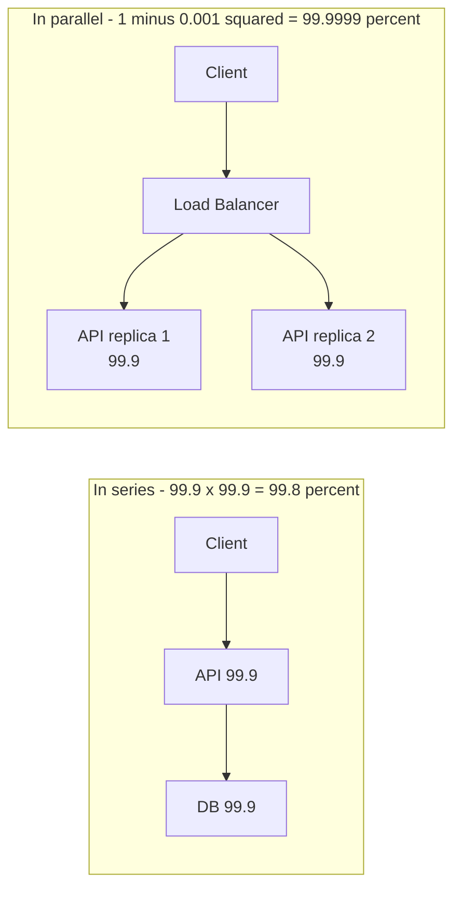

**Diagram walkthrough**
1. In the top chain, the request fails if **either** the API or the DB fails, so their unavailabilities add up (roughly 0.1% + 0.1% = 0.2% down).
2. In the bottom setup, the request fails only if **both** replicas are down at the same time (0.1% × 0.1% = 0.0001%).
3. Caveat: the parallel math assumes failures are **independent**. Two replicas in the same rack, sharing the same bad deploy, are not independent — that's why we spread across availability zones and roll out gradually.

**Single Point of Failure (SPOF)** — a component whose failure takes down the whole system. Finding and removing SPOFs is a core interview step.

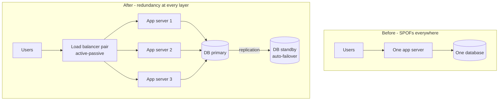

**Walkthrough:** in "before", any one box failing = outage. In "after", the load balancer is a redundant pair, app servers are stateless and interchangeable, and the database has a standby that is promoted automatically if the primary dies (see [Replication and Read Replicas](03_databases_and_storage.md#8-replication-and-read-replicas)). Remaining risk: a whole data-centre outage — solved with multi-AZ / multi-region ([Designing for Failure](06_architecture_reliability_and_security.md#6-designing-for-failure)).

### 3.3 Reliability vs Availability

> **Level:** 🟡 Intermediate

| | Availability | Reliability |
|---|---|---|
| Question | *Is the system up right now?* | *Does the system do the **right thing** consistently over time?* |
| Measured by | Uptime % | Correct responses %, MTBF, error rate |
| Example of failure | Server returns 503 | Server returns 200 **with wrong data** |

A system can be **available but unreliable**: it always responds, but sometimes returns stale prices or drops messages. Reliability includes correctness. *A reliable system is (usually) available; an available system is not necessarily reliable.*

### 3.4 Durability

> **Level:** 🟢 Essential

**What is it?** Durability means **once data is acknowledged as saved, it is never lost** — even if machines crash, disks die, or a data centre burns down.

**How it's achieved**
1. **Write-ahead log (WAL)** — the database writes the change to an append-only log on disk (and `fsync`s it) before acknowledging.
2. **Replication** — copies on multiple machines/zones (S3 stores objects redundantly across ≥3 AZs and advertises 99.999999999% — "11 nines" — durability).
3. **Backups and point-in-time recovery** — protect against logical errors (a bad `DELETE`), which replication would faithfully copy.

> **Durability ≠ availability.** S3 is designed for 11 nines of durability but its availability SLA is ~99.9%. Your data is almost never lost, but occasionally you can't read it for a few minutes.

### 3.5 Fault Tolerance vs High Availability

> **Level:** 🟡 Intermediate

| | High Availability (HA) | Fault Tolerance (FT) |
|---|---|---|
| Goal | Minimise downtime | **Zero** interruption when a component fails |
| On failure | Short blip during failover (seconds) | Users notice nothing |
| How | Redundancy + fast failover | Full redundancy, active-active, consensus, often lockstep |
| Cost | Moderate | High |
| Example | Postgres primary + standby with automatic failover | Aircraft flight computers; multi-AZ active-active with quorum writes |

**Fault** = one component misbehaving (a disk, a node). **Failure** = the whole system stops providing its service. Fault tolerance is about preventing faults from becoming failures.

### 3.6 Maintainability and Other Attributes

> **Level:** 🟡 Intermediate

- **Maintainability** — how easily engineers can understand, change, and operate the system (operability, simplicity, evolvability). Often the most expensive attribute over a system's life. LLD principles in [File 10](10_low_level_design_and_patterns.md) serve this.
- **Observability** — can you tell what's wrong from the outside? (logs, metrics, traces — see [Observability](06_architecture_reliability_and_security.md#8-observability)).
- **Security** — confidentiality, integrity, availability of data ([Security Fundamentals](06_architecture_reliability_and_security.md#11-security-fundamentals)).
- **Cost efficiency** — doing the job at an acceptable cost per request/user.

**Interview perspective (Section 3)**
> **Q: You have an API at 99.9% that depends on three services, each 99.9%. What's your end-to-end availability, and how would you improve it?**
> "In series that's 0.999⁴ ≈ 99.6%, roughly 35 hours of downtime a year — worse than any individual part. To improve it I'd (1) remove hard dependencies from the critical path — make non-essential calls async or optional with fallbacks; (2) add redundancy to each dependency so each one is effectively much higher than 99.9%; (3) use timeouts and circuit breakers so a slow dependency degrades gracefully instead of failing the whole request."

> **Q: What's the difference between durability and availability?**
> "Durability is about never losing acknowledged data; availability is about being able to serve requests right now. A system can be durable but temporarily unavailable — S3 is the classic example."

**Common mistakes**
- Promising "five nines" without realising it allows only ~5 minutes of downtime per year, including deploys.
- Assuming redundancy helps when replicas share a failure domain (same rack, same config push).
- Confusing replication with backup — replication copies mistakes too.

**Quick revision**
- Availability ≈ MTBF / (MTBF + MTTR); reduce MTTR with automation.
- Series multiplies availabilities (worse); parallel redundancy improves them (if failures are independent).
- 99.9% ≈ 8.8 h/yr; 99.99% ≈ 53 min/yr.
- Durability = no data loss (WAL + replication + backups). Reliability = correct behaviour. FT = no visible interruption.

---

## 4. Latency, Throughput and Performance

### 4.1 Latency vs Throughput vs Bandwidth

> **Level:** 🟢 Essential

**What are they?**
- **Latency** — the time for **one** request to complete (milliseconds). *"How long do I wait?"*
- **Throughput** — how many requests (or bytes) the system completes **per unit time** (QPS/RPS, MB/s). *"How many can we serve?"*
- **Bandwidth** — the **maximum** data rate a link can carry (e.g., 10 Gbps). Throughput is what you actually achieve; bandwidth is the ceiling.

**Analogy — a highway:** latency is how long one car takes to drive from A to B; bandwidth is the number of lanes; throughput is how many cars actually arrive per hour. Adding lanes (bandwidth) raises throughput but doesn't make any single car faster (latency).

**Why they are different levers**

| Technique | Improves latency? | Improves throughput? |
|---|---|---|
| Caching | ✅ Yes (memory vs disk) | ✅ Yes (less DB work) |
| Adding more servers | ❌ Not per request | ✅ Yes |
| Batching writes | ❌ Often worse per item | ✅ Yes |
| CDN / edge | ✅ Yes (shorter distance) | ✅ Offloads origin |
| Async processing (queue) | ✅ User-perceived latency | ✅ Smooths spikes |
| Faster algorithm / index | ✅ Yes | ✅ Yes |

> Batching is the classic trade-off: Kafka producers batch messages for higher throughput at the cost of a few ms extra latency (`linger.ms`).

**Where latency goes in one request**

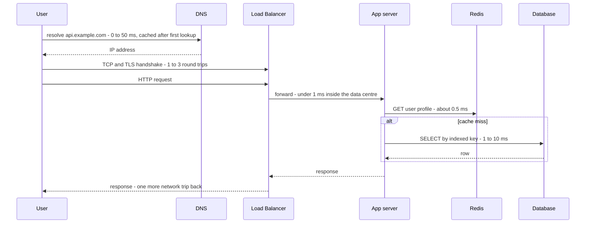

**Walkthrough:** total latency = DNS + connection setup + network round trips + server processing + data access. For a user far away, **network distance dominates** (a cross-continent round trip is ~150 ms), which is why CDNs and regional deployments matter more than micro-optimising code. Inside the data centre, **disk/DB access dominates**, which is why caching matters.

### 4.2 Percentiles and Tail Latency

> **Level:** 🟢 Essential

**What is it?** A percentile tells you the latency under which a given fraction of requests complete. **p50** (median) = half are faster; **p99** = 99% are faster, 1% are slower. The slow end is called the **tail**.

**Why averages lie**

```
Request latencies (ms): [10, 12, 11, 9, 13, 10, 11, 12, 500, 12]
Average = 60 ms     <- looks bad and represents nobody
p50     = 11.5 ms   <- typical user
p95/p99 = 500 ms    <- the unlucky user who really exists
```

**Why tail latency matters at scale — fan-out amplification.** If one page load calls 100 backend services in parallel, the page is as slow as the **slowest** call. If each service has a 1% chance of being slow, the chance at least one is slow is `1 − 0.99^100 ≈ 63%`. *Your p99 becomes most users' experience.*

**Techniques to reduce tail latency:** timeouts, hedged requests (send a duplicate to another replica after the p95 time), avoiding synchronous fan-out, isolating noisy neighbours, GC tuning, caching hot keys.

> SLOs are defined on percentiles (e.g., "p99 < 200 ms"), never on averages — see [SLI, SLO, SLA and Error Budgets](06_architecture_reliability_and_security.md#9-sli-slo-sla-and-error-budgets).

### 4.3 Littles Law

> **Level:** 🟡 Intermediate

**What is it?** Little's Law is a simple law connecting throughput, latency and concurrency for any stable system:

```
L = λ × W
L = average number of requests in the system (concurrency)
λ = arrival rate (throughput, requests/second)
W = average time each request spends in the system (latency, seconds)
```

**Why it's useful in interviews — sizing thread pools and connection pools.**
- 10,000 RPS with 200 ms average latency → `L = 10,000 × 0.2 = 2,000` requests in flight at any moment.
- If each server handles 200 concurrent requests (e.g., 200 worker threads), you need **≥ 10 servers** (plus headroom).
- If a downstream dependency slows from 200 ms to 2 s, in-flight requests jump to 20,000 — threads exhaust and the service falls over. This is exactly why **timeouts and bulkheads** exist ([Bulkhead](05_distributed_systems_and_messaging.md#17-bulkhead)).

### 4.4 Latency Numbers Every Engineer Should Know

> **Level:** 🟢 Essential — memorise the orders of magnitude, not exact values.

| Operation | Approx. time |
|---|---|
| L1 cache reference | 0.5 ns |
| Branch mispredict | 5 ns |
| L2 cache reference | 7 ns |
| Mutex lock/unlock | 25 ns |
| Main memory reference | 100 ns |
| Compress 1 KB (Snappy/LZ4) | 2–3 µs |
| Send 1 KB over a 1 Gbps network | 10 µs |
| SSD random read (4 KB) | 16–100 µs |
| Read 1 MB sequentially from memory | ~10–250 µs |
| Round trip within the same data centre | 0.5 ms |
| Redis GET including network (same DC) | ~0.2–1 ms |
| Read 1 MB sequentially from SSD | ~1 ms |
| Indexed DB lookup (warm) | 1–5 ms |
| HDD seek | 10 ms |
| Read 1 MB sequentially from HDD | ~20 ms |
| Round trip, same continent | 20–50 ms |
| Round trip, cross-continent (US ↔ EU) | ~150 ms |

**Takeaways**
1. Memory ≫ SSD ≫ HDD ≫ cross-region network. Each step is 10–1000× slower.
2. **Avoid cross-region calls on the hot path.**
3. **Sequential I/O is much faster than random I/O** — this is why Kafka and LSM-tree databases (Cassandra) are fast at writes.
4. Compress before sending over the network — CPU is cheap compared to network time.

**Interview perspective**
> **Q: Your API's p50 is 20 ms but p99 is 2 s. What do you investigate?**
> "Tail problems usually come from a subset of requests hitting something slow: cache misses going to the DB, GC pauses, lock contention, a slow downstream in a fan-out, cold instances, or noisy neighbours. I'd look at traces of the slow requests specifically, check whether they correlate with particular endpoints, users (hot keys or very large accounts) or instances, then fix the cause — add timeouts, hedge requests, cache the hot path, or isolate the expensive workload."

**Common mistakes**
- Reporting averages instead of percentiles.
- Thinking more servers reduces per-request latency.
- Ignoring network distance for global users.

**Quick revision**
- Latency = time per request; throughput = requests per second; bandwidth = maximum capacity.
- Use p95/p99; tail latency amplifies with fan-out.
- Little's Law `L = λ × W` sizes thread pools and shows why slow dependencies kill services.
- Memory ~100 ns, SSD ~100 µs, same-DC RTT ~0.5 ms, cross-continent ~150 ms.

---

## 5. Vertical vs Horizontal Scaling

> **Theme:** Design for ~10× your current load. Build for where you're going, not just where you are — but don't build for 1000×.

### 5.1 Vertical Scaling

> **Level:** 🟢 Essential

**What is it?** Vertical scaling (**scale up**) means giving the **same machine** more resources: more CPU cores, more RAM, faster disks.

```
Before: 4 cores, 16 GB RAM
After:  64 cores, 512 GB RAM
```

**Pros:** simple; no code changes; no distributed-systems problems (no partitions between nodes, transactions stay local).
**Cons:** hard ceiling (the biggest machine available); cost grows super-linearly at the high end; still a **single point of failure**; upgrades often require downtime.

### 5.2 Horizontal Scaling

> **Level:** 🟢 Essential

**What is it?** Horizontal scaling (**scale out**) means adding **more machines** and spreading the load across them.

```
Before: 1 server
After:  10 servers behind a load balancer
```

**Pros:** near-unlimited growth; fault tolerance (one server dies, others continue); commodity hardware; elastic — scale up and down with traffic.
**Cons:** the application must be **stateless** (or state must be partitioned); needs a load balancer; data consistency becomes harder; more operational complexity.

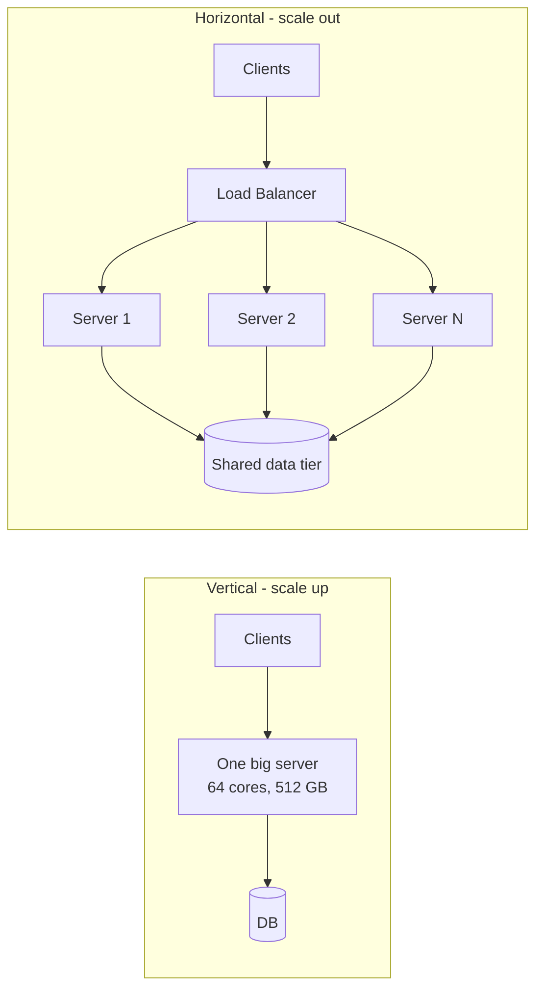

**Walkthrough:** vertically, every request still hits one box — simple, but one failure is an outage and you hit a ceiling. Horizontally, the load balancer ([Load Balancers](02_networking_and_communication.md#12-load-balancers)) spreads requests across interchangeable servers; the bottleneck moves to the **shared data tier**, which then needs its own scaling (caching, replicas, sharding).

**When to use each**

| Scenario | Recommendation |
|---|---|
| Early-stage startup / MVP | Vertical first — simpler and cheaper to operate |
| Proven product, growing fast | Horizontal for the app tier |
| Stateless services (APIs) | Horizontal — easy and cheap |
| Relational database | Vertical first → read replicas → caching → sharding last |
| Stateful services (sessions, WebSockets) | Externalise state first, then scale out |

### 5.3 Stateless Services

> **Level:** 🟢 Essential

**What is it?** A **stateless** service keeps **no user-specific data in its own memory or local disk between requests**. Every request carries (or can fetch) everything needed to process it. State lives in a shared store — Redis, a database, object storage.

**Why it matters for scaling**

```
Stateful:  user's session stored in Server A's memory
           LB routes next request to Server B -> session not found ❌
           Server A dies -> all its users are logged out ❌

Stateless: session stored in Redis (or carried in a signed JWT)
           any server can handle any request ✅
           add/remove servers freely; autoscaling just works ✅
```

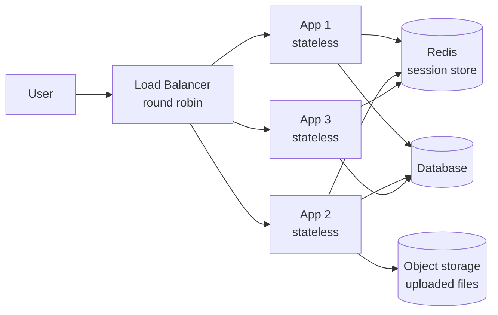

**Walkthrough**
1. The user's first request lands on App 1, which creates a session, writes it to **Redis** (key `session:<id>`), and returns a session cookie.
2. The next request lands on App 3. App 3 reads the session from Redis — same result. The user never notices which server served them.
3. If App 2 crashes, the load balancer's health check removes it; no sessions are lost because none lived there.
4. Uploaded files go to object storage (S3), never to an app server's local disk.
5. **Failure note:** Redis is now critical — run it replicated (Sentinel/Cluster, see [Redis](04_caching.md#6-redis)), or use JWTs so session data travels with the request ([Authentication and Authorization](06_architecture_reliability_and_security.md#10-authentication-and-authorization)).

**How to make services stateless**
- Store sessions in Redis or use signed tokens (JWT).
- Store files in object storage ([Object, File and Block Storage](03_databases_and_storage.md#13-object-file-and-block-storage)).
- Don't rely on in-memory caches for correctness — only as an optimisation.
- Avoid sticky sessions unless the protocol needs them (e.g., long-lived WebSocket connections).

> **Rule:** If you can kill and restart any instance without users noticing, your service is stateless. That's the goal.

### 5.4 The Typical Scaling Journey

> **Level:** 🟡 Intermediate

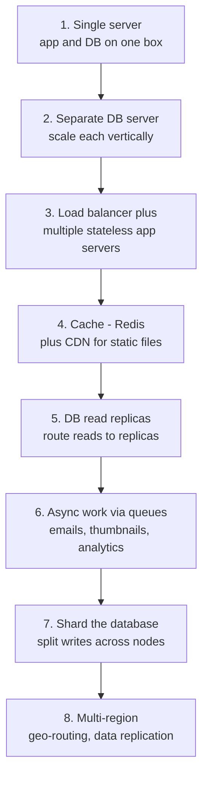

**Walkthrough:** each step is taken **only when a measured bottleneck demands it**. Most systems never need step 7. Sharding is a last resort because it complicates queries, transactions and operations ([Partitioning and Sharding](03_databases_and_storage.md#9-partitioning-and-sharding)).

**Interview perspective**
> **Q: Why not just scale vertically forever?**
> "There's a hardware ceiling, the cost curve gets steep at the top end, and one big box is still a single point of failure. Vertical scaling is a great *first* step because it's simple — I'd use it for the database until replicas and caching are needed — but for the stateless app tier, horizontal scaling gives both capacity and fault tolerance."

> **Q: What does it mean for a service to be stateless, and why does it matter?**
> "It holds no per-user state in its own memory between requests; state is externalised to Redis, a DB, or object storage. That lets any instance serve any request, so I can autoscale, do rolling deploys and survive instance crashes without sticky sessions."

**Common mistakes**
- Saying "we'll scale horizontally" without explaining how state and the database scale.
- Using sticky sessions as a crutch — they create uneven load and lose sessions on failure.
- Sharding before trying caching and read replicas.

**Quick revision**
- Vertical = bigger box (simple, ceiling, SPOF). Horizontal = more boxes (scalable, fault tolerant, needs statelessness).
- Stateless app tier + shared state store is the default modern pattern.
- Scale in steps, driven by measured bottlenecks: LB → cache → replicas → queues → shards → multi-region.

---

## 6. Capacity Estimation

> **Theme:** Numbers give your design credibility. Estimate, don't guess — and round aggressively.

> **Level:** 🟢 Essential

**What is it?** Back-of-the-envelope estimation: quick, approximate calculations of **traffic (QPS), storage, bandwidth, memory (cache) and server counts**.

**Why do we need it?** Estimates decide the architecture:
- Can one database handle the writes, or do we need sharding?
- Does the hot data fit in a single Redis node?
- How many app servers do we need?
- Is bandwidth (e.g., video) the real cost driver?

> Interviewers care about the **method and the order of magnitude**, not precise digits. State assumptions, round to friendly numbers, and sanity-check.

### 6.1 The Estimation Toolkit

**Data units (powers of 2 ≈ powers of 10)**

| Power of 2 | Exact | Approx. | Unit |
|---|---|---|---|
| 2^10 | 1,024 | ~1 thousand | 1 KB |
| 2^20 | 1,048,576 | ~1 million | 1 MB |
| 2^30 | ~1.07 billion | ~1 billion | 1 GB |
| 2^40 | ~1.1 trillion | ~1 trillion | 1 TB |
| 2^50 | ~1.13 quadrillion | ~1 quadrillion | 1 PB |

**Time**

| Period | Seconds | Use for math |
|---|---|---|
| 1 day | 86,400 | **~10^5** (100,000) |
| 1 month | ~2.6 million | ~2.5 × 10^6 |
| 1 year | ~31.5 million | ~3 × 10^7 |

**Handy conversions**
- **1 million requests/day ≈ 12 QPS** (10^6 / 86,400 ≈ 11.6).
- **1 billion requests/day ≈ 12,000 QPS.**
- Peak ≈ **2–3× average** for most consumer apps (up to 10× for flash sales or live events).

**Typical sizes**

| Item | Approx. size |
|---|---|
| ASCII / UTF-8 Latin character | 1 byte |
| int / long / timestamp | 4 / 8 / 8 bytes |
| UUID | 16 bytes binary (36 as text) |
| Tweet-like text post + metadata | ~0.5–1 KB |
| Compressed photo | 200 KB – 2 MB |
| 1 minute of 1080p video | ~50–100 MB |

**Rough per-node capacities (order of magnitude, simple requests)**

| Component | Ballpark |
|---|---|
| Stateless app server (JVM, simple JSON API) | 1,000–10,000 RPS |
| Postgres / MySQL single primary | ~5,000–20,000 simple writes/s; more reads |
| Redis single node | ~100,000+ ops/s |
| Kafka broker | hundreds of MB/s |
| Cassandra node | ~10,000+ writes/s |

### 6.2 The Estimation Formula

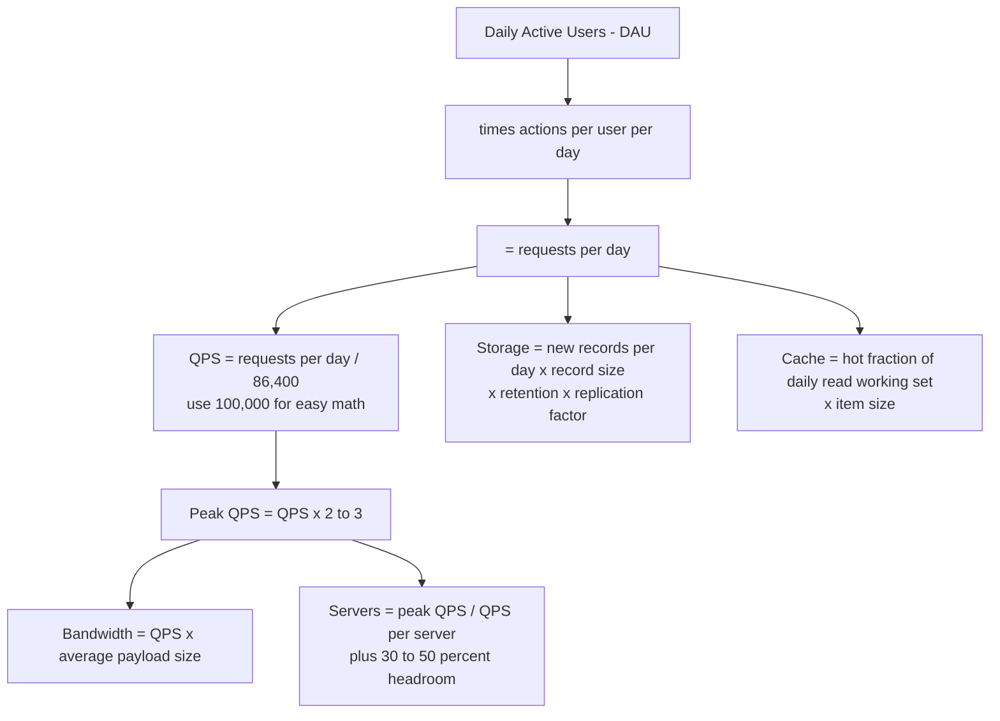

**Walkthrough:** start from users, derive daily request counts, then convert to per-second rates. Storage comes from the **write** rate; bandwidth and server counts come from **peak** rates; cache size comes from the **working set** (the data actively read), not from total data.

### 6.3 Worked Estimate — URL Shortener

> This estimate is reused in the full design: [URL Shortener](07_interview_problems_part1.md#1-url-shortener).

**Assumptions (say them out loud)**
- 100M DAU.
- Each user creates **1** short URL/day (write) and visits **10** short URLs/day (read) → read:write = 10:1.
- Average long URL ≈ 200 bytes; record ≈ 250 bytes with metadata.
- Retention: 5 years.

**Step 1 — QPS**

```
Writes: 100M/day -> 100M / 86,400 ≈ 1,200 writes/s  -> peak ≈ 2,400–3,600/s
Reads:  1B/day   -> 1B / 86,400   ≈ 11,600 reads/s  -> peak ≈ 23,000–35,000/s
```

**Step 2 — Storage**

```
Per record:
  short code       7 bytes
  long URL         200 bytes
  user ID          8 bytes
  created_at       8 bytes
  expires_at       8 bytes
  overhead/index   ~20 bytes
  ≈ 250 bytes

Per day:   100M × 250 B = 25 GB/day
Per year:  25 GB × 365 ≈ 9 TB/year
5 years:   ≈ 45 TB   (≈ 135 TB with 3× replication)
Records:   100M × 365 × 5 ≈ 180 billion URLs
```

> ⚠️ **Correction of the original notes:** an earlier Q&A claimed ~125 GB over 5 years — that assumed 100M URLs per *year*. With 100M new URLs per *day*, the answer is ~45 TB, which **does** require partitioning across nodes (or a horizontally scalable key-value store such as DynamoDB or Cassandra).

**Step 3 — Short-code length sanity check**

```
Base62 alphabet (a–z, A–Z, 0–9) = 62 symbols
62^6 ≈ 57 billion    <- not enough for 180B URLs
62^7 ≈ 3.5 trillion  <- plenty -> use 7 characters
```

**Step 4 — Bandwidth**

```
Writes: 1,200/s × ~250 B ≈ 300 KB/s                    -> trivial
Reads:  11,600/s × ~500 B (HTTP 301/302 + headers) ≈ 6 MB/s
Peak:   ≈ 15–20 MB/s                                    -> easily handled
```

**Step 5 — Cache**

```
Pareto rule: ~20% of URLs get ~80% of traffic.
Read working set per day: assume ~100M distinct URLs are read in a day.
Cache the hot 20%: 20M × 250 B ≈ 5 GB
-> fits comfortably in one Redis node (32–64 GB RAM); add a replica for HA.
```

> ⚠️ **Correction:** the cache is sized from the hot fraction of the **daily read working set**, and it does *not* grow by "5 GB per day" — eviction (LRU) keeps it at a fixed size. The [full URL shortener design](07_interview_problems_part1.md#1-url-shortener) assumes ~200M distinct URLs/day and gets ~10–20 GB. Different assumptions give different numbers, which is why you state them out loud.

**Step 6 — Servers**

```
Peak reads ≈ 35,000 QPS; with a ~90% cache hit rate only ~3,500 QPS reach the DB tier.
App tier: if one instance handles ~3,000 simple redirects/s -> ~12 instances, + headroom ≈ 15–20.
```

**Summary table**

| Metric | Value | Design implication |
|---|---|---|
| Write QPS | ~1,200 (peak ~3,000) | Modest — fine for a partitioned store |
| Read QPS | ~11,600 (peak ~35,000) | **Cache aggressively**, add read replicas |
| Storage (5 yrs) | ~45 TB raw | **Must partition** — choose a horizontally scalable store |
| Bandwidth | ~6 MB/s reads | Not a concern |
| Cache | ~5 GB | One Redis node + replica |
| Bottleneck | Read latency + total data size | Cache + sharded KV store |

> **Interview insight:** the 10:1 read:write ratio immediately tells you to optimise the read path. Keep the redirect path under ~10 ms server-side using a cache.

### 6.4 Reference Scales of Real Systems

Useful for sanity-checking ("is my number plausible?"). Figures are public, approximate, and change over time.

| System | Key metric | Rough scale |
|---|---|---|
| Twitter/X | Tweets per second | ~6,000 average; spikes far higher |
| WhatsApp | Messages per day | ~100 billion |
| YouTube | Video uploaded | ~500 hours per minute |
| Uber | Driver location updates | ~1M pings per second at global peak |
| Netflix | Bandwidth | historically ~15% of global downstream internet traffic (older figures quoted ~37% of US peak traffic) |
| Google Search | Queries per day | ~8+ billion |

**Interview perspective**
> **Q: Walk me through estimating QPS for 100M DAU.**
> "If each user makes ~10 requests a day, that's 1B requests/day. Divide by ~10^5 seconds → ~10,000 QPS average. Peak at 2–3× → 20,000–30,000 QPS. That tells me a single DB can't take all reads directly — I'll need caching and replicas — and that I need on the order of 10–20 app instances."

> **Q: Why does the read:write ratio matter?**
> "It tells me where to optimise. Read-heavy (10:1 or more) → cache, replicas, CDN, denormalised read models. Write-heavy (logging, IoT) → append-optimised stores like Cassandra or Kafka, batching, partitioning, async processing. Optimising the wrong side wastes effort."

**Common mistakes**
- Spending 15 minutes on arithmetic. Budget ~5 minutes; round to powers of 10.
- Forgetting peak vs average, replication factor, or retention.
- Sizing caches from total data instead of the working set.
- Not drawing a conclusion. Every number should end with *"…so we need X."*

**Quick revision**
- 1M/day ≈ 12 QPS; 1B/day ≈ 12k QPS; a day ≈ 10^5 s.
- Storage = writes/day × size × retention × replication.
- Cache = hot % × working set. Servers = peak / per-server capacity + headroom.
- Always state assumptions and finish with a design implication.

---

## 7. CAP Theorem and PACELC

> **Theme:** Traffic distribution is easy; agreeing on data across machines is the fundamental limit of distributed systems.

### 7.1 CAP Theorem

> **Level:** 🟢 Essential

**What is it?** The CAP theorem says that when a distributed data store experiences a **network partition**, it must choose between **Consistency** and **Availability** — it cannot guarantee both.

| Property | Precise meaning |
|---|---|
| **C — Consistency** | Every read receives the most recent write **or an error** (this is *linearizability*, not the "C" in ACID) |
| **A — Availability** | Every request to a non-failed node receives a (non-error) response — not necessarily the latest data |
| **P — Partition tolerance** | The system keeps operating even when messages between nodes are lost or delayed |

**Jargon — network partition:** a network failure that splits nodes into groups that can't talk to each other, although each group is still running. See [Network Partitions and Reconciliation](05_distributed_systems_and_messaging.md#4-network-partitions-and-reconciliation).

**The key insight:** in any real distributed system, **partitions will happen** (switch failures, misconfigured firewalls, cloud zone issues). So P is not optional. The real choice is: **when a partition happens, do you sacrifice C or A?** When there is *no* partition, you can have both.

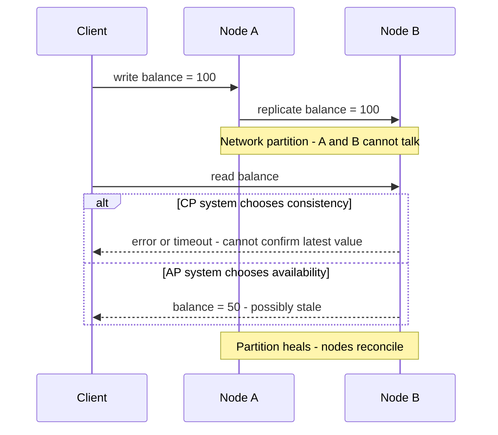

**Walkthrough**
1. The client writes `balance = 100` to Node A; A tries to replicate to B.
2. A partition cuts A off from B before (or while) replication happens.
3. A client reads from B. B cannot know whether it has the latest value.
4. A **CP** system makes B refuse (error/timeout) rather than risk stale data.
5. An **AP** system makes B answer with what it has (maybe the old value 50), and fixes things up after the partition heals.

**CP systems (Consistency + Partition tolerance)** — refuse to serve rather than return stale data.
- Examples: ZooKeeper, etcd, Consul (consensus-based), HBase, MongoDB with majority reads/writes, a single-primary RDBMS where the minority side can't accept writes.
- Use for: financial balances, inventory counts, locks, leader election, configuration — anything where stale data causes real harm.

**AP systems (Availability + Partition tolerance)** — always answer, reconcile later.
- Examples: Cassandra, DynamoDB (default eventually consistent reads), CouchDB, Riak, DNS.
- Use for: social feeds, shopping carts, likes/view counts, product catalogues, analytics.

**CA systems?** Only possible if partitions never happen — i.e., a single node. A single-node Postgres is "CA" in a trivial sense, but it isn't distributed.

> **Interview gotcha:** "CA systems don't really exist in distributed settings. The question is always CP vs AP *during a partition*."

**Nuances seniors mention**
- CAP is a choice **per operation**, not per product. Cassandra with `QUORUM` reads/writes behaves much more like CP; DynamoDB offers strongly consistent reads as an option.
- CAP's "C" is linearizability — a very strict model. Many systems sit in between (see [Section 8](#8-consistency-models)).
- CAP says nothing about **latency** during normal operation — which is why PACELC exists.

### 7.2 PACELC

> **Level:** 🟡 Intermediate

**What is it?** PACELC extends CAP to cover normal operation too:

```
IF there is a Partition (P) -> choose Availability (A) or Consistency (C)
ELSE (E, normal operation)  -> choose Latency (L) or Consistency (C)
```

**Why it matters:** even without failures, strong consistency costs latency — to guarantee every read sees the latest write, a write must be confirmed by other replicas (often across zones) before it's acknowledged.

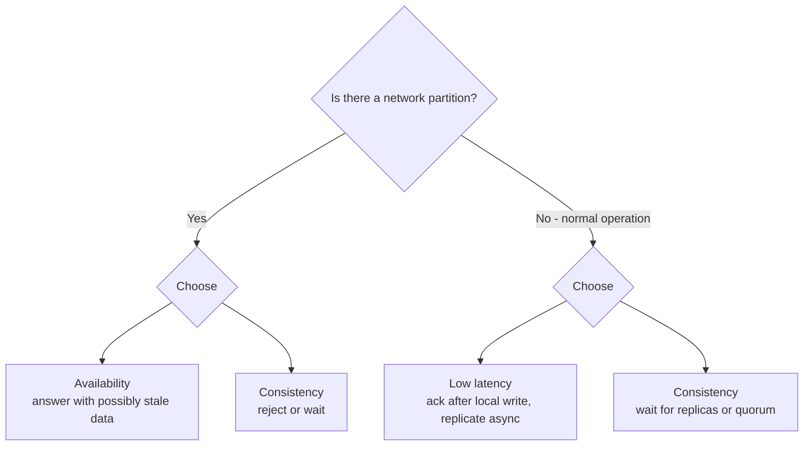

| System | During partition | Normal case | Label |
|---|---|---|---|
| DynamoDB (default) | Availability | Latency | PA/EL |
| Cassandra (default levels) | Availability | Latency | PA/EL |
| MongoDB (majority concern) | Consistency | Consistency | PC/EC |
| HBase | Consistency | Consistency | PC/EC |
| Spanner / CockroachDB | Consistency | Consistency (pays latency) | PC/EC |
| Postgres with synchronous replica | Consistency | Consistency | PC/EC |

**Interview perspective**
> **Q: Explain CAP in simple terms.**
> "When the network between replicas breaks, a replica that can't reach the others has two options: answer with what it has, which may be stale — that's choosing availability — or refuse until it can confirm the latest value — that's choosing consistency. Since partitions are unavoidable, the real decision is CP vs AP, and it's made per use case: a bank balance should be CP, a like counter can be AP."

> **Q: Give an example of a system that should be CP and one that should be AP.**
> "CP: a banking ledger — acting on a stale balance could let someone spend money twice; an error is better than a wrong answer. AP: a social feed — if a post appears two seconds late, no harm done, and being down is worse than being slightly stale."

> **Q: Is it possible to build a CA distributed system?**
> "Not in practice. CA assumes the network never partitions. The moment two nodes can't talk, you must pick stale answers or refusals."

**Common mistakes**
- Saying "we choose two of three" as if P were optional.
- Confusing CAP consistency with ACID consistency (ACID's C means integrity constraints hold).
- Labelling a whole product as "AP" without mentioning tunable consistency.
- Forgetting latency — PACELC's "else" branch is what you live with 99.9% of the time.

**Quick revision**
- Partitions are inevitable → real choice is C vs A during a partition.
- CP: ZooKeeper/etcd/HBase/majority-configured MongoDB. AP: Cassandra/DynamoDB/DNS.
- PACELC: else (no partition) → latency vs consistency.
- Consistency is often tunable per operation.

---

## 8. Consistency Models

> **Level:** 🟡 Intermediate (strong vs eventual is 🟢 Essential)

**What is it?** A consistency model is a **contract between a data store and its clients** about what values reads may return when data is replicated. Stronger models are easier to program against but cost latency and availability.

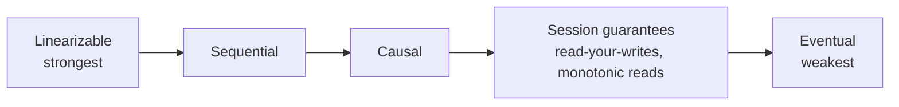

**Walkthrough:** moving right, guarantees get weaker, but latency drops and availability during partitions improves. Each model to the left implies the guarantees of the ones to its right.

### 8.1 Strong Consistency and Linearizability

> **Level:** 🟢 Essential

**What is it?** After a write completes, **every** subsequent read — from any client, any replica — returns that write (or a newer one). The system behaves as if there were **one copy** of the data and each operation happened instantaneously at some point between its start and end.

```
T1: write balance = $100  (acknowledged)
T2: any client, any replica reads balance -> $100 ✅ always
```

**How it's implemented:** single leader handling all reads and writes; or synchronous replication to all/majority before acknowledging; or consensus protocols (Raft/Paxos) — see [Consensus and Leader Election](05_distributed_systems_and_messaging.md#6-consensus-and-leader-election). Quorums with `W + R > N` give overlap but are not strictly linearizable without extra mechanisms (read repair, sloppy quorum disabled) — see [Quorum Reads and Writes](05_distributed_systems_and_messaging.md#3-quorum-reads-and-writes).
**Cost:** higher write latency; lower availability during failures.
**Use when:** money, inventory, unique usernames, locks, seat booking.

### 8.2 Sequential Consistency

> **Level:** 🔴 Advanced

All clients see **all operations in the same order**, and each client's own operations appear in the order it issued them — but that global order doesn't have to match real (wall-clock) time. A client may see slightly old state, but never a different *order* of events than another client.

### 8.3 Causal Consistency

> **Level:** 🔴 Advanced

Operations that are **causally related** are seen by everyone in the same order; unrelated (concurrent) operations may be seen in different orders.

**Example:** Alice posts "I got the job!" and Bob replies "Congrats!". Causal consistency guarantees nobody sees Bob's reply *before* Alice's post. Two unrelated posts by strangers may appear in different orders for different users.
**How:** track dependencies with version vectors / vector clocks or logical timestamps ([Time, Clocks and Ordering](05_distributed_systems_and_messaging.md#5-time-clocks-and-ordering)); deliver a write only after its dependencies.

### 8.4 Read-Your-Writes and Monotonic Reads

> **Level:** 🟡 Intermediate

These are **session guarantees** — promises to a *single user*, which fix the most visible eventual-consistency bugs cheaply.

- **Read-your-writes:** after *you* write something, *your* later reads always see it. (You update your profile picture, refresh, and see the new one — even if other users see the old one for a few seconds.)
- **Monotonic reads:** once you've seen a value, you never see an *older* value later. (Without it, refreshing a page could make a comment appear, disappear, then reappear as you hit different replicas.)

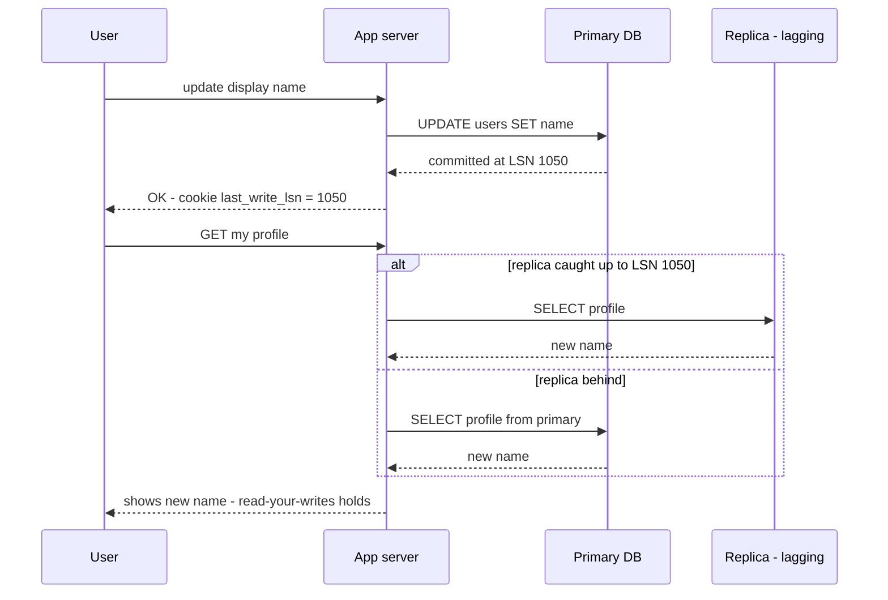

**Walkthrough / implementation options**
1. After a write, remember the write's position (log sequence number, timestamp, or version) in the user's session.
2. On reads, only use a replica that has caught up to that position; otherwise read from the primary.
3. Simpler alternatives: route a user's reads to the primary for ~N seconds after they write; or pin each user to one replica (also gives **monotonic reads**).

### 8.5 Eventual Consistency

> **Level:** 🟢 Essential

**What is it?** If no new writes happen, all replicas will **eventually converge** to the same value. Until then, reads may return stale data. There's no bound on "eventually" in the definition, though in practice it's usually milliseconds to seconds.

```
T1: write balance = $100 to Primary
T2: read from Replica -> $95 (stale, not yet replicated) ⚠️
T3: replication completes
T4: read from Replica -> $100 ✅
```

**How:** asynchronous replication; anti-entropy and read repair to fix divergence; conflict resolution (last-write-wins, CRDTs, application merge) when concurrent writes happen.
**Cost:** temporary inconsistency; application must tolerate stale reads and handle conflicts.
**Use when:** social feeds, profiles, product catalogue, view counters, analytics, DNS.

### 8.6 Summary Table

| Model | Guarantee | Typical implementation | Example use |
|---|---|---|---|
| **Linearizable** | Reads see the latest completed write, real-time order | Single leader + sync/majority replication, Raft | Bank balance, locks, seat booking |
| **Sequential** | Same order for everyone, not necessarily real-time | Total-order broadcast | Replicated state machines |
| **Causal** | Cause before effect for everyone | Vector clocks, dependency tracking | Comments and replies, chat threads |
| **Read-your-writes** | You always see your own writes | Read from leader after write, LSN tracking | Profile updates, settings |
| **Monotonic reads** | Never go back in time | Sticky replica per user | Feeds, comment lists |
| **Eventual** | Replicas converge eventually | Async replication, anti-entropy | Likes, views, catalogue |

**Interview perspective**
> **Q: What is the difference between strong and eventual consistency? Give an analogy.**
> "Strong: after you deposit $100, the bank app immediately shows it everywhere — every read reflects the latest write. Eventual: after you post a tweet, a follower might see it two seconds later. Strong consistency is like a shared whiteboard in one room — everyone sees the same thing at once. Eventual is like posting notices on bulletin boards in several offices — the update reaches each board, but not at the same instant."

> **Q: What is read-your-writes consistency and when is it important?**
> "It guarantees a user always sees their own writes, even if the system is eventually consistent for everyone else. It matters for user-facing edits — after updating your profile you shouldn't see the old one. I implement it by routing that user's reads to the primary for a short window after a write, or by tracking the write's log position and only reading from replicas that have caught up."

**Common mistakes**
- Treating "eventual consistency" as "no guarantees at all" — session guarantees fix most UX problems.
- Choosing strong consistency everywhere "to be safe" — it costs latency and availability you may not need.
- Ignoring conflict resolution for multi-writer systems.

**Quick revision**
- Spectrum: linearizable → sequential → causal → session (RYW, monotonic) → eventual.
- Strong for money/inventory/locks; eventual for feeds/counters; RYW for a user's own edits.
- Pick the **weakest model the business can tolerate** — it's the cheapest and most available.

---

## 9. The Trade-off Mindset

> **Level:** 🟢 Essential — the single most important skill in system design interviews.

**What is it?** There is no perfect system, only **trade-offs**: every choice buys something (speed, simplicity, availability) by paying with something else (cost, consistency, complexity). Interviewers grade *how well you reason about what you are giving up*.

**Common trade-off pairs**

| Trade-off | Choose the first when… | Choose the second when… |
|---|---|---|
| Consistency vs availability | Banking, payments, inventory | Social feeds, analytics, carts |
| Latency vs consistency | Global reads, user-facing speed | Correctness is critical |
| Latency vs durability | Caches, ephemeral state | Financial records, orders |
| Read vs write optimisation | Read-heavy (index, cache, denormalise) | Write-heavy (append logs, fewer indexes) |
| Normalised vs denormalised | Data integrity, frequent updates | Fast reads, rare updates |
| Sync vs async | Caller needs the result now | Work can happen later; resilience matters |
| SQL vs NoSQL | Relations, transactions, ad-hoc queries | Massive scale, known access patterns, flexible schema |
| Push vs pull | Few recipients, real-time needed | Many recipients (celebrities), tolerate delay |
| Cost vs performance | Startup, MVP, cold data | High-traffic, revenue-critical paths |
| Simplicity vs scalability | Early stage, small team | Proven need, measured bottleneck |
| Build vs buy (managed) | Core differentiator | Commodity (auth, queues, DB ops) |

> ⚠️ The original notes drew the CAP triangle as "the holy trinity of trade-offs". CAP only describes behaviour **during network partitions** — it is one trade-off among many above, not the general model.

**How to express trade-offs in interviews**

> ❌ "I'll use Redis for caching."
> ✅ "I'll use Redis for caching to cut DB load on reads. **The trade-off is** that cache invalidation adds complexity and we may serve stale data for up to the TTL — which is acceptable here because a profile picture being 60 seconds stale is harmless."

**Template for every decision**
1. **Decision** — "I'll use X…"
2. **Reason** — "…because requirement Y (from the NFRs)…"
3. **Trade-off** — "…the cost is Z…"
4. **Mitigation / when I'd change it** — "…which we mitigate with W; if requirement V changes, I'd switch to U."

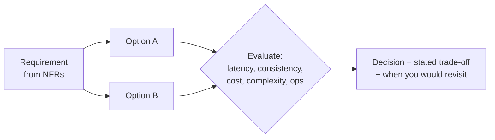

**Interview perspective**
> **Q: What are the most important trade-offs to discuss in a system design interview?**
> "Consistency vs availability and latency — does every read need to be current? Read vs write optimisation — which side is the bottleneck? Latency vs durability — what can live in memory? Sync vs async — does the caller need the result now? And simplicity vs scalability — am I adding complexity before it's needed? Strong candidates don't just pick; they say what they're giving up and when they'd change their mind."

**Common mistakes**
- Presenting choices as obviously correct ("Kafka is best").
- Listing pros only.
- Over-engineering: adding every component "for scale" without a requirement driving it.

**Quick revision**
- Every decision = requirement → option → trade-off → mitigation.
- Always say "**The trade-off is…**".
- Simplest design that meets the NFRs wins; add complexity only for a stated need.

---

## 10. The System Design Interview Framework

> **Level:** 🟢 Essential — apply this to *every* unfamiliar question.

**Why a framework?** Interviewers reward **structured thinking** over jumping to solutions. A fixed sequence stops you from forgetting requirements, lets the interviewer follow you, and gives you something to fall back on when you face an unfamiliar problem.

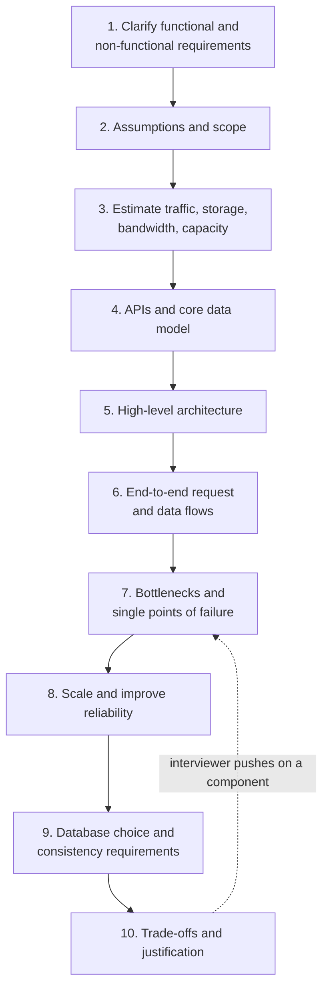

**Walkthrough:** steps 1–4 make sure you're solving the right problem; steps 5–6 produce a working design; steps 7–10 are where senior candidates distinguish themselves. The dotted arrow is important — the interviewer will often ask you to deep-dive a part, which sends you back to bottleneck analysis for that component.

### 10.1 The Ten Steps in Detail

**Step 1 — Clarify functional and non-functional requirements** (≈3–5 min)
- Ask: who are the users? Top 3–5 features? What's explicitly out of scope?
- NFRs with numbers: DAU, read:write ratio, latency target (p99), availability target, consistency needs, data retention, global vs regional.
- *Say:* "Before designing, I'd like to pin down requirements so I build the right thing."

**Step 2 — Identify assumptions and scope** (≈1–2 min)
- Write assumptions visibly ("100M DAU, 10:1 reads, eventual consistency OK for counts").
- Agree on what you will and won't cover.
- *Say:* "I'll assume X; let me know if you'd prefer a different scale."

**Step 3 — Estimate traffic, storage, bandwidth and capacity** (≈3–5 min)
- QPS (average and peak), storage over retention, bandwidth, cache size, server count — [Section 6](#6-capacity-estimation).
- *Always end with a conclusion:* "…so a single DB can't hold this; we'll need partitioning."

**Step 4 — Define APIs and the core data model** (≈5 min)
- 3–5 key endpoints with method, path, request/response, idempotency key where needed ([REST API Design](02_networking_and_communication.md#7-rest-api-design)).
- Main entities, primary keys, and **access patterns** ("fetch by short code", "list by user ordered by time").

**Step 5 — Draw the high-level architecture** (≈5–10 min)
- Client → DNS/CDN → load balancer / API gateway → services → cache → database → queue → workers.
- Start simple and working; don't add Kafka "just because".

**Step 6 — Explain end-to-end request and data flows** (≈5 min)
- Walk the write path and the read path step by step. Mention where data is cached, persisted and replicated.

**Step 7 — Identify bottlenecks and single points of failure** (≈5 min)
- For each box: "what if this is 10× slower / dies / gets a hot key?"
- Typical suspects: the database, a hot partition, a synchronous fan-out, a single queue consumer, the load balancer itself.

**Step 8 — Scale the system and improve reliability** (≈5–10 min)
- Caching, replicas, sharding, async processing, CDN, autoscaling; redundancy, failover, retries with backoff, circuit breakers, rate limiting, multi-AZ.

**Step 9 — Discuss database choices and consistency requirements** (often woven into steps 4–8)
- SQL vs NoSQL justified by access pattern, scale and consistency ([How to Choose a Database](03_databases_and_storage.md#1-how-to-choose-a-database)).
- Which operations need strong consistency (payments, inventory) and which can be eventual (feeds, counters).

**Step 10 — Evaluate trade-offs and justify decisions** (≈3–5 min, and throughout)
- Summarise key decisions with their trade-offs; mention what you'd do with more time (monitoring, security, analytics, multi-region).

### 10.2 Time Budget for a 45-Minute Round

| Minutes | Activity | Steps |
|---|---|---|
| 0–5 | Requirements, scope, assumptions | 1–2 |
| 5–10 | Estimation | 3 |
| 10–15 | APIs and data model | 4 |
| 15–25 | High-level design and flows | 5–6 |
| 25–38 | Deep dives: bottlenecks, scaling, reliability, DB/consistency | 7–9 |
| 38–43 | Trade-offs, alternatives, what you'd improve | 10 |
| 43–45 | Questions for the interviewer | — |

> For 60-minute rounds, extend the deep-dive slot. If the interviewer drives toward a specific component early, **follow them** — the framework is a guide, not a script.

### 10.3 What Interviewers Evaluate by Level

| Level | Expectations |
|---|---|
| **Junior / new grad** | Clarifies requirements; produces a working high-level design; knows basic components (LB, cache, DB, queue); explains a request flow clearly |
| **Mid-level (2–5 yrs)** | Reasonable estimates; correct DB and caching choices with reasons; identifies main bottlenecks; handles 1–2 deep dives; knows common failure handling (retries, idempotency) |
| **Senior (5+ yrs)** | Drives the conversation; quantifies trade-offs; anticipates failure modes (hot keys, partitions, thundering herds, data migration); discusses consistency precisely; considers operability, cost, security, evolution; knows when *not* to add complexity |
| **Staff+** | Multiple viable architectures compared; organisational and long-term implications; phased rollout and migration plans; clear risk analysis |

### 10.4 Design Checklist

Use this mental checklist before you say "I'm done":

```
□ What are the top 3 functional requirements?
□ What are the critical NFRs (latency, availability, consistency)?
□ What is the read:write ratio?
□ What is the peak QPS? Data size over retention?
□ Does the data have relations? → SQL or NoSQL?
□ Is eventual consistency acceptable? For which operations?
□ Where are the hotspots? → Caching needed? Hot keys?
□ Is the service stateless? → Can it scale horizontally?
□ Do I need sharding? → What is the shard key?
□ What fails if a component goes down? Any single point of failure?
□ Are retries safe (idempotent)? What about duplicates?
□ How do we monitor it and know it's healthy?
□ Security: authentication, authorization, rate limiting, abuse?
```

### 10.5 Phrases That Signal Strong Thinking

- "Let me confirm the scope before I start drawing."
- "Given the 100:1 read ratio, I'll optimise the read path first."
- "The simplest version that works is…; now let's see where it breaks."
- "This is a single point of failure — let's make it redundant."
- "The trade-off is…, which is acceptable because…"
- "If the requirement changed to X, I'd switch to Y."
- "I'll keep strong consistency only where money or inventory is involved."
- "Would you like me to go deeper on the storage layer or the real-time delivery path?"

**Common mistakes (framework)**
- Skipping requirements and estimation to "save time" — you lose more time later.
- Monologuing for 20 minutes without checking in.
- Going deep on one component before the end-to-end design exists.
- Ignoring the interviewer's hints ("what happens if this gets popular?" means *talk about hot keys*).
- Never mentioning failure, monitoring or security.

---

## 11. Worked Example Applying the Framework

> **Level:** 🟡 Intermediate — a complete mock interview using all 10 steps.
> **Question:** *"Design a real-time leaderboard for an online multiplayer game."*

### 11.1 Step 1 — Clarify Requirements

> **Interviewer:** Design a real-time leaderboard for our online game.
>
> **You:** Before I start, a few questions. Is this one global leaderboard, or per game mode and season? Do players need their own rank, or just the top list? How "real-time" — sub-second?
>
> **Interviewer:** Per game mode and per season. Players see the top 100 and their own rank with a few neighbours. Updates should appear within about a second.
>
> **You:** Does a player's entry reflect their **best** score or their **cumulative** score? Do we need friends-only leaderboards?
>
> **Interviewer:** Best score for the season. Friends leaderboards are nice-to-have — skip them for now.

**Functional requirements (written on the board)**
1. Submit a score when a match ends.
2. View the top N (N ≤ 100) for a (game mode, season).
3. View my rank and the ±5 players around me.
4. Seasons reset; old seasons remain viewable (read-only).

**Non-functional requirements**
- Score visible on the leaderboard within ~1 s (p99).
- Leaderboard reads p99 < 100 ms.
- Highly available for reads (99.9%+); scores must never be lost (durable).
- Ranking can be **eventually consistent** by up to ~1 s — nobody is harmed by a one-second lag.
- Cheating prevention: scores come from trusted game servers, not clients.

**Out of scope:** friends leaderboards, anti-cheat ML, rewards payout.

### 11.2 Step 2 — Assumptions and Scope

> **You:** I'll assume 20M daily active players, about 5 matches each per day, 10 game modes, and a global season leaderboard per mode with up to ~50M ranked players. I'll design for one region first and discuss global later.

### 11.3 Step 3 — Estimation

```
Score submissions: 20M × 5 = 100M/day ≈ 1,200/s average; peak (evenings, launches) ≈ 5× -> ~6,000/s
Leaderboard reads: say 10 views/player/day = 200M/day ≈ 2,300/s; peak ≈ 12,000/s
  - "Top 100" reads are identical for everyone in a mode -> highly cacheable
  - "My rank" reads are per-player -> must hit the ranking store

Ranking store memory:
  One sorted-set entry ≈ ~100 bytes (member ID + score + skip-list/hash overhead)
  50M players × 100 B ≈ 5 GB per (mode, season) leaderboard at full size
  Realistically most modes are smaller; total across 10 modes ≈ 10–30 GB

Durable storage:
  Match results: 100M/day × ~200 B ≈ 20 GB/day ≈ 7 TB/year (append-only, archivable)
  Best-score table: 50M players × 10 modes × ~50 B ≈ 25 GB per season
```

> **You:** So the hot ranking data fits in memory across a small Redis cluster, and peak write rate of ~6,000/s is well within a single Redis node's ~100k ops/s. The real challenges are rank queries at scale, hot keys for popular modes, and durability — not raw throughput.

### 11.4 Step 4 — APIs and Data Model

**APIs**

```http
POST /v1/modes/{modeId}/seasons/{seasonId}/scores
Headers: Authorization: Bearer <game-server-token>
         Idempotency-Key: <matchId>:<playerId>
Body:    { "playerId": "p42", "score": 4200, "matchId": "m-981" }
-> 202 Accepted

GET /v1/modes/{modeId}/seasons/{seasonId}/leaderboard?limit=100
-> 200 { "entries": [ { "rank": 1, "playerId": "p7", "score": 9910 }, ... ] }

GET /v1/modes/{modeId}/seasons/{seasonId}/players/{playerId}/rank?around=5
-> 200 { "rank": 18342, "score": 4200, "neighbours": [ ... 11 entries ... ] }
```

> **You:** Scores are submitted by our **game servers**, not by clients, so a cheater can't post arbitrary numbers. The `Idempotency-Key` makes retries safe — a game server that times out can resend without double-counting.

**Data model**

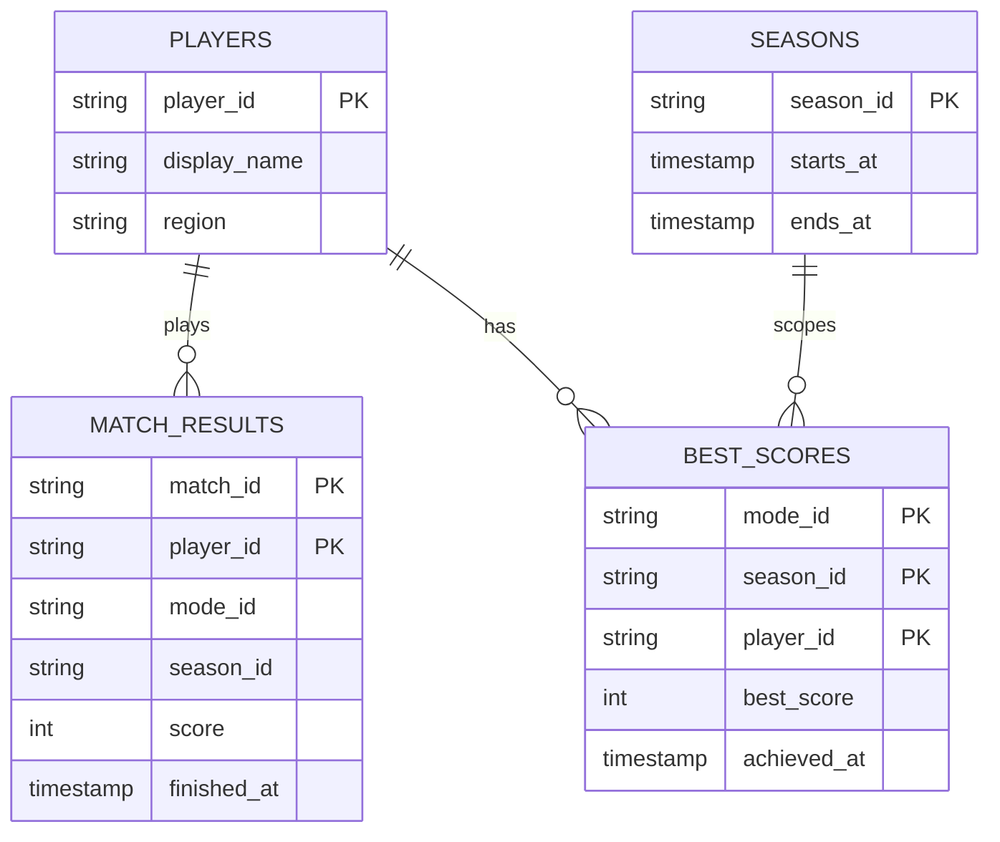

**Ranking store (Redis sorted set):** key `lb:{modeId}:{seasonId}`, member = `playerId`, score = best score. A **sorted set (ZSET)** keeps members ordered by score using a skip list, so rank queries are `O(log N)`.

```bash
ZADD lb:ranked:s5 GT 4200 p42                 # keep only if higher than current (Redis 6.2+)
ZRANGE lb:ranked:s5 0 99 REV WITHSCORES        # top 100, highest first
ZREVRANK lb:ranked:s5 p42                      # p42's 0-based rank, O(log N)
ZRANGE lb:ranked:s5 18336 18346 REV WITHSCORES # neighbours around rank 18341
```

### 11.5 Step 5 — High-Level Architecture

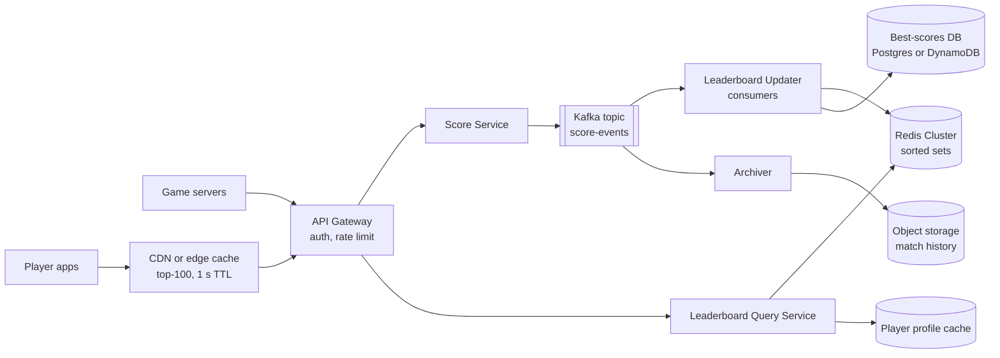

**Component responsibilities**
1. **Game servers** — authoritative source of match results.
2. **API Gateway** — authenticates game servers, rate-limits, routes ([API Gateway and BFF](02_networking_and_communication.md#13-api-gateway-and-bff)).
3. **Score Service** — validates the request, checks the idempotency key, publishes an event to Kafka, returns `202 Accepted`.
4. **Kafka** — durable, replayable log of all score events; absorbs spikes ([Apache Kafka](05_distributed_systems_and_messaging.md#11-apache-kafka)).
5. **Leaderboard Updater** — consumes events, updates the Redis sorted set (`ZADD GT`) and the durable best-scores table.
6. **Redis Cluster** — in-memory ranking store; derived data that can be rebuilt.
7. **Leaderboard Query Service** — serves top-N and rank-around-me; enriches with display names.
8. **CDN/edge cache** — caches the top-100 response for ~1 s; thousands of identical reads become one.
9. **Archiver** — writes raw match history to cheap object storage for analytics and audits.

### 11.6 Step 6 — Request Flows

**Write path — submitting a score**

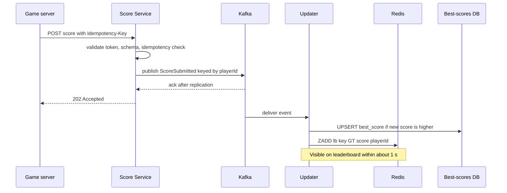

**Walkthrough**
1. The game server posts the score; the Score Service validates it and dedups on the idempotency key.
2. It publishes to Kafka **keyed by playerId** so all events for a player stay in order on one partition.
3. Once Kafka acknowledges (replicated to in-sync replicas), the service returns 202 — the write is now durable even if Redis is down.
4. The Updater conditionally upserts the durable best score and runs `ZADD ... GT`, which only raises a score — so replays and duplicates are harmless (**idempotent**).
5. **Failure handling:** if Redis is unavailable, the consumer pauses and retries; Kafka retains the events, so nothing is lost and the board catches up when Redis recovers.

**Read path — rank around me**

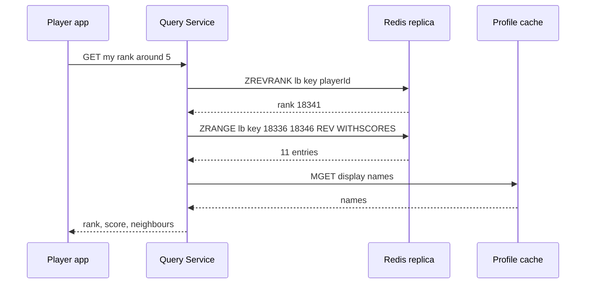

### 11.7 Step 7 — Bottlenecks and Single Points of Failure

> **Interviewer:** What breaks first?
>
> **You:** Three things:
> 1. **Hot key.** A popular mode's sorted set lives on **one** Redis shard (a key can't be split across slots). All reads and writes for that mode hit one node.
> 2. **Redis as a single point of failure** for reads.
> 3. **Very large sorted sets** — if one board grows to hundreds of millions of players, memory and per-key throughput on one node become limits.

### 11.8 Step 8 — Scale and Improve Reliability

**Hot key mitigations**
- **Cache the top 100** at the edge/app tier for ~1 s — it's identical for everyone.
- **Read replicas** for Redis: rank queries go to replicas; writes go to the primary.
- **Coalesce writes:** the Updater batches events per player within a short window and applies only the max — fewer `ZADD`s.

**Reliability**
- Redis primary + replica per shard with automatic failover (Sentinel or Cluster); enable AOF persistence (`appendfsync everysec`).
- **Redis is derived data:** if it's lost entirely, rebuild from the best-scores DB (or replay Kafka). This is a key design principle — keep a durable **source of truth** separate from the fast **serving store**.
- Multi-AZ deployment for every tier; Kafka replication factor 3 with `min.insync.replicas=2`.

**Scaling beyond one node per board** 🔴

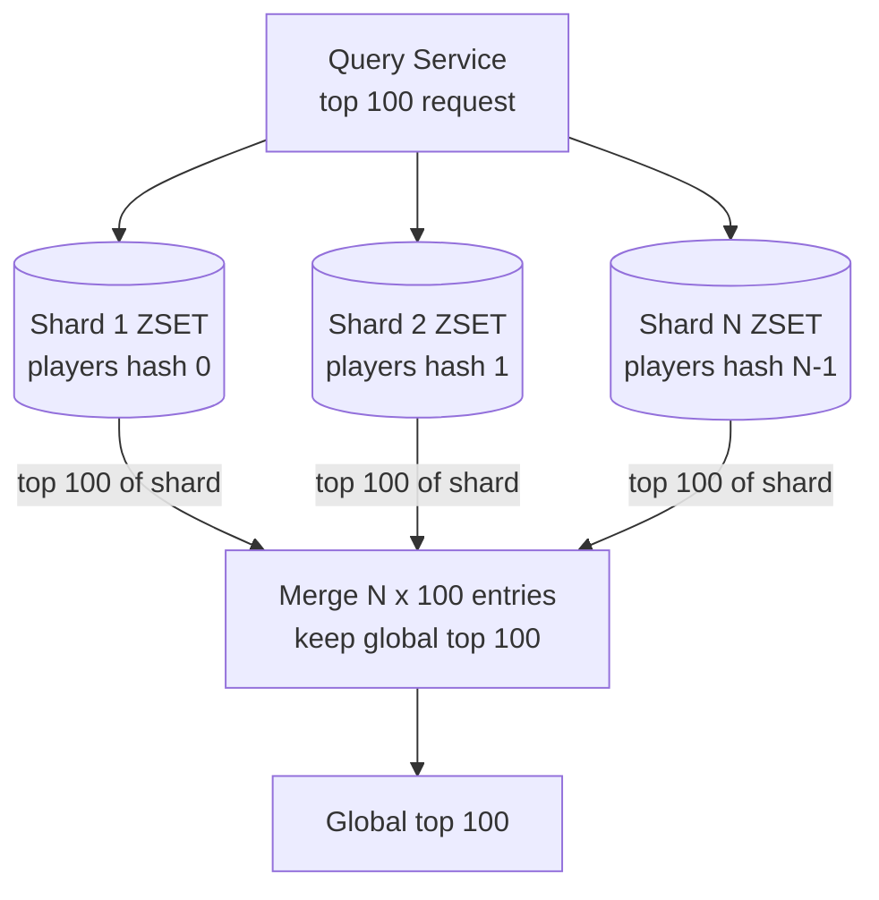

**Walkthrough**
1. Split one logical board into N sub-sets by `hash(playerId) % N`, each on a different Redis node.
2. **Top-K** = ask each shard for its top K, merge N×K entries (scatter-gather). Cheap: 10 shards × 100 = 1,000 entries.
3. **Exact rank** of a player = sum over shards of `ZCOUNT(key, myScore, +inf)` — N calls, still `O(N log M)`.
4. For players far down the list, show an **approximate percentile** ("top 12%") from a precomputed score histogram — users don't care whether they're #4,812,331 or #4,812,340.

**Tie-breaking:** equal scores should rank whoever achieved it first. Encode a composite score, e.g. `score × 2^32 + (2^32 − 1 − secondsSinceSeasonStart)`, which stays exact within a double's 53-bit precision as long as scores are below ~2^21.

### 11.9 Step 9 — Database Choice and Consistency

> **You:** Why not just a SQL table with an index on score? Top-100 is fine — `ORDER BY score DESC LIMIT 100` on an index is fast. But **rank** is `SELECT COUNT(*) WHERE score > :mine`, which scans a large part of the index for mid-table players — `O(N)` per request at 12,000 QPS. A sorted set answers rank in `O(log N)` from memory. So I use **Redis for serving ranks** and a **durable DB for the best score per player** — Postgres works at this size (25 GB/season, ~6,000 upserts/s peak, maybe partitioned by season), or DynamoDB if we want managed horizontal scale.
>
> **Consistency:** the leaderboard is **eventually consistent** with ~1 s lag, which matches the requirement. The best-score table uses a conditional upsert (`... ON CONFLICT DO UPDATE ... WHERE excluded.best_score > best_scores.best_score`), so concurrent or duplicate events can never lower a score.

### 11.10 Step 10 — Trade-offs Summary

| Decision | Why | Trade-off | Revisit if… |
|---|---|---|---|
| Redis sorted sets for ranking | `O(log N)` rank and range queries in memory | Memory cost; derived data must be rebuildable | Boards exceed ~100M+ entries → shard or approximate |
| Kafka between submit and update | Durability, spike absorption, replay | ~100s of ms extra latency, more infra | Low volume → write Redis + DB synchronously |
| Async 202 response | Game server isn't blocked | Score not instantly visible | Needs read-your-own-score → return the new score in the response |
| Edge cache top 100 for 1 s | Kills hot-key read load | Up to 1 s stale | Esports finals needing true live → push via WebSockets |
| Server-authoritative scores | Anti-cheat | Clients can't submit directly | — |
| Best score only (`ZADD GT`) | Idempotent, replay-safe | Can't show score history from Redis | Need cumulative scores → `ZINCRBY` + strict dedup |

> **Interviewer:** How would you add friends leaderboards?
>
> **You:** Friends lists are small (say ≤ 500). On request, fetch friend IDs, call `ZMSCORE` on the season key to get their scores in one round trip, sort in the service. No new sorted sets needed. For huge friend lists I'd precompute per-user boards asynchronously.

**What this example demonstrates:** requirements shaped the consistency choice (1 s eventual), estimation showed throughput wasn't the problem (rank queries and hot keys were), the data structure choice was justified against a SQL alternative, and every component had a failure story.

---

## 12. Quick Revision

**Requirements**
- FR = what; NFR = how well (availability, latency, throughput, durability, consistency, scalability, security, cost). NFRs drive architecture.
- State assumptions and scope explicitly.

**Quality attributes**
- Availability ≈ MTBF / (MTBF + MTTR). 99.9% ≈ 8.8 h/yr, 99.99% ≈ 53 min/yr.
- Series multiplies (worse); parallel redundancy improves (if failures are independent). Remove SPOFs.
- Durability = never lose acknowledged data (WAL, replication, backups). Reliability = correct behaviour. Fault tolerance = no visible interruption.

**Performance**
- Latency (per request) ≠ throughput (per second) ≠ bandwidth (max capacity).
- Use p95/p99, not averages; fan-out amplifies tail latency.
- Little's Law: concurrency = throughput × latency.
- Memory 100 ns · SSD 100 µs · DC round trip 0.5 ms · cross-continent 150 ms.

**Scaling**
- Vertical = simple, ceiling, SPOF. Horizontal = scalable, needs stateless services.
- Journey: LB → cache/CDN → read replicas → queues → sharding → multi-region — each step only when needed.

**Estimation**
- Day ≈ 10^5 s; 1M/day ≈ 12 QPS; peak 2–3×.
- Storage = writes/day × size × retention × replication. Cache = hot % of working set.
- URL shortener: ~1.2k writes/s, ~12k reads/s, ~45 TB over 5 years, ~5 GB cache, 7-char Base62 codes.

**CAP / consistency**
- Partitions are inevitable → choose C or A during a partition. CA isn't real for distributed systems.
- PACELC adds: otherwise, latency vs consistency.
- Spectrum: linearizable → sequential → causal → read-your-writes / monotonic → eventual. Choose the weakest the business can tolerate.

**Interview**
- 10 steps: requirements → assumptions → estimates → APIs and data → HLD → flows → bottlenecks → scale and reliability → DB and consistency → trade-offs.
- Always say "**the trade-off is…**" and "**I'd revisit this if…**".

---

**Next:** [Part 2 — Networking and Communication](02_networking_and_communication.md)
**See also:** [Interview Prep and Cheat Sheet](09_interview_prep_and_cheatsheet.md) · [Interview Problems Part 1](07_interview_problems_part1.md)
