# Networking, APIs and Traffic Management

> **Part 2 of 10** in the System Design interview notes — see [README](README.md) for the roadmap.
> **What you'll learn:** how a request actually reaches your servers (DNS, TCP, TLS, HTTP), how to design APIs (REST, GraphQL, gRPC, real-time), and the components that sit in front of your services (reverse proxies, load balancers, API gateways, rate limiters, CDNs).
> **Level legend:** 🟢 Essential (asked in almost every interview) · 🟡 Intermediate · 🔴 Advanced / senior
> **Related:** [Fundamentals](01_system_design_fundamentals.md) · [Caching](04_caching.md) · [Distributed Systems and Messaging](05_distributed_systems_and_messaging.md) · [Architecture, Reliability and Security](06_architecture_reliability_and_security.md)

---

## Table of Contents

1. [How a Request Travels the Internet](#1-how-a-request-travels-the-internet)
2. [DNS](#2-dns)
3. [TCP, UDP and IP](#3-tcp-udp-and-ip)
4. [HTTP and HTTPS](#4-http-and-https)
5. [TLS and mTLS](#5-tls-and-mtls)
6. [Real-Time Communication](#6-real-time-communication)
7. [REST API Design](#7-rest-api-design)
   - [Pagination](#73-pagination) · [Versioning](#74-api-versioning) · [Idempotency](#75-idempotency-in-apis)
8. [GraphQL](#8-graphql)
9. [gRPC](#9-grpc)
10. [Choosing an API Style](#10-choosing-an-api-style)
11. [Reverse Proxy](#11-reverse-proxy)
12. [Load Balancers](#12-load-balancers)
    - [L4 vs L7](#122-l4-vs-l7-load-balancers) · [Algorithms](#123-load-balancing-algorithms) · [Health Checks](#124-health-checks-and-sticky-sessions) · [Avoiding the LB SPOF](#125-load-balancer-redundancy-and-global-load-balancing)
13. [API Gateway and BFF](#13-api-gateway-and-bff)
14. [Rate Limiting](#14-rate-limiting)
15. [CDN and Edge Computing](#15-cdn-and-edge-computing)
16. [Quick Revision](#16-quick-revision)

---

## 1. How a Request Travels the Internet

> **Level:** 🟢 Essential

**What is it?** The classic interview warm-up: *"What happens when you type `https://shop.example.com/products/42` into a browser and press Enter?"* Answering it well shows you understand every layer this file covers.

**Why it matters:** Every component in a system design diagram (DNS, CDN, load balancer, gateway, service, cache, DB) lives somewhere on this path. If you can narrate the path, you can reason about where latency comes from and where things fail.

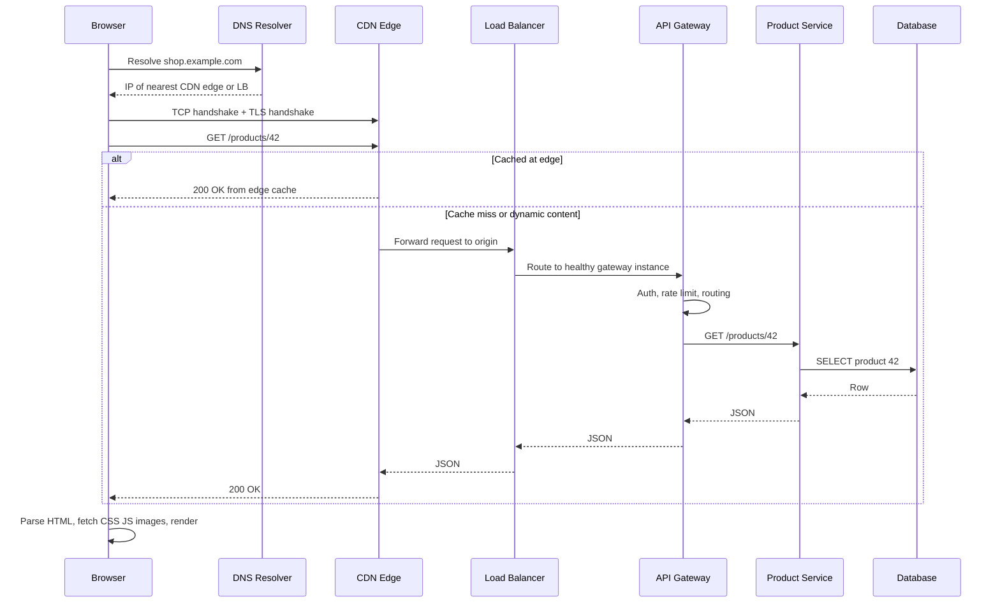

**Step-by-step walkthrough**

1. **URL parsing** — the browser splits the URL into scheme (`https`), host (`shop.example.com`), path (`/products/42`). `https` means port 443 and TLS.
2. **DNS lookup** — the browser checks its own cache, the OS cache, then asks a recursive resolver, which turns the hostname into an IP address ([Section 2](#2-dns)).
3. **TCP connection** — a three-way handshake opens a reliable connection to that IP ([Section 3](#3-tcp-udp-and-ip)). With HTTP/3 this is QUIC over UDP instead.
4. **TLS handshake** — the client verifies the server's certificate and both sides agree on encryption keys ([Section 5](#5-tls-and-mtls)).
5. **HTTP request** — the browser sends `GET /products/42` with headers (cookies, `Accept`, `Authorization`).
6. **Edge / CDN** — if the response is cacheable and cached at the nearest edge, it returns immediately ([Section 15](#15-cdn-and-edge-computing)).
7. **Load balancer** — picks a healthy backend instance ([Section 12](#12-load-balancers)).
8. **API gateway** — authenticates, rate-limits, routes to the right microservice ([Section 13](#13-api-gateway-and-bff)).
9. **Service and data layer** — the service checks its cache, queries the DB, builds the response ([Caching](04_caching.md), [Databases](03_databases_and_storage.md)).
10. **Response and render** — the browser parses HTML and fires more requests for CSS, JS and images (often served by the CDN).

**Where the latency goes** (rough, cross-continent first visit): DNS 20–100 ms · TCP 1 RTT · TLS 1.3 1 RTT · request/response ≥ 1 RTT + server time. This is why CDNs (shorter RTT), connection reuse (skip handshakes) and DNS caching matter so much.

**Interview perspective**

> **Q: Where would you look first if this page is slow for users in India but fast in the US?**
> A: The RTT component. If origin servers are in us-east, every handshake and every uncached request crosses ~200 ms of network. I'd check CDN hit rate for static assets, whether dynamic content could be cached at the edge with short TTLs, whether connections are reused (HTTP/2, keep-alive), and whether we need a regional deployment or read replicas closer to those users.

**Quick revision**
- DNS → TCP → TLS → HTTP → CDN → LB → Gateway → Service → Cache/DB.
- Each handshake costs round trips; distance (RTT) dominates user-perceived latency.
- Caching and connection reuse remove whole steps from the path.

---

## 2. DNS

### 2.1 What DNS Is and How Resolution Works

> **Level:** 🟢 Essential

**What is it?** The **Domain Name System** is the internet's phone book: it translates human-friendly names (`api.example.com`) into IP addresses (`203.0.113.10`) that computers use to connect.

**Why do we need it?** IP addresses are hard to remember and they *change* (servers get replaced, traffic moves between regions). DNS adds a layer of indirection: you change the record, not every client.

**Key players**

| Component | Role |
|---|---|
| **Stub resolver** | The tiny client in your OS/browser that asks questions |
| **Recursive resolver** | Your ISP's or a public resolver (8.8.8.8, 1.1.1.1). Does the legwork and caches answers |
| **Root name servers** | Know where each top-level domain (`.com`, `.org`) lives |
| **TLD name servers** | Know which name servers are authoritative for `example.com` |
| **Authoritative name server** | Holds the actual records for `example.com` (Route 53, Cloudflare DNS) |

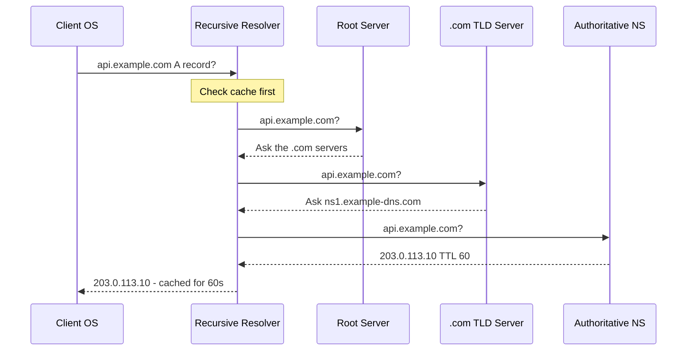

**Walkthrough**
1. The client asks its configured recursive resolver. This client→resolver query is **recursive**: "give me the final answer".
2. On a cache miss, the resolver performs **iterative** queries: root → TLD → authoritative. Each server answers with a *referral* ("ask them") rather than doing the work itself.
3. The authoritative server returns the record plus a **TTL** (time to live, in seconds).
4. Every layer caches the answer until the TTL expires — browser, OS, resolver. Most lookups never reach the root.

**Recursive vs iterative:** recursive = "do it for me and return the final answer" (client → resolver). Iterative = "tell me who to ask next" (resolver → root/TLD/authoritative).

### 2.2 DNS Record Types

> **Level:** 🟢 Essential

| Record | Maps | Example | Typical use |
|---|---|---|---|
| **A** | Name → IPv4 | `api.example.com → 203.0.113.10` | Point a name at a server/LB |
| **AAAA** | Name → IPv6 | `api.example.com → 2001:db8::1` | IPv6 clients |
| **CNAME** | Name → another name | `www.example.com → example.cdn-provider.net` | Point at a CDN or managed LB whose IPs change |
| **MX** | Domain → mail server | `example.com → mail.example.com (priority 10)` | Email routing |
| **NS** | Domain → its authoritative name servers | `example.com → ns1.dnsprovider.com` | Delegation |
| **TXT** | Name → arbitrary text | `v=spf1 include:...` | Domain verification, SPF/DKIM email auth |
| **SRV** | Service → host + port | `_sip._tcp.example.com` | Service discovery (also used by Consul/K8s) |

> **Gotcha:** a CNAME cannot coexist with other records at the zone apex (`example.com` itself). Providers offer "ALIAS"/"ANAME" or Route 53 "alias" records to work around this.

### 2.3 TTL, Caching and DNS-Based Traffic Management

> **Level:** 🟡 Intermediate

**TTL trade-off**

| Low TTL (30–60 s) | High TTL (hours/days) |
|---|---|
| ✅ Fast failover and traffic shifts | ✅ Fewer lookups, lower latency, less DNS load |
| ❌ More DNS queries, slightly slower first requests | ❌ Changes propagate slowly; failover takes hours |

> **Practice:** lower the TTL a day *before* a planned migration, do the migration, then raise it again.

**DNS-based load balancing and routing**

- **Round-robin DNS** — return multiple A records; clients pick one. Cheap, but no health awareness and clients cache aggressively.
- **GeoDNS / latency-based routing** — return the IP of the region closest to the user (Route 53 latency/geolocation policies). Foundation of multi-region active-active.
- **Weighted routing** — send 5% of resolutions to a new region (canary at the DNS level).
- **Health-checked failover** — the DNS provider probes your endpoints; if the primary region fails, it starts answering with the secondary's IP.

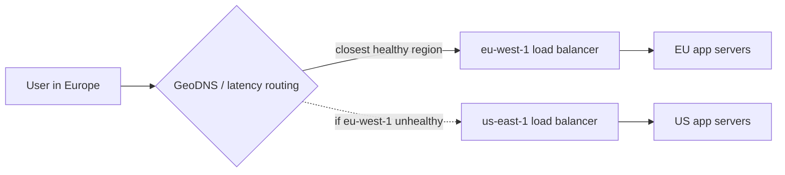

**Walkthrough:** the DNS provider health-checks both regions. Normally EU users get the EU LB IP. If EU health checks fail, new resolutions return the US IP — but users with a cached answer keep hitting EU until their TTL expires. This is why DNS failover is *coarse* (seconds to minutes) and you still want LB-level failover inside each region.

**Common mistakes / pitfalls**
- Assuming DNS failover is instant — clients, OSes and some resolvers ignore or extend TTLs (Java historically cached DNS forever with a security manager; set `networkaddress.cache.ttl`).
- Putting a single DNS provider in the critical path with no secondary — DNS outages (e.g., the 2016 Dyn attack) take down everything.
- Using round-robin DNS as your only load balancer — no health checks, uneven load.

**Interview perspective**

> **Q: Why not just use DNS for all load balancing?**
> A: DNS has no idea about server health or load in real time, and answers are cached for the TTL by clients we don't control. It's great for coarse, global decisions (which region), but within a region we need a real load balancer that health-checks instances and reacts in seconds.

**Quick revision**
- Recursive (client → resolver) vs iterative (resolver → root → TLD → authoritative).
- A/AAAA = IPs, CNAME = alias, NS = delegation, MX = mail, TXT = verification.
- TTL trades failover speed for lookup cost. GeoDNS routes users to the nearest region.

---

## 3. TCP, UDP and IP

### 3.1 IP and the Layered Model

> **Level:** 🟢 Essential

**What is it?** Networking is built in layers; each layer uses the one below it.

| Layer (simplified TCP/IP) | Protocols | What it gives you | Who cares in system design |
|---|---|---|---|
| Application (L7) | HTTP, gRPC, DNS, WebSocket | Meaningful messages | API design, L7 LBs, gateways |
| Transport (L4) | TCP, UDP, QUIC | Process-to-process delivery via ports | L4 LBs, connection limits |
| Network (L3) | IP | Host-to-host routing via IP addresses, best effort | VPCs, subnets, routing |
| Link (L2) | Ethernet, Wi-Fi | Frames on a local link | Rarely discussed |

**IP is best-effort:** packets can be dropped, duplicated, or arrive out of order. TCP adds reliability on top; UDP doesn't.

### 3.2 TCP

> **Level:** 🟢 Essential

**What is it?** The **Transmission Control Protocol** gives an ordered, reliable byte stream between two programs.

**How does it work?**
1. **Three-way handshake** opens the connection (costs one round trip before data flows).
2. Every byte has a **sequence number**; the receiver **acknowledges** what it got.
3. Lost segments are **retransmitted**; out-of-order segments are reordered.
4. **Flow control** (receive window) stops a fast sender from overwhelming a slow receiver.
5. **Congestion control** (slow start, AIMD, BBR) stops senders from overwhelming the *network*.
6. **Four-way close** (FIN/ACK) tears it down; the closer sits in `TIME_WAIT` briefly.

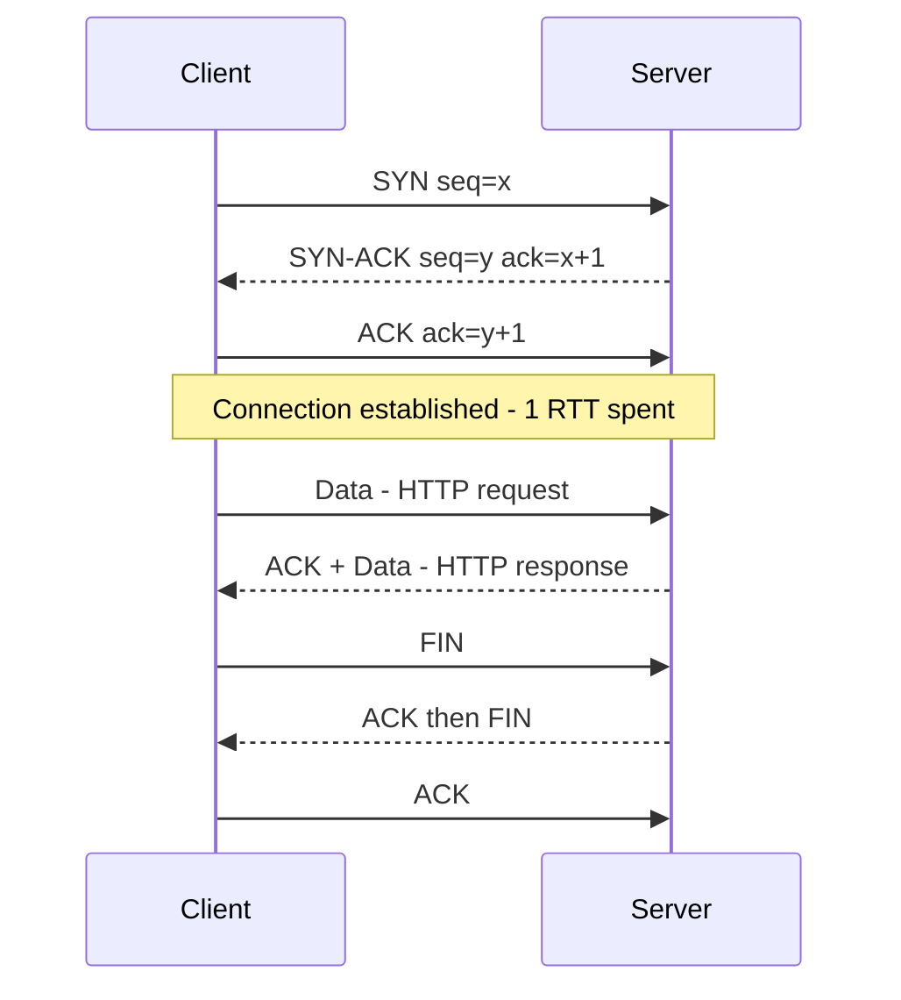

**Head-of-line (HOL) blocking:** because TCP delivers bytes strictly in order, one lost packet stalls *everything* behind it on that connection — even data for unrelated HTTP/2 streams. This is the main motivation for QUIC.

**Why it matters in design**
- Handshakes are expensive → **reuse connections** (keep-alive, HTTP/2, connection pools to DBs and downstream services).
- Each connection costs memory and a file descriptor → a server can hold only so many (relevant for WebSockets, [Section 6](#6-real-time-communication)).
- Slow start means new connections start slow → long-lived connections perform better.

### 3.3 UDP and QUIC

> **Level:** 🟡 Intermediate

**UDP** (User Datagram Protocol) just sends independent packets (datagrams): no handshake, no ordering, no retransmission, no congestion control.

| | TCP | UDP |
|---|---|---|
| Connection | Handshake required | Connectionless |
| Reliability | Guaranteed, ordered | Best effort; may drop/reorder |
| Overhead | Higher (20+ byte header, ACKs, state) | Low (8-byte header, no state) |
| Latency | Higher (handshake, retransmits, HOL blocking) | Lowest |
| Use cases | Web, APIs, DBs, file transfer, email | Video calls, gaming, live streaming, DNS, VoIP, metrics (StatsD) |

**When to choose UDP:** when *late data is useless data*. In a video call, a retransmitted frame from 300 ms ago is worse than skipping it. Applications that need some reliability build only the part they need on top of UDP.

**QUIC** is exactly that: a transport built on UDP (by Google, now IETF standard) that provides:
- **Independent streams** — a lost packet only stalls its own stream (no TCP HOL blocking).
- **Built-in TLS 1.3** — transport + crypto handshake combined: 1 RTT for new connections, 0-RTT for resumption.
- **Connection migration** — connections are identified by an ID, not the IP/port 4-tuple, so a phone switching Wi-Fi → 4G keeps its connection.

**Interview perspective**

> **Q: Your multiplayer game sends player positions 30 times a second. TCP or UDP?**
> A: UDP. Each position update supersedes the previous one, so retransmitting a lost update is wasted work and TCP's in-order delivery would make the newest update wait behind the lost one. I'd send positions over UDP with a sequence number so the client discards stale packets, and use a reliable channel (TCP or a reliable layer on UDP) for things that must arrive, like purchases or chat.

**Common mistakes**
- Saying "UDP is unreliable so never use it" — DNS, video, games and QUIC (HTTP/3) all use it.
- Forgetting connection cost — opening a new TCP+TLS connection per request to a downstream service is a common latency bug.

**Quick revision**
- TCP: reliable, ordered, handshake, flow + congestion control, HOL blocking.
- UDP: fast, connectionless, no guarantees — real-time media, games, DNS.
- QUIC = UDP + streams + TLS 1.3 + connection migration → basis of HTTP/3.

---

## 4. HTTP and HTTPS

### 4.1 HTTP Versions

> **Level:** 🟢 Essential

**What is it?** **HTTP** (HyperText Transfer Protocol) is the request/response application protocol of the web. **HTTPS** is HTTP inside a TLS-encrypted connection ([Section 5](#5-tls-and-mtls)).

| Version | Transport | Key idea | Problem it solved / left |
|---|---|---|---|
| **HTTP/1.0** | TCP | New connection per request | Very slow — handshake every time |
| **HTTP/1.1** | TCP | **Keep-alive** (persistent connections), `Host` header, chunked transfer | One request at a time per connection → browsers open ~6 parallel connections; app-level HOL blocking |
| **HTTP/2** | TCP | **Binary framing, multiplexing** many streams on one connection, header compression (HPACK), server push (now deprecated in browsers) | Still suffers TCP-level HOL blocking on packet loss |
| **HTTP/3** | QUIC (UDP) | Same semantics as HTTP/2 over QUIC, independent streams, faster handshakes | Some networks block/throttle UDP → clients fall back to HTTP/2 |

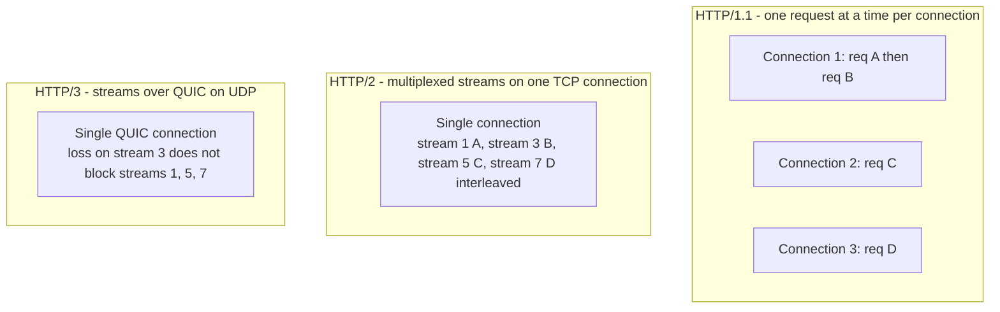

**Walkthrough:** HTTP/1.1 needs many connections for parallelism (more handshakes, more server sockets). HTTP/2 interleaves frames from many requests on one connection, but a lost TCP packet stalls all streams. HTTP/3 moves streams into QUIC so loss only affects the affected stream.

### 4.2 Methods, Safety and Idempotency

> **Level:** 🟢 Essential

- **Safe** = does not change server state (read-only).
- **Idempotent** = calling it once or N times leaves the server in the **same state** (the response may differ, e.g., a second DELETE may return 404).

| Method | Purpose | Safe | Idempotent | Typical success code |
|---|---|---|---|---|
| GET | Read a resource | ✅ | ✅ | 200 |
| HEAD | Headers only | ✅ | ✅ | 200 |
| OPTIONS | Capabilities / CORS preflight | ✅ | ✅ | 204 |
| PUT | Create or **replace** at a known URI | ❌ | ✅ | 200 / 201 / 204 |
| DELETE | Remove | ❌ | ✅ | 204 / 200 |
| POST | Create a sub-resource / trigger an action | ❌ | ❌ | 201 / 202 |
| PATCH | Partial update | ❌ | ❌ usually (✅ if the patch is "set field = X") | 200 / 204 |

> **Why it matters:** idempotent methods are safe to **retry** automatically (proxies, clients, SDKs do this on timeouts). POST is not — retrying it can create duplicate orders or double charges, so we add **idempotency keys** ([Section 7.5](#75-idempotency-in-apis)).

### 4.3 Status Codes You Must Know

> **Level:** 🟢 Essential

| Code | Meaning | When to use |
|---|---|---|
| **200 OK** | Success with body | GET, successful PUT/PATCH |
| **201 Created** | Resource created | POST that creates; include `Location` header |
| **202 Accepted** | Accepted, processing async | Long-running job; return a status URL |
| **204 No Content** | Success, no body | DELETE, PUT with no body |
| **301 / 308** | Permanent redirect (308 keeps method) | Moved resources, URL shortener (cacheable) |
| **302 / 307** | Temporary redirect (307 keeps method) | URL shortener when you want analytics on every hit |
| **304 Not Modified** | Client cache still valid | Conditional GET with `ETag`/`If-None-Match` |
| **400 Bad Request** | Malformed input | Validation failure |
| **401 Unauthorized** | Not authenticated | Missing/invalid token |
| **403 Forbidden** | Authenticated but not allowed | RBAC denial |
| **404 Not Found** | No such resource | — |
| **409 Conflict** | State conflict | Duplicate unique key, optimistic-lock version mismatch, seat already booked |
| **412 Precondition Failed** | `If-Match` failed | Optimistic concurrency on PUT |
| **422 Unprocessable Content** | Well-formed but semantically invalid | Business rule violation |
| **429 Too Many Requests** | Rate limited | Include `Retry-After` |
| **500 Internal Server Error** | Bug / unexpected failure | — |
| **502 Bad Gateway** | Proxy got an invalid response from upstream | Upstream crashed |
| **503 Service Unavailable** | Overloaded or in maintenance | Load shedding; include `Retry-After` |
| **504 Gateway Timeout** | Proxy timed out waiting for upstream | Slow downstream |

**Retry rule of thumb:** retry 408, 429 (honour `Retry-After`), 502, 503, 504 with backoff + jitter; do **not** retry other 4xx — the request itself is wrong. See [Timeouts and Retries](05_distributed_systems_and_messaging.md#15-timeouts-retries-and-exponential-backoff).

### 4.4 Important Headers

> **Level:** 🟡 Intermediate

| Header | Purpose |
|---|---|
| `Host` | Which site on a shared IP (virtual hosting, L7 routing) |
| `Authorization: Bearer <token>` | Credentials (JWT/OAuth) |
| `Content-Type` / `Accept` | Body format sent / wanted (content negotiation) |
| `Cache-Control`, `ETag`, `Last-Modified` | HTTP caching — see [HTTP Caching](04_caching.md#9-http-caching) |
| `Idempotency-Key` | De-duplicate retried POSTs |
| `X-Request-ID`, `traceparent` | Correlation and distributed tracing |
| `X-Forwarded-For`, `X-Forwarded-Proto` | Original client IP/scheme behind proxies (standardized as `Forwarded`) |
| `Retry-After` | When to retry after 429/503 |
| `Connection: keep-alive` / `Upgrade: websocket` | Connection reuse / protocol upgrade |

**Interview perspective**

> **Q: Why did HTTP/2 not fully fix head-of-line blocking?**
> A: HTTP/2 removed *application-level* HOL blocking by multiplexing streams over one connection, but all those streams share one TCP byte stream. If a single TCP packet is lost, TCP holds back every later byte until it's retransmitted, so every stream stalls. HTTP/3 fixes this by running over QUIC, where each stream is independently ordered.

**Common mistakes**
- Using GET for actions that change state (crawlers and prefetchers will trigger them).
- Returning 200 with `{"error": ...}` in the body — breaks monitoring, caching and client retry logic.
- Confusing 401 (who are you?) with 403 (I know you, but no).

**Quick revision**
- HTTP/1.1 keep-alive → HTTP/2 multiplexing → HTTP/3 over QUIC.
- Safe ⊂ idempotent. GET/PUT/DELETE idempotent; POST not.
- Know 200/201/202/204/301/302/304/400/401/403/404/409/429/500/502/503/504.

---

## 5. TLS and mTLS

### 5.1 What TLS Provides

> **Level:** 🟢 Essential

**What is it?** **TLS** (Transport Layer Security, successor of SSL) is the cryptographic protocol that puts the "S" in HTTPS.

**Why do we need it?** Without it, anyone on the path (public Wi-Fi, ISP, a compromised router) can read or modify traffic.

| Property | Meaning | Mechanism |
|---|---|---|
| **Confidentiality** | Eavesdroppers see only ciphertext | Symmetric encryption (AES-GCM, ChaCha20) with session keys |
| **Integrity** | Tampering is detected | AEAD ciphers / MACs |
| **Authentication** | You're talking to the real server | X.509 certificate signed by a trusted CA |

**Certificates and CAs (in one paragraph):** the server holds a private key and a **certificate** that binds its public key to its domain name. The certificate is signed by a **Certificate Authority** (CA) such as Let's Encrypt or DigiCert, usually via an intermediate. Browsers/OSes ship a list of trusted root CAs; the client verifies the chain (leaf → intermediate → root), the hostname, and the expiry. Certificates expire (often 90 days with Let's Encrypt) — **automate renewal** (ACME, cert-manager, AWS ACM); expired certificates are a classic self-inflicted outage.

### 5.2 TLS 1.3 Handshake

> **Level:** 🟡 Intermediate

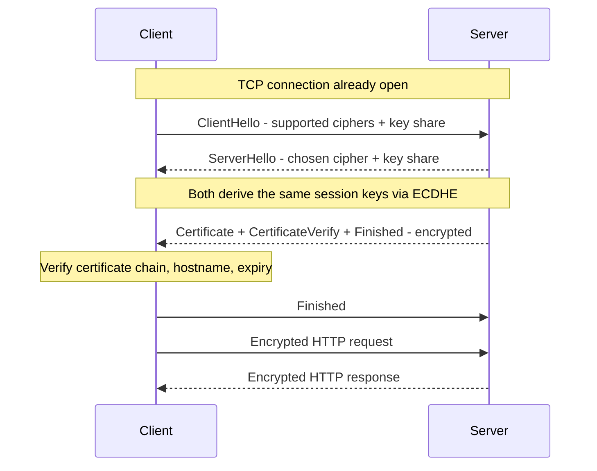

**Walkthrough**
1. **ClientHello** — TLS version, cipher suites, and (new in 1.3) a key share guessed up front.
2. **ServerHello** — picks a cipher and sends its own key share. Both sides now compute the same secret using **(EC)DHE** (Ephemeral Diffie-Hellman) — the key itself never crosses the wire.
3. Server sends its **certificate** and a signature proving it owns the matching private key — already encrypted.
4. Client verifies the certificate; both send **Finished**; application data flows. **Total: 1 RTT** (TLS 1.2 needed 2).

**TLS 1.3 improvements over 1.2**
- 1-RTT handshake; **0-RTT** resumption for returning clients (0-RTT data can be replayed, so only use it for idempotent requests).
- Removed weak/legacy ciphers (RSA key exchange, CBC, RC4, SHA-1).
- **Forward secrecy mandatory** — ephemeral keys mean stealing the server's private key later doesn't decrypt recorded past traffic.

**Symmetric vs asymmetric in TLS:** asymmetric crypto (certificates, signatures, Diffie-Hellman) is slow and used only during the handshake to authenticate and agree on a key; the bulk data uses fast symmetric encryption. More in [Security Fundamentals](06_architecture_reliability_and_security.md#11-security-fundamentals).

### 5.3 TLS Termination

> **Level:** 🟡 Intermediate

Where do you decrypt?

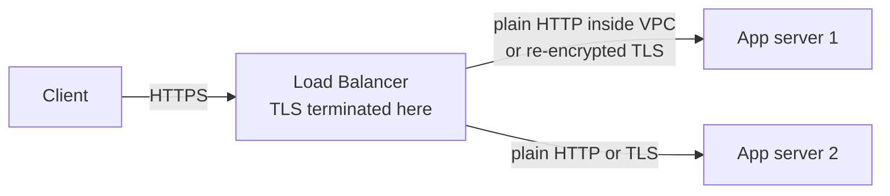

| Option | How | Pros | Cons |
|---|---|---|---|
| **Terminate at LB/gateway** | LB holds certs, forwards HTTP internally | Centralized cert management; LB can inspect HTTP (L7 routing, WAF); offloads CPU | Traffic unencrypted inside the network unless re-encrypted |
| **Re-encrypt (TLS bridging)** | LB decrypts, inspects, re-encrypts to backend | L7 features + encryption everywhere | Certs on backends too; a bit more CPU |
| **Passthrough** | LB forwards encrypted bytes (L4) | End-to-end encryption, LB never sees plaintext | No L7 routing/inspection at the LB |

> Modern zero-trust practice: terminate at the edge **and** encrypt internal hops (often automatically via a service mesh with mTLS).

### 5.4 mTLS — Mutual TLS

> **Level:** 🟡 Intermediate

**What is it?** In normal TLS only the **server** proves its identity. In **mutual TLS**, the **client also presents a certificate**, and the server verifies it.

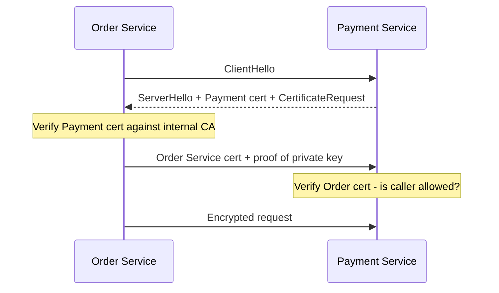

**Why/when:** service-to-service authentication inside a microservice platform ("only the Order service may call Payment"), B2B APIs, IoT devices. Each workload gets a short-lived certificate from an internal CA (SPIFFE/SPIRE, Istio's CA). A **service mesh** (Istio, Linkerd) does this transparently in sidecar proxies — apps don't change code. See [Microservices Building Blocks](06_architecture_reliability_and_security.md#2-microservices-building-blocks).

**Trade-off:** strong identity and encryption everywhere, at the cost of certificate lifecycle management (issuance, rotation, revocation) — which is why people use a mesh or managed PKI rather than hand-rolling it.

**Interview perspective**

> **Q: TLS terminates at our load balancer. Is the traffic to backends secure?**
> A: Only as secure as the internal network. Inside a private VPC with strict security groups, many teams accept plain HTTP, but defence-in-depth and compliance (PCI, HIPAA) usually require re-encrypting to backends or using mTLS between services, so a compromised host inside the network can't sniff or impersonate traffic.

**Common mistakes**
- Thinking HTTPS hides the domain — SNI (Server Name Indication) is visible unless Encrypted Client Hello is used; the *path and body* are encrypted.
- Manual certificate renewal → expiry outages.
- Disabling certificate verification in internal clients "to make it work".

**Quick revision**
- TLS = confidentiality + integrity + server authentication.
- TLS 1.3: 1-RTT, 0-RTT resumption, forward secrecy, no weak ciphers.
- Asymmetric for handshake, symmetric for data.
- Terminate at LB for L7 features; mTLS for service identity.

---

## 6. Real-Time Communication

> **Level:** 🟢 Essential (chat, notifications, live dashboards, ride tracking all depend on this)

**The problem:** HTTP is client-initiated — the server can't speak until asked. How does a server push a new chat message or a driver's location to a client the moment it happens?

### 6.1 Short Polling

**How it works:** the client asks "anything new?" every N seconds.

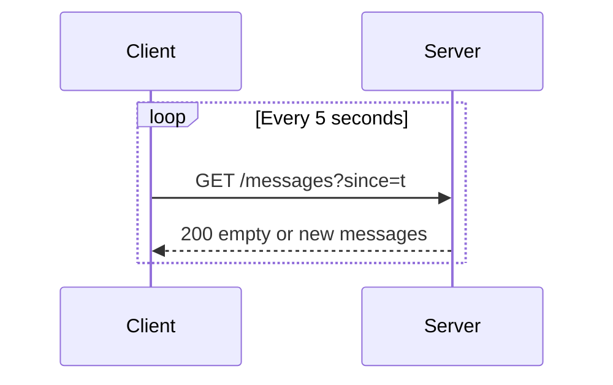

- ✅ Trivial; works everywhere; stateless servers.
- ❌ Wasteful (most responses empty), latency up to N seconds, load grows with clients × frequency.
- **Use for:** low-frequency updates (job status every 30 s), admin dashboards.

### 6.2 Long Polling

**How it works:** the client sends a request; the server **holds it open** until there's data or a timeout (~30 s), responds, and the client immediately re-requests.

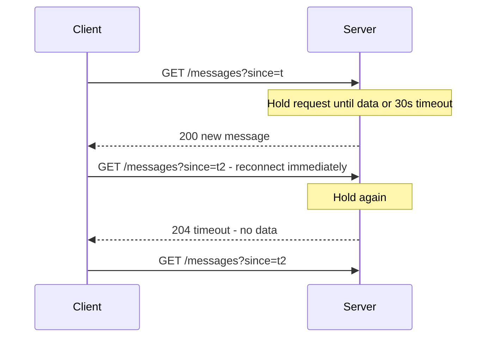

- ✅ Near-real-time over plain HTTP; works through almost any proxy.
- ❌ Each waiting client holds a connection; reconnect overhead; message ordering/duplication handling needed between polls.
- **Use for:** fallback when WebSockets/SSE are blocked; moderate-scale notifications.

### 6.3 Server-Sent Events

**What is it?** **SSE** is a long-lived HTTP response (`Content-Type: text/event-stream`) over which the server streams events **one-way** to the browser. The browser's `EventSource` API auto-reconnects and resends `Last-Event-ID` so the server can resume.

- ✅ Simple, plain HTTP (works with HTTP/2, proxies, auth headers/cookies), auto-reconnect built in.
- ❌ Server → client only; text-only; HTTP/1.1 browsers limit ~6 connections per domain (fine with HTTP/2).
- **Use for:** live feeds, stock tickers, notifications, **streaming LLM tokens** (that's how most chat-AI UIs stream).

### 6.4 WebSockets

**What is it?** A **full-duplex**, persistent connection: after an HTTP `Upgrade` handshake, both sides can send messages (text or binary frames) at any time with tiny framing overhead.

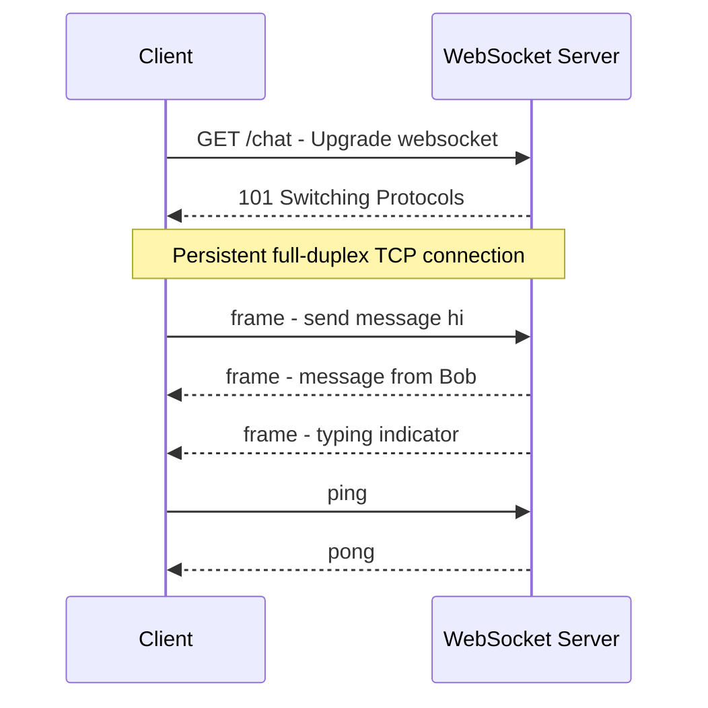

- ✅ Lowest latency, bi-directional, efficient for high-frequency messages.
- ❌ **Stateful** connections: harder to load-balance, scale, deploy (draining connections), and they don't benefit from HTTP caching. Some corporate proxies break them.
- **Use for:** chat, multiplayer games, collaborative editing, live trading.

### 6.5 WebRTC

🔴 **Advanced.** **WebRTC** enables **peer-to-peer** audio/video/data between browsers, usually over UDP. Servers are still needed for **signaling** (exchanging connection info, often via WebSocket), **STUN** (discover your public IP) and **TURN** (relay when peer-to-peer fails behind strict NATs). Group calls typically use an **SFU** (Selective Forwarding Unit) server that forwards streams instead of a full mesh. Use for video calls and screen sharing.

### 6.6 Comparison

| | Short polling | Long polling | SSE | WebSocket | WebRTC |
|---|---|---|---|---|---|
| Direction | Client pull | Client pull (server-held) | Server → client | Bi-directional | Peer ↔ peer |
| Latency | Up to interval | Low | Low | Lowest | Lowest (P2P) |
| Protocol | HTTP | HTTP | HTTP | WS over TCP | UDP (SRTP/SCTP) |
| Server state | None | Held request | Open stream | Open socket | Signaling only |
| Reconnect | N/A | Manual | Built-in | Manual | Manual |
| Best for | Rare updates | Fallback | Feeds, notifications, AI streaming | Chat, games, collaboration | Video/voice calls |

### 6.7 Scaling WebSockets

> **Level:** 🟡 Intermediate

**The problem:** user A is connected to WebSocket server 1, user B to server 7. How does A's message reach B? And what happens to a million open sockets during a deploy?

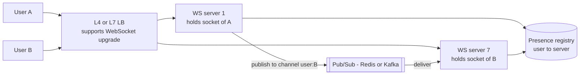

**Walkthrough**
1. The LB routes the upgrade request to any WS server; the connection then **sticks** to that server for its lifetime (it's one TCP connection).
2. Each WS server records `user → server` in a presence registry (Redis with TTL heartbeat), or simply subscribes to a channel per connected user.
3. When A sends to B, server 1 publishes to a **pub/sub bus** (Redis Pub/Sub, NATS, Kafka). The server holding B's socket receives it and pushes it down.
4. **Failure:** if server 7 dies, B's client reconnects (with exponential backoff + jitter, to avoid a reconnect storm) to another server and fetches missed messages from durable storage using its last-seen message ID.

**Capacity notes:** a tuned server holds ~100K–1M mostly idle connections (limited by memory per connection and file descriptors). Separate the **connection tier** (thin, stateful, holds sockets) from the **business logic tier** (stateless services) so you can deploy logic without dropping connections. For deploys, drain: stop accepting new sockets, ask clients to reconnect gradually.

**Interview perspective**

> **Q: Chat app: WebSockets, SSE or long polling?**
> A: WebSockets for the main channel, because chat is bi-directional and high frequency (messages, typing indicators, read receipts). I'd keep long polling as a fallback for networks that block WebSockets. For a notification bell that only receives, SSE would be simpler since it's plain HTTP with automatic reconnect.

**Common mistakes**
- Forgetting that WebSocket servers are stateful and assuming any instance can deliver to any user.
- No heartbeat (ping/pong) → dead connections linger behind NATs and LBs with idle timeouts.
- Treating the socket as durable storage — messages must be persisted; the socket is only a delivery path.

**Quick revision**
- Polling (simple, wasteful) → long polling (held request) → SSE (server push over HTTP) → WebSocket (full duplex).
- Scale WebSockets with a stateful connection tier + pub/sub fan-out + presence registry.
- Reconnect with backoff + jitter; resume from last message ID.

---

## 7. REST API Design

### 7.1 REST Principles and Resource Naming

> **Level:** 🟢 Essential

**What is it?** **REST** (Representational State Transfer) is an architectural style where the API exposes **resources** (nouns) identified by URLs, manipulated with standard HTTP methods, with **stateless** requests (each request carries everything needed — auth token, parameters).

```
GET    /users/123          → fetch user
POST   /users              → create user
PUT    /users/123          → replace user
PATCH  /users/123          → partial update
DELETE /users/123          → delete user
GET    /users/123/orders   → sub-collection: orders of user 123
```

**Characteristics**
- **Stateless** — any server can handle any request → easy horizontal scaling ([Vertical vs Horizontal Scaling](01_system_design_fundamentals.md#5-vertical-vs-horizontal-scaling)).
- **Resource-based** — URLs are nouns (`/orders`), not verbs (`/createOrder`).
- **Uniform interface** — HTTP methods and status codes carry meaning.
- **Cacheable** — GET responses can be cached by browsers, CDNs and proxies.

**Naming conventions**

| Do | Don't |
|---|---|
| `/orders`, `/orders/987` | `/getOrders`, `/order/987/fetch` |
| Plural nouns, lowercase, hyphens: `/payment-methods` | Mixed case, underscores |
| Nest one level for ownership: `/users/123/orders` | Deep nesting `/users/1/orders/2/items/3/reviews` |
| Actions as sub-resources when unavoidable: `POST /orders/987/cancel` | `GET /cancelOrder?id=987` |
| Filtering/sorting via query params: `/orders?status=SHIPPED&sort=-created_at` | Encoding filters in the path |

**HATEOAS (brief):** "Hypermedia as the Engine of Application State" — responses include links to related actions (`"links": {"cancel": "/orders/987/cancel"}`). Rarely implemented fully in practice; mention it to show awareness of strict REST.

### 7.2 Errors, Filtering and API Hygiene

> **Level:** 🟢 Essential

**Consistent error format** (RFC 9457 "Problem Details"):

```json
{
  "type": "https://api.example.com/errors/insufficient-funds",
  "title": "Insufficient funds",
  "status": 422,
  "detail": "Balance 30.00 is less than amount 50.00",
  "instance": "/payments/req-8f2a",
  "traceId": "4bf92f3577b34da6"
}
```

**Spring Boot 3** supports this natively via `ProblemDetail`:

```java
@RestControllerAdvice
public class ApiErrors {
    @ExceptionHandler(InsufficientFundsException.class)
    public ProblemDetail handle(InsufficientFundsException ex) {
        ProblemDetail pd = ProblemDetail.forStatusAndDetail(
                HttpStatus.UNPROCESSABLE_ENTITY, ex.getMessage());
        pd.setTitle("Insufficient funds");
        return pd;
    }
}
```

**API best-practice checklist**
- Paginate every list endpoint ([7.3](#73-pagination)); cap `limit`.
- Use correct status codes; never `200` for errors.
- Validate input at the edge; return field-level errors.
- Make POSTs that create money/orders idempotent ([7.5](#75-idempotency-in-apis)).
- Version the contract ([7.4](#74-api-versioning)); prefer additive changes.
- Support filtering, sorting and sparse fields (`?fields=id,name`) to avoid over-fetching.
- Use `ETag` + `If-None-Match` for cache validation and `If-Match` for optimistic concurrency.
- Rate-limit and authenticate ([Section 14](#14-rate-limiting), [AuthN and AuthZ](06_architecture_reliability_and_security.md#10-authentication-and-authorization)).
- For long-running work, return `202 Accepted` + `Location: /jobs/123` and let clients poll or subscribe.
- Document with OpenAPI; propagate `X-Request-ID` / `traceparent`.

### 7.3 Pagination

> **Level:** 🟢 Essential

Never return unbounded lists — one "get all orders" call on a big tenant can take down the DB.

#### Offset-based

```
GET /users?page=3&limit=20
SQL: SELECT * FROM users ORDER BY id LIMIT 20 OFFSET 40
```
- ✅ Easy; users can jump to any page; total count is natural.
- ❌ Slow at large offsets — the DB still reads and discards `OFFSET` rows. ❌ Unstable: rows inserted/deleted between requests cause duplicates or skipped items.

#### Cursor-based (recommended for feeds)

```
GET /posts?cursor=eyJpZCI6MTAwfQ==&limit=20
SQL: SELECT * FROM posts WHERE id < 100 ORDER BY id DESC LIMIT 20
Response: { "data": [...], "next_cursor": "eyJpZCI6ODB9" }
```
- The cursor is an **opaque** token (often base64 of the last item's sort key) — clients must not parse it, so you can change its contents later.
- ✅ Fast at any depth (uses the index); stable under concurrent inserts.
- ❌ No random page jumps; total count is expensive.

#### Keyset (seek) pagination

```
GET /orders?after_id=5000&limit=20
SQL: SELECT * FROM orders WHERE id > 5000 ORDER BY id LIMIT 20
```
- The non-opaque cousin of cursor pagination. For non-unique sort keys use a tuple: `WHERE (created_at, id) < (:ts, :id) ORDER BY created_at DESC, id DESC`.

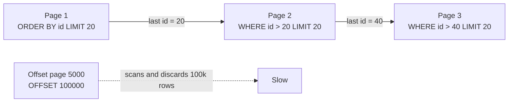

> **Rule of thumb:** cursor/keyset for feeds, timelines, infinite scroll and large tables; offset for small admin tables where page numbers matter.

### 7.4 API Versioning

> **Level:** 🟢 Essential

**Why?** An API is a **contract**. Mobile apps in the wild can't be force-upgraded, so breaking changes (renaming/removing a field, changing types or semantics) need a new version.

| Strategy | Example | Pros | Cons |
|---|---|---|---|
| **URL path** (most common) | `/api/v1/users`, `/api/v2/users` | Visible, explicit, easy to route at the gateway, easy to test in a browser | URL "pollution"; clients must migrate |
| **Header / media type** | `Accept: application/vnd.myapi.v2+json` | Clean URLs; true content negotiation | Less visible; harder to test and cache (needs `Vary`) |
| **Query parameter** | `/api/users?version=2` | Easy to add | Easy to forget; messy at scale; cache-key pitfalls |

**Best practice**
- Prefer **non-breaking, additive changes** within a version: add optional fields, add endpoints. Clients must ignore unknown fields ("tolerant reader").
- Use URL path versioning for public APIs; run old and new side by side for a **deprecation window** (typically 6–12 months), announce with `Deprecation`/`Sunset` headers, and measure usage of the old version before turning it off.
- GraphQL and gRPC evolve schemas instead (deprecate fields; never reuse protobuf field numbers).

### 7.5 Idempotency in APIs

> **Level:** 🟢 Essential

**What is it?** An operation is **idempotent** if performing it once or many times has the same effect.

**Why do we need it?** Networks fail *after* the server did the work: the client sees a timeout and can't tell if the payment went through. It will retry. Without idempotency the customer is charged twice.

**How does it work (idempotency key)?**
1. The client generates a unique key per *logical* operation (UUID) and sends `Idempotency-Key: 6f1c...` with the POST. Retries reuse the same key.
2. The server atomically tries to **claim** the key (e.g., Redis `SET key IN_PROGRESS NX EX 86400`, or a DB unique constraint).
3. If the claim succeeds → execute, store the final response under the key, return it.
4. If the key exists with a stored response → return the **same response** without re-executing.
5. If the key exists but is still `IN_PROGRESS` → return `409 Conflict` (or wait) so two concurrent retries don't both execute.
6. Optionally store a hash of the request body; same key + different body → `422`, it's a client bug.

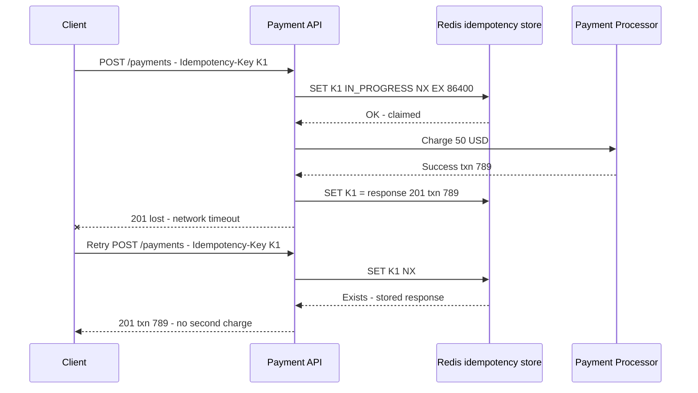

```java
@PostMapping("/payments")
public ResponseEntity<PaymentResponse> pay(@RequestHeader("Idempotency-Key") String key,
                                           @RequestBody PaymentRequest req) {
    String redisKey = "idem:" + key;
    Boolean claimed = redis.opsForValue()
            .setIfAbsent(redisKey, "IN_PROGRESS", Duration.ofHours(24));
    if (Boolean.FALSE.equals(claimed)) {
        String stored = redis.opsForValue().get(redisKey);
        if ("IN_PROGRESS".equals(stored)) {
            return ResponseEntity.status(HttpStatus.CONFLICT).build();
        }
        return ResponseEntity.status(HttpStatus.CREATED).body(deserialize(stored));
    }
    PaymentResponse resp = paymentService.charge(req, key); // pass key downstream too
    redis.opsForValue().set(redisKey, serialize(resp), Duration.ofHours(24));
    return ResponseEntity.status(HttpStatus.CREATED).body(resp);
}
```

**Senior nuances** 🔴
- A Redis TTL (24 h is common — Stripe keeps keys for 24 h) bounds storage; for money, also enforce a **DB unique constraint** on the business key so losing Redis can't cause a double charge.
- If the process crashes while `IN_PROGRESS`, the key must expire (short "lock" TTL) or be reconciled, otherwise retries are blocked forever.
- Pass the key **downstream** (payment providers accept idempotency keys too) so the whole chain is idempotent.
- Message consumers need the same idea — see [Delivery Guarantees and Idempotency](05_distributed_systems_and_messaging.md#13-delivery-guarantees-idempotency-and-deduplication).

**Interview perspective**

> **Q: Why is idempotency critical in payment APIs?**
> A: Because timeouts make the outcome unknown to the client, and retries are inevitable — from users double-clicking, SDKs, proxies and our own retry policies. An idempotency key lets the server recognise the duplicate and return the original result instead of re-executing. That turns at-least-once request delivery into effectively-once processing, which is the only safe behaviour when money moves.

**Common mistakes (Section 7)**
- Verbs in URLs; ignoring status codes; no pagination.
- Offset pagination on huge, frequently-changing tables.
- Breaking changes without a version bump; removing v1 without measuring its traffic.
- "Check then insert" idempotency without atomicity — two concurrent retries both pass the check.

**Quick revision**
- Nouns + HTTP verbs + status codes + stateless.
- Cursor/keyset for big or live lists, offset for small admin lists.
- URL-path versioning, additive changes, deprecation window.
- Idempotency key + atomic claim + stored response + TTL (+ DB unique constraint for money).

---

## 8. GraphQL

> **Level:** 🟡 Intermediate

**What is it?** **GraphQL** is a query language and runtime for APIs where the **client specifies exactly which fields it wants**, across related objects, in a single request to a single endpoint (usually `POST /graphql`). The server exposes a typed **schema**; **resolvers** fetch each field.

**Why do we need it?** REST endpoints return fixed shapes:
- **Over-fetching** — you need a user's name but get 40 fields.
- **Under-fetching** — you need user + orders + items, so you make 3 sequential round trips (painful on mobile networks).

```graphql
# REST would require 3 calls:
#   GET /users/123
#   GET /users/123/orders
#   GET /orders/456/items

# GraphQL: one call, exactly what you need
query {
  user(id: "123") {
    name
    email
    orders(last: 5) {
      id
      total
      items { name price }
    }
  }
}
```

**How does it work?**
1. The client sends a query document (plus variables).
2. The server **parses and validates** it against the schema (types, required args).
3. The executor walks the query tree and calls a **resolver** per field — resolvers can call DBs, REST services, gRPC services.
4. The response mirrors the query's shape as JSON. Writes are **mutations**; real-time pushes are **subscriptions** (usually over WebSockets).

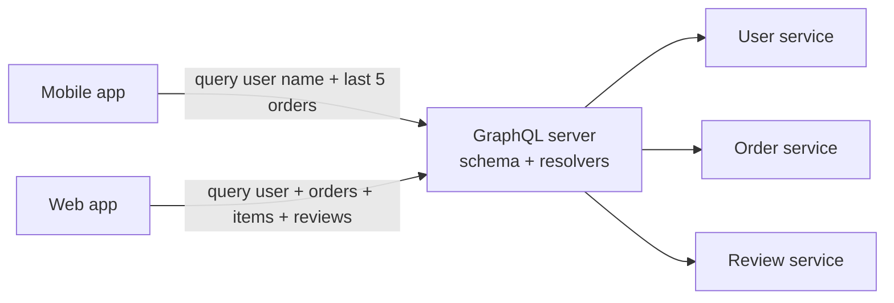

**The N+1 problem and DataLoader** 🔴
Fetching 50 orders and then each order's `customer` field naively makes **1 query for orders + 50 queries for customers**. Fix with **DataLoader**: resolvers request keys, the loader collects all keys requested in one tick and issues **one batched call** (`WHERE id IN (...)`), with per-request caching. Spring for GraphQL supports this via `@BatchMapping`.

```java
@Controller
public class OrderGraphQlController {
    @QueryMapping
    public List<Order> orders(@Argument String userId) { return orderService.byUser(userId); }

    // Called once with ALL orders in the response instead of once per order
    @BatchMapping
    public Map<Order, Customer> customer(List<Order> orders) {
        return customerService.byIds(orders.stream().map(Order::customerId).toList());
    }
}
```

**Challenges**
- **Caching** — everything is `POST /graphql`, so URL-based HTTP/CDN caching doesn't work out of the box. Fixes: **persisted queries** (client sends a hash of a pre-registered query, enabling `GET` and CDN caching), client-side normalized caches (Apollo), field-level server caching.
- **Expensive queries** — clients can ask for deeply nested data. Protect with depth limits, **query cost analysis**, timeouts, and allow-listing persisted queries for public clients.
- **Authorization** is per-field, not per-endpoint — easy to leak a field.
- **Error handling** — responses are often `200` with an `errors` array; monitoring must read the body.

**REST vs GraphQL**

| Feature | REST | GraphQL |
|---|---|---|
| Over-fetching | Common — get the whole object | ✅ Fetch only needed fields |
| Under-fetching | Common — multiple requests | ✅ One request for nested data |
| Caching | ✅ Easy — HTTP/CDN caching by URL | Harder — needs persisted queries or client caches |
| Endpoints | Many, resource-based | One, schema-based |
| Learning curve | Low | Higher (schema, resolvers, N+1) |
| Tooling / adoption | Mature, universal | Mature for frontend; growing elsewhere |
| Versioning | Needed (`/v1`, `/v2`) | Schema evolution, field deprecation |
| Errors | HTTP status codes | Usually `200` + `errors` array |
| Best for | Public APIs, CRUD, cache-heavy reads | Many clients with different data needs, mobile, aggregation over microservices |

**When to use it:** multiple clients (web, iOS, Android, TV) needing different data shapes; a **BFF/aggregation layer** over many microservices; fast-moving frontends. **Avoid** for simple CRUD, file uploads, or public APIs where HTTP caching and simplicity matter more.

**Interview perspective**

> **Q: When would you choose GraphQL over REST?**
> A: When different clients need different shapes of the same data — a mobile app wants a few fields to save bandwidth, the web app wants rich nested data — and I'd otherwise build several bespoke REST endpoints or force multiple round trips. GraphQL gives one flexible contract. The trade-off is harder HTTP caching, the N+1 problem (solved with DataLoader batching), and the need to protect the server from expensive queries with cost limits.

**Quick revision**
- Client picks fields; one endpoint; typed schema; resolvers per field.
- Solves over/under-fetching; costs: caching, N+1, query cost, per-field auth.
- DataLoader batching; persisted queries for caching and security.

---

## 9. gRPC

> **Level:** 🟡 Intermediate

**What is it?** **gRPC** is a high-performance **RPC** (Remote Procedure Call) framework from Google: you call a method on a remote service as if it were a local function. Contracts are defined in **Protocol Buffers** (protobuf), a compact binary serialization format, and transported over **HTTP/2**.

**Why do we need it?** For internal service-to-service calls, JSON over HTTP/1.1 is verbose (field names repeated in every message), slow to parse, and has no enforced contract. gRPC gives smaller payloads, faster serialization, generated type-safe clients in many languages, and streaming.

```protobuf
syntax = "proto3";

service PaymentService {
  rpc Charge (ChargeRequest) returns (ChargeResponse);              // unary
  rpc StreamStatus (StatusRequest) returns (stream StatusUpdate);   // server streaming
}

message ChargeRequest {
  string order_id = 1;      // field numbers are the wire contract - never reuse them
  int64 amount_cents = 2;
  string currency = 3;
}

message ChargeResponse {
  string transaction_id = 1;
  bool success = 2;
}
```

**How does it work?**
1. Define services and messages in `.proto`.
2. `protoc` generates client stubs and server interfaces (Java, Go, Python…).
3. Client calls `stub.charge(req)`; the stub serializes to protobuf and sends an HTTP/2 request.
4. Server deserializes, runs the implementation, returns the response. Deadlines (timeouts) and cancellation propagate across calls.

**Four communication modes**

| Mode | Shape | Example |
|---|---|---|
| Unary | 1 request → 1 response | `Charge` |
| Server streaming | 1 request → stream of responses | Live order-status updates |
| Client streaming | Stream of requests → 1 response | Uploading telemetry batches |
| Bidirectional streaming | Both stream independently | Chat, real-time location exchange |

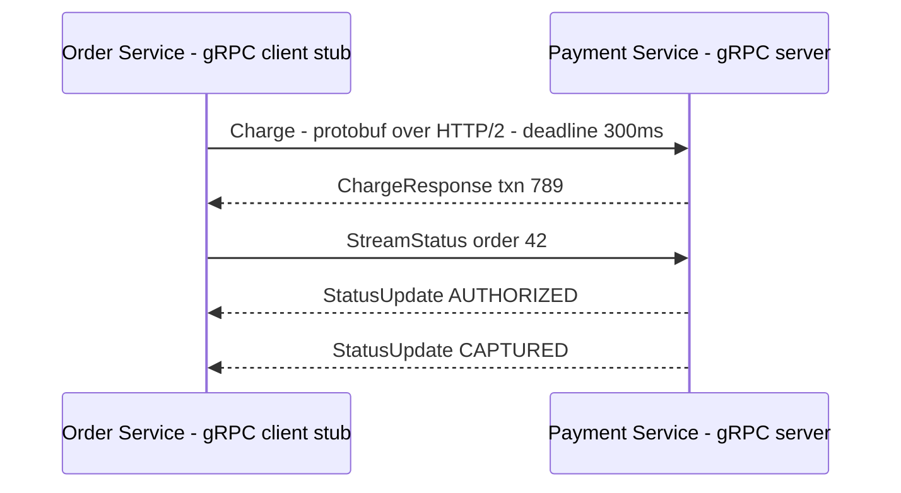

**Advantages and disadvantages**

| ✅ Pros | ❌ Cons |
|---|---|
| Compact binary payloads (often 3–10× smaller than JSON) and fast parsing | Not human-readable; harder to debug with curl |
| Strong contracts + code generation | Browsers can't call it directly (needs gRPC-Web or a gateway transcoding to JSON) |
| HTTP/2 multiplexing and streaming | L7 load balancing required — long-lived HTTP/2 connections defeat L4 per-connection balancing |
| Deadlines and cancellation built in | Tighter coupling to schema; requires tooling |

**When to use it:** internal microservice communication with high call volume or strict latency budgets, polyglot services, streaming. Use REST/GraphQL at the public edge, gRPC inside.

**Common mistake:** putting gRPC behind an L4 load balancer — each client opens one long-lived HTTP/2 connection and *all* its calls go to one backend. Use an L7 LB/mesh (Envoy) or client-side load balancing.

**Quick revision**
- Protobuf + HTTP/2 + generated stubs; unary and three streaming modes.
- Fast and typed; not browser-native; needs L7 balancing.
- Field numbers are the contract — add fields, never renumber.

---

## 10. Choosing an API Style

> **Level:** 🟢 Essential

| Criterion | REST | GraphQL | gRPC | WebSocket |
|---|---|---|---|---|
| Typical placement | Public APIs, CRUD | Client-facing aggregation / BFF | Internal service-to-service | Real-time client channels |
| Payload | JSON (text) | JSON (text) | Protobuf (binary) | Any (text/binary frames) |
| Transport | HTTP/1.1 or 2 | HTTP (POST) | HTTP/2 | Upgraded TCP |
| Contract | OpenAPI (optional) | Schema (required) | `.proto` (required) | Custom |
| Caching | ✅ Excellent (HTTP) | ⚠️ Harder | ❌ App-level only | ❌ |
| Streaming | ❌ (SSE separately) | Subscriptions | ✅ All modes | ✅ Bi-directional |
| Browser support | ✅ | ✅ | ⚠️ gRPC-Web | ✅ |
| Performance | Good | Good (watch N+1) | Best | Best for push |
| Learning curve | Low | Medium | Medium | Medium |

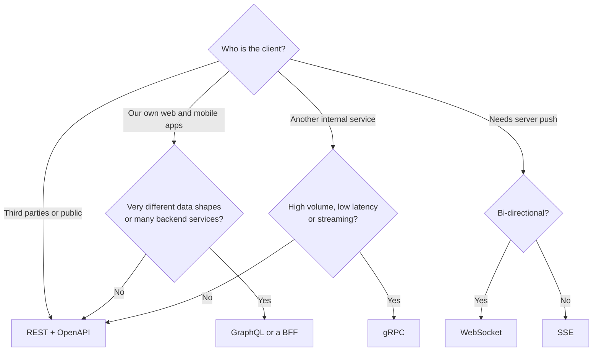

> **Strong answer pattern:** "Public REST at the edge for compatibility and caching, gRPC between internal services for performance and contracts, WebSockets for the real-time channel — each chosen for its consumer."

---

## 11. Reverse Proxy

> **Level:** 🟢 Essential

**What is it?** A **reverse proxy** is a server that sits **in front of your servers** and receives client requests on their behalf. Clients talk to the proxy; they never see backend addresses. (A **forward proxy** sits in front of *clients* — e.g., a corporate proxy — and talks to the internet on their behalf.)

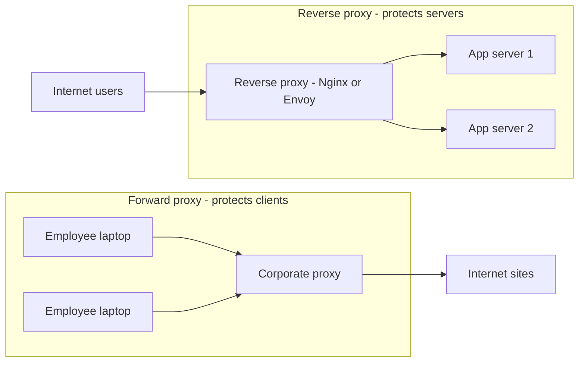

**Responsibilities**
- **TLS termination** and certificate management.
- **Load balancing** across backends (a load balancer is a specialised reverse proxy).
- **Caching** static and cacheable responses; **compression** (gzip/brotli).
- **Security**: hide topology, filter bad requests (WAF), limit request size, basic rate limiting, IP allow/deny.
- **Routing**: `/api/*` to the API cluster, `/static/*` to object storage.
- **Connection management**: absorb slow clients ("slowloris"), keep pooled keep-alive connections to backends.

**Examples:** Nginx, HAProxy, Envoy, Traefik, Caddy; managed: AWS ALB, Cloudflare.

```nginx
upstream api_backend {
    least_conn;
    server 10.0.1.5:8080 max_fails=3 fail_timeout=10s;
    server 10.0.1.6:8080 max_fails=3 fail_timeout=10s;
    keepalive 64;
}

server {
    listen 443 ssl http2;
    server_name api.example.com;
    ssl_certificate     /etc/ssl/api.crt;
    ssl_certificate_key /etc/ssl/api.key;

    location /api/ {
        proxy_pass http://api_backend;
        proxy_http_version 1.1;
        proxy_set_header Connection "";
        proxy_set_header X-Forwarded-For $proxy_add_x_forwarded_for;
        proxy_read_timeout 5s;
    }
    location /static/ {
        root /var/www;
        expires 30d;
    }
}
```

**Common mistakes:** forgetting `X-Forwarded-For` (apps log the proxy's IP and rate-limit everyone as one user); trusting `X-Forwarded-For` from the public internet (spoofable — only trust it from your own proxies); running one proxy instance (SPOF).

---

## 12. Load Balancers

### 12.1 What a Load Balancer Does

> **Level:** 🟢 Essential

**What is it?** A **load balancer** (LB) distributes incoming requests across a pool of servers so no single server is overwhelmed, and routes around unhealthy ones.

**Why do we need it?** Horizontal scaling ([Fundamentals](01_system_design_fundamentals.md#5-vertical-vs-horizontal-scaling)) only works if something spreads traffic across the instances, and high availability only works if something stops sending traffic to dead ones.

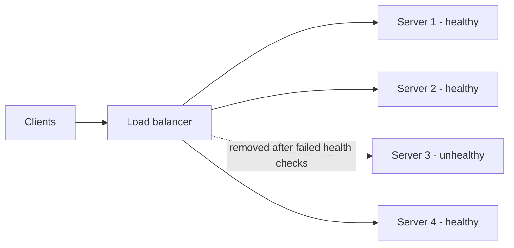

**Walkthrough:** the LB accepts the client connection, chooses a backend using an algorithm ([12.3](#123-load-balancing-algorithms)), forwards the request, and returns the response. It continuously health-checks backends; server 3 failed its checks so it receives no traffic until it recovers. Auto-scaling groups register new instances with the LB as load grows.

### 12.2 L4 vs L7 Load Balancers

> **Level:** 🟢 Essential

**L4 — transport layer.** Routes **TCP/UDP connections** using IP addresses and ports. It does not parse HTTP, so it can't see URLs, headers or cookies.
- Very fast, very high throughput, low latency; protocol-agnostic (databases, MQTT, raw TCP, gRPC passthrough, game servers on UDP).
- Can do **TLS passthrough**, and many (e.g., AWS NLB TLS listeners) can also **terminate TLS** — what they can't do is route on HTTP content.
- Balances **per connection**: every request on a long-lived connection goes to the same backend.
- Examples: AWS NLB, HAProxy (TCP mode), Google TCP/UDP LB, LVS, Maglev.

**L7 — application layer.** Terminates the connection and understands **HTTP** (or gRPC).
- Content-based routing (`/api/*` → API pool, `/images/*` → media pool, header `X-Tenant: acme` → tenant pool).
- TLS termination, cookie-based sticky sessions, header rewriting, compression, caching, WAF, per-request retries, request-level metrics and logs.
- Balances **per request**, which matters for HTTP/2 and gRPC multiplexed connections.
- Examples: AWS ALB, Nginx, Envoy, HAProxy (HTTP mode), Traefik, GCP HTTPS LB.

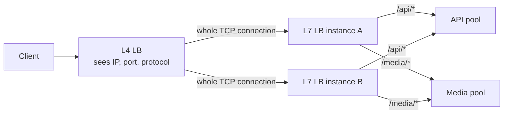

**Walkthrough (a common layered setup):** an L4 LB spreads raw connections across a fleet of L7 proxies (cheap and scalable); the L7 proxies terminate TLS and route each HTTP request by path to the right service pool.

| Feature | L4 | L7 |
|---|---|---|
| Routing basis | IP + port (connection 4-tuple) | URL path, host, headers, cookies, method |
| TLS | Passthrough or termination (no HTTP inspection) | Termination (+ optional re-encryption) |
| Content-based routing | ❌ | ✅ |
| Balancing unit | Connection | Request |
| Performance | Faster, millions of connections | More CPU per request |
| Observability | Low (bytes, connections) | High (status codes, latency per route) |
| Protocols | Any TCP/UDP | HTTP/1.1, HTTP/2, gRPC, WebSocket |
| Use case | Non-HTTP traffic, extreme throughput, front tier | Web apps, microservices, gRPC |

### 12.3 Load Balancing Algorithms

> **Level:** 🟢 Essential

| Algorithm | How it works | Best for | Watch out |
|---|---|---|---|
| **Round robin** | Rotate through servers in order | Identical servers, uniform requests | Ignores current load |
| **Weighted round robin** | Bigger servers get proportionally more | Mixed instance sizes, canary (5% weight) | Static weights |
| **Least connections** | Pick server with fewest active connections | Long-lived or variable-length requests (WebSockets, uploads) | Connection count ≠ CPU load |
| **Least response time** | Fewest connections weighted by observed latency | Heterogeneous performance | Needs latency tracking |
| **Power of two choices** | Pick 2 random servers, send to the less loaded | Large fleets; near-optimal with little state | — |
| **IP hash** | `hash(client IP) % N` → same server | Session affinity without cookies | Uneven behind NAT; reshuffles when N changes |
| **Consistent hashing** | Hash key onto a ring; nearest server clockwise | Cache servers, sharded stateful backends — keeps keys on the same node when servers are added/removed | Hot keys; use virtual nodes. See [Consistent Hashing](03_databases_and_storage.md#10-consistent-hashing) |
| **Random** | Pick at random | Simple; approximates round robin at scale | — |

**Interview perspective**

> **Q: Your API servers have uneven load — some overloaded, some idle. What algorithm would help?**
> A: Least connections (or least response time). Round robin assumes all requests cost the same, but if some requests take 2 seconds and others 20 ms, servers that happen to get the slow ones pile up. Least connections routes each new request to whoever is least busy *right now*. If the servers have different capacities I'd add weights; at very large scale, "power of two choices" gives nearly the same benefit with less coordination.

### 12.4 Health Checks and Sticky Sessions

> **Level:** 🟡 Intermediate

**Health checks**
- **Active:** the LB probes each backend (`GET /health` every 5–10 s). N consecutive failures → mark unhealthy; M successes → healthy again.
- **Passive (outlier detection):** the LB watches real traffic; a backend returning many 5xx or timeouts is ejected temporarily (Envoy outlier detection, Nginx `max_fails`).
- **Liveness vs readiness** (Kubernetes vocabulary): *liveness* = "is the process alive?" (restart if not); *readiness* = "can it take traffic now?" (warming caches, DB reachable). Readiness should gate LB traffic.
- **Pitfall:** a "deep" health check that calls the DB can mark **every** instance unhealthy during a brief DB blip, turning a partial outage into a total one. Keep LB health checks shallow; surface dependency health separately.

**Sticky sessions (session affinity)**
- The LB pins a user to one backend via a cookie (L7) or IP hash (L4).
- ✅ Needed for in-memory sessions or local caches; improves cache locality.
- ❌ Uneven load, hard failover (sessions lost when that server dies), complicates scaling and deploys.
- **Better:** make services **stateless** — store sessions in Redis or use JWTs — and drop stickiness. WebSockets are naturally sticky per connection, which is fine.

**Connection draining:** on deploy or scale-in, the LB stops sending *new* requests to an instance but lets in-flight requests finish (deregistration delay, e.g., 30 s).

### 12.5 Load Balancer Redundancy and Global Load Balancing

> **Level:** 🟡 Intermediate

**Isn't the load balancer itself a single point of failure (SPOF)?** Yes, unless you make it redundant.

```mermaid
flowchart TD
    dns["DNS / GSLB<br/>health-checked records"] --> vip1["Region A virtual IP"]
    dns -.->|"failover"| vip2["Region B virtual IP"]
    vip1 --> lbA1["LB active"]
    vip1 -.->|"VRRP takeover on failure"| lbA2["LB standby"]
    lbA1 --> poolA["Region A servers"]
    lbA2 --> poolA
    vip2 --> lbB["Region B LB pair"]
    lbB --> poolB["Region B servers"]
```

**Walkthrough**
1. **Within a site:** two LB nodes share a **virtual IP** (VIP). The active node owns it; the standby monitors via heartbeats (VRRP/keepalived) and takes over the VIP in seconds if the active dies. Active-active pairs with ECMP routing or anycast also work.
2. **Managed cloud LBs** (ALB/NLB, GCP LB) are already distributed across multiple nodes and availability zones — the SPOF problem is handled for you, but deploy targets across **multiple AZs**.
3. **Across regions — Global Server Load Balancing (GSLB):** GeoDNS/latency-based DNS or **anycast** (same IP announced from many locations; BGP routes users to the nearest) directs users to a healthy region. Cloudflare and Google's global LB use anycast.

**Interview perspective**

> **Q: How do you avoid the load balancer being a single point of failure?**
> A: Run LBs in redundant pairs or clusters — active-passive with a floating virtual IP and heartbeat failover, or active-active behind anycast/ECMP. In the cloud, managed LBs are already multi-node and multi-AZ, so I'd make sure targets span AZs. For region-level failure I'd add DNS-based or anycast global load balancing with health checks so traffic shifts to another region.

**Common mistakes (Section 12)**
- Saying "L4 can't do TLS" — it can terminate TLS; it can't route on HTTP content.
- gRPC/HTTP/2 behind L4 → one backend gets all of a client's traffic.
- Deep health checks that cascade dependency failures into total outage.
- Relying on sticky sessions instead of externalising state.

**Quick revision**
- L4 = connections, fast, protocol-agnostic. L7 = requests, content-aware, TLS + routing + observability.
- Round robin for uniform load; least connections/response time for variable load; consistent hashing for stateful/cache affinity.
- Active + passive health checks; shallow readiness checks; connection draining.
- No SPOF: LB pairs with VIP, multi-AZ managed LBs, GSLB/anycast across regions.

---

## 13. API Gateway and BFF

### 13.1 API Gateway

> **Level:** 🟢 Essential

**What is it?** An **API gateway** is the single entry point for all client requests into a microservices system. It handles **cross-cutting concerns** — things every service would otherwise re-implement — and routes each request to the right downstream service.

**Why do we need it?** Without a gateway, every service must implement auth, rate limiting, TLS, logging and CORS on its own → duplication, inconsistency, security gaps. Clients would also need to know every service's address, so refactoring services would break them.

```mermaid
flowchart LR
    mobile["Mobile app"] --> gw
    web["Web app"] --> gw
    partner["Partner API client"] --> gw
    subgraph gw["API Gateway"]
        direction TB
        auth["AuthN - validate JWT"] --> rl["Rate limit per key"]
        rl --> route["Route + transform + aggregate"]
    end
    gw --> users["User service"]
    gw --> orders["Order service"]
    gw --> payments["Payment service"]
    gw -.-> logs["Logs, metrics, traces"]
```

**What it does**

| Concern | Example |
|---|---|
| Authentication / coarse authorization | Validate JWT signature and expiry, check scopes; pass user ID downstream |
| Rate limiting and quotas | 100 req/s per API key; monthly quotas per plan |
| Routing | `/v1/orders/**` → order-service; canary 5% → v2 |
| TLS termination | Certificates managed in one place |
| Request/response transformation | REST ↔ gRPC transcoding, header injection, field filtering |
| Aggregation | One client call fans out to 3 services and merges the result |
| Caching | Cache GET responses for popular resources |
| Resilience | Timeouts, retries, circuit breaking to upstreams |
| Observability | Access logs, metrics per route, starting the trace (`traceparent`) |
| CORS, IP allow-lists, WAF integration | Edge security |

**Popular gateways:** AWS API Gateway, Kong, Apigee, Envoy-based (Gloo, Emissary), Nginx, Traefik, Spring Cloud Gateway.

```yaml
# Spring Cloud Gateway - route + rate limit + circuit breaker
spring:
  cloud:
    gateway:
      routes:
        - id: orders
          uri: lb://order-service            # resolved via service discovery
          predicates:
            - Path=/api/v1/orders/**
          filters:
            - name: RequestRateLimiter
              args:
                redis-rate-limiter.replenishRate: 100
                redis-rate-limiter.burstCapacity: 200
            - name: CircuitBreaker
              args:
                name: ordersCb
                fallbackUri: forward:/fallback/orders
```

**Gateway pitfalls**
- **SPOF and bottleneck** — run it as a horizontally scaled, stateless, multi-AZ fleet behind an LB; keep per-request work cheap.
- **Business logic creep** — the gateway should not become a "god service" with domain rules; keep it to cross-cutting concerns.
- **Extra hop latency** — typically 1–5 ms; acceptable, but don't chain multiple gateways.
- **Coupling of deploys** — if every team edits one gateway config, it becomes a release bottleneck; use per-team route ownership or declarative config.

### 13.2 Backend for Frontend

> **Level:** 🟡 Intermediate

**What is it?** The **BFF** pattern gives each client type its **own gateway/API layer**, owned by the team building that client and tailored to its needs.

```mermaid
flowchart LR
    mob["Mobile app"] --> mbff["Mobile BFF<br/>compact payloads"]
    webc["Web app"] --> wbff["Web BFF<br/>rich aggregated views"]
    part["Partners"] --> pbff["Partner API<br/>stable versioned contract"]
    mbff --> svc1["User service"]
    mbff --> svc2["Order service"]
    wbff --> svc1
    wbff --> svc2
    wbff --> svc3["Recommendation service"]
    pbff --> svc2
```

- **Mobile BFF:** small payloads, fewer round trips, tolerant of poor connectivity, device-specific auth flows.
- **Web BFF:** richer data, aggregates several services per page, may render server-side.
- **Partner BFF:** stable, versioned contract with strict rate limits and API-key auth.

**Trade-off:** clients get exactly what they need and frontend teams move independently, at the cost of more services to run and some duplicated aggregation logic. GraphQL is often used as a single "universal BFF" instead.

### 13.3 LB vs Reverse Proxy vs API Gateway vs Service Mesh

> **Level:** 🟡 Intermediate

These overlap heavily — the same software (Envoy, Nginx) can play all roles. What differs is **where it sits and what it's responsible for**.

| | Load balancer | Reverse proxy | API gateway | Service mesh |
|---|---|---|---|---|
| Traffic direction | North-south (into the system) | North-south | North-south (client → services) | East-west (service ↔ service) |
| Main job | Spread load, health checks | Front servers: TLS, caching, routing | API management: auth, quotas, routing, aggregation, versioning | Service identity (mTLS), retries, timeouts, traffic shifting, telemetry |
| Awareness | Servers | HTTP | APIs, consumers, API keys, plans | Services, workloads |
| Deployment | Edge appliance / managed | Edge | Edge, centralized | Sidecar proxy per service (or node-level/ambient) |
| Examples | AWS ALB/NLB, HAProxy | Nginx, Envoy | Kong, Apigee, AWS API Gateway, Spring Cloud Gateway | Istio, Linkerd, Consul Connect |

See [Microservices Building Blocks](06_architecture_reliability_and_security.md#2-microservices-building-blocks) for sidecars and meshes.

**Interview perspective**

> **Q: What does an API gateway do and why is it important in microservices?**
> A: It's the single front door. It centralizes cross-cutting concerns — authentication, rate limiting, TLS, routing, logging, sometimes aggregation — so services can focus on business logic and those policies are consistent. It also decouples clients from the internal topology, so we can split or move services without changing client URLs. The trade-off is an extra hop and a critical component, so it must be stateless, horizontally scaled and multi-AZ, and kept free of business logic.

**Quick revision**
- Gateway = front door for APIs: auth, rate limiting, routing, transformation, aggregation, observability.
- BFF = one tailored API layer per client type.
- LB spreads load; reverse proxy fronts servers; gateway manages APIs; mesh handles service-to-service.

---

## 14. Rate Limiting

### 14.1 Why and Where

> **Level:** 🟢 Essential

**What is it?** **Rate limiting** caps how many requests a client (user, API key, IP, tenant) can make in a time window, rejecting or delaying the excess.

**Why do we need it?**
- Protect backends from overload, runaway clients, scrapers and DDoS.
- Enforce **fairness** between tenants ("noisy neighbour") and **commercial plans** (free: 100/min, pro: 10,000/min).
- Control **cost** on expensive endpoints (LLM calls, SMS sending, third-party APIs billed per call).
- Slow down brute-force attacks (login, OTP verification).

**Where to apply it**
- **Edge / API gateway** (preferred) — rejects excess before it consumes any backend resources.
- **Application layer** — business-specific limits ("max 5 password resets per hour per account").
- **Client side** — well-behaved SDKs throttle themselves and honour `Retry-After`.
- **Outbound** — limit your own calls to a partner API that rate-limits you.

**Keys:** per user ID, per API key, per IP (careful with NAT and IPv6 ranges), per tenant, per endpoint — often combined (`tenant:acme:endpoint:/search`).

### 14.2 Algorithms

> **Level:** 🟢 Essential

#### Token bucket ⭐ (most common)

A bucket holds up to **capacity** tokens and is refilled at **rate r** tokens/second. Each request takes a token; no token → reject (429).

```mermaid
flowchart LR
    refill["Refill 10 tokens per second"] --> bucket[("Bucket<br/>capacity 20")]
    req["Incoming request"] --> check{"Token available?"}
    bucket --> check
    check -->|"yes - take 1"| allow["Allow"]
    check -->|"no"| reject["Reject 429"]
```

*Worked example:* capacity 20, refill 10/s. An idle client has 20 tokens and can **burst** 20 requests instantly; after that it's limited to 10/s sustained.
- ✅ Allows short bursts, smooth average; tiny state (tokens + last refill timestamp); used by AWS, Stripe, Spring Cloud Gateway's Redis limiter.
- ❌ Two parameters to tune.

#### Leaky bucket

Requests enter a FIFO queue that **drains at a constant rate**; if the queue is full, new requests are dropped.
*Example:* drain 10/s, queue 50. A burst of 100 → 50 queued and processed over 5 s, 50 dropped.
- ✅ Perfectly smooth output — protects a fragile downstream (payment provider, legacy system).
- ❌ Bursts are delayed, not served; queued requests add latency.

#### Fixed window counter

Count requests per fixed window (`user:42:2024-05-01T10:01`); reset at the boundary.
*Example:* limit 100/min. A client sends 100 at 10:00:59 and 100 at 10:01:00 → **200 requests in 2 seconds** all allowed — the boundary-spike problem.
- ✅ Simplest, one counter per key (`INCR` + `EXPIRE`).
- ❌ Boundary bursts up to 2× the limit.

#### Sliding window log

Store the **timestamp of every request** (e.g., Redis sorted set). On each request, drop timestamps older than the window and count the rest.
*Example:* limit 100/min; at 10:01:30 count requests in (10:00:30, 10:01:30].
- ✅ Exact.
- ❌ Memory ∝ requests (100K req/min per key = 100K entries).

#### Sliding window counter

Approximate the sliding window using the current and previous fixed-window counts:

```
estimated = current_count + previous_count × (overlap fraction of previous window)
```
*Example:* limit 100/min. Previous minute had 80, current minute has 30 so far, and we're 25% into the current minute → the sliding window still overlaps 75% of the previous one → `30 + 80 × 0.75 = 90` ≤ 100 → allow.
- ✅ Two counters per key, smooth, accurate enough (used by Cloudflare).
- ❌ Approximation assumes uniform traffic in the previous window.

| Algorithm | Bursts | Accuracy | Memory per key | Best for |
|---|---|---|---|---|
| Token bucket | Allows up to capacity | Good | 2 values | General API limits |
| Leaky bucket | Smooths/queues | Good | Queue | Protecting fragile downstreams, background jobs |
| Fixed window | 2× spike at boundary | Low | 1 counter | Simple, coarse quotas |
| Sliding log | No | Exact | O(requests) | Low-volume, strict limits (login attempts) |
| Sliding counter | Minimal | High (approx.) | 2 counters | High-volume public APIs |

### 14.3 Distributed Rate Limiting

> **Level:** 🟡 Intermediate

**The problem:** with 20 gateway instances, per-instance in-memory counters let a client get 20× the limit. Limits must be **shared**.

**Common solution:** a central **Redis** store, updated **atomically** with a Lua script (Redis runs a script without interleaving other commands, so read-modify-write is race-free).

```mermaid
sequenceDiagram
    participant C as Client
    participant G as Gateway instance 7
    participant R as Redis
    participant S as Backend service
    C->>G: GET /search - API key K
    G->>R: EVAL token_bucket.lua key=rl:K rate=10 cap=20
    R-->>G: allowed=1 remaining=12
    G->>S: Forward request
    S-->>G: 200
    G-->>C: 200 + X-RateLimit-Remaining 12
    C->>G: Burst of requests
    G->>R: EVAL token_bucket.lua
    R-->>G: allowed=0 retry_after=1
    G-->>C: 429 Too Many Requests + Retry-After 1
```

```lua
-- token_bucket.lua  KEYS[1]=bucket key  ARGV: rate, capacity, now_ms, requested
local rate      = tonumber(ARGV[1])
local capacity  = tonumber(ARGV[2])
local now       = tonumber(ARGV[3])
local requested = tonumber(ARGV[4])

local data   = redis.call("HMGET", KEYS[1], "tokens", "ts")
local tokens = tonumber(data[1]) or capacity
local ts     = tonumber(data[2]) or now

-- refill based on elapsed time
tokens = math.min(capacity, tokens + (now - ts) / 1000 * rate)

local allowed = 0
if tokens >= requested then
  tokens  = tokens - requested
  allowed = 1
end

redis.call("HSET", KEYS[1], "tokens", tokens, "ts", now)
redis.call("PEXPIRE", KEYS[1], math.ceil(capacity / rate * 1000) * 2)
return { allowed, math.floor(tokens) }
```

**Design decisions to discuss**
- **Fail open vs fail closed** when Redis is down: most public APIs **fail open** (allow traffic, rely on autoscaling and a coarse local limiter) because rejecting everyone is worse; security-critical limits (login attempts) may **fail closed**.
- **Latency:** one Redis round trip (~0.5 ms in-region) per request. For extreme scale, use **local token buckets with periodic sync** (approximate but cheaper), or shard Redis by key.
- **Clock source:** use Redis server time (`redis.call("TIME")`) or a single clock to avoid skew between gateway nodes.
- **Hot keys:** one huge tenant hammering one Redis key — shard the key or use local pre-aggregation.

### 14.4 Responses and Headers

> **Level:** 🟢 Essential

```http
HTTP/1.1 429 Too Many Requests
Retry-After: 30
X-RateLimit-Limit: 1000
X-RateLimit-Remaining: 0
X-RateLimit-Reset: 1700000000
Content-Type: application/problem+json
```

- `Retry-After` — seconds (or a date) until retry is allowed; clients should back off with jitter.
- `X-RateLimit-*` — de-facto standard; the IETF draft standardizes `RateLimit` / `RateLimit-Policy` headers.
- Rate limiting (reject per client) differs from **load shedding** (server rejects excess under overload regardless of client, usually 503) and **throttling** (slow down rather than reject).

**Interview perspective**

> **Q: Which rate limiting algorithm would you choose for a public API and why?**
> A: Token bucket, stored in Redis and updated with a Lua script for atomicity. It allows reasonable bursts — real clients are bursty — while enforcing an average rate, and it needs only two values per key. If the requirement were "never exceed N in any rolling minute" I'd use a sliding window counter. I'd enforce it at the gateway so rejected traffic never reaches services, return 429 with Retry-After, and fail open if Redis is unavailable so a limiter outage doesn't become a full outage.

**Common mistakes**
- Per-instance counters in a horizontally scaled fleet.
- Non-atomic `GET` then `SET` → races allow over-limit traffic.
- Rate-limiting only by IP (punishes users behind NAT; attackers rotate IPs).
- Not telling clients when to retry → synchronized retry storms.

**Quick revision**
- Token bucket (bursts OK) · leaky bucket (smooth) · fixed window (boundary spike) · sliding log (exact, memory heavy) · sliding counter (approximate, cheap).
- Enforce at the gateway; shared Redis + Lua for distributed limits; fail open for availability.
- 429 + `Retry-After` + `X-RateLimit-*` headers.
- Full interview design: [Rate Limiter design](07_interview_problems_part1.md#2-rate-limiter).

---

## 15. CDN and Edge Computing

### 15.1 What a CDN Is

> **Level:** 🟢 Essential

**What is it?** A **Content Delivery Network** is a globally distributed network of **edge servers** (Points of Presence, PoPs) that cache and serve content close to users.

**Why do we need it?** Physics: a round trip from Mumbai to Virginia is ~200 ms. Serving a 2 MB image from an edge 20 ms away instead of the origin makes pages dramatically faster, and it removes most of that traffic from your origin servers (lower cost, higher capacity).

```mermaid
sequenceDiagram
    participant U as User in Mumbai
    participant E as CDN edge Mumbai
    participant Sh as Origin shield
    participant O as Origin - S3 or app servers
    U->>E: GET /img/logo.png
    alt Edge cache hit
        E-->>U: 200 from edge - about 20ms
    else Edge miss
        E->>Sh: GET /img/logo.png
        alt Shield hit
            Sh-->>E: 200
        else Shield miss
            Sh->>O: GET /img/logo.png
            O-->>Sh: 200 Cache-Control max-age=86400
            Sh-->>E: 200
        end
        E-->>U: 200 and cache for 1 day
    end
```

**Walkthrough**
1. DNS (CNAME to the CDN) or anycast routes the user to the nearest edge PoP.
2. **Hit** → served from edge memory/disk.
3. **Miss** → the edge asks the **origin shield** (a designated mid-tier cache), which consolidates misses from all edges so the origin sees one request instead of hundreds.
4. The origin's `Cache-Control` headers tell the CDN how long to cache.
5. **Failure:** if the origin is down, many CDNs can serve **stale** content (`stale-if-error`) — a cheap form of graceful degradation.

### 15.2 Push vs Pull CDN

> **Level:** 🟡 Intermediate

| | Pull CDN (origin pull) | Push CDN |
|---|---|---|
| How | Edge fetches from origin on first miss, then caches | You upload content to the CDN ahead of time |
| ✅ | Zero maintenance; only popular content occupies cache | No first-request miss; full control over what's at the edge |
| ❌ | First user per edge pays the miss; stale until TTL/purge | You manage uploads, storage, and updates |
| Best for | Most websites and APIs, dynamic catalogs | Large, rarely-changing files: video libraries, game patches, software releases |

### 15.3 Cache Keys, TTL and Invalidation

> **Level:** 🟡 Intermediate

- **Cache key** — normally scheme + host + path + (selected) query string. Including unnecessary parts (tracking params like `utm_source`, all cookies) fragments the cache and kills the hit rate; excluding needed parts (e.g., `Accept-Language` when the content varies) serves the wrong content. Use `Vary` carefully.
- **TTL** — set by `Cache-Control: max-age` / `s-maxage` (shared caches) from the origin. Long TTLs for immutable assets; short or `no-store` for personalized data. Details in [HTTP Caching](04_caching.md#9-http-caching) and [CDN Caching](04_caching.md#10-cdn-caching).
- **Invalidation options**
  1. **Versioned (fingerprinted) URLs** ⭐ — `app.3f9a2c.js`, `logo.png?v=42`. New deploy = new URL; old cached copies are simply never requested. Lets you cache "forever" (`max-age=31536000, immutable`).
  2. **Purge / invalidation API** — remove a path or tag from all edges (seconds to minutes; may cost money; rate-limited).
  3. **Short TTL + stale-while-revalidate** — serve slightly stale while fetching fresh in the background.
  4. **Surrogate keys / cache tags** — tag responses (`product-42`) and purge everything tagged at once.

### 15.4 Signed URLs, Security and Edge Compute

> **Level:** 🟡 Intermediate

- **Signed URLs / cookies** — the origin issues a URL with an expiry and HMAC signature (`?Expires=...&Signature=...`); the edge verifies it before serving private content (paid videos, user documents) without hitting the origin.
- **DDoS absorption** — a large CDN's aggregate capacity (hundreds of Tbps) absorbs volumetric attacks; combine with **WAF** rules, bot management and rate limiting at the edge.
- **TLS at the edge** — the TLS handshake happens with a nearby PoP (short RTT), and the edge keeps warm connections to the origin.
- **Edge compute** — run small functions at the PoP (Cloudflare Workers, Lambda@Edge, CloudFront Functions, Fastly Compute): A/B routing, auth token checks, geo-redirects, header rewriting, image resizing, personalization of cached pages. Constraints: tight CPU/time limits, limited state (edge KV stores are eventually consistent).
- **Dynamic content acceleration** — even uncacheable API calls benefit: TLS terminates at the edge and the request travels over the CDN's optimized backbone with persistent connections to origin.

**Real-world example:** Netflix's Open Connect places CDN appliances inside ISPs and **pushes** the next day's popular titles during off-peak hours, so most streaming bytes never cross the wider internet. See [Video Streaming design](08_interview_problems_part2.md#7-video-streaming-platform).

**Advantages and disadvantages**

| ✅ | ❌ |
|---|---|
| Lower latency for global users | Stale content risk; invalidation complexity |
| Offloads origin bandwidth and compute | Cost per GB; vendor lock-in for edge features |
| DDoS protection, TLS at the edge | Debugging is harder (which PoP served what?) |
| Higher availability (serve stale if origin down) | Personalized/private content needs care (never cache `Set-Cookie` responses publicly) |

**Interview perspective**

> **Q: We deployed new CSS but some users still see the old version. Why, and how would you prevent it?**
> A: The CDN and browsers cached the old file under the same URL until its TTL expires. Purging would fix it reactively, but the robust fix is content-hashed filenames generated at build time — every deploy references new URLs, so caches never need invalidating and we can set year-long immutable TTLs. The HTML that references them gets a short TTL or `no-cache` so it's revalidated on each visit.

**Common mistakes**
- Caching personalized responses publicly (user A sees user B's account page) — use `Cache-Control: private` or `no-store`.
- Query-string or cookie explosion in the cache key → low hit ratio.
- Relying on purges for every deploy instead of versioned assets.
- Forgetting the origin must handle a full cache flush (cold cache → origin traffic spike). Use origin shield and pre-warming.

**Quick revision**
- CDN = edge caches near users; origin shield collapses misses.
- Pull for most content; push for large, predictable files.
- Versioned URLs > purges. Short TTL + stale-while-revalidate for semi-dynamic content.
- Signed URLs for private content; edge compute for light logic; DDoS absorption.

---

## 16. Quick Revision

| Topic | Remember this |
|---|---|
| Request path | DNS → TCP → TLS → HTTP → CDN → LB → Gateway → Service → Cache/DB |
| DNS | Recursive resolver does iterative lookups; TTL trades failover speed vs load; GeoDNS for multi-region |
| TCP vs UDP | Reliable/ordered/handshake vs fast/connectionless; QUIC = UDP + streams + TLS 1.3 |
| HTTP versions | 1.1 keep-alive → 2 multiplexing (TCP HOL remains) → 3 over QUIC |
| Idempotent methods | GET, HEAD, PUT, DELETE (and OPTIONS); POST is not → idempotency keys |
| TLS 1.3 | 1-RTT, forward secrecy; asymmetric handshake + symmetric data; mTLS for service identity |
| Real-time | Polling → long polling → SSE (server push) → WebSocket (duplex); scale WS with pub/sub + presence |
| REST | Nouns, verbs, status codes, stateless; cursor pagination; URL versioning; RFC 9457 errors |
| GraphQL | Client-shaped queries; N+1 → DataLoader; caching via persisted queries |
| gRPC | Protobuf over HTTP/2, streaming, internal services, needs L7 LB |
| Reverse proxy | Fronts servers: TLS, caching, routing, security |
| L4 vs L7 | Connections vs requests; L7 for content routing; both can terminate TLS |
| LB algorithms | RR, weighted, least connections, least response time, consistent hashing |
| LB HA | Active-passive VIP, multi-AZ managed LBs, GSLB/anycast |
| API gateway | Auth, rate limiting, routing, aggregation; stateless and scaled; no business logic |
| Rate limiting | Token bucket default; Redis + Lua for distributed; 429 + Retry-After; fail open |
| CDN | Edge caching, origin shield, versioned assets, signed URLs, DDoS absorption |

**Five sentences to say in any design interview**
1. "Static assets go through a CDN with content-hashed URLs, so we can cache them for a year."
2. "TLS terminates at the load balancer; internal traffic is re-encrypted or uses mTLS through the mesh."
3. "The API gateway handles auth and rate limiting with a token bucket in Redis, so services stay focused on business logic."
4. "List endpoints use cursor pagination, and create endpoints accept an Idempotency-Key so retries are safe."
5. "Public APIs are REST, internal calls are gRPC, and the real-time channel is WebSockets with a pub/sub backplane."

---

**Previous:** [01 — System Design Fundamentals](01_system_design_fundamentals.md) · **Next:** [03 — Databases and Storage](03_databases_and_storage.md)
