# Databases and Storage

> **Part 3 of 10** in the System Design interview notes — see [README](README.md) for the roadmap.
> **What you'll learn:** how to pick the right database for an access pattern, how indexes, transactions, replication and sharding really work, how to find and fix database bottlenecks, and when to use object, file or block storage.
> **Level legend:** 🟢 Essential (asked in almost every interview) · 🟡 Intermediate · 🔴 Advanced / senior
> **Related:** [Fundamentals](01_system_design_fundamentals.md) · [Caching](04_caching.md) · [Distributed Systems and Messaging](05_distributed_systems_and_messaging.md) · [Architecture, Reliability and Security](06_architecture_reliability_and_security.md)

---

## Table of Contents

1. [How to Choose a Database](#1-how-to-choose-a-database)
2. [SQL vs NoSQL](#2-sql-vs-nosql)
3. [Database Types](#3-database-types)
   - [3.1 Relational](#31-relational-databases) · [3.2 Document](#32-document-databases) · [3.3 Key-Value](#33-key-value-stores) · [3.4 Wide-Column](#34-wide-column-databases) · [3.5 Graph](#35-graph-databases) · [3.6 Time-Series](#36-time-series-databases) · [3.7 Search Engines](#37-search-engines-and-the-inverted-index)
4. [Data Modeling, Normalization and Denormalization](#4-data-modeling-normalization-and-denormalization)
5. [Indexing](#5-indexing)
6. [Transactions, ACID and Isolation Levels](#6-transactions-acid-and-isolation-levels)
7. [BASE and Eventual Consistency](#7-base-and-eventual-consistency)
8. [Replication and Read Replicas](#8-replication-and-read-replicas)
9. [Partitioning and Sharding](#9-partitioning-and-sharding)
10. [Consistent Hashing](#10-consistent-hashing)
11. [Connection Pooling](#11-connection-pooling)
12. [Database Bottlenecks and the Scaling Ladder](#12-database-bottlenecks-and-the-scaling-ladder)
13. [Object, File and Block Storage](#13-object-file-and-block-storage)
14. [Quick Revision](#14-quick-revision)

---

## 1. How to Choose a Database

> **Level:** 🟢 Essential

**What is it?** Choosing a database means matching a storage engine to *how your data is read and written* (the **access pattern**), not to what is popular or what you used last time.

**Why do we need it?** The database is usually the hardest component to change later. Data outlives code: migrating terabytes between engines is slow, risky and expensive. A wrong early choice (for example, a key-value store for data that needs ad-hoc joins and reports) leads to painful workarounds for years.

**How does it work?** Ask these questions in order:

1. **What are the main queries?** Point lookups by key? Range scans by time? Joins across entities? Full-text search? Graph traversal?
2. **What is the read:write ratio and peak QPS?** (QPS = queries per second.)
3. **Do you need multi-row transactions and strong consistency?** (money, inventory, bookings)
4. **How big will the data get and how fast?** GB, TB or PB?
5. **How fixed is the schema?** Stable columns, or every record different?
6. **What latency is required?** Sub-millisecond (in-memory) vs tens of ms (disk)?
7. **What does the team already operate well?** Operational familiarity is a real factor.

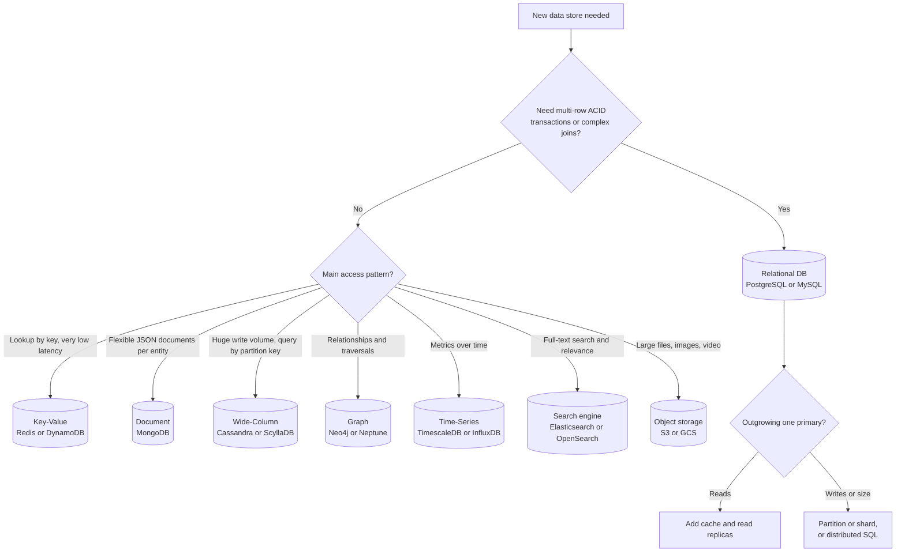

**Walkthrough:**
1. Start with the strongest requirement: if correctness needs transactions or joins, a relational database is the default — it is the most general-purpose tool.
2. Otherwise, pick by the dominant access pattern. Each specialised store is excellent at one shape of query and mediocre at others.
3. Even a relational choice has a scaling path: cache and replicas for reads, partitioning or sharding (or a distributed SQL engine like CockroachDB, Spanner, YugabyteDB) for writes and size.

**Real-world example:** An e-commerce platform typically uses **several** stores (called **polyglot persistence**): PostgreSQL for orders and payments, Redis for sessions and carts, Elasticsearch for product search, S3 for product images, and a data warehouse for analytics.

**Interview perspective**

> **Q: Which database would you choose for this system?**
> A strong answer starts from access patterns, not product names: "Orders need transactions across order, payment and inventory rows, and we'll run reporting queries with joins, so I'll start with PostgreSQL. Product search needs relevance ranking and fuzzy matching, which relational databases do poorly, so I'll index products into Elasticsearch asynchronously. The trade-off is operating two systems and keeping the search index eventually consistent with the source of truth."

**Common mistakes**
- Picking NoSQL "because it scales" without knowing the queries.
- Using one database for everything, including search and blobs.
- Forgetting that you also need backups, migrations and on-call expertise for each store.

**Quick revision**
- Access pattern first, product second.
- Relational is the safe default when you need transactions or flexible queries.
- Real systems are polyglot: each store does what it is best at.

---

## 2. SQL vs NoSQL

> **Level:** 🟢 Essential

**What is it?**
- **SQL (relational) databases** store data in **tables** of rows and columns with a fixed **schema** (the declared structure). You query with SQL and can **join** tables. Examples: PostgreSQL, MySQL, Oracle, SQL Server.
- **NoSQL ("not only SQL")** is an umbrella term for non-relational stores: document, key-value, wide-column and graph databases. They trade some relational features (joins, multi-row transactions, rigid schema) for flexibility, specific performance profiles or easier horizontal scaling.

**Why does the distinction exist?** In the 2000s, web companies hit limits of single-server relational databases (write volume, data size, global availability). Amazon's Dynamo and Google's Bigtable papers showed you could scale out by giving up joins and cross-key transactions. That family became "NoSQL".

**How they differ in practice:**

| Feature | SQL (Relational) | NoSQL |
|---|---|---|
| Data model | Tables, rows, columns | Documents, key-value pairs, wide rows, graphs |
| Schema | Fixed, enforced by DB (schema-on-write) | Flexible, enforced by application (schema-on-read) |
| Query language | SQL — expressive, ad-hoc queries | Varies; often key-based APIs, limited ad-hoc queries |
| Joins | ✅ Powerful, built in | ❌ Limited or manual (do it in application or denormalize) |
| Transactions | ✅ Full ACID across many rows/tables | Often single-key/single-document; some offer multi-document ACID (MongoDB 4+, DynamoDB transactions) |
| Consistency | Strong by default on the primary | Often tunable; eventual by default in many |
| Horizontal scaling | Harder (manual sharding or distributed SQL) | Usually built in (automatic partitioning) |
| Best for | Relationships, integrity, reporting | Massive scale on known access patterns, flexible data |

**Use SQL when:**
- Data has clear relationships (users → orders → order items → products).
- ACID compliance is required (payments, banking, bookings, inventory).
- You need complex queries with joins and aggregations, or you don't yet know all the queries.
- The schema is stable and well defined.

**Use NoSQL when:**
- You need massive scale (very high write throughput, many TB) with predictable latency.
- The schema is flexible or evolves per record (product catalogs with varying attributes).
- Access patterns are known and simple (get by key, list by partition key) — no complex joins.
- High availability matters more than strong consistency for that data.

**Myths to correct in interviews**

| Myth | Reality |
|---|---|
| "NoSQL always scales better." | NoSQL scales *specific access patterns* well. Query something the data model wasn't designed for and it scales terribly (full scans across partitions). |
| "SQL can't scale." | Single PostgreSQL/MySQL nodes handle tens of thousands of QPS; with replicas, caching and sharding, relational databases run at huge scale (Shopify, GitHub, Instagram's early years, YouTube via Vitess). Distributed SQL (Spanner, CockroachDB) scales writes horizontally *with* SQL. |
| "NoSQL means no schema." | There is always a schema — it just lives in your application code, which makes it easier to break silently. |
| "NoSQL has no transactions." | Many have single-item atomicity and some offer multi-item ACID transactions with limits. |
| "NoSQL is faster." | A key lookup in Redis is faster than a SQL join, but an indexed PostgreSQL lookup is also sub-millisecond on hot data. Speed depends on the access pattern and data model. |

**Interview perspective**

> **Q: When would you choose NoSQL over SQL?**
> "When I need massive horizontal scale — millions of writes per second — on access patterns I know up front, the structure varies per record, I don't need joins, and eventual consistency is acceptable. A user activity log or IoT telemetry is a good fit for Cassandra. If I need ACID transactions and relationships — orders, users, inventory — I stay with SQL. I'd say: 'I'd use PostgreSQL when data integrity and relations matter, like an order management system; Cassandra or DynamoDB when I need millions of writes per second with predictable low latency, like an activity log.'"

**Common mistakes**
- Treating "SQL vs NoSQL" as a religious choice instead of a per-dataset choice.
- Saying "MongoDB because it's schemaless" with no further reasoning.
- Forgetting that NoSQL data modeling is *query-first*: you design tables for the queries, and new queries may need new tables.

**Quick revision**
- SQL = relations + ACID + flexible queries; scale-out is harder but possible.
- NoSQL = scale-out + flexible schema on known access patterns; joins/transactions are limited.
- Justify the choice with the access pattern and consistency requirement.

---

## 3. Database Types

The four classic NoSQL families, plus the specialised stores you'll meet in designs:

| Type | Examples | Data shape | Best for |
|---|---|---|---|
| **Relational** | PostgreSQL, MySQL | Tables with relations | Transactions, integrity, reporting |
| **Document** | MongoDB, Firestore, Couchbase | JSON-like documents | Flexible schemas, user profiles, catalogs |
| **Key-Value** | Redis, DynamoDB, etcd | Key → opaque value | Sessions, caching, high-speed lookups |
| **Wide-Column (column-family)** | Cassandra, HBase, ScyllaDB, Bigtable | Partition key → sorted rows of columns | Time-series, write-heavy, very large scale |
| **Graph** | Neo4j, Amazon Neptune | Nodes and edges | Social graphs, recommendations, fraud detection |
| **Time-Series** | TimescaleDB, InfluxDB, Prometheus | Timestamped measurements | Metrics, IoT, monitoring |
| **Search** | Elasticsearch, OpenSearch, Solr | Inverted index over documents | Full-text search, log search, faceting |

### 3.1 Relational Databases

> **Level:** 🟢 Essential

**What is it?** Data lives in tables; each row has the same columns; relationships use **foreign keys** (a column pointing at another table's primary key). The database enforces constraints (NOT NULL, UNIQUE, foreign keys, CHECK).

**How does it work?** A query planner turns your SQL into an execution plan (which indexes to use, join order). Storage is usually a **B-tree** based engine with a **write-ahead log (WAL)** — every change is first appended to a log on disk so it can be replayed after a crash (this is how durability works).

**When to use:** default for business data — orders, payments, accounts, bookings, inventory, anything with relationships and invariants ("a seat can be booked only once").

**Limits:** a single primary handles all writes; scaling writes beyond one machine needs sharding or distributed SQL.

### 3.2 Document Databases

> **Level:** 🟢 Essential

**What is it?** Each record is a self-contained **document** (JSON/BSON) that can contain nested objects and arrays. Documents in the same collection can have different fields.

```json
{
  "_id": "prod-123",
  "name": "Running Shoe",
  "price": 89.99,
  "attributes": { "size": [8, 9, 10], "color": "blue" },
  "reviews": [ { "user": "u1", "stars": 5 } ]
}
```

**How does it work?** You fetch or update a whole document by ID, or query by indexed fields. Data that is read together is stored together (embedding), avoiding joins.

**When to use:** product catalogs with varying attributes, user profiles, content management, any entity read as one "aggregate".

**Trade-offs:** joins across collections are weak (`$lookup` exists but is not the model's strength); embedding unbounded arrays (e.g., all comments of a viral post) makes documents huge — reference them instead. MongoDB supports multi-document transactions, but heavy reliance on them is a sign the data is relational.

### 3.3 Key-Value Stores

> **Level:** 🟢 Essential

**What is it?** The simplest model: a giant distributed hash map. `PUT(key, value)`, `GET(key)`, `DELETE(key)`. The store doesn't look inside the value.

**How does it work?** The key is hashed to find the partition/node; lookups are O(1). In-memory stores (Redis, Memcached) answer in well under a millisecond; disk-backed ones (DynamoDB) in single-digit milliseconds at any scale.

**When to use:** sessions, caches, feature flags, shopping carts, rate-limit counters, idempotency keys, URL shortener mappings (short code → long URL).

**Trade-offs:** no queries by value, no joins, limited range queries (DynamoDB supports range queries within a partition via the sort key). See [Caching](04_caching.md#6-redis) for Redis in depth.

### 3.4 Wide-Column Databases

> **Level:** 🟡 Intermediate

**What is it?** A wide-column (column-family) store like **Cassandra** organises data into tables where each row is identified by a **partition key**, and rows inside a partition are sorted by **clustering keys**. Think of it as a distributed, sorted map: `partition key → (clustering key → columns)`.

**How does it work?**
1. The **partition key** is hashed to decide which nodes store the partition (using [consistent hashing](#10-consistent-hashing)).
2. Within a partition, rows are stored **sorted by the clustering key**, so range scans inside one partition are fast.
3. Writes go to an in-memory **memtable** and an append-only commit log, then flush to immutable **SSTables** on disk ([LSM-tree](#52-b-tree-vs-lsm-tree)) — which is why writes are so fast.
4. Queries **must** specify the partition key; querying by anything else means scanning the whole cluster (disallowed by default).

```sql
-- Cassandra (CQL): messages of a chat, newest first
CREATE TABLE messages_by_chat (
    chat_id    uuid,          -- partition key: all messages of one chat live together
    sent_at    timeuuid,      -- clustering key: sorted within the partition
    sender_id  uuid,
    body       text,
    PRIMARY KEY ((chat_id), sent_at)
) WITH CLUSTERING ORDER BY (sent_at DESC);

-- Fast: one partition, sorted range
SELECT * FROM messages_by_chat WHERE chat_id = ? LIMIT 50;
```

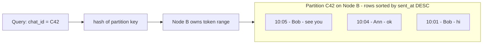

**Query-first modeling:** In relational design you model entities, then write any query. In Cassandra you list the queries first and create **one table per query**, duplicating data across tables (e.g., `messages_by_chat` and `messages_by_user`). Writes are cheap; duplication is the accepted cost.

**When to use:** chat messages, activity feeds, IoT telemetry, event logs — very high write volume, queries always scoped by a known key, multi-datacenter availability.

**Trade-offs:** no joins, no ad-hoc queries, limited transactions (lightweight transactions via Paxos are slow), **partition size must be bounded** (bucket by time, e.g., `(chat_id, month)`), deletes create **tombstones** that slow reads if overused.

### 3.5 Graph Databases

> **Level:** 🟡 Intermediate

**What is it?** Data stored as **nodes** (entities) and **edges** (relationships), both with properties. Traversals follow pointers instead of computing joins.

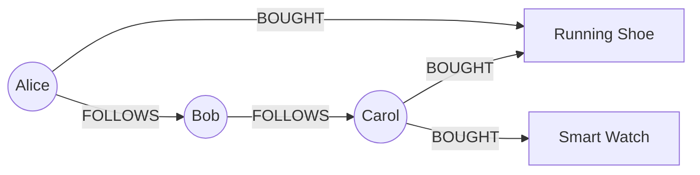

**Why?** "Friends of friends who bought X" is a multi-hop query. In SQL it's several self-joins that get slower with depth; in a graph database each hop is a cheap pointer walk (index-free adjacency).

```cypher
// Neo4j Cypher: products bought by people Alice's friends follow
MATCH (a:User {name:'Alice'})-[:FOLLOWS]->()-[:FOLLOWS]->(fof)-[:BOUGHT]->(p)
RETURN p.name, count(*) AS score ORDER BY score DESC LIMIT 10
```

**When to use:** social graphs, recommendations, fraud rings (shared devices/cards), knowledge graphs, network topology.

**Trade-offs:** harder to shard (graphs don't partition cleanly), smaller ecosystem, not good for bulk aggregations. Many companies keep the graph in SQL/KV (e.g., a `follows` table) and only adopt a graph DB when deep traversals matter.

### 3.6 Time-Series Databases

> **Level:** 🟡 Intermediate

**What is it?** Optimised for data points of the form `(metric, tags, timestamp, value)` — CPU usage, stock prices, sensor readings.

**How does it work?** Data is partitioned by time (chunks per hour/day), heavily compressed (consecutive timestamps and values differ little), and supports **downsampling** (keep 10-second data for 7 days, 1-minute averages for 90 days) and **retention policies** (drop old chunks cheaply instead of deleting rows).

**When to use:** monitoring/metrics platforms, IoT, financial ticks. Examples: TimescaleDB (PostgreSQL extension), InfluxDB, Prometheus (local TSDB), ClickHouse (columnar, great for analytics). See the [metrics platform design](08_interview_problems_part2.md#11-distributed-logging-and-metrics-platform).

**Common mistake:** high-cardinality tags (e.g., `user_id` as a label on every metric) explode the number of series and kill performance.

### 3.7 Search Engines and the Inverted Index

> **Level:** 🟢 Essential

**What is it?** A search engine (Elasticsearch, OpenSearch, Solr — all built on Apache Lucene) answers "which documents contain these words, ranked by relevance?" using an **inverted index**.

**How does it work?**
1. **Analysis:** each document's text is tokenized ("Running Shoes" → `run`, `shoe` after lowercasing and stemming).
2. **Inverted index:** a map from each term to the list of document IDs containing it (a **postings list**) — the inverse of "document → words".
3. **Query:** look up each query term's postings, intersect/union them, and **score** results (BM25 relevance: rare terms and frequent matches score higher).

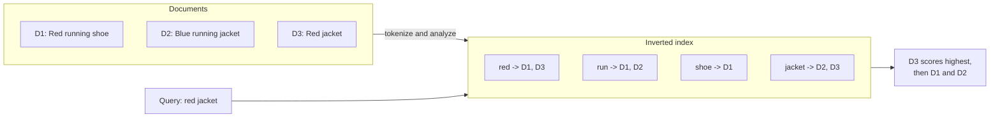

**When to use:** product search, autocomplete, log search (ELK), filtering with facets ("brand = Nike, size = 9").

**Architecture pattern:** the search engine is **not** the source of truth. Write to the primary DB, then stream changes (via [CDC or an outbox](05_distributed_systems_and_messaging.md#19-transactional-outbox-and-cdc)) into the search index. The index is eventually consistent and can be rebuilt from the DB.

**Why not `LIKE '%shoe%'` in SQL?** A leading wildcard can't use a B-tree index → full table scan, and there is no relevance ranking, stemming or typo tolerance. (PostgreSQL full-text search with GIN indexes is a reasonable middle ground for modest scale.)

**Interview perspective (database types)**

> **Q: Your design needs search, a social graph and orders. How many databases?**
> "Orders go in PostgreSQL for ACID. Search goes in Elasticsearch fed asynchronously from the DB. For the social graph I'd start with a `follows` table in the relational DB or a key-value store keyed by user — most queries are one hop ('who do I follow'). I'd only add a graph database if we need multi-hop traversals like friend-of-friend recommendations. Each extra store adds operational cost, so I add them only when an access pattern demands it."

**Quick revision**
- Document = aggregate per entity; KV = lookup by key; wide-column = huge writes, query by partition key; graph = traversals; time-series = metrics; search = inverted index for relevance.
- Search indexes and caches are derived data — rebuildable from the source of truth.

---

## 4. Data Modeling, Normalization and Denormalization

### 4.1 Data Modeling Basics

> **Level:** 🟢 Essential

**What is it?** Data modeling is deciding *which entities exist, what attributes they have, and how they relate*. In interviews you sketch a few core tables with their keys — enough to show the access patterns work.

**Key terms:**
- **Primary key (PK):** uniquely identifies a row (`user_id`).
- **Foreign key (FK):** a column referencing another table's PK (`orders.user_id → users.user_id`).
- **Cardinality:** one-to-one, one-to-many (a user has many orders), many-to-many (orders ↔ products, resolved via a join table `order_items`).

**Example — e-commerce core model:**

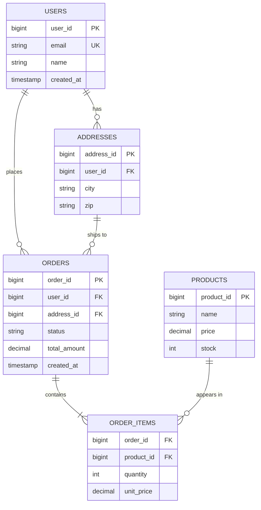

**Walkthrough:**
1. A user places many orders (`||--o{` = exactly one to zero-or-many).
2. An order contains one or more order items; each item references a product. `ORDER_ITEMS` is the join table that resolves the many-to-many between orders and products (its PK is the pair `(order_id, product_id)`).
3. `unit_price` is copied into the order item on purpose: the product price may change later, but the order must remember what was charged. That is a deliberate, *correct* denormalization — historical facts should be snapshotted.

**Interview tip:** model only what the core flows need, name the PKs, and say which column each hot query filters on (that tells you the indexes and the shard key).

### 4.2 Normalization

> **Level:** 🟡 Intermediate

**What is it?** Normalization is organising tables so **each fact is stored once**. It prevents **update anomalies** — when the same fact is stored in several places and one copy gets updated but another doesn't.

**The normal forms (simple version):**

| Form | Rule | Violation example | Fix |
|---|---|---|---|
| **1NF** | Each column holds one atomic value; no repeating groups | `phones = "555-1, 555-2"` in one column | Separate `user_phones` table, one row per phone |
| **2NF** | 1NF + every non-key column depends on the *whole* composite key | In `order_items(order_id, product_id, quantity, product_name)`, `product_name` depends only on `product_id` | Move `product_name` to `products` |
| **3NF** | 2NF + no non-key column depends on another non-key column (no transitive dependency) | `orders(order_id, customer_id, customer_city)` — city depends on customer, not order | Keep city in `customers` |

> **Memory trick:** every non-key column must depend on "the key (1NF), the whole key (2NF), and nothing but the key (3NF)".

**Advantages:** no duplicated facts, smaller storage, writes touch one place, integrity enforced by the DB.
**Disadvantages:** reads need joins; at large scale, joins across big tables (or across shards) get expensive.

### 4.3 Denormalization

> **Level:** 🟢 Essential

**What is it?** Deliberately **duplicating data** so reads are faster — storing data in the shape it is read, avoiding joins.

**Why do we need it?** Joins are fine on one database, but become slow on huge tables and impossible across shards or services. Read-heavy systems (feeds, product pages) benefit from precomputed, ready-to-serve data.

**Common techniques:**
- **Duplicate columns:** store `author_name` on each post so a feed doesn't join users.
- **Precomputed counters:** `posts.like_count` instead of `COUNT(*)` over `likes` each time.
- **Materialized views:** the database stores the result of a query and refreshes it (PostgreSQL `REFRESH MATERIALIZED VIEW`, optionally `CONCURRENTLY`).
- **Read models / projections:** a separate store built from events, optimised for queries — see [CQRS](06_architecture_reliability_and_security.md#4-cqrs).
- **Embedding** in document DBs; **one table per query** in Cassandra.

```sql
-- Materialized view for a dashboard that would otherwise join + aggregate on every request
CREATE MATERIALIZED VIEW daily_sales AS
SELECT date_trunc('day', o.created_at) AS day,
       p.category,
       SUM(oi.quantity * oi.unit_price) AS revenue
FROM orders o
JOIN order_items oi ON oi.order_id = o.order_id
JOIN products p     ON p.product_id = oi.product_id
GROUP BY 1, 2;

CREATE UNIQUE INDEX ON daily_sales (day, category);   -- required for CONCURRENTLY

-- Refresh periodically (e.g., every 5 minutes by a scheduler) without blocking readers
REFRESH MATERIALIZED VIEW CONCURRENTLY daily_sales;
```

**Costs of denormalization:**

| Benefit | Cost |
|---|---|
| Faster reads, no joins | Writes must update every copy (write amplification) |
| Works across shards/services | Copies can drift — you need a sync mechanism (events, CDC, triggers) |
| Precomputed aggregates | Staleness: materialized views and projections lag |
| Simple queries | More storage |

**When to use:** the read:write ratio is high, the duplicated data changes rarely (author names change rarely; likes change often — use counters carefully), or data is split across shards/services. **Start normalized**, then denormalize the specific hot paths you have measured.

**Interview perspective**

> **Q: Normalize or denormalize?**
> "I start normalized in the source-of-truth database because it keeps writes simple and correct. For hot read paths — say a timeline that would join posts, users and like counts — I denormalize into a read model or cache that is updated asynchronously. The trade-off is eventual consistency of that read model and extra write work, which is acceptable for a feed but not for an account balance."

**Common mistakes**
- Denormalizing everything up front "for performance" with no measured bottleneck.
- Duplicating data without a plan for keeping copies in sync.
- Storing derived values (like balances) without a way to recompute them from the underlying facts.

**Quick revision**
- Normalize = each fact once (1NF atomic, 2NF whole key, 3NF nothing but the key).
- Denormalize = copy data for read speed; pay in write cost and sync complexity.
- Snapshot historical values (price at purchase time) — that's correct modeling, not a hack.

---

## 5. Indexing

### 5.1 What an Index Is

> **Level:** 🟢 Essential

**What is it?** An index is a separate, sorted **data structure that speeds up reads** — like the index at the back of a book. It maps column values to the locations of matching rows. The cost: **slower writes** (every insert/update must also update each index) and **extra storage**.

**Why do we need it?** Without an index, finding `email = 'alice@mail.com'` in 10M rows requires a **full table scan** — O(n), reading every row. With a B-tree index it is O(log n): a handful of page reads, typically well under a millisecond when the pages are cached.

```
Table: users (10M rows)
Query: SELECT * FROM users WHERE email = 'alice@mail.com'

Without index: scan all 10M rows ❌
With index on email: B-tree lookup → ~3–4 page reads ✅
```

### 5.2 B-Tree vs LSM-Tree

> **Level:** 🟡 Intermediate

These are the two dominant **storage engine** designs. Knowing them explains why some databases are read-optimised and others write-optimised.

**B-tree (PostgreSQL, MySQL InnoDB, Oracle, SQL Server):**
1. Data/index is a balanced tree of fixed-size **pages** (e.g., 8–16 KB). Inner pages hold keys and child pointers; leaf pages hold keys and row pointers (or the rows themselves in a clustered index).
2. A lookup walks root → inner → leaf. With high fan-out (hundreds of keys per page), a billion keys need only ~4 levels.
3. Writes **update pages in place** (after first recording the change in the WAL). Leaves are linked, so range scans are efficient.

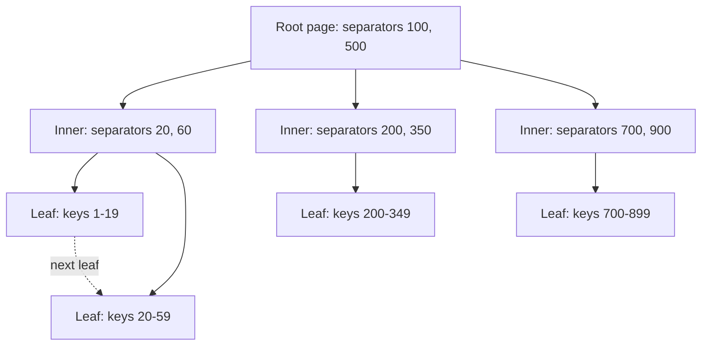

**Walkthrough:** to find key 42, read the root (42 < 100 → left child), read the inner page (20 ≤ 42 < 60 → second leaf), read the leaf. Three page reads. For a range `20..59`, find the first leaf and follow the "next leaf" links.

**LSM-tree — Log-Structured Merge-tree (Cassandra, RocksDB, ScyllaDB, HBase, LevelDB):**
1. Writes go to an append-only **commit log** (for durability) and an in-memory sorted **memtable**. No random disk I/O, so writes are very fast.
2. When the memtable is full, it is flushed to disk as an immutable sorted file (**SSTable** — Sorted String Table).
3. Reads check the memtable, then SSTables from newest to oldest; **Bloom filters** (a compact probabilistic check that answers "definitely not here" or "maybe here") skip files that can't contain the key.
4. Background **compaction** merges SSTables, discarding overwritten values and deleted ones (tombstones).

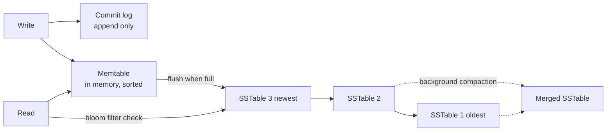

| Aspect | B-tree | LSM-tree |
|---|---|---|
| Write path | In-place page updates (random I/O) | Sequential appends (fast) |
| Read path | One tree walk — predictable | May check several SSTables — mitigated by Bloom filters and compaction |
| Best for | Read-heavy, transactional workloads | Write-heavy workloads (logs, telemetry, messages) |
| Amplification | Write amplification from page rewrites | Write amplification from compaction; read amplification across levels |
| Examples | PostgreSQL, MySQL | Cassandra, RocksDB, HBase |

> **Interview line:** "B-trees optimise reads with in-place updates; LSM-trees optimise writes by turning random writes into sequential appends and paying for it later with compaction."

### 5.3 Types of Indexes

> **Level:** 🟢 Essential

| Type | What it is | Use case |
|---|---|---|
| **B-Tree** (default) | Sorted tree | Equality, ranges (`>`, `BETWEEN`), `ORDER BY`, prefix `LIKE 'abc%'` |
| **Hash** | Hash table of value → rows | Exact equality only; no ranges or sorting |
| **Composite (multi-column)** | Index on `(a, b, c)` in that order | Queries filtering on a leading prefix of the columns — order matters! |
| **Covering** | Index containing every column the query needs | Query answered from the index alone ("index-only scan"), no table lookup |
| **Partial (filtered)** | Indexes only rows matching a condition | `WHERE status = 'ACTIVE'` when most rows are inactive |
| **Unique** | Enforces no duplicate values | Emails, idempotency keys, "one booking per seat" |
| **Full-text** (GIN in PostgreSQL) | Inverted index of words | Text search — see [search engines](#37-search-engines-and-the-inverted-index) |
| **Clustered vs secondary** | Clustered = rows physically stored in index order (InnoDB primary key); secondary = separate structure pointing to rows | InnoDB secondary indexes store the PK, so a lookup may need a second lookup by PK |

### 5.4 Composite Indexes and the Leftmost Prefix Rule

> **Level:** 🟢 Essential

A composite index on `(last_name, first_name)` is sorted by `last_name` first, then by `first_name` *within* each last name — exactly like a phone book.

```sql
-- Index: (last_name, first_name)

SELECT * FROM people WHERE last_name = 'Smith';                         -- ✅ uses index (leading column)
SELECT * FROM people WHERE last_name = 'Smith' AND first_name = 'John'; -- ✅ uses both columns
SELECT * FROM people WHERE first_name = 'John';                         -- ❌ can't seek: like finding every John in a phone book
SELECT * FROM people WHERE last_name = 'Smith' ORDER BY first_name;     -- ✅ index also provides the sort for free
```

**Column order rules of thumb:**
1. **Equality columns first, then range/sort columns.** For `WHERE user_id = ? AND created_at > ? ORDER BY created_at`, index `(user_id, created_at)`. A range condition on an earlier column stops later columns from being used for seeking.
2. Among equality columns, put the one used by the **most queries** first, so more queries can reuse the same index. Selectivity (how many distinct values) is a secondary consideration.
3. The leading column must appear in the `WHERE` clause for the index to be used for seeking.

> Correction of a common oversimplification: "put the most selective column first" is not a universal rule. For equality-only predicates on all columns, order barely matters for that query; what matters is which *other* queries can reuse the index and keeping range columns last.

**Covering index example:**

```sql
CREATE INDEX idx_orders_user_status_created ON orders (user_id, status, created_at);

-- Answered entirely from the index: no table access
SELECT status, created_at FROM orders WHERE user_id = 123;
```

PostgreSQL can also add non-key payload columns: `CREATE INDEX ... ON orders (user_id) INCLUDE (status, total_amount);`

**Partial index example:**

```sql
-- Only ~1% of orders are PENDING; a full index on status would be mostly dead weight
CREATE INDEX idx_orders_pending ON orders (created_at) WHERE status = 'PENDING';
```

### 5.5 Reading EXPLAIN

> **Level:** 🟡 Intermediate

`EXPLAIN` shows the plan the database chose; `EXPLAIN ANALYZE` actually runs the query and shows real times and row counts.

```sql
EXPLAIN ANALYZE
SELECT * FROM orders WHERE user_id = 123 ORDER BY created_at DESC LIMIT 20;
```

```
-- Bad plan (no suitable index) — simplified output
Limit  (actual time=812.4..812.4 rows=20)
  ->  Sort  (Sort Key: created_at DESC)
        ->  Seq Scan on orders  (Filter: user_id = 123; Rows Removed by Filter: 9,999,952)

-- Good plan (after CREATE INDEX ON orders (user_id, created_at))
Limit  (actual time=0.05..0.09 rows=20)
  ->  Index Scan Backward using idx_orders_user_created on orders
        Index Cond: (user_id = 123)
```

**What to look for:**
- **Seq Scan** on a large table for a selective query → missing or unusable index.
- A **Sort** step that an index could have avoided.
- **Estimated vs actual rows** wildly different → stale statistics (run `ANALYZE`).
- **Nested Loop** with a huge outer row count → bad join order or a missing index on the join column.
- **Index Only Scan** → your covering index is working.

**Why might the database ignore your index?** Low selectivity (matching 40% of rows is cheaper as a sequential scan), a function on the column (`WHERE lower(email) = ...` needs an expression index), implicit type casts, or a leading wildcard `LIKE '%x'`.

### 5.6 Index Trade-offs and When Indexes Hurt

> **Level:** 🟢 Essential

| Benefit | Cost |
|---|---|
| Faster reads (`SELECT`, `JOIN`, `ORDER BY`) | Slower writes (`INSERT`, `UPDATE`, `DELETE`) — every index must be updated (**write amplification**) |
| Enforce uniqueness | Extra storage — indexes can exceed the table size |
| Index-only scans | Maintenance: bloat, rebuilds, more RAM needed to keep indexes cached |

**Index a column when:** it appears often in `WHERE`, `JOIN ON` or `ORDER BY`; it has **high cardinality** (many distinct values — `email` good, `is_active` boolean poor); and the table is large (indexes help little on small tables).

**Indexes hurt when:**
- The table is **write-heavy** (logs, events) and the index is rarely read.
- The column has **low cardinality** — the planner won't use it anyway.
- You have **redundant indexes** (`(a)` is redundant if `(a, b)` exists).
- Building an index on a huge production table **blocks writes** — in PostgreSQL use `CREATE INDEX CONCURRENTLY`.

**Interview perspective**

> **Q: What is a covering index and why is it useful?**
> "A covering index contains every column a query needs, so the database answers from the index without touching the table. For example `INDEX(user_id, status, created_at)` covers `SELECT status, created_at FROM orders WHERE user_id = 123`. It removes the table lookup, which is often the most expensive random I/O, so high-frequency queries get much faster. The trade-off is a bigger index and slower writes."

> **Q: How do you decide whether a column should be indexed?**
> "I start from the actual slow queries — `EXPLAIN ANALYZE` and the slow query log — not guesses. I index columns used in WHERE, JOIN and ORDER BY with high cardinality on large tables, ordering composite columns equality-first then range. I avoid indexing low-cardinality or write-hot columns, because the write overhead outweighs the read benefit."

**Common mistakes**
- "Index every column" — kills write throughput.
- Wrong composite column order (range column first).
- Wrapping indexed columns in functions inside `WHERE`.
- Forgetting that every secondary index is another write on every insert.

**Quick revision**
- Index = sorted structure; O(log n) instead of O(n); costs writes and storage.
- Composite: leftmost prefix; equality columns before range columns.
- B-tree for read-heavy OLTP; LSM-tree for write-heavy.
- Verify with `EXPLAIN ANALYZE`; build big indexes `CONCURRENTLY`.

---

## 6. Transactions, ACID and Isolation Levels

### 6.1 What a Transaction Is and ACID

> **Level:** 🟢 Essential

**What is it?** A **transaction** is a group of reads and writes that the database treats as one logical unit: either all of it takes effect or none of it does. **ACID** is the set of guarantees a transactional database provides.

**Why do we need it?** Real operations touch several rows. A money transfer debits one account and credits another. If the server crashes in between, or two transfers run at the same time, you must never end up with money created or destroyed.

| Property | Meaning | Example | How databases implement it |
|---|---|---|---|
| **Atomicity** | All operations succeed or all are rolled back | Transfer: debit AND credit, never just one | Undo log / rollback on failure |
| **Consistency** | Each transaction moves the DB from one valid state to another (constraints hold) | Balance never goes negative (`CHECK balance >= 0`), FKs valid | Constraints, triggers + application invariants |
| **Isolation** | Concurrent transactions don't see each other's half-done work | Two simultaneous transfers don't corrupt each other | Locks and/or MVCC snapshots |
| **Durability** | Once committed, data survives crashes and power loss | Power outage after "commit OK" loses nothing | Write-ahead log flushed (fsync) before commit returns; replication |

> Note: the "C" in ACID (invariants hold) is **not** the same as the "C" in CAP (every read sees the latest write). See [CAP Theorem and PACELC](01_system_design_fundamentals.md#7-cap-theorem-and-pacelc).

```sql
BEGIN;
UPDATE accounts SET balance = balance - 100 WHERE id = 'A' AND balance >= 100;
-- application checks that exactly 1 row was updated, otherwise ROLLBACK (insufficient funds)
UPDATE accounts SET balance = balance + 100 WHERE id = 'B';
INSERT INTO ledger (from_acct, to_acct, amount) VALUES ('A', 'B', 100);
COMMIT;
```

```java
// Spring Boot: the whole method runs in one transaction; any RuntimeException rolls back everything
@Transactional
public void transfer(String from, String to, BigDecimal amount) {
    int debited = accountRepo.debitIfSufficient(from, amount);   // UPDATE ... WHERE balance >= :amount
    if (debited == 0) throw new InsufficientFundsException(from);
    accountRepo.credit(to, amount);
    ledgerRepo.save(new LedgerEntry(from, to, amount));
}
```

### 6.2 Concurrency Anomalies

> **Level:** 🟢 Essential

When transactions run concurrently without enough isolation, these anomalies can happen:

| Anomaly | What happens | Example |
|---|---|---|
| **Dirty read** | You read data another transaction wrote but hasn't committed (and may roll back) | T1 sets balance to 0, T2 reads 0, T1 rolls back — T2 acted on data that never existed |
| **Non-repeatable read** | Reading the same row twice in one transaction gives different values | T1 reads price 10; T2 updates to 12 and commits; T1 reads 12 |
| **Phantom read** | Re-running the same *query* returns a different set of rows | T1 counts orders for today = 5; T2 inserts one; T1 counts again = 6 |
| **Lost update** | Two transactions read-modify-write the same row; one overwrites the other | Both read stock = 10, both write 9 — two items sold, stock only dropped by 1 |
| **Write skew** | Two transactions read overlapping data, each writes a *different* row, together violating an invariant | Rule: at least one doctor on call. Alice and Bob both see 2 on call, both go off call → 0 on call |

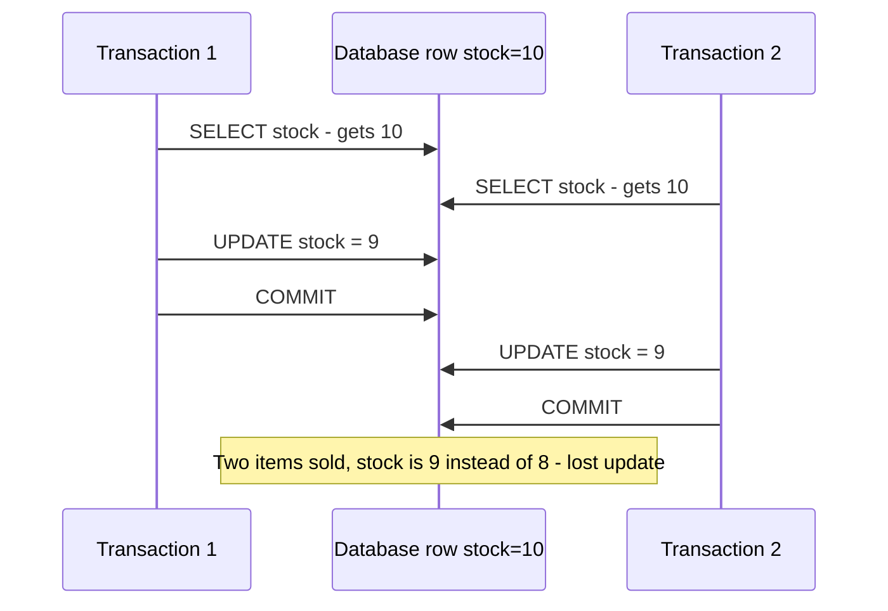

**Walkthrough:** both transactions computed the new value from a stale read in application code. Fix with an atomic update (`UPDATE ... SET stock = stock - 1 WHERE stock > 0`), a row lock (`SELECT ... FOR UPDATE`), or optimistic locking with a version column (see [6.5](#65-optimistic-vs-pessimistic-locking)).

### 6.3 Isolation Levels

> **Level:** 🟢 Essential

**What is it?** Isolation levels are the knob that trades **correctness** against **concurrency**. Higher isolation prevents more anomalies but causes more blocking, aborts and retries.

The SQL standard defines four levels by which anomalies they *must* prevent:

| Level | Dirty read | Non-repeatable read | Phantom read | Performance |
|---|---|---|---|---|
| **Read Uncommitted** | ❌ Possible | ❌ Possible | ❌ Possible | Fastest |
| **Read Committed** | ✅ Prevented | ❌ Possible | ❌ Possible | Fast |
| **Repeatable Read** | ✅ Prevented | ✅ Prevented | ❌ Possible *per standard* (see note) | Moderate |
| **Serializable** | ✅ Prevented | ✅ Prevented | ✅ Prevented | Slowest (more blocking or aborts) |

**Real databases differ from the standard table — this is a favourite senior follow-up:**

| Database | Default | What its levels actually do |
|---|---|---|
| **PostgreSQL** | Read Committed | Each statement sees a fresh snapshot. **Repeatable Read = snapshot isolation**: the whole transaction sees one snapshot, so phantoms are **prevented**, and concurrent updates of the same row fail with a serialization error (preventing lost updates). It still allows **write skew**. **Serializable = SSI** (Serializable Snapshot Isolation): detects dangerous patterns and aborts one transaction — the app must retry. |
| **MySQL InnoDB** | Repeatable Read | Plain `SELECT`s read a consistent snapshot (no phantoms for them). Locking reads (`SELECT ... FOR UPDATE`, `UPDATE`) use **next-key/gap locks** to block inserts into the scanned range, limiting phantoms. Lost updates are still possible with naive read-then-write in application code unless you lock. |
| **Oracle** | Read Committed | "Serializable" is actually snapshot isolation (allows write skew). |

**Which level should you use?**
- **Read Committed** (default in PostgreSQL) is fine for most OLTP work *if* you use atomic updates and explicit locks where needed.
- **Repeatable Read / snapshot** for consistent multi-query reads (reports, exports within one transaction).
- **Serializable** when invariants span multiple rows and anomalies are unacceptable (financial ledgers, on-call rules, booking constraints) — and wrap the transaction in retry logic.

### 6.4 MVCC in Brief

> **Level:** 🟡 Intermediate

**What is it?** **Multi-Version Concurrency Control** keeps multiple versions of each row so **readers don't block writers and writers don't block readers**.

**How does it work (PostgreSQL-style)?**
1. Every row version records which transaction created it (and which one deleted/replaced it).
2. An `UPDATE` writes a **new version** instead of overwriting in place.
3. Each transaction reads using a **snapshot**: it sees only versions committed before the snapshot was taken.
4. Old versions no longer visible to anyone are cleaned up later (PostgreSQL `VACUUM`; InnoDB purges its undo log).

**Consequence:** long-running transactions keep old versions alive → table bloat and slower queries. Keep transactions short.

### 6.5 Optimistic vs Pessimistic Locking

> **Level:** 🟢 Essential

**Pessimistic locking** — "assume conflict, lock first". Lock the row when reading; others wait.

```sql
BEGIN;
SELECT stock FROM products WHERE product_id = 42 FOR UPDATE;   -- row locked until COMMIT
-- application verifies stock > 0
UPDATE products SET stock = stock - 1 WHERE product_id = 42;
COMMIT;
```

```java
public interface ProductRepository extends JpaRepository<Product, Long> {
    @Lock(LockModeType.PESSIMISTIC_WRITE)                 // generates SELECT ... FOR UPDATE
    @Query("select p from Product p where p.id = :id")
    Optional<Product> findByIdForUpdate(@Param("id") Long id);
}
```

**Optimistic locking** — "assume no conflict, detect it at write time". Each row has a `version` column; the update succeeds only if the version hasn't changed since you read it.

```sql
-- read: product 42 has version = 7
UPDATE products
SET stock = stock - 1, version = version + 1
WHERE product_id = 42 AND version = 7;
-- 0 rows updated → someone else changed it → reload and retry (or report a conflict)
```

```java
@Entity
public class Product {
    @Id private Long id;
    private int stock;
    @Version private long version;   // JPA adds "AND version = ?" and increments it on every update
}
// On conflict Spring throws ObjectOptimisticLockingFailureException → catch and retry or return 409 Conflict
```

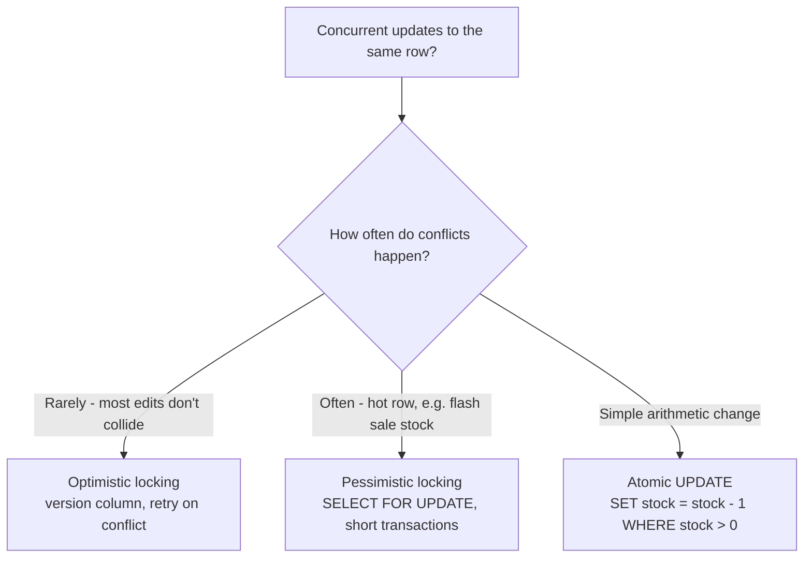

| Aspect | Optimistic | Pessimistic |
|---|---|---|
| Mechanism | Version check at write time | Locks held from read until commit |
| Best when | Conflicts rare; long "think time" (user edits a form) | Conflicts frequent; short critical sections |
| Cost | Retries on conflict | Blocking, risk of deadlocks, lower throughput |
| Works across HTTP requests | ✅ (send version to client, e.g. ETag/If-Match) | ❌ can't hold DB locks across requests |

**Interview perspective**

> **Q: Explain what Repeatable Read prevents.**
> "Per the SQL standard it prevents dirty reads and non-repeatable reads but may allow phantoms. In practice it depends on the engine: PostgreSQL implements it as snapshot isolation, which prevents phantoms too but still allows write skew — two transactions reading the same data and updating different rows so that together they break a rule. MySQL InnoDB uses snapshots for plain reads and gap locks for locking reads. To prevent write skew I'd use Serializable with retries, or explicitly lock the rows the invariant depends on."

> **Q: Two users buy the last item at the same moment. How do you prevent overselling?**
> "Make the decrement atomic and conditional: `UPDATE products SET stock = stock - 1 WHERE id = ? AND stock > 0`, then check the affected row count. If the flow needs more logic, use `SELECT ... FOR UPDATE` in a short transaction, or optimistic locking with a version column and retry. For extreme flash-sale contention I'd move the counter to Redis with an atomic `DECR` or queue the purchases — see the [ticket booking design](08_interview_problems_part2.md#10-ticket-booking-system)."

**Common mistakes**
- Read-modify-write in Java (`product.setStock(product.getStock() - 1)`) without locking or versioning → lost updates.
- Assuming the standard isolation table describes your database exactly.
- Long transactions that include remote HTTP calls — they hold locks and bloat MVCC.
- Using Serializable without retry logic.

**Quick revision**
- ACID = all-or-nothing, invariants hold, no interference, survives crashes (WAL).
- Anomalies: dirty read, non-repeatable read, phantom, lost update, write skew.
- PostgreSQL RR = snapshot isolation (no phantoms, write skew possible); Serializable = SSI with aborts.
- Optimistic (`@Version`) for rare conflicts; pessimistic (`FOR UPDATE`) for hot rows; atomic `UPDATE` when possible.

---

## 7. BASE and Eventual Consistency

> **Level:** 🟢 Essential

**What is it?** **BASE** is the informal opposite of ACID used to describe many distributed NoSQL systems:
- **B**asically **A**vailable — the system keeps answering, even during failures.
- **S**oft state — replicas may temporarily hold different values.
- **E**ventual consistency — if writes stop, all replicas converge to the same value.

**Why do we need it?** Keeping every replica in lockstep (strong consistency) requires coordination on every write, which adds latency and makes the system unavailable when nodes can't talk to each other. For data where a few seconds of staleness is harmless (likes, feeds, product views), accepting eventual consistency buys availability and low latency at global scale.

**How does it work?**
1. A write is accepted by one or a few replicas and acknowledged.
2. It propagates asynchronously to the others.
3. Conflicting concurrent writes are resolved by a rule: last-write-wins timestamps, version vectors, CRDTs or application merge logic (details in [Replication Strategies](05_distributed_systems_and_messaging.md#2-replication-strategies)).
4. Background repair (read repair, anti-entropy) fixes replicas that missed updates.

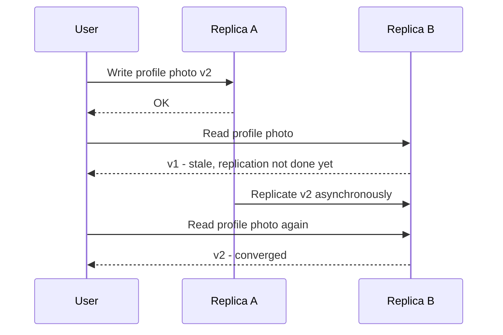

| ACID | BASE |
|---|---|
| Strong consistency, transactions | Availability first, eventual consistency |
| Coordination on every write | Asynchronous propagation |
| Typical in relational DBs | Typical in Dynamo-style stores (Cassandra, DynamoDB default reads) |
| Correctness is simple to reason about | App must tolerate stale reads and resolve conflicts |

**When to use eventual consistency:** social feeds, counters, recommendations, product catalog, analytics, search indexes, caches. **Avoid** for balances, inventory decrements, bookings, uniqueness constraints — or isolate those parts into a strongly consistent store.

**Useful middle grounds** (covered in [Consistency Models](01_system_design_fundamentals.md#8-consistency-models)): **read-your-writes** (you always see your own updates), **monotonic reads** (you never see time go backwards), **causal consistency**. Many stores also offer **tunable consistency** (Cassandra `QUORUM`, DynamoDB `ConsistentRead=true`).

**Interview perspective**

> **Q: Is eventual consistency acceptable here?**
> "I ask: what is the cost of a stale read? If a user sees a like count that is 2 seconds old, nothing bad happens — eventual consistency is fine and buys availability. If a stale read could double-book a seat or overdraw an account, it isn't. I usually split the system: strongly consistent core for money and inventory, eventually consistent read models for everything users browse."

**Common mistakes:** saying "NoSQL is eventually consistent" as if it's fixed (most stores are tunable); forgetting read-your-writes for the user who just made the change.

**Quick revision**
- BASE = basically available, soft state, eventual consistency.
- Decide per data item based on the cost of a stale read.
- Read-your-writes fixes the most visible UX issue.

---

## 8. Replication and Read Replicas

> **Level:** 🟢 Essential

This section covers what you need for most designs. Multi-leader, leaderless and quorum replication are covered in depth in [Replication Strategies](05_distributed_systems_and_messaging.md#2-replication-strategies) and [Quorum Reads and Writes](05_distributed_systems_and_messaging.md#3-quorum-reads-and-writes).

### 8.1 What Replication Is

**What is it?** **Replication** keeps copies of the same data on multiple machines (**replicas**). In the most common setup, one **primary** (leader) accepts all writes and streams changes to **read replicas** (followers) that serve reads.

**Why do we need it?**
- **Read scaling:** one DB node can't serve 50,000 reads/sec; five replicas can share the load.
- **High availability:** if the primary dies, a replica is promoted.
- **Geographic latency:** a replica near users serves local reads.
- **Isolation of workloads:** run analytics/reporting on a replica so it doesn't slow down production traffic.

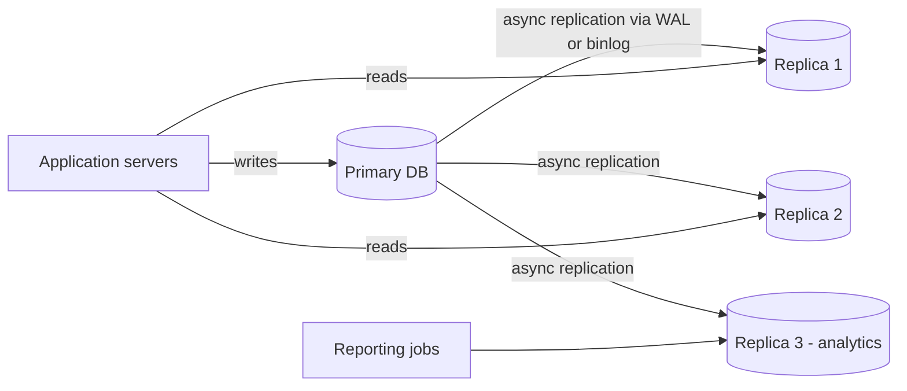

**Walkthrough:**
1. All writes go to the primary, which records them in its log (PostgreSQL WAL, MySQL binlog).
2. Replicas pull/receive the log and apply changes in the same order.
3. Application reads are spread across replicas (via a read-only connection pool or a proxy).
4. Heavy reports run on a dedicated replica so they can't hurt user-facing queries.

**Failure:** if the primary fails, writes stop until a replica is promoted (seconds to a minute with automation such as Patroni, RDS Multi-AZ, Aurora). With async replication, writes the primary acknowledged but hadn't shipped yet **can be lost** at failover.

### 8.2 Synchronous, Asynchronous and Semi-Synchronous

| Mode | How it works | Pros | Cons |
|---|---|---|---|
| **Synchronous** | Primary waits until replica(s) confirm before acknowledging the client | No data loss on failover; replicas up to date | Higher write latency; writes stall if a sync replica is slow or down |
| **Asynchronous** | Primary acknowledges immediately; replicas catch up | Fast writes; replicas don't slow the primary | **Replication lag**; possible data loss on failover |
| **Semi-synchronous** | At least one replica must confirm receipt; others async | Balances durability and latency | More complex; latency of the fastest replica |

Most production setups: async read replicas + one synchronous or semi-sync standby (or quorum-based storage like Aurora) for durability.

### 8.3 Replication Lag and Read-Your-Writes

**The problem:** replication lag is usually milliseconds but can grow to seconds or minutes under load. A user updates their profile (primary), refreshes the page (replica), and sees the **old** profile — they think the update failed.

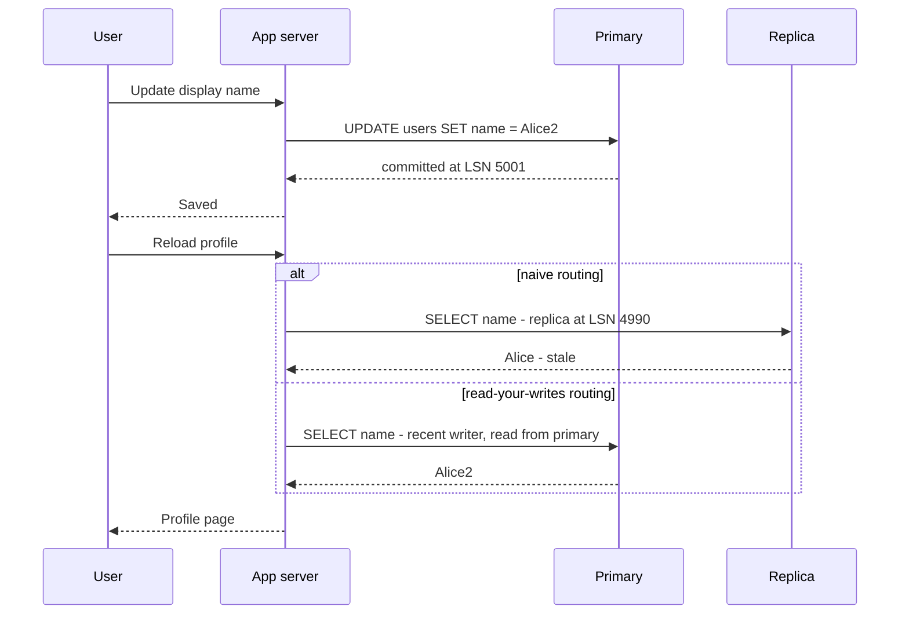

**Read-your-writes techniques:**
1. **Read from the primary for a short window** (e.g., 10–30 s) after a user writes — track `last_write_at` in the session.
2. **Read from the primary for "own" data** (my profile, my orders), replicas for other people's data.
3. **Position-based reads:** remember the write's log position (LSN/GTID) and only use a replica that has replayed past it.
4. **Monotonic reads:** pin a user's session to one replica so they never go "back in time" by hitting a more-lagged replica.

**Spring Boot pattern:** route `@Transactional(readOnly = true)` methods to replicas using `AbstractRoutingDataSource` (wrapped in `LazyConnectionDataSourceProxy` so routing is decided when the connection is actually obtained), and everything else to the primary.

### 8.4 Failover

1. **Detect:** health checks / heartbeats miss for N seconds.
2. **Elect:** choose the most up-to-date replica (a consensus system like etcd or a managed service decides, to avoid two primaries — "split-brain").
3. **Promote:** the replica becomes primary; others re-point to it.
4. **Redirect clients:** update DNS / virtual IP / proxy (PgBouncer, ProxySQL, RDS endpoint).
5. **Fence the old primary** so it can't accept writes if it comes back (see [Consensus and Leader Election](05_distributed_systems_and_messaging.md#6-consensus-and-leader-election)).

**Advantages and disadvantages of read replicas**

| Advantages | Disadvantages |
|---|---|
| Scale reads almost linearly | Don't scale **writes** at all — every replica applies every write |
| Faster failover and HA | Replication lag → stale reads |
| Isolate analytics workload | Async replication can lose recent writes on failover |
| Low-latency regional reads | More nodes to pay for and monitor |

**When to use:** read:write ratio high (10:1 or more), reporting queries that would slow the primary, multi-region reads. **Not** a fix for write bottlenecks — that needs partitioning/sharding.

**Interview perspective**

> **Q: What is a read replica and what problem does it solve?**
> "It's a copy of the primary that serves read queries. It solves the problem of one database node being overwhelmed by reads: writes go to the primary, reads are spread across replicas. Replication is usually asynchronous, so replicas may lag by milliseconds to seconds; that's fine for most reads but I route a user's own reads to the primary right after they write, to give read-your-writes. Replicas also give a failover target. They don't help with write throughput."

**Common mistakes**
- Adding replicas to fix a write bottleneck.
- Ignoring replication lag in flows like "create, then immediately read".
- Assuming failover is lossless with async replication.

**Quick revision**
- Primary takes writes; replicas serve reads and are failover targets.
- Sync = durable but slow; async = fast but laggy and may lose writes on failover.
- Fix lag UX with read-your-writes routing.

---

## 9. Partitioning and Sharding

### 9.1 Vertical vs Horizontal Partitioning

> **Level:** 🟢 Essential

**What is it?**
- **Partitioning** = splitting one big dataset into smaller pieces.
- **Vertical partitioning** = splitting by **columns or by feature**: move rarely used or large columns (`profile_bio`, `avatar_blob`) into a separate table, or move a whole domain (analytics, audit logs) into its own database.
- **Horizontal partitioning** = splitting by **rows**: users 1–10M in one partition, 10M–20M in another. When the partitions live on **different database servers**, it is called **sharding**, and each piece is a **shard**.

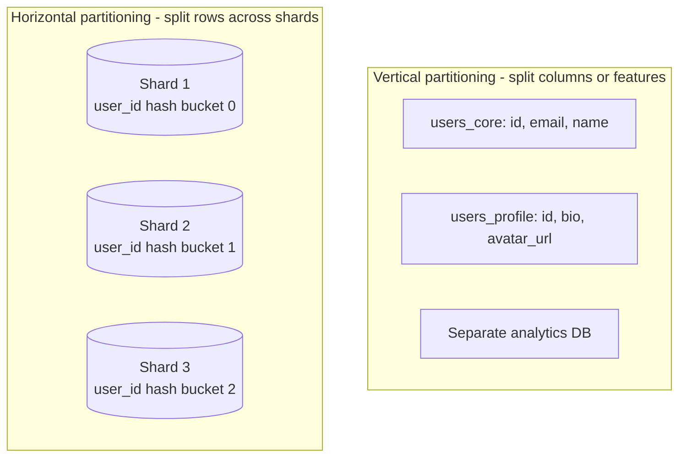

**Partitioning inside one database** (e.g., PostgreSQL declarative partitioning by month) helps with query pruning and cheap data retention (`DROP` an old partition instead of deleting billions of rows) — but it is still one server. **Sharding** spreads load across servers.

```sql
-- PostgreSQL native range partitioning (single server): great for time-based retention
CREATE TABLE events (
    id         bigint,
    created_at timestamptz NOT NULL,
    payload    jsonb
) PARTITION BY RANGE (created_at);

CREATE TABLE events_2026_10 PARTITION OF events
    FOR VALUES FROM ('2026-10-01') TO ('2026-11-01');
```

### 9.2 Why and When to Shard

> **Level:** 🟢 Essential

**Why?** A single primary has hard limits: write throughput (one machine's CPU and disk), dataset size (one machine's storage, and how long backups/restores take), and connection counts. Sharding splits the data so each server handles a fraction of writes and storage.

**When to shard:**
- The primary's **write load** exceeds what the largest affordable instance can handle.
- The **dataset** is too large for one machine or for acceptable backup/restore times.
- You need data **close to users** in different regions or for data residency (GDPR).

> **Interview insight:** Most systems don't need sharding until they're at multi-terabyte scale or tens of thousands of writes/sec. Exhaust query optimisation, indexes, caching, vertical scaling and read replicas first (see the [scaling ladder](#12-database-bottlenecks-and-the-scaling-ladder)). Sharding is a one-way door that complicates every query, transaction and migration.

### 9.3 Sharding Strategies

> **Level:** 🟢 Essential

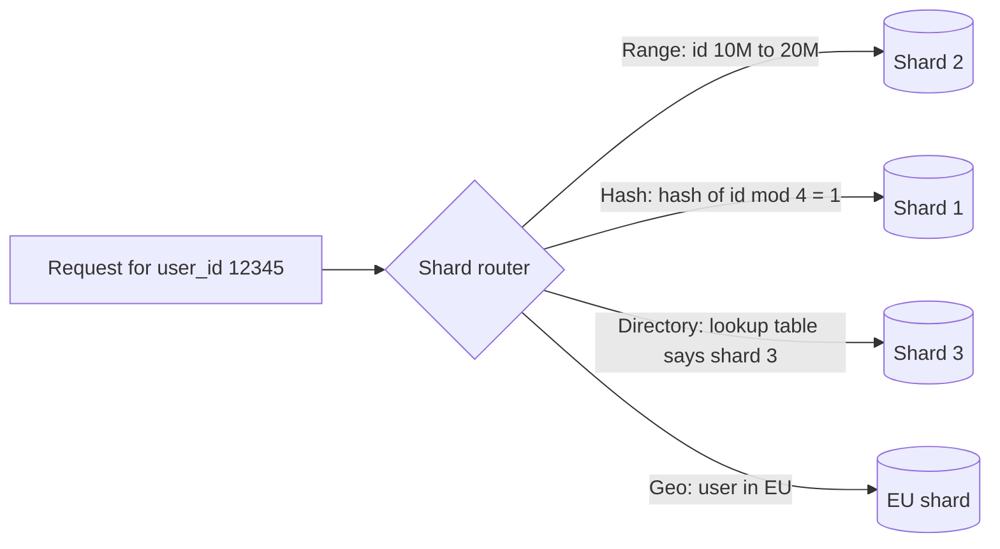

**1. Range-based sharding** — split by ranges of the shard key.
```
Shard 1: user_id 1 – 10M
Shard 2: user_id 10M – 20M
Shard 3: user_id 20M – 30M
```
✅ Efficient range queries (all orders in January live on one shard); easy to understand.
❌ **Hotspots** — with sequential IDs or timestamps, all *new* writes hit the last shard; uneven load.

**2. Hash-based sharding** — apply a hash function to the shard key.
```
shard = hash(user_id) % number_of_shards
```
✅ Even distribution; no sequential hotspot.
❌ Range queries must hit every shard (scatter-gather). With plain `% N`, changing N moves almost every key — use [consistent hashing](#10-consistent-hashing) or a fixed number of logical partitions instead.

**3. Directory-based sharding** — a lookup service maps each key (or key range/tenant) to its shard.
```
Lookup table:
  tenant acme   → Shard 2
  tenant globex → Shard 1
```
✅ Maximum flexibility: move a big tenant to its own shard; rebalance without changing the hash function.
❌ The directory is on every request path — must be cached and highly available, or it becomes a bottleneck and single point of failure.

**4. Geo-based sharding** — split by geography.
```
Shard US:   US users
Shard EU:   European users
Shard APAC: Asia-Pacific users
```
✅ Low latency for regional users; data-residency compliance (GDPR).
❌ Uneven shard sizes; cross-region queries are slow and expensive; users who move or travel complicate routing.

**Practical tip — logical partitions:** create many more logical partitions than servers (e.g., 1,024 buckets via `hash(key) % 1024`) and map buckets to physical servers. To add capacity, move whole buckets — no rehashing of individual keys. Vitess, Citus, DynamoDB and Redis Cluster's hash slots all follow this idea.

### 9.4 Choosing a Shard Key

> **Level:** 🟢 Essential

The shard key is the most important sharding decision; changing it later means migrating all data.

**A good shard key:**
1. **High cardinality** — many distinct values so data spreads out (`user_id`, not `country`).
2. **Even access distribution** — no single value gets a big fraction of traffic.
3. **Matches the main query pattern** — the hottest queries include the key, so they hit **one** shard.
4. **Keeps related data together** — all of a user's orders on the user's shard enables single-shard transactions.
5. **Stable** — the value shouldn't change (moving a row between shards on update is painful).

| System | Good shard key | Why |
|---|---|---|
| Chat messages | `conversation_id` | Fetching a conversation hits one shard |
| E-commerce orders | `user_id` (or `order_id` with a user lookup) | "My orders" is the hottest query |
| Multi-tenant SaaS | `tenant_id` | Tenant isolation; queries scoped per tenant |
| URL shortener | `short_code` (hashed) | Every redirect is a point lookup |
| Metrics | `(metric_id, time_bucket)` | Spreads writes, keeps time ranges together |

### 9.5 Hotspots and the Celebrity Problem

> **Level:** 🟡 Intermediate

**What is it?** A **hotspot** (hot shard / hot partition) is a shard receiving far more traffic than others. The classic case is the **celebrity problem**: a user with 100M followers lives on one shard, and every read of their posts or every like on their content hits that one shard.

**Fixes:**
- **Key salting / splitting:** append a random suffix to the hot key (`celebrity_123#0..#9`) to spread writes over 10 partitions; reads gather from all 10. Good for counters and append-heavy keys.
- **Cache the hot data** aggressively (read-heavy hotspots) — often with local in-process caches too. See [Cache Failure Modes](04_caching.md#8-cache-failure-modes).
- **Dedicated shard** for very large tenants (directory-based sharding makes this easy).
- **Write buffering:** aggregate likes in memory/stream and write counts in batches.
- **Hybrid fan-out** in feeds — see the [news feed design](07_interview_problems_part1.md#5-news-feed).

### 9.6 Sharding Challenges

> **Level:** 🟡 Intermediate

| Challenge | Why it hurts | Solution |
|---|---|---|
| **Cross-shard joins** | Data needed for one query lives on several servers | Denormalize so a query hits one shard; application-level joins; separate analytics store (data warehouse) |
| **Cross-shard transactions** | No single database can guarantee ACID across shards | Choose a shard key that keeps transactional data together; otherwise [Saga](05_distributed_systems_and_messaging.md#18-distributed-transactions-2pc-vs-saga) or distributed SQL |
| **Scatter-gather queries** | Queries without the shard key hit every shard; latency = slowest shard | Global secondary index (a separate table keyed by the other attribute), or search index |
| **Resharding** | Data growth forces adding shards; `% N` reshuffles everything | Consistent hashing or fixed logical buckets; online migration with dual writes and backfill |
| **Hotspots** | One key/shard overloaded | Hash-based keys, salting, caching, dedicated shards |
| **Global uniqueness and IDs** | Auto-increment IDs collide across shards | Snowflake-style IDs (timestamp + machine + sequence), UUIDv7, or ID ranges per shard |
| **Operational complexity** | N databases to back up, migrate, monitor | Managed or middleware solutions: Vitess, Citus, ProxySQL, or a distributed database |

**Resharding without downtime (outline):**
1. Create the new shards and the new mapping.
2. **Dual-write:** application writes to old and new locations (or stream changes via CDC).
3. **Backfill** existing data to the new shards.
4. **Verify** (checksums, shadow reads comparing old vs new).
5. **Switch reads** to the new mapping, then stop writing to the old location.
6. Clean up.

**Interview perspective**

> **Q: When would you use hash-based vs range-based sharding?**
> "Range-based when queries are mostly range scans on the key — like time-ordered data — and I can avoid write hotspots, for example by prefixing the range with a high-cardinality key. Hash-based when most queries are point lookups by ID and I need even distribution. Hash is the safer default for user-facing OLTP; range is better for sequential scans. I'd implement hash sharding with many logical buckets so I can add servers by moving buckets."

> **Q: What's the difference between horizontal partitioning and vertical partitioning?**
> "Horizontal partitioning splits rows across nodes — users 1 to 10M on shard 1, the next 10M on shard 2 — and helps with write scale and data volume. Vertical partitioning splits columns or features — core user fields in one table, large blobs or activity logs elsewhere, or analytics in its own database — and helps query performance and separation of concerns."

**Common mistakes**
- Sharding too early, or on a low-cardinality key like `country`.
- Choosing a shard key that doesn't appear in the hottest query → every request becomes scatter-gather.
- Forgetting ID generation and cross-shard uniqueness.
- Using `hash % N` and then needing to add a node.

**Quick revision**
- Vertical = split columns/features; horizontal = split rows; sharding = horizontal across servers.
- Strategies: range (scans, hotspots), hash (even, no ranges), directory (flexible, lookup SPOF), geo (latency, compliance).
- Shard key: high cardinality, even load, in the hot query, keeps related data together.
- Shard last; use logical buckets so resharding moves buckets, not keys.

---

## 10. Consistent Hashing

> **Level:** 🟢 Essential

**What is it?** **Consistent hashing** is a way to assign keys to nodes so that when a node is added or removed, **only a small fraction of keys move** (about `1/N` of them), instead of nearly all of them.

**Why do we need it?** With `node = hash(key) % N`, changing N from 4 to 5 changes the result for ~80% of keys. In a cache cluster that means a sudden flood of cache misses (a thundering herd hitting the database); in a database it means migrating most of the data.

**How does it work?**
1. Imagine the hash output space (say 0 to 2^32 − 1) bent into a **ring**.
2. Each **node** is hashed onto the ring at some position.
3. Each **key** is hashed onto the ring; it belongs to the **first node clockwise** from its position.
4. **Adding a node** takes over only the keys between it and its counter-clockwise neighbour. **Removing a node** hands its keys to the next node clockwise. Everything else stays put.

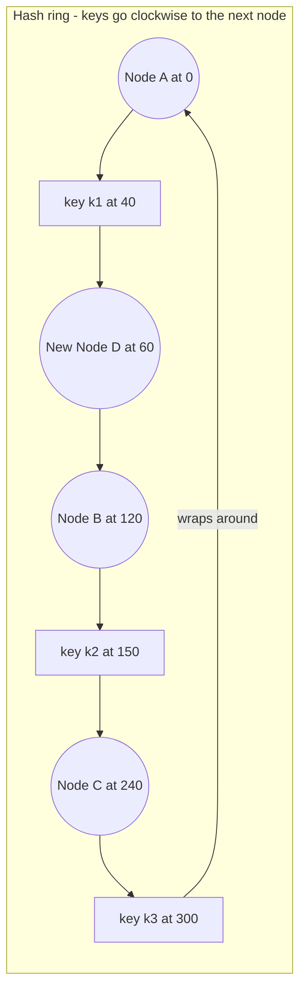

**Walkthrough:**
1. Positions on a 0–360 ring: A=0, B=120, C=240. Before D exists, `k1` (40) belongs to B, `k2` (150) to C, `k3` (300) wraps around to A.
2. Add D at 60: only keys in (0, 60] — like `k1` — move from B to D. `k2` and `k3` don't move.
3. If C fails, only keys in (120, 240] move — to the next node clockwise, A.

**Virtual nodes (vnodes):** with only a few physical nodes, positions are uneven and one node may own a huge arc. So each physical node is placed on the ring many times (e.g., 100–256 virtual positions: `hash("A#1")`, `hash("A#2")`, …).
- Load spreads evenly across nodes.
- When a node leaves, its load is spread over **many** nodes instead of dumped on one neighbour.
- Stronger machines can get more vnodes (weighted capacity).

**Replication on the ring:** Dynamo-style systems store each key on the first node clockwise **and the next N−1 distinct physical nodes** — the key's **preference list**.

**Who uses it (and who doesn't):**

| System | Mechanism |
|---|---|
| Amazon Dynamo, Cassandra, ScyllaDB, Riak | Consistent hashing ring with virtual nodes (token ranges) |
| DynamoDB | Hash-partitioned key space, split/merged automatically by the service |
| Memcached clients (Ketama), Envoy/Nginx `ring_hash` load balancing | Consistent hashing on the client/proxy side |
| **Redis Cluster** | **Not consistent hashing.** Uses **16,384 fixed hash slots**: `slot = CRC16(key) mod 16384`; each node owns a set of slots. Adding a node migrates some slots to it — similar effect (only moved slots' keys transfer), different mechanism. Hash tags `{user123}` force related keys into the same slot. |
| Vitess, Citus, Kafka partitions | Fixed logical partitions / key ranges mapped to servers |

**Advantages and disadvantages**

| Advantages | Disadvantages |
|---|---|
| Adding/removing a node moves only ~1/N of keys | More complex than modulo |
| No central lookup table required | Uneven load without virtual nodes |
| Natural replication along the ring | Hot *keys* are still hot — consistent hashing balances keys, not traffic per key |

**When to use:** distributed caches, partitioned key-value stores, sticky load balancing (same user → same backend) where membership changes frequently.

**Interview perspective**

> **Q: What problem does consistent hashing solve?**
> "Plain `hash(key) % N` breaks when N changes — adding or removing a node remaps almost every key. Consistent hashing places nodes and keys on a ring and assigns each key to the next node clockwise, so a membership change only moves the keys in one arc — about 1/N of them. Virtual nodes smooth out the distribution and spread a failed node's load across many nodes. It's critical for cache clusters, where mass remapping means a stampede of cache misses on the database."

> **Q: How does Redis Cluster distribute data?**
> "It divides the key space into 16,384 hash slots, maps each key with CRC16(key) mod 16384, and assigns slot ranges to nodes. Resharding moves slots between nodes, so only keys in the moved slots transfer. It achieves the same goal as consistent hashing with a fixed slot table rather than a ring."

**Common mistakes**
- Claiming Redis Cluster uses a consistent hashing ring.
- Forgetting virtual nodes (then load is badly uneven).
- Thinking consistent hashing fixes hot keys.

**Quick revision**
- Ring; key → next node clockwise; join/leave moves ~1/N of keys.
- Virtual nodes for balance and graceful failure.
- Redis Cluster = 16,384 hash slots, not a ring.

---

## 11. Connection Pooling

> **Level:** 🟢 Essential

**What is it?** A **connection pool** keeps a set of open database connections that application threads borrow and return, instead of opening a new connection per request.

**Why do we need it?**
- Opening a connection is expensive: TCP handshake, TLS handshake, authentication, and (in PostgreSQL) forking a whole backend **process** per connection — several milliseconds and a few MB of memory each.
- Databases have a **hard connection limit** (`max_connections`, often 100–500). Too many connections cause memory pressure and context-switching; performance collapses well before the limit.
- With autoscaling app servers, connections multiply: 50 pods × 20 connections = 1,000 connections → the DB falls over.

**How does it work?**
1. At startup the pool opens a minimum number of connections.
2. A request thread **borrows** a connection, runs its queries, and **returns** it (it is not closed).
3. If all connections are busy, the thread **waits** up to a timeout, then fails.
4. The pool validates, recycles (max lifetime) and closes idle connections.

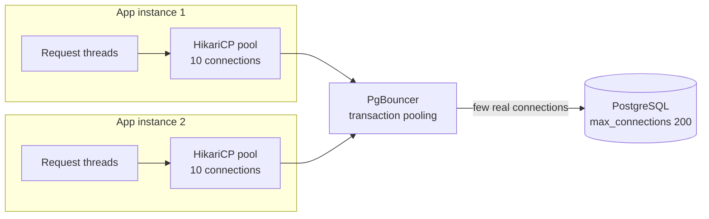

**Walkthrough:** each app instance has a small application-side pool (HikariCP, the Spring Boot default). When there are many instances, a **server-side pooler** like **PgBouncer** (or RDS Proxy, ProxySQL for MySQL) multiplexes thousands of client connections over a few dozen real database connections. In *transaction pooling* mode a real connection is assigned only for the duration of a transaction (session-level features like session `SET` or some prepared-statement uses need care).

**Sizing intuition:** bigger is **not** better. The database can only execute about as many queries in parallel as it has CPU cores (plus some waiting on disk). A useful starting formula from the PostgreSQL/HikariCP community: `connections ≈ (cores × 2) + effective_spindles` — for an 8-core DB, roughly 16–20 *total active* connections. Then divide across app instances and measure.

```yaml
# Spring Boot (HikariCP) — typical starting point per instance
spring:
  datasource:
    hikari:
      maximum-pool-size: 10        # total across all instances must fit the DB's budget
      minimum-idle: 5
      connection-timeout: 2000     # ms to wait for a free connection before failing fast
      max-lifetime: 1800000        # recycle connections (below DB or proxy idle timeouts)
      leak-detection-threshold: 20000
```

**Pool exhaustion — symptoms and causes**
- Symptoms: requests time out with `Connection is not available, request timed out after 2000ms`; latency spikes while DB CPU is *low*; threads blocked waiting for the pool.
- Causes: slow queries holding connections; **long transactions that include remote calls** (calling a payment API inside `@Transactional`); connection leaks (not closing in custom JDBC code); pool too small for the concurrency; a downstream lock causing everyone to wait.
- Fixes: keep transactions short and DB-only; add timeouts on queries (`statement_timeout`); fix leaks (leak detection); use a [bulkhead](05_distributed_systems_and_messaging.md#17-bulkhead) — separate pools for critical vs batch work.

**Interview perspective**

> **Q: We scaled app servers from 10 to 100 pods and the database fell over. Why?**
> "Each pod opened its own connection pool, so connections went from maybe 200 to 2,000, exceeding what PostgreSQL handles efficiently — each connection is a process with its own memory. I'd put PgBouncer or RDS Proxy in front in transaction-pooling mode, shrink per-pod pools, and treat total database connections as a budget shared across all instances."

**Common mistakes:** huge pools ("set it to 500"); remote calls inside transactions; no connection timeout (threads hang forever).

**Quick revision**
- Pools reuse expensive connections; databases have hard connection limits.
- Small pools sized to DB cores; total connections are a shared budget.
- Many instances → server-side pooler (PgBouncer, RDS Proxy).
- Pool exhaustion usually means slow or long transactions, not a too-small pool.

---

## 12. Database Bottlenecks and the Scaling Ladder

> **Level:** 🟢 Essential

**What is it?** A structured, cheapest-first sequence of steps for scaling a relational database. Each rung adds complexity, so you climb only as far as the measured problem requires.

**Why do we need it?** Interviewers want to hear that you won't jump to sharding for a problem an index would fix. Measure first (slow query log, `pg_stat_statements`, CPU, IOPS, connections, replication lag, lock waits), then apply the smallest fix.

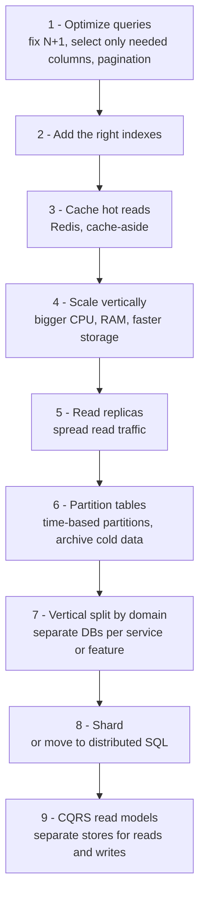

**Walkthrough:**
1. **Optimise queries** — most "the DB is slow" incidents are a few bad queries.
2. **Indexes** — make hot queries O(log n).
3. **Caching** — remove repeated reads entirely ([Caching Patterns](04_caching.md#3-caching-patterns)).
4. **Vertical scaling** — surprisingly far: a single large instance handles a lot; zero code change. Trade-off: cost and a ceiling.
5. **Read replicas** — scale reads; accept lag.
6. **Partition** big tables inside the DB (time-based) and archive cold data to cheaper storage.
7. **Split by domain** — give heavy features their own databases (functional partitioning).
8. **Shard** — scales writes and size; highest complexity.
9. **CQRS** — dedicated read stores (search index, denormalized views) shaped for queries — see [CQRS](06_architecture_reliability_and_security.md#4-cqrs).

Writes can also be smoothed by **queuing** (accept requests into Kafka/SQS, write at a steady rate) and **batching** (multi-row inserts).

**Common bottlenecks and fixes**

| Bottleneck | Symptom | Fix |
|---|---|---|
| **N+1 queries** | Loading 50 orders then 1 query per order for its items = 51 queries | `JOIN FETCH` / `@EntityGraph`, batch fetching (`IN (...)`), DTO projections |
| **Missing index / full scans** | High read IOPS, Seq Scan in plans | Add composite/covering index |
| **Slow queries** | p99 latency spikes, slow query log | `EXPLAIN ANALYZE`, rewrite, paginate with keyset instead of large `OFFSET` |
| **Lock contention / hot rows** | Many sessions waiting on locks; one counter row updated by everyone | Atomic updates, shorter transactions, shard counters (N sub-rows summed on read), batch updates via a queue |
| **Connection limits** | "too many connections", pool timeouts | Pooling, PgBouncer, fewer/smaller pools |
| **Replication lag** | Stale reads, replicas falling behind | Reduce write bursts, bigger replicas, avoid long-running replica queries |
| **Large tables / bloat** | Slow vacuums, huge indexes | Partitioning, archiving, vacuum tuning |
| **Write throughput ceiling** | Primary CPU/IO saturated on writes | Batching, async writes via queue, then sharding |

```java
// N+1 problem in JPA and its fix
// ❌ 1 query for orders + 1 query per order when accessing items lazily
List<Order> orders = orderRepo.findByUserId(userId);
orders.forEach(o -> o.getItems().size());

// ✅ one query with a join fetch
@Query("select distinct o from Order o left join fetch o.items where o.userId = :userId")
List<Order> findWithItemsByUserId(@Param("userId") Long userId);
```

**Interview perspective**

> **Q: A service gets 50,000 read QPS but only 500 write QPS. Walk through your scaling approach.**
> "Reads dominate, so I optimise reads first. One: add Redis cache-aside for hot data — likely removes 90%+ of DB reads. Two: add read replicas for the remaining reads, 3–5 replicas handle this comfortably, with read-your-writes routing for users who just wrote. Three: keep the app tier stateless and scale it horizontally behind a load balancer. 500 writes/sec is comfortably handled by a single primary, so I wouldn't shard. I'd monitor write growth and replication lag, and only consider partitioning if writes grow by an order of magnitude."

> **Q: The database CPU is at 95%. What do you do first?**
> "Find out *what* is using it before adding hardware: check `pg_stat_statements` for the top queries by total time, look for missing indexes or N+1 patterns from a recent deploy, check lock waits and connection counts. Often one query is the culprit. As a short-term mitigation I might add a cache or scale up vertically, but the fix is usually the query."

**Common mistakes**
- Jumping straight to sharding or a NoSQL migration.
- Scaling up without finding the offending query.
- Large `OFFSET` pagination on big tables — use keyset (`WHERE id > last_id`).

**Quick revision**
- Measure → optimise queries → index → cache → scale up → replicas → partition → split by domain → shard → CQRS.
- Know N+1, hot rows, lock contention, pool exhaustion, replication lag.

---

## 13. Object, File and Block Storage

> **Level:** 🟢 Essential

**What is it?** Three ways to store bytes, at different levels of abstraction:

| Type | What you get | Access | Examples | Best for |
|---|---|---|---|---|
| **Block storage** | A raw virtual disk made of fixed-size blocks; you put a filesystem on it | Mounted by **one** server (usually); very low latency | AWS EBS, GCP Persistent Disk, SAN volumes | Databases, VM boot disks — anything needing low-latency random I/O |
| **File storage** | A shared hierarchical filesystem (folders, files) | Mounted by **many** servers via NFS/SMB | AWS EFS, Azure Files, NAS | Shared files for legacy apps, CMS uploads, home directories |
| **Object storage** | Flat namespace of **objects** (bytes + metadata) addressed by key in a **bucket**, via HTTP API | HTTP `PUT`/`GET` from anywhere; higher latency (tens of ms), massive throughput | AWS S3, Google Cloud Storage, Azure Blob, MinIO | Images, video, backups, logs, data lakes, static websites |

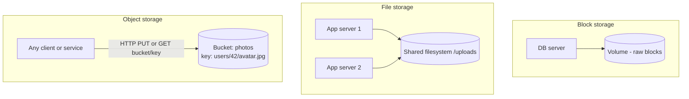

### 13.1 The Object Storage Model

**How does it work?**
- **Bucket** = top-level container; **key** = full name like `users/42/avatar.jpg` (the "folders" are just a key prefix); **object** = the bytes plus metadata (content type, custom tags).
- Objects are written whole (no partial in-place edits — you re-upload or use multipart).
- Very high durability: S3 is designed for **99.999999999% ("11 nines") durability** by storing data redundantly across multiple availability zones (erasure coding / replication). Durability (data not lost) is different from availability (S3 Standard is designed for 99.99% availability).
- S3 now provides strong read-after-write consistency for PUTs and DELETEs.

**Storage classes / lifecycle** — pay less for data you rarely read:

| Class | Use | Trade-off |
|---|---|---|
| Standard | Hot data | Highest storage price, no retrieval fee |
| Infrequent Access | Accessed monthly | Cheaper storage, retrieval fee, minimum duration |
| Glacier / Archive tiers | Backups, compliance archives | Very cheap; retrieval from milliseconds (Instant Retrieval) to hours (Deep Archive) |
| Intelligent-Tiering | Unknown access pattern | Moves objects automatically for a small monitoring fee |

Lifecycle rules automate it: "move logs to Infrequent Access after 30 days, Glacier after 90, delete after 1 year".

### 13.2 Multipart Upload and Pre-signed URLs

**Multipart upload:** large files (100 MB+) are split into parts (e.g., 8–100 MB), uploaded **in parallel** and independently retried, then combined with a "complete" call. Benefits: speed, resumability, no single huge request failing at 99%.

**Pre-signed URLs:** the backend generates a time-limited URL signed with its credentials that lets the *client* upload or download **directly** to/from object storage. Your servers never proxy the bytes, so they don't become a bandwidth bottleneck.

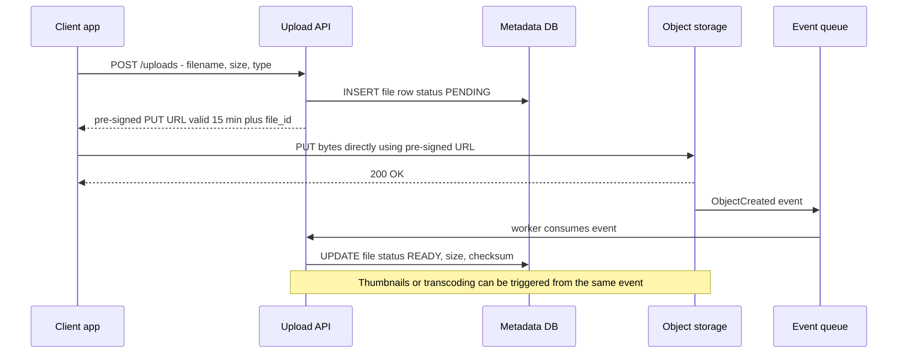

**Walkthrough:**
1. The client asks the API for permission to upload; the API validates the user, quota and file type, and records a `PENDING` metadata row.
2. The API returns a pre-signed URL scoped to one key, one method, short expiry.
3. The client uploads directly to object storage (multipart for big files).
4. The storage emits an event; a worker marks the file `READY` and triggers processing (thumbnails, virus scan, transcoding).
5. **Failure handling:** if the client never uploads, a cleanup job expires stale `PENDING` rows; S3 lifecycle rules abort incomplete multipart uploads.

```java
// AWS SDK v2: generate a pre-signed PUT URL
PutObjectRequest put = PutObjectRequest.builder()
        .bucket("user-uploads")
        .key("users/" + userId + "/" + fileId)
        .contentType("image/jpeg")
        .build();

PresignedPutObjectRequest presigned = s3Presigner.presignPutObject(r -> r
        .signatureDuration(Duration.ofMinutes(15))
        .putObjectRequest(put));

String uploadUrl = presigned.url().toString();   // return to the client
```

### 13.3 Metadata in the Database, Blobs in Object Storage

> **Level:** 🟢 Essential

**The pattern:** never store large binary files (BLOBs) in your relational database. Store the **bytes in object storage** and the **metadata in the database**: owner, filename, size, content type, checksum, object key, status, permissions, timestamps.

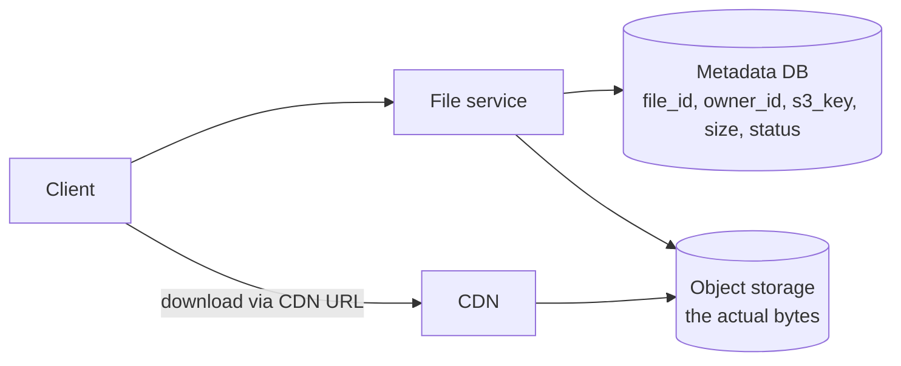

**Why:**
- Databases are expensive per GB, and BLOBs bloat backups, replication and buffer caches.
- Object storage is cheap, durable, effectively unlimited, and integrates with **CDNs** for fast global downloads ([CDN Caching](04_caching.md#10-cdn-caching)).
- The DB stays small and fast for the queries that need it ("list my files", permissions checks).

**Trade-off:** two systems to keep consistent — handle orphans (object without a row, or row without an object) with statuses, events and periodic reconciliation jobs.

**Interview perspective**

> **Q: Where do you store user-uploaded photos?**
> "In object storage like S3, uploaded directly by the client using a pre-signed URL so the bytes don't go through my servers, multipart for large files. The metadata — owner, key, size, status — goes in the database. Downloads go through a CDN. I'd use lifecycle rules to move old originals to cheaper tiers. The trade-off is keeping metadata and objects consistent, which I handle with a PENDING-then-READY status driven by storage events plus a cleanup job."

**Common mistakes**
- Storing images or videos as BLOBs in the database.
- Proxying all uploads through app servers.
- Confusing durability (11 nines) with availability (99.99%).
- Using block storage when multiple servers need shared access (use file or object storage).

**Quick revision**
- Block = raw disk for one server (databases); file = shared filesystem; object = HTTP key → bytes, cheap and massively scalable.
- Pre-signed URLs + multipart upload = direct, resumable client uploads.
- Metadata in DB, bytes in object storage, delivery via CDN.
- See the [file storage design](07_interview_problems_part1.md#6-file-storage-and-sharing-service) and [video streaming design](08_interview_problems_part2.md#7-video-streaming-platform).

---

## 14. Quick Revision

**Choosing**
- Start from access patterns, consistency needs, scale and team skills. Relational is the default for transactional data; add specialised stores for search, cache, blobs, analytics.
- SQL = joins + ACID + flexible queries. NoSQL = scale-out on known access patterns. Both scale; neither is universally faster.

**Types**
- Document (aggregate per entity), key-value (lookups), wide-column (huge writes, partition + clustering keys, query-first tables), graph (traversals), time-series (metrics), search (inverted index, derived from source of truth).

**Modeling**
- Normalize the source of truth (1NF/2NF/3NF); denormalize measured hot read paths (counters, materialized views, read models). Snapshot historical facts.

**Indexing**
- B-tree (read-optimised, in-place) vs LSM (write-optimised, compaction). Composite = leftmost prefix, equality before range. Covering = index-only scan. Every index taxes writes. Verify with `EXPLAIN ANALYZE`.

**Transactions**
- ACID; anomalies: dirty, non-repeatable, phantom, lost update, write skew. PostgreSQL default Read Committed; its Repeatable Read = snapshot isolation (no phantoms, write skew possible). MySQL default Repeatable Read with gap locks. Optimistic `@Version` vs pessimistic `FOR UPDATE` vs atomic `UPDATE`.

**Replication**
- Primary for writes, replicas for reads and failover. Async = lag + possible loss on failover. Read-your-writes routing. Replicas don't scale writes.

**Sharding**
- Range / hash / directory / geo. Shard key: high cardinality, even, in the hot query, groups related data. Watch hotspots (celebrities), cross-shard joins and transactions, resharding. Use logical buckets.

**Consistent hashing**
- Ring, next node clockwise, ~1/N keys move, virtual nodes. Redis Cluster uses 16,384 hash slots instead.

**Operations**
- Pool connections (small pools, PgBouncer); keep transactions short. Scaling ladder: optimise → index → cache → scale up → replicas → partition → split → shard → CQRS.

**Storage**
- Block (DB disks), file (shared FS), object (S3: 11 nines durability, lifecycle tiers). Pre-signed URLs + multipart; metadata in DB, blobs in object storage, CDN in front.

---

**Previous:** [Networking and Communication](02_networking_and_communication.md) · **Next:** [Caching](04_caching.md)
