# Caching — From Cache-Aside to Cache Stampedes

> **Part 4 of 10** in the System Design interview notes — see [README](README.md) for the roadmap.
> **What you'll learn:** why caching is the single most common scaling lever, where caches live, how each caching pattern behaves on reads and writes, how caches fail (stampede, penetration, avalanche, hot keys), and how Redis, HTTP caching, and CDNs fit together.
> **Level legend:** 🟢 Essential (asked in almost every interview) · 🟡 Intermediate · 🔴 Advanced / senior
> **Related:** [Databases and Storage](03_databases_and_storage.md) · [Networking and Communication](02_networking_and_communication.md) · [Distributed Systems and Messaging](05_distributed_systems_and_messaging.md) · [Interview Problems Part 1](07_interview_problems_part1.md)

---

## Table of Contents

1. [What Is Caching](#1-what-is-caching)
   - [1.1 The Core Idea](#11-the-core-idea)
   - [1.2 Hit Ratio and Effective Latency](#12-hit-ratio-and-effective-latency)
   - [1.3 What to Cache and What Not to Cache](#13-what-to-cache-and-what-not-to-cache)
2. [Where Caches Live](#2-where-caches-live)
   - [2.1 The Cache Layers](#21-the-cache-layers)
   - [2.2 Local vs Distributed Cache](#22-local-vs-distributed-cache)
   - [2.3 Two-Level Caching](#23-two-level-caching)
3. [Caching Patterns](#3-caching-patterns)
   - [3.1 Cache-Aside](#31-cache-aside)
   - [3.2 Read-Through](#32-read-through)
   - [3.3 Write-Through](#33-write-through)
   - [3.4 Write-Back](#34-write-back)
   - [3.5 Write-Around](#35-write-around)
   - [3.6 Refresh-Ahead](#36-refresh-ahead)
   - [3.7 Comparison of Caching Patterns](#37-comparison-of-caching-patterns)
   - [3.8 Delete vs Update the Cache on Write](#38-delete-vs-update-the-cache-on-write)
4. [Cache Invalidation and Expiration](#4-cache-invalidation-and-expiration)
5. [Eviction Policies](#5-eviction-policies)
6. [Redis](#6-redis)
7. [Distributed Caching](#7-distributed-caching)
8. [Cache Failure Modes](#8-cache-failure-modes)
   - [8.1 Cache Stampede](#81-cache-stampede)
   - [8.2 Cache Penetration](#82-cache-penetration)
   - [8.3 Cache Avalanche](#83-cache-avalanche)
   - [8.4 Hot Keys and Big Keys](#84-hot-keys-and-big-keys)
9. [HTTP Caching](#9-http-caching)
10. [CDN Caching](#10-cdn-caching)
11. [Quick Revision](#11-quick-revision)

---

## 1. What Is Caching

> **Theme:** The fastest request is one that never hits the database.

### 1.1 The Core Idea

> **Level:** 🟢 Essential

**What is it?**
A **cache** is a small, fast storage layer (usually RAM) that keeps a copy of data that is expensive to fetch or compute, so future requests for the same data can be served faster. The original, authoritative copy lives in the **source of truth** (usually a database).

Key vocabulary:

| Term | Meaning |
|---|---|
| **Cache hit** | The requested data was found in the cache |
| **Cache miss** | Not found — must go to the source of truth |
| **Hit ratio** | hits ÷ (hits + misses) — the single most important cache metric |
| **TTL** (Time To Live) | How long an entry stays valid before it expires |
| **Eviction** | Removing entries when the cache is full |
| **Invalidation** | Removing/updating entries because the source data changed |
| **Stale data** | Cached data that no longer matches the source of truth |
| **Cold cache** | Empty cache (e.g., after restart) — every request misses |
| **Warm cache** | Cache already filled with the hot data |

**Why do we need it?**

| Without Cache | With Cache |
|---|---|
| Every read hits DB | Hot data served from memory |
| DB becomes bottleneck | DB load drops dramatically |
| Higher latency (ms) | Sub-millisecond response |
| Scales poorly (DBs are expensive to scale) | Scales cheaply (add cache nodes) |

Memory access is ~100 ns; an SSD read ~100 µs; a network round trip in the same data center ~0.5 ms; a DB query with joins can be 5–50 ms. A Redis `GET` over the network is typically **< 1 ms**. Caching turns expensive work into a cheap lookup.

**Cache is effective when:**
- Data is **read frequently and written infrequently** (high read:write ratio)
- Data is **expensive to compute** (aggregations, joins, rendered pages, ML features)
- Access is **skewed** — a small set of keys gets most of the traffic (Pareto: ~20% of items get ~80% of requests)
- **Slight staleness is acceptable**

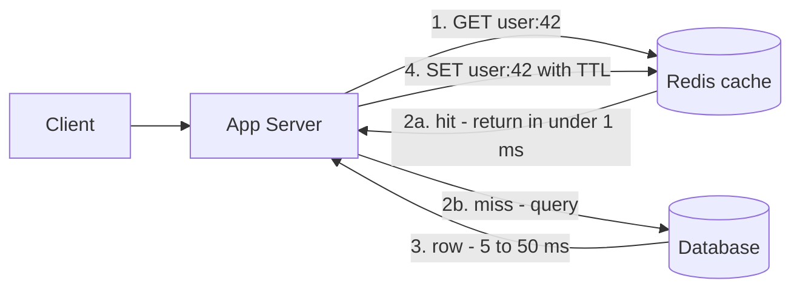

**Walkthrough**
1. The app first asks the cache for the key.
2. On a hit it returns immediately — the database is never touched.
3. On a miss it queries the database (slow path).
4. It stores the result in the cache with a TTL so the next request is a hit.

**Failure note:** If the cache goes down, every request takes the slow path. A cache that the DB *cannot survive without* is a hidden single point of failure — see [Cache Avalanche](#83-cache-avalanche).

### 1.2 Hit Ratio and Effective Latency

> **Level:** 🟢 Essential

**Formula**

```
Effective latency = hit_ratio × cache_latency + (1 − hit_ratio) × (cache_latency + db_latency)
                  ≈ hit_ratio × cache_latency + miss_ratio × db_latency     (when cache_latency << db_latency)

DB load           = total_QPS × miss_ratio
```

**Worked example**

- Read traffic: 50,000 QPS
- Redis latency: 0.5 ms, DB latency: 20 ms

| Hit ratio | Effective latency | QPS reaching the DB |
|---|---|---|
| 0% (no cache) | 20 ms | 50,000 |
| 80% | 0.8×0.5 + 0.2×20.5 ≈ **4.5 ms** | 10,000 |
| 95% | 0.95×0.5 + 0.05×20.5 ≈ **1.5 ms** | 2,500 |
| 99% | 0.99×0.5 + 0.01×20.5 ≈ **0.7 ms** | 500 |

**Insight:** going from 95% → 99% hit ratio cuts DB load by **5×**. Small hit-ratio improvements matter enormously at the tail. This is also why a sudden drop in hit ratio (deploy that changes key format, cache restart) can take down a database that was "fine" yesterday.

**Sizing a cache (back-of-envelope):** cache the hot working set, not everything. Example: 100M distinct items read per day × 20% hot × 1 KB ≈ **20 GB** → fits in a small Redis cluster. (Size from the *read working set*, i.e., distinct keys actually read, not from total data stored.)

### 1.3 What to Cache and What Not to Cache

> **Level:** 🟢 Essential

| Good candidates | Poor candidates |
|---|---|
| User profiles, product catalog, config, feature flags | Data that changes on almost every read (live stock tick for trading) |
| Rendered HTML fragments, API responses | Data that must be strongly consistent (account balance used for a debit decision) |
| Results of expensive queries/aggregations (leaderboards, counts) | Rarely read data (cache pollution — wastes memory) |
| Session data, auth tokens, rate-limit counters | Highly personalized, low-reuse responses (low hit ratio) |
| Static assets (images, JS, CSS) — at the CDN | Large blobs better served by object storage + CDN |

> **Rule:** cache what is **hot, expensive, and tolerant of slight staleness**. If a stale read can cause real harm (double spend, overselling), read from the source of truth — or use the cache only as a hint and re-validate at the DB (e.g., `UPDATE ... WHERE stock > 0`).

**Common mistakes**
- Caching without a TTL "because we invalidate on write" — one missed invalidation path means stale data forever.
- Measuring average latency instead of hit ratio and p99.
- Treating the cache as the source of truth (unless you deliberately chose write-back and accept the risk).

**Quick revision**
- Cache = fast copy; DB = source of truth.
- Hit ratio drives everything: DB load = QPS × miss ratio.
- Cache hot, expensive, staleness-tolerant data.

---

## 2. Where Caches Live

### 2.1 The Cache Layers

> **Level:** 🟢 Essential

**What is it?** Caching happens at *every* layer between the user and the disk. Each layer that answers a request saves all the layers behind it.

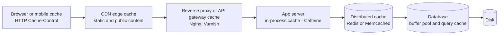

**Walkthrough — closest to the user first**

| Layer | Example | What it caches | Typical latency saved |
|---|---|---|---|
| **Client** (browser, mobile app) | HTTP cache, localStorage, app memory | Static assets, API responses with `Cache-Control` | Entire network round trip |
| **CDN** | CloudFront, Cloudflare, Akamai | Images, video segments, JS/CSS, public API responses | Cross-region latency (50–150 ms) |
| **Reverse proxy / gateway** | Nginx, Varnish, API gateway response cache | Full HTTP responses | App + DB work |
| **Application (in-process)** | Caffeine, Guava, a `ConcurrentHashMap` | Config, hot reference data, very hot keys | Network hop to Redis |
| **Distributed cache** | Redis, Memcached | Shared app data, sessions, counters | DB query |
| **Database internal** | Postgres shared buffers, InnoDB buffer pool, OS page cache | Data/index pages | Disk I/O |

**Interview perspective**
> **Q: "Where would you add caching in this design?"**
> "I'd go outside-in. Static content and public, rarely changing responses go to the CDN with long TTLs and versioned URLs. Shared application data — user profiles, product details — goes in Redis with cache-aside and a TTL. Extremely hot, tiny, read-only data like feature flags I'd also keep in an in-process cache with a short TTL to avoid even the Redis hop. The trade-off at each layer is staleness and invalidation complexity, so the closer to the user, the more static the data should be."

### 2.2 Local vs Distributed Cache

> **Level:** 🟡 Intermediate

| Aspect | Local / in-process (Caffeine) | Distributed (Redis, Memcached) |
|---|---|---|
| Latency | ~nanoseconds to microseconds (no network) | ~0.2–1 ms (network hop) |
| Shared across instances | ❌ Each instance has its own copy | ✅ One shared copy |
| Consistency across servers | Hard — N copies can diverge | Easier — single place to invalidate |
| Capacity | Limited by app heap; GC pressure in Java | Large, scales horizontally |
| Survives app restart | ❌ Lost | ✅ (cache cluster stays up) |
| Operational cost | None | Must run and monitor a cluster |
| Best for | Tiny, hot, rarely changing data | Shared state, sessions, most app caching |

**Common mistake:** using a local cache for data that changes often in a horizontally scaled service — instance A shows the new price, instance B shows the old one, and users see the value flip on refresh.

### 2.3 Two-Level Caching

> **Level:** 🟡 Intermediate

**What is it?** An **L1 in-process cache** in front of an **L2 distributed cache** in front of the DB.

**Why?** Absorb hot keys locally (no network, no Redis hotspot) while still sharing data across instances.

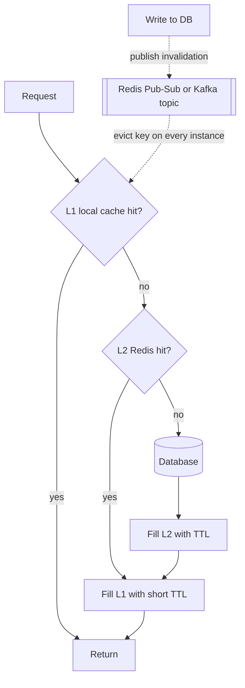

**How it works**
1. Check L1 (microseconds). Hit → return.
2. Miss → check L2 Redis. Hit → populate L1 with a **short** TTL (e.g., 5–30 s) and return.
3. Miss → DB, populate L2, then L1.
4. On writes, broadcast an invalidation message so every instance evicts its L1 copy; the short L1 TTL bounds staleness if a message is lost.

**Trade-off:** big latency/hotspot win, but now there are N+1 copies to keep fresh. Keep L1 TTLs short and L1 limited to read-mostly data.

---

## 3. Caching Patterns

> **Theme:** A caching pattern answers two questions — *who loads the cache on a read?* and *what happens to the cache on a write?*

### 3.1 Cache-Aside

> **Level:** 🟢 Essential

**What is it?** Also called **lazy loading**. The **application** owns the logic: it checks the cache, and on a miss it reads the DB and populates the cache itself. The cache knows nothing about the DB. This is the most common pattern in interviews and in practice.

**Why do we need it?** It's simple, works with any cache and any DB, and only caches data that is actually requested.

**How does it work?**

```
Read flow:
1. Check cache → hit? Return value ✅
2. Miss → query DB
3. Store result in cache (with TTL)
4. Return value

Write flow:
1. Write to DB (source of truth)
2. Invalidate (DELETE) the cache entry
   → next read re-populates from DB
```

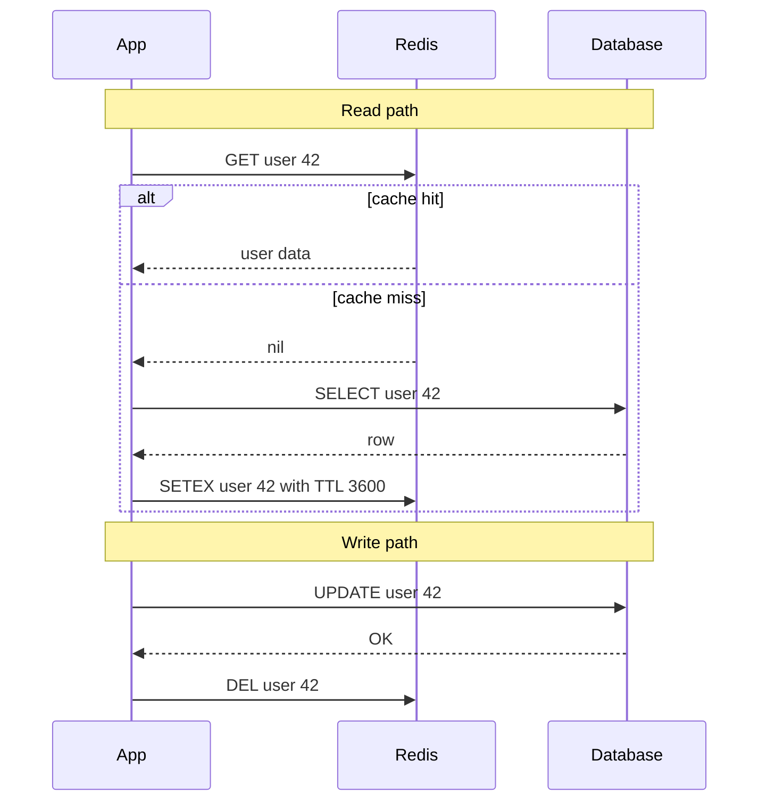

**Java example (from the original notes)**

```java
public User getUser(String id) {
    User cached = redis.get("user:" + id);
    if (cached != null) return cached;            // cache hit

    User user = userRepository.findById(id);      // cache miss → DB
    redis.setex("user:" + id, 3600, user);        // TTL 1 hour
    return user;
}

public void updateUser(User user) {
    userRepository.save(user);                    // 1. write DB first
    redis.delete("user:" + user.getId());         // 2. then invalidate
}
```

**Spring Boot equivalent** — Spring's cache abstraction implements cache-aside declaratively:

```java
@Service
public class UserService {

    @Cacheable(value = "users", key = "#id")      // read: check cache, else call method and cache result
    public User getUser(String id) {
        return userRepository.findById(id).orElseThrow();
    }

    @CacheEvict(value = "users", key = "#user.id") // write: evict after the method succeeds
    public User updateUser(User user) {
        return userRepository.save(user);
    }
}
```

Configure `spring.cache.type=redis` and a default TTL via `RedisCacheConfiguration.defaultCacheConfig().entryTtl(Duration.ofHours(1))`. Note: if `updateUser` runs inside a `@Transactional` method, the eviction can happen before the DB commit — for strict ordering, evict in a `@TransactionalEventListener(phase = AFTER_COMMIT)`.

**Advantages and disadvantages**

| Pros | Cons |
|---|---|
| Only caches what's actually requested — memory efficient | First request for each key is slow (miss = 3 operations: check + DB + set) |
| DB remains the source of truth | Cold start after cache restart hammers the DB |
| Cache failure is not fatal — app falls back to DB | Window for stale data (see [3.8](#38-delete-vs-update-the-cache-on-write)) |
| Works with any DB / any cache | Caching logic is spread in application code |

**When to use it:** default choice for read-heavy workloads — profiles, product pages, URL lookups.

**Interview perspective**
> **Q: "Explain cache-aside. When does it fail?"**
> "The app checks the cache; on a miss it reads the DB, writes the value into the cache, and returns it. On writes it updates the DB and deletes the cache key. It struggles under high concurrency on hot keys: when a popular key expires, thousands of requests miss at once and all hit the DB — a cache stampede. I'd fix that with a per-key lock or request coalescing, plus jittered TTLs. It also has a small race window where a slow reader can write a stale value back after a writer's delete, which I bound with a TTL."

**Common mistakes**
- Invalidating the cache *before* writing the DB (a concurrent read refills the old value).
- No TTL → one missed invalidation = stale forever.
- Not handling a Redis outage — wrap cache calls so failures fall through to the DB (with a short timeout and a circuit breaker so you don't wait on dead connections).

### 3.2 Read-Through

> **Level:** 🟡 Intermediate

**What is it?** Like cache-aside, but the **cache library/provider** loads from the DB on a miss. The app only talks to the cache; you plug in a *loader* function.

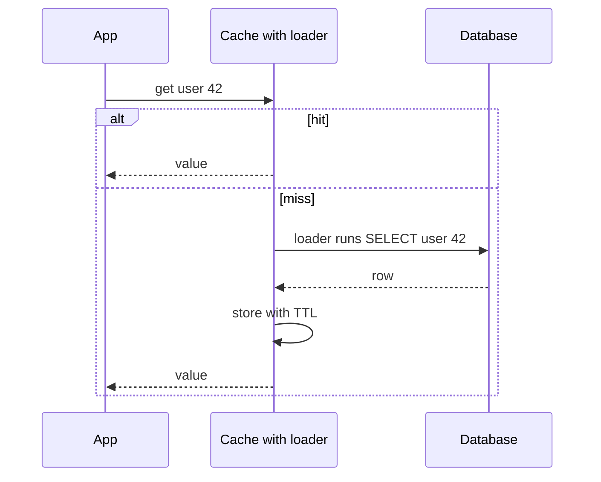

```java
// Caffeine LoadingCache — read-through, in-process
LoadingCache<String, User> users = Caffeine.newBuilder()
        .maximumSize(10_000)
        .expireAfterWrite(Duration.ofMinutes(5))
        .build(id -> userRepository.findById(id).orElse(null)); // loader

User u = users.get("42"); // loads on miss; concurrent misses for the same key share one load
```

| Pros | Cons |
|---|---|
| Cleaner app code — one place for loading logic | Needs a cache that supports loaders (Caffeine, Guava, DAX for DynamoDB) |
| Libraries often coalesce concurrent misses for the same key (built-in stampede protection) | Same cold-start and staleness issues as cache-aside |

**Cache-aside vs read-through:** same data flow; the difference is *who* does the loading — app code vs the cache.

### 3.3 Write-Through

> **Level:** 🟢 Essential

**What is it?** Every write goes to the **cache and the DB synchronously** as part of the same operation; the write is acknowledged only after both succeed. Usually paired with read-through.

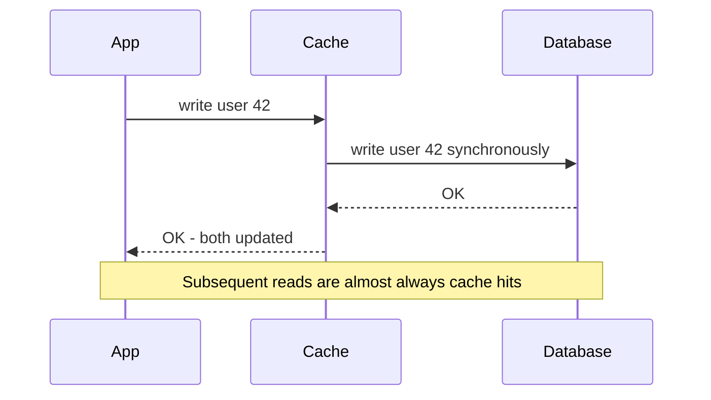

```
Write flow:
1. Write to cache
2. Write to DB (synchronously)
3. Return success

Read flow:
1. Check cache → almost always a hit
```

| Pros | Cons |
|---|---|
| Cache stays fresh — reads after writes see new data | Higher write latency (two writes on the critical path) |
| No cold misses for recently written data | Cache fills with data that may never be read (use TTL) |
| Simple read path | **Not truly strongly consistent** — see note below |

**Important correction:** write-through is often described as "strong consistency." It isn't, strictly. If the DB write succeeds but the cache write fails (or vice versa), the two diverge; two concurrent writers can also apply in different orders to cache and DB. Treat it as "cache stays *fresher*" (near-consistent), and still keep a TTL as a safety net.

**When to use it:** read-after-write is common and stale reads are annoying (user settings, shopping cart), and write volume is moderate.

### 3.4 Write-Back

> **Level:** 🟡 Intermediate

**What is it?** Also called **write-behind**. Write to the **cache only** and acknowledge immediately; the cache flushes changes to the DB **asynchronously** later (batched or after a delay).

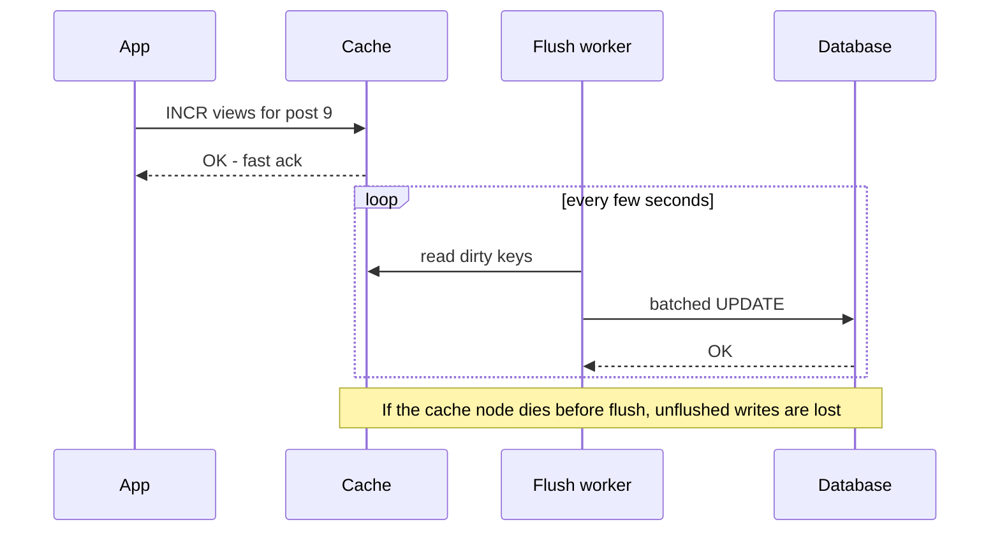

```
Write flow:
1. Write to cache → return immediately ✅ (fast)
2. Async: flush to DB (batched or after delay)
```

| Pros | Cons |
|---|---|
| Very fast writes | **Risk of data loss** if cache fails before flush |
| Batching / coalescing reduces DB load (100 increments → 1 UPDATE) | Complex: ordering, retries, dirty tracking |
| Absorbs write spikes | DB is temporarily behind — other readers of the DB see stale data |

**When to use it:** high-volume, loss-tolerant writes — view/like counters, analytics, gaming scores, IoT telemetry. Reduce loss with Redis AOF persistence + replication, or write to a durable log (Kafka) instead of relying on cache memory. **Never** for payments or orders.

### 3.5 Write-Around

> **Level:** 🟡 Intermediate

**What is it?** Writes go **directly to the DB, bypassing the cache**. The cache is populated only on reads (usually via cache-aside). Optionally the write deletes any existing cache entry.

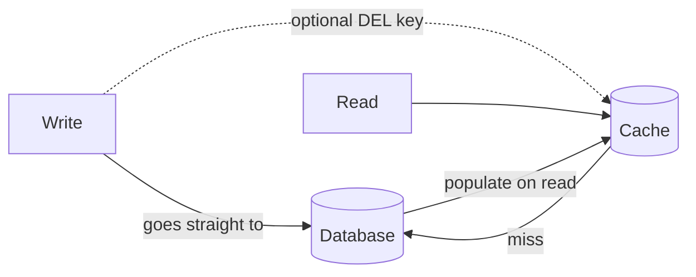

| Pros | Cons |
|---|---|
| Avoids polluting the cache with write-once, rarely read data | A read right after a write is a cache miss |
| Simple write path | Must still invalidate existing entries or accept staleness until TTL |

**When to use it:** write-heavy data that is rarely re-read soon after writing — logs, audit records, bulk imports, chat history archives.

### 3.6 Refresh-Ahead

> **Level:** 🔴 Advanced

**What is it?** The cache **proactively refreshes** hot entries *before* they expire (e.g., when an entry is accessed after 80% of its TTL has passed, trigger an async reload while still serving the current value). Hot keys never cause an expiry miss.

```java
// Caffeine: refreshAfterWrite triggers an async reload on access after 4 min,
// while still serving the old value; expireAfterWrite is the hard limit.
LoadingCache<String, Product> products = Caffeine.newBuilder()
        .refreshAfterWrite(Duration.ofMinutes(4))
        .expireAfterWrite(Duration.ofMinutes(5))
        .build(id -> productRepository.findById(id).orElse(null));
```

| Pros | Cons |
|---|---|
| Eliminates expiry-driven latency spikes and stampedes on hot keys | Wasted refreshes if a key isn't read again |
| Smooth DB load | More complexity; needs access tracking |

**When to use it:** predictable hot keys — homepage, top products, leaderboards, config.

### 3.7 Comparison of Caching Patterns

> **Level:** 🟢 Essential

| Pattern | Who loads on read | On write | Read perf | Write perf | Freshness | Data-loss risk | Complexity |
|---|---|---|---|---|---|---|---|
| **Cache-aside** | App | DB, then delete key | Good (miss on first) | Good | Eventual (TTL-bounded) | None | Low |
| **Read-through** | Cache loader | (combine with a write pattern) | Good | — | Eventual | None | Low–Medium |
| **Write-through** | Cache loader | Cache + DB synchronously | Excellent | Slower (2 writes) | Fresher (not strictly strong) | None | Medium |
| **Write-back** | Cache | Cache now, DB later | Excellent | Excellent | DB lags | **Yes** | High |
| **Write-around** | App (cache-aside) | DB only | Miss after write | Good | Eventual | None | Low |
| **Refresh-ahead** | Cache, proactively | (combine) | Excellent for hot keys | — | Bounded staleness | None | Medium–High |

**Choosing quickly:**
- Read-heavy, general purpose → **cache-aside** (+ TTL + delete on write).
- Read-after-write matters → **write-through**.
- Massive, loss-tolerant writes → **write-back**.
- Write-once, read-rarely → **write-around**.
- Predictable hot keys with strict latency → **refresh-ahead**.

**Interview perspective**
> **Q: "What's the difference between write-through and write-behind caching?"**
> "Write-through writes to both cache and DB synchronously, so the cache stays fresh and nothing is lost, but every write pays two round trips. Write-behind writes to the cache and acknowledges immediately, flushing to the DB asynchronously in batches — writes are very fast and the DB sees less load, but anything not yet flushed is lost if the cache node dies. I'd pick write-through for user-facing data that's read right after writing, and write-behind only for loss-tolerant, high-volume data like view counters."

### 3.8 Delete vs Update the Cache on Write

> **Level:** 🔴 Advanced

**The question:** on a write, should you **update** the cache entry with the new value, or **delete** it and let the next read reload it?

**Prefer delete.** Updating the cache from two concurrent writers can leave the cache with the *older* value:

```
Writer A: UPDATE DB price=10
Writer B: UPDATE DB price=12
Writer B: SET cache price=12
Writer A: SET cache price=10        ← cache now 10, DB is 12 → stale until TTL
```

Deleting is idempotent and order-independent; it also avoids computing values that may never be read.

**But delete still has a race — the classic stale-set race in cache-aside:**

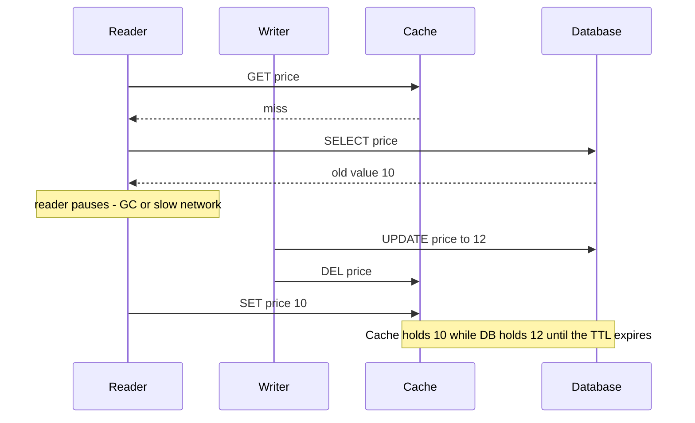

**Walkthrough:** the reader fetched the old value *before* the write but stored it in the cache *after* the writer's delete. It's rare (a slow reader must land exactly in that window) but real at scale.

**Fixes (simplest to strongest)**

| Fix | How | Trade-off |
|---|---|---|
| **Always set a TTL** | Bounds staleness to the TTL | Limits, doesn't prevent |
| **Delete after DB commit** (never before) | Order: write DB → commit → DEL | Required baseline |
| **Delayed double delete** | DEL, then DEL again ~0.5–1 s later (async) | Heuristic; delay must exceed typical read time |
| **Versioned values / compare-and-set** | Store a `version` with the value; only `SET` if newer (Lua script) | Needs a version column |
| **CDC-driven invalidation** | Debezium tails the DB binlog/WAL → Kafka → consumer deletes keys | Reliable and decoupled; adds infra and slight lag. See [Transactional Outbox and CDC](05_distributed_systems_and_messaging.md#19-transactional-outbox-and-cdc) |
| **Lease tokens** (Memcached at Facebook) | A miss grants a lease; a later `SET` is rejected if a delete happened since | Strong, but needs cache support |

**Interview perspective**
> **Q: "Why delete the cache key on write instead of updating it?"**
> "Updates from concurrent writers can apply out of order and leave the cache permanently older than the DB, while deletes are idempotent — the next read reloads the truth. Deletes still leave a narrow race where a slow reader writes a stale value back, so I always keep a TTL, delete only after commit, and for critical data drive invalidation from CDC or use versioned writes."

---

## 4. Cache Invalidation and Expiration

> **Theme:** "There are only two hard things in Computer Science: cache invalidation and naming things." — Phil Karlton

### 4.1 Why Invalidation Is Hard

> **Level:** 🟢 Essential

**What is it?** **Invalidation** removes or refreshes a cached entry when the source data changes. **Expiration** removes it automatically after a TTL. Together they decide *how stale* your cache can get.

**Why is it hard?** The cache and DB are two separate systems with no shared transaction. Writes can come from many services, batch jobs, or manual SQL fixes — any path that forgets to invalidate leaves stale data.

**Stale data problem (from the original notes):** DB updated but cache still has the old value.
**Solutions:** appropriate TTL · explicit invalidation on write · event-driven invalidation (DB → event → cache invalidation).

### 4.2 Invalidation Strategies

> **Level:** 🟢 Essential

| Strategy | How it works | Staleness | Complexity | Use when |
|---|---|---|---|---|
| **TTL only** | Entry expires after N seconds | Up to TTL | Lowest | Staleness of N seconds is fine (catalog, feed counts) |
| **Jittered TTL** | `TTL = base + random(0, jitter)` | Up to TTL | Low | Always — prevents mass expiry ([avalanche](#83-cache-avalanche)) |
| **Explicit invalidation** | Writer deletes key after DB commit | Small race window | Medium | Single service owns writes |
| **Event-driven invalidation** | Writer publishes `ProductUpdated` event → consumers delete keys | Event lag (ms–s) | Medium–High | Many services cache the same data |
| **CDC-driven invalidation** | Debezium reads the DB log → Kafka → invalidator | Log lag (ms–s) | High | Writes come from many paths (including manual SQL); need reliability |
| **Versioned keys** | Key includes a version: `product:42:v7`; bump version on write; old keys age out | None for readers using the new version | Medium | Immutable snapshots, config, bulk invalidation |
| **Namespace / generation key** | `catalog:gen` counter in key prefix; increment to invalidate a whole group | None | Medium | Invalidate thousands of keys at once without `SCAN`+`DEL` |

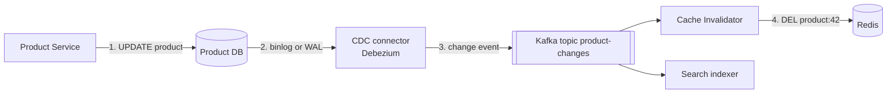

**Walkthrough**
1. Any writer (service, batch job, admin SQL) updates the DB.
2. The CDC connector reads the database's change log — so no write path can "forget".
3. Changes are published to Kafka.
4. An invalidator deletes the affected keys. Other consumers (search index, analytics) reuse the same stream.

**Failure note:** if the invalidator is down, keys stay stale until it catches up (Kafka retains events) — keep a TTL as the backstop.

### 4.3 Choosing a TTL

> **Level:** 🟡 Intermediate

| Data | Typical TTL | Reason |
|---|---|---|
| OTP / verification codes | 2–10 min | Security requirement |
| Session | 15–30 min sliding | Inactivity timeout |
| User profile | 5–60 min | Changes rarely; invalidated on write |
| Product catalog | 1–24 h | Changes rarely; invalidated on update |
| Feed / timeline page | 30 s – 5 min | Freshness matters but tolerant |
| Static assets with versioned URL | 1 year (`immutable`) | URL changes when content changes |
| Negative (null) results | 30 s – 5 min | Short, so newly created items appear |

**Rule of thumb:** TTL = the longest staleness the business can tolerate, then add jitter.

**Interview perspective (original Q33)**
> **Q: "Design a caching strategy for a product catalog with 1M products, mostly reads, updated every few hours."**
> "Cache-aside with Redis. Cache each product by ID with a TTL of about 1 hour. On product update, explicitly invalidate that entry after the DB commit — or drive invalidation from CDC if updates come from several systems. For the homepage's popular products, pre-warm the cache after each update with a background job. Add random jitter (±5 min) to TTLs so a bulk update doesn't make all 1M entries expire at once and stampede the DB."

---

## 5. Eviction Policies

> **Level:** 🟢 Essential

**What is it?** **Eviction** decides which entry to remove when the cache is **full**. (Different from expiration, which removes entries whose TTL ran out, and invalidation, which removes entries whose data changed.)

| Strategy | Rule | Best for |
|---|---|---|
| **LRU** (Least Recently Used) | Evict the item unused the longest | General purpose — most common |
| **LFU** (Least Frequently Used) | Evict the item accessed least often | Stable popularity (some keys always hot) |
| **FIFO** | Evict the oldest inserted item | Simple; often suboptimal |
| **TTL-based** | Evict when time-to-live expires (or the one closest to expiry) | Time-sensitive data (OTPs, sessions) |
| **Random** | Evict a random item | Rarely used; cheap; last resort |

**LRU vs LFU in one line:** LRU protects *recent* items (good for shifting trends, news); LFU protects *popular* items (good when the top items stay the same), but plain LFU is slow to forget items that *were* popular — Redis' LFU uses a decaying counter to fix that. Caffeine uses **W-TinyLFU**, which combines both and gets near-optimal hit ratios.

### 5.1 Redis maxmemory Policies

> **Level:** 🟡 Intermediate

Set with `maxmemory` + `maxmemory-policy` in `redis.conf`:

| Policy | Evicts from | Algorithm |
|---|---|---|
| `noeviction` (default) | — | Rejects writes with an error when full |
| `allkeys-lru` | All keys | Approximate LRU |
| `volatile-lru` | Keys with a TTL | Approximate LRU |
| `allkeys-lfu` | All keys | Approximate LFU |
| `volatile-lfu` | Keys with a TTL | Approximate LFU |
| `allkeys-random` / `volatile-random` | All / TTL keys | Random |
| `volatile-ttl` | Keys with a TTL | Shortest remaining TTL first |

> **Correction from the original notes:** Redis' *default* is `noeviction`, not LRU. For a pure cache set `allkeys-lru` (or `allkeys-lfu`). Use `volatile-*` when the same Redis also holds data that must never be evicted (keys without TTL). Redis LRU is **approximate** — it samples `maxmemory-samples` keys (default 5) and evicts the best candidate, trading precision for speed and memory.

### 5.2 How LRU Is Implemented

> **Level:** 🟡 Intermediate (classic coding interview question)

**Idea:** a **hash map** for O(1) lookup + a **doubly linked list** ordered by recency. On every access, move the node to the head; on insert when full, remove the tail.

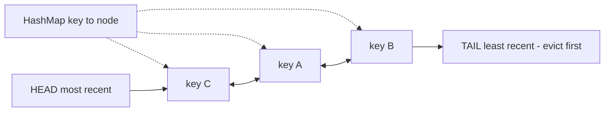

```java
// Simplest correct LRU in Java: LinkedHashMap in access-order mode
class LruCache<K, V> extends LinkedHashMap<K, V> {
    private final int capacity;

    LruCache(int capacity) {
        super(16, 0.75f, true);          // true = access order (get moves entry to the end)
        this.capacity = capacity;
    }

    @Override
    protected boolean removeEldestEntry(Map.Entry<K, V> eldest) {
        return size() > capacity;        // evict least recently used when over capacity
    }
}
// Not thread-safe: wrap with Collections.synchronizedMap or use Caffeine in production.
```

**Interview perspective (original Q19)**
> **Q: "What eviction policy would you choose for a session cache and why?"**
> "TTL-based expiry is the primary mechanism — sessions should disappear after a fixed inactivity period (sliding TTL, e.g., 30 minutes). For eviction under memory pressure I'd use `volatile-lru` so only expiring keys are candidates. I'd avoid LFU: a session hit heavily early on shouldn't outlive a newer active session. And I'd size memory so eviction is rare — evicting a live session logs a user out."

**Common mistakes**
- Confusing eviction (memory full) with expiration (TTL) and invalidation (data changed).
- Leaving `noeviction` on a cache Redis → writes start failing when memory fills.
- Running a cache at 100% memory constantly — high eviction rate means the cache is too small; watch `evicted_keys`.

---

## 6. Redis

> **Level:** 🟢 Essential

**What is it?** **Redis** (Remote Dictionary Server) is an open-source, **in-memory data structure store** used as a cache, database, message broker, and coordination tool. It's the industry default for distributed caching. (Valkey is the Linux Foundation fork with the same protocol; managed versions include AWS ElastiCache/MemoryDB and Azure Cache for Redis.)

**Why it's fast:** data lives in RAM, operations are simple O(1)/O(log N) structure operations, and the command execution loop is **single-threaded** (no locks, no context switches). Redis 6+ uses extra threads only for network I/O.

### 6.1 Data Structures and Use Cases

| Structure | What it is | Use case |
|---|---|---|
| **String** | Bytes up to 512 MB; supports atomic `INCR` | Simple key-value, counters, session tokens, cached JSON |
| **Hash** | Field → value map inside one key | Object storage (user profile fields), partial updates |
| **List** | Linked list; push/pop both ends | Simple queues, recent-activity feeds (`LPUSH` + `LTRIM`) |
| **Set** | Unordered unique members | Unique tags, followers, "who liked", set intersection |
| **Sorted Set (ZSET)** | Unique members ordered by score | Leaderboards, priority queues, sliding-window rate limiting, time-ordered feeds |
| **Bitmap** | Bit array on a string | Daily active users, feature flags per user ID |
| **HyperLogLog** | Probabilistic distinct count (~0.81% error, 12 KB) | Unique visitors |
| **Geospatial** | Sorted set with geohash scores | "Drivers within 2 km" |
| **Pub/Sub** | Fire-and-forget broadcast channels | Real-time notifications, cache-invalidation broadcast (no persistence) |
| **Streams** | Append-only log with consumer groups | Event logs, lightweight message queues (with acks) |

### 6.2 Common Commands

```bash
SET key value EX 3600          # set with 1-hour TTL
SET lock:order:9 token NX PX 30000   # set only if absent, 30 s expiry (simple lock)
GET key                        # get value
DEL key                        # delete
INCR counter                   # atomic increment
EXPIRE key 300                 # set TTL
TTL key                        # check remaining TTL
HSET user:123 name "Alice"     # hash field set
HGETALL user:123               # all fields
ZADD leaderboard 1500 "Alice"  # sorted set add
ZREVRANGE leaderboard 0 9 WITHSCORES   # top 10
PFADD visitors:2026-10-27 u1 u2        # HyperLogLog add
SCAN 0 MATCH user:* COUNT 100  # iterate keys safely (never use KEYS * in production)
```

### 6.3 Atomicity, Lua Scripts and Pipelining

> **Level:** 🟡 Intermediate

- **Single commands are atomic** — because one thread executes commands one at a time, `INCR` from 1,000 clients never loses an update.
- **`MULTI`/`EXEC` transactions** queue commands and run them together without interleaving — but there is **no rollback**, and you can't branch on intermediate results. `WATCH` adds optimistic locking.
- **Lua scripts (`EVAL`)** run a whole read-modify-write atomically on the server — the standard way to implement rate limiters, compare-and-set, and safe lock release.
- **Pipelining** sends many commands without waiting for each reply → one round trip instead of N. It improves throughput but is **not** atomic.

```lua
-- Safe lock release: delete only if we still own the lock
if redis.call("GET", KEYS[1]) == ARGV[1] then
  return redis.call("DEL", KEYS[1])
else
  return 0
end
```

**Caveat:** a long-running Lua script or an O(N) command (`KEYS *`, `HGETALL` on a huge hash, `DEL` of a huge key) blocks *every* client — keep scripts short and use `SCAN`/`UNLINK`.

### 6.4 Persistence — RDB vs AOF

> **Level:** 🟡 Intermediate

| | RDB snapshots | AOF (Append-Only File) |
|---|---|---|
| How | Periodic point-in-time dump (fork + write) | Logs every write command; replayed on restart |
| Data loss on crash | Since last snapshot (minutes) | ≤ 1 s with `appendfsync everysec` (default); ~0 with `always` (slow) |
| Restart speed | Fast | Slower (replay; mitigated by AOF rewrite) |
| File size | Compact | Larger |
| Use | Backups, fast restarts | Durability |

Production often enables **both** (Redis 7 uses an RDB preamble inside AOF). For a *pure cache*, persistence can be off — the DB is the source of truth — but a warm restart avoids a cold-cache stampede.

### 6.5 Deployment Modes

> **Level:** 🟢 Essential

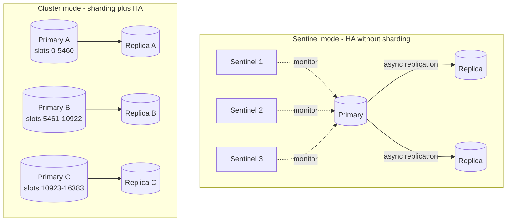

| Mode | What it gives you | Limits |
|---|---|---|
| **Standalone** | One node. Simple | No HA; capacity of one machine |
| **Sentinel** | Primary + replicas; Sentinels (≥3, quorum) detect failure and promote a replica automatically | Still one primary for writes; dataset must fit one node |
| **Cluster** | Data sharded across multiple primaries, each with replicas; automatic failover | Multi-key ops only within one slot; more client complexity |

**Walkthrough — Sentinel failover:** Sentinels ping the primary; when a quorum agrees it's down, they elect a leader Sentinel, promote the most up-to-date replica, reconfigure the other replicas, and tell clients the new primary address. Because replication is asynchronous, writes acknowledged just before the crash can be lost.

### 6.6 Redis Cluster Hash Slots

> **Level:** 🟡 Intermediate

- The key space is split into **16,384 hash slots**. `slot = CRC16(key) mod 16384`.
- Each primary owns a range of slots. Clients cache the slot → node map; a wrong node replies `MOVED` and the client updates its map.
- **Adding a node** = migrating some slots to it (only keys in those slots move — similar benefit to consistent hashing, but it is *not* a hash ring; it's a fixed slot table).
- **Hash tags:** only the part inside `{...}` is hashed. `cart:{user42}` and `orders:{user42}` land in the same slot, so multi-key commands and Lua scripts across them work.

> **Correction:** Redis Cluster does **not** use consistent hashing — it uses fixed hash slots. Consistent hashing (with virtual nodes) is used by Cassandra, DynamoDB, and client-side Memcached sharding. See [Consistent Hashing](03_databases_and_storage.md#10-consistent-hashing).

**Interview perspective (original Q21)**
> **Q: "How does Redis Cluster handle data distribution?"**
> "It divides the key space into 16,384 hash slots, mapping each key with CRC16(key) mod 16384, and each primary owns a range of slots with replicas for failover. Adding a node migrates a subset of slots, so only those keys move. If I need multi-key operations — say a user's cart and session together — I use hash tags like `{user42}` so they share a slot."

### 6.7 Redis vs Memcached

> **Level:** 🟡 Intermediate

| Feature | Redis | Memcached |
|---|---|---|
| Data types | Rich (hash, list, set, zset, streams, geo, HLL) | Strings only |
| Persistence | RDB / AOF | None |
| Replication and failover | Built in (Sentinel, Cluster) | None (client-side only) |
| Sharding | Server-side (Cluster) | Client-side (consistent hashing in the client) |
| Threading | Single-threaded execution (+ I/O threads) | Multi-threaded — scales on many cores |
| Atomic ops / scripting | Yes (INCR, Lua, transactions) | Basic (incr, CAS) |
| Pub/Sub, streams | Yes | No |
| Best for | Almost everything — default choice | Very simple, huge, multi-threaded string caches |

**Interview line:** "I'd default to Redis for its data structures, replication, and atomic operations. Memcached is only worth it for a plain, very large string cache where multi-threaded throughput per node matters more than features."

---

## 7. Distributed Caching

> **Level:** 🟡 Intermediate

**What is it?** A cache whose data is **spread across many nodes** so it can hold more data and serve more traffic than one machine, while appearing as one logical cache to the application.

**Why?** A single Redis node tops out around ~100K+ ops/sec and the RAM of one machine. Beyond that — or for high availability — you need multiple nodes.

**How does it work?**
1. **Partitioning (sharding):** each key is mapped to one node — server-side (Redis Cluster slots) or client-side (consistent hashing in the client library, e.g., Memcached with ketama).
2. **Replication:** each shard has replicas for failover and extra read capacity.
3. **Routing:** clients know the key → node map (smart client) or go through a proxy (Twemproxy, Envoy, cloud endpoints).

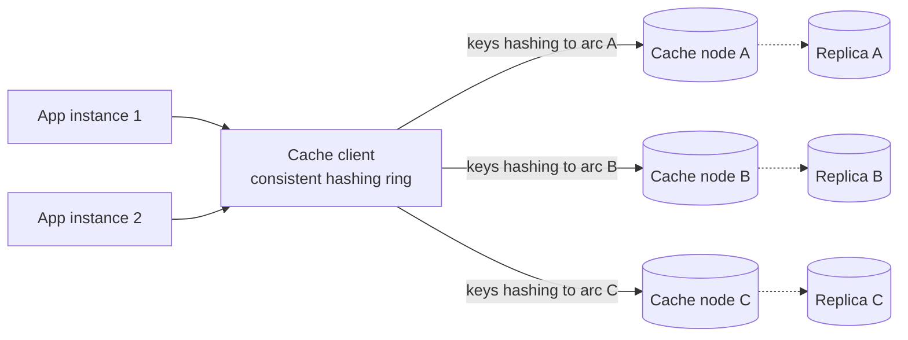

**Why consistent hashing (not `hash % N`)?** With `hash(key) % N`, changing N from 3 to 4 remaps ~75% of keys → near-total cache miss → stampede on the DB. Consistent hashing remaps only ~1/N of keys. Details: [Consistent Hashing](03_databases_and_storage.md#10-consistent-hashing).

**Cache warming:** before sending traffic to a new or restarted cache, pre-load hot keys (from access logs, top-N queries, or by replaying recent reads). Also used after deploys that change key formats. Combine with gradual traffic shift.

**Spring Boot with Redis as a distributed cache**

```java
@Configuration
@EnableCaching
public class CacheConfig {
    @Bean
    public RedisCacheManager cacheManager(RedisConnectionFactory cf) {
        RedisCacheConfiguration defaults = RedisCacheConfiguration.defaultCacheConfig()
                .entryTtl(Duration.ofMinutes(30))
                .disableCachingNullValues()
                .serializeValuesWith(RedisSerializationContext.SerializationPair
                        .fromSerializer(new GenericJackson2JsonRedisSerializer()));

        return RedisCacheManager.builder(cf)
                .cacheDefaults(defaults)
                .withCacheConfiguration("products",
                        defaults.entryTtl(Duration.ofHours(1)))   // per-cache TTL
                .build();
    }
}

@Service
public class ProductService {
    @Cacheable(value = "products", key = "#id", sync = true) // sync=true: one loader per key per instance
    public Product getProduct(Long id) { return repo.findById(id).orElseThrow(); }
}
```

(`spring.data.redis.cluster.nodes=...` switches Lettuce to cluster mode.)

**Advantages and disadvantages**

| Pros | Cons |
|---|---|
| Scales memory and throughput horizontally | Network hop on every access |
| Shared across all app instances — one place to invalidate | Another cluster to operate, monitor, and pay for |
| Survives app restarts and deploys | Node loss = partial cold cache; resharding moves keys |

**Common mistakes**
- Serializing with Java native serialization (fragile across deploys, big) — prefer JSON or Protobuf and version your cached format.
- One shared Redis for cache + queues + locks + sessions — a noisy workload evicts or blocks the others. Separate by purpose.
- No timeouts on cache calls — a slow Redis then makes the whole app slow.

---

## 8. Cache Failure Modes

> **Theme:** Caches fail in a few well-known ways. Interviewers love asking about each by name.

| Failure mode | One-line definition | Main fixes |
|---|---|---|
| **Stampede** (thundering herd, dog-piling) | One **hot key** expires → many concurrent misses hit the DB | Lock / single-flight, early refresh, stale-while-revalidate |
| **Penetration** | Requests for keys that **don't exist** anywhere → always miss → always hit DB | Cache nulls, Bloom filter, input validation |
| **Avalanche** | **Many keys** expire at once, or the **cache tier goes down** → DB flooded | Jittered TTLs, HA cache, multi-level cache, circuit breaker, rate-limit DB |
| **Hot key** | One key gets so much traffic that its single cache node melts | Local L1 cache, key replication/splitting |
| **Big key** | One value is huge (MBs) → slow ops, network spikes, blocked Redis | Split, compress, paginate |

### 8.1 Cache Stampede

> **Level:** 🟢 Essential

**What is it?** A popular cache key expires (or is evicted/deleted) → thousands of simultaneous requests miss → all query the DB for the *same* value at once → DB overload → slower responses → more timeouts and retries → worse overload.

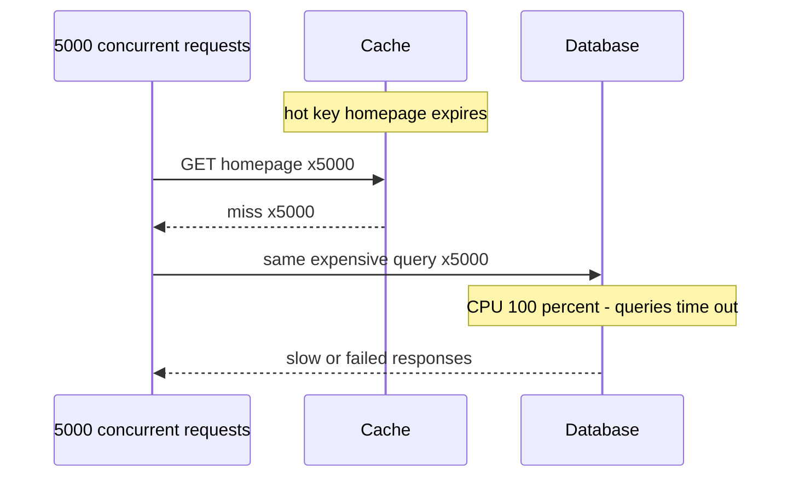

**Fixes**

1. **Mutex / distributed lock per key** — the first request to miss acquires a short lock (`SET lock:key token NX PX 5000`), recomputes and refills the cache; the others wait briefly and re-read the cache (or serve stale).

```java
public String getHomepage() {
    String v = redis.get("homepage");
    if (v != null) return v;

    String token = UUID.randomUUID().toString();
    Boolean gotLock = redis.set("lock:homepage", token, SetArgs.Builder.nx().px(5000)); // Lettuce-style
    if (Boolean.TRUE.equals(gotLock)) {
        try {
            v = buildHomepageFromDb();
            redis.setex("homepage", 300 + ThreadLocalRandom.current().nextInt(60), v); // jittered TTL
            return v;
        } finally {
            releaseIfOwner("lock:homepage", token);   // Lua compare-and-delete (see 6.3)
        }
    }
    sleepQuietly(50);              // someone else is rebuilding — wait and retry the cache
    return getHomepageWithRetryLimit();
}
```

2. **Request coalescing / single-flight** — within one instance, concurrent misses for the same key share one in-flight load (Caffeine `LoadingCache`, Spring `@Cacheable(sync = true)`, Go `singleflight`). Cuts DB queries from *requests* to *instances*.
3. **Probabilistic early expiration (XFetch)** — each reader, as the TTL nears, recomputes with a probability that rises as expiry approaches; one lucky request refreshes early, before the key actually expires.
4. **Stale-while-revalidate / soft TTL** — store a logical expiry inside the value with a longer physical TTL; when logically expired, serve the stale value and refresh asynchronously (one refresher via lock).
5. **Refresh-ahead / never expire hot keys** — a background job refreshes known hot keys ([3.6](#36-refresh-ahead)).
6. **Jittered TTL** — avoids many keys expiring together (helps avalanche more than single-key stampede).

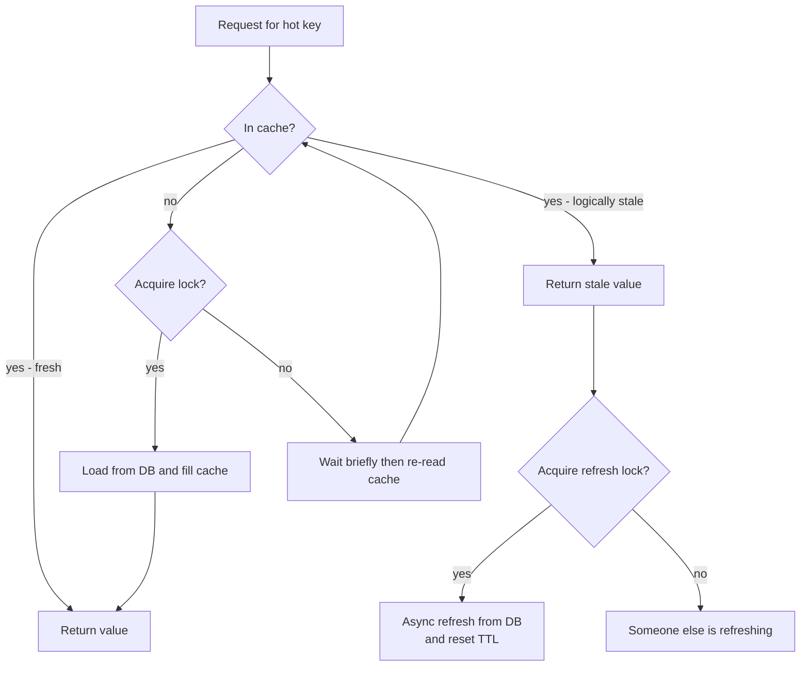

**Interview perspective**
> **Q: "A celebrity's profile key expires and the DB falls over. What happened and how do you prevent it?"**
> "That's a cache stampede: every request for that hot key missed at the same moment and went to the DB. I'd add per-key request coalescing so only one loader per instance runs, plus a short distributed lock so only one instance rebuilds while others serve the stale value — stale-while-revalidate. For known hot keys I'd refresh ahead of expiry so they never actually expire, and add TTL jitter everywhere."

### 8.2 Cache Penetration

> **Level:** 🟢 Essential

**What is it?** Requests for data that **doesn't exist** in the cache *or* the DB. Each request misses the cache, queries the DB, finds nothing, caches nothing — and repeats. Attackers can exploit this by requesting random IDs (`/users/9999999999`).

**Fixes**
1. **Cache null results** with a short TTL (e.g., `user:999 → "NULL"` for 60 s). Simple; costs memory if keys are random.
2. **Bloom filter** in front of the cache: a compact probabilistic set of all *valid* keys. If it says "definitely not present", reject without touching cache or DB.
3. **Input validation** — reject malformed IDs (wrong format, out of range) at the API layer; rate-limit abusive clients.

**Bloom filter in one paragraph:** a bit array of m bits plus k hash functions. To add a key, set the k bits it hashes to. To check, test those k bits: if any is 0 → the key is **definitely not** in the set; if all are 1 → **probably** in the set (false positives possible, **no false negatives**). ~10 bits per key gives ~1% false positives. Standard Bloom filters can't delete (use counting or cuckoo filters if needed). Redis offers it via the RedisBloom module (`BF.ADD`, `BF.EXISTS`).

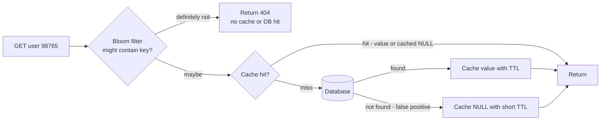

**Walkthrough:** the Bloom filter (populated from all existing IDs and updated on every insert) stops nearly all invalid lookups; the rare false positive is absorbed by null caching.

**Interview perspective (original Q20)**
> **Q: "What is cache penetration and how do you prevent it?"**
> "It's when requests for non-existent data bypass the cache every time — miss, DB hit, no result, nothing cached, repeat. I'd cache null results with a short TTL so repeated lookups for the same invalid key hit the cache, and for attacks with random keys put a Bloom filter of valid IDs in front, which rejects keys that provably don't exist with no false negatives. Plus input validation and rate limiting at the gateway."

### 8.3 Cache Avalanche

> **Level:** 🟡 Intermediate

**What is it?** A **large fraction of the cache becomes unavailable at once** — either many keys share the same TTL and expire together (e.g., all loaded by a warm-up job at 09:00 with TTL 1 h), or a cache node/cluster crashes or restarts cold. The full read load lands on the DB, which can't handle it.

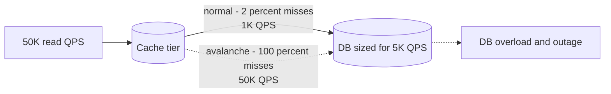

**Fixes**
- **Jittered TTLs:** `ttl = base + random(0, 10% of base)` so expiries spread out.
- **Highly available cache:** replicas + automatic failover (Sentinel/Cluster), across availability zones.
- **Multi-level cache:** an L1 local cache keeps serving hot keys if Redis is down.
- **Protect the DB:** circuit breaker around cache-miss DB calls, request rate limiting/load shedding, and serving degraded responses (stale or default data). See [Designing for Failure](06_architecture_reliability_and_security.md#6-designing-for-failure).
- **Warm before traffic:** after a cache restart, pre-load hot keys and ramp traffic gradually.
- **Persistence:** Redis RDB/AOF lets a restarted node come back warm.

### 8.4 Hot Keys and Big Keys

> **Level:** 🔴 Advanced

**Hot key:** one key (a celebrity profile, a flash-sale product, a viral post) receives so much traffic that the single shard owning it saturates CPU or network — even though the cluster overall is idle. Sharding doesn't help because one key lives on one shard.

| Fix | How |
|---|---|
| **L1 local cache** | Cache the hot key in-process for a few seconds on every app instance — absorbs most reads |
| **Key replication / splitting** | Store copies `product:42#0` … `product:42#9` on different shards; readers pick a random suffix; writers update all |
| **Read from replicas** | Spread reads of that shard across its replicas |
| **Detect early** | `redis-cli --hotkeys` (LFU policy), proxy metrics, client-side sampling |

**Big key:** a single value that's very large (a 50 MB hash, a list of 1M followers). Reading or deleting it blocks Redis' single thread and spikes network.

| Fix | How |
|---|---|
| **Split** | Break into buckets (`followers:42:0..99`) or paginate |
| **Compress** | gzip/LZ4 large JSON values |
| **Delete asynchronously** | `UNLINK` instead of `DEL` |
| **Store elsewhere** | Large blobs → object storage + CDN, keep a pointer in the cache |

**Common mistakes (all failure modes)**
- Fixing a stampede with only a TTL increase — just delays it.
- Caching nulls with a long TTL — newly created items stay "not found".
- Assuming sharding solves hot keys.

---

## 9. HTTP Caching

> **Level:** 🟡 Intermediate

**What is it?** Rules defined by HTTP headers that let **browsers, CDNs, and proxies** store responses and reuse them — sometimes without contacting the server at all, sometimes by asking "has it changed?" and getting a tiny `304 Not Modified`.

**Why?** It's the cheapest cache: no infrastructure on your side, and it removes requests *before* they reach you.

### 9.1 Cache-Control Directives

| Directive | Meaning |
|---|---|
| `max-age=N` | Fresh for N seconds in any cache |
| `s-maxage=N` | Overrides `max-age` for **shared** caches (CDN/proxy) |
| `public` | Any cache (including CDN) may store it |
| `private` | Only the user's browser may store it — use for personalized data |
| `no-cache` | May store, but **must revalidate** with the server before each reuse (not "don't cache"!) |
| `no-store` | Never store anywhere — sensitive data (banking pages, tokens) |
| `must-revalidate` | Once stale, must revalidate; don't serve stale |
| `immutable` | Content will never change during its lifetime — skip revalidation (versioned assets) |
| `stale-while-revalidate=N` | Serve stale for up to N s while refreshing in the background |
| `stale-if-error=N` | Serve stale for up to N s if the origin errors |

**Typical policies**

```http
# Versioned static asset: app.3f9c2a.js
Cache-Control: public, max-age=31536000, immutable

# Public API response, CDN-cacheable for 60 s, browser 10 s
Cache-Control: public, max-age=10, s-maxage=60, stale-while-revalidate=30

# Personalized page
Cache-Control: private, max-age=0, no-cache

# Sensitive
Cache-Control: no-store
```

### 9.2 Validation With ETag and Last-Modified

- **ETag** — an opaque version identifier of the response (often a hash). Client sends `If-None-Match: "<etag>"`; if unchanged the server replies **`304 Not Modified`** with no body.
- **Last-Modified** — a timestamp; client sends `If-Modified-Since`. Coarser (1-second resolution); ETag is preferred.

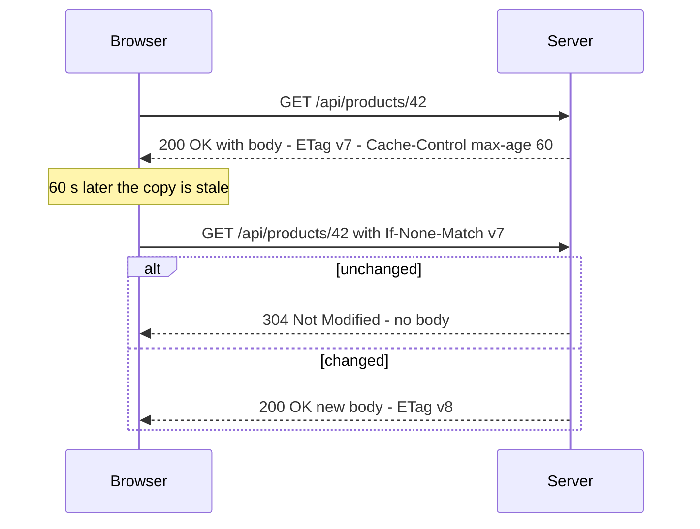

**Walkthrough:** the first response carries both a freshness lifetime and a validator. While fresh, the browser doesn't call the server at all. Once stale, it revalidates cheaply; a 304 saves bandwidth and server serialization work (though the server may still need to compute the ETag).

Spring Boot: `ShallowEtagHeaderFilter` adds ETags automatically (hashes the body — saves bandwidth, not server CPU), or return `ResponseEntity.ok().eTag(version).cacheControl(CacheControl.maxAge(60, SECONDS)).body(dto)` and check `WebRequest.checkNotModified(etag)` to skip work entirely.

### 9.3 Vary

`Vary: Accept-Encoding, Accept-Language` tells caches that the response differs by those request headers, so they store separate copies. Forgetting `Vary` can serve a gzip body to a client that can't decode it, or French content to English users. `Vary: Cookie` or `Vary: Authorization` effectively disables shared caching — fine for personalized data.

**Common mistakes**
- Thinking `no-cache` means "don't cache" — that's `no-store`.
- Marking personalized responses `public` → the CDN serves Alice's data to Bob. **Security bug.**
- Long `max-age` on unversioned URLs (`/app.js`) → users stuck on old code; use content-hashed filenames.

---

## 10. CDN Caching

> **Level:** 🟢 Essential

**What is it?** A **CDN** (Content Delivery Network) is a global network of edge servers (PoPs — points of presence) that cache content close to users. Full coverage of how CDNs route users and edge computing is in [CDN and Edge Computing](02_networking_and_communication.md#15-cdn-and-edge-computing); here we focus on the caching rules.

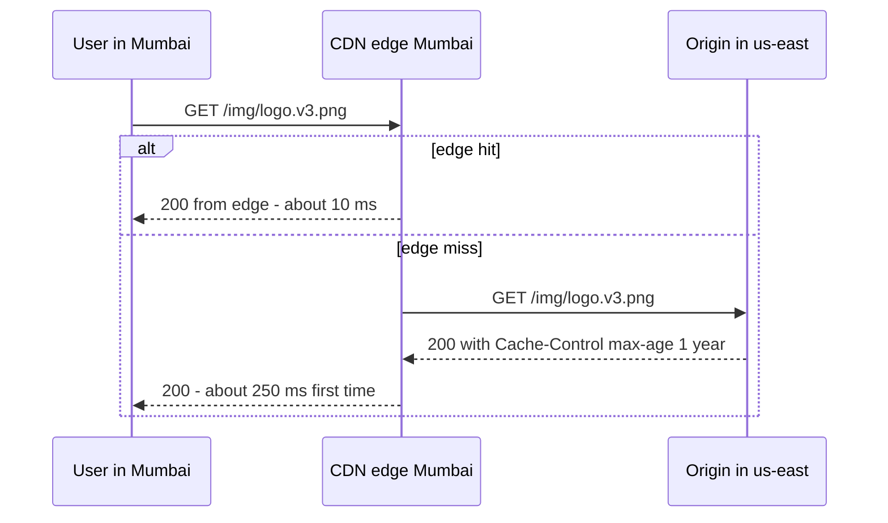

**Key concepts**

| Concept | What it means | Practical rule |
|---|---|---|
| **Cache key** | What makes two requests "the same" — by default host + path (+ query string, if configured) | Exclude irrelevant query params (tracking `utm_*`) to raise hit ratio; include ones that change the response |
| **TTL** | From origin `Cache-Control` / `s-maxage`, or CDN overrides | Long for static, short (seconds) for public API/HTML |
| **Purge / invalidation** | Explicitly remove objects from all edges | Slow-ish (seconds–minutes) and sometimes billed — don't rely on it for routine deploys |
| **Versioned asset URLs** | `app.3f9c2a.js`, `logo.v3.png` — new content = new URL | Best practice: cache forever (`immutable`), never purge |
| **Origin shield** | A mid-tier cache between edges and origin | Collapses misses from many edges into one origin request |
| **stale-if-error / stale-while-revalidate** | Serve stale content if origin fails or while refreshing | Keeps the site up during origin outages |
| **Signed URLs / cookies** | Time-limited access to private content | Paid video, private files |

**What to put on a CDN:** images, video segments (HLS/DASH), JS/CSS, fonts, downloads, public and anonymous HTML/API responses. **What not to:** personalized or authenticated responses (unless keyed per user and marked carefully), write requests.

**Interview perspective**
> **Q: "How do you deploy a new version of your frontend without users getting stale JS from the CDN?"**
> "Use content-hashed filenames for all assets and cache them for a year with `immutable`. The HTML that references them gets a short TTL or `no-cache` with an ETag, so it's revalidated on every load. A deploy just publishes new hashed files and a new HTML; no purge is needed, and old and new versions can coexist during rollout."

---

## 11. Quick Revision

**Fundamentals**
- Cache = fast copy close to the reader; DB = source of truth. Cache data that is **hot, expensive, and staleness-tolerant**.
- **Hit ratio** is the key metric. DB load = QPS × miss ratio. 95% → 99% hits = 5× less DB load.
- Layers: browser → CDN → proxy/gateway → in-process (Caffeine) → distributed (Redis) → DB buffer pool.

**Patterns**
- **Cache-aside** (default): app reads cache → miss → DB → set with TTL; on write, update DB **then delete** the key.
- **Read-through**: cache loader fetches on miss. **Write-through**: cache + DB synchronously (fresher, not strictly strong).
- **Write-back**: cache now, DB later — fast, risk of loss. **Write-around**: writes skip cache. **Refresh-ahead**: refresh hot keys before expiry.
- Delete > update on write; the stale-set race is bounded by TTL and fixed by versioning, delayed double delete, or CDC.

**Invalidation and eviction**
- Always set a TTL, with **jitter**. Use explicit, event-driven, or CDC invalidation for freshness.
- Eviction (cache full): LRU default, LFU for stable popularity. Redis default is `noeviction` → set `allkeys-lru` for caches.
- LRU = HashMap + doubly linked list (Java: `LinkedHashMap` access-order).

**Redis**
- In-memory, single-threaded command execution → single commands are atomic; use Lua for atomic read-modify-write; pipelining for throughput.
- Structures: string, hash, list, set, sorted set (leaderboards), bitmap, HLL, geo, streams.
- Persistence: RDB (snapshots) vs AOF (log, ≤1 s loss). Modes: standalone, Sentinel (HA), Cluster (16,384 hash slots, hash tags `{}`).
- Redis Cluster ≠ consistent hashing.

**Failure modes**
- **Stampede**: hot key expires → lock / single-flight / stale-while-revalidate / early refresh.
- **Penetration**: non-existent keys → cache nulls (short TTL) + Bloom filter + validation.
- **Avalanche**: mass expiry or cache down → jittered TTL, HA cache, L1 cache, circuit breaker, warm-up.
- **Hot key** → local cache, key splitting. **Big key** → split, compress, `UNLINK`.

**HTTP and CDN**
- `no-cache` = revalidate; `no-store` = never store; `private` for personalized; `immutable` + hashed filenames for assets.
- ETag + `If-None-Match` → `304 Not Modified`.
- CDN: tune the cache key, prefer versioned URLs over purges, use origin shield and `stale-if-error`.

---

**Previous:** [Databases and Storage](03_databases_and_storage.md) · **Next:** [Distributed Systems and Messaging](05_distributed_systems_and_messaging.md)
