# Distributed Systems and Messaging

> **Part 5 of 10** in the System Design interview notes — see [README](README.md) for the roadmap.
> **What you'll learn:** how data is replicated and kept consistent across machines, how nodes agree on a leader, how services talk asynchronously through queues and streams, and the resilience patterns (timeouts, retries, circuit breakers, bulkheads, sagas, outbox) that keep a distributed system alive when parts of it fail.
> **Level legend:** 🟢 Essential (asked in almost every interview) · 🟡 Intermediate · 🔴 Advanced / senior
> **Related:** [Fundamentals — CAP and Consistency](01_system_design_fundamentals.md#7-cap-theorem-and-pacelc) · [Databases — Replication and Sharding](03_databases_and_storage.md#8-replication-and-read-replicas) · [Architecture and Reliability](06_architecture_reliability_and_security.md#1-architecture-styles) · [Interview Problems](07_interview_problems_part1.md#1-url-shortener)

---

## Table of Contents

1. [Why Distributed Systems Are Hard](#1-why-distributed-systems-are-hard)
2. [Replication Strategies](#2-replication-strategies)
   - [2.1 Single-Leader Replication](#21-single-leader-replication)
   - [2.2 Multi-Leader Replication](#22-multi-leader-replication)
   - [2.3 Leaderless Replication](#23-leaderless-replication)
3. [Quorum Reads and Writes](#3-quorum-reads-and-writes)
4. [Network Partitions and Reconciliation](#4-network-partitions-and-reconciliation)
5. [Time, Clocks and Ordering](#5-time-clocks-and-ordering)
6. [Consensus and Leader Election](#6-consensus-and-leader-election)
7. [Distributed Locks](#7-distributed-locks)
8. [Service Discovery](#8-service-discovery)
9. [Synchronous vs Asynchronous Communication](#9-synchronous-vs-asynchronous-communication)
10. [Message Queues, Pub-Sub and Event Streaming](#10-message-queues-pub-sub-and-event-streaming)
11. [Apache Kafka](#11-apache-kafka)
12. [RabbitMQ and Amazon SQS](#12-rabbitmq-and-amazon-sqs)
13. [Delivery Guarantees, Idempotency and Deduplication](#13-delivery-guarantees-idempotency-and-deduplication)
14. [Dead Letter Queues and Backpressure](#14-dead-letter-queues-and-backpressure)
15. [Timeouts, Retries and Exponential Backoff](#15-timeouts-retries-and-exponential-backoff)
16. [Circuit Breaker](#16-circuit-breaker)
17. [Bulkhead](#17-bulkhead)
18. [Distributed Transactions 2PC vs Saga](#18-distributed-transactions-2pc-vs-saga)
19. [Transactional Outbox and CDC](#19-transactional-outbox-and-cdc)
20. [Quick Revision](#20-quick-revision)

---

## 1. Why Distributed Systems Are Hard

> **Level:** 🟢 Essential

**What is it?**
A **distributed system** is a collection of independent computers (called **nodes**) that cooperate over a network and appear to users as one coherent system. Your Spring Boot service with 6 instances, a Postgres primary with 2 replicas, a Redis cluster and a Kafka cluster is already a distributed system.

**Why do we need it?**
One machine eventually runs out of CPU, memory, disk or network — and when it dies, everything dies. Distributing work across machines gives us **scale** (more capacity), **availability** (survive a node failure) and **latency** (put data close to users).

**Why is it hard?** Because of **partial failure**: on one machine, things either work or crash. In a distributed system, *some* parts fail while others keep running — and often nobody knows exactly which parts.

- **Networks are unreliable** — packets are lost, delayed, duplicated or reordered.
- **You cannot tell "slow" from "dead"** — a request that times out may have failed, may still be running, or may have succeeded and only the reply was lost.
- **Clocks are not synchronized** — two machines disagree about "now" by milliseconds (sometimes seconds). See [Section 5](#5-time-clocks-and-ordering).
- **No global state** — every node has a partial, possibly stale view of the world.
- **Nodes fail independently** — GC pauses, disk failure, OOM kills, deployments, VM migrations.

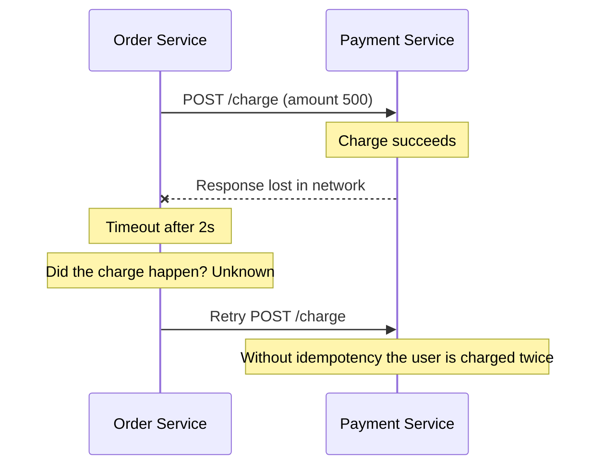

**Walkthrough:**
1. Order Service calls Payment Service.
2. Payment Service actually charges the card.
3. The reply is lost (network blip, LB reset, pod restarted).
4. Order Service only sees a timeout — it cannot know whether the charge happened.
5. If it retries naively, the customer is charged twice. This single picture is why [idempotency](#13-delivery-guarantees-idempotency-and-deduplication), [timeouts and retries](#15-timeouts-retries-and-exponential-backoff) exist.

### 1.1 The Eight Fallacies of Distributed Computing

> **Level:** 🟢 Essential

Things engineers wrongly assume (Peter Deutsch / James Gosling) — and what each costs you:

| # | Fallacy | Reality and design consequence |
|---|---|---|
| 1 | The network is reliable | Add timeouts, retries, idempotency |
| 2 | Latency is zero | Avoid chatty calls; batch; cache; co-locate |
| 3 | Bandwidth is infinite | Compress, paginate, avoid huge payloads |
| 4 | The network is secure | Encrypt in transit (TLS/mTLS), authenticate every hop |
| 5 | Topology doesn't change | Use service discovery, not hardcoded IPs |
| 6 | There is one administrator | Multiple teams/clouds/configs — automate and document |
| 7 | Transport cost is zero | Serialization and egress cost money and CPU |
| 8 | The network is homogeneous | Different protocols, versions, clients — use standard formats |

**Interview perspective**

> **Q: Why can't you just "retry until it works" in a distributed system?**
> Because a timeout does not mean failure. The first attempt may have succeeded, so a blind retry can duplicate side effects (double payment, duplicate email). Retries are only safe when the operation is idempotent, and they must be bounded with backoff and jitter so they don't overload a struggling service.

**Common mistakes**
- Treating a remote call like a local method call (no timeout, no failure handling).
- Assuming "timeout = failed".
- Designing as if clocks on different machines agree.

**Quick revision**
- Distributed = partial failure is normal.
- You can't distinguish slow from dead → timeouts + idempotency.
- Memorize 2–3 fallacies with their design consequences.

---

## 2. Replication Strategies

> **Level:** 🟢 Essential

**What is it?**
**Replication** means keeping copies of the same data on multiple nodes.

**Why do we need it?**
- **Availability / fault tolerance** — if one node dies, another has the data.
- **Read scalability** — spread reads across copies.
- **Latency** — keep a copy near users (another region).

**The hard part** is keeping copies in sync when data *changes*. There are three families of approaches:

| Strategy | Who accepts writes | Typical systems |
|---|---|---|
| Single-leader (leader–follower) | One leader | PostgreSQL, MySQL, MongoDB replica sets, Redis Sentinel, Kafka partitions |
| Multi-leader | Several leaders (often one per region) | Multi-region active-active setups, CouchDB, collaborative editing |
| Leaderless | Any replica | Cassandra, DynamoDB (Dynamo-style), Riak, ScyllaDB |

> For read replicas from the database perspective (routing reads, replica lag, read-your-writes), see [Databases — Replication and Read Replicas](03_databases_and_storage.md#8-replication-and-read-replicas). This section goes deeper into the distributed-systems mechanics.

### 2.1 Single-Leader Replication

> **Level:** 🟢 Essential

**What is it?** One node — the **leader** (primary) — accepts all writes. It streams changes (a replication log: Postgres WAL, MySQL binlog) to **followers** (replicas), which serve reads.

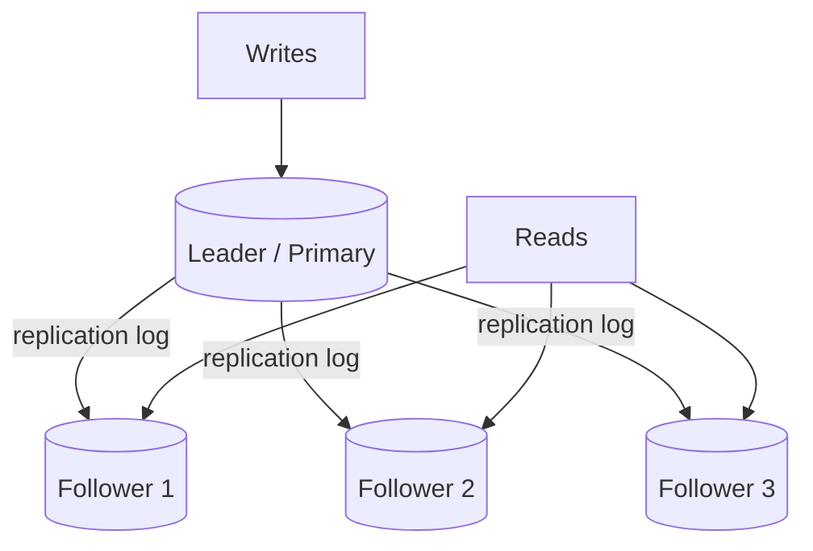

**Walkthrough:**
1. All writes go to the leader, which orders them — there is a single source of truth, so no write conflicts.
2. The leader appends each change to its log and ships it to followers.
3. Followers apply changes in the same order and serve reads.
4. **Bottleneck:** the leader caps write throughput. To scale writes you need [sharding](03_databases_and_storage.md#9-partitioning-and-sharding) (each shard has its own leader).

#### Synchronous vs Asynchronous Replication

| Type | How it works | Pros | Cons |
|---|---|---|---|
| **Synchronous** | Leader waits for follower(s) to confirm before acknowledging client | No data loss on leader crash; followers are up to date | Higher write latency; a slow/dead follower blocks writes |
| **Asynchronous** | Leader acknowledges immediately; followers catch up later | Low write latency; followers can lag freely | Leader crash can lose recently acknowledged writes; stale reads |
| **Semi-synchronous** | At least one follower confirms synchronously; the rest async | Durable on 2 nodes without waiting for all | More complex; still some latency |

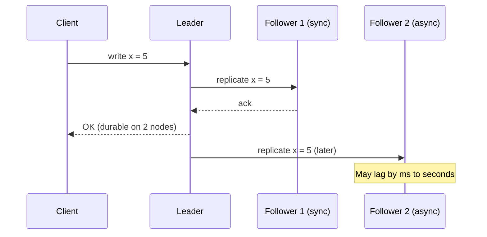

**Why most production systems use semi-sync:** fully synchronous replication to *all* followers means any one slow replica stalls every write; fully async can lose data. One synchronous follower gives "data exists on two machines" with bounded latency.

#### Failover — What Happens When the Leader Dies?

1. **Detect** — followers (or a monitor like Patroni, Sentinel, an orchestrator) miss heartbeats for a timeout (e.g., 10–30 s).
2. **Elect** — choose a new leader, usually the most up-to-date follower (ideally by a consensus/quorum mechanism, see [Section 6](#6-consensus-and-leader-election)).
3. **Reconfigure** — clients/proxies/DNS are pointed to the new leader.
4. **Demote** — if the old leader comes back, it must become a follower and discard un-replicated writes.

**Failover pitfalls:**
- **Lost writes:** with async replication, writes acknowledged by the old leader but not yet replicated are gone.
- **Timeout tuning:** too short → unnecessary failovers during GC pauses or load spikes; too long → long outage.
- **Split-brain** (below).

#### Split-Brain

**What is it?** Two nodes both believe they are the leader at the same time — typically after a network partition or a long GC pause where the old leader "wakes up" not knowing it was replaced. Both accept writes → divergent, corrupted data.

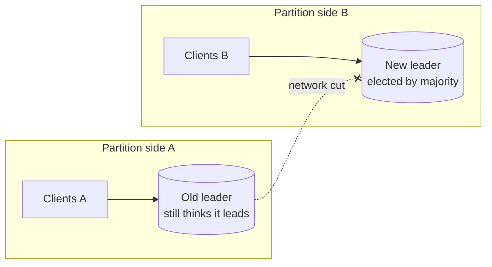

**Prevention:**
- **Quorum-based election** — a leader needs votes from a *majority*. The minority side cannot elect anyone, and an old leader that can't reach a majority steps down.
- **Fencing tokens** — each new leader/lock holder gets a monotonically increasing number (epoch/term). Storage rejects writes carrying an older token. See [Section 7](#7-distributed-locks).
- **STONITH** ("Shoot The Other Node In The Head") — forcibly power off or isolate the old leader before promoting a new one.
- **Leases** — the leader holds a time-limited lease and stops serving writes when it can't renew.

#### Real-World Examples

| System | Implementation |
|---|---|
| PostgreSQL | WAL streaming replication; leader + hot standbys; Patroni for automated failover |
| MySQL | Binary log replication; semi-sync plugin; Group Replication |
| Redis Sentinel | Sentinels monitor primary, vote, and promote a replica |
| MongoDB | Replica sets (primary + secondaries) with Raft-like election |
| Kafka | Each partition has a leader + ISR (in-sync replicas) |

### 2.2 Multi-Leader Replication

> **Level:** 🟡 Intermediate

**What is it?** Several nodes accept writes (commonly one leader per region) and replicate changes to each other.

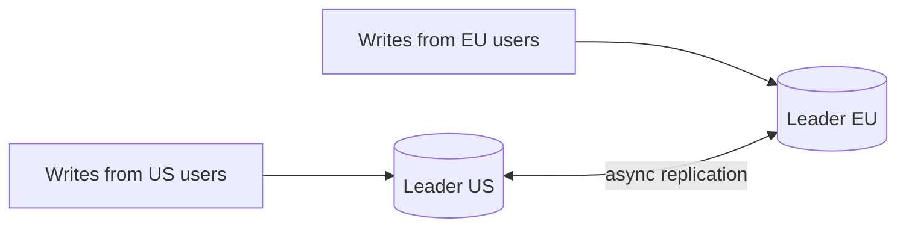

**Why use it?** Low write latency in every region and region-level failure tolerance (active-active). Also used by offline-capable apps (each device is a "leader") and collaborative editors.

**The big problem — write conflicts:** a user edits a record in the US while another edits the same record in the EU. Both succeed locally; replication then discovers two different values.

**Conflict resolution strategies:**

| Strategy | How | Risk / note |
|---|---|---|
| **Last Write Wins (LWW)** | Keep the write with the highest timestamp | Silently drops data; clock skew can make an *older* write win |
| **Merge** | Combine values (union of sets, sum of counters) | Only works for mergeable data types |
| **Custom application logic** | App resolves on write or on read (show both versions to user) | Flexible but more code |
| **CRDTs** (Conflict-free Replicated Data Types) | Data structures mathematically guaranteed to converge (G-Counter, OR-Set, sequence CRDTs) | Used by Redis Enterprise active-active, Riak, collaborative editing |
| **Avoid conflicts** | Route all writes for a given record to one "home" region | Simplest; most common in practice |

**When to use it:** multi-region active-active where local write latency matters and conflicts are rare or mergeable. **When not:** inventory counts, money balances — conflicts are unacceptable; use single leader per record instead.

### 2.3 Leaderless Replication

> **Level:** 🟡 Intermediate

**What is it?** No leader at all. The client (or a coordinator node acting for it) sends each write to several replicas in parallel and reads from several replicas in parallel. Introduced by Amazon's Dynamo paper; used by Cassandra, DynamoDB, Riak.

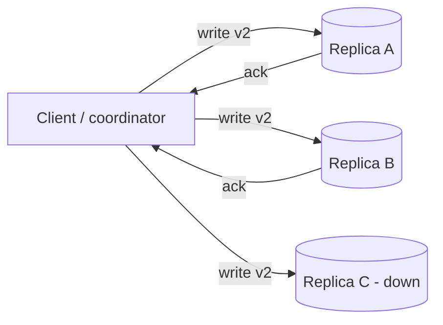

**Walkthrough:**
1. The write goes to all N replicas.
2. It is considered successful once **W** of them acknowledge (here 2 of 3).
3. A read asks **R** replicas and picks the newest version (by version/timestamp).
4. Replica C missed the write; it is fixed later by [read repair or anti-entropy](#4-network-partitions-and-reconciliation).

**Advantages:** no failover needed, high write availability, tolerant of slow nodes.
**Disadvantages:** conflicts and stale reads must be handled; consistency depends on quorum settings ([Section 3](#3-quorum-reads-and-writes)).

**Interview perspective**

> **Q: Single-leader vs leaderless — how do you choose?**
> Single-leader is simpler: one ordering of writes, no conflicts, easy transactions — great for relational workloads like orders and payments. Its weaknesses are the failover window and the single write bottleneck. Leaderless (Cassandra/DynamoDB) favors write availability and multi-datacenter operation at the cost of conflict handling and weaker default consistency — great for high-volume writes like activity logs, IoT, messaging inboxes.

**Common mistakes**
- Saying "async replication has no downside" — it loses acknowledged writes on leader failure.
- Ignoring replica lag when reading your own writes (user updates profile, refresh shows old data).
- Using LWW for data where losing a write matters.

**Quick revision**
- Single-leader: simple, no conflicts, write bottleneck, failover risk (split-brain → quorum + fencing).
- Multi-leader: local writes everywhere, must resolve conflicts (LWW, merge, CRDT, avoid).
- Leaderless: write/read to many replicas, quorum decides, repair later.
- Semi-sync is the practical middle ground.

---

## 3. Quorum Reads and Writes

> **Level:** 🟡 Intermediate

**What is it?**
A **quorum** is the minimum number of replicas that must take part in an operation for it to count as successful.

```
N = number of replicas holding a piece of data
W = replicas that must acknowledge a write
R = replicas that must answer a read

If W + R > N  → every read set overlaps every write set in at least one node
              → the read sees the latest acknowledged write
```

**Why do we need it?** In leaderless (and some leader-based) systems, there's no single node that is "the truth". Quorums give a tunable dial between consistency, latency and availability.

**How does it work?**

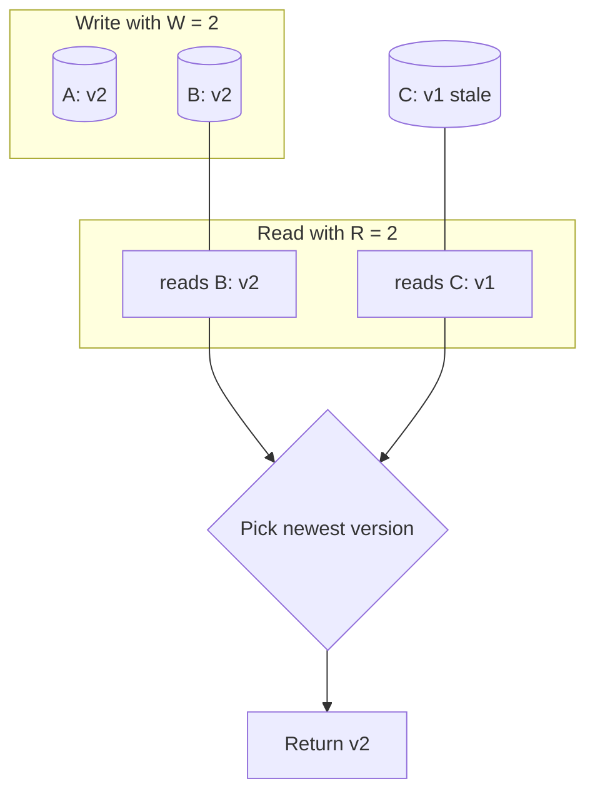

**Walkthrough:**
1. N = 3. The write reaches A and B (W = 2); C is slow and still has v1.
2. A read asks B and C (R = 2). Because 2 + 2 > 3, at least one of them (B) must have v2.
3. The coordinator compares versions and returns v2, and can repair C in the background (read repair).

#### Example with N = 3

| W | R | W + R | Result |
|---|---|---|---|
| 2 | 2 | 4 > 3 | ✅ Overlap guaranteed — reads see latest write (balanced) |
| 1 | 3 | 4 > 3 | ✅ Fast writes, slow reads |
| 3 | 1 | 4 > 3 | ✅ Slow writes (all must confirm), very fast reads |
| 1 | 1 | 2 ≤ 3 | ❌ Eventual consistency only — may read stale data |

#### Quorum Trade-offs

| Config | Write speed | Read speed | Availability | Consistency |
|---|---|---|---|---|
| W=N, R=1 | Slowest | Fastest | Writes fail if any replica down | Strong-ish |
| W=1, R=N | Fastest | Slowest | Reads fail if any replica down | Strong-ish |
| W=majority, R=majority | Balanced | Balanced | Tolerates ⌊(N−1)/2⌋ failures | Strong-ish |
| W=1, R=1 | Fastest | Fastest | Highest | Eventual |

> 🔴 **Senior nuance:** W + R > N is *not* full linearizability. Edge cases (concurrent writes with LWW, a write that failed on some nodes but succeeded on others, sloppy quorums, clock skew) can still produce anomalies. Say "quorum overlap gives you read-latest in the common case; for strict linearizability you need consensus (Raft/Paxos) or extra mechanisms."

#### Cassandra Consistency Levels

```
ONE            → 1 replica responds — fastest, least consistent
QUORUM         → majority of all replicas (across DCs)
LOCAL_QUORUM   → majority within the local datacenter (most common for multi-DC)
EACH_QUORUM    → majority in every datacenter (writes)
ALL            → every replica — strongest, least available
```
Typical choice: `LOCAL_QUORUM` for both reads and writes with replication factor 3 per DC → strong-ish consistency in-region with low latency.

#### Sloppy Quorum and Hinted Handoff 🔴

> **Level:** 🔴 Advanced

If some of the N "home" replicas are unreachable, a **sloppy quorum** lets the write be accepted by *other* healthy nodes temporarily. Those nodes keep a **hint** ("this belongs to node C") and hand it off when C recovers (**hinted handoff**). This increases write availability, but W + R > N no longer guarantees overlap with the home replicas — reads can be stale until handoff completes.

**Interview perspective**

> **Q: With N=3, W=2, R=2, can you always read the latest data?**
> Yes, in the normal case. Any 2 nodes you write and any 2 nodes you read must share at least one node, and that node holds the latest acknowledged value; the coordinator returns the newest version. The trade-off is that both reads and writes wait for two nodes and the system tolerates only one replica being down for both operations.

**Common mistakes**
- Forgetting that latency is set by the *slowest* node in the quorum.
- Believing quorum = linearizable in all cases.

**Quick revision**
- W + R > N → read and write sets overlap.
- Majority quorums tolerate ⌊(N−1)/2⌋ failures.
- Tune W/R per workload: write-heavy → low W; read-heavy → low R.
- Sloppy quorum + hinted handoff trade consistency for availability.

---

## 4. Network Partitions and Reconciliation

> **Level:** 🟢 Essential

**What is it?**
A **network partition** happens when a network failure splits the cluster into groups that can't talk to each other, even though each group is still running.

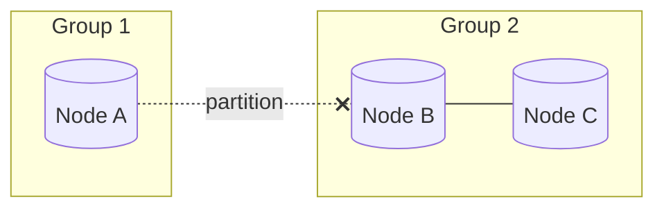

Node A can't reach B or C; B and C can't reach A. All three are alive.

**What happens during a partition?** This is exactly where [CAP](01_system_design_fundamentals.md#7-cap-theorem-and-pacelc) applies — you must choose:

| Choice | Behavior | Example |
|---|---|---|
| **Consistency (CP)** | The minority side refuses requests (returns errors) until the partition heals — no stale data served | ZooKeeper, etcd: a node without quorum stops serving writes; HBase; single-leader DB with quorum failover |
| **Availability (AP)** | Every side keeps accepting reads/writes; data diverges and is reconciled later | Cassandra, DynamoDB, Riak: accept writes on all sides; resolve on reconnect |

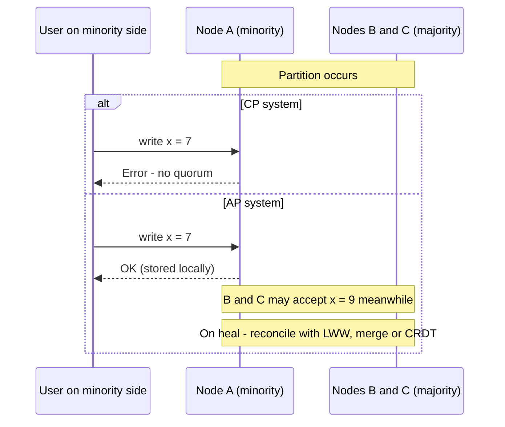

### 4.1 Partition Healing and Reconciliation

> **Level:** 🟡 Intermediate

When the network heals, replicas that diverged must converge:

- **Read repair** — during a read, the coordinator notices a replica returned an older version and writes the newest version back to it. Cheap, but only fixes data that is actually read.
- **Anti-entropy** — a background process compares replicas and copies missing data. To avoid comparing every row, replicas build **Merkle trees** (hash trees): each leaf hashes a key range, each parent hashes its children. Comparing roots tells you instantly whether two replicas match; walking down only mismatched branches finds the exact differing ranges with very little data transfer.
- **Hinted handoff** — writes destined for a node that was down are stored as hints elsewhere and delivered when it returns.

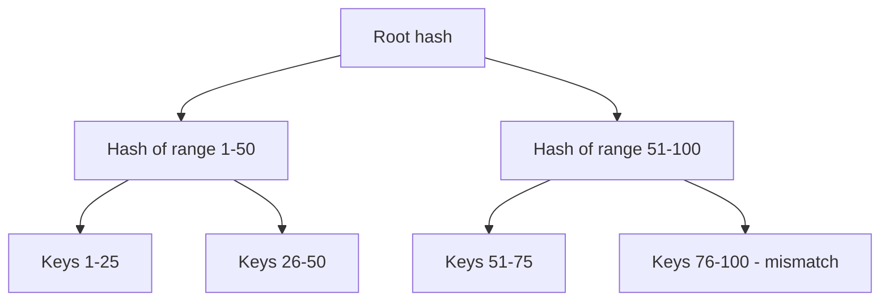

Two replicas compare roots → different → compare children → only "51–100" differs → only "76–100" differs → sync just that range.

**Interview perspective**

> **Q: What happens to a Cassandra cluster during a partition?**
> Cassandra is AP by default: nodes on both sides keep accepting reads and writes at the requested consistency level if enough replicas are reachable (e.g., `ONE`); stricter levels like `QUORUM` may fail on the minority side. When the partition heals, Cassandra converges using per-cell last-write-wins timestamps, hinted handoff, read repair and anti-entropy repair with Merkle trees. Concurrent conflicting writes are resolved by timestamp, so one of them is silently lost — that's the AP trade-off.

**Common mistakes**
- Saying "we'll just avoid partitions" — they happen in every real network (switch failures, misconfigured firewalls, cloud AZ issues).
- Forgetting that a long GC pause looks exactly like a partition to other nodes.

**Quick revision**
- Partition = nodes alive but can't talk.
- CP refuses on the minority side; AP accepts and reconciles later.
- Reconciliation: read repair, anti-entropy (Merkle trees), hinted handoff.

---

## 5. Time, Clocks and Ordering

> **Level:** 🟡 Intermediate

**What is it?**
Every machine has its own physical clock (quartz oscillator). Clocks **drift** (a few ms per minute), are corrected by **NTP** (Network Time Protocol), and can even jump *backwards* after a correction. The difference between two machines' clocks is called **clock skew**.

**Why does it matter?**
Many designs quietly depend on "which event happened first":
- Last-write-wins conflict resolution compares timestamps.
- Lock leases ("valid for 10 seconds") assume both sides measure 10 seconds the same way.
- Ordering of events in logs or event streams.

If node A's clock is 200 ms ahead of node B's, a write on A stamped "10:00:00.300" may actually have happened *before* a write on B stamped "10:00:00.250".

### 5.1 Why Last-Write-Wins Loses Data

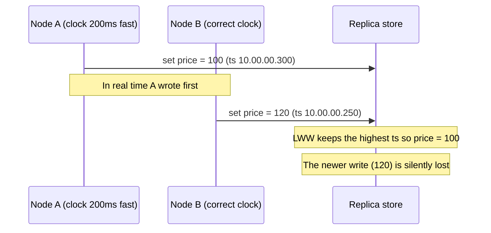

**Lesson:** physical timestamps are fine for *display* and *approximate* ordering, but unsafe for deciding correctness between concurrent writes on different machines.

### 5.2 Logical Clocks

> **Level:** 🔴 Advanced

**Lamport clocks** — each node keeps a counter:
1. Increment the counter before each local event.
2. Attach the counter to every message sent.
3. On receiving a message, set `counter = max(local, received) + 1`.

Result: if event X *caused* event Y, then `L(X) < L(Y)`. The reverse isn't true — Lamport clocks give a total order consistent with causality, but can't tell you whether two events were concurrent.

**Vector clocks** — each node keeps a vector of counters, one per node (`[A:2, B:1, C:0]`). Comparing two vectors tells you whether one happened-before the other or whether they are **concurrent** (neither dominates). Concurrent = a true conflict that must be merged or shown to the user. Used by Dynamo/Riak-style systems (often as "version vectors").

**Hybrid Logical Clocks (HLC)** — combine physical time with a logical counter so timestamps stay close to wall-clock time but never go backwards and still respect causality. Used by CockroachDB and YugabyteDB. Google Spanner instead uses **TrueTime** (GPS + atomic clocks with a bounded uncertainty interval) and waits out the uncertainty to get globally consistent timestamps.

| Clock | Gives you | Detects concurrency? | Used by |
|---|---|---|---|
| Physical (NTP) | Approximate wall time | No | Logs, TTLs, display |
| Lamport | Causal total order | No | Ordering inside protocols |
| Vector / version vector | Causal partial order | Yes | Dynamo, Riak |
| HLC | Causal order close to wall time | Partly | CockroachDB, YugabyteDB |
| TrueTime | Real time with bounded uncertainty | — | Spanner |

### 5.3 Ordering Guarantees in Practice

- **Total order** across a whole system is expensive (needs a single leader or consensus).
- **Per-key ordering** is usually enough and cheap — Kafka guarantees order *within a partition*, so route all events of one order to the same partition ([Section 11](#11-apache-kafka)).
- Use **sequence numbers / versions** generated by the single owner of a record (the leader, the DB) rather than client clocks.

**Interview perspective**

> **Q: Can you use timestamps to order events from different servers?**
> Only approximately. Clocks skew by milliseconds or more and NTP can move them backwards, so two events close together can be misordered, and last-write-wins can drop the real latest write. For correctness I'd use a single sequencer per key (DB sequence, partition offset, version column with optimistic locking), or logical/vector clocks if I need to detect concurrent updates.

**Common mistakes**
- Using `System.currentTimeMillis()` from many hosts to order writes.
- Measuring durations with wall-clock time instead of a monotonic clock (`System.nanoTime()`).

**Quick revision**
- Clocks drift and jump; skew is unavoidable.
- LWW + skew = silent data loss.
- Lamport = causal order; vector clocks = detect concurrency; HLC = causal + near wall time.
- Prefer per-key ordering from a single owner.

---

## 6. Consensus and Leader Election

> **Level:** 🟡 Intermediate

**What is it?**
**Consensus** is getting multiple nodes to agree on a value (or a sequence of values) even if some nodes crash or messages are delayed. Once agreed, the decision never changes.

**Why do we need it?**
- **Leader election** — exactly one leader at a time (no split-brain).
- **Replicated log / state machine** — every node applies the same commands in the same order (etcd, ZooKeeper, CockroachDB ranges, Kafka KRaft metadata).
- **Distributed locks, configuration, membership** — "who is alive, who owns what".

**Key rule — majorities:** a cluster of **2f + 1** nodes tolerates **f** failures, because any two majorities overlap in at least one node. That's why clusters are 3 nodes (tolerate 1) or 5 nodes (tolerate 2). A 4-node cluster still only tolerates 1 failure — even numbers add cost without extra tolerance.

| Cluster size | Majority | Failures tolerated |
|---|---|---|
| 1 | 1 | 0 |
| 3 | 2 | 1 |
| 4 | 3 | 1 |
| 5 | 3 | 2 |
| 7 | 4 | 3 |

### 6.1 Raft

> **Level:** 🟡 Intermediate

Raft was designed to be understandable (compared with Paxos). Each node is in one of three roles:

- **Leader** — handles all client requests and replicates log entries.
- **Follower** — passive; responds to the leader and votes.
- **Candidate** — a follower that is trying to become leader.

Time is divided into **terms** (1, 2, 3, …). Each term has at most one leader. The term number acts like a fencing token: messages from an older term are rejected.

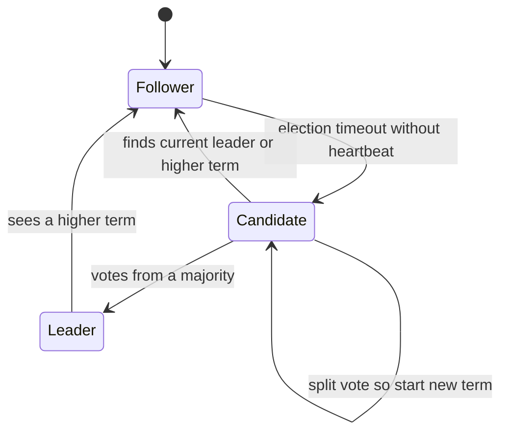

**Leader election:**
1. Followers expect periodic heartbeats from the leader. Each has a *randomized* election timeout (e.g., 150–300 ms) so they don't all start elections at once.
2. A follower whose timeout fires becomes a candidate, increments the term, votes for itself and sends `RequestVote` to all nodes.
3. A node grants at most one vote per term, and only to a candidate whose log is at least as up to date as its own.
4. With a majority of votes, the candidate becomes leader and starts sending heartbeats.
5. If votes split, the timeout fires again and a new term begins.

**Log replication:**

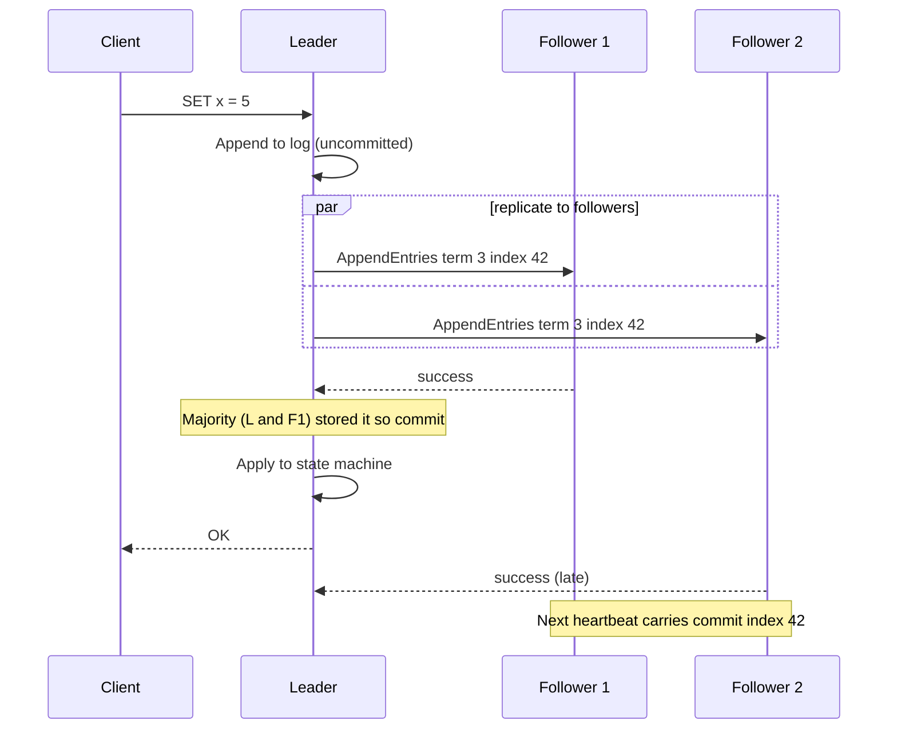

**Walkthrough:**
1. Client sends a write to the leader (followers redirect clients to the leader).
2. Leader appends it to its log as uncommitted.
3. Leader sends `AppendEntries` to followers.
4. When a majority (including the leader) has stored it, the entry is **committed** — it can never be lost, because any future leader must have it (guaranteed by the voting rule).
5. Leader applies it, replies to the client, and tells followers the new commit index.

**Failure:** if the leader dies before majority replication, the entry may be lost — but the client never received "OK", so no *acknowledged* write is lost.

**Used by:** etcd (Kubernetes' state store), Consul, CockroachDB, TiKV, Kafka's KRaft controller quorum, RabbitMQ quorum queues.

**Paxos** — the original consensus algorithm (Lamport). Same guarantees, harder to understand and implement; Multi-Paxos is used in Google Chubby and Spanner. In interviews, explain Raft and mention Paxos as the predecessor.

### 6.2 Leader Election in Your Own Services

> **Level:** 🟡 Intermediate

You rarely implement Raft yourself. Use a consensus-backed coordination service:

- **ZooKeeper** — each instance creates an **ephemeral sequential znode** under `/election`. The lowest sequence number is leader. Ephemeral nodes disappear when the session dies, so the next node takes over. Each node watches only its predecessor (avoids a herd effect).
- **etcd** — acquire a key bound to a **lease** (TTL) and keep renewing it; if the leader dies, the lease expires and another instance wins. Kubernetes controller managers use the `Lease` object this way.
- **Database or Redis lease** — `UPDATE leader SET owner = :me, expires_at = now() + interval '15 seconds' WHERE expires_at < now()` or a Redis key with TTL. Simpler, but needs fencing ([Section 7](#7-distributed-locks)).

**Use cases:** only one instance should run a scheduled job, the outbox relay, the billing batch.

**Spring example:** Spring Integration offers `LockRegistryLeaderInitiator` (JDBC/Redis/ZooKeeper locks), Spring Cloud Kubernetes offers leader election, and **ShedLock** is a popular lightweight way to make `@Scheduled` jobs run on one instance:

```java
@Scheduled(cron = "0 */5 * * * *")
@SchedulerLock(name = "outboxRelay", lockAtMostFor = "4m", lockAtLeastFor = "30s")
public void relayOutbox() {
    // runs on only one instance at a time (lock row stored in DB or Redis)
}
```

**Interview perspective**

> **Q: Why does a consensus cluster need an odd number of nodes?**
> Because decisions need a majority. 3 nodes tolerate 1 failure, 5 tolerate 2. A 4th node raises the majority from 2 to 3 but still tolerates only 1 failure, so it adds latency and cost without extra fault tolerance.

> **Q: What is Raft used for?**
> Keeping a replicated log consistent across nodes: elect one leader per term by majority vote, replicate every write to a majority before committing, and guarantee committed entries survive any minority of failures. It's the core of etcd (Kubernetes), Consul, CockroachDB and Kafka's KRaft metadata quorum.

**Common mistakes**
- Running a 2-node consensus cluster (one failure = no majority = outage).
- Putting high-volume application data in ZooKeeper/etcd — they're for small, critical coordination data.
- Spreading a 3-node cluster across only 2 availability zones (losing the zone with 2 nodes kills the quorum).

**Quick revision**
- 2f + 1 nodes tolerate f failures.
- Raft: one leader per term, randomized election timeouts, commit on majority.
- Use ZooKeeper/etcd/DB leases instead of writing your own consensus.

---

## 7. Distributed Locks

> **Level:** 🟡 Intermediate

**What is it?**
A lock that coordinates access to a shared resource across *multiple processes on different machines* — e.g., "only one instance may process invoice #42" or "only one worker may rebuild this cache key".

**Why do we need it?**
`synchronized` and `ReentrantLock` only work inside one JVM. Once you run multiple instances, the lock must live in a shared system (Redis, ZooKeeper, etcd, a database).

**Two very different purposes** (Martin Kleppmann's distinction):
- **Efficiency** — avoid doing the same work twice (two instances both recomputing a report). An occasional double execution is acceptable.
- **Correctness** — two holders would corrupt data (double-spending). Here the lock alone is never enough — you also need **fencing tokens**.

### 7.1 Redis Lock

```text
# Acquire: set only if not exists, with expiry, value = unique owner token
SET lock:invoice:42 c3f1-instance-7 NX PX 30000

# Release: delete ONLY if we still own it (atomic Lua script)
if redis.call("GET", KEYS[1]) == ARGV[1] then
    return redis.call("DEL", KEYS[1])
else
    return 0
end
```

**Why each part matters:**
- `NX` — only one client can create the key.
- `PX 30000` — auto-expires so a crashed holder doesn't block forever.
- **Unique token value** — a client never deletes a lock that expired and was taken by someone else.
- **Lua release** — the GET and DEL must be atomic.

In Java, **Redisson** implements this (plus a "watchdog" that keeps extending the lease while the holder is alive, when no explicit lease time is given):

```java
RLock lock = redisson.getLock("lock:invoice:42");
if (lock.tryLock(0, 30, TimeUnit.SECONDS)) {   // wait 0s, lease 30s
    try {
        processInvoice(42);
    } finally {
        lock.unlock();
    }
}
```

### 7.2 The Problem — Leases Expire While You Still Think You Hold Them

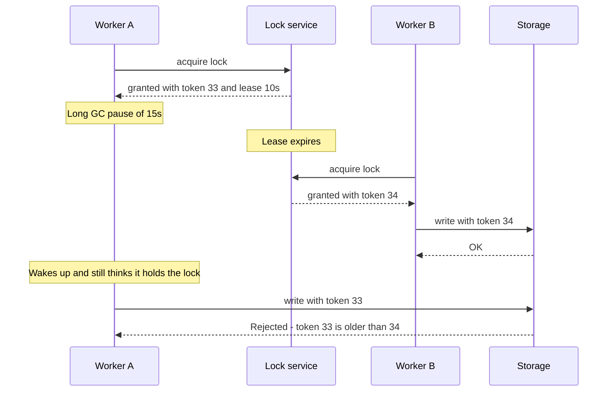

**Fencing tokens:** every time the lock is granted, the lock service returns a monotonically increasing number. The *storage* remembers the highest token it has seen and rejects writes carrying an older one. Without that final check, Worker A would overwrite B's data.

Sources of fencing tokens: ZooKeeper `zxid` / znode version, etcd revision, a DB sequence, or a version column — `UPDATE ... WHERE version = ?` (optimistic locking) is fencing in disguise.

### 7.3 Redlock and Its Controversy

> **Level:** 🔴 Advanced

**Redlock** acquires the lock on a majority of N independent Redis masters (e.g., 3 of 5) within a time bound. Critics (Kleppmann) point out that it relies on bounded clock drift and bounded process pauses, and doesn't provide fencing tokens — so it isn't safe for correctness. Redis's author argues it's fine under realistic assumptions. **Interview-safe position:** "For efficiency locks, a single Redis `SET NX PX` is fine. For correctness, use a consensus-backed store (etcd/ZooKeeper) *and* fencing tokens — or better, design the operation to be safe without a lock (DB constraints, conditional writes)."

### 7.4 Lock Options Compared

| Option | Safety | Performance | Notes |
|---|---|---|---|
| Redis `SET NX PX` (single primary) | Efficiency only | Very fast | Lock can be lost on failover if the replica didn't receive the key |
| Redlock | Debated | Fast | No fencing tokens |
| ZooKeeper ephemeral nodes | Strong (CP) | Slower | Session-based; zxid usable as fencing token |
| etcd lease + revision | Strong (CP) | Slower | Revision is a natural fencing token |
| DB lock (`SELECT ... FOR UPDATE`, `pg_advisory_lock`) | Strong within that DB | Medium | Ideal when the protected resource lives in the same DB |

### 7.5 When to Avoid Locks

Prefer designs that don't need a lock at all:
- **Unique constraints** — `INSERT ... ON CONFLICT DO NOTHING` for "process once".
- **Optimistic concurrency** — `UPDATE seats SET status = 'HELD', version = version + 1 WHERE id = ? AND version = ?`.
- **Single-writer partitioning** — route all events for a key to one Kafka partition so one consumer handles them sequentially.
- **Atomic operations** — Redis `INCR`/`DECRBY`/Lua scripts; DynamoDB conditional writes.

**Interview perspective**

> **Q: How would you make sure a scheduled job runs on only one of 10 instances?**
> Use a lease-based lock in a shared store — ShedLock on the database, or Redis `SET NX PX` with a TTL a bit longer than the job. A duplicate run here only wastes effort, so an efficiency lock is enough. If a duplicate run could corrupt data, I'd also make the job idempotent or use fencing tokens checked by the storage layer.

**Common mistakes**
- A lock without TTL (holder crashes → blocked forever).
- Releasing with plain `DEL` (deletes someone else's lock).
- Trusting a lock for correctness without fencing.

**Quick revision**
- `SET key token NX PX ttl` + Lua compare-and-delete.
- Leases expire during GC pauses → storage must check fencing tokens.
- For correctness: etcd/ZooKeeper + fencing, or avoid locks via constraints and optimistic locking.

---

## 8. Service Discovery

> **Level:** 🟢 Essential

**What is it?**
**Service discovery** is how a service finds the current network locations (IP:port) of another service's instances without hardcoding them.

**Why do we need it?**
In cloud/container environments instances come and go constantly:
- `payment-service` may have 3 instances now and 12 during peak.
- IPs change on every container restart or deploy.
- Crashed instances must stop receiving traffic.

Hardcoded IPs break immediately.

**How does it work?** A **service registry** keeps the list of healthy instances:
1. Each instance **registers** on startup (name, IP, port, metadata).
2. It sends **heartbeats**, or the registry runs **health checks**; unhealthy instances are removed.
3. It **deregisters** on graceful shutdown.
4. Callers look up instances by service name.

### 8.1 Client-Side Discovery

The caller queries the registry and load-balances itself.

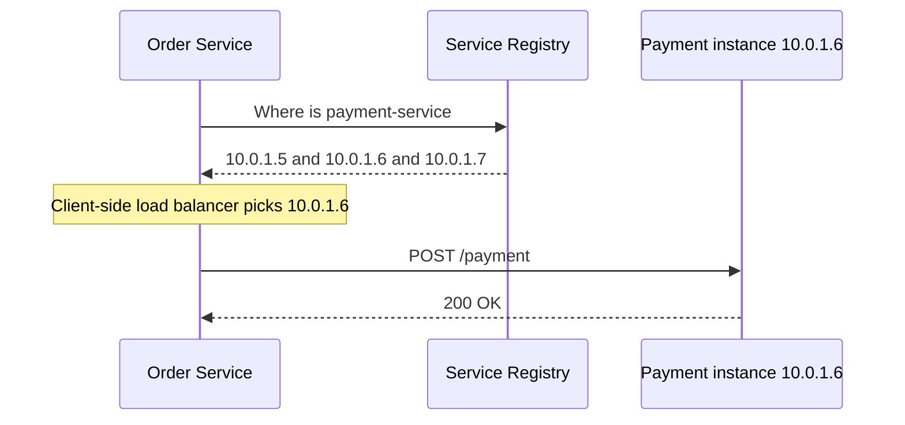

**Spring Boot example:** with `spring-cloud-starter-netflix-eureka-client` on the classpath the service **auto-registers** — the old `@EnableEurekaClient` annotation is unnecessary in modern Spring Cloud. Calls go through Spring Cloud LoadBalancer (Netflix Ribbon is retired):

```java
@Bean
@LoadBalanced                     // resolves "payment-service" through the registry
RestClient.Builder restClientBuilder() {
    return RestClient.builder();
}

// usage
PaymentResponse resp = restClientBuilder.build()
    .post().uri("http://payment-service/payment")
    .body(request)
    .retrieve()
    .body(PaymentResponse.class);

// Lower-level alternative (from the original notes)
List<ServiceInstance> instances = discoveryClient.getInstances("payment-service");
String url = instances.get(0).getUri() + "/payment";
```

### 8.2 Server-Side Discovery

The caller sends to a stable address (load balancer / proxy / DNS name); infrastructure resolves the instances.

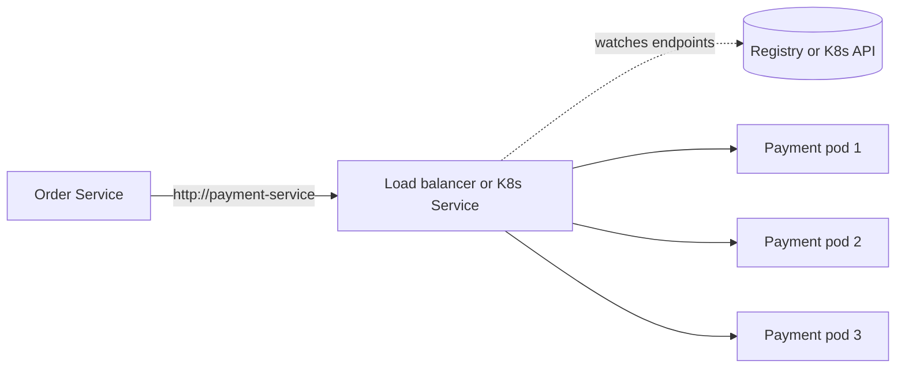

**Examples:** Kubernetes Services (DNS name `payment-service.namespace.svc.cluster.local` → ClusterIP → kube-proxy routes to *ready* pods), AWS ALB + ECS target groups, service meshes (Envoy sidecars receive endpoints from the control plane).

### 8.3 Comparison and Tools

| Aspect | Client-side | Server-side |
|---|---|---|
| Who load-balances | Caller library | LB / proxy / kube-proxy |
| Client complexity | Higher (library per language) | Minimal |
| Extra network hop | No | Usually yes (or a sidecar) |
| Control | Fine-grained (zone-aware, custom rules) | Centralized |

| Tool | Style | Notes |
|---|---|---|
| **Eureka** (Netflix) | Client-side | Spring Cloud native; AP — prefers availability, may return stale instances |
| **Consul** | Both | Health checks, KV store, DNS interface, service mesh |
| **ZooKeeper** | Coordination used for discovery | CP; ephemeral nodes for membership |
| **etcd** | Coordination | CP; backs Kubernetes |
| **Kubernetes DNS + Services** | Server-side | Built in; readiness probes decide which pods get traffic |

**Health checks matter:** a **liveness** probe answers "should I be restarted?"; a **readiness** probe answers "should I receive traffic?". Only ready instances should be discoverable.

**Interview perspective**

> **Q: Client-side vs server-side discovery?**
> Client-side: the caller asks the registry for instances and picks one — no extra hop and smart routing, but every language needs the library. Server-side: the caller hits a stable name and the platform (Kubernetes Service, ALB, mesh) routes to healthy instances — simpler clients and the default on Kubernetes. I'd start with Kubernetes DNS/Services and reach for client-side balancing or a mesh when I need zone-aware or weighted routing.

**Common mistakes**
- Registering instances before they're ready (warm-up, DB pools) → errors on first requests.
- No graceful deregistration → traffic hits terminating pods during deploys.
- JVM caching DNS forever (`networkaddress.cache.ttl`).

**Quick revision**
- Registry + register/heartbeat/deregister + health checks.
- Client-side (Eureka + LoadBalancer) vs server-side (K8s Service, ALB).
- Readiness probes gate traffic.

---

## 9. Synchronous vs Asynchronous Communication

> **Level:** 🟢 Essential

**What is it?**
- **Synchronous** — the caller sends a request and *waits* for the response (HTTP/REST, gRPC). The caller and callee must both be up at the same time.
- **Asynchronous** — the caller hands a message to a broker (queue/stream) and moves on; the receiver processes it later.

**Why does it matter?** Synchronous call chains create **temporal coupling**: every service in the chain must be healthy *right now*, and latencies add up.

**The problem with synchronous chains (from the original notes):**

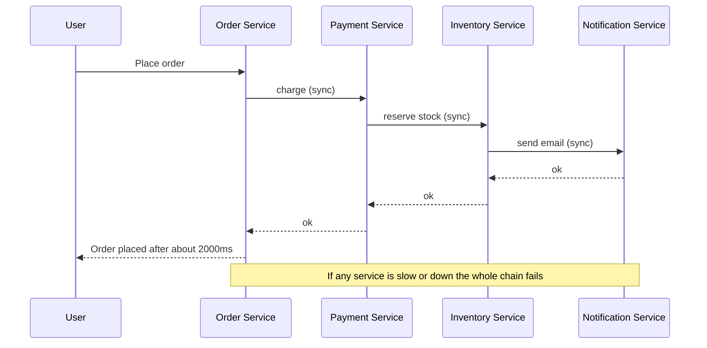

**With asynchronous messaging:**

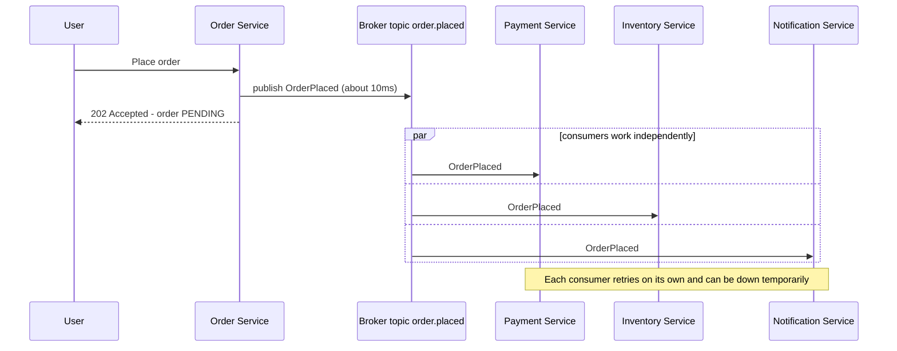

**Benefits of async messaging:**
- **Decoupling** — the producer doesn't know or care who consumes.
- **Resilience** — if a consumer is down, messages wait in the broker until it recovers.
- **Scalability** — add consumers to process faster.
- **Peak shaving / load leveling** — the broker absorbs bursts; consumers process at a steady rate.

**Costs of async:**
- **Eventual consistency** — the order is "PENDING" until payment completes; the UI must show that.
- **Harder debugging** — need correlation IDs and [distributed tracing](06_architecture_reliability_and_security.md#8-observability).
- **Duplicates and ordering** — must handle [at-least-once delivery](#13-delivery-guarantees-idempotency-and-deduplication).
- **Operational overhead** — running a broker.

**Request-reply over messaging:** when you need a response but want broker buffering, the request message carries a `replyTo` queue and a `correlationId`; the responder publishes the answer to `replyTo` and the caller matches it by correlation ID. Useful for long-running jobs (e.g., video transcoding status), but don't use it to imitate a fast synchronous API.

| Use synchronous when | Use asynchronous when |
|---|---|
| The caller needs the answer to continue (fetch user profile, check price) | The work can finish later (emails, analytics, thumbnails) |
| Low latency read paths | Spiky load you want to buffer |
| Simple request/response CRUD | Several services react to one event (fan-out) |
| Strong consistency for the user right now | Long-running tasks; you can show "processing" |

**Interview perspective**

> **Q: An order service calls a slow payment service synchronously. How do you fix it?**
> Short term: put a timeout and a [circuit breaker](#16-circuit-breaker) around the call so the order service fails fast with a fallback instead of piling up threads. Structurally: if the user doesn't need the payment result instantly, decouple — create the order as PENDING, publish an `OrderPlaced` event, let payment consume it and publish `PaymentCompleted`, and move the order to CONFIRMED. That removes the temporal coupling and lets both services scale independently; the trade-off is eventual consistency and a saga to handle failures.

**Common mistakes**
- Making *everything* async — simple reads become complicated and slower.
- Going async but still blocking on the reply synchronously.
- Not designing the user experience for the "pending" state.

**Quick revision**
- Sync = temporal coupling, latency adds up, cascading failure.
- Async = decoupling, buffering, fan-out — but eventual consistency, duplicates, harder tracing.
- Choose per interaction, not per system.

---

## 10. Message Queues, Pub-Sub and Event Streaming

> **Level:** 🟢 Essential

Three related but different messaging models. Getting the vocabulary right is a common interview signal.

**Definitions:**
- **Message queue (point-to-point)** — each message is delivered to **one** consumer among a group of competing consumers, then deleted after acknowledgment. Purpose: *distribute work*. Examples: RabbitMQ queues, Amazon SQS.
- **Publish-subscribe (pub-sub)** — publishers emit to a **topic**; **every subscriber** gets its own copy. Publishers don't know subscribers. Purpose: *broadcast events*. Examples: SNS, RabbitMQ fanout exchange, Google Pub/Sub, Redis Pub/Sub.
- **Event streaming (log)** — messages are appended to a durable, ordered **log** and *retained* (days or forever). Each consumer group tracks its own position (offset) and can **replay**. Purpose: event history, streaming pipelines, many independent readers. Examples: Kafka, Kinesis, Pulsar, Redis Streams.

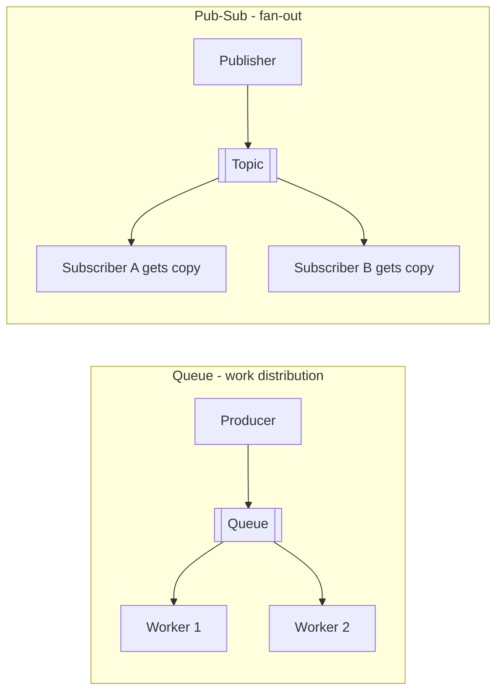

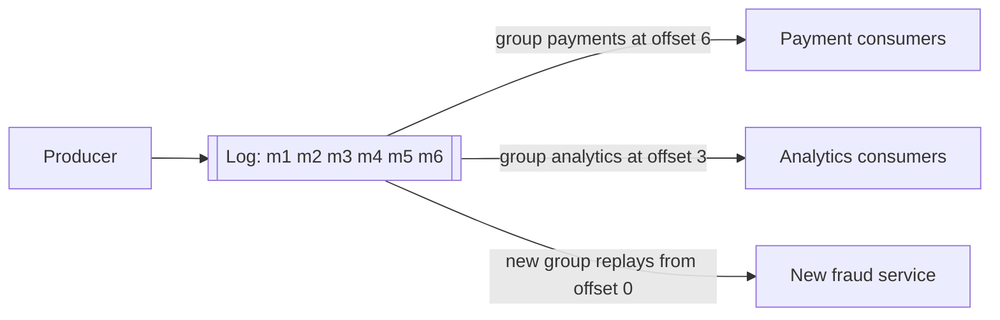

**Walkthrough:**
1. In a **queue**, each message is processed by exactly one of the workers — adding workers increases throughput.
2. In **pub-sub**, every subscriber receives every message — adding a subscriber adds a new reaction without touching the publisher.
3. In a **log**, messages stay after being read. Each consumer group reads at its own pace, and a brand-new service can replay history from the beginning.

**Pub-Sub example — Order Placed event (from the original notes):**

```
Order Service publishes to topic "order.placed":
    { orderId: "123", userId: "456", amount: 1500 }

Subscribers (each receives independently):
    Payment Service      → charge the customer
    Inventory Service    → reserve stock
    Notification Service → send confirmation email
    Analytics Service    → record for reporting
```
Adding a new subscriber = register it with the topic; Order Service doesn't change. This is the [Observer pattern](10_low_level_design_and_patterns.md#8-behavioral-patterns) at system scale.

**Combining models:** a common AWS pattern is **SNS topic → several SQS queues** (fan-out, then each service gets its own durable work queue with retries and a DLQ). In Kafka, one topic with several consumer groups gives both: pub-sub across groups, queue semantics within a group.

| Feature | Queue | Pub-Sub | Event stream (log) |
|---|---|---|---|
| Consumers per message | One | All subscribers | All consumer groups (one consumer per partition within a group) |
| Retention after consumption | Deleted on ack | Usually not retained (push) | Retained by time/size; replayable |
| Ordering | Per queue (often best-effort with parallel consumers) | Usually none | Per partition |
| Replay | ❌ | ❌ (mostly) | ✅ |
| Typical use | Background jobs, task distribution | Notifications, cache invalidation broadcasts | Event-driven microservices, CDC, analytics, audit |

**Interview perspective**

> **Q: When would you use pub-sub over a point-to-point queue?**
> Pub-sub when several independent services must react to the same event — order placed → payment, inventory, email, analytics — without the publisher knowing them. A queue when I want one worker to handle each task and to scale by adding competing consumers — like resizing uploaded images. Often I combine them: fan out via a topic into a per-service queue so each service gets its own retries and DLQ.

**Common mistakes**
- Calling Kafka "a queue" without noting retention, replay and partition ordering.
- Using Redis Pub/Sub for important events — it's fire-and-forget; offline subscribers miss messages (use Redis Streams or a real broker).

**Quick revision**
- Queue = one consumer per message, deleted on ack.
- Pub-sub = every subscriber gets a copy.
- Log = retained, ordered per partition, replayable, offsets per consumer group.

---

## 11. Apache Kafka

> **Level:** 🟢 Essential

**What is it?**
Apache Kafka is a distributed, fault-tolerant, high-throughput **event streaming platform**. It stores events as an append-only, ordered, replicated log and lets many consumers read independently.

**Why do we need it?** It handles millions of events per second, keeps them durably for replay, and decouples dozens of producers and consumers — the backbone for event-driven microservices, CDC pipelines, log/metrics aggregation and real-time analytics.

### 11.1 Core Concepts

| Concept | Definition |
|---|---|
| **Topic** | A named stream of events (e.g., `orders`). Like an append-only table. |
| **Partition** | A topic is split into partitions for parallelism. Each partition is an ordered, immutable sequence of records. |
| **Offset** | The position of a record within a partition (0, 1, 2…). Consumers track the offset they have processed. |
| **Producer** | Publishes records to a topic; chooses the partition (by key hash, or round-robin/sticky if no key). |
| **Consumer** | Reads records from partitions. |
| **Consumer group** | Consumers sharing the work of a topic. Each partition is consumed by exactly **one** consumer in the group. Different groups read independently. |
| **Broker** | A Kafka server storing partitions. A cluster has many brokers. |
| **Replication factor** | Number of copies of each partition (typically 3). One replica is the **leader**; others are **followers**. |
| **ISR (in-sync replicas)** | Replicas that are caught up with the leader. Only ISR members can become leader (with default unclean election disabled). |
| **Retention** | How long records are kept (default 7 days) or up to a size limit. Records are **not** deleted when consumed. |
| **Log compaction** | Alternative retention: keep only the latest record per key (great for "current state" topics, e.g., user profiles). |
| **KRaft** | Kafka's built-in Raft-based metadata quorum. ZooKeeper is no longer needed (KRaft is production-ready since 3.3, and ZooKeeper support was removed in Kafka 4.0). |

### 11.2 Architecture

```mermaid
flowchart LR
    prod["Producers"] --> topic
    subgraph topic["Topic orders - 3 partitions"]
        p0[["Partition 0: m1 m3 m6"]]
        p1[["Partition 1: m2 m5 m7"]]
        p2[["Partition 2: m4 m8 m9"]]
    end
    subgraph groupA["Consumer group payment-service"]
        ca["Consumer A"]
        cb["Consumer B"]
        cc["Consumer C"]
    end
    p0 --> ca
    p1 --> cb
    p2 --> cc
    p0 -.-> an["Group analytics - reads all partitions independently"]
    p1 -.-> an
    p2 -.-> an
```

**Walkthrough:**
1. Producers write to topic `orders`; the record key decides the partition: `partition = hash(key) % numPartitions`.
2. In group `payment-service`, each partition is assigned to one consumer → 3 partitions = at most 3 active consumers (a 4th would sit idle). **Partitions are the unit of parallelism.**
3. Group `analytics` independently reads the same records with its own offsets.
4. If Consumer B dies, the group **rebalances** and Partition 1 moves to A or C, which resume from the last committed offset.

**Partition key = ordering guarantee:** Kafka guarantees order only *within a partition*. Same key → same partition → events for one entity stay in order.

```java
// All events for order-123 go to the same partition, so created, paid, shipped stay ordered
producer.send(new ProducerRecord<>("orders", "order-123", orderEvent));
```

**Hot partitions:** if one key is extremely popular (a celebrity user, a giant tenant), its partition becomes a bottleneck. Mitigate with a better key, key salting (`key + "#" + n` when strict per-key order isn't needed), or a dedicated topic.

### 11.3 Replication and Durability

```mermaid
sequenceDiagram
    participant P as Producer (acks=all)
    participant L as Partition leader broker 1
    participant F1 as Follower broker 2 (ISR)
    participant F2 as Follower broker 3 (ISR)
    P->>L: produce record
    L->>L: append to local log
    F1->>L: fetch new records
    F2->>L: fetch new records
    Note over L: All ISR replicas have it so high watermark advances
    L-->>P: ack
    Note over P,F2: Consumers only see records up to the high watermark
```

| Producer `acks` | Meaning | Durability | Latency |
|---|---|---|---|
| `acks=0` | Don't wait | May lose data | Lowest |
| `acks=1` | Leader wrote it | Lost if leader dies before followers copy | Low |
| `acks=all` (`-1`) | All in-sync replicas wrote it | Strong — combine with `min.insync.replicas=2` and RF=3 | Higher |

**Recommended durable config:** replication factor 3, `min.insync.replicas=2`, `acks=all`, `enable.idempotence=true` (default in modern clients). This survives one broker failure without losing acknowledged data; if two replicas are down, producers get errors instead of silently losing durability (a CP-style choice).

### 11.4 Consumers, Offsets and Rebalancing

- Consumers **commit** offsets (stored in the internal `__consumer_offsets` topic).
- **Commit after processing** → at-least-once (a crash after processing but before commit = reprocessing → make handlers idempotent).
- **Commit before processing** → at-most-once (a crash = message skipped).
- **Consumer lag** = latest offset − committed offset. The #1 Kafka health metric: growing lag means consumers can't keep up → add consumers (up to the partition count), speed up processing, or add partitions.
- **Rebalancing** happens when consumers join/leave or partitions change. Cooperative (incremental) rebalancing and static group membership reduce the "stop-the-world" pauses of older eager rebalancing.

```java
// At-least-once consumer with idempotency check (most common pattern)
@KafkaListener(topics = "orders", groupId = "payment-service")
public void handleOrder(OrderEvent event, Acknowledgment ack) {
    if (!processedEvents.existsById(event.getEventId())) {   // idempotency check
        paymentService.charge(event);
        processedEvents.save(new ProcessedEvent(event.getEventId()));
    }
    ack.acknowledge();                                         // commit offset after processing
}
```
(Requires `spring.kafka.listener.ack-mode=manual`. Ideally the charge and the processed-event insert happen in one local DB transaction.)

### 11.5 Exactly-Once Semantics in Kafka

> **Level:** 🔴 Advanced

Kafka offers **exactly-once semantics (EOS)** for **read-process-write within Kafka**:
- **Idempotent producer** — broker de-duplicates retried sends using producer ID + sequence numbers (no duplicates from producer retries).
- **Transactions** — a producer atomically writes output records *and* commits consumer offsets; consumers with `isolation.level=read_committed` only see committed results. Kafka Streams uses this (`processing.guarantee=exactly_once_v2`).

**Scope matters:** EOS does not extend to external side effects. If your consumer calls a payment API or writes to Postgres, you're back to at-least-once and need [idempotent processing](#13-delivery-guarantees-idempotency-and-deduplication).

### 11.6 Kafka Use Cases

- Event-driven communication between microservices.
- Event sourcing and audit logs (immutable, replayable history).
- **Change Data Capture (CDC)** from databases via Debezium ([Section 19](#19-transactional-outbox-and-cdc)).
- Real-time analytics and stream processing (Kafka Streams, Flink).
- Log and metrics aggregation ([Distributed Logging problem](08_interview_problems_part2.md#11-distributed-logging-and-metrics-platform)).

**Advantages and disadvantages**

| Advantages | Disadvantages |
|---|---|
| Very high throughput (millions of msgs/s on a cluster) | Operational complexity (partitions, rebalances, retention, capacity) |
| Durable, replicated, replayable | Ordering only per partition |
| Many independent consumer groups | No per-message routing/priorities like RabbitMQ |
| Natural fit for event sourcing and CDC | Partition count is hard to reduce; increasing it changes key→partition mapping |
| Backpressure-friendly — consumers pull at their own pace | No built-in delayed messages or per-message TTL |

**Interview perspective**

> **Q: What is a partition key and why does it matter?**
> It decides which partition a record goes to — `hash(key) % partitions`. Records with the same key always land in the same partition, and Kafka only guarantees ordering within a partition. So I key order events by `orderId` to keep "created → paid → shipped" in order for each order, while different orders are processed in parallel. The trade-off is skew: a very hot key overloads one partition.

> **Q: How do you scale Kafka consumers?**
> Add consumers to the group up to the number of partitions; beyond that extra consumers sit idle. So I size partitions for future peak parallelism (e.g., expected throughput ÷ per-consumer throughput, with headroom), watch consumer lag, and make processing faster (batching, async I/O) before adding partitions, because adding partitions reshuffles key placement.

**Common mistakes**
- Expecting global ordering across a topic.
- More consumers than partitions and wondering why throughput doesn't grow.
- Long processing inside the poll loop → `max.poll.interval.ms` exceeded → constant rebalances.
- Saying "Kafka needs ZooKeeper" — modern Kafka uses KRaft.

**Quick revision**
- Topic → partitions → offsets; consumer group = one consumer per partition.
- Same key → same partition → ordered.
- RF=3 + `min.insync.replicas=2` + `acks=all` for durability.
- Commit after processing + idempotent handlers = effectively-once.
- Watch consumer lag.

---

## 12. RabbitMQ and Amazon SQS

> **Level:** 🟡 Intermediate

### 12.1 RabbitMQ

**What is it?**
RabbitMQ is a traditional **message broker** implementing AMQP. Producers publish to **exchanges**, which route messages to **queues** using **bindings**; consumers receive messages and **acknowledge** them, after which they're deleted.

| Concept | Definition |
|---|---|
| **Exchange** | Receives messages from producers and routes them to queues by rules |
| **Queue** | Stores messages until consumed and acknowledged |
| **Binding** | Rule connecting an exchange to a queue (often with a pattern) |
| **Routing key** | Label on a message used for routing |
| **Ack / Nack** | Consumer confirms success (delete) or failure (requeue or dead-letter) |
| **Prefetch (QoS)** | Max unacknowledged messages per consumer — controls fairness and backpressure |

**Exchange types:**

| Type | Routing logic | Use case |
|---|---|---|
| **Direct** | Exact routing key match | Send tasks to a specific worker queue |
| **Fanout** | Broadcast to all bound queues (ignores key) | Notify every subscriber |
| **Topic** | Pattern match on dotted keys (`order.*`, `*.error`, `order.#`) | Flexible multi-consumer routing |
| **Headers** | Match on message header attributes | Complex routing without routing keys |

```mermaid
flowchart LR
    prod["Producer"] -->|"routing key order.paid"| ex{{"Topic exchange orders"}}
    ex -->|"binding order.*"| q1[["payment-queue"]]
    ex -->|"binding order.paid"| q2[["shipping-queue"]]
    ex -->|"binding matches all keys"| q3[["audit-queue"]]
    q1 --> c1["Payment consumer"]
    q2 --> c2["Shipping consumer"]
    q3 --> c3["Audit consumer"]
```

**Walkthrough:** the audit queue is bound with the pattern `#`. A message with key `order.paid` matches all three bindings, so each queue gets a copy; within each queue, competing consumers share the work. `*` matches exactly one word, `#` matches zero or more words.

**Reliability features:** durable queues + persistent messages, publisher confirms, manual acks, **quorum queues** (Raft-replicated — the recommended replicated queue type), dead-letter exchanges, per-message TTL and priorities, and **streams** (an append-only, Kafka-like queue type).

```java
@RabbitListener(queues = "payment-queue")
public void onOrderPaid(OrderPaidEvent event) {
    paymentService.settle(event);   // exception -> nack -> retry or dead-letter (per config)
}
```

### 12.2 Amazon SQS

**What is it?** AWS's fully managed message queue — no brokers to run, scales automatically, pay per request.

| Type | Delivery | Ordering | Throughput | Use case |
|---|---|---|---|---|
| **Standard** | At-least-once (occasional duplicates) | Best-effort | Nearly unlimited | Most background work; consumers must be idempotent |
| **FIFO** | Exactly-once *processing* within a 5-minute deduplication window (by dedup ID or content hash) | Strict per **message group ID** | 300 msg/s per API action, 3,000 with batching; much higher in high-throughput mode | Ordered per-entity workflows (per account, per order) |

> Note: FIFO is not magic "exactly-once delivery" end to end — a consumer that crashes after side effects but before deleting the message will see it again after the visibility timeout. Still design idempotent consumers.

**Visibility timeout** — after a consumer receives a message, it becomes invisible to others for N seconds. If the consumer deletes it in time, done. If it crashes, the message reappears and another consumer retries it.

```mermaid
sequenceDiagram
    participant Q as SQS queue
    participant A as Consumer A
    participant B as Consumer B
    A->>Q: ReceiveMessage
    Q-->>A: M1 (now invisible for 30s)
    alt A finishes in time
        A->>Q: DeleteMessage M1
        Note over Q: M1 removed
    else A crashes
        Note over Q: 30s pass and M1 becomes visible again
        B->>Q: ReceiveMessage
        Q-->>B: M1 (receive count 2)
        B->>Q: DeleteMessage M1
    end
```

Set the visibility timeout longer than your worst-case processing time (or extend it with `ChangeMessageVisibility` for long jobs).

**Long polling** — `WaitTimeSeconds` up to 20: the consumer waits for messages instead of hammering the API with empty responses → fewer requests, lower cost, lower latency.

**Redrive policy (DLQ)** — after `maxReceiveCount` failed receives, SQS moves the message to a dead-letter queue:

```json
{
  "RedrivePolicy": {
    "deadLetterTargetArn": "arn:aws:sqs:us-east-1:123456789012:order-events-dlq",
    "maxReceiveCount": 3
  }
}
```

### 12.3 Kafka vs RabbitMQ vs SQS

| Feature | Kafka | RabbitMQ | SQS |
|---|---|---|---|
| Model | Distributed log (retained, replayable) | Broker with exchanges and queues | Managed queue |
| After consumption | Kept until retention | Deleted on ack | Deleted by consumer |
| Multiple independent consumers | ✅ Consumer groups | Via fanout/topic exchanges (copy per queue) | Via SNS fan-out to several queues |
| Ordering | Per partition | Per queue (single consumer) | FIFO per message group; Standard best-effort |
| Replay | ✅ Reset offsets | ❌ (except stream queues) | ❌ |
| Routing | By partition key | Very flexible (direct/topic/headers) | None (one queue) |
| Throughput | Very high (millions/s per cluster) | High (tens to hundreds of thousands/s) | Effectively unlimited (Standard) |
| Ops burden | High self-managed (or MSK/Confluent) | Medium | None |
| Delays / priorities / per-message TTL | No native support | ✅ | Delay queues up to 15 min |
| Best for | Event streaming, CDC, analytics, event sourcing, high-volume event buses | Task queues, complex routing, RPC-style work, priorities | Simple decoupling and background jobs on AWS |

**Decision guide:**
- Need **replay, multiple consumer groups, very high volume, stream processing** → **Kafka**.
- Need **flexible routing, priorities, per-message TTL, classic work queues** → **RabbitMQ**.
- On **AWS**, want **zero ops** for background jobs → **SQS** (+ SNS for fan-out).

**Interview perspective**

> **Q: Kafka vs RabbitMQ — which would you choose?**
> It depends on whether I need a log or a queue. For an event backbone where several services consume the same events, I need replay for new consumers or reprocessing, and volume is high — Kafka. For task distribution with rich routing, priorities, or delayed retries, where messages should disappear once handled — RabbitMQ. If we're on AWS and just need reliable background jobs, SQS avoids running a broker at all.

**Common mistakes**
- Visibility timeout shorter than processing time → duplicates and loops.
- Unbounded prefetch in RabbitMQ → one consumer hoards messages and runs out of memory.
- Assuming FIFO queues remove the need for idempotency.

**Quick revision**
- RabbitMQ: exchange → binding → queue; ack deletes; prefetch = backpressure; quorum queues for HA.
- SQS: Standard (at-least-once, best-effort order) vs FIFO (dedup window, per-group order); visibility timeout; long polling; redrive to DLQ.
- Kafka = log; RabbitMQ = smart broker; SQS = managed simple queue.

---

## 13. Delivery Guarantees, Idempotency and Deduplication

> **Level:** 🟢 Essential

### 13.1 Delivery Guarantees

**What is it?** A delivery guarantee describes what can happen to a message when things fail (crashes, timeouts, retries).

| Guarantee | Meaning | How you get it | Risk |
|---|---|---|---|
| **At-most-once** | Delivered 0 or 1 times — may be lost, never duplicated | Fire-and-forget; commit/ack *before* processing; Kafka `acks=0` and no retries | Data loss |
| **At-least-once** | Delivered 1+ times — never lost, may be duplicated | Retries + ack/commit *after* processing; Kafka `acks=all` with retries | Duplicates |
| **Exactly-once** | Effect happens exactly once | At-least-once delivery **+ idempotent / deduplicated processing** (or Kafka transactions inside Kafka) | Complexity |

```mermaid
flowchart TD
    rcv["Consumer receives message"] --> choice{"When is it acknowledged?"}
    choice -->|"before processing"| amo["Crash after ack - message lost<br/>At-most-once"]
    choice -->|"after processing"| alo["Crash before ack - redelivered<br/>At-least-once"]
    alo --> idem{"Is the handler idempotent?"}
    idem -->|"yes"| eo["Effectively exactly-once"]
    idem -->|"no"| dup["Duplicate side effects"]
```

**Key insight for interviews:** true exactly-once *delivery* over an unreliable network is impossible (the Two Generals problem — you can never be sure the other side got your last message). What systems actually provide is **exactly-once processing** = at-least-once delivery + idempotency. Default to **at-least-once + idempotent consumers**.

### 13.2 Idempotency

**What is it?** An operation is **idempotent** if performing it once or many times has the same effect. `SET balance = 100` is idempotent; `balance = balance + 10` is not.

**Why do we need it?** Retries, redeliveries and user double-clicks are unavoidable. Without idempotency: timeout → retry → **payment charged twice**.

**HTTP methods (from the original notes):**

| Method | Idempotent? | Safe (no side effects)? |
|---|---|---|
| GET, HEAD | ✅ | ✅ |
| PUT | ✅ | ❌ |
| DELETE | ✅ | ❌ |
| POST | ❌ (make it idempotent with a key) | ❌ |
| PATCH | ❌ usually | ❌ |

For API-level design details (headers, status codes), see [REST API Design](02_networking_and_communication.md#7-rest-api-design).

### 13.3 Idempotency and Deduplication Techniques

| Technique | How | Example |
|---|---|---|
| **Idempotency key** | Client sends a unique key; server stores key → result; repeats return the stored result | `Idempotency-Key: 7f9c…` on `POST /payments` (Stripe-style) |
| **Processed-message table (inbox)** | Store each processed `messageId` with a unique constraint in the same DB transaction as the side effect | `INSERT INTO processed_messages(id) …` fails on duplicates |
| **Upserts** | Insert-or-update by a natural key instead of plain insert | `INSERT … ON CONFLICT (order_id) DO UPDATE …` |
| **Naturally idempotent operations** | Set absolute values instead of increments | `status = 'SHIPPED'` rather than `count = count + 1` |
| **Conditional writes / versions** | Apply only if the current version matches | `UPDATE … WHERE version = 7`; DynamoDB `ConditionExpression` |
| **State machine checks** | Ignore transitions that already happened | Ignore `PaymentCaptured` if order is already `PAID` |
| **Broker dedup** | Kafka idempotent producer; SQS FIFO dedup ID | Removes producer-side duplicates only |

**Idempotency key flow:**

```mermaid
sequenceDiagram
    participant C as Client
    participant API as Payment API
    participant S as Idempotency store
    participant G as Card gateway
    C->>API: POST /payments with Idempotency-Key k1
    API->>S: insert k1 as IN_PROGRESS (unique)
    alt key is new
        API->>G: charge 500
        G-->>API: success txn 99
        API->>S: save k1 as DONE with response
        API-->>C: 201 Created txn 99
    else key already DONE
        S-->>API: stored response
        API-->>C: 201 Created txn 99 (replayed, no new charge)
    else key IN_PROGRESS
        API-->>C: 409 Conflict - retry later
    end
```

**Implementation notes:**
1. Reserve the key atomically *before* doing the work (unique constraint or Redis `SET NX`) — otherwise two concurrent retries both execute.
2. Store the response so replays return the same body/status.
3. Scope keys per client/user, and validate that a reused key has the same request payload (else 422).
4. Keep keys for a bounded window (e.g., 24 h–7 days TTL in Redis or a DB table).
5. Pass the same key downstream (many payment gateways accept one) so the *external* call is idempotent too.

```java
@Transactional
public void handle(PaymentRequested event) {
    // unique PK on message_id makes duplicates fail fast inside the same transaction
    if (processedRepo.insertIfAbsent(event.messageId()) == 0) {
        return;                     // duplicate delivery - already processed
    }
    paymentRepo.save(Payment.from(event));
}
```

### 13.4 Ordering Guarantees

- **Kafka:** ordered per partition → key by entity ID. With `enable.idempotence=true`, retries don't reorder within a partition.
- **SQS FIFO:** ordered per message group ID.
- **RabbitMQ:** ordered per queue with a single consumer; parallel consumers or requeues break order.
- If you need ordering but processing is parallel, use **sequence numbers / versions** and let consumers drop or buffer out-of-order events ("ignore event with version ≤ stored version").

**Interview perspective**

> **Q: What does at-least-once mean and how do you handle it?**
> The broker guarantees delivery but may deliver a message more than once — after a consumer crash before ack, a rebalance, or a retry. So the consumer must be idempotent: record processed message IDs with a unique constraint in the same transaction as the side effect, use upserts or absolute-value updates, or check entity state/version before applying. That combination gives effectively-once processing.

> **Q: Why is idempotency critical in payment APIs?**
> Because the client can never know whether a timed-out request succeeded. With a client-generated idempotency key, the server records the first execution and replays its result for retries, so retrying is always safe and the customer is never charged twice.

**Common mistakes**
- Checking "already processed?" and doing the work in separate transactions (race window).
- Idempotency keys generated server-side per attempt (defeats the purpose — the *client* must reuse the key across retries).
- Believing the broker's "exactly-once" covers your database or external API calls.

**Quick revision**
- At-most-once loses, at-least-once duplicates, exactly-once = at-least-once + idempotency.
- Techniques: idempotency key, inbox table, upsert, absolute values, conditional writes.
- Reserve the key atomically before work; store the response.

---

## 14. Dead Letter Queues and Backpressure

> **Level:** 🟢 Essential

### 14.1 Dead Letter Queue

**What is it?**
A **Dead Letter Queue (DLQ)** is a separate queue/topic where messages go when they can't be processed successfully — after exceeding a retry limit, expiring, or being explicitly rejected.

**Why do we need it?** A **poison message** (malformed payload, a bug triggered by specific data, a reference to a deleted entity) fails every time. Without a DLQ it retries forever, wastes resources and — in ordered queues/partitions — **blocks every message behind it**.

```mermaid
flowchart LR
    main[["Main queue order-events"]] --> cons["Consumer"]
    cons -->|"success"| done["Ack and delete"]
    cons -->|"failure"| retry{"Attempts below max?"}
    retry -->|"yes - retry with backoff"| main
    retry -->|"no"| dlq[["Dead letter queue"]]
    dlq --> alert["Alert and dashboard"]
    alert --> fix["Investigate and fix bug or data"]
    fix -->|"redrive"| main
```

**Walkthrough:**
1. The consumer fails to process a message.
2. It is retried (ideally with backoff — via retry topics in Kafka, delayed redelivery in RabbitMQ, visibility timeout in SQS).
3. After the max attempts (e.g., 3–5), it's moved to the DLQ, so the main queue keeps flowing.
4. An alert fires on DLQ depth; an engineer inspects payload + error metadata.
5. After a fix, messages are **redriven** (replayed) to the main queue.

**Implementations:** SQS redrive policy (`maxReceiveCount`, see [Section 12.2](#122-amazon-sqs)); RabbitMQ dead-letter exchange (`x-dead-letter-exchange`); Kafka has no built-in DLQ — Spring Kafka's `DefaultErrorHandler` + `DeadLetterPublishingRecoverer` or `@RetryableTopic` publish to `orders-retry-N` and `orders-dlt` topics.

```java
@RetryableTopic(attempts = "4", backoff = @Backoff(delay = 1000, multiplier = 2.0),
                exclude = {ValidationException.class})   // don't retry bad data
@KafkaListener(topics = "orders", groupId = "fulfilment")
public void consume(OrderEvent event) {
    fulfilmentService.process(event);
}

@DltHandler
public void toDeadLetter(OrderEvent event, @Header(KafkaHeaders.EXCEPTION_MESSAGE) String error) {
    log.error("Order event dead-lettered id={} error={}", event.getId(), error);
}
```

**DLQ best practices:**
- Alert on DLQ message count (CloudWatch alarm, Prometheus alert → PagerDuty/Slack).
- Store error reason, stack trace, original topic/partition/offset and attempt count with the message.
- Don't retry non-retryable errors (validation, deserialization) — send them straight to the DLQ.
- Build a redrive tool (SQS has native redrive) and make consumers idempotent so redrives are safe.
- Never ignore DLQ growth — it signals a bug or bad data.

### 14.2 Backpressure

> **Level:** 🟡 Intermediate

**What is it?** **Backpressure** is a mechanism for a slow consumer to signal or force a fast producer to slow down, so the system degrades gracefully instead of running out of memory or collapsing.

**Why do we need it?** If producers send 10,000 msg/s and consumers handle 6,000 msg/s, something has to give: unbounded in-memory queues grow until OOM, latencies explode, and timeouts trigger retries that make it worse.

**Techniques:**

| Technique | How it works |
|---|---|
| **Bounded queues / buffers** | Fixed capacity; when full, block the producer or reject (`429`, `503`) |
| **Pull-based consumption** | Consumers fetch only what they can handle (Kafka, SQS) — broker storage is the buffer |
| **Prefetch / credit limits** | RabbitMQ `prefetch`, gRPC/HTTP2 flow-control windows, Reactive Streams `request(n)` |
| **Load shedding** | Drop low-priority work when overloaded (analytics before checkout) |
| **Rate limiting producers** | Token bucket at the API gateway — see [Rate Limiting](02_networking_and_communication.md#14-rate-limiting) |
| **Autoscaling consumers** | Scale on queue depth / consumer lag (e.g., KEDA on Kubernetes) |
| **Batching** | Process many messages per round trip to raise consumer throughput |

**Real-world example:** during a flash sale, order events spike 20×. Kafka absorbs the burst on disk; consumer lag grows; KEDA scales consumers up to the partition count; non-critical recommendation updates are shed; lag drains after the peak. The user-facing API stayed fast because it only had to append to Kafka.

**Interview perspective**

> **Q: What is a DLQ and when do you use it?**
> It's where messages go after exhausting retries, so a poison message can't block or burn the main queue. I use one for every consumer that can fail — which is all of them — with an alert on DLQ depth, error metadata stored alongside, and a redrive path once the bug is fixed. Non-retryable errors skip straight to the DLQ.

**Common mistakes**
- Infinite retries with no DLQ (one bad message stalls a partition).
- A DLQ no one monitors.
- Unbounded in-memory queues in application code (`new LinkedBlockingQueue<>()` with no capacity).

**Quick revision**
- DLQ isolates poison messages; alert, inspect, redrive.
- Retry only retryable errors; backoff between attempts.
- Backpressure: bounded buffers, pull, prefetch, shed load, scale on lag.

---

## 15. Timeouts, Retries and Exponential Backoff

> **Level:** 🟢 Essential

### 15.1 Timeouts

**What is it?** A limit on how long you'll wait for a remote operation.

**Why do we need it?** Without a timeout, a hung dependency holds your thread/connection forever. With 200 threads and a hung downstream, all 200 are blocked in seconds and your service stops responding — a **cascading failure**.

**Guidelines:**
- Every remote call needs **connect** and **read** timeouts (HTTP clients, JDBC, Redis, Kafka producers).
- Base timeouts on the dependency's latency percentiles — e.g., slightly above its p99.9, not "30 seconds because that's the default".
- **Deadline propagation** — if the user request has 2 s total, downstream calls get the *remaining* budget, not a fresh 2 s each (gRPC deadlines do this natively).
- Timeouts at outer layers should be longer than at inner layers, or retries at inner layers become useless.

### 15.2 Retries with Exponential Backoff and Jitter

**What is it?** Re-attempting a failed operation, waiting progressively longer between attempts, with randomness added.

**Why exponential?** Constant fast retries hammer a struggling service exactly when it needs relief. Exponential backoff spreads load out; **jitter** prevents thousands of clients from retrying in lockstep (the **thundering herd** / synchronized retry wave).

```
delay(attempt) = min(maxDelay, base * 2^attempt)

Full jitter  (recommended):  sleep = random(0, delay(attempt))
Equal jitter:                sleep = delay/2 + random(0, delay/2)

Example base = 100 ms, no jitter:
  attempt 1 → 100 ms, 2 → 200 ms, 3 → 400 ms, 4 → 800 ms (cap e.g. 10 s)
```

```mermaid
sequenceDiagram
    participant C as Client
    participant S as Recovering service
    C->>S: request
    S-->>C: 503 Service Unavailable
    Note over C: wait random 0-100ms
    C->>S: retry 1
    S-->>C: timeout
    Note over C: wait random 0-200ms
    C->>S: retry 2
    S-->>C: 503
    Note over C: wait random 0-400ms
    C->>S: retry 3
    S-->>C: 200 OK
```

### 15.3 What Is Safe to Retry

| Retry ✅ | Don't retry ❌ |
|---|---|
| Network errors, connection resets, timeouts — **only if the operation is idempotent** | Non-idempotent operations without an idempotency key (POST payment) |
| `503 Service Unavailable`, `502`, `504` | Most `4xx` — `400`, `401`, `403`, `404`, `409`, `422` (retrying won't fix them) |
| `429 Too Many Requests` and `408 Request Timeout` — honoring the `Retry-After` header | Business rule violations (insufficient funds, validation failed) |
| Transient DB errors (deadlock victim, serialization failure) — retry the whole transaction | Errors after the operation is known to have succeeded |

### 15.4 Retry Storms and Retry Budgets

> **Level:** 🔴 Advanced

**Retry amplification:** if each of 4 layers retries 3 times, one user request can become 3⁴ = 81 calls to the bottom service — exactly when it's already overloaded.

**Mitigations:**
- **Retry at one layer only** (usually the outermost caller or the client SDK), not at every hop.
- **Retry budgets** — allow retries to add at most ~10% extra load (e.g., Envoy/Finagle retry budgets, gRPC retry throttling).
- **Cap attempts** (2–3) and total time.
- **Combine with a circuit breaker** so retries stop entirely when the dependency is clearly down.

**Spring Boot with Resilience4j (from the original notes, completed):**

```java
@Retry(name = "inventoryService", fallbackMethod = "fallback")
public InventoryResponse checkInventory(String productId) {
    return inventoryClient.get(productId);
}

private InventoryResponse fallback(String productId, Exception ex) {
    return InventoryResponse.unknown(productId);   // graceful degradation
}
```

```yaml
resilience4j:
  retry:
    instances:
      inventoryService:
        maxAttempts: 3
        waitDuration: 100ms
        enableExponentialBackoff: true
        exponentialBackoffMultiplier: 2
        enableRandomizedWait: true          # jitter
        retryExceptions:
          - java.io.IOException
          - java.util.concurrent.TimeoutException
        ignoreExceptions:
          - com.example.BusinessException
```

**Interview perspective**

> **Q: Why exponential backoff instead of constant retry intervals?**
> Constant retries from many clients arrive in synchronized waves and keep a recovering service overloaded. Exponential backoff reduces the retry rate the longer the outage lasts, and jitter de-synchronizes clients so the load spreads evenly. I also cap attempts and use a retry budget so retries can't multiply load across layers.

> **Q: When should you NOT retry?**
> When the operation isn't idempotent and has no idempotency key, when the error is permanent (validation, auth, not found, business rule), and when the dependency is clearly down — that's the circuit breaker's job. 429 and 503 are retryable but I respect `Retry-After`.

**Common mistakes**
- No timeout, or the default infinite/very long timeout.
- Retrying at every layer → exponential amplification.
- Retrying non-idempotent writes.
- Backoff without jitter.

**Quick revision**
- Every remote call: timeout (based on p99), propagate deadlines.
- Retry only idempotent + transient errors; 2–3 attempts; exponential backoff + full jitter.
- One retry layer, retry budget, plus circuit breaker.

---

## 16. Circuit Breaker

> **Level:** 🟢 Essential

**What is it?**
A **circuit breaker** wraps calls to a dependency and, after too many failures, "opens" to **fail fast** (return a fallback immediately) instead of calling a dependency that is clearly broken. Named after electrical breakers that cut current to prevent fires.

**Why do we need it?** To stop **cascading failures**: when Payment Service is down, every Order Service thread waiting on it is stuck for the full timeout. Fail fast frees threads, gives the dependency room to recover, and gives users a quick degraded answer.

**How does it work?**

```mermaid
stateDiagram-v2
    [*] --> Closed
    Closed --> Open : failure rate or slow call rate over threshold
    Open --> HalfOpen : wait duration elapsed
    HalfOpen --> Closed : trial calls succeed
    HalfOpen --> Open : trial calls fail
```

| State | Behavior |
|---|---|
| **Closed** | Normal — calls pass through; failures and slow calls are counted in a sliding window |
| **Open** | Threshold exceeded — calls fail immediately with a fallback; no load on the dependency |
| **Half-Open** | After a wait, allow a few trial calls; success → Closed, failure → Open again |

```mermaid
flowchart LR
    order["Order Service"] --> cb{"Circuit breaker state"}
    cb -->|"Closed"| pay["Payment Service"]
    cb -->|"Open"| fb["Fallback - mark order PAYMENT_PENDING<br/>and queue for later"]
    pay -->|"errors and timeouts counted"| cb
```

**Spring Boot with Resilience4j:**

```java
@CircuitBreaker(name = "paymentService", fallbackMethod = "paymentFallback")
@TimeLimiter(name = "paymentService")
public CompletableFuture<PaymentResponse> processPayment(PaymentRequest req) {
    return CompletableFuture.supplyAsync(() -> paymentClient.charge(req));
}

private CompletableFuture<PaymentResponse> paymentFallback(PaymentRequest req, Throwable ex) {
    return CompletableFuture.completedFuture(PaymentResponse.queued());   // graceful degradation
}
```

```yaml
resilience4j:
  circuitbreaker:
    instances:
      paymentService:
        slidingWindowType: COUNT_BASED
        slidingWindowSize: 50              # last 50 calls
        minimumNumberOfCalls: 20           # don't judge on 2 calls
        failureRateThreshold: 50           # percent
        slowCallDurationThreshold: 2s
        slowCallRateThreshold: 60
        waitDurationInOpenState: 30s
        permittedNumberOfCallsInHalfOpenState: 5
  timelimiter:
    instances:
      paymentService:
        timeoutDuration: 2s
```

**Good fallbacks:** cached/stale data, a default value, a "try again later" response, queueing the work for async processing, hiding a non-essential widget. A fallback that calls *another* fragile service just moves the problem.

**Advantages and disadvantages**

| Advantages | Disadvantages |
|---|---|
| Prevents thread exhaustion and cascading failure | Needs tuning (window, thresholds) per dependency |
| Gives the dependency time to recover | Fallback logic adds code paths to test |
| Fast, predictable responses for users | One breaker per instance → each instance learns separately |
| Metrics on dependency health | Wrong granularity (one breaker for all endpoints) can block healthy calls |

**Interview perspective**

> **Q: What is a circuit breaker and what states does it have?**
> It wraps calls to a dependency and tracks failures and slow calls. Closed: calls flow normally. Open: the failure rate crossed a threshold, so calls fail immediately with a fallback without touching the dependency. Half-open: after a cool-down, a few trial calls test recovery — success closes the breaker, failure reopens it. It prevents one bad dependency from exhausting threads across the whole call chain.

**Common mistakes**
- Circuit breaker without timeouts (slow calls never count as failures).
- Counting `4xx` client errors as failures (one bad client opens the breaker for everyone).
- No metrics/alerts on breaker state changes.

**Quick revision**
- Closed → Open (threshold) → Half-Open (trial) → Closed/Open.
- Fail fast + fallback; protects threads; lets the dependency recover.
- Pair with timeouts, retries (inside the breaker) and bulkheads.

---

## 17. Bulkhead

> **Level:** 🟡 Intermediate

**What is it?**
The **bulkhead** pattern isolates resources (thread pools, connection pools, semaphores, even separate instances) per dependency or workload, so one failing part can't consume everything. Named after ship compartments: one flooded compartment doesn't sink the ship.

**Why do we need it?** A service with one shared pool of 200 threads that calls Payment, Notification and Analytics: if Payment hangs, all 200 threads end up waiting on Payment and *nothing* works — not even endpoints that never call Payment.

```mermaid
flowchart TD
    subgraph shared["Without bulkhead"]
        sp["Shared pool 200 threads"] --> pay1["Payment - hangs"]
        sp --> not1["Notification"]
        sp --> ana1["Analytics"]
    end
    subgraph isolated["With bulkhead"]
        pa["Pool A 80 threads"] --> pay2["Payment - hangs"]
        pb["Pool B 40 threads"] --> not2["Notification - keeps working"]
        pc["Pool C 20 threads"] --> ana2["Analytics - keeps working"]
    end
```

**Walkthrough:** on the left, a Payment outage blocks the shared pool and the whole service fails. On the right, only Pool A saturates; calls beyond its limit are rejected immediately (fallback), while Notification and Analytics continue.

**Types:**
- **Thread-pool isolation** — each dependency gets its own executor (Resilience4j `ThreadPoolBulkhead`).
- **Semaphore isolation** — limit concurrent calls per dependency on the caller's thread (Resilience4j `Bulkhead`).
- **Connection-pool isolation** — separate HTTP/DB pools per downstream or per workload (OLTP vs reporting).
- **Instance / cell isolation** — separate deployments per tenant tier or region (cell-based architecture), so a noisy tenant can't affect others.

```java
@Bulkhead(name = "paymentService", type = Bulkhead.Type.SEMAPHORE, fallbackMethod = "busy")
public PaymentResponse pay(PaymentRequest req) {
    return paymentClient.charge(req);
}
// resilience4j.bulkhead.instances.paymentService.maxConcurrentCalls: 25
```

**Interview perspective**

> **Q: What is the bulkhead pattern and why does it matter?**
> It caps the resources each dependency can use — separate thread pools, semaphores or connection pools. If Payment hangs, it only exhausts its own 25 permits; Notification and Analytics continue normally, and extra Payment calls get an immediate fallback. Without it, one slow dependency can take down an entire service.

**Common mistakes**
- Pools so small they throttle normal peak traffic; size from expected concurrency (Little's law: concurrency ≈ throughput × latency).
- Isolating threads but sharing one DB connection pool (the bottleneck just moves).

**Quick revision**
- Isolate resources per dependency/workload.
- Thread-pool vs semaphore vs connection-pool vs cell isolation.
- Size pools with Little's law.

### 17.1 How the Resilience Patterns Work Together

> **Level:** 🟢 Essential

A real service-to-service call layers these patterns (from the original notes, extended):

```mermaid
flowchart TD
    req["Incoming request"] --> rl["Rate limiter at gateway - protect from overload"]
    rl --> rt["Retry with backoff and jitter - transient failures"]
    rt --> cbk["Circuit breaker - fail fast if dependency is down"]
    cbk --> to["Timeout - bound each attempt"]
    to --> bh["Bulkhead - cap concurrency per dependency"]
    bh --> op["Idempotent operation - safe to retry"]
    cbk -.->|"open"| fallback["Fallback response"]
    bh -.->|"full"| fallback
```

**Order matters:** each attempt gets its own timeout, and the circuit breaker must be able to stop retries once a dependency is clearly down. Resilience4j's default aspect order is `Retry( CircuitBreaker( RateLimiter( TimeLimiter( Bulkhead( call ) ) ) ) )` — Retry is outermost, so every attempt passes through the breaker and is counted. Once the breaker opens, attempts fail instantly with `CallNotPermittedException`; add that exception to the retry's `ignoreExceptions` so you go straight to the fallback instead of spinning through pointless retries.

**Failure scenarios and the pattern that handles them:**

| Problem | Pattern |
|---|---|
| Downstream service slow or down | Timeout + Circuit Breaker + fallback |
| Temporary network failure | Retry + Exponential Backoff + jitter |
| Thread pool exhaustion caused by one dependency | Bulkhead |
| Traffic spike or abuse | Rate Limiter, load shedding |
| Duplicate requests from retries | Idempotency keys / dedup |
| Poison message in a queue | DLQ |
| Producer faster than consumer | Backpressure, buffering in a broker |
| Distributed business transaction fails halfway | Saga with compensations |
| DB write and event publish must both happen | Transactional Outbox |

---

## 18. Distributed Transactions 2PC vs Saga

> **Level:** 🟢 Essential

**The problem:** an order flow spans Order Service, Payment Service and Inventory Service, each with its [own database](06_architecture_reliability_and_security.md#2-microservices-building-blocks). A single ACID transaction can't span three databases owned by three services. How do we keep them consistent when step 3 fails after steps 1 and 2 succeeded?

### 18.1 Two-Phase Commit

> **Level:** 🟡 Intermediate

**What is it?** A protocol where a **coordinator** asks all participants to *prepare* (lock resources, promise to commit), and only if all vote yes tells them to *commit*.

```mermaid
sequenceDiagram
    participant Co as Coordinator
    participant O as Order DB
    participant P as Payment DB
    participant I as Inventory DB
    Note over Co,I: Phase 1 - Prepare
    Co->>O: PREPARE
    Co->>P: PREPARE
    Co->>I: PREPARE
    O-->>Co: YES (locks held)
    P-->>Co: YES (locks held)
    I-->>Co: YES (locks held)
    Note over Co,I: Phase 2 - Commit
    Co->>O: COMMIT
    Co->>P: COMMIT
    Co->>I: COMMIT
    Note over O,I: If the coordinator crashes after PREPARE participants wait with locks held
```

**Why it's avoided across microservices:**

| Problem | Impact |
|---|---|
| Blocking protocol | Participants hold locks from prepare until the coordinator decides |
| Coordinator failure | Prepared participants are stuck ("in doubt") until it recovers |
| Latency | Multiple synchronous network round trips on every transaction |
| Availability coupling | Every participant must be up for any transaction to commit |
| Technology coupling | All participants must support XA/2PC (many NoSQL stores, brokers and SaaS APIs don't) |

**Nuance:** 2PC isn't "never use". It runs *inside* distributed databases (Spanner, CockroachDB combine it with consensus so the coordinator isn't a single point of failure), and XA transactions are used within a single organization's tightly controlled systems (e.g., DB + JMS broker in a monolith). It's avoided **across independently deployed microservices** because it couples their availability and holds locks across the network.

### 18.2 Saga Pattern

> **Level:** 🟢 Essential

**What is it?** A **saga** replaces one distributed ACID transaction with a **sequence of local transactions**, one per service. Each step publishes an event or reply that triggers the next. If a step fails, previously completed steps are undone by **compensating transactions** (semantic undo — e.g., "refund", not "delete the row").

**Flow (from the original notes):**

```
1. Create Order       → success ✅  (order = PENDING)
2. Charge Payment     → success ✅
3. Reserve Inventory  → FAILS ❌
   ↓ compensate in reverse order
2a. Refund Payment    (compensating action)
1a. Cancel Order      (compensating action) → order = CANCELLED
```

**Two ways to coordinate:**

**Orchestration** — a central **saga orchestrator** (a state machine) tells each service what to do and reacts to replies.

```mermaid
sequenceDiagram
    participant Or as Order Saga Orchestrator
    participant O as Order Service
    participant P as Payment Service
    participant I as Inventory Service
    Or->>O: CreateOrder (PENDING)
    O-->>Or: OrderCreated
    Or->>P: ChargePayment
    P-->>Or: PaymentCharged
    Or->>I: ReserveStock
    I-->>Or: OutOfStock
    Note over Or: Step failed so run compensations in reverse
    Or->>P: RefundPayment
    P-->>Or: PaymentRefunded
    Or->>O: CancelOrder
    O-->>Or: OrderCancelled
```

**Choreography** — no central coordinator; each service listens for events and emits its own.

```mermaid
sequenceDiagram
    participant O as Order Service
    participant B as Event bus
    participant P as Payment Service
    participant I as Inventory Service
    O->>B: OrderCreated
    B->>P: OrderCreated
    P->>B: PaymentCharged
    B->>I: PaymentCharged
    I->>B: StockReservationFailed
    B->>P: StockReservationFailed
    P->>B: PaymentRefunded
    B->>O: PaymentRefunded
    Note over O: Order marked CANCELLED
```

| | Orchestration | Choreography |
|---|---|---|
| **How** | Central coordinator tells services what to do | Services emit events; others react |
| **Pros** | Clear flow in one place, easier to debug/monitor, handles complex branching and timeouts | Decentralized, loose coupling, no extra component |
| **Cons** | Orchestrator is extra complexity and must be highly available (persist its state) | Flow is implicit and spread across services; cyclic dependencies and "event spaghetti" risk; hard to trace |
| **Best for** | Complex workflows with many steps and strong business rules | Short, simple flows (2–4 steps) |
| **Tools** | Temporal, Camunda/Zeebe, AWS Step Functions, Axon, custom state machine | Kafka/RabbitMQ events + outbox |

### 18.3 Designing Good Sagas

> **Level:** 🔴 Advanced

- **Compensations must be idempotent and retryable** — they *must eventually succeed* (retry, then alert a human).
- **Not everything can be compensated** — an email can't be unsent. Put irreversible steps (send email, ship goods) **last**, after the "pivot" step that decides success.
- **Lack of isolation** — other transactions can see intermediate states (order PENDING, money charged but stock not yet reserved). Countermeasures:
  - **Semantic locks** — mark records as `PENDING` / `RESERVED` so other operations treat them carefully (a seat is `HELD`, not `AVAILABLE`).
  - **Commutative updates**, **re-reading values** before acting, and **version checks**.
- **Timeouts** — the orchestrator should time out waiting steps and compensate (e.g., payment never answered in 15 min → cancel).
- **Reliable messaging** — each step's local DB change and its outgoing event must be atomic → use the [Transactional Outbox](#19-transactional-outbox-and-cdc).

```mermaid
stateDiagram-v2
    [*] --> Pending
    Pending --> PaymentCharged : payment ok
    Pending --> Cancelled : payment failed
    PaymentCharged --> Confirmed : stock reserved
    PaymentCharged --> Refunding : stock unavailable
    Refunding --> Cancelled : refund done
    Confirmed --> [*]
    Cancelled --> [*]
```

### 18.4 Consistency Pattern Comparison

| Pattern | Consistency | Scalability | Complexity |
|---|---|---|---|
| 2PC | Strong (atomic) | Low | High |
| Saga | Eventual (with compensation) | High | Medium |
| CQRS | Write side consistent; read models eventual | High | High |
| Event Sourcing | Event store consistent; projections eventual | High | Very High |

(CQRS and Event Sourcing are covered in [Architecture — CQRS](06_architecture_reliability_and_security.md#4-cqrs) and [Event Sourcing](06_architecture_reliability_and_security.md#5-event-sourcing).)

**Interview perspective**

> **Q: Why not use 2PC in microservices?**
> 2PC is blocking: participants hold locks between prepare and commit, and if the coordinator dies they're stuck in doubt. It requires every service to be up and XA-capable for every transaction, adding latency and coupling their availability. Sagas trade atomicity for availability: local commits plus compensating actions, with eventual consistency the business can model as PENDING states.

> **Q: Orchestration vs choreography?**
> Orchestration when the workflow is complex, has many steps, branches or timeouts, and I want one place to see and monitor its state — e.g., order fulfilment with payment, fraud, inventory and shipping. Choreography for short flows where services just react to each other's events and I want minimal coupling. A common failure of choreography is that nobody can answer "what state is this order in?" without stitching events from five services.

**Common mistakes**
- Forgetting compensations can fail too.
- Treating a saga as isolated — not handling intermediate states.
- Publishing events outside the DB transaction (dual-write bug) — fix with the outbox.

**Quick revision**
- 2PC: atomic but blocking, coordinator SPOF, coupled availability — fine inside a DB, avoided across services.
- Saga: local transactions + compensations, eventual consistency.
- Orchestration (central state machine) vs choreography (events).
- Irreversible steps last; semantic locks; idempotent compensations; outbox.

---

## 19. Transactional Outbox and CDC

> **Level:** 🟢 Essential

### 19.1 The Dual-Write Problem

**What is it?** A service must **update its database** *and* **publish an event** (e.g., save order, then publish `OrderCreated`). These are two different systems — there's no shared transaction.

```java
@Transactional
public void placeOrder(Order order) {
    orderRepository.save(order);                    // 1. DB write
    kafkaTemplate.send("orders", order.toEvent());  // 2. broker write - NOT in the DB transaction
}
```

Failure cases:
- DB commits, then the service crashes before publishing → **event lost**, downstream never knows.
- Event published, then the DB transaction rolls back → **phantom event** for an order that doesn't exist.

### 19.2 Transactional Outbox

**What is it?** Write the event into an **outbox table in the same database, in the same local transaction** as the business change. A separate **relay** reads the outbox and publishes to the broker, marking rows as sent.

```mermaid
flowchart LR
    svc["Order Service"] -->|"one local transaction"| db
    subgraph db["Order database"]
        orders[("orders table")]
        outbox[("outbox table")]
    end
    relay["Outbox relay - poller or CDC"] -->|"read new rows"| outbox
    relay -->|"publish"| broker[["Kafka topic orders"]]
    broker --> c1["Payment Service"]
    broker --> c2["Inventory Service"]
```

```sql
CREATE TABLE outbox (
    id             UUID PRIMARY KEY,
    aggregate_type VARCHAR(50)  NOT NULL,   -- 'Order'
    aggregate_id   VARCHAR(64)  NOT NULL,   -- used as the Kafka key for ordering
    event_type     VARCHAR(100) NOT NULL,   -- 'OrderCreated'
    payload        JSONB        NOT NULL,
    created_at     TIMESTAMP    NOT NULL DEFAULT now(),
    published_at   TIMESTAMP NULL
);
```

```java
@Transactional
public void placeOrder(Order order) {
    orderRepository.save(order);
    outboxRepository.save(OutboxEvent.of("Order", order.getId(), "OrderCreated", order.toJson()));
    // both rows commit or roll back together
}
```

**Walkthrough:**
1. The business row and the outbox row commit atomically — either both exist or neither does.
2. The relay picks up unpublished rows and sends them to Kafka (keyed by `aggregate_id` to preserve per-entity order).
3. After the broker acknowledges, the relay marks the row published (or deletes it).
4. If the relay crashes between publishing and marking, it publishes again → **at-least-once** → consumers must be idempotent (the event `id` is a perfect dedup key).

**Two ways to build the relay:**

| Relay | How | Pros | Cons |
|---|---|---|---|
| **Polling publisher** | Scheduled job: `SELECT … WHERE published_at IS NULL ORDER BY created_at LIMIT 100 FOR UPDATE SKIP LOCKED` | Simple, any DB | Polling load and latency; must run on one instance or use `SKIP LOCKED` |
| **Log-based CDC** | Debezium tails the DB's transaction log (Postgres WAL, MySQL binlog) and streams outbox inserts to Kafka (Outbox Event Router) | Low latency, no polling queries, preserves commit order | Extra infrastructure (Kafka Connect), DB log configuration |

### 19.3 Change Data Capture

> **Level:** 🟡 Intermediate

**What is it?** **CDC** captures every insert/update/delete from a database's transaction log and emits them as events. Besides powering the outbox, CDC is used to:
- Keep search indexes (Elasticsearch), caches and analytics warehouses in sync.
- Build CQRS read models.
- Migrate data between databases with zero downtime.

**Caution:** streaming *raw tables* couples consumers to your internal schema. Prefer the outbox (publish deliberate, versioned domain events) for service-to-service integration, and raw CDC for data pipelines you own.

### 19.4 Inbox Pattern on the Consumer Side

The consumer stores each received message ID in an **inbox / processed-messages table** in the same transaction as its own state change, so redelivered messages are ignored. Outbox (producer) + Inbox (consumer) together give **effectively-once** processing end to end over an at-least-once broker.

```mermaid
sequenceDiagram
    participant K as Kafka
    participant C as Payment consumer
    participant DB as Payment DB
    K->>C: OrderCreated id e42
    C->>DB: BEGIN
    C->>DB: INSERT inbox(e42)
    alt e42 is new
        C->>DB: INSERT payment row
        C->>DB: COMMIT
        C->>K: commit offset
    else duplicate key on e42
        C->>DB: ROLLBACK
        C->>K: commit offset (already processed)
    end
```

**Interview perspective**

> **Q: How do you reliably update the database and publish an event?**
> I avoid the dual write. I write the event to an outbox table in the same local transaction as the business change, then a relay — a poller or Debezium CDC on the WAL — publishes it to Kafka and marks it sent. That guarantees no lost or phantom events; the relay can duplicate on crash, so consumers dedupe by event ID with an inbox table or idempotent handlers.

**Common mistakes**
- Publishing to Kafka inside `@Transactional` and assuming it's atomic with the DB.
- Running multiple pollers without `SKIP LOCKED` or leader election → duplicate floods.
- Letting the outbox table grow forever — archive or delete published rows.

**Quick revision**
- Dual write = lost or phantom events.
- Outbox: event row in the same transaction; relay publishes (poller or Debezium CDC).
- At-least-once → idempotent consumers / inbox table.
- CDC also syncs search, caches, read models and warehouses.

---

## 20. Quick Revision

**Fundamentals**
- Distributed = partial failure; a timeout tells you nothing about whether the operation happened.
- 2f + 1 nodes tolerate f failures; use odd-sized consensus clusters.
- Clocks skew → don't order cross-node writes by wall-clock; LWW can drop data.

**Replication and consistency**
- Single-leader (simple, write bottleneck, failover/split-brain) · multi-leader (conflicts: LWW, merge, CRDT) · leaderless (quorums).
- Quorum: W + R > N for overlapping reads/writes; majorities tolerate ⌊(N−1)/2⌋ failures.
- Split-brain → majority election + fencing tokens + leases/STONITH.
- Reconcile with read repair, anti-entropy (Merkle trees), hinted handoff.

**Coordination**
- Raft: terms, randomized election timeouts, commit on majority — etcd, Consul, KRaft.
- Locks: `SET NX PX` + token + Lua release for efficiency; etcd/ZooKeeper + fencing for correctness; prefer constraints/optimistic locking.
- Service discovery: registry + health checks; client-side (Eureka) vs server-side (K8s Service).

**Messaging**
- Queue (one consumer) · pub-sub (all subscribers) · log (retained, replayable, ordered per partition).
- Kafka: partitions = parallelism and ordering unit; same key → same partition; RF=3, `min.insync.replicas=2`, `acks=all`; watch consumer lag; KRaft replaces ZooKeeper.
- RabbitMQ: exchanges/bindings, acks, prefetch, quorum queues. SQS: visibility timeout, long polling, FIFO = per-group order + 5-min dedup.
- Exactly-once = at-least-once + idempotency. DLQ for poison messages. Backpressure via bounded buffers, pull, shedding, autoscaling on lag.

**Resilience**
- Timeouts on every call; retries only for idempotent + transient errors; exponential backoff + full jitter; one retry layer + budget.
- Circuit breaker: Closed → Open → Half-Open; fail fast + fallback.
- Bulkhead: isolate pools per dependency.

**Distributed transactions**
- 2PC: atomic but blocking — fine inside a DB, avoided across services.
- Saga: local transactions + compensations; orchestration vs choreography; semantic locks; irreversible steps last.
- Outbox + CDC solves dual writes; inbox dedupes on the consumer side.

---

**Previous:** [04 — Caching](04_caching.md) · **Next:** [06 — Architecture, Reliability and Security](06_architecture_reliability_and_security.md)
