# System Design Interview Problems — Part 1

> **Part 7 of 10** in the System Design interview notes — see [README](README.md) for the roadmap.
> **What you'll learn:** Complete, step-by-step designs for six classic interview problems — URL shortener, rate limiter, notification service, chat, news feed, and file storage — each built with the same repeatable framework so you can derive answers to unfamiliar problems instead of memorizing them.
> **Level legend:** 🟢 Essential (asked in almost every interview) · 🟡 Intermediate · 🔴 Advanced / senior
> **Related:** [Fundamentals and the Interview Framework](01_system_design_fundamentals.md) · [Networking and APIs](02_networking_and_communication.md) · [Databases](03_databases_and_storage.md) · [Caching](04_caching.md) · [Distributed Systems and Messaging](05_distributed_systems_and_messaging.md) · [Part 2 Problems](08_interview_problems_part2.md)

---

## Table of Contents

- [How to Read These Designs](#how-to-read-these-designs)
1. [URL Shortener](#1-url-shortener)
2. [Rate Limiter](#2-rate-limiter)
3. [Notification Service](#3-notification-service)
4. [Chat and Messaging Application](#4-chat-and-messaging-application)
5. [News Feed](#5-news-feed)
6. [File Storage and Sharing Service](#6-file-storage-and-sharing-service)

Problems 7–11 (video streaming, ride-hailing, e-commerce, ticket booking, logging and metrics) are in [Part 2](08_interview_problems_part2.md).

---

## How to Read These Designs

Every design below follows the same 12-part skeleton, which is just the [10-step interview framework](01_system_design_fundamentals.md#10-the-system-design-interview-framework) written down:

| Subsection in each design | Framework step | What the interviewer is checking |
|---|---|---|
| N.1 Requirements | 1–2. Clarify requirements, assumptions and scope | Do you ask before you build? Can you cut scope? |
| N.2 Capacity Estimation | 3. Estimate traffic, storage, bandwidth | Do numbers drive your decisions? |
| N.3 API Design | 4. Define APIs | Can you define a clean contract? |
| N.4 Data Model | 4. Core data models + 9. DB choice | Do you pick storage from access patterns? |
| N.5 High-Level Architecture | 5. Draw the architecture | Can you decompose into components with clear responsibilities? |
| N.6 Request Flows | 6. End-to-end flows | Can you walk a request through every hop? |
| N.7 Deep Dives | 8–9. The hard parts | Senior signal — depth on the 2–3 things that actually matter |
| N.8 Scaling Strategy | 8. Scale the system | Do you scale the real bottleneck? |
| N.9 Bottlenecks and Failure Handling | 7. Bottlenecks and single points of failure | Do you design for failure? |
| N.10 Trade-offs and Alternatives | 10. Justify decisions | Do you know what you gave up? |
| N.11 Interviewer Follow-ups | — | Can you handle pressure and change of requirements? |
| N.12 Quick Revision | — | Last-minute recap |

### The 11 problems at a glance

| # | Problem | Where | Key concepts it tests |
|---|---|---|---|
| 1 | URL Shortener | This file | Read-heavy design, ID generation, caching, 301 vs 302 |
| 2 | Rate Limiter | This file | Algorithms, atomic Redis ops, distributed counters, fail-open vs fail-closed |
| 3 | Notification Service | This file | Queues, fan-out, retries and DLQ, idempotency, third-party failover |
| 4 | Chat and Messaging | This file | WebSockets, connection routing, ordering, delivery guarantees, presence |
| 5 | News Feed | This file | Fan-out on write vs read, celebrity problem, feed caching, ranking |
| 6 | File Storage and Sharing | This file | Chunking, dedup, object storage, sync and conflict resolution |
| 7 | Video Streaming | [Part 2](08_interview_problems_part2.md#7-video-streaming-platform) | Transcoding pipeline, adaptive bitrate, CDN |
| 8 | Ride-Hailing | [Part 2](08_interview_problems_part2.md#8-ride-hailing-application) | Geospatial indexing, high-frequency location writes, matching |
| 9 | E-Commerce | [Part 2](08_interview_problems_part2.md#9-e-commerce-platform) | Inventory consistency, checkout saga, payments idempotency |
| 10 | Ticket Booking | [Part 2](08_interview_problems_part2.md#10-ticket-booking-system) | Seat locking, contention, virtual waiting room |
| 11 | Distributed Logging and Metrics | [Part 2](08_interview_problems_part2.md#11-distributed-logging-and-metrics-platform) | Write-heavy ingestion, Kafka, time-series storage, retention |

### How to adapt instead of memorize

1. **Identify the dominant property first.** Read-heavy (URL shortener, feed)? Write-heavy (logging, location updates)? Contention-heavy (ticket booking, inventory)? Real-time (chat, ride-hailing)? This one decision picks most of the architecture.
2. **Find the one "hard part".** Every problem has 1–3 genuinely difficult pieces (ID generation, fan-out, seat contention). Spend your deep-dive time there, not on drawing load balancers.
3. **Reuse building blocks.** Almost every design is a combination of: load balancer → stateless service → cache → database → queue → async workers → object storage + CDN. What changes is *which* block is the bottleneck.
4. **Let numbers drive choices.** "1.2k writes/sec fits one Postgres primary" is a design decision backed by estimation; "I'll use Cassandra because it scales" is not.
5. **Always state the trade-off.** Every choice ends with "The trade-off is…".

> **Interview tip:** Interviewers rarely want *the* answer. They want to see a structured, justified path to *an* answer, plus awareness of where it breaks.

---

## 1. URL Shortener

> **Level:** 🟢 Essential — the most common "first" system design question (TinyURL, bit.ly).

**The problem in one line:** Turn a long URL into a short alias (`https://sho.rt/aZ3kP9q`) and redirect anyone who visits the alias to the original URL — fast, forever, at huge read volume.

### 1.1 Requirements

> **Level:** 🟢 Essential

**Functional requirements**
- Given a long URL, return a unique short URL.
- Visiting the short URL redirects to the original URL.
- Users can optionally choose a custom alias (`sho.rt/my-sale`).
- Links expire after a default period (e.g., 1 year for anonymous links); users can set an expiry.
- (Optional) Click analytics: count, referrer, country, device.

**Non-functional requirements**

| NFR | Target | Why it matters here |
|---|---|---|
| Availability | 99.99% for redirects | A dead redirect breaks every link ever shared |
| Latency | Redirect p99 < 10–20 ms (server side) | Users are waiting on a blank page |
| Durability | Mappings never lost for their lifetime | Links are printed on posters and in emails |
| Scale | 100M new URLs/day, 10:1 read:write | Drives caching and storage decisions |
| Consistency | Eventual is OK for reads, but a short code must never map to two URLs | Uniqueness is a hard invariant |
| Security | Short codes not trivially enumerable; block malicious URLs | Abuse (phishing, malware) is real |

**Out of scope (say it out loud):** user accounts and dashboards UI, link editing after creation, billing.

> **Interview tip:** Confirm the scope: "I'll focus on shortening and redirecting, then add analytics if we have time. Is that OK?" Then call out the driving NFR: "This is a read-heavy system, so I'll optimize the redirect path."

### 1.2 Capacity Estimation

> **Level:** 🟢 Essential

**Assumptions:** 100M new short URLs per day; read:write = 10:1; average record ~250 bytes; retention 5 years.

```
Write QPS
  100M writes/day ÷ 86,400 s ≈ 1,160 ≈ 1,200 writes/s
  Peak (×2)                    ≈ 2,400 writes/s

Read QPS
  100M × 10 = 1B redirects/day ÷ 86,400 ≈ 11,600 reads/s
  Peak (×2)                              ≈ 23,000 reads/s

Storage per record
  short code 7 B + long URL ~200 B + user id 8 B + created 8 B + expires 8 B + overhead
  ≈ 250 B

Storage growth
  100M × 250 B           = 25 GB/day
  25 GB × 365            ≈ 9 TB/year
  × 5 years              ≈ 45 TB   (before replication; ×3 replicas ≈ 135 TB raw)

Total keys needed in 5 years
  100M × 365 × 5         ≈ 183 billion short codes

Key space with base62 (a–z, A–Z, 0–9)
  62^6 ≈ 56.8 billion   → too small for 5 years
  62^7 ≈ 3.5 trillion   → ~19× headroom ✅  → use 7 characters

Bandwidth
  Reads: 11,600/s × ~500 B (HTTP 302 response incl. headers) ≈ 6 MB/s — trivial
  Writes: 1,200/s × ~500 B                                  ≈ 0.6 MB/s

Cache sizing (hot set of a day's reads, Pareto 80/20)
  Assume 1B redirects/day touch ~200M distinct URLs
  Cache the hottest 20%: 40M × 250 B ≈ 10 GB (+ Redis overhead → ~20 GB)
  → fits in a small Redis cluster (e.g., 3 shards × 16 GB, each with a replica)
```

> **Correction vs the original notes:** an earlier version claimed "~125 GB for 5 years". That contradicts its own assumption of 100M new URLs *per day*. 100M/day × 250 B × 365 × 5 ≈ **45 TB**. At that size a single database node is not enough long-term — we need sharding or a horizontally scalable key-value store.

| Metric | Value | Design implication |
|---|---|---|
| Write QPS | ~1,200 (peak 2,400) | A single SQL primary could take this; storage growth is the real issue |
| Read QPS | ~11,600 (peak 23,000) | Cache in front of the store; CDN/edge optional |
| Storage (5 yrs) | ~45 TB | Shard or use a distributed KV store |
| Code length | 7 chars base62 | 3.5 trillion combinations |
| Cache | ~10–20 GB | Small Redis cluster, >90% hit ratio expected |

### 1.3 API Design

> **Level:** 🟢 Essential

```http
POST /api/v1/urls
Authorization: Bearer <token>          (optional for anonymous)
Idempotency-Key: 6f1c...                (optional; safe client retries)
Content-Type: application/json

{
  "longUrl": "https://example.com/products/summer-sale?utm_source=mail",
  "customAlias": "summer-sale",          // optional
  "expiresAt": "2027-10-27T00:00:00Z"    // optional
}

201 Created
{
  "shortCode": "summer-sale",
  "shortUrl": "https://sho.rt/summer-sale",
  "longUrl": "https://example.com/products/summer-sale?utm_source=mail",
  "expiresAt": "2027-10-27T00:00:00Z"
}

409 Conflict        → custom alias already taken
400 Bad Request     → invalid or blocked URL
429 Too Many Requests → creation rate limit exceeded
```

```http
GET /{shortCode}

302 Found
Location: https://example.com/products/summer-sale?utm_source=mail
Cache-Control: private, max-age=0

404 Not Found       → unknown code
410 Gone            → expired link
```

```http
GET /api/v1/urls/{shortCode}/stats?from=2026-10-01&to=2026-10-27
200 OK
{ "clicks": 18234, "byCountry": {"IN": 9100, "US": 4200}, "byDay": [...] }

DELETE /api/v1/urls/{shortCode}   → 204 No Content (owner only)
```

**Design notes**
- The redirect lives at the root path (`/{code}`) on a separate short domain — short URLs must stay short.
- Creation is `POST` (not idempotent by default), so accept an `Idempotency-Key` to make retries safe. See [Idempotency in REST APIs](02_networking_and_communication.md#7-rest-api-design).

### 1.4 Data Model

> **Level:** 🟢 Essential

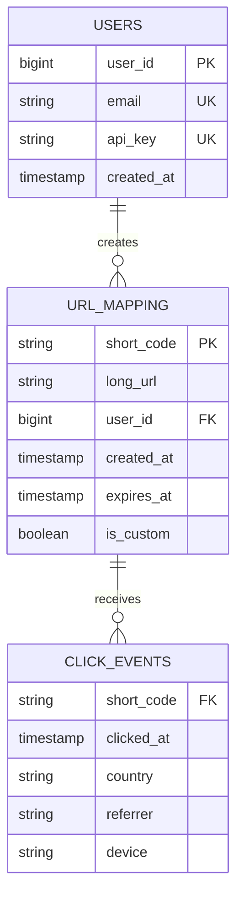

**Access patterns drive the choice**
- 99% of traffic is `get long_url by short_code` — a pure **key-value lookup**. No joins.
- Writes are simple inserts with a uniqueness constraint on `short_code`.
- 45 TB over 5 years → needs horizontal scaling.

**DB choice:** A horizontally scalable key-value / wide-column store (**DynamoDB** or **Cassandra**) partitioned by `short_code` is a natural fit. A **sharded PostgreSQL/MySQL** (shard key = `short_code`) also works and gives a simpler uniqueness guarantee per shard. Either is defensible — what matters is the reasoning:

| Option | Why it fits | Watch out for |
|---|---|---|
| DynamoDB / Cassandra | Key lookups, linear horizontal scale, built-in replication | Uniqueness needs conditional writes (`attribute_not_exists` / LWT); eventual consistency on replicas |
| Sharded PostgreSQL | Strong uniqueness, familiar, transactions | Operational cost of sharding and resharding |
| Click events | Kafka → columnar store (ClickHouse, BigQuery) | Never write analytics synchronously on the redirect path |

See [How to Choose a Database](03_databases_and_storage.md#1-how-to-choose-a-database).

### 1.5 High-Level Architecture

> **Level:** 🟢 Essential

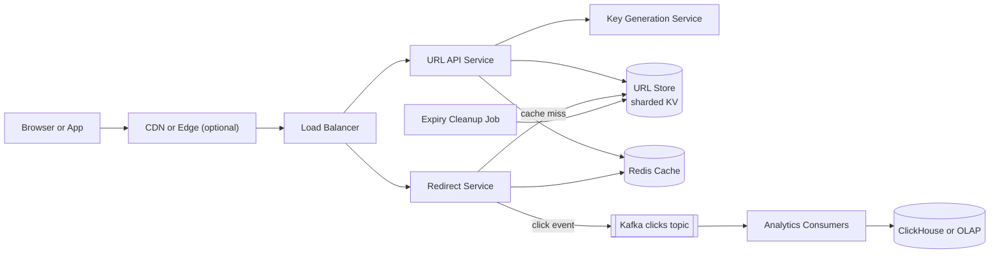

| Component | Responsibility |
|---|---|
| CDN / edge | Optional: cache redirects for viral links close to users (only if we accept losing some click accuracy or log at edge) |
| Load balancer | Distributes traffic; TLS termination; health checks |
| URL API Service | Validates URL (format, malware blocklist), handles custom aliases, gets a key, writes mapping |
| Key Generation Service (KGS) | Hands out unique, unused short codes in batches |
| Redirect Service | Stateless, hot path: cache → DB → 302; emits click events asynchronously |
| Redis cache | Holds hot `short_code → long_url` mappings |
| URL store | Durable source of truth, partitioned by `short_code` |
| Kafka + analytics | Decouples click tracking from the redirect latency |
| Expiry cleanup | Lazily/periodically removes expired links |

Splitting **read (redirect)** and **write (create)** services lets us scale them independently — redirects are 10× the traffic.

### 1.6 Request Flows

> **Level:** 🟢 Essential

**Write path — create a short URL**

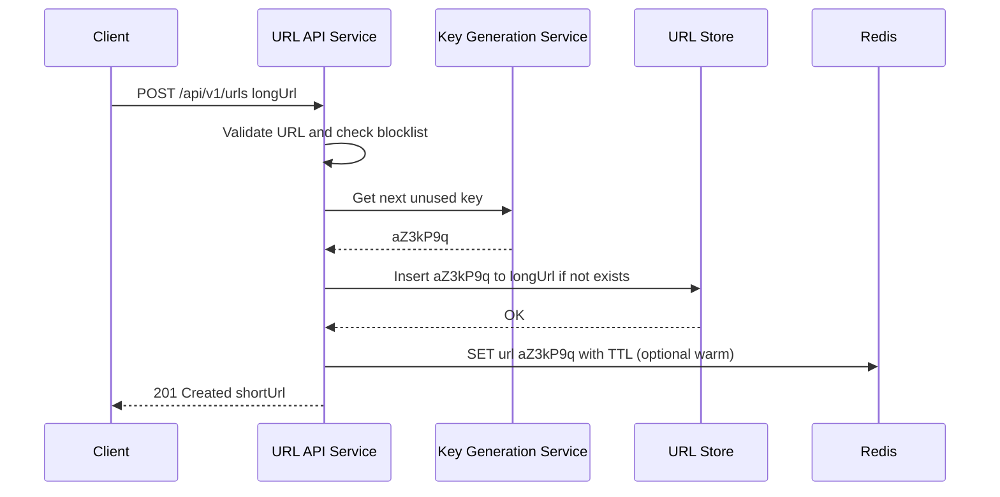

1. Client sends the long URL.
2. API validates format and checks it against a malicious-URL blocklist (e.g., Google Safe Browsing).
3. API takes a pre-generated key from KGS (local batch in memory — usually no network call).
4. API inserts with a conditional write ("only if code does not exist") — a safety net even though KGS keys are unique.
5. Optionally warm the cache (new links are often clicked immediately after sharing).
6. Return `201`.

**Read path — redirect**

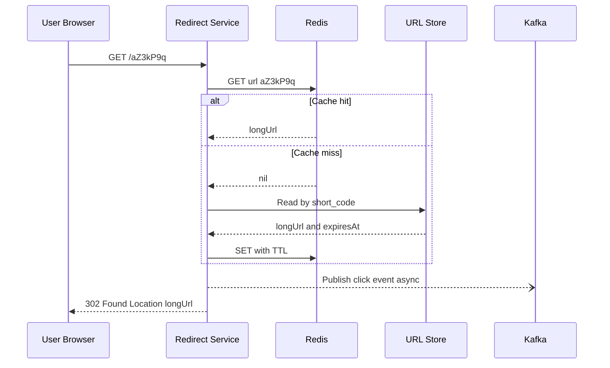

1. Check Redis. Expect > 90% hit ratio.
2. On miss, read from the store, check `expires_at`, populate the cache (cache-aside — see [Caching Patterns](04_caching.md#3-caching-patterns)).
3. Publish click event fire-and-forget (buffered producer). Analytics must never slow down or break the redirect.
4. Return `302` (or `301` — see deep dive).

**Failure notes:** If Redis is down, the service falls back to the DB (protect it with a circuit breaker and request coalescing). If Kafka is down, buffer locally and drop analytics if the buffer fills — redirects keep working.

### 1.7 Deep Dives

#### 1.7.1 Short code generation

> **Level:** 🟡 Intermediate → 🔴 Advanced

The core question: **how do we generate 183 billion unique 7-character codes without collisions and without a bottleneck?**

| Approach | How it works | Pros | Cons |
|---|---|---|---|
| **Hash + truncate** | `base62(md5(longUrl))[0:7]` | Same URL → same code (natural dedup); no coordination | Collisions — must check DB and retry with salt; every write needs a read |
| **Base62 of a global counter** | Auto-increment ID → base62 encode (`125 → "21"`) | No collisions, short codes | Single counter is a bottleneck/SPOF; codes are sequential and **guessable** |
| **Ticket server / range allocation** | Central DB hands out ranges (e.g., 1,000,000 IDs) to each app server; servers encode locally | Very few coordination calls; no collisions | Ranges lost on crash (acceptable); still sequential unless shuffled |
| **Snowflake-style IDs** | 64-bit = timestamp + machine id + sequence, then base62 | Fully decentralized, sortable | 64-bit → ~11 base62 chars, longer than 7; clock-skew handling |
| **Key Generation Service (KGS)** | Offline job pre-generates random unique 7-char keys into a "unused keys" table; servers fetch batches | No collisions at write time, random (not guessable), fast | Extra service; must make sure a key is never handed out twice |

**Recommended answer:** **KGS with batch allocation** (or a ticket-server range scheme with a bijective shuffle to avoid guessability).

How KGS avoids double-allocation:
1. Keys live in two logical sets: `unused` and `used`.
2. A KGS instance moves a batch (e.g., 10,000 keys) from `unused` to `used` **in one transaction** before handing it to an API server.
3. The API server keeps the batch in memory and consumes it locally — zero network calls per write.
4. If an API server crashes, its unconsumed keys are simply wasted. With 3.5 trillion keys and only 183 billion needed, wasting some is fine.
5. KGS itself is replicated (standby instance); since API servers hold batches, a short KGS outage doesn't stop writes.

```java
// Base62 encoding used by counter/range approaches
public final class Base62 {
    private static final char[] ALPHABET =
        "0123456789abcdefghijklmnopqrstuvwxyzABCDEFGHIJKLMNOPQRSTUVWXYZ".toCharArray();

    public static String encode(long value) {
        if (value == 0) return "0";
        StringBuilder sb = new StringBuilder();
        while (value > 0) {
            sb.append(ALPHABET[(int) (value % 62)]);
            value /= 62;
        }
        return sb.reverse().toString();
    }
}
```

**Same long URL submitted twice?** Ask the interviewer. Usually each request gets a new code (different users want separate analytics). If dedup is required, keep a secondary index `hash(longUrl) → short_code`.

#### 1.7.2 301 vs 302 redirects and analytics

> **Level:** 🟢 Essential

| | 301 Moved Permanently | 302 Found (temporary) |
|---|---|---|
| Browser behavior | Caches the redirect; later clicks may never reach our servers | Asks our server every time |
| Server load | Lower | Higher |
| Analytics | Inaccurate (cached clicks are invisible) | Accurate |
| Can we change/expire the link? | Hard — browsers keep the cached redirect | Yes |

**Decision:** Use **302** (or 307) when analytics or expiry matter — which is the usual product requirement. Use 301 only for a pure "dumb" shortener where minimizing load is the only goal. The trade-off is ~10× more requests hitting us, which the cache absorbs cheaply.

#### 1.7.3 Caching hot links

> **Level:** 🟡 Intermediate

- **Pattern:** cache-aside with TTL (e.g., 24 h) + LRU eviction. Mappings are effectively immutable, so invalidation is trivial: only on delete/expiry.
- **Viral links (hot keys):** a single link shared by a celebrity can get 100k+ req/s, overwhelming one Redis shard. Mitigations: in-process local cache (Caffeine, 1–5 s TTL) in each redirect server; replicate hot keys to multiple shards; or cache at the CDN edge.
- **Negative caching:** cache "not found" for random/garbage codes for a short TTL to stop [cache penetration](04_caching.md#8-cache-failure-modes); optionally a Bloom filter of existing codes.

#### 1.7.4 Custom aliases and expiry cleanup

> **Level:** 🟡 Intermediate

- **Custom aliases** share the same key space. Insert with a conditional write; return `409` if taken. Reserve words (`api`, `admin`, `login`) and enforce a character set/length. Store KGS keys and custom aliases in the same table so uniqueness is checked in one place.
- **Expiry:** two layers:
  1. **Lazy:** the redirect path checks `expires_at` and returns `410 Gone` — correctness never depends on cleanup.
  2. **Active:** a low-priority batch job (or native TTL in DynamoDB/Cassandra) deletes expired rows during off-peak hours. Optionally return freed codes to KGS (most systems don't bother).

### 1.8 Scaling Strategy

> **Level:** 🟡 Intermediate

1. **Stateless services** behind a load balancer; autoscale redirect pods on CPU/RPS.
2. **Cache first:** Redis cluster absorbs > 90% of reads; local in-process cache for viral keys.
3. **Shard the store by `short_code`** (hash-based) — keys are random, so load is even with no hotspots ([Partitioning and Sharding](03_databases_and_storage.md#9-partitioning-and-sharding)).
4. **Replicate** each shard (3 replicas, multi-AZ) for durability and read capacity.
5. **Multi-region:** redirect services and read replicas in each region (GeoDNS routes users to the nearest); writes can go to a home region since writes are 10× rarer and a few hundred ms of replication lag is acceptable — KGS ranges per region avoid cross-region coordination.
6. **Analytics off the hot path:** Kafka → stream aggregation → OLAP.

### 1.9 Bottlenecks and Failure Handling

> **Level:** 🟡 Intermediate

| What fails | Impact | Mitigation |
|---|---|---|
| Redis node down | Miss storm onto DB | Redis replicas + automatic failover; request coalescing; DB read replicas; circuit breaker |
| DB shard down | Links on that shard unresolvable (cached ones still work) | Replica promotion; multi-AZ; long cache TTLs for immutable data |
| KGS down | No new keys | API servers hold key batches in memory; KGS standby; alerts on low batch |
| Viral hot key | One cache shard saturated | Local cache, key replication, CDN edge caching |
| Kafka down | Analytics lost | Local buffering; analytics is best-effort, redirects unaffected |
| Abuse (spam/phishing) | Reputation damage, domain blocklisted | Rate limit creation, URL reputation checks, report/takedown flow |
| Enumeration | Attackers crawl all links | Random (non-sequential) codes, rate limiting per IP |

### 1.10 Trade-offs and Alternatives

> **Level:** 🟡 Intermediate

| Decision | Chosen | Alternative | Why |
|---|---|---|---|
| Redirect code | 302 | 301 | Analytics + ability to expire links outweigh extra load |
| Key generation | KGS batches | Hash + collision check | No write-time collisions, no read-before-write, non-guessable |
| Store | Sharded KV (DynamoDB/Cassandra) | Single Postgres | 45 TB and simple key lookups favor horizontal KV |
| Analytics | Async via Kafka | Synchronous DB counter | Keeps redirect p99 low; counters would create hot rows |
| Consistency | Eventual for reads | Strong everywhere | Mappings are immutable; a new link reachable after ~100 ms is fine |

### 1.11 Interviewer Follow-ups

> **Level:** 🟡 Intermediate

**Q1. How do you guarantee two servers never generate the same code?**
> Uniqueness is guaranteed at allocation time: KGS moves a batch of keys from the unused set to the used set in a single transaction before handing it out, so no two servers ever hold the same key. As defense in depth, the insert is conditional (`IF NOT EXISTS`), so even a bug can't silently overwrite a mapping.

**Q2. Why not just hash the URL?**
> Hashing to 7 characters produces collisions as the table grows (birthday paradox), so every write must check the DB and retry — adding a read to every write and making latency unpredictable. It's acceptable at small scale or when dedup of identical URLs is a requirement.

**Q3. How would you support 10× more traffic?**
> Reads scale with more cache shards, local caches for hot keys, and more stateless redirect pods; I'd consider caching redirects at the CDN edge with edge-side logging for analytics. Writes at 12k/s are still modest for a sharded KV store; I'd add shards and more KGS batch size.

**Q4. How do you prevent the service being used for phishing?**
> Check URLs against reputation services at creation time, rescan asynchronously, rate-limit creation per IP/account, require accounts for high-volume creation, and support takedown — a flagged code returns a warning page instead of redirecting.

**Q5. How do you make short codes unguessable?**
> Random keys from KGS (not sequential counters). If using counters, apply a reversible permutation (e.g., multiply by a large prime modulo 62^7, or format-preserving encryption) before base62 encoding.

**Q6. Where would you store click analytics and how would you serve the stats API?**
> Click events go to Kafka, are aggregated by a stream processor (Flink/Kafka Streams) into per-minute counts, and stored in a columnar store like ClickHouse. The stats API queries pre-aggregated tables — never raw events.

**Q7. What consistency do you need?**
> Uniqueness of a code must be strongly enforced (conditional write on the partition owner). Reads can be eventually consistent — a brand-new link failing for a few milliseconds on a lagging replica is fixed by falling back to the primary on a miss for very new codes, or by warming the cache at creation.

### 1.12 Quick Revision

- Read-heavy (10:1): cache-aside Redis + stateless redirect service; split read and write services.
- Corrected math: 100M/day × 250 B ≈ 25 GB/day ≈ **45 TB in 5 years** → shard; 7 base62 chars = 3.5T keys.
- Key generation: **KGS with batch allocation** (or ranges + shuffle) beats hash+collision checks.
- **302** for analytics/expiry; 301 only when you don't care about tracking.
- Analytics asynchronously via Kafka; lazy expiry check + background cleanup.

---

## 2. Rate Limiter

> **Level:** 🟢 Essential — asked both as a standalone design and as a component inside other designs.

**The problem in one line:** Decide, in under a millisecond, whether each incoming request from a given client is allowed or must be rejected with `429 Too Many Requests` — consistently across hundreds of servers.

For algorithm fundamentals (token bucket, leaky bucket, fixed and sliding windows) see [Rate Limiting](02_networking_and_communication.md#14-rate-limiting). This section designs a **distributed rate-limiting service**.

### 2.1 Requirements

> **Level:** 🟢 Essential

**Functional requirements**
- Limit requests per **key**: user ID, API key, IP address, or a combination (e.g., `user + endpoint`).
- Support multiple rules: `100 req/min per user`, `10 login attempts/hour per IP`, `1,000 req/s per tenant`.
- Rules configurable without redeploying.
- Reject with `429` and informative headers so clients know when to retry.
- (Optional) Soft limits: log and alert but allow ("shadow mode").

**Non-functional requirements**

| NFR | Target | Why |
|---|---|---|
| Latency overhead | < 1–2 ms p99 | It sits on every request |
| Availability | Must not become a single point of failure | If the limiter is down, the API shouldn't be down |
| Accuracy | Approximately correct (a few % over-admission OK) | Exactness across regions costs latency |
| Scale | 1M+ decisions/s across the fleet | Every API call checks it |

**Out of scope:** network-layer DDoS protection (handled by CDN/WAF such as Cloudflare or AWS Shield), monthly billing quotas.

### 2.2 Capacity Estimation

> **Level:** 🟡 Intermediate

```
Traffic
  API fleet handles 1M req/s at peak → 1M limiter decisions/s
  Each decision = 1 Redis round trip running a small script (~0.2–0.5 ms in the same DC)

Redis throughput
  One Redis shard handles roughly 100k–200k simple ops/s (Lua scripts somewhat fewer)
  1M/s ÷ ~100k/s per shard ≈ 10 shards (+ replicas) → Redis Cluster with ~10–16 primaries

Memory
  Active keys: 50M users × 2 rules = 100M buckets
  Token bucket state: tokens + timestamp ≈ ~100 B per key including Redis overhead
  100M × 100 B ≈ 10 GB → spread across the cluster easily
  Idle keys expire, so memory tracks *active* users only
```

### 2.3 API Design

> **Level:** 🟢 Essential

The limiter is usually invoked **in-process** (a library or gateway plugin) rather than as a separate HTTP hop, but logically it exposes:

```http
POST /internal/v1/ratelimit/check
{ "key": "user:42", "rule": "api_default", "cost": 1 }

200 OK
{ "allowed": true, "limit": 100, "remaining": 37, "resetAtEpochSec": 1793059260 }
```

What the **client** of the protected API sees when blocked:

```http
HTTP/1.1 429 Too Many Requests
Retry-After: 30
X-RateLimit-Limit: 1000
X-RateLimit-Remaining: 0
X-RateLimit-Reset: 1700000000
Content-Type: application/json

{ "error": "rate_limited", "message": "Limit of 1000 requests per hour exceeded" }
```

(An IETF draft standardizes `RateLimit-Limit` / `RateLimit-Remaining` / `RateLimit-Reset`; the `X-` prefixed versions are still the most common in practice.)

**Rule configuration** (stored in a config service, cached in every limiter instance):

```yaml
rules:
  - name: api_default
    match: { route: "/api/**" }
    key: user_id
    algorithm: token_bucket
    capacity: 100              # burst size
    refill_per_second: 1.67    # ≈ 100 per minute
  - name: login
    match: { route: "/login", method: POST }
    key: ip
    algorithm: sliding_window
    limit: 10
    window_seconds: 3600
    on_store_failure: fail_closed   # security-sensitive
```

### 2.4 Data Model

> **Level:** 🟡 Intermediate

Limiter state is tiny and short-lived → **Redis** (in-memory, atomic operations, TTLs). Rules → a small durable store (Postgres, or a config service like etcd/Consul) pushed to limiters.

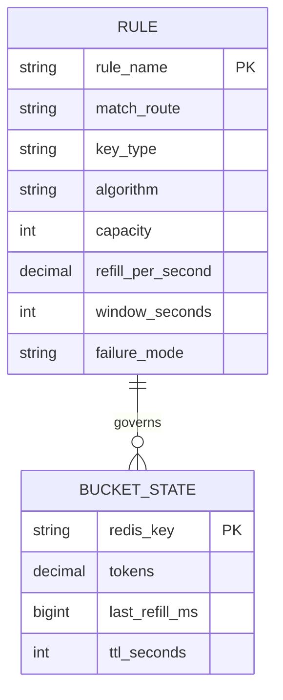

Redis key format: `rl:{rule}:{key}`, e.g. `rl:api_default:user:42`, stored as a hash `{tokens, ts}`. A hash tag such as `rl:{user:42}:api_default` keeps all of one user's buckets on the same Redis Cluster slot if several rules must be checked atomically together.

### 2.5 High-Level Architecture

> **Level:** 🟢 Essential

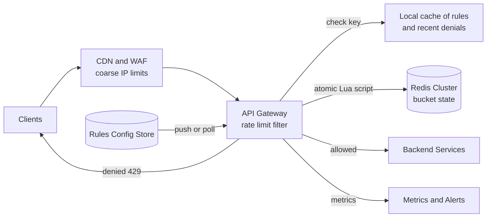

| Component | Responsibility |
|---|---|
| CDN / WAF | Coarse, volumetric protection (per-IP floods) before traffic reaches us |
| API Gateway filter | Extracts the key (user / API key / IP), finds matching rules, calls Redis, adds headers, returns 429 |
| Local rule cache | Rules held in memory; refreshed on change (push via pub/sub, or poll every few seconds) |
| Redis Cluster | Shared buckets so every gateway instance sees the same state |
| Config store | Source of truth for rules; changes audited |
| Metrics | Allowed/denied counts per rule, Redis latency, fail-open events |

**Where should the limiter live?** Client-side (can't be trusted), at the **API gateway** (preferred: rejects before any backend work and is managed in one place), or inside each service (needed for business-specific limits like "5 password resets per day"). Real systems combine edge + gateway + a few in-service limits.

### 2.6 Request Flows

> **Level:** 🟢 Essential

**Normal check**

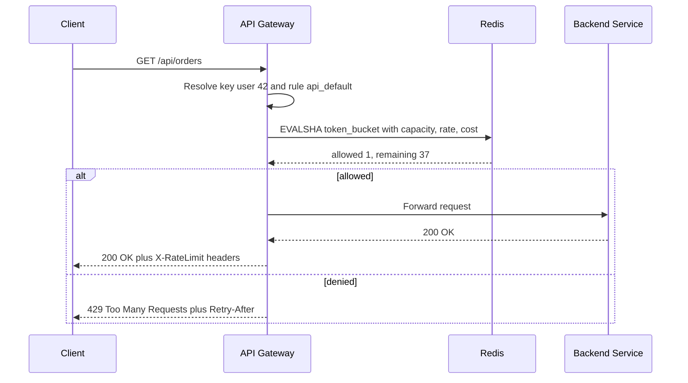

1. The gateway identifies the caller and the matching rule(s) from its in-memory rule cache.
2. One atomic script call to Redis both checks and updates the bucket.
3. Allowed → forward and attach `X-RateLimit-*` headers. Denied → `429` immediately; the backend never sees the request.

**When Redis is unreachable**

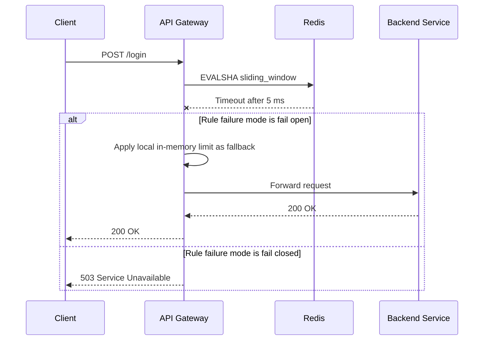

### 2.7 Deep Dives

#### 2.7.1 Choosing the algorithm

> **Level:** 🟢 Essential

| Algorithm | Memory per key | Bursts | Accuracy | Use for |
|---|---|---|---|---|
| Fixed window counter | 1 counter | Up to 2× the limit at a window boundary | Low | Simple quotas, internal tools |
| Sliding window log | 1 entry per request | Exact | Exact | Low limits needing precision (login attempts) |
| Sliding window counter | 2 counters | Smoothed | Approximate but very good | General API limits at scale |
| Token bucket | tokens + timestamp | Allows controlled bursts | Good | Most public APIs (AWS, Stripe style) |
| Leaky bucket | queue or timestamp | Smooths output to a constant rate | Good | Protecting a downstream with fixed capacity |

**Sliding window counter formula:** `estimate = current_count + previous_count × (1 − fraction_of_current_window_elapsed)`. Limit 100/min, 25% into the current minute, current = 30, previous = 80 → `30 + 80 × 0.75 = 90` → allowed.

**Default recommendation:** token bucket — two numbers per key, allows bursts (good UX for bursty clients such as a page firing 10 calls at load), and maps naturally to "N requests per second with burst B".

#### 2.7.2 Race conditions and atomicity with Redis and Lua

> **Level:** 🟡 Intermediate

The naive approach — `GET count`, check in the application, `SET count+1` — has a **race**: two gateway instances both read `99`, both allow, and 101 requests get through. Under high concurrency the over-admission can be large.

Fixes: use atomic primitives (`INCR` + `EXPIRE` for fixed windows), or run the whole read-modify-write as a **Lua script**, which Redis executes atomically (no other command interleaves).

```lua
-- token_bucket.lua
-- KEYS[1] = bucket key
-- ARGV[1] = capacity (max tokens)
-- ARGV[2] = refill rate (tokens per second)
-- ARGV[3] = cost of this request (usually 1)
local capacity = tonumber(ARGV[1])
local rate     = tonumber(ARGV[2])
local cost     = tonumber(ARGV[3])

-- Use the Redis server clock so all gateways share one notion of time
local t   = redis.call('TIME')
local now = tonumber(t[1]) * 1000 + math.floor(tonumber(t[2]) / 1000)

local state  = redis.call('HMGET', KEYS[1], 'tokens', 'ts')
local tokens = tonumber(state[1])
local ts     = tonumber(state[2])
if tokens == nil then
  tokens = capacity
  ts = now
end

-- Refill based on elapsed time, capped at capacity
local elapsed = math.max(0, now - ts) / 1000.0
tokens = math.min(capacity, tokens + elapsed * rate)

local allowed = 0
if tokens >= cost then
  tokens = tokens - cost
  allowed = 1
end

redis.call('HSET', KEYS[1], 'tokens', tokens, 'ts', now)
-- Idle buckets disappear after twice the full-refill time
redis.call('PEXPIRE', KEYS[1], math.ceil(capacity / rate * 1000) * 2)

-- Seconds until enough tokens are available (for Retry-After)
local retryAfter = 0
if allowed == 0 then
  retryAfter = math.ceil((cost - tokens) / rate)
end
return { allowed, math.floor(tokens), retryAfter }
```

```java
// Spring Boot: calling the script with Spring Data Redis
@Component
public class RedisTokenBucketLimiter {
    private final StringRedisTemplate redis;
    @SuppressWarnings("rawtypes")
    private final RedisScript<List> script =
        RedisScript.of(new ClassPathResource("token_bucket.lua"), List.class);

    public RedisTokenBucketLimiter(StringRedisTemplate redis) { this.redis = redis; }

    @SuppressWarnings("unchecked")
    public Decision tryAcquire(String key, int capacity, double ratePerSec) {
        List<Long> r = redis.execute(script, List.of("rl:" + key),
            String.valueOf(capacity), String.valueOf(ratePerSec), "1");
        return new Decision(r.get(0) == 1L, r.get(1), r.get(2));
    }

    public record Decision(boolean allowed, long remaining, long retryAfterSec) {}
}
```

Notes:
- Redis caches the script; later calls use `EVALSHA` (Spring handles this automatically).
- `redis.call('TIME')` inside the script avoids **clock skew** between gateway servers.
- A fixed-window variant needs no Lua: `INCR key` then `EXPIRE key <window> NX`.

#### 2.7.3 Distributed and multi-region limiting

> **Level:** 🔴 Advanced

| Approach | How | Trade-off |
|---|---|---|
| **Redis per region** | Each region has its own cluster; regional limit = global limit split by traffic share | Fast; a client spraying multiple regions can slightly exceed the global limit |
| **Global synchronous store** | All regions call one store | Exact, but adds 50–150 ms cross-region latency — unacceptable |
| **Local counting + async sync** | Each gateway counts locally, periodically pushes deltas and pulls global totals | Very fast, eventually consistent; over-admission bounded by the sync interval |
| **Sticky routing** | Route each key to a fixed region/shard via consistent hashing | Exact per key; regional failover is harder |

**Senior answer:** "I'd keep decisions local to the region — Redis in-region, sub-millisecond — accept a bounded few-percent over-admission, and use exact global accounting only for business-critical quotas like paid API usage, which can be reconciled asynchronously against a billing counter."

**Optimization:** after a deny, each gateway caches "key blocked until T" in memory, so an abusive client's retries are rejected without touching Redis.

#### 2.7.4 Fail-open vs fail-closed

> **Level:** 🟡 Intermediate

- **Fail-open** (allow when the limiter store is unavailable) protects *availability*. Right for general API limits — a Redis blip shouldn't take down the product. Pair it with a coarse in-memory limiter as a safety net.
- **Fail-closed** (deny when unavailable) protects *security*. Right for login, OTP, password reset, and expensive operations — brute-force protection must not vanish during an outage.
- Always set a **tight timeout** (2–5 ms) on the Redis call and wrap it in a [circuit breaker](05_distributed_systems_and_messaging.md#16-circuit-breaker) so a slow Redis doesn't add latency to every request.

### 2.8 Scaling Strategy

> **Level:** 🟡 Intermediate

1. Shard bucket state across a **Redis Cluster** (hash slots on the key) — load spreads as users spread.
2. Exactly **one round trip per request** (single Lua call or pipelining).
3. **Local caches** for rules and recent denials; abusive hot keys never reach Redis.
4. Run the limiter **in-process** in the gateway (filter/library) — no extra network hop to a separate limiter service.
5. Very large per-tenant limits (e.g., 1M req/s): split the key into N sub-keys (`tenant:7:s3`), each with 1/N of the budget, so no single Redis key becomes hot.

### 2.9 Bottlenecks and Failure Handling

> **Level:** 🟡 Intermediate

| What fails | Impact | Mitigation |
|---|---|---|
| Redis shard down | Decisions for keys on that shard fail | Replica failover (seconds); per-rule fail-open/closed; local fallback limiter |
| Redis slow | Latency added to every API call | Strict timeout + circuit breaker |
| Hot key (one huge tenant) | One shard saturated | Sub-key sharding; local token pre-allocation |
| Clock skew between servers | Wrong refill math | Use Redis `TIME` in the script |
| Bad rule deployed | Legitimate users blocked | Shadow mode first, gradual rollout, audit log, quick rollback |
| Retry storms from blocked clients | Load amplification | `Retry-After`, documented backoff with jitter, in-memory block cache |

### 2.10 Trade-offs and Alternatives

> **Level:** 🟡 Intermediate

| Decision | Chosen | Alternative | Why |
|---|---|---|---|
| Algorithm | Token bucket | Sliding window log | O(1) memory and allows bursts; the log is exact but O(requests) memory |
| State | Redis Cluster | In-memory per server | Shared state gives a consistent limit; per-server limits drift as autoscaling changes server count |
| Placement | API gateway filter | Separate limiter microservice | Avoids an extra network hop on every request |
| Multi-region | Per-region budgets | Global exact counter | Latency beats perfect accuracy |
| Failure mode | Per rule (open for APIs, closed for login) | One global mode | Availability vs security needs differ by endpoint |

### 2.11 Interviewer Follow-ups

> **Level:** 🟡 Intermediate

**Q1. Why not an in-memory counter in each server?**
> With 50 servers behind a round-robin load balancer, each sees ~1/50th of a user's traffic, so the effective limit becomes 50× the intended one — and it changes whenever autoscaling changes the server count. A shared store gives one consistent count. Per-server limits remain useful as a coarse fallback.

**Q2. How do you prevent race conditions?**
> Make check-and-update atomic inside Redis: `INCR` for counters or a Lua script for token bucket, since Redis runs a script without interleaving other commands. Never read in the application and write back.

**Q3. Fixed windows have a boundary problem — explain and fix it.**
> With 100/min, a client sends 100 at 12:00:59 and 100 at 12:01:00 — 200 in two seconds. The sliding window counter weights the previous window's count by its overlap, smoothing this with only two counters per key.

**Q4. How do clients know when to retry?**
> `429` plus `Retry-After` and `X-RateLimit-Remaining/Reset`. Well-behaved clients back off with jitter; the gateway caches recent denials so abusive retries are cheap to reject.

**Q5. How would you limit by cost rather than by request count?**
> Give each request a cost (search = 5 tokens, read = 1) and pass it to the token bucket script. GraphQL APIs commonly limit by computed query complexity this way.

**Q6. How do you roll out a stricter rule safely?**
> Shadow mode first — evaluate and emit metrics without blocking — compare would-be denials with expectations, then enforce gradually by tenant or percentage, with fast rollback.

### 2.12 Quick Revision

- Place at the **API gateway**; key by user / API key / IP; rules in config, cached locally.
- **Token bucket in Redis via Lua** — atomic, server clock, idle keys expire.
- Return `429` + `Retry-After` + `X-RateLimit-*` headers.
- Per-region decisions with bounded over-admission; exact global limits are too slow.
- **Fail-open** for general APIs, **fail-closed** for security endpoints; tight timeouts + circuit breaker.

---

## 3. Notification Service

> **Level:** 🟢 Essential — tests queues, fan-out, retries, idempotency, and third-party integration.

**The problem in one line:** Let any internal service say "notify user X about Y" and reliably deliver it by push, SMS, email, or in-app — respecting user preferences, without spamming, duplicating, or losing important messages.

### 3.1 Requirements

> **Level:** 🟢 Essential

**Functional requirements**
- Channels: mobile push (APNs for iOS, FCM for Android), SMS, email, in-app inbox.
- Send to one user, a list of users, or a segment ("all users in Pune who bought X").
- Templates with variables and localization (`Hi {{name}}, your order {{orderId}} has shipped`).
- User preferences: opt-out per channel and category, quiet hours, frequency caps.
- Immediate and scheduled sends; priorities (OTP > order update > marketing).
- Delivery tracking: queued, sent, delivered, opened, failed.

**Non-functional requirements**

| NFR | Target | Why |
|---|---|---|
| Reliability | At-least-once for transactional messages; no duplicates visible to the user | Missing an OTP or payment alert is a serious bug |
| Latency | OTP/security in a few seconds end to end; marketing can take minutes or hours | Different SLAs per priority |
| Scale | 1B notifications/day, 10× bursts during campaigns | Campaigns create massive spikes |
| Availability | High; degrade marketing before transactional | Business priorities |
| Extensibility | Add a channel or provider without touching callers | Providers change often |

**Out of scope:** building our own SMS/email transport (we use Twilio, Amazon SES, SendGrid, FCM, APNs), the campaign-builder UI.

### 3.2 Capacity Estimation

> **Level:** 🟡 Intermediate

```
Volume
  1B notifications/day ÷ 86,400 ≈ 11,600/s average
  Campaign bursts ×10            ≈ 120,000/s for short periods

Channel mix (assumed)
  Push 60% → ~7,000/s | Email 25% → ~2,900/s | In-app 10% → ~1,160/s | SMS 5% → ~580/s

Storage
  Delivery log record ≈ 500 B (ids, template, channel, status timestamps)
  1B × 500 B = 500 GB/day → keep 30–90 days hot (15–45 TB), archive older to object storage

Provider limits (the real bottleneck)
  SMS: often tens to hundreds of msgs/s per sender number/account
  Email: thousands/s with warmed-up sending IPs
  → Queue and rate-limit per provider, not just per user
```

The key insight: our own services scale horizontally; **third-party provider limits and costs are the bottleneck**, so queues must absorb bursts and workers must respect provider quotas.

### 3.3 API Design

> **Level:** 🟢 Essential

```http
POST /api/v1/notifications
Idempotency-Key: order-981-shipped
{
  "recipients": { "userIds": [42] },          // or { "segmentId": "seg_pune_buyers" }
  "category": "ORDER_UPDATE",                 // drives preference checks
  "priority": "HIGH",                         // CRITICAL | HIGH | NORMAL | LOW
  "channels": ["PUSH", "EMAIL"],              // optional; defaults per category
  "templateId": "order_shipped_v3",
  "data": { "name": "Asha", "orderId": "981", "eta": "Oct 29" },
  "sendAt": null                              // or an ISO timestamp to schedule
}

202 Accepted
{ "notificationId": "ntf_01JBX8...", "status": "QUEUED" }
```

```http
GET  /api/v1/notifications/{id}                → status per recipient and channel
GET  /api/v1/users/{userId}/inbox?cursor=...   → in-app notifications (cursor pagination)
POST /api/v1/users/{userId}/inbox/{id}/read    → mark as read
PUT  /api/v1/users/{userId}/preferences        → { "MARKETING": {"EMAIL": false}, "quietHours": "22:00-07:00", "tz": "Asia/Kolkata" }
POST /api/v1/devices                           → register a push token { userId, platform, token }
POST /webhooks/providers/{provider}            → delivery receipts from Twilio, SES, etc.
```

**Why `202 Accepted`?** Sending is asynchronous. The caller gets an ID to track and never waits on a third-party provider.

### 3.4 Data Model

> **Level:** 🟡 Intermediate

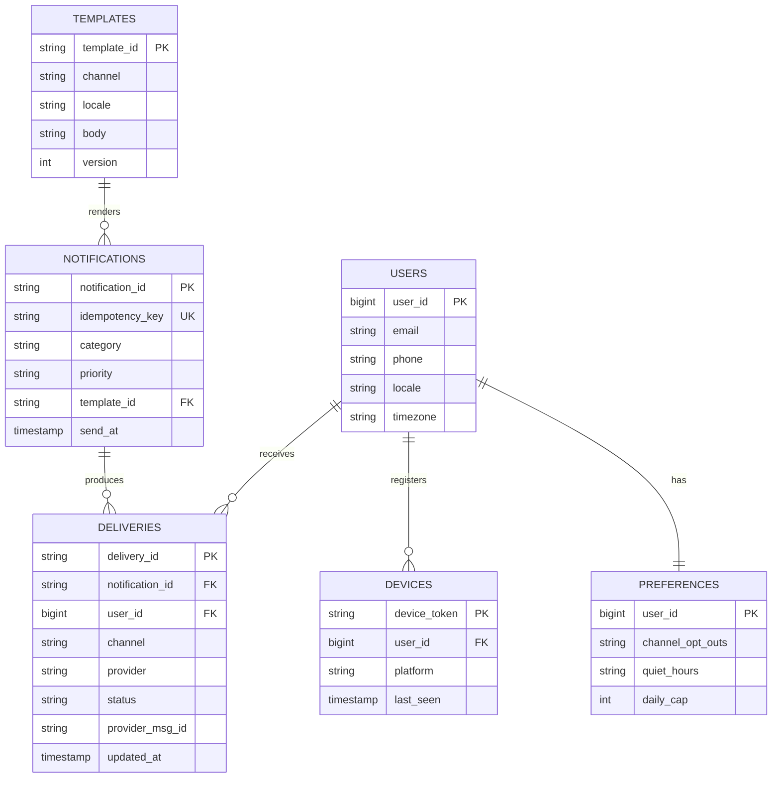

| Data | Store | Why |
|---|---|---|
| Users, devices, preferences, templates | PostgreSQL + Redis cache for preferences | Relational, modest size, read on every send |
| Delivery log | Cassandra or DynamoDB (partition `user_id`, cluster by time) | ~1B rows/day, write-heavy, time-ordered per user, native TTL |
| In-app inbox | Same wide-column store, partition `user_id` | "Latest N for this user" query |
| Idempotency / dedup keys | Redis with TTL (24–72 h) | Fast `SET NX` checks |
| Queues | Kafka topics per channel and priority | Burst buffering, replay, consumer scaling |

### 3.5 High-Level Architecture

> **Level:** 🟢 Essential

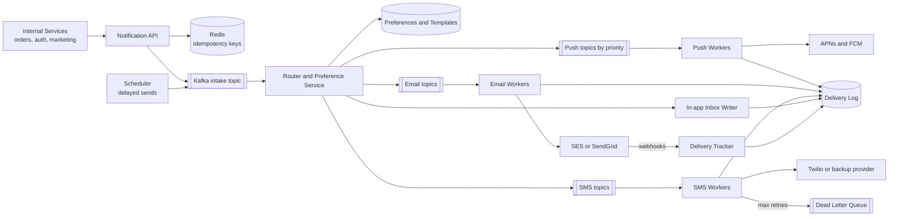

| Component | Responsibility |
|---|---|
| Notification API | Authenticates the calling service, validates, checks idempotency, publishes to intake; returns `202` |
| Scheduler | Holds future sends (table indexed by `send_at`, or a delay queue) and releases them on time |
| Router / preference service | Expands segments into users, applies opt-outs, quiet hours and caps, renders templates, chooses channels |
| Channel topics | Separate Kafka topics per channel and priority so a marketing burst can't delay OTPs |
| Channel workers | Call providers within per-provider rate limits; retry with backoff; fail over to a backup provider |
| Delivery tracker | Consumes provider webhooks (delivered, bounced, opened) and updates status |
| DLQ | Messages that exhausted retries, kept for inspection and redrive |

### 3.6 Request Flows

> **Level:** 🟢 Essential

**Transactional notification (order shipped)**

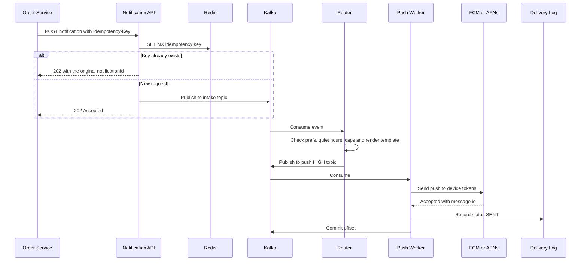

1. The order service calls the API with an idempotency key derived from the business event (`order-981-shipped`), so its own retries can't create duplicates.
2. The API only enqueues; it never waits on providers.
3. The router applies user rules at *send* time (preferences may have changed since scheduling).
4. The push worker sends, records status, and only then commits its Kafka offset (at-least-once).

**Provider failure with retry and failover**

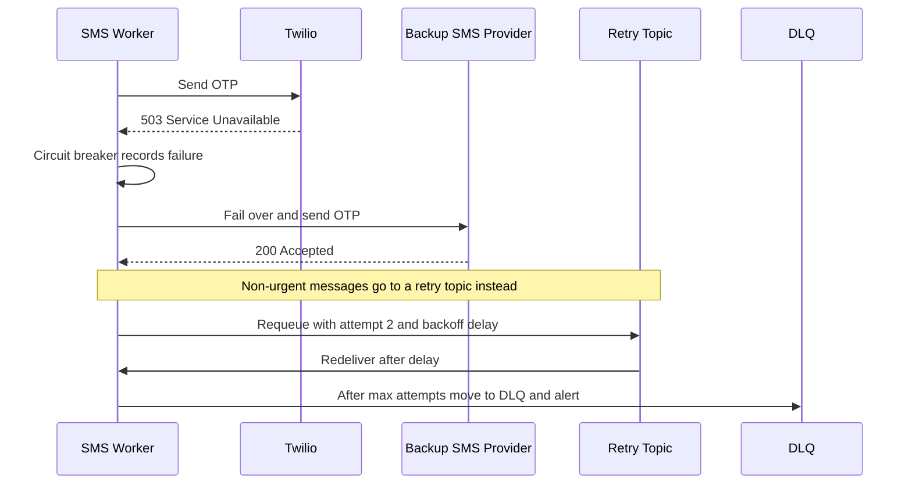

### 3.7 Deep Dives

#### 3.7.1 Priorities and isolation

> **Level:** 🟡 Intermediate

A campaign of 200M emails must never delay a 2FA code. Use **separate topics and separate worker pools per priority** — the [bulkhead pattern](05_distributed_systems_and_messaging.md#17-bulkhead). Critical pools get reserved capacity and a dedicated provider quota; low-priority consumers are throttled first under load (load shedding).

#### 3.7.2 Deduplication and idempotency

> **Level:** 🟡 Intermediate

Duplicates come from three places:
1. **Caller retries** → `Idempotency-Key` at the API (`SET key NX EX 86400`; if it exists, return the original response).
2. **At-least-once redelivery** (worker crashes after sending but before committing the offset) → deterministic `delivery_id = hash(notificationId, userId, channel)`; the worker records it atomically before calling the provider and skips if already present.
3. **Provider-side retries** → pass our `delivery_id` as the provider's reference / idempotency ID where supported.

Exactly-once delivery to a phone is impossible across a third-party boundary. The goal is **at-least-once delivery + idempotent processing = effectively once**. See [Delivery Guarantees](05_distributed_systems_and_messaging.md#13-delivery-guarantees-idempotency-and-deduplication).

#### 3.7.3 Preferences, quiet hours, and frequency caps

> **Level:** 🟡 Intermediate

- Preferences cached in Redis (read on every send, rarely changed); invalidate on update.
- **Quiet hours:** if the user's local time is inside quiet hours and priority < CRITICAL, reschedule for the end of quiet hours via the scheduler.
- **Frequency caps:** per-user counters such as `INCR notif:42:marketing:2026-10-27` with a 24 h TTL — effectively a per-user [rate limiter](#2-rate-limiter).
- **Compliance:** honor unsubscribes immediately (CAN-SPAM, GDPR); transactional messages may bypass marketing opt-outs but not a channel-level block.

#### 3.7.4 Retries, DLQ, and provider failover

> **Level:** 🟡 Intermediate

- Classify errors: **retryable** (timeouts, 429, 5xx) vs **permanent** (invalid number, unsubscribed, unregistered device token → also delete the token).
- Retry with exponential backoff + jitter via tiered retry topics (`sms-retry-1m`, `sms-retry-10m`) so a stuck message doesn't block its partition ([Timeouts and Retries](05_distributed_systems_and_messaging.md#15-timeouts-retries-and-exponential-backoff)).
- After max attempts → **DLQ** with alerting and a redrive tool ([Dead Letter Queues](05_distributed_systems_and_messaging.md#14-dead-letter-queues-and-backpressure)).
- **Circuit breaker per provider**; when open, route to the secondary provider. Multi-provider also gives cost leverage and avoids lock-in.
- A token bucket per provider account keeps us under provider quotas.

#### 3.7.5 Large fan-out to segments

> **Level:** 🔴 Advanced

"Notify all 50M users in India" is a batch job, not one message. The router streams the segment from the user store in chunks (e.g., 10k users), publishes one task per chunk, and many workers expand chunks in parallel. Throttle the campaign's overall rate to respect provider quotas — and to avoid a thundering herd on *our own* app servers when millions of users tap the notification at once.

### 3.8 Scaling Strategy

> **Level:** 🟡 Intermediate

- Stateless API and workers; autoscale workers on **consumer lag** per topic.
- Size Kafka partitions per topic for peak parallelism (e.g., 64–128); partition key `user_id` keeps one user's messages ordered.
- Shard the delivery log by `user_id`; TTL old rows; archive to object storage.
- Cache templates and preferences; pre-compile templates per locale.
- Regional deployments; call providers from the nearest region.

### 3.9 Bottlenecks and Failure Handling

> **Level:** 🟡 Intermediate

| What fails | Impact | Mitigation |
|---|---|---|
| Provider outage | One channel down | Circuit breaker + backup provider; queue absorbs the backlog |
| Provider throttling (429) | Slower delivery | Per-provider token bucket; backoff; multiple sender accounts |
| Worker crash mid-send | Possible duplicate | Deterministic delivery ID + dedup check before sending |
| Campaign burst | Queue lag, delayed OTPs | Separate priority topics and worker pools; throttle campaigns |
| Kafka unavailable | Can't enqueue | API writes to an outbox table; a relay publishes later ([Transactional Outbox](05_distributed_systems_and_messaging.md#19-transactional-outbox-and-cdc)) |
| Stale device tokens | Wasted sends, provider penalties | Remove tokens on "unregistered" responses |
| Poison message (bad template data) | Endless retries | Validate at intake; DLQ after N attempts |

### 3.10 Trade-offs and Alternatives

> **Level:** 🟡 Intermediate

| Decision | Chosen | Alternative | Why |
|---|---|---|---|
| Queue | Kafka, topics per channel and priority | RabbitMQ / SQS | Kafka for throughput and replay; RabbitMQ/SQS are fine at smaller scale and make per-message delays and retries simpler |
| Delivery semantics | At-least-once + dedup | At-most-once | Losing OTPs is worse than rare duplicates, which we dedup anyway |
| Preference check | At routing/send time | At API time | Preferences can change between scheduling and sending |
| Delivery log | Cassandra / DynamoDB | PostgreSQL | 1B writes/day, time series per user, TTLs |
| Providers | Multi-provider with failover | Single provider | Availability and cost leverage vs integration effort |

### 3.11 Interviewer Follow-ups

> **Level:** 🟡 Intermediate

**Q1. How do you make sure an OTP isn't delayed by a marketing blast?**
> Separate priority topics and dedicated worker pools with reserved provider capacity — bulkheads. Under pressure the system sheds or delays low-priority traffic first. The OTP path also has strict timeouts and immediate provider failover instead of slow retries.

**Q2. How do you avoid sending the same notification twice?**
> Idempotency keys at the API, deterministic delivery IDs checked before every provider call, and provider-side reference IDs. True exactly-once to a device isn't achievable across a third party, so the target is at-least-once with dedup.

**Q3. How do quiet hours work for users in different timezones?**
> We store each user's timezone; the router computes their local time and, for non-critical messages inside quiet hours, hands the message to the scheduler with `sendAt` = end of quiet hours.

**Q4. How would you track whether an email was opened?**
> A tracking pixel and wrapped links pointing at our tracker, plus provider webhooks for delivered/bounced. Events flow through Kafka to update the delivery log asynchronously. Opens are approximate because of image blocking and privacy proxies.

**Q5. What if Kafka is down?**
> The API stores the request in its own DB (outbox) and a relay publishes once Kafka recovers; callers still receive `202`. For OTPs we can additionally allow a direct synchronous send as a fallback.

**Q6. How do you prepare for 10× traffic on Black Friday?**
> Pre-scale workers and partitions, warm up email IPs, negotiate temporary provider quota increases, throttle campaigns, and alert on consumer lag per priority.

### 3.12 Quick Revision

- API returns **202**; everything after is async via **Kafka topics per channel and priority**.
- Router applies **preferences, quiet hours, frequency caps, templates** at send time.
- **At-least-once + idempotency** (API key, deterministic delivery ID).
- **Retries with backoff, DLQ, circuit breaker, provider failover**; provider quotas are the real bottleneck.
- **Bulkheads** keep OTPs fast during campaigns.

---

## 4. Chat and Messaging Application

> **Level:** 🟢 Essential core (1:1 messaging) · 🔴 Advanced for groups, multi-device sync, and encryption — "Design WhatsApp / Messenger / Slack".

**The problem in one line:** Deliver messages between users in real time, in the correct order, exactly as sent — even when recipients are offline, on several devices, or in large groups.

### 4.1 Requirements

> **Level:** 🟢 Essential

**Functional requirements**
- 1:1 chat and group chat (up to, say, 500 members).
- Real-time delivery when the recipient is online; stored and delivered later when offline (plus a push notification).
- Message status: sent ✓, delivered ✓✓, read (blue ticks).
- Chat history synced across a user's devices (phone + web + desktop).
- Online/last-seen presence and typing indicators.
- Media (images/video/voice notes) — upload to object storage, send a reference.

**Non-functional requirements**

| NFR | Target | Why |
|---|---|---|
| Latency | < 200–500 ms end to end when both online | Feels "instant" |
| Ordering | Messages within a conversation appear in the same order for everyone | Conversations are unreadable otherwise |
| Durability | Once the sender sees ✓, the message is never lost | Core promise |
| Delivery | At-least-once on the wire; deduplicated on the client | No lost or duplicate bubbles |
| Availability | 99.99% | Communication is critical |
| Scale | 500M DAU, ~200M concurrent connections | Persistent connections are the hard part |

**Out of scope:** voice/video calls (WebRTC), stories, payments, spam detection details.

### 4.2 Capacity Estimation

> **Level:** 🟡 Intermediate

```
Messages
  500M DAU × 40 messages/day = 20B messages/day
  20B ÷ 86,400               ≈ 230,000 messages/s average
  Peak ×2–3                  ≈ 500,000–700,000 messages/s

Storage (text)
  ~100 B average message + ~100 B metadata ≈ 200 B
  20B × 200 B = 4 TB/day → ~1.5 PB/year (before replication)
  (WhatsApp-style designs delete from servers after delivery; Slack/Messenger-style keep history)

Connections
  ~200M concurrent WebSocket connections
  A tuned gateway server holds ~100k–500k idle connections (memory per connection ~10–50 KB)
  200M ÷ 100k ≈ 2,000 gateway servers (fewer with more aggressive tuning)

Bandwidth
  500k msg/s × ~1 KB on the wire (framing, TLS, receipts) ≈ 500 MB/s ingress, similar egress per fan-out
  Media goes directly to object storage + CDN, not through chat servers
```

### 4.3 API Design

> **Level:** 🟢 Essential

Real-time traffic uses a **persistent WebSocket** (bidirectional, low overhead — see [Real-Time Communication](02_networking_and_communication.md#6-real-time-communication)). REST handles everything that isn't latency-critical.

**WebSocket frames (JSON for readability; production often uses Protobuf):**

```json
// Client → server: send
{ "type": "message.send", "clientMsgId": "c-7f3a", "conversationId": "conv_123",
  "body": "Hey, are we still on for 7?", "sentAtClient": 1793059200123 }

// Server → sender: ack (✓) with the server-assigned order
{ "type": "message.ack", "clientMsgId": "c-7f3a", "messageId": "m_88121", "seq": 1043 }

// Server → recipient: new message
{ "type": "message.new", "conversationId": "conv_123", "messageId": "m_88121",
  "seq": 1043, "senderId": 42, "body": "Hey, are we still on for 7?", "sentAt": 1793059200150 }

// Recipient → server: delivery / read receipts
{ "type": "receipt", "conversationId": "conv_123", "upToSeq": 1043, "status": "READ" }

// Presence / typing
{ "type": "typing", "conversationId": "conv_123", "isTyping": true }
```

**REST endpoints:**

```http
GET  /api/v1/conversations?cursor=...                         → conversation list with last message
GET  /api/v1/conversations/{id}/messages?beforeSeq=1043&limit=50  → history (scroll up)
GET  /api/v1/sync?since=<deviceCursor>                       → everything missed while offline
POST /api/v1/conversations                                    → create group { name, memberIds }
POST /api/v1/media/upload-url                                 → pre-signed URL for media upload
```

`clientMsgId` makes sends **idempotent**: if the client resends after a dropped connection, the server returns the existing `messageId` instead of creating a duplicate.

### 4.4 Data Model

> **Level:** 🟡 Intermediate

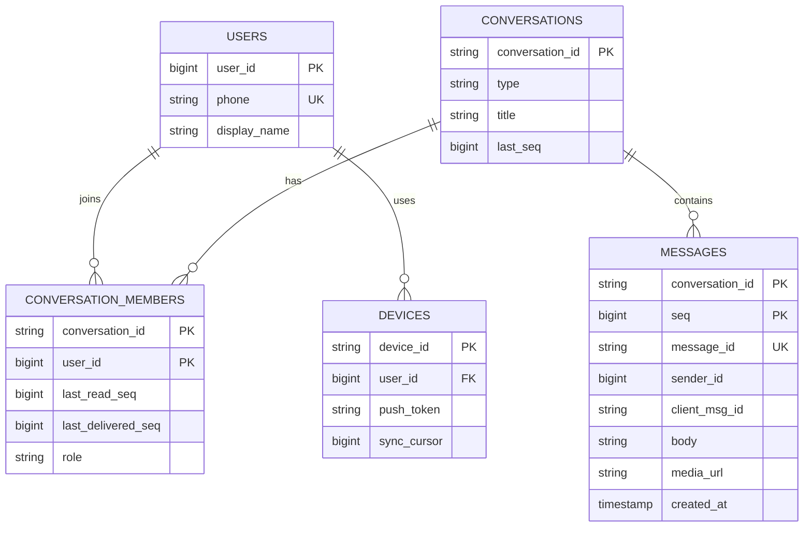

**Storage choice:** messages are written ~500k/s and read as "latest N messages of conversation X" → a **wide-column store (Cassandra, ScyllaDB, HBase)** with:
- **Partition key:** `conversation_id` (all messages of a chat together; reads hit one partition).
- **Clustering key:** `seq DESC` (messages stored in order; "last 50" is a sequential read).
- For huge, long-lived groups, bucket the partition by time (`conversation_id, month`) to avoid unbounded partitions.

Facebook Messenger used HBase; Discord moved from Cassandra to ScyllaDB with exactly this model. Users, groups, and membership are relational and smaller → **PostgreSQL/MySQL** (sharded by user/conversation). Connection registry and presence are ephemeral → **Redis**.

### 4.5 High-Level Architecture

> **Level:** 🟢 Essential

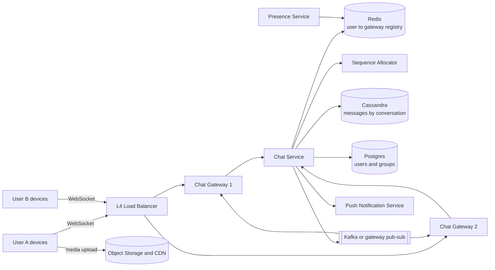

| Component | Responsibility |
|---|---|
| L4 load balancer | Distributes long-lived TCP/WebSocket connections (least-connections works well) |
| Chat gateway | Terminates WebSockets, authenticates, holds connection state, forwards frames; *stateful* by nature |
| Connection registry | `user_id → {device_id → gateway_id}` in Redis with TTL, refreshed by heartbeats |
| Chat service | Stateless business logic: validate membership, assign sequence, persist, route to recipients |
| Sequence allocator | Per-conversation monotonically increasing `seq` (e.g., Redis `INCR conv:123:seq` or the partition owner) |
| Message store | Durable, ordered history |
| Message bus | Delivers messages to the gateway holding the recipient's connection |
| Push service | Notifies offline devices via APNs/FCM ([Notification Service](#3-notification-service)) |
| Presence service | Tracks online/last-seen from heartbeats; fans out presence changes to interested contacts |

### 4.6 Request Flows

> **Level:** 🟢 Essential

**1:1 message, recipient online**

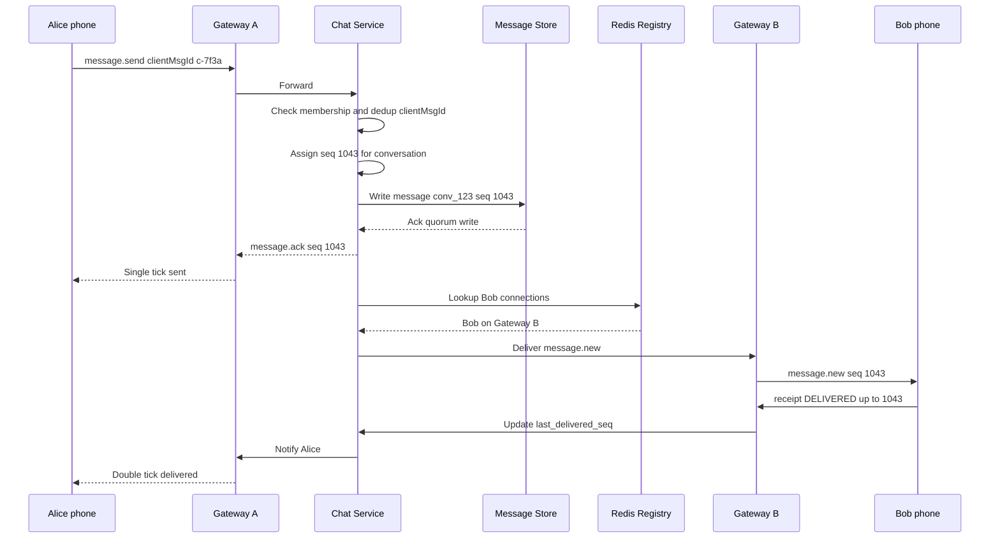

1. The message is **persisted before the sender gets ✓** — durability first.
2. The `seq` gives a single authoritative order per conversation.
3. The registry tells the chat service which gateway holds Bob's connection(s).
4. Delivery receipts flow back the same way and update `last_delivered_seq` (one number per member, not per message).

**Recipient offline, then reconnects**

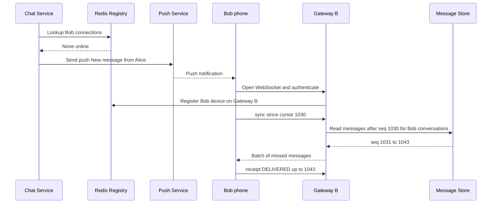

### 4.7 Deep Dives

#### 4.7.1 Connection management and routing

> **Level:** 🟡 Intermediate

- Gateways are **stateful** (they own sockets), so the rest of the system must stay stateless and *find* the right gateway. Options:
  1. **Registry lookup + direct RPC** to the gateway (shown above).
  2. **Pub/sub per user channel:** each gateway subscribes to channels for users it holds (Redis Pub/Sub or Kafka); the chat service publishes to `user:42`. Simpler routing, more pub/sub load.
- **Heartbeats** (e.g., every 30 s) keep NAT/LB connections alive and refresh the registry TTL. Missing heartbeats → the entry expires → user considered offline.
- **Gateway crash:** clients reconnect (with jittered backoff to avoid a reconnect storm) to another gateway and re-sync from their cursor — no message is lost because delivery state lives in the store, not in the gateway.
- **Deployments:** drain connections gradually; send a "reconnect" frame instead of killing sockets.

#### 4.7.2 Message ordering with sequence numbers

> **Level:** 🟡 Intermediate

- **Don't order by client timestamps** — device clocks are wrong and skewed.
- Assign a **per-conversation, monotonically increasing `seq`** at the server (single writer per conversation: Redis `INCR`, or route all writes of a conversation to the same chat-service partition using consistent hashing on `conversation_id`).
- Clients render by `seq`; a gap (`1041, 1043`) tells the client to fetch the missing `1042`.
- Global ordering across all conversations is unnecessary and expensive — only per-conversation order matters. (Kafka gives the same property: order per partition, partition key = `conversation_id`.)

#### 4.7.3 Delivery guarantees, receipts, and multi-device sync

> **Level:** 🟡 Intermediate → 🔴 Advanced

- **At-least-once + idempotency:** the client retries a send until it gets an ack; the server dedups by `(conversation_id, client_msg_id)`. The receiving client dedups by `message_id`. Result: effectively exactly-once display.
- **Receipts are cumulative:** "delivered/read up to seq N" — one update covers many messages, which saves enormous write volume.
- **Multi-device:** each device keeps its own `sync_cursor`. On reconnect: `GET /sync?since=cursor` returns all newer events (messages, receipts, membership changes). The server fans out to *all* online devices of the recipient and to the sender's other devices.
- **Group read receipts:** store `last_read_seq` per member; "read by 37 of 50" is computed from member rows, not per-message rows.

#### 4.7.4 Group chat fan-out

> **Level:** 🔴 Advanced

| Group size | Strategy |
|---|---|
| Small/medium (≤ ~500) | **Fan-out on write:** store the message once in the conversation partition, then push to each online member's gateway; offline members get push notifications and sync later |
| Very large channels (Slack/Discord/Telegram channels with 100k+) | **Fan-out on read:** store once; online clients viewing the channel get it via a channel subscription; others pull on open. Don't push notifications to everyone |

The message is stored **once per conversation**, not once per recipient — the per-member state is just `last_delivered_seq` / `last_read_seq`.

#### 4.7.5 Presence

> **Level:** 🟡 Intermediate

- Online = recent heartbeat; store `presence:42 = {status, lastSeen}` in Redis with TTL.
- Fan-out presence changes only to contacts who currently have that chat open (subscribe on open), not to all contacts — otherwise one login triggers thousands of updates.
- Debounce flapping (mobile network changes) — mark offline only after, e.g., 30–60 s without heartbeat.

#### 4.7.6 End-to-end encryption

> **Level:** 🔴 Advanced (mention, don't deep dive unless asked)

With E2EE (Signal protocol, used by WhatsApp), the server stores only ciphertext and per-device public keys; each message is encrypted for each recipient device. Consequences: no server-side search, multi-device needs per-device key management, and group messages use sender keys to avoid encrypting N times.

### 4.8 Scaling Strategy

> **Level:** 🟡 Intermediate

1. **Gateways** scale horizontally by connection count; tune kernel limits (file descriptors, epoll) and use event-driven servers (Netty, Go).
2. **Chat service** is stateless; partition work by `conversation_id` so a conversation's ordering lives on one owner.
3. **Message store** shards by `conversation_id` (Cassandra token ring with consistent hashing); replication factor 3 with quorum writes.
4. **Registry/presence** in Redis Cluster.
5. **Multi-region:** users connect to the nearest region; a conversation has a home region for sequencing; cross-region delivery via replicated bus. Users in different regions see slightly higher latency.
6. **Media** never flows through chat servers — pre-signed uploads to object storage, CDN for downloads.

### 4.9 Bottlenecks and Failure Handling

> **Level:** 🟡 Intermediate

| What fails | Impact | Mitigation |
|---|---|---|
| Gateway crash | Its users disconnect | Clients reconnect with jittered backoff and sync from cursor |
| Mass reconnect after outage | Thundering herd on auth and sync | Jittered backoff, admission control, rate-limited sync batches |
| Registry stale entry | Message sent to a dead gateway | Delivery failure → treat as offline → push + sync on reconnect |
| Hot group (huge, very active) | One partition overloaded | Time-bucketed partitions; fan-out on read for big channels |
| Message store write latency | Slow ✓ ticks | Quorum writes within region, async cross-region replication |
| Sequence allocator down | Can't order new messages | Seq owned by the partition owner with failover; Redis with replicas |
| Network flaps on mobile | Duplicate sends | `clientMsgId` dedup on server, `messageId` dedup on client |

### 4.10 Trade-offs and Alternatives

> **Level:** 🟡 Intermediate

| Decision | Chosen | Alternative | Why |
|---|---|---|---|
| Transport | WebSocket | Long polling / SSE | Bidirectional, low overhead per message; long polling as fallback for restrictive networks |
| Ordering | Server-assigned per-conversation seq | Client timestamps / global order | Correct and cheap; global ordering isn't needed |
| Storage | Cassandra/ScyllaDB/HBase | MySQL | Massive write throughput; partition-local ordered reads |
| Group fan-out | Write-time push for small groups, read-time for large | Always fan-out on write | Large channels would explode write volume |
| Server retention | Keep history (multi-device) | Delete after delivery (classic WhatsApp) | Product decision: sync across devices vs storage/privacy |
| Receipts | Cumulative per member | Per message per member | Orders of magnitude fewer writes |

### 4.11 Interviewer Follow-ups

> **Level:** 🟡 Intermediate → 🔴 Advanced

**Q1. How does the server know which machine to send Bob's message to?**
> A connection registry in Redis maps `user → device → gateway`, written on connect and refreshed by heartbeats with a TTL. The chat service looks it up and calls that gateway (or publishes to Bob's pub/sub channel that the gateway subscribes to). If Bob isn't found, he's offline: we push-notify and he syncs on reconnect.

**Q2. How do you guarantee ordering in a group where three people send at once?**
> All messages for a conversation are sequenced by one owner — a per-conversation counter — so the server assigns 1043, 1044, 1045 in arrival order and everyone renders by seq. The order may differ from the senders' wall clocks, but it's identical for all participants, which is what matters.

**Q3. Why do you persist the message before acknowledging the sender?**
> The single tick is a durability promise. If we acked first and the server crashed, the sender would believe the message was sent but it would be lost. Persist with a quorum write, then ack.

**Q4. What happens if the recipient's phone is off for a week?**
> Messages stay in the store; each device has a sync cursor. On reconnect it calls sync and pulls everything after its cursor in batches. A push notification was sent when the message arrived.

**Q5. How would you implement "typing…" indicators cheaply?**
> As ephemeral frames: never persisted, sent only to members currently connected and viewing the conversation, throttled to one event per few seconds, and auto-expired on the client after ~5 s.

**Q6. How do you handle 200M concurrent connections?**
> Event-driven gateways (Netty/Go) with tuned OS limits holding 100k+ connections each, an L4 load balancer using least-connections, horizontal scaling to thousands of gateways, and keeping gateways thin — all logic lives in stateless services behind them.

**Q7. How does end-to-end encryption change your design?**
> The server can't read content, so no server-side search or content moderation; we store per-device public keys and ciphertext only, and each message is encrypted per recipient device (or with sender keys for groups). Multi-device sync must re-encrypt for newly added devices.

### 4.12 Quick Revision

- **WebSocket gateways** (stateful) + **stateless chat service** + **Redis connection registry**.
- **Persist then ack**; per-conversation **seq** defines order; dedup with `clientMsgId`.
- Message store: **Cassandra/HBase, partition by conversation, cluster by seq**.
- Offline: **push + sync from per-device cursor**; receipts are **cumulative** (`up to seq N`).
- Small groups fan-out on write; huge channels fan-out on read; presence via heartbeats with TTL.

---

## 5. News Feed

> **Level:** 🟢 Essential core (fan-out choice) · 🔴 Advanced for ranking and hybrid fan-out — "Design the Twitter/X timeline, Instagram feed, or Facebook News Feed".

**The problem in one line:** When a user opens the app, show a fresh, personalized list of posts from the people they follow — in under ~200 ms — even though some accounts have 100M followers.

### 5.1 Requirements

> **Level:** 🟢 Essential

**Functional requirements**
- Users create posts (text + optional media).
- Users follow other users (asymmetric follow, like Twitter/Instagram).
- Home feed shows posts from followed accounts, newest first or ranked; infinite scroll.
- Likes and comments counts shown on posts.

**Non-functional requirements**

| NFR | Target | Why |
|---|---|---|
| Feed latency | p99 < 200 ms | Home screen is the most-used screen |
| Availability | 99.99%; serve a slightly stale feed rather than an error | AP choice — staleness is fine |
| Freshness | New posts appear in followers' feeds within seconds to a minute | Eventual consistency is acceptable |
| Scale | 200M DAU, read-heavy (~20:1) | Optimize reads |

**Out of scope:** ads insertion, search, notifications, DMs, content moderation pipelines.

### 5.2 Capacity Estimation

> **Level:** 🟡 Intermediate

```
Users and posts
  200M DAU; 0.5 posts per user per day     → 100M posts/day ≈ 1,200 posts/s (peak ~3,000)
  Feed opens: 10 per user per day           → 2B feed reads/day ≈ 23,000/s (peak ~50,000)

Fan-out volume (if we push every post to every follower)
  Average followers per poster ≈ 200
  100M posts × 200 = 20B feed inserts/day ≈ 230,000 inserts/s
  A celebrity with 100M followers → one post = 100M inserts (the "celebrity problem")

Feed cache
  Store top 500 post IDs per active user: 500 × 8 B ≈ 4 KB (+ overhead ~10 KB in Redis)
  200M active users × 10 KB ≈ 2 TB → Redis Cluster (~60–100 nodes) — only for active users

Post storage
  ~1 KB per post (text + metadata) × 100M/day = 100 GB/day ≈ 36 TB/year
  Media: assume 20% of posts have a 500 KB image → 10 TB/day → object storage + CDN
```

### 5.3 API Design

> **Level:** 🟢 Essential

```http
POST /api/v1/posts
{ "text": "Shipping the new release today!", "mediaIds": ["med_91a"] }
201 Created  { "postId": "p_1849375839", "createdAt": "2026-10-27T09:00:00Z" }

GET /api/v1/feed?limit=20&cursor=eyJzY29yZSI6MTc5...
200 OK
{
  "items": [
    { "postId": "p_1849375839", "author": {"id": 77, "name": "Ravi"}, "text": "...",
      "mediaUrls": ["https://cdn.example.com/m/91a.jpg"], "likeCount": 120, "createdAt": "..." }
  ],
  "nextCursor": "eyJzY29yZSI6MTc4..."
}

POST   /api/v1/users/{id}/follow      → 204
DELETE /api/v1/users/{id}/follow      → 204
POST   /api/v1/posts/{id}/like        → 204 (idempotent per user)
```

**Cursor pagination, not offset:** new posts are constantly inserted at the top, so `OFFSET 20` would show duplicates or skip items. The cursor encodes the last seen (score, postId). See [REST API Design](02_networking_and_communication.md#7-rest-api-design).

### 5.4 Data Model

> **Level:** 🟡 Intermediate

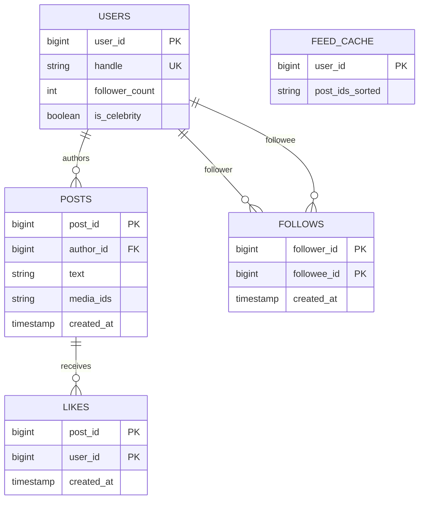

| Data | Store | Why |
|---|---|---|
| Posts | Cassandra/DynamoDB keyed by `post_id` (Snowflake IDs are time-sortable), plus `author_id → post_ids` table | Huge volume, simple key access, "posts by author, newest first" |
| Follow graph | Sharded MySQL/Postgres or a graph store; two indexes: `followers_of(x)` and `following_of(x)` | Fan-out needs followers; read-time merge needs followees |
| Feed cache | **Redis sorted sets** `feed:{userId}` → (score = time or rank, member = postId), trimmed to ~500 | Fast range reads and inserts |
| Like counts | Redis counters + periodic flush to DB | Avoid hot rows on viral posts |
| Media | Object storage + CDN | Large immutable blobs |

### 5.5 High-Level Architecture

> **Level:** 🟢 Essential

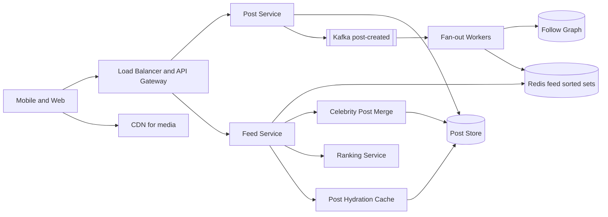

| Component | Responsibility |
|---|---|
| Post Service | Validates and stores posts, publishes `post-created` events |
| Fan-out workers | For normal authors, push the post ID into each follower's feed cache |
| Follow graph | Who follows whom (both directions) |
| Feed cache | Precomputed list of post IDs per active user |
| Feed Service | Reads cached IDs, merges celebrity posts at read time, ranks, hydrates, paginates |
| Ranking service | Scores candidates (recency, affinity, engagement) — optional for chronological feeds |
| Hydration cache | `post_id → post object + author + counts` (Redis/Memcached) |
| CDN | Serves images and video |

### 5.6 Request Flows

> **Level:** 🟢 Essential

**Write path — publish a post (normal user)**

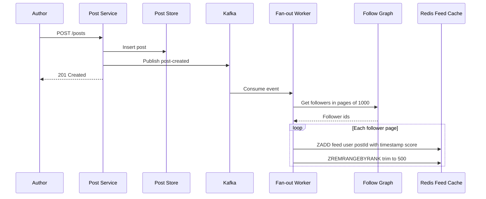

**Read path — open the home feed (hybrid model)**

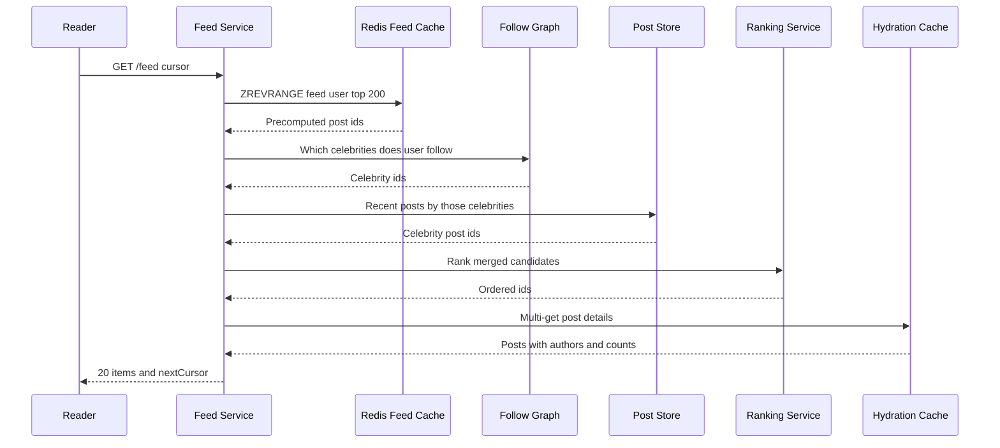

**Cold or inactive user:** if `feed:{userId}` doesn't exist (user inactive for weeks, so we didn't fan out to them), fall back to **fan-out on read** — fetch recent posts of followees, merge, rank, and write the result to the cache.

### 5.7 Deep Dives

#### 5.7.1 Fan-out on write vs fan-out on read vs hybrid

> **Level:** 🟢 Essential — the core of this question

| | Fan-out on write (push) | Fan-out on read (pull) | Hybrid |
|---|---|---|---|
| How | On post, insert the post ID into every follower's feed | On feed open, fetch recent posts of every followee and merge | Push for normal users; pull for celebrities at read time |
| Read latency | Very fast (precomputed) | Slow for users following thousands | Fast |
| Write cost | Huge for authors with many followers | Cheap | Bounded |
| Wasted work | Pushes to inactive users | None | Skip inactive users |
| Freshness | Delay while fan-out runs | Always fresh | Fresh |
| Best for | Most users (follower counts in hundreds) | Celebrities, very inactive readers | Production systems (Twitter, Instagram) |

**The celebrity problem:** a user with 100M followers would generate 100M cache writes per post, delaying everyone's feed and saturating Redis. Solution: mark accounts above a threshold (e.g., > 100k followers) as celebrities, **skip fan-out** for them, and merge their recent posts at read time (each reader follows only a handful of celebrities, so the read-time merge is small and the celebrity's recent posts are themselves heavily cached).

**Further optimizations:** fan out only to followers active in the last N days; prioritize fan-out to online users first; run fan-out at lower priority than user-facing reads.

#### 5.7.2 Feed cache design

> **Level:** 🟡 Intermediate

- `feed:{userId}` = Redis **sorted set**: member = `postId`, score = `created_at` (chronological) or a precomputed rank score.
- Store **IDs only**, not post bodies — a post edit or delete then needs no fan-out; bodies come from the hydration cache.
- Trim to ~500–1,000 entries; older pages fall back to pull from the post store.
- Deletions: remove from the post store and mark deleted in the hydration cache; feeds filter out tombstoned IDs during hydration (lazy cleanup instead of un-fan-out).

```java
// Fan-out worker: push a post into one follower's feed (Spring Data Redis)
public void pushToFeed(long followerId, long postId, long createdAtMillis) {
    String key = "feed:" + followerId;
    redis.opsForZSet().add(key, String.valueOf(postId), createdAtMillis);
    redis.opsForZSet().removeRange(key, 0, -501);   // keep newest 500
    redis.expire(key, Duration.ofDays(14));          // inactive users fall out
}
```

#### 5.7.3 Ranking

> **Level:** 🔴 Advanced

Chronological is simplest. Ranked feeds use two stages:
1. **Candidate generation:** ~500–1,000 posts from the feed cache + celebrity merge (+ recommended content).
2. **Scoring:** an ML model predicts engagement probability from features (author affinity, post age, media type, past interactions, like velocity). A simplified hand-tuned version: `score = affinity × weight(type) × engagement / (age_hours + 2)^1.5`.

Keep ranking fast (< 50 ms) by caching features and pre-scoring at fan-out time where possible. Cursor encodes the rank snapshot so pagination is stable.

#### 5.7.4 Counters and hot posts

> **Level:** 🟡 Intermediate

A viral post can receive 100k likes/s. Writing `UPDATE posts SET likes = likes + 1` creates a hot row. Instead: `INCR likes:{postId}` in Redis (or sharded counters `likes:{postId}:{0..15}`), record individual likes asynchronously, and flush aggregated counts to the DB periodically. Displayed counts are approximate in real time — acceptable.

### 5.8 Scaling Strategy

> **Level:** 🟡 Intermediate

- **Read path:** feed cache + hydration cache absorb almost all reads; stateless feed service scales horizontally.
- **Write path:** Kafka buffers fan-out; workers scale by lag; fan-out is idempotent (ZADD of the same member is a no-op), so retries are safe.
- **Shard** the follow graph by user ID; Redis Cluster for feeds; post store by `post_id`.
- **Media** via CDN with pre-signed uploads.
- **Multi-region:** regional feed caches; posts replicated asynchronously across regions (eventual consistency is acceptable).

### 5.9 Bottlenecks and Failure Handling

> **Level:** 🟡 Intermediate

| What fails | Impact | Mitigation |
|---|---|---|
| Celebrity post | Fan-out storm | Hybrid model: no fan-out for celebrities |
| Fan-out lag | Posts appear late | Prioritize active users; autoscale workers; alert on lag |
| Redis feed shard down | Feeds missing for some users | Replicas + failover; fallback to fan-out on read |
| Hot post counters | DB write hotspot | Redis counters, sharded counters, async flush |
| Post store slow | Hydration latency | Hydration cache, multi-get, timeouts with partial results |
| Ranking service down | No personalization | Graceful degradation to chronological feed |

### 5.10 Trade-offs and Alternatives

> **Level:** 🟡 Intermediate

| Decision | Chosen | Alternative | Why |
|---|---|---|---|
| Fan-out | Hybrid push/pull | Pure push or pure pull | Push gives fast reads; pull fixes celebrities and inactive users |
| Feed contents | Post IDs only | Full post objects | Edits/deletes need no re-fan-out; less memory |
| Consistency | Eventual | Strong | A post appearing seconds later is fine; availability matters more |
| Pagination | Cursor | Offset | Stable under constant inserts at the top |
| Counters | Approximate, async | Exact, synchronous | Avoid hot rows |

### 5.11 Interviewer Follow-ups

> **Level:** 🟡 Intermediate → 🔴 Advanced

**Q1. Why not just compute the feed with a SQL query at read time?**
> `SELECT * FROM posts WHERE author_id IN (500 followees) ORDER BY created_at DESC LIMIT 20` hits many shards, sorts large sets, and runs 23k times per second at average load — too slow and expensive. Precomputing the feed moves the work to write time, where it's done once per post instead of once per read.

**Q2. How do you handle a user who follows 5,000 accounts including 50 celebrities?**
> The precomputed part covers the 4,950 normal accounts. At read time we fetch recent posts of the 50 celebrities — their recent posts are cached because millions read them — merge with the cached feed, and rank. That's a bounded, cache-friendly merge.

**Q3. A user unfollows someone — what happens to their feed?**
> Remove that author's post IDs from the feed lazily: filter at read time against the current followee set, and optionally run an async cleanup job. Exact immediate removal isn't required.

**Q4. A post is deleted — do you remove it from millions of feeds?**
> No. Feeds hold IDs; hydration finds the post marked deleted and drops it. Cache entries age out naturally.

**Q5. How does pagination stay stable while new posts arrive?**
> The cursor encodes the last (score, postId) seen; the next page queries strictly below it. New posts land above the cursor, so they don't shift pages; the client shows a "new posts" pill to refresh the top.

**Q6. How would you add ads or recommended posts?**
> Treat them as additional candidate sources merged in the ranking stage with slot rules (e.g., an ad every 8 items), served from separate services so failures degrade gracefully.

### 5.12 Quick Revision

- Core trade-off: **fan-out on write** (fast reads) vs **on read** (cheap writes) → **hybrid** with celebrity threshold.
- Feed cache = **Redis sorted set of post IDs**, trimmed, only for active users; hydrate from a post cache.
- **Cursor pagination**; eventual consistency is fine.
- Hot counters in Redis, async flush; ranking degrades to chronological on failure.
- Media through **CDN**; fan-out via **Kafka** workers, idempotent and scaled on lag.

---

## 6. File Storage and Sharing Service

> **Level:** 🟡 Intermediate core · 🔴 Advanced for sync and conflict resolution — "Design Dropbox / Google Drive / OneDrive".

**The problem in one line:** Let users upload files of any size, keep them in sync across all their devices, share them with others, and never lose a byte — while storing petabytes cheaply.

### 6.1 Requirements

> **Level:** 🟢 Essential

**Functional requirements**
- Upload, download, delete, rename, move files and folders.
- Automatic sync across a user's devices (desktop client watches a folder).
- Share files/folders with users (viewer/editor) or via link.
- File version history (restore previous versions for 30+ days).
- Large files (up to, say, 50 GB) with resumable uploads.
- Notify devices when something changes.

**Non-functional requirements**

| NFR | Target | Why |
|---|---|---|
| Durability | 99.999999999% (11 nines) for stored content | Losing a user's file is unforgivable |
| Consistency | Metadata strongly consistent (a file has one current version); content immutable | Users must not see corrupted trees |
| Availability | 99.9–99.99% | Users can work offline and sync later |
| Efficiency | Don't re-upload unchanged data; dedup identical content | Bandwidth and storage cost |
| Latency | Small changes sync within seconds | Feels live |

**Out of scope:** real-time collaborative editing (Google Docs-style operational transforms), full-text search inside files, virus scanning details.

### 6.2 Capacity Estimation

> **Level:** 🟡 Intermediate

```
Users
  500M registered, 50M DAU
  Average stored per user: 10 GB → 500M × 10 GB = 5 EB logical
  After dedup (~30% savings) ≈ 3.5 EB; with erasure coding (~1.4× overhead) ≈ 5 EB raw
  (Most users store far less; heavy users dominate — still exabyte scale)

Uploads
  50M DAU × 2 file changes/day = 100M changes/day ≈ 1,200/s (peak ~3,000/s)
  Average changed data per change ~1 MB (chunk-level delta) → ~1.2 GB/s ingress average

Chunks
  4 MB chunks; 100M changes × ~1 chunk ≈ 100M chunk writes/day

Metadata
  Files: 500M users × 2,000 files = 1 trillion file rows (!) × ~500 B ≈ 500 TB
  → metadata DB must be sharded (by user / namespace)

Notifications
  50M concurrently connected desktop clients holding long-poll connections
```

### 6.3 API Design

> **Level:** 🟢 Essential

```http
# 1. Start an upload: client sends the file's chunk hashes
POST /api/v1/files/upload-session
{ "path": "/Photos/trip.mov", "size": 734003200,
  "chunkHashes": ["sha256:9f2c...", "sha256:a71b...", "..."], "baseRevision": 17 }

200 OK
{ "sessionId": "up_55c1",
  "missingChunks": [
    { "hash": "sha256:a71b...", "uploadUrl": "https://blobs.example.com/...signed..." }
  ] }          # chunks the server already has are skipped (dedup)

# 2. Client PUTs each missing chunk directly to object storage via its pre-signed URL

# 3. Commit: metadata transaction creates the new revision
POST /api/v1/files/upload-session/up_55c1/commit
200 OK { "fileId": "f_812", "revision": 18 }
409 Conflict { "currentRevision": 18, "message": "File changed on another device" }
```

```http
GET  /api/v1/files/{fileId}/download          → list of chunk URLs (pre-signed, CDN-backed)
GET  /api/v1/files/{fileId}/revisions          → version history
POST /api/v1/files/{fileId}/restore { "revision": 15 }
POST /api/v1/shares { "fileId": "f_812", "granteeEmail": "a@x.com", "role": "VIEWER" }
POST /api/v1/links  { "fileId": "f_812", "expiresAt": "...", "password": "..." } → share link
GET  /api/v1/changes?cursor=c_9912             → changes since cursor (sync)
GET  /api/v1/changes/longpoll?cursor=c_9912    → blocks up to ~60 s until something changes
```

### 6.4 Data Model

> **Level:** 🟡 Intermediate

```mermaid
erDiagram
    USERS ||--o{ NAMESPACES : "owns"
    NAMESPACES ||--o{ FILES : "contains"
    FILES ||--o{ FILE_REVISIONS : "has"
    FILE_REVISIONS ||--o{ REVISION_CHUNKS : "lists"
    CHUNKS ||--o{ REVISION_CHUNKS : "referenced by"
    FILES ||--o{ SHARES : "shared via"
    NAMESPACES ||--o{ JOURNAL : "records"
    USERS {
        bigint user_id PK
        string email UK
        bigint quota_bytes
    }
    NAMESPACES {
        bigint namespace_id PK
        bigint owner_id FK
    }
    FILES {
        bigint file_id PK
        bigint namespace_id FK
        bigint parent_id
        string name
        boolean is_folder
        bigint current_revision
        boolean is_deleted
    }
    FILE_REVISIONS {
        bigint file_id PK
        bigint revision PK
        bigint size
        bigint device_id
        timestamp created_at
    }
    REVISION_CHUNKS {
        bigint file_id PK
        bigint revision PK
        int chunk_index PK
        string chunk_hash FK
    }
    CHUNKS {
        string chunk_hash PK
        string storage_location
        int ref_count
        int size
    }
    SHARES {
        bigint file_id PK
        bigint grantee_id PK
        string role
    }
    JOURNAL {
        bigint namespace_id PK
        bigint journal_seq PK
        bigint file_id
        string op
    }
```

**Separate metadata from content** — the single most important decision:

| Data | Store | Why |
|---|---|---|
| File tree, revisions, shares, journal | **Sharded relational DB** (MySQL/Postgres, sharded by `namespace_id`) — Dropbox built "Edgestore" on MySQL | Needs transactions: a commit atomically creates a revision, updates the current pointer, and appends to the journal |
| Chunk content | **Object storage** (S3 / GCS / in-house like Dropbox Magic Pocket), keyed by content hash | Immutable blobs, cheap, 11-nines durability via replication/erasure coding |
| Chunk index (hash → location, refcount) | Sharded KV store | Dedup lookups at very high rate |
| Change notifications | Redis / in-memory notification servers | Ephemeral |

See [Object, File and Block Storage](03_databases_and_storage.md#13-object-file-and-block-storage).

### 6.5 High-Level Architecture

> **Level:** 🟢 Essential

```mermaid
flowchart LR
    desktop["Desktop and Mobile Clients<br/>watcher, chunker, local DB"] --> lb["Load Balancer and API Gateway"]
    lb --> meta["Metadata Service"]
    lb --> notify["Notification Service<br/>long-poll"]
    meta --> metaDB[("Sharded Metadata DB")]
    meta --> chunkIdx[("Chunk Index KV")]
    meta --> signer["Pre-signed URL Issuer"]
    desktop -->|"PUT chunks directly"| blob[("Object Storage")]
    desktop -->|"GET chunks"| cdn["CDN"]
    cdn --> blob
    meta --> bus[["Kafka change events"]]
    bus --> notify
    bus --> workers["Async Workers<br/>thumbnails, virus scan, GC"]
    workers --> blob
```

| Component | Responsibility |
|---|---|
| Client | Watches the local folder, splits files into chunks, hashes them, keeps a local metadata DB, uploads only missing chunks, applies remote changes |
| Metadata service | Upload sessions, dedup check, commit transactions, revisions, permissions, change journal |
| Pre-signed URL issuer | Short-lived URLs so clients upload/download chunks **directly** to object storage (no data through app servers) |
| Object storage | Durable chunk storage keyed by hash |
| Notification service | Holds long-poll connections; wakes clients when their namespace's journal advances |
| Async workers | Thumbnails/previews, malware scan, garbage-collect unreferenced chunks, cold-tier migration |

### 6.6 Request Flows

> **Level:** 🟢 Essential

**Upload a changed file (only modified chunks travel)**

```mermaid
sequenceDiagram
    participant C as Desktop Client
    participant M as Metadata Service
    participant I as Chunk Index
    participant S as Object Storage
    participant DB as Metadata DB
    participant K as Kafka
    C->>C: Detect change, split into 4 MB chunks, SHA-256 each
    C->>M: Create upload session with chunk hashes and baseRevision 17
    M->>I: Which hashes already exist
    I-->>M: All except a71b
    M-->>C: missingChunks a71b with pre-signed URL
    C->>S: PUT chunk a71b
    S-->>C: 200 OK
    C->>M: Commit session
    M->>DB: BEGIN, check current_revision is 17, insert revision 18, update pointer, append journal, COMMIT
    DB-->>M: OK
    M->>K: Publish namespace changed
    M-->>C: 200 revision 18
```

**Another device learns about the change**

```mermaid
sequenceDiagram
    participant D as Laptop Client
    participant N as Notification Service
    participant K as Kafka
    participant M as Metadata Service
    participant CDN as CDN and Object Storage
    D->>N: Long-poll changes for cursor c_9912
    K->>N: Namespace changed event
    N-->>D: Changes available
    D->>M: GET changes since c_9912
    M-->>D: File f_812 revision 18 with chunk list and new cursor
    D->>D: Compare with local chunks, find only a71b missing
    D->>CDN: GET chunk a71b
    CDN-->>D: Chunk bytes
    D->>D: Reassemble file, verify hashes, update local DB
```

### 6.7 Deep Dives

#### 6.7.1 Chunking and deduplication

> **Level:** 🟡 Intermediate

- Split files into chunks (Dropbox uses 4 MB). Each chunk is identified by its **content hash (SHA-256)**.
- **Delta sync:** editing a 2 GB video's metadata changes one or two chunks — only those upload. Fixed-size chunks break when bytes are inserted at the start (everything shifts); **content-defined chunking** (rolling hash, Rabin fingerprints) picks boundaries from content so insertions affect only nearby chunks.
- **Dedup:** before uploading, the client sends hashes; the server says which it already has. Identical chunks across files (or across users) are stored once with a reference count.
- **Security caveat:** cross-user dedup can leak "this file exists somewhere" (a confirmation attack). Mitigations: dedup only within a user/team namespace, or require proof of possession.
- **Resumable uploads** fall out naturally: chunks already uploaded are skipped on retry.

#### 6.7.2 Metadata consistency and the commit protocol

> **Level:** 🔴 Advanced

- Chunks are uploaded first and are immutable; the **commit is a single metadata transaction** — so a crash mid-upload leaves no half-written file, just orphaned chunks for garbage collection.
- **Optimistic concurrency:** the commit carries `baseRevision`. If the server's current revision differs, someone else changed the file → `409 Conflict`.
- Shard metadata by **namespace** (a user's root or a shared folder) so a commit touches one shard — no distributed transaction. Cross-namespace moves are rare and handled with a careful two-step protocol.

#### 6.7.3 Sync protocol and conflict resolution

> **Level:** 🔴 Advanced

- Each namespace has an **append-only journal** with a monotonically increasing `journal_seq`. A client's **cursor** = last seq it has applied. "What changed?" = `journal rows where seq > cursor` — simple, resumable, works after weeks offline.
- **Notification via long polling:** clients hold an HTTP request open (~60 s) to the notification service; it returns immediately when the namespace advances. Long polling (rather than WebSockets) is simple, firewall-friendly, and enough because the payload is just "something changed — go fetch". See [Real-Time Communication](02_networking_and_communication.md#6-real-time-communication).
- **Conflicts:** two devices edit the same file offline. The first commit wins (revision 18). The second gets `409`; the client keeps the server version and saves its own as **"trip (Asha's conflicted copy 2026-10-27).mov"**. Automatic merging is only safe for specific formats (that's Google Docs-style collaboration, out of scope).
- Deletes are tombstones in the journal (and the revision remains for restore).

#### 6.7.4 Sharing and permissions

> **Level:** 🟡 Intermediate

- A shared folder is its own **namespace** mounted into each member's tree; permission checks happen on namespace access (`SHARES` / ACL rows), and members' clients follow that namespace's journal too.
- Link sharing: random unguessable token → `{fileId, role, expiry, password hash}`; downloads go through pre-signed, short-lived URLs.
- Permission checks are on the hot path → cache ACLs per (user, namespace) with short TTL and invalidate on change.

#### 6.7.5 Durability, versioning, and cost

> **Level:** 🟡 Intermediate

- Object storage provides durability via replication across availability zones or **erasure coding** (e.g., split into 10 data + 4 parity fragments; any 10 reconstruct the chunk at ~1.4× overhead instead of 3× for triple replication).
- Versions are cheap: a revision is just a new list of chunk hashes; unchanged chunks are shared.
- **Garbage collection:** decrement refcounts when revisions expire; delete chunks at zero after a grace period (protects against races with in-flight uploads).
- **Tiering:** move rarely accessed chunks to cold storage (S3 Glacier-like) to cut cost.

### 6.8 Scaling Strategy

> **Level:** 🟡 Intermediate

- Content path scales via **object storage + CDN**; app servers never proxy bytes (pre-signed URLs).
- Metadata DB **sharded by namespace**; read replicas for listing/browsing; cache hot folder listings.
- Chunk index sharded by hash prefix (uniform distribution).
- Notification servers scale by connection count; namespace → server mapping via consistent hashing, fed by Kafka.
- Clients batch small changes and apply backoff during server pressure.

### 6.9 Bottlenecks and Failure Handling

> **Level:** 🟡 Intermediate

| What fails | Impact | Mitigation |
|---|---|---|
| Upload interrupted | Partial upload | Chunk-level resume; uncommitted chunks GC'd later |
| Commit races between devices | Lost update | Optimistic concurrency on `baseRevision`; conflicted copies |
| Metadata shard down | Namespace read-only/unavailable | Replicated shards with failover; clients keep working offline and retry |
| Object storage region outage | Downloads fail | Cross-region replication of chunks; CDN caches |
| Notification service down | Changes noticed late | Clients fall back to periodic polling of `/changes` |
| Huge shared folder (millions of files) | Slow listing/sync | Paginated listing, journal compaction, snapshots for initial sync |
| Corrupted chunk | Bad file | Hash verification on upload and download; repair from replicas |

### 6.10 Trade-offs and Alternatives

> **Level:** 🟡 Intermediate

| Decision | Chosen | Alternative | Why |
|---|---|---|---|
| Content vs metadata | Separate stores | Store files in DB | Blobs belong in object storage; metadata needs transactions |
| Upload path | Client → object storage via pre-signed URLs | Through app servers | Removes app servers from the data path; cheaper, scales better |
| Chunking | Content-defined chunks + hashes | Whole-file upload | Delta sync, dedup, resumability; costs client CPU |
| Change notification | Long polling + cursor | WebSockets / periodic polling | Simple, firewall-friendly, near-real-time; payload is tiny |
| Conflicts | Conflicted copy | Last-write-wins / auto-merge | Never silently loses data |
| Dedup scope | Per namespace or team | Global cross-user | Avoids existence-leak attacks at some storage cost |

### 6.11 Interviewer Follow-ups

> **Level:** 🟡 Intermediate → 🔴 Advanced

**Q1. Why split files into chunks?**
> Three wins: delta sync (only changed chunks upload), deduplication (identical chunks stored once), and resumable, parallel uploads for large files. The cost is client-side hashing and a more complex metadata model.

**Q2. Why not upload files through your API servers?**
> Moving gigabytes through app servers wastes bandwidth and ties up threads. Pre-signed URLs let the client write directly to object storage with a short-lived, scoped permission; the app server only handles small metadata calls.

**Q3. Two devices edit the same file while offline. What happens?**
> Each commit sends its base revision. The first to commit succeeds; the second gets a conflict and the client stores its version as a "conflicted copy" next to the original, so nothing is lost and the user resolves it.

**Q4. How does a device that was offline for a month catch up?**
> It sends its cursor; the server returns journal entries after it in pages. If the journal has been compacted beyond that point, the client does a full resync by comparing its local tree with a server snapshot.

**Q5. How do you guarantee durability of 11 nines?**
> Object storage replicates or erasure-codes chunks across multiple availability zones, verifies checksums continuously, and repairs from healthy fragments. Metadata is replicated synchronously within a region and backed up with point-in-time recovery. See [Disaster Recovery](06_architecture_reliability_and_security.md#12-disaster-recovery-backups-rto-and-rpo).

**Q6. How would you implement "restore my folder to last Tuesday"?**
> Revisions and tombstones are retained; walk the namespace journal back to the timestamp and recreate the revision pointers. Chunks are still present because GC only deletes after retention expires.

**Q7. How does sharing work with sync?**
> A shared folder is a separate namespace with its own journal and ACL; each member's client subscribes to that namespace too, so changes by any member propagate via the same cursor mechanism.

### 6.12 Quick Revision

- **Separate metadata (sharded SQL, transactional) from content (object storage, immutable chunks)**.
- **Chunk + hash** → delta sync, dedup, resumable uploads; **pre-signed URLs** keep bytes off app servers.
- Commit = one metadata transaction with **optimistic concurrency** (`baseRevision`) → conflicted copies.
- Sync = per-namespace **journal + cursor**; notify with **long polling**.
- Durability via replication/erasure coding; GC unreferenced chunks; tier cold data.

---

**Previous:** [Architecture, Reliability and Security](06_architecture_reliability_and_security.md) · **Next:** [Interview Problems Part 2](08_interview_problems_part2.md)
