# System Design Interview Problems — Part 2

> **Part 8 of 10** in the System Design interview notes — see [README](README.md) for the roadmap.
> **What you'll learn:** Complete, step-by-step designs for five heavyweight interview problems — video streaming, ride-hailing, e-commerce, ticket booking, and a logging/metrics platform — with estimates, APIs, data models, diagrams, failure handling, and the follow-up questions interviewers actually ask.
> **Level legend:** 🟢 Essential (asked in almost every interview) · 🟡 Intermediate · 🔴 Advanced / senior
> **Related:** [Interview Problems Part 1](07_interview_problems_part1.md) · [Fundamentals and Framework](01_system_design_fundamentals.md) · [Distributed Systems and Messaging](05_distributed_systems_and_messaging.md) · [Databases and Storage](03_databases_and_storage.md)

## Table of Contents

- [How to Read These Designs](#how-to-read-these-designs)
7. [Video Streaming Platform](#7-video-streaming-platform)
   - [7.1 Requirements](#71-requirements) · [7.7 Deep Dives](#77-deep-dives) · [7.11 Interviewer Follow-ups](#711-interviewer-follow-ups)
8. [Ride-Hailing Application](#8-ride-hailing-application)
   - [8.1 Requirements](#81-requirements) · [8.7 Deep Dives](#87-deep-dives) · [8.11 Interviewer Follow-ups](#811-interviewer-follow-ups)
9. [E-Commerce Platform](#9-e-commerce-platform)
   - [9.1 Requirements](#91-requirements) · [9.7 Deep Dives](#97-deep-dives) · [9.11 Interviewer Follow-ups](#911-interviewer-follow-ups)
10. [Ticket Booking System](#10-ticket-booking-system)
    - [10.1 Requirements](#101-requirements) · [10.7 Deep Dives](#107-deep-dives) · [10.11 Interviewer Follow-ups](#1011-interviewer-follow-ups)
11. [Distributed Logging and Metrics Platform](#11-distributed-logging-and-metrics-platform)
    - [11.1 Requirements](#111-requirements) · [11.7 Deep Dives](#117-deep-dives) · [11.11 Interviewer Follow-ups](#1111-interviewer-follow-ups)

---

## How to Read These Designs

Every design below follows the same 12-step skeleton used in [Part 1](07_interview_problems_part1.md#how-to-read-these-designs), which is the [10-step interview framework](01_system_design_fundamentals.md#10-the-system-design-interview-framework) applied to a concrete problem:

| Step | Section | What you say in the interview |
|---|---|---|
| 1 | Requirements | "Let me confirm what we are building and what we are not." |
| 2 | Capacity Estimation | "Rough numbers so the design is sized correctly." |
| 3 | API Design | "The contract between clients and the system." |
| 4 | Data Model | "What we store and where — and why that database." |
| 5 | High-Level Architecture | "The boxes and arrows." |
| 6 | Request Flows | "Walk one request end to end." |
| 7 | Deep Dives | "The two or three genuinely hard parts." |
| 8 | Scaling Strategy | "What changes at 10x." |
| 9 | Bottlenecks and Failure Handling | "What breaks first, and what happens when it does." |
| 10 | Trade-offs and Alternatives | "What I chose, what I gave up." |
| 11 | Interviewer Follow-ups | Practice answers. |
| 12 | Quick Revision | 60-second recap. |

**How to use them:**

- 🟢 sections are what a junior or mid-level candidate must be able to produce in 45 minutes.
- 🔴 sections are where senior candidates differentiate themselves — you rarely have time for all of them, so pick the one the interviewer leans into.
- Do not memorize the numbers. Memorize the *reasoning chain*: "upload is write-once, read-millions → push bytes to object storage and CDN, keep the app servers out of the byte path."

> **Golden rule:** In every one of these problems, the hard part is *not* the boxes. It is one specific concurrency, scale, or consistency problem: transcoding throughput (video), geospatial matching (ride-hailing), overselling (e-commerce), double booking (tickets), and write volume with cardinality (logging). Find that problem early and spend your time there.

---

## 7. Video Streaming Platform

> Design YouTube or Netflix: users upload videos, the platform processes them, and millions of viewers stream them smoothly on any device and network.

### 7.1 Requirements

> **Level:** 🟢 Essential

**Functional requirements**

1. Creators upload videos (up to several GB).
2. The system processes videos into multiple resolutions (240p → 4K) and formats so any device can play them.
3. Viewers stream videos with adaptive quality (quality drops on a slow network instead of buffering).
4. Viewers can search videos by title, tags, and creator.
5. Show video metadata: title, description, view count, likes.
6. (Nice-to-have) Comments, recommendations, subscriptions.

**Non-functional requirements**

| NFR | Target | Why it matters |
|---|---|---|
| Availability | 99.99% for playback | Playback failure is the most visible failure |
| Playback start latency | < 2 s to first frame | Users abandon slow starts |
| Rebuffering | < 1% of watch time | Core quality metric for streaming |
| Durability | Never lose an uploaded original | Creators cannot re-upload lost content easily |
| Processing time | Video available within minutes of upload | Creator experience |
| Scale | Hundreds of millions of daily viewers, global | Drives CDN-first design |
| Consistency | Eventual is fine for view counts, likes, search | Read-heavy, tolerant of staleness |

**Out of scope (state it explicitly):** recommendation ML models, live streaming (mention as an extension), DRM details, ads, monetization.

> **Interview tip:** Say early: "This is an extremely read-heavy, bandwidth-dominated system. The core design decision is to get video bytes out of my servers and onto a CDN."

### 7.2 Capacity Estimation

> **Level:** 🟢 Essential

**Assumptions**

- 1B monthly users, 200M daily active users (DAU).
- Each DAU watches 5 videos/day, average 5 minutes each.
- Upload ratio: 1 upload per 1,000 views → roughly 500 hours of video uploaded per minute (the commonly quoted YouTube figure).
- Average streamed bitrate: ~2 Mbps (mix of mobile 480p and desktop 1080p).

**Views and QPS**

```
Views/day        = 200M × 5               = 1B views/day
View QPS (avg)   = 1B / 100,000 s (≈86,400) ≈ 10,000 video starts/sec
Peak (×3)        ≈ 30,000 video starts/sec
Concurrent streams ≈ (views/day × minutes per view) / minutes per day
                   ≈ (1B × 5) / 1,440 ≈ 3.5M concurrent streams (average)
Segment GETs/sec   ≈ 3.5M streams / 4-second segments ≈ ~900,000 GET/s  ← CDN must serve these
```

**Egress bandwidth**

```
Concurrent streams × bitrate = 3.5M × 2 Mbps = 7 Tbps average egress
Peak (×2–3)                  ≈ 15–20 Tbps
```

That number alone proves the design must be **CDN-first** — no origin fleet serves 15 Tbps economically.

**Storage**

```
Upload volume: 500 hours/min × 60 min/hour × 24 = 720,000 hours/day
Original at ~1 GB/hour (compressed 1080p upload)     = 720 TB/day of originals
Transcoded renditions (≈6 resolutions × 2 codecs):
   total rendition size ≈ 1.5–3× the original           ≈ 1–2 PB/day
Per year (originals + renditions)                     ≈ 600 PB–1 EB/year
```

Meaning: object storage with lifecycle tiering (rarely watched videos → cold storage, fewer renditions) is mandatory.

**Metadata**

```
Videos/day ≈ 720,000 hours / (avg 10 min ≈ 1/6 hour) ≈ 4.3M videos/day
Metadata ≈ 5 KB/video → ~22 GB/day → ~8 TB/year — small; fits a sharded SQL or wide-column store.
```

| Metric | Value | Design implication |
|---|---|---|
| Video starts | ~10K/s avg, 30K/s peak | Metadata API must be cached |
| Segment GETs | ~1M/s | CDN serves ≥ 95% of these |
| Egress | 7–20 Tbps | CDN + ISP-embedded caches |
| New storage | ~1–2 PB/day | Object storage + tiering |
| Uploads | ~50 videos/sec | Async transcoding pipeline |

### 7.3 API Design

> **Level:** 🟢 Essential

**1. Start an upload (get pre-signed URLs)**

```http
POST /v1/videos/uploads
Authorization: Bearer <token>
Content-Type: application/json

{ "title": "My trip to Ladakh", "sizeBytes": 2147483648, "contentType": "video/mp4" }
```

```json
201 Created
{
  "videoId": "v_8fK2aQ",
  "uploadId": "up_91x",
  "partSizeBytes": 16777216,
  "parts": [
    { "partNumber": 1, "url": "https://upload-bucket.s3.amazonaws.com/...&X-Amz-Signature=..." },
    { "partNumber": 2, "url": "https://upload-bucket.s3.amazonaws.com/..." }
  ],
  "expiresAt": "2026-10-27T12:00:00Z"
}
```

**2. Complete the upload**

```http
POST /v1/videos/v_8fK2aQ/uploads/up_91x/complete
{ "parts": [ { "partNumber": 1, "etag": "\"a1b2\"" }, { "partNumber": 2, "etag": "\"c3d4\"" } ] }
```

```json
202 Accepted
{ "videoId": "v_8fK2aQ", "status": "PROCESSING" }
```

**3. Get playback info**

```http
GET /v1/videos/v_8fK2aQ/playback
```

```json
200 OK
{
  "videoId": "v_8fK2aQ",
  "status": "READY",
  "manifests": {
    "hls":  "https://cdn.example.com/v_8fK2aQ/master.m3u8?token=...",
    "dash": "https://cdn.example.com/v_8fK2aQ/manifest.mpd?token=..."
  },
  "durationSec": 612,
  "thumbnails": "https://cdn.example.com/v_8fK2aQ/thumbs/sprite.jpg"
}
```

**4. Metadata, search, views**

```http
GET  /v1/videos/{videoId}                    → title, creator, viewCount, likes
GET  /v1/search?q=ladakh+trip&cursor=...      → paginated results (cursor-based)
POST /v1/videos/{videoId}/views               → { "watchedSec": 45, "sessionId": "s_77" }  → 202
```

**Design notes**

- Video bytes **never pass through the API servers** — the client uploads straight to object storage with pre-signed URLs, and plays straight from the CDN.
- `POST /views` returns `202 Accepted` because view counting is asynchronous.
- Playback URLs carry a short-lived signed token so CDN content can't be hot-linked forever.

### 7.4 Data Model

> **Level:** 🟢 Essential

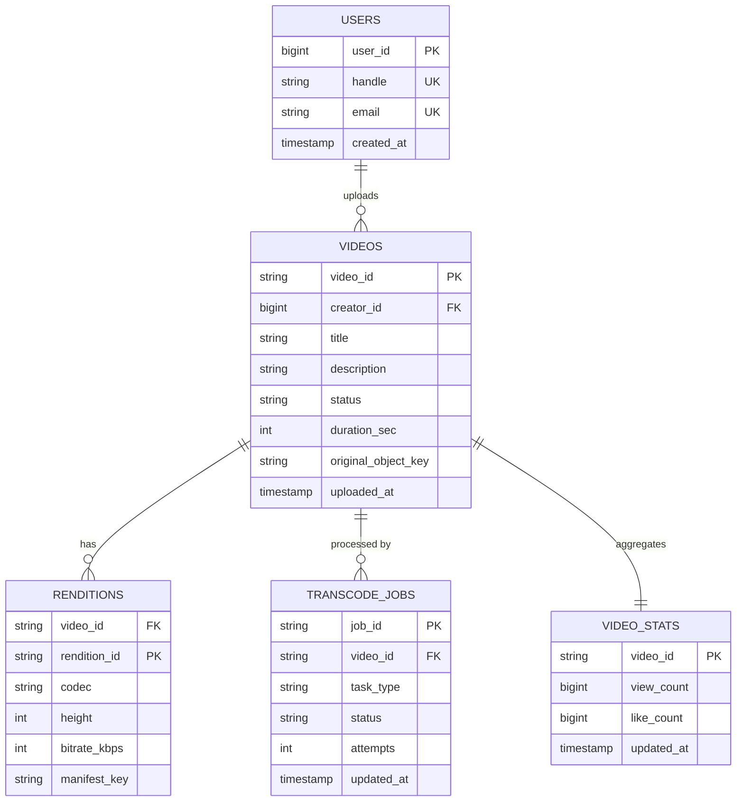

**Where each piece lives — and why**

| Data | Store | Why |
|---|---|---|
| Original + transcoded segments | Object storage (S3/GCS) | Cheap, 11-nines durability, unlimited scale, CDN origin |
| Video metadata, renditions | Sharded MySQL/Postgres (Vitess) or Cassandra, keyed by `video_id` | Simple key lookups, strong consistency on status, YouTube historically used MySQL + Vitess |
| Transcode job state | Same metadata DB or DynamoDB | Needs conditional updates for job state transitions |
| View/like counters | Redis counters + periodically flushed to a wide-column store | Very high write rate, eventual consistency is fine |
| Search index | Elasticsearch / OpenSearch | Full-text search, relevance ranking |
| Watch history | Cassandra (partition key `user_id`, clustering by time) | Write-heavy, time-ordered per user |

### 7.5 High-Level Architecture

> **Level:** 🟢 Essential

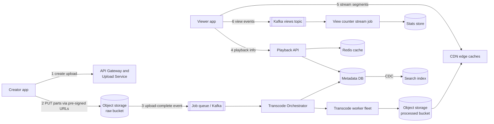

**Diagram walkthrough**

1. The creator asks the Upload Service for an upload session; it creates a `VIDEOS` row with `status=UPLOADING` and returns pre-signed multipart URLs.
2. The creator uploads parts directly to the **raw bucket** — app servers never handle the gigabytes.
3. On completion, object storage emits an event; the **orchestrator** builds a transcoding DAG and enqueues tasks; **workers** write HLS/DASH segments to the **processed bucket** and update metadata to `READY`.
4. A viewer asks the **Playback API** for manifest URLs (cached in Redis, since popular video metadata is read millions of times).
5. The player fetches the manifest and segments from the **CDN**; on a cache miss the CDN pulls from the processed bucket (the *origin*).
6. The player sends view/heartbeat events to Kafka; a stream job aggregates counts.

**Component responsibilities**

| Component | Responsibility | Scales by |
|---|---|---|
| Upload Service | Auth, quota checks, issue pre-signed URLs, create video record | Stateless, horizontal |
| Raw bucket | Durable store of originals | Managed |
| Transcode Orchestrator | Build per-video DAG, track task state, retry failures | Partition by `video_id` |
| Transcode workers | CPU/GPU-heavy ffmpeg jobs | Autoscale on queue depth; spot instances |
| Processed bucket | Segments + manifests, CDN origin | Managed |
| CDN | Serve ~95–99% of bytes from the edge | Provider + ISP-embedded caches (Netflix Open Connect) |
| Playback API | Return manifest URLs, signed tokens, entitlement checks | Stateless + Redis cache |
| View counter | Aggregate events → counters, dedup, fraud filtering | Kafka partitions + stream processors |
| Search index | Full-text search of metadata | Shards + replicas |

### 7.6 Request Flows

> **Level:** 🟢 Essential

**Flow A — Upload and processing**

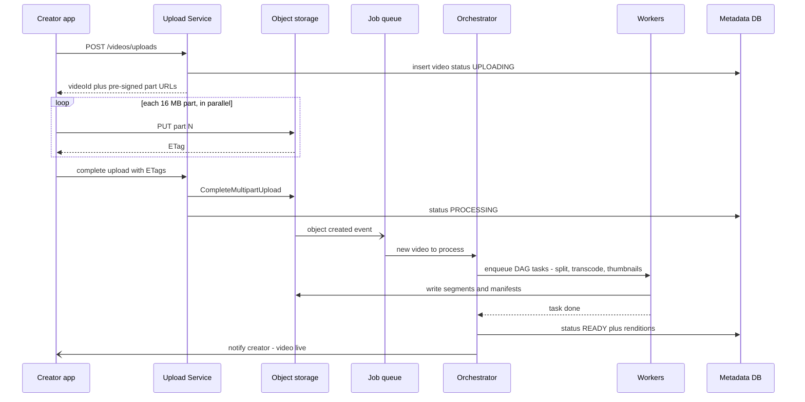

1. Parts upload in parallel and are individually retryable — a flaky mobile network only re-sends a failed 16 MB part, not the whole 2 GB file.
2. `CompleteMultipartUpload` stitches parts into one object atomically.
3. Processing is asynchronous; the creator gets `202 PROCESSING` and later a notification.

**Flow B — Playback**

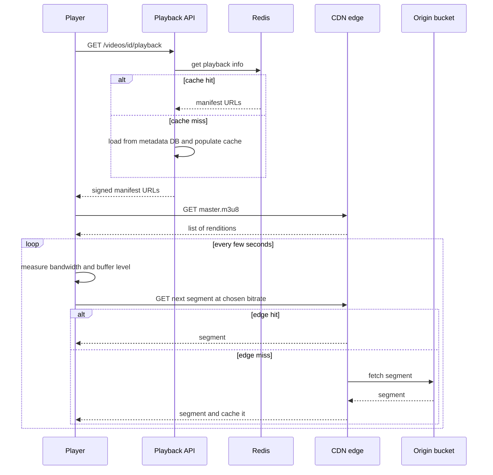

**Failure notes**

- If the Playback API is degraded, popular videos still play because manifests are cached at the CDN too (with short TTLs).
- If one CDN provider has an outage, the Playback API can hand out URLs for a second CDN (multi-CDN steering).

### 7.7 Deep Dives

> **Level:** 🔴 Advanced

#### Deep dive 1 — Resumable upload with pre-signed multipart URLs

**Why:** A 2 GB upload over a phone network *will* get interrupted. Proxying it through app servers wastes their bandwidth and memory.

**How:**

1. Upload Service calls the object store's `CreateMultipartUpload` and generates a pre-signed URL per part (a URL that embeds a signature granting temporary, scoped permission to PUT that one part).
2. Client uploads parts in parallel (e.g., 4 at a time), records each returned ETag.
3. On reconnect, the client calls `ListParts` (through the service) to learn which parts already arrived and resumes.
4. Client sends `complete` with the part list; a lifecycle rule aborts incomplete multipart uploads after 7 days to avoid paying for orphaned parts.
5. Optional: client computes a checksum per part; storage verifies it, protecting against corruption.

#### Deep dive 2 — Transcoding pipeline as a DAG

**What is transcoding?** Converting the uploaded file (any codec/container) into standard renditions: several resolutions (240p, 360p, 480p, 720p, 1080p, 4K) × codecs (H.264 for compatibility, VP9/AV1 for bandwidth savings), split into small segments.

**Why a DAG (directed acyclic graph)?** Some tasks depend on others, and many can run in parallel:

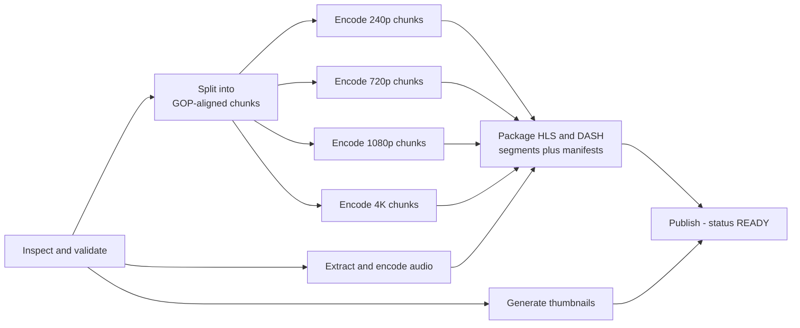

**How it runs:**

1. The orchestrator persists the DAG for a video (each node = a task row with status).
2. Tasks whose dependencies are complete go onto a work queue (SQS/Kafka/RabbitMQ). Large videos are **split into chunks** (e.g., 10-second chunks aligned to keyframes) so a 2-hour movie is encoded by hundreds of workers in parallel — minutes instead of hours.
3. Workers pull tasks, process, write output to object storage, and ack. **Tasks are idempotent**: output keys are deterministic (`/v_8fK2aQ/720p/chunk_0042.ts`), so a retried task just overwrites the same object.
4. Failed tasks retry with backoff; after N failures they go to a **DLQ** and the video is marked `FAILED` with a reason (see [Dead Letter Queues](05_distributed_systems_and_messaging.md#14-dead-letter-queues-and-backpressure)).
5. Priority queues: popular creators' uploads or short videos can jump ahead; low-priority renditions (4K AV1) can be generated later only if the video gets popular.

**Cost trick (senior point):** Encode cheap H.264 renditions first to publish fast; generate expensive AV1 renditions lazily for videos that cross a view threshold — most videos are rarely watched, so this saves huge compute.

#### Deep dive 3 — HLS/DASH and adaptive bitrate streaming

**What:** HLS (HTTP Live Streaming, Apple) and DASH (Dynamic Adaptive Streaming over HTTP) chop video into small segments (2–6 s) and describe them in **manifests**:

```
master.m3u8                 ← lists renditions
  ├── 240p/index.m3u8       ← lists 240p segments
  ├── 720p/index.m3u8
  └── 1080p/index.m3u8
1080p/seg_00001.m4s, seg_00002.m4s, ...
```

**Adaptive bitrate (ABR):** The *player* (not the server) measures download throughput and buffer level after each segment and picks the next segment's rendition. Network drops → it switches to 480p for the next segment instead of stalling.

**Why this design is brilliant for scale:** Every segment is a plain, immutable static file over HTTP. That means:

- Any CDN and any HTTP cache can serve it.
- Segments can be cached with very long TTLs (they never change).
- No stateful streaming servers are needed.

#### Deep dive 4 — CDN distribution and popularity-based caching

- **Long-tail distribution:** ~10% of videos get ~90% of views. The hot head lives in CDN edges; the long tail is fetched from origin on demand.
- **Tiered caching:** edge PoP → regional mid-tier cache ("origin shield") → origin bucket. The shield collapses many edge misses into one origin fetch, protecting origin.
- **Proactive push (Netflix-style):** Netflix knows tomorrow's popular titles, so it pre-positions content into ISP-embedded appliances (Open Connect) during off-peak hours.
- **Cache key hygiene:** strip per-user tokens from the cache key (validate the token at the edge, then cache by path) — otherwise every viewer creates a separate cache entry and the hit rate collapses.

See also [CDN Caching](04_caching.md#10-cdn-caching).

#### Deep dive 5 — View counting at scale

**Problem:** 10K–30K view events/sec, and a viral video can receive thousands/sec on a single row → hot-key write contention.

**Design:**

1. Player sends a view event only after meaningful watch time (e.g., ≥ 30 s) — basic anti-fraud.
2. Events go to Kafka partitioned by `video_id`.
3. A stream processor (Flink/Kafka Streams) deduplicates (`sessionId + videoId` in a windowed state store), filters bots, and **pre-aggregates** counts per video per 10 seconds.
4. It writes `view_count += delta` once per window per video — 1 write instead of thousands.
5. Displayed counts come from cache and are **eventually consistent** (YouTube famously freezes/lags counts while it verifies views).

For extremely hot keys, use **sharded counters**: `views:v_8fK2aQ:{0..15}` incremented randomly, summed on read.

#### Deep dive 6 — Metadata and search

- Metadata DB is the source of truth; changes stream via **CDC** (change data capture) or the outbox pattern into Elasticsearch ([Transactional Outbox and CDC](05_distributed_systems_and_messaging.md#19-transactional-outbox-and-cdc)).
- Search ranking combines text relevance (BM25) with popularity signals (views, recency).
- Autocomplete uses a prefix index / completion suggester, heavily cached.

### 7.8 Scaling Strategy

> **Level:** 🟡 Intermediate

| Layer | Strategy |
|---|---|
| Egress | Multi-CDN, ISP-embedded caches, origin shield; better codecs (AV1 saves ~30% bandwidth vs H.264) |
| Transcoding | Chunk-parallel encoding, autoscale on queue depth, spot/preemptible instances, GPU/ASIC encoders |
| Storage | Lifecycle tiering: hot (standard) → infrequent access → archive; delete unused high renditions for dead videos |
| Metadata | Shard by `video_id`; read replicas; Redis cache for hot videos |
| Counters | Kafka + stream pre-aggregation + sharded counters |
| Global | Region-local Playback API + metadata read replicas; uploads go to the nearest region's bucket and replicate |

**At 10x traffic:** egress is the first thing to scale — negotiate more CDN capacity and push more content to the edge. Origin and APIs barely notice because the CDN absorbs growth if the hit ratio stays high.

### 7.9 Bottlenecks and Failure Handling

> **Level:** 🟡 Intermediate

| Failure / bottleneck | Impact | Mitigation |
|---|---|---|
| CDN PoP or provider outage | Viewers in a region can't stream | Multi-CDN steering via DNS/playback API; client falls back to alternate URL |
| Origin overload on viral video (miss storm) | Origin slow, edges time out | Origin shield, request coalescing at the CDN, pre-warm hot videos |
| Transcode worker crash mid-task | Task never finishes | Queue visibility timeout re-delivers; idempotent deterministic outputs |
| Poison video (corrupt file) | Retries forever | Max attempts → DLQ → mark `FAILED`, notify creator |
| Metadata DB primary down | Can't publish new videos | Automatic failover; playback continues from cache and replicas |
| Hot counter row | Write contention | Stream pre-aggregation, sharded counters |
| Upload interruptions | Bad creator experience | Multipart resumable uploads |
| Hot-linking / piracy | Bandwidth theft | Signed URLs with short TTL, token validation at edge, DRM for premium |

### 7.10 Trade-offs and Alternatives

> **Level:** 🟡 Intermediate

| Decision | Chosen | Alternative | Why chosen / trade-off |
|---|---|---|---|
| Upload path | Pre-signed direct-to-storage | Proxy through app servers | Offloads bandwidth; trade-off: validation happens after upload |
| Streaming protocol | HLS/DASH over HTTP | RTMP / custom UDP streaming | CDN-cacheable static files; trade-off: a few seconds of latency (fine for VOD, not ideal for live) |
| Renditions | Eager common + lazy expensive | Eager everything | Saves compute on the long tail; trade-off: first viewers of a newly viral video may get lower quality briefly |
| View counts | Eventually consistent | Strongly consistent counter | Throughput and cost; trade-off: counts lag by seconds/minutes |
| Metadata DB | Sharded SQL | Cassandra | Status transitions need conditional updates and simple transactions; Cassandra also viable for pure key lookups |
| CDN | Buy (multi-CDN) | Build (Open Connect) | Building only pays off at Netflix scale |

### 7.11 Interviewer Follow-ups

> **Level:** 🔴 Advanced

**Q1. How would you support live streaming?**
> The ingest side changes: the broadcaster pushes RTMP/SRT to an ingest server, which transcodes in real time into short HLS/DASH segments (1–2 s, or LL-HLS partial segments) and updates a sliding-window manifest. Viewers still pull from the CDN, but manifests have tiny TTLs. The trade-off is latency vs stability: smaller segments mean lower latency but more requests and more rebuffering risk. For sub-second interactivity (video calls) you'd use WebRTC instead.

**Q2. A video goes viral and the CDN miss rate spikes. What happens and how do you protect origin?**
> Thousands of edges miss at once and all hit origin — a classic stampede. An origin shield (mid-tier cache) plus request coalescing means only one fetch per segment reaches origin. I'd also pre-warm: when the view-rate stream job detects acceleration on a video, push its first few minutes of segments to edges proactively.

**Q3. How do you make the transcoding pipeline reliable?**
> Persist the DAG and task states in a DB, dispatch ready tasks through a durable queue, make each task idempotent with deterministic output keys, retry with exponential backoff, and route repeated failures to a DLQ. The orchestrator itself is stateless apart from the DB, so if it crashes another instance resumes from the stored task states.

**Q4. How do you count unique views accurately?**
> Exact unique counts per video need a set per video — too much memory at scale. I'd use HyperLogLog per video per day (≈12 KB each, ~1% error) for "unique viewers" and a deduplicated stream count for "views." Displayed counts are approximate and eventually consistent; billing-grade counts (for ad revenue) are computed in a batch pipeline from the raw event log.

**Q5. How do you reduce storage cost for a billion videos?**
> Lifecycle policies: move originals to archive storage after transcoding; drop rarely used renditions (e.g., 4K) for videos with almost no views and regenerate on demand; dedupe identical uploads by content hash; use efficient codecs for the popular head.

**Q6. Why not stream from your own servers instead of a CDN?**
> At ~10+ Tbps, egress cost and latency dominate. CDNs place content within a few milliseconds of users and are paid per GB at far lower rates than cloud egress. Our servers would also be a single regional bottleneck. The only argument for self-hosting is Netflix-level volume, where building an ISP-embedded CDN pays off.

**Q7. How does the player decide which quality to fetch?**
> Client-side ABR: after each segment it estimates throughput and checks buffer health. Buffer-based algorithms (like BOLA) pick higher bitrates when the buffer is full and drop quickly when it drains. The server only provides the menu (the manifest); the decision lives in the client, which keeps the server stateless.

### 7.12 Quick Revision

- Bytes bypass app servers: **pre-signed multipart upload in**, **CDN out**.
- Transcoding = **DAG of idempotent tasks on a queue**, chunk-parallel, DLQ for poison videos.
- **HLS/DASH**: immutable segments + manifests → perfectly cacheable; **ABR decided by the player**.
- Long tail: hot content at the edge, origin shield, lazy expensive renditions, storage tiering.
- View counts: Kafka → dedup + pre-aggregate → sharded counters; eventually consistent.

---

## 8. Ride-Hailing Application

> Design Uber or Ola: riders request a ride, the system finds a nearby available driver, both see each other live on a map, and the trip is priced and paid.

### 8.1 Requirements

> **Level:** 🟢 Essential

**Functional requirements**

1. Drivers go online/offline and continuously report their location.
2. Riders see nearby cars on the map and request a ride (pickup, destination).
3. The system shows a fare estimate and ETA before booking.
4. The system matches the rider with a nearby available driver; the driver can accept or decline.
5. Rider and driver see each other's live location during pickup and the trip.
6. Trip completes → fare calculated → payment charged → both rate each other.

**Non-functional requirements**

| NFR | Target | Why |
|---|---|---|
| Matching latency | Driver offered within a few seconds | Riders abandon slow matches |
| Location freshness | Positions ≤ ~5 s old | Matching quality and map UX |
| Consistency of assignment | A driver is **never** assigned to two trips; a rider never gets two drivers | Core correctness requirement |
| Availability | 99.99% for requesting rides | Revenue-critical, safety-relevant |
| Scale | Millions of concurrent online drivers globally | Huge write volume of location updates |
| Durability | Trips and payments never lost | Money and legal records |

**Out of scope:** driver onboarding/KYC, detailed ML for ETA and pricing, ride-pooling (mentioned as an extension), food delivery.

> **Interview tip:** Name the two hard problems up front: (1) ingesting and querying a firehose of location updates by proximity, and (2) assigning each driver to exactly one rider under concurrency.

### 8.2 Capacity Estimation

> **Level:** 🟢 Essential

**Assumptions:** 100M monthly riders, 20M rides/day, 5M drivers of which ~1M are online at peak, drivers send location every 4 seconds.

```
Location updates:
  1M online drivers / 4 s              = 250,000 writes/sec (peak)
  Payload ≈ 100 B (driverId, lat, lng, heading, speed, ts)
  Ingress ≈ 250K × 100 B               = 25 MB/s  ← small in bytes, huge in ops/sec

Ride requests:
  20M rides/day / 100,000 s            ≈ 200 rides/sec average
  Peak (×5 on Friday nights, events)   ≈ 1,000 rides/sec
  Each request triggers a nearby-driver query + several offer attempts

Rider map views ("show nearby cars"):
  ~10M riders with the app open at peak, refresh every 5 s ≈ 2M reads/sec
  → must be served from in-memory geo data, never a disk DB

Trip storage:
  20M trips/day × 2 KB                  = 40 GB/day ≈ 15 TB/year
Location history (for disputes, analytics):
  250K/s × 100 B × 86,400               ≈ 2 TB/day → cheap columnar/object storage
```

| Metric | Value | Implication |
|---|---|---|
| Location writes | ~250K/s | In-memory geo index, sharded by region; don't write each ping to a SQL DB |
| Ride requests | ~1K/s peak | Matching is modest in QPS but latency- and correctness-critical |
| Nearby reads | up to ~2M/s | Cache/aggregate; approximate positions are fine for the map |
| Trips | ~15 TB/year | Sharded SQL is fine |

### 8.3 API Design

> **Level:** 🟢 Essential

```http
# Driver
POST /v1/drivers/me/status            { "status": "ONLINE" }            → 200
WS   /v1/drivers/me/stream            (bi-directional WebSocket)
     → client sends:  { "type": "location", "lat": 12.9716, "lng": 77.5946, "heading": 90, "ts": 1761550000 }
     ← server sends:  { "type": "offer", "offerId": "of_1", "tripId": "t_42", "pickup": {...}, "expiresInSec": 15 }
POST /v1/offers/{offerId}/accept      → 200 { "tripId": "t_42" }  |  409 Conflict (offer expired or taken)
POST /v1/offers/{offerId}/decline     → 204

# Rider
GET  /v1/estimates?pickup=12.97,77.59&drop=13.03,77.63&product=GO
     → 200 { "fare": { "min": 210, "max": 260, "currency": "INR" }, "surge": 1.3, "etaSec": 240, "quoteId": "q_9" }
POST /v1/trips
     Idempotency-Key: 5f1c-...
     { "quoteId": "q_9", "pickup": {...}, "drop": {...}, "paymentMethodId": "pm_3" }
     → 202 { "tripId": "t_42", "status": "MATCHING" }
GET  /v1/trips/{tripId}               → status, driver, vehicle, ETA
WS   /v1/riders/me/stream             ← { "type": "driver_location", "lat": ..., "lng": ..., "etaSec": 180 }
POST /v1/trips/{tripId}/cancel        → 200 (cancellation-fee rules apply)
```

**Design notes**

- `POST /trips` takes an `Idempotency-Key` — if the rider double-taps or the network retries, they still get exactly one trip.
- `quoteId` locks the shown fare and surge for a few minutes, so the price the rider accepted is the price charged.
- `409 Conflict` on accept signals the offer expired or was reassigned — the driver app simply dismisses it.
- WebSockets because both sides need **server push** at high frequency ([Real-Time Communication](02_networking_and_communication.md#6-real-time-communication)).

### 8.4 Data Model

> **Level:** 🟢 Essential

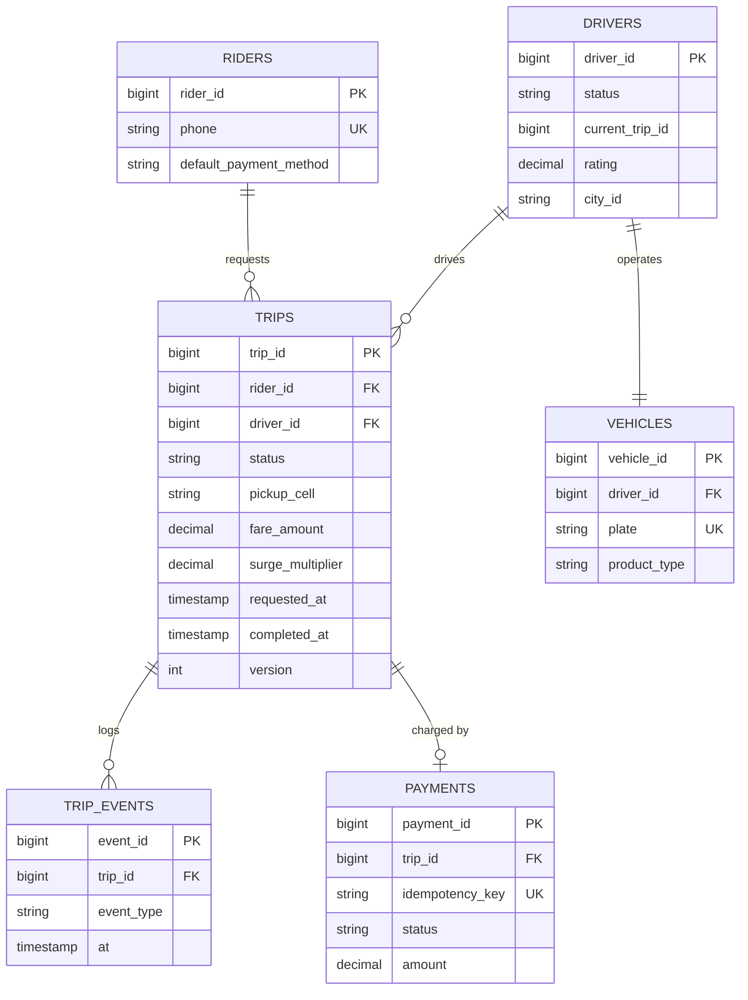

| Data | Store | Why |
|---|---|---|
| Live driver locations | In-memory geo index (Redis GEO or a custom service) sharded by city / geo cell | 250K writes/s, only the latest value matters, TTL-able |
| Driver availability / state | Redis (fast path) + authoritative row in SQL | Matching needs a fast check; assignment needs an atomic conditional write |
| Trips, payments | Sharded Postgres/MySQL (shard by `city_id` or `trip_id`) | ACID state transitions, money |
| Trip event log | Kafka → data lake | Audit, analytics, disputes |
| Location history | Kafka → object storage (Parquet) | Huge, rarely read, cheap storage |

### 8.5 High-Level Architecture

> **Level:** 🟢 Essential

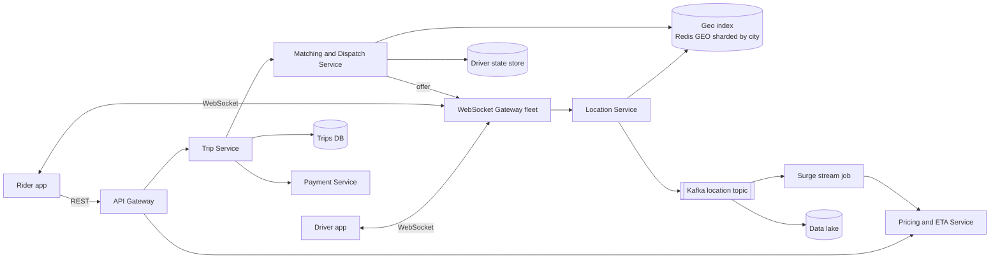

| Component | Responsibility |
|---|---|
| WebSocket Gateway | Holds millions of persistent connections; routes messages by user ID (connection registry in Redis) |
| Location Service | Validates pings, updates the geo index, publishes to Kafka, forwards driver position to the matched rider |
| Geo index | Answers "which available drivers are within 2 km of this point?" in milliseconds |
| Pricing and ETA | Fare estimate from distance/time, surge multiplier, routing engine for ETA |
| Trip Service | Owns the trip lifecycle and state machine; source of truth in the Trips DB |
| Matching and Dispatch | Finds candidate drivers, ranks them, sends offers, handles accept/timeout, guarantees single assignment |
| Payment Service | Charges after the trip with idempotency keys; retries; integrates with payment providers (PSPs) |
| Surge job | Computes supply vs demand per geo cell every ~1 min from the location and request streams |

### 8.6 Request Flows

> **Level:** 🟢 Essential

**Flow A — Driver location update (every 4 s)**

1. Driver app sends a `location` message over its WebSocket.
2. Gateway forwards to the Location Service (partitioned by city).
3. Location Service updates the geo index (`GEOADD drivers:blr 77.5946 12.9716 d_17`) and refreshes a heartbeat key with a TTL (`SET driver:hb:d_17 1 EX 15`) — drivers whose heartbeat expires drop out of matching automatically.
4. Publishes the ping to Kafka (for history, ETA models, surge).
5. If the driver is on a trip, pushes the position to the rider's connection.

**Flow B — Request a ride and match**

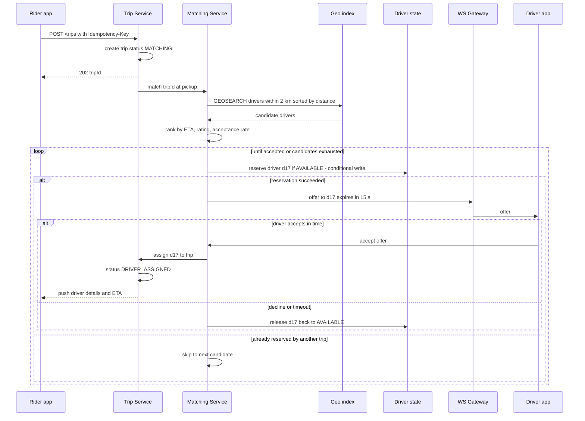

**Walkthrough**

1. The trip row is created immediately so the rider sees "Finding your driver…", and the idempotency key prevents duplicate trips.
2. Matching queries the geo index for nearby available drivers and ranks them by *ETA* (road distance), not straight-line distance.
3. Before offering, it **atomically reserves** the driver (`AVAILABLE → OFFERED`). If two trips race for the same driver, only one conditional write succeeds.
4. The offer has a timeout. Decline/timeout releases the reservation and the loop tries the next candidate (optionally widening the radius).
5. On accept, the trip moves to `DRIVER_ASSIGNED`, and the rider gets a push with driver details.

**Failure notes:** If the Matching Service instance crashes mid-loop, the reservation has a TTL (e.g., 20 s), so the driver becomes available again automatically. The trip — still `MATCHING` — is picked up by another instance via a sweeper that re-enqueues stale matching trips.

**Flow C — Trip lifecycle**

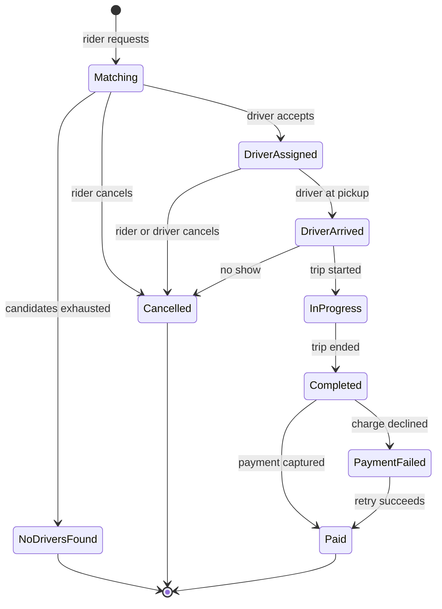

Every transition is a conditional, versioned update:

```sql
UPDATE trips
   SET status = 'IN_PROGRESS', version = version + 1
 WHERE trip_id = :id AND status = 'DRIVER_ARRIVED' AND version = :expectedVersion;
```

Illegal transitions (e.g., completing a cancelled trip) simply affect 0 rows and are rejected.

### 8.7 Deep Dives

> **Level:** 🔴 Advanced

#### Deep dive 1 — Geospatial indexing

**Problem:** "Find available drivers within 2 km" over 1M moving points, refreshed 250K times/second. A SQL `WHERE distance(lat, lng) < 2km` scans everything.

**Approach: convert 2-D positions into cell IDs you can index.**

| Technique | How it works | Pros | Cons |
|---|---|---|---|
| **Geohash** | Interleave latitude/longitude bits → base-32 string; a shared prefix ≈ nearby (`tdr1v` is inside `tdr1`) | Simple, works with any KV store, prefix length = zoom level | Edge effects: neighbors across a cell border have different prefixes → always query the cell + 8 neighbors; cell size varies with latitude |
| **Quadtree** | Recursively split a region into 4 until each leaf holds ≤ N drivers | Adapts to density (small cells downtown, big in rural areas) | In-memory tree must be updated/rebalanced as drivers move; harder to shard |
| **H3 (Uber) / S2 (Google)** | Hierarchical hexagonal (H3) or spherical-square (S2) cells | Hexagons have uniform neighbor distances — great for surge/demand per cell | Needs a library; conceptually heavier |
| **Redis GEO** | Sorted set whose score is a 52-bit geohash; `GEOSEARCH ... BYRADIUS` | Production-ready in minutes, sub-millisecond queries | One key holds many members; shard by city to keep keys bounded |

**Recommended answer:** Shard by city/region. Inside each shard keep drivers in Redis GEO (or an in-memory map of H3 cell → driver set). Query the rider's cell plus neighboring rings, filter by availability heartbeat, then rank the top ~20 by routing-engine ETA.

```text
GEOADD drivers:blr 77.5946 12.9716 d_17
GEOSEARCH drivers:blr FROMLONLAT 77.59 12.97 BYRADIUS 2 km ASC COUNT 20 WITHDIST
```

**Why keep only the latest location in the index?** Matching never needs history; storing only current positions keeps the index small (1M × ~100 B ≈ 100 MB) and fully in memory.

#### Deep dive 2 — Never double-assign a driver

**The race:** Two riders 200 m apart request at the same instant; both matchers pick driver d17.

**Solutions (pick one and explain why):**

1. **Atomic conditional write in Redis** (fast path):
   ```text
   SET driver:lock:d17 trip_42 NX EX 20    -- succeeds only if nobody holds it
   ```
   The lock auto-expires, so a crashed matcher can't strand the driver.
2. **Conditional update in the database** (authoritative):
   ```sql
   UPDATE drivers
      SET status = 'OFFERED', current_trip_id = 42
    WHERE driver_id = 17 AND status = 'AVAILABLE';
   -- 1 row updated → we own the driver; 0 rows → someone else got there first
   ```
3. **Single writer per geo cell:** route all matching for a cell to one partition/actor (e.g., Kafka partition by city or cell). No locks are needed inside the partition — but cross-cell candidates need coordination and hot cells become bottlenecks.

**Senior nuance:** Redis locks are not perfectly safe under failover (see [Distributed Locks](05_distributed_systems_and_messaging.md#7-distributed-locks)). Use the Redis reservation for speed, but make the *authoritative* assignment a conditional DB write (or carry a fencing token), so a stale lock holder can never complete an assignment.

#### Deep dive 3 — Dispatch strategy

- **Greedy nearest** is simple but globally suboptimal: it can steal the only nearby driver from a rider who has no alternative.
- **Batched matching:** collect requests for ~2 s per cell, then solve a bipartite assignment that minimizes total ETA. Slightly slower per rider, better for the whole system.
- **Offer timeouts:** 10–15 s; drivers who repeatedly time out get lower priority.
- **Radius expansion:** 1 km → 2 km → 5 km as attempts fail.

#### Deep dive 4 — Surge pricing and ETA (brief)

- **Surge:** a stream job (Flink) consumes ride requests and driver locations, computes demand/supply per H3 cell per minute, and maps the ratio to a multiplier (smoothed to prevent oscillation). Multipliers live in a cache read by the Pricing Service. The quote locks the multiplier for the rider.
- **ETA:** a routing engine over the road graph (e.g., contraction hierarchies) plus live traffic from aggregated driver speeds; ML corrects the remaining error. Cache ETAs between popular cell pairs.

#### Deep dive 5 — Live location to the rider

- Rider and driver hold WebSocket connections to (possibly different) gateway nodes. A **connection registry** (`user_id → gateway node`, in Redis) lets the Location Service route the driver's position to the rider's node; alternatively, nodes subscribe to a pub/sub channel per trip (`trip:t_42`).
- Send updates every 2–4 s; the client **interpolates** movement along the road for smooth animation instead of needing more updates.
- On reconnect, the client fetches the current trip state via REST, then resumes the stream — never rely on the socket alone for state.

### 8.8 Scaling Strategy

> **Level:** 🟡 Intermediate

| Concern | Strategy |
|---|---|
| Location writes (250K/s) | Partition by city/cell; in-memory geo index; batch Kafka produces; drop pings older than the latest |
| WebSocket connections (millions) | Many gateway nodes (each ~100K+ connections), L4 load balancing, connection registry |
| Matching | Stateless matchers per region; work partitioned by city so a Mumbai spike doesn't affect Delhi |
| Trips DB | Shard by `city_id` (most queries are city-local) or by `trip_id`; read replicas for history |
| Global | Cell-based / regional deployments — each region is an independent stack, so failures stay local |
| Peaks (New Year's Eve) | Pre-scale; surge pricing itself balances load (it pulls drivers in and dampens demand) |

### 8.9 Bottlenecks and Failure Handling

> **Level:** 🟡 Intermediate

| Failure / bottleneck | Impact | Mitigation |
|---|---|---|
| Geo index shard (a city) down | No matching in that city | Replica with automatic failover; the index rebuilds itself from the next 4 s of pings |
| Matcher crash mid-offer | Driver stuck as OFFERED, trip stuck MATCHING | TTL on reservations; sweeper re-enqueues stale trips |
| Driver loses network | Ghost driver appears available | Heartbeat TTL ~15 s; missing heartbeats remove the driver from candidates |
| WebSocket gateway node dies | Users disconnected | Clients reconnect with backoff to another node; state re-fetched via REST |
| Payment provider outage | Can't charge at trip end | Trip still completes; payment retried asynchronously (idempotent); circuit breaker on the PSP |
| Hot cell (stadium after a match) | One shard overloaded | Finer cells, split hot cells, batched matching, surge |
| Kafka consumer lag | Surge/ETA stale | Use last-known values with decay; it's not on the critical path |

### 8.10 Trade-offs and Alternatives

> **Level:** 🟡 Intermediate

| Decision | Chosen | Alternative | Trade-off |
|---|---|---|---|
| Location store | In-memory geo index, latest only | Write every ping to a DB | Speed and cost vs no history in the index (history goes to Kafka / data lake) |
| Geo technique | Redis GEO or H3 cells | Quadtree | Simplicity and shardability vs density-adaptive cells |
| Matching | Batched in dense areas, greedy elsewhere | Always greedy | Global efficiency vs ~1–2 s added latency |
| Assignment safety | Redis reservation + conditional DB write | Distributed lock only | Fast path + correctness guarantee vs one extra write |
| Transport | WebSockets | Polling | Low latency and battery-friendly vs managing stateful connections |
| Consistency | Strong for trip/assignment/payment; eventual for map positions and surge | Strong everywhere | Correctness where it matters, cheap elsewhere |

### 8.11 Interviewer Follow-ups

> **Level:** 🔴 Advanced

**Q1. Why not store driver locations in Postgres with PostGIS?**
> PostGIS handles geo queries well, but 250K updates/sec of a value overwritten every 4 seconds is the wrong workload for a durable, WAL-logged disk database — it would spend all its effort on writes that are obsolete seconds later. Live locations are ephemeral, so an in-memory index is the right fit, with history kept durably in Kafka. PostGIS is fine for slow-changing geo data like service areas or pickup zones.

**Q2. How do you handle the geohash boundary problem?**
> Two points can be 10 m apart but in different cells with different prefixes. So I always query the rider's cell plus its 8 neighbors (with H3, the k-ring of radius 1), then filter by exact distance. If too few drivers are found, I expand to the next ring.

**Q3. A driver accepts an offer at the exact moment it times out. What happens?**
> Accept is a conditional transition: `UPDATE offers SET status='ACCEPTED' WHERE offer_id=? AND status='PENDING'`. The expiry job runs the same kind of update to `EXPIRED`. Exactly one wins. If expiry won, the driver gets `409 Conflict` and the app dismisses the offer. The design never relies on clocks agreeing — the database decides the winner.

**Q4. How would you design ride-pooling?**
> Matching becomes route insertion: for a new request, find active pool trips whose route can absorb the new pickup and drop with a bounded detour (e.g., ≤ 5 minutes added for existing riders). It's compute-heavy, so I'd run it in batches per cell with a solver, and the trip model becomes "a vehicle route with multiple rider legs."

**Q5. How do you keep a region working if a data center fails?**
> Use a cell-based architecture: each region has its own gateways, location, matching, and trip DB shards, so a region is self-sufficient. Global services (accounts, payments) are replicated across regions. During failover, active trips continue from trip state replicated to the standby; live locations rebuild within seconds from incoming pings.

**Q6. How do you prevent duplicate charges at trip end?**
> The Payment Service uses an idempotency key derived from the trip (`trip_42:fare`), stored with a unique constraint. Retries after timeouts return the stored result instead of charging again. The PSP call also passes the idempotency key, since most PSPs support it. See [Delivery Guarantees, Idempotency and Deduplication](05_distributed_systems_and_messaging.md#13-delivery-guarantees-idempotency-and-deduplication).

**Q7. What consistency does the rider's map need?**
> Eventual — a car icon a few seconds stale is fine, and we can even return slightly coarsened positions for driver privacy. That's why map views can be served from cached per-cell snapshots rather than the live index, cutting read load massively.

### 8.12 Quick Revision

- Two hard parts: **location firehose + proximity query** and **single assignment under concurrency**.
- Live locations: **in-memory geo index (Redis GEO / H3 / geohash cells)**, latest value only, sharded by city, heartbeats with TTL.
- Matching: candidates → rank by ETA → **atomic reserve (NX lock / conditional UPDATE)** → offer with timeout → accept or release.
- Trip = **state machine** with conditional, versioned transitions; payment is idempotent.
- WebSockets + connection registry for live updates; cell-based regional deployments.

---

## 9. E-Commerce Platform

> Design an Amazon/Flipkart-like store: browse a catalog, search, add to cart, check out, pay, and track orders — without ever selling stock you don't have or charging a customer twice.

### 9.1 Requirements

> **Level:** 🟢 Essential

**Functional requirements**

1. Browse product catalog and product detail pages (price, images, availability).
2. Search products with filters (category, price, brand, rating) and sorting.
3. Add/remove items in a cart; the cart persists across devices.
4. Checkout: address, shipping option, payment.
5. Place order → reserve inventory → charge payment → confirm order → notify user.
6. Order history and order tracking; cancellations and refunds.
7. (Extension) Flash sales: limited stock at a discounted price, starting at a fixed time.

**Non-functional requirements**

| NFR | Target | Why |
|---|---|---|
| Availability | 99.99% for browse/search/cart; 99.95%+ for checkout | Every minute of downtime is lost revenue |
| Latency | Product page p99 < 200 ms; search p99 < 300 ms | Conversion drops with latency |
| Consistency | **Strong** for inventory, orders, payments; **eventual** for catalog, search, reviews, recommendations | Overselling and double charging are unacceptable; a stale description is fine |
| Scale | 100M+ products, read:write ≈ 100:1 on catalog | Cache/CDN heavy design |
| Peak | 10–50x normal during sales (Big Billion Days, Prime Day) | Must degrade gracefully |
| Durability | Orders and payments never lost | Legal and financial records |

**Out of scope:** seller onboarding, warehouse/logistics optimization, recommendation models, tax engines (mention as services).

> **Interview tip:** Split the system in your first minute into a **read-heavy, eventually consistent browse side** (catalog, search) and a **write-critical, strongly consistent transaction side** (cart → checkout → inventory → payment → order). Different rules apply to each.

### 9.2 Capacity Estimation

> **Level:** 🟢 Essential

**Assumptions:** 50M DAU, each views 20 product pages and does 5 searches per day; 2% of DAU place an order; average order has 3 items.

```
Product page views:
  50M × 20 = 1B/day → 1B / 100,000 s ≈ 10,000 QPS avg → peak ×3 ≈ 30K QPS
  Sale day ×10 ≈ 100K QPS  → CDN + cache must absorb this

Searches:
  50M × 5 = 250M/day ≈ 2,500 QPS avg → ~10K QPS peak, ~25K on sale days

Orders:
  50M × 2% = 1M orders/day ≈ 12 orders/sec avg
  Sale-day peak (first minutes of a sale): ~1,000–5,000 orders/sec
  → The checkout path has low average QPS but violent spikes

Storage:
  Catalog: 100M products × 10 KB (attributes, description) ≈ 1 TB (+ images in object storage)
  Orders:  1M/day × 5 KB ≈ 5 GB/day ≈ ~2 TB/year
  Images:  100M products × 8 images × 300 KB ≈ 240 TB (object storage + CDN)
```

| Metric | Value | Implication |
|---|---|---|
| Product reads | 10K–100K QPS | Edge caching, Redis, read replicas |
| Search | up to ~25K QPS | Dedicated search cluster (Elasticsearch) |
| Orders | 12/s avg, thousands/s at sale start | Queue-based admission + inventory pre-allocation |
| Catalog size | ~1 TB | Document store or sharded SQL |

### 9.3 API Design

> **Level:** 🟢 Essential

```http
GET  /v1/products/{productId}                         → 200 product details (cacheable, ETag)
GET  /v1/search?q=running+shoes&brand=nike&priceMax=5000&sort=rating&cursor=abc
     → 200 { "results": [...], "facets": {...}, "nextCursor": "def" }

GET    /v1/cart                                       → 200 { "items": [...], "subtotal": 4599 }
PUT    /v1/cart/items/{skuId}   { "quantity": 2 }     → 200   (idempotent: sets quantity)
DELETE /v1/cart/items/{skuId}                         → 204

POST /v1/checkout/sessions
     { "addressId": "a_1", "shipping": "STANDARD" }
     → 201 { "checkoutId": "co_77", "total": 4799, "priceLockedUntil": "2026-10-27T10:15:00Z" }

POST /v1/orders
     Idempotency-Key: 3b9e-41f2-...
     { "checkoutId": "co_77", "paymentMethodId": "pm_3" }
     → 202 { "orderId": "o_501", "status": "PENDING" }

GET  /v1/orders/{orderId}                             → 200 { "status": "CONFIRMED", "items": [...], "tracking": {...} }
POST /v1/orders/{orderId}/cancel                      → 200 { "status": "CANCELLED", "refund": "INITIATED" }
```

**Design notes**

- `PUT /cart/items/{skuId}` sets a quantity (idempotent) instead of `POST /add` (not idempotent) — a retried request can't double the quantity.
- `POST /orders` **requires** an `Idempotency-Key` header; the server stores key → result so a timed-out-and-retried checkout returns the same order instead of creating a second one.
- Order creation returns `202 PENDING`: the saga continues asynchronously and the client polls or receives a push.
- Search uses **cursor pagination**, so deep scrolling stays fast ([REST API Design](02_networking_and_communication.md#7-rest-api-design)).

### 9.4 Data Model

> **Level:** 🟢 Essential

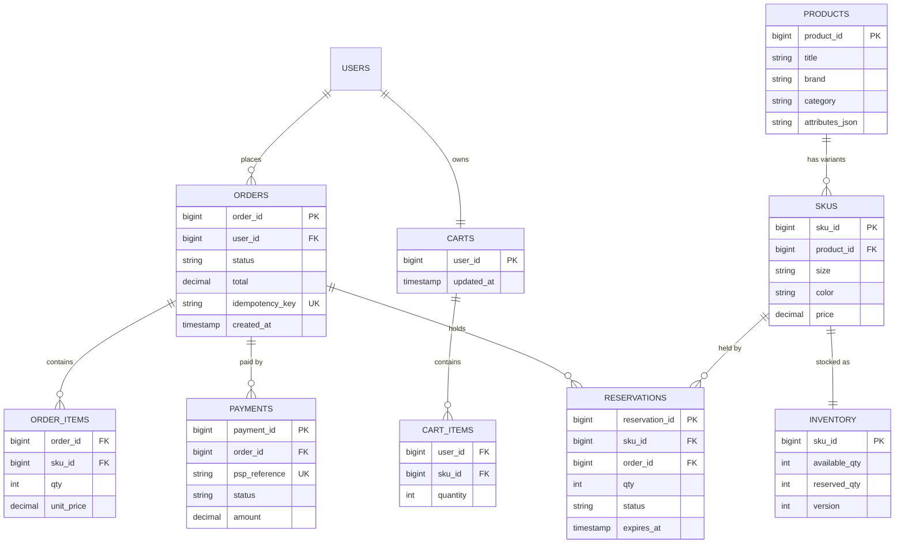

**Database choices (database per service)**

| Service | Store | Why |
|---|---|---|
| Catalog | Document DB (MongoDB/DynamoDB) or sharded SQL + Redis + CDN | Flexible attributes per category (shoes have sizes, TVs have screen sizes); read-heavy |
| Search | Elasticsearch / OpenSearch | Full-text, facets, relevance; fed by CDC from catalog |
| Cart | Redis (with persistence) or DynamoDB, keyed by `user_id` | Simple key-value access, high write rate, can tolerate losing an anonymous cart rarely |
| Inventory | Postgres/MySQL (sharded by `sku_id`) | Needs atomic conditional decrements and transactions |
| Orders | Postgres/MySQL (sharded by `user_id`) | ACID, order history queries by user |
| Payments | Postgres with unique constraints on idempotency key / PSP reference | Money: strict correctness and audit |

Note `unit_price` is **copied** into `ORDER_ITEMS` — a deliberate denormalization: the order must remember the price the customer paid even if the catalog price later changes ([Data Modeling, Normalization and Denormalization](03_databases_and_storage.md#4-data-modeling-normalization-and-denormalization)).

### 9.5 High-Level Architecture

> **Level:** 🟢 Essential

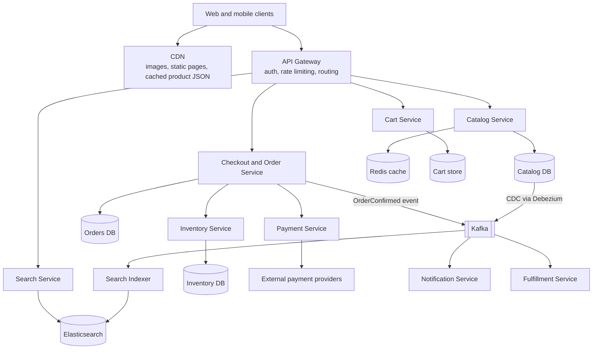

| Component | Responsibility | Consistency |
|---|---|---|
| CDN | Images, static assets, even cached product JSON for anonymous users | Eventual (TTL / purge) |
| API Gateway | Authentication, rate limiting, routing, request IDs | — |
| Catalog Service | Product and SKU data; cache-aside with Redis | Eventual for readers |
| Search Service | Query Elasticsearch; facets, ranking | Eventual (seconds behind catalog) |
| Cart Service | Per-user cart; merges guest cart into user cart on login | Read-your-writes for the user |
| Checkout and Order Service | Orchestrates the checkout **saga**; owns the order state machine | Strong |
| Inventory Service | Reservations with TTL, conditional decrements | Strong |
| Payment Service | Idempotent charges, refunds, PSP integration | Strong |
| Notification / Fulfillment | React to order events (Observer pattern via Kafka) | Eventual, at-least-once |

### 9.6 Request Flows

> **Level:** 🟢 Essential

**Flow A — Product page (read path)**

1. Client requests `/products/123`; the CDN serves cached JSON for anonymous users (TTL ~60 s).
2. On a miss, Catalog Service checks Redis (cache-aside), then the Catalog DB on a miss.
3. **Price and stock badge** are fetched separately with a short TTL (or not cached), because they change more often than descriptions. A displayed "In stock" is a hint — the real check happens at checkout.

**Flow B — Checkout saga (orchestrated)**

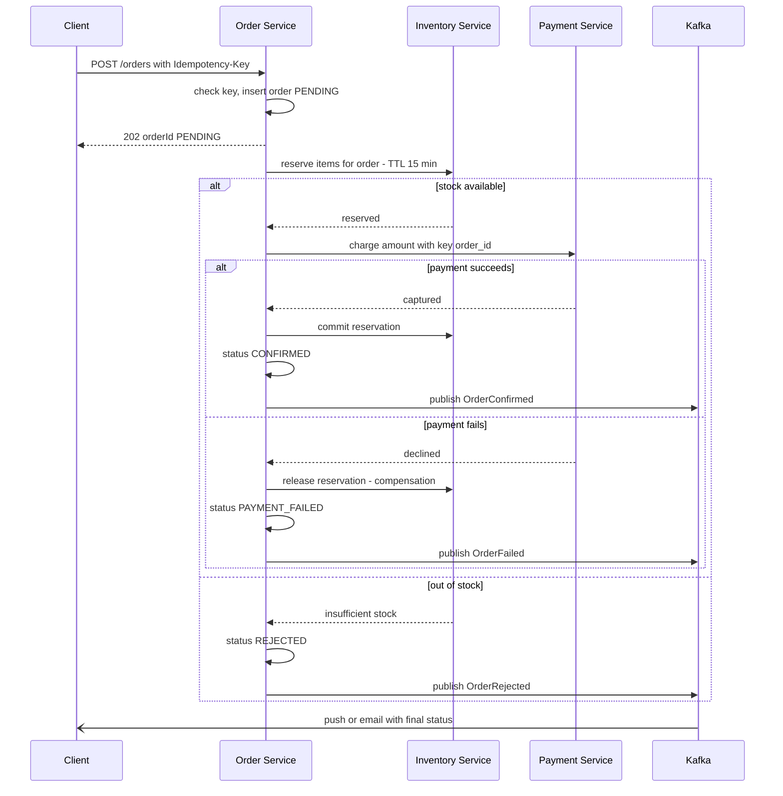

**Walkthrough**

1. **Idempotency first:** the Order Service looks up the `Idempotency-Key`. If it exists, it returns the stored response; otherwise it inserts the order and key in the same local transaction.
2. **Reserve inventory** (not decrement yet): stock is held for 15 minutes for this order.
3. **Charge payment** with an idempotency key (`order_id`), so retries after a timeout can't double-charge.
4. **Confirm:** commit the reservation (turn reserved into sold), set `CONFIRMED`, publish the event — using the **transactional outbox** so the DB update and the event can't diverge ([Transactional Outbox and CDC](05_distributed_systems_and_messaging.md#19-transactional-outbox-and-cdc)).
5. **Compensations:** payment declined → release the reservation. If confirming fails after a successful charge, a compensation **refunds** the payment. Each step and compensation is idempotent and retried.
6. Notifications and fulfillment react to `OrderConfirmed` — the Observer pattern implemented via pub/sub.

This is the **Saga pattern** with an orchestrator ([Distributed Transactions 2PC vs Saga](05_distributed_systems_and_messaging.md#18-distributed-transactions-2pc-vs-saga)). We choose orchestration because the checkout flow has strict business ordering and needs to be traceable; choreography would scatter this logic across services.

**Order state machine**

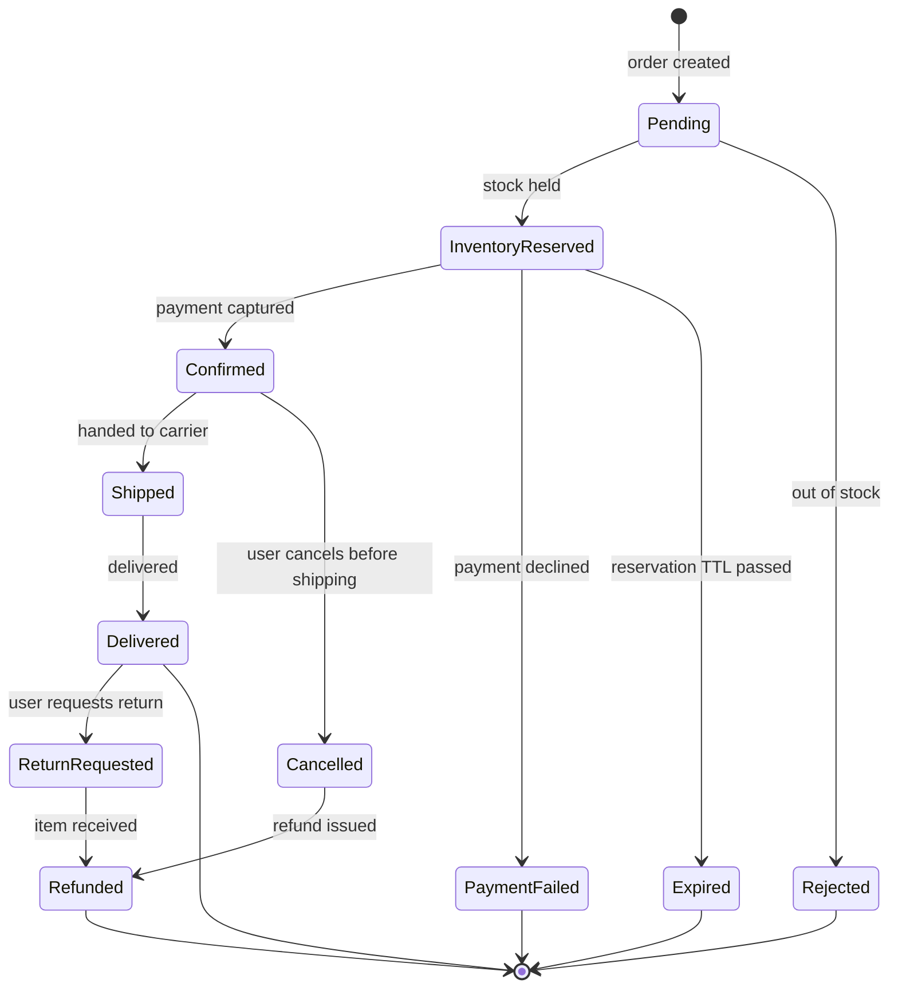

### 9.7 Deep Dives

> **Level:** 🔴 Advanced

#### Deep dive 1 — Preventing overselling

**The race:** 1 unit left; two customers check out in the same millisecond. A naive read-then-write (`SELECT qty` → `if qty > 0` → `UPDATE qty = qty - 1`) lets both succeed. This is a **lost update** anomaly.

**Option A — Atomic conditional decrement (simplest, very effective):**

```sql
UPDATE inventory
   SET available_qty = available_qty - :qty,
       reserved_qty  = reserved_qty  + :qty
 WHERE sku_id = :skuId
   AND available_qty >= :qty;
-- rows affected = 1 → reserved; 0 → out of stock
```

The check and the write happen in one atomic statement under the row lock, so two concurrent requests serialize on that row.

**Option B — Reservations with TTL (what real checkouts use):**

1. On checkout, insert a `RESERVATIONS` row (`status=HELD`, `expires_at = now + 15 min`) in the same transaction as the conditional decrement above.
2. On payment success → mark the reservation `COMMITTED`.
3. A sweeper (or delayed message) finds `HELD` reservations past `expires_at` and returns their quantity to `available_qty`. This prevents abandoned checkouts from locking stock forever.

**Option C — Optimistic locking with a version column:** read `version`, then `UPDATE ... WHERE sku_id=? AND version=?`; retry on conflict. Good for low contention; under a flash sale, retries explode — prefer Option A.

#### Deep dive 2 — Payment idempotency and resilience

The payment service in an interview is a great place to show **pattern combinations** (from the original pattern notes):

| Pattern | Role in payments |
|---|---|
| **Strategy** | `PaymentMethodStrategy` per method — card, UPI, wallet, net banking — chosen at runtime |
| **Circuit Breaker** | Wrap each PSP call; if a provider is failing, fail fast or route to a backup provider |
| **Retry with backoff + jitter** | Only for transient errors (timeouts, 5xx, 429); never for declines |
| **Idempotency** | Key = `order_id` (+ attempt intent); unique constraint in the payments table; also passed to the PSP |

```java
@Service
public class PaymentService {

    private final Map<String, PaymentMethodStrategy> strategies; // Strategy pattern: "CARD", "UPI", ...
    private final PaymentRepository payments;

    @CircuitBreaker(name = "psp", fallbackMethod = "queueForLater")
    @Retry(name = "psp") // configured for timeouts/5xx only, with exponential backoff + jitter
    @Transactional
    public PaymentResult charge(ChargeCommand cmd) {
        // Idempotency: return the stored result if this key was already processed
        Optional<Payment> existing = payments.findByIdempotencyKey(cmd.idempotencyKey());
        if (existing.isPresent()) {
            return existing.get().toResult();
        }
        PaymentResult result = strategies.get(cmd.method()).charge(cmd); // PSP also receives the key
        payments.save(Payment.from(cmd, result)); // unique constraint on idempotency_key
        return result;
    }

    private PaymentResult queueForLater(ChargeCommand cmd, Throwable ex) {
        return PaymentResult.pending(); // graceful degradation: order stays PENDING, retried async
    }
}
```

**The "unknown outcome" problem:** a PSP call times out — did the charge happen? Never blindly charge again. Retry with the *same* idempotency key (the PSP dedupes), or query the PSP's status endpoint; a reconciliation job compares our records with the PSP's settlement files daily.

#### Deep dive 3 — Flash sales

**Problem:** 1M users hit "Buy" at 12:00:00 for 10,000 units. The inventory row for that SKU becomes a hot spot; the DB melts; most requests are doomed to fail anyway.

**Layered defense:**

1. **Before the sale:** pre-scale, pre-warm caches, serve the sale page from the CDN, and **pre-load stock into Redis** (`SET stock:sku_9 10000`).
2. **Admission control:** a virtual queue/waiting room at the edge admits users at a rate the backend can handle; rate-limit per user and block bots.
3. **Fast atomic decrement in Redis:** a Lua script checks and decrements atomically:
   ```lua
   -- KEYS[1] = stock key, ARGV[1] = qty
   local stock = tonumber(redis.call('GET', KEYS[1]) or '0')
   if stock >= tonumber(ARGV[1]) then
       redis.call('DECRBY', KEYS[1], ARGV[1])
       return 1
   end
   return 0
   ```
   Winners get a short-lived purchase token; losers instantly see "sold out" — the DB never sees them.
4. **Async order creation:** winners' orders go through a Kafka queue to the order service, which writes to the DB at a steady rate (**peak shaving**).
5. **Reconciliation:** Redis is the fast gate, the DB is the source of truth. If Redis and DB disagree (e.g., Redis failover lost a decrement), the DB's conditional decrement still prevents overselling; worst case we undersell slightly, which is the safe direction.
6. **Hot SKU splitting:** split the stock into N buckets (`stock:sku_9:0..9`, 1,000 each) to spread contention across shards.

#### Deep dive 4 — Catalog reads and search freshness

- **Cache layers:** CDN (anonymous product JSON, images) → Redis (product by ID) → read replicas → primary.
- **Invalidation:** catalog updates publish events; consumers delete Redis keys and purge CDN paths. Add TTLs as a safety net.
- **Search indexing via CDC:** Debezium reads the catalog DB's change log (binlog/WAL) and publishes to Kafka; the indexer updates Elasticsearch. The index is seconds behind — acceptable. Full reindex jobs rebuild into a new index and atomically swap an alias, so a bad mapping can be rolled back.
- **Price changes** are the exception: price shown at checkout is always re-read from the pricing source of truth.

#### Deep dive 5 — Cart design

- Logged-in cart: key `cart:{userId}` → hash of `skuId → qty` in Redis (with AOF persistence) or DynamoDB.
- Guest cart: keyed by an anonymous cookie ID; merged into the user cart on login.
- The cart **does not reserve stock** — reserving at add-to-cart would let idle carts hold inventory hostage. Stock is reserved only at checkout.

### 9.8 Scaling Strategy

> **Level:** 🟡 Intermediate

| Area | Strategy |
|---|---|
| Browse | CDN + Redis + read replicas; target > 95% cache hit ratio for product reads |
| Search | Elasticsearch shards + replicas; cache popular queries; autocomplete from a separate lightweight index |
| Checkout | Stateless order service, horizontally scaled; DB sharded by `user_id` |
| Inventory | Shard by `sku_id`; hot SKUs split into stock buckets; Redis gate for flash sales |
| Events | Kafka partitioned by `order_id` for per-order ordering |
| Peak events | Pre-scale, waiting room, feature flags to disable expensive features (recommendations, reviews) — **graceful degradation** |

### 9.9 Bottlenecks and Failure Handling

> **Level:** 🟡 Intermediate

| Failure / bottleneck | Impact | Mitigation |
|---|---|---|
| Hot SKU row in flash sale | DB lock contention, timeouts | Redis Lua gate, stock buckets, queue-based order creation |
| Payment provider down | Checkouts fail | Circuit breaker, failover to secondary PSP, orders stay PENDING and retry |
| Payment timeout, unknown result | Risk of double charge or lost charge | Same idempotency key on retry; PSP status query; daily reconciliation |
| Order Service crashes mid-saga | Order stuck, stock held | Saga state persisted; resume from last step; reservation TTL releases stock |
| Event lost between DB and Kafka | Customer never notified, fulfillment never starts | Transactional outbox / CDC |
| Duplicate events | Duplicate emails or shipments | Idempotent consumers (processed-event table keyed by event ID) |
| Search cluster down | No search | Fallback to category browse; cached popular queries; search is isolated (bulkhead) from checkout |
| Recommendation service slow | Product pages slow | Timeout + fallback to "popular items"; never block the page on it |

### 9.10 Trade-offs and Alternatives

> **Level:** 🟡 Intermediate

| Decision | Chosen | Alternative | Trade-off |
|---|---|---|---|
| Distributed transaction | Orchestrated saga | 2PC across services | Availability and loose coupling vs temporary inconsistency + compensation logic |
| Saga style | Orchestration | Choreography | Clear flow and easy debugging vs a central orchestrator to maintain |
| Stock check | Reserve at checkout | Reserve at add-to-cart | Inventory isn't held by idle carts vs a "sold out at checkout" surprise is possible |
| Oversell prevention | Conditional decrement + reservation TTL | Pessimistic `SELECT ... FOR UPDATE` | Short lock duration vs holding locks across network calls |
| Catalog store | Document DB | Relational EAV tables | Flexible attributes vs weaker joins |
| Search sync | CDC to Elasticsearch | Dual writes from the service | Reliable and decoupled vs seconds of indexing lag |
| Flash-sale gate | Redis pre-allocated stock | DB only | Massive throughput vs reconciliation complexity |

### 9.11 Interviewer Follow-ups

> **Level:** 🔴 Advanced

**Q1. Why not use a distributed transaction (2PC) across Order, Inventory, and Payment?**
> 2PC is blocking: participants hold locks until the coordinator decides, and a coordinator failure can stall everyone. External PSPs don't support it anyway. A saga gives each service a local ACID transaction plus compensations, which keeps services independently available. The trade-off is that the system is briefly inconsistent (stock reserved but payment pending), which we model explicitly with order states.

**Q2. The payment succeeded but the Order Service crashed before marking the order CONFIRMED. What happens?**
> The saga state is persisted, so on restart (or via a timeout sweeper) the orchestrator re-queries the payment by its idempotency key, sees it captured, and continues to the confirm step. If the reservation had already expired, we either re-reserve or refund — a business rule. Every step being idempotent is what makes this safe to resume.

**Q3. How do you show "In stock" on product pages without hammering the inventory DB?**
> Product pages show a cached availability hint (in stock / few left / out of stock) refreshed every few seconds or updated via inventory events. It is explicitly allowed to be slightly stale. The authoritative check is the conditional decrement at checkout. That separation lets the read path scale without touching the write-critical inventory database.

**Q4. How would you handle 1M users trying to buy 10K units at the same second?**
> Waiting room to admit users at a sustainable rate, Redis-held stock with an atomic Lua decrement so 990K users get an instant "sold out" without touching the DB, async order creation through Kafka for the 10K winners, and per-user limits plus bot detection. The DB remains the source of truth with a conditional decrement, so even a Redis glitch can't cause overselling.

**Q5. How do you keep search consistent with the catalog?**
> CDC from the catalog DB into Kafka, then an indexer into Elasticsearch — no dual writes, so the index can't silently miss updates the DB committed. The index is eventually consistent (seconds). For full rebuilds, write a new index and swap an alias atomically. Price and stock are always re-verified at checkout, so search staleness can't cause a wrong charge.

**Q6. How do you design the cart for a user on multiple devices?**
> Server-side cart keyed by user ID, so every device reads the same cart. Updates use set-quantity semantics (idempotent), and concurrent edits use last-write-wins per item, which is acceptable for carts. Guest carts are keyed by a cookie and merged on login.

**Q7. How do you prevent duplicate orders when the user double-clicks "Place order"?**
> The client generates an idempotency key per checkout attempt (or we use the `checkoutId`). The server stores it with a unique constraint in the same transaction as the order insert. The second request finds the key and returns the existing order. The button is also disabled client-side, but the server-side key is the real guarantee.

### 9.12 Quick Revision

- Two halves: **browse (eventual, cache/CDN/search)** vs **transact (strong, saga)**.
- Checkout = **orchestrated saga**: order PENDING → reserve stock (TTL) → charge (idempotent) → confirm; compensations release stock or refund.
- Oversell prevention: **`UPDATE ... WHERE available_qty >= qty`**, reservations with TTL; optimistic locking for low contention.
- Payments: **Strategy + Circuit Breaker + Retry + Idempotency**, reconciliation for unknown outcomes.
- Flash sales: **waiting room + Redis Lua gate + async orders + stock buckets**.
- Reliable events with the **outbox/CDC**; idempotent consumers.

---

## 10. Ticket Booking System

> Design BookMyShow or Ticketmaster: users pick specific seats for a show or event, hold them briefly while paying, and the system guarantees no seat is ever sold twice — even when a million fans arrive the second a concert goes on sale.

### 10.1 Requirements

> **Level:** 🟢 Essential

**Functional requirements**

1. Browse events/movies by city, date, venue.
2. View the seat map for a show with live availability.
3. Select seats → seats are **held** for the user for a few minutes (e.g., 10).
4. Pay within the hold window → booking confirmed → e-ticket issued.
5. If the user doesn't pay in time, or payment fails, seats are released automatically.
6. Cancel bookings (per policy) with refunds.

**Non-functional requirements**

| NFR | Target | Why |
|---|---|---|
| Correctness | **Zero double bookings** | The entire product depends on it |
| Consistency | Strong for seat state and bookings; eventual for browse/search | Seat conflicts must be impossible; listing pages may be seconds stale |
| Availability | 99.99% for browse; booking path may queue users rather than fail | Better to queue than to oversell |
| Latency | Seat hold response < 500 ms | Users are competing in real time |
| Burst traffic | 100x–1000x normal at on-sale time for big events | The defining scale problem |
| Fairness | First-come, first-served-ish; bots limited | Public perception and legal pressure |

**Out of scope:** dynamic pricing algorithms, resale marketplace, venue management tooling.

> **Interview tip:** This problem looks like e-commerce, but the difference matters: in e-commerce you sell *interchangeable units* (any of 10 shirts), here every seat is *unique*. Contention is per seat, and users choose the exact item.

### 10.2 Capacity Estimation

> **Level:** 🟢 Essential

**Normal day (movies, nationwide):**

```
Shows/day:   10,000 screens × 5 shows = 50,000 shows
Seats/show:  ~200 → 10M seats/day of inventory
Bookings:    ~2M bookings/day, avg 2.5 seats → ~25 bookings/sec avg, ~200/s evening peak
Browse:      ~50x bookings → ~1,250 QPS avg; seat-map views ~5K QPS at peak
```

**Hot on-sale (stadium concert):**

```
Seats:            60,000
Fans arriving:    2M in the first 5 minutes
Arrival rate:     2M / 300 s ≈ 6,700 users/s, each refreshing seat maps and trying holds
Seat-hold attempts: maybe 50K/s in the first seconds, on just 60K rows → extreme contention
Sold out in:      ~10–20 minutes
```

**Storage:**

```
Seat inventory rows: 10M/day × 100 B ≈ 1 GB/day (can be archived after the show)
Bookings: 2M/day × 1 KB ≈ 2 GB/day ≈ 700 GB/year
```

| Metric | Value | Implication |
|---|---|---|
| Normal booking rate | ~200/s peak | One sharded SQL cluster handles it easily |
| Hot event attempts | tens of thousands/s on 60K seats | Need a **waiting room** + fast hold store |
| Data size | Small | The challenge is contention, not volume |

### 10.3 API Design

> **Level:** 🟢 Essential

```http
GET  /v1/events?city=bengaluru&date=2026-11-01                 → list of events/shows
GET  /v1/shows/{showId}/seats                                   → seat map with status per seat
     200 { "showId": "sh_9", "seats": [ { "seatId": "A12", "status": "AVAILABLE", "price": 450 }, ... ],
           "version": 18872 }

POST /v1/shows/{showId}/holds
     { "seatIds": ["A12", "A13"] }
     → 201 { "holdId": "h_55", "seatIds": ["A12","A13"], "expiresAt": "2026-11-01T18:10:00Z" }
     → 409 { "error": "SEATS_UNAVAILABLE", "unavailable": ["A13"] }

DELETE /v1/holds/{holdId}                                       → 204 (user releases seats)

POST /v1/bookings
     Idempotency-Key: 8c1d-...
     { "holdId": "h_55", "paymentMethodId": "pm_3" }
     → 202 { "bookingId": "b_301", "status": "PAYMENT_PENDING" }

GET  /v1/bookings/{bookingId}                                   → { "status": "CONFIRMED", "tickets": [...] }

# Waiting room (hot events)
POST /v1/events/{eventId}/queue                                 → 200 { "queueToken": "qt_..", "position": 48211 }
GET  /v1/events/{eventId}/queue/status?token=qt_..              → { "position": 120, "admitted": false }
```

**Design notes**

- Holding seats is an explicit resource (`holdId`) with an expiry — the client knows exactly how long it has.
- `409 Conflict` lists exactly which seats were lost so the UI can suggest alternatives.
- Booking confirm is idempotent (`Idempotency-Key`), since payment redirects and retries are common.
- Seat map responses carry a `version` so clients can poll for deltas rather than the full map.

### 10.4 Data Model

> **Level:** 🟢 Essential

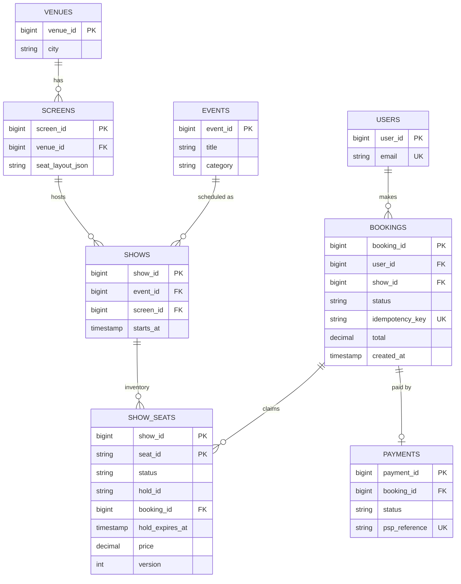

**Key modeling decisions**

- `SHOW_SEATS` has one row per (show, seat), primary key `(show_id, seat_id)`. Seat status: `AVAILABLE → HELD → BOOKED` (or back to `AVAILABLE`).
- A **unique/primary key on `(show_id, seat_id)`** plus single-row status transitions means a seat physically cannot be in two bookings.
- Store: **Postgres/MySQL** — we need row-level atomic conditional updates and transactions across a few seats. Shard by `show_id`, because all contention and queries for a show stay on one shard (no cross-shard transactions).
- Holds can live in the same table (`status=HELD`, `hold_expires_at`) or in Redis with TTL (see deep dive).
- Browse/search data (events, venues) is read-heavy → cache + search index; eventual consistency is fine.

### 10.5 High-Level Architecture

> **Level:** 🟢 Essential

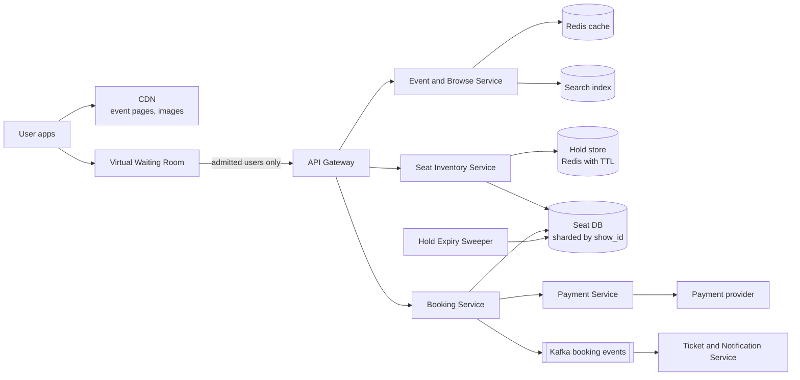

| Component | Responsibility |
|---|---|
| CDN | Event pages, posters; absorbs browsing during on-sale |
| Virtual Waiting Room | Queues users for hot events; admits at a controlled rate with signed admission tokens |
| Event and Browse Service | Event lists, show times, venue info; heavily cached |
| Seat Inventory Service | Seat maps, atomic holds, release; the contention hotspot |
| Booking Service | Converts a hold to a booking after payment; idempotent; saga-like flow with payment |
| Hold Expiry Sweeper | Releases expired holds (or Redis TTL does it automatically) |
| Ticket and Notification Service | Generates QR e-tickets, emails/SMS; consumes events |

### 10.6 Request Flows

> **Level:** 🟢 Essential

**Flow A — Hold seats and book**

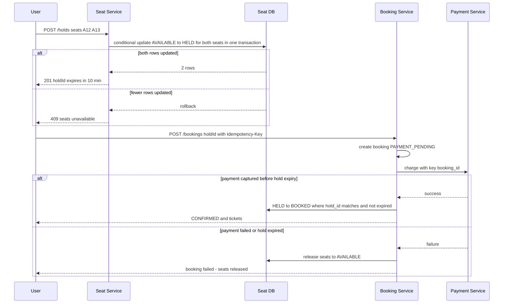

**Walkthrough**

1. The hold is an **all-or-nothing** transaction: either every requested seat moves `AVAILABLE → HELD`, or none do (the user wanted seats together).
2. The booking is created as `PAYMENT_PENDING` with an idempotency key.
3. Payment runs while the seats are held.
4. Confirmation is a conditional update that checks the hold is still ours and not expired. If the hold expired and someone else took the seat, the update affects 0 rows → we **refund** automatically.
5. Expired holds are released by TTL/sweeper, so abandoned carts free seats.

**Flow B — Seat state machine**

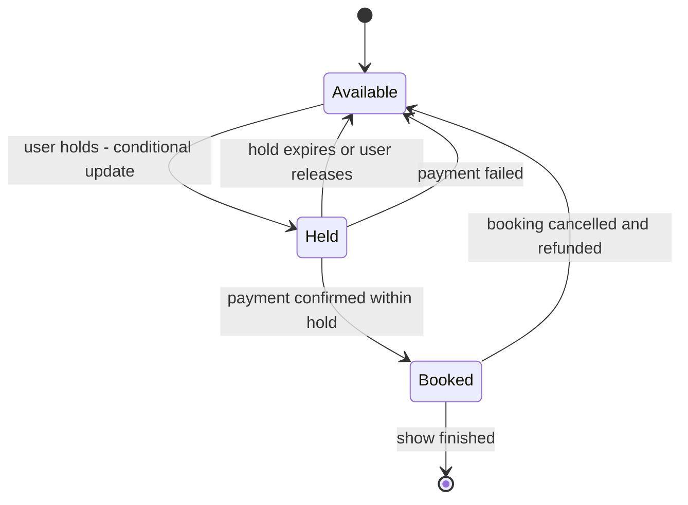

### 10.7 Deep Dives

> **Level:** 🔴 Advanced

#### Deep dive 1 — Preventing double booking

Three layers, from strongest guarantee outward:

**1. Database constraint (last line of defense).** Primary key `(show_id, seat_id)` in `SHOW_SEATS` means there is exactly one row per seat; a booking claims it by setting `booking_id`. If you instead model a separate `BOOKED_SEATS` table, put a **unique constraint on `(show_id, seat_id)`** — the second insert fails no matter what bugs exist above it.

**2. Atomic conditional updates (pessimistic vs optimistic).**

*Pessimistic locking* — lock rows first, then decide:

```sql
BEGIN;
SELECT seat_id, status
  FROM show_seats
 WHERE show_id = 9 AND seat_id IN ('A12', 'A13')
 ORDER BY seat_id            -- consistent lock order avoids deadlocks
   FOR UPDATE;               -- other transactions wait here
-- application checks all are AVAILABLE
UPDATE show_seats
   SET status = 'HELD', hold_id = 'h_55', hold_expires_at = now() + interval '10 minutes'
 WHERE show_id = 9 AND seat_id IN ('A12', 'A13');
COMMIT;
```

*Optimistic / conditional* — no explicit lock, the `WHERE` clause is the check:

```sql
UPDATE show_seats
   SET status = 'HELD', hold_id = 'h_55',
       hold_expires_at = now() + interval '10 minutes',
       version = version + 1
 WHERE show_id = 9
   AND seat_id IN ('A12', 'A13')
   AND (status = 'AVAILABLE' OR (status = 'HELD' AND hold_expires_at < now()));
-- application: if rows affected != 2 → ROLLBACK and return 409
```

| Approach | Good when | Weakness |
|---|---|---|
| Pessimistic (`SELECT ... FOR UPDATE`) | Moderate contention, multi-step logic in one transaction | Lock waits pile up under extreme contention; deadlock risk without ordered locking |
| Optimistic / conditional `UPDATE` | High contention with short transactions; most attempts either win instantly or fail fast | Losers must retry or pick other seats; needs a clear failure UX |

Note the conditional update also **reclaims expired holds inline**, so correctness doesn't depend on the sweeper running on time.

**3. Fast hold layer in Redis (optional, for hot events).**

```text
SET hold:sh_9:A12 h_55 NX EX 600     -- succeeds only if the seat is not held
```

For multiple seats, use a Lua script that checks all keys and sets them atomically (all-or-nothing). Redis absorbs the hot contention in memory; the DB conditional update at confirmation remains the source of truth. Because a Redis failover can lose a recent hold, the DB check (and unique constraint) is what actually guarantees no double booking.

#### Deep dive 2 — Hold expiry and payment timeouts

- **Hold TTL:** 8–10 minutes. Show a countdown to the user.
- **Release mechanisms (use more than one):**
  1. Redis key TTL expires automatically.
  2. The conditional `UPDATE` treats `hold_expires_at < now()` as available (lazy expiry).
  3. A sweeper job every 30 s sets stale `HELD` rows back to `AVAILABLE` so seat maps look right.
- **Payment slower than the hold:** the payment might succeed after the hold expired. On confirmation, if the seat is gone, automatically refund and tell the user — never confirm a seat that's no longer theirs. To reduce this, extend the hold once when payment is in progress (e.g., +3 minutes, capped).
- **Unknown payment outcome (timeout):** keep the booking `PAYMENT_PENDING`, query the PSP with the idempotency key, and decide; a reconciliation job closes any stragglers.

#### Deep dive 3 — Virtual waiting room for on-sale spikes

**Problem:** 2M users at 10:00:00 for 60K seats. Letting all of them hit the seat service creates lock storms, timeouts, and retries that make things worse.

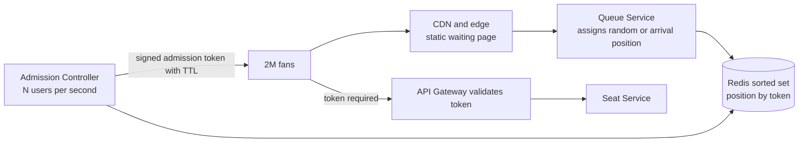

**How it works**

1. Before the sale, users land on a static waiting page served by the CDN (cheap, scales infinitely).
2. At sale time, each user gets a queue position (random among those present at start for fairness, then FIFO).
3. The admission controller lets in N users/second — sized to what the seat service can handle (e.g., 2,000/s).
4. Admitted users receive a **signed, short-lived admission token**; the API gateway rejects booking calls without one.
5. Clients poll their position (or get a push), seeing an honest ETA.
6. When inventory is gone, the queue is closed and everyone remaining is told immediately.

**Why it works:** it converts an unbounded spike into a steady, controlled load — the same idea as **rate limiting plus peak shaving**, applied at the business level. It also gives a natural place for bot detection (CAPTCHA, per-account limits, device fingerprinting).

#### Deep dive 4 — Seat map freshness

- Seat maps for normal shows: cached for 1–2 s, or served with version-based deltas (`GET /seats?sinceVersion=18872`).
- For hot events, push seat changes via WebSocket/SSE per show channel, or simply accept staleness: the hold call is authoritative and returns `409` with alternatives.
- **Seat suggestion** ("best available 2 seats") is computed server-side and immediately attempted as a hold, reducing failed user clicks.

### 10.8 Scaling Strategy

> **Level:** 🟡 Intermediate

| Area | Strategy |
|---|---|
| Browse | CDN + Redis + search index; fully separate from the booking path |
| Seat DB | Shard by `show_id` — one show's contention stays on one shard, no cross-shard transactions |
| Hot shows | Dedicated shard/instance for mega events; Redis hold layer; waiting room |
| Booking service | Stateless; horizontally scaled |
| Payments | Isolated with a bulkhead (separate thread/connection pools) so a slow PSP can't exhaust booking threads |
| Notifications | Async via Kafka; e-ticket generation can lag by seconds |

### 10.9 Bottlenecks and Failure Handling

> **Level:** 🟡 Intermediate

| Failure / bottleneck | Impact | Mitigation |
|---|---|---|
| Lock contention on hot show | Timeouts, frustrated users | Waiting room, conditional updates instead of long locks, Redis hold layer |
| Deadlocks in multi-seat holds | Failed transactions | Lock rows in a consistent order (`ORDER BY seat_id`); short transactions |
| Hold sweeper stops | Seats appear held forever | Lazy expiry in the conditional update; alert on sweeper lag |
| Payment succeeds after hold expiry | Paid but no seat | Conditional confirm; automatic refund; extend hold during payment |
| Redis failover loses holds | Two users think they hold a seat | DB conditional update + unique constraint is authoritative |
| User double-submits booking | Duplicate charge | Idempotency key with a unique constraint |
| Seat DB shard down | That show can't be booked | Synchronous replica + automatic failover; waiting room pauses admissions |
| Bots grab seats | Unfair sell-out | Per-account and per-card limits, CAPTCHA, verified-fan presale |

### 10.10 Trade-offs and Alternatives

> **Level:** 🟡 Intermediate

| Decision | Chosen | Alternative | Trade-off |
|---|---|---|---|
| Concurrency control | Conditional `UPDATE` (optimistic) | `SELECT ... FOR UPDATE` (pessimistic) | Fast fail under contention vs simpler multi-step logic |
| Hold store | DB rows with expiry (+ Redis for hot events) | Redis only | Durability and single source of truth vs raw speed |
| Spike handling | Waiting room | Autoscale and hope | Predictable, fair load vs added user wait time |
| Seat map freshness | Short cache + authoritative hold | Strongly consistent live map | Cheap reads vs occasional `409` on click |
| Sharding key | `show_id` | `user_id` | Contention and transactions stay local vs user history needs a secondary index |
| Hold duration | ~10 min | Longer | Fewer payment-timeout failures vs inventory locked by abandoners |

### 10.11 Interviewer Follow-ups

> **Level:** 🔴 Advanced

**Q1. How exactly do you guarantee two users can't book the same seat?**
> The seat is a single row keyed by `(show_id, seat_id)`, and every state change is a conditional update (`WHERE status='AVAILABLE'` or an expired hold). The database executes that check-and-set atomically under a row lock, so only one transaction can win. As a final guarantee, any booked-seat table has a unique constraint on `(show_id, seat_id)`. Caches and Redis holds are accelerators, never the source of truth.

**Q2. Why shard by show and not by user?**
> All contention is per show, and a hold for multiple seats must be one atomic transaction. Sharding by `show_id` keeps all seats of a show on one shard, so the transaction stays local — no distributed transaction. User booking history is served via a secondary index or a separate read model keyed by user.

**Q3. Pessimistic or optimistic locking here?**
> For normal movie bookings either works. For hot on-sales I prefer conditional updates: they hold the row lock only for the single statement, and losers fail instantly with a `409` instead of waiting in a lock queue that eventually times out. Pessimistic locking is fine when contention is moderate and the logic needs several reads in one transaction — just always lock in a consistent order to avoid deadlocks.

**Q4. A user's payment completes 30 seconds after their hold expired and someone else took the seat. What now?**
> The confirm step is conditional on the hold still being ours, so it fails safely. The booking moves to `FAILED_SEAT_LOST`, and we refund automatically and notify the user, possibly offering nearby seats. To reduce how often this happens, we extend the hold once when the payment is initiated.

**Q5. How do you make the on-sale fair and keep bots out?**
> A waiting room that randomizes positions among users present at the start, then admits at a fixed rate with signed tokens; per-account, per-card, and per-device purchase limits; CAPTCHA or proof-of-work at queue entry; and verified-fan presales for the biggest events. Rate limiting at the gateway catches crude bots; the queue removes the advantage of hammering refresh.

**Q6. Can you use Redis alone for seat holds?**
> It's fast and `SET NX EX` gives automatic expiry, but Redis replication is asynchronous, so a failover can lose recent holds and two users could believe they hold the same seat. I'd use Redis to absorb contention and the DB conditional update at confirmation as the authority. If the business is fine with rare hold losses but never booking losses, that combination is exactly right.

### 10.12 Quick Revision

- Every seat is unique → contention per row; **zero double booking** is the core requirement.
- Seat row `(show_id, seat_id)` + **conditional UPDATE** (or `FOR UPDATE` with ordered locks) + **unique constraint** as the last defense.
- **Holds with TTL** (DB `hold_expires_at` and/or Redis `SET NX EX`), lazy expiry + sweeper.
- Pay within the hold; **conditional confirm**, auto-refund if the hold was lost; idempotent booking.
- **Virtual waiting room** turns on-sale spikes into steady load; shard by `show_id`.

---

## 11. Distributed Logging and Metrics Platform

> Design an internal observability platform (like ELK, Datadog, or Prometheus + Loki): thousands of services ship logs and metrics; engineers search logs, graph metrics, and get alerted within seconds when something breaks.

### 11.1 Requirements

> **Level:** 🟢 Essential

**Functional requirements**

1. Collect **logs** (text/JSON events) and **metrics** (numeric time series) from every host, container, and service.
2. Search logs by time range, service, level, trace ID, and free text.
3. Query and graph metrics (rates, percentiles, aggregations by tags) on dashboards.
4. Define alert rules (e.g., "5xx error rate > 2% for 5 minutes") and notify on-call via PagerDuty/Slack.
5. Retention policies per tenant/team (e.g., logs 30 days hot, 1 year archived; metrics 15 days raw, 1 year downsampled).
6. Multi-tenant: teams see their own data; quotas per team.

**Non-functional requirements**

| NFR | Target | Why |
|---|---|---|
| Ingestion availability | Never block or crash the producing app | Observability must not cause outages |
| Ingestion durability | No loss of logs once acknowledged by the pipeline (best effort before) | Needed for incident analysis and audits |
| Freshness | Logs searchable < 10–30 s; metrics < 10 s; alerts evaluated every 15–60 s | Incidents are debugged in real time |
| Query latency | Recent data p95 < 2 s; historical slower is fine | Engineers query during incidents |
| Scale | Millions of events/sec, PBs of logs | Write-dominated system |
| Cost | Cost per GB is a first-class requirement | Logs grow faster than budgets |

**Out of scope:** APM/tracing UI details (mention trace IDs link logs ↔ traces), SIEM-grade security analytics, ML anomaly detection.

> **Interview tip:** Say early: "This is a write-heavy, read-rarely system. Most data is never queried, so I'll optimize ingestion throughput and storage cost, and keep only recent data in expensive indexed storage." Also: "Logs and metrics are different data shapes, so they get different storage engines."

### 11.2 Capacity Estimation

> **Level:** 🟢 Essential

**Assumptions:** 20,000 hosts/containers × ~50 services each emitting; average 500 log lines/sec per host at peak; 1 KB per log line; 20,000 hosts × 1,000 active metric series each, scraped every 15 s.

```
Logs:
  20,000 hosts × 500 lines/s        = 10M log lines/sec (peak)
  × 1 KB                            = 10 GB/s ingest ≈ 860 TB/day raw (peak-rate upper bound)
  Realistic daily average (~30% of peak) ≈ 250 TB/day raw
  Compression (~10x with zstd)      ≈ 25 TB/day stored
  Indexed hot storage, 7 days, ×2 replicas ≈ 25 TB × 7 × 2 × (index overhead ~1.5) ≈ 525 TB hot
  Archive 1 year in object storage  ≈ 25 TB × 365 ≈ 9 PB  → object storage (cheap tier)

Metrics:
  20,000 hosts × 1,000 series       = 20M active time series
  Samples/sec                       = 20M / 15 s ≈ 1.3M samples/sec
  Bytes per sample (compressed, Gorilla-style) ≈ 1.5 B
  Per day ≈ 1.3M × 86,400 × 1.5 B   ≈ 170 GB/day raw → small compared to logs
  Downsampled (5-min rollups) for 1 year → tiny

Queries:
  ~5,000 engineers, ~10K dashboard panels refreshing every 30 s ≈ 300–500 queries/sec
  Alert rules: 100K rules × every 30 s ≈ 3,300 rule evaluations/sec
```

| Metric | Value | Implication |
|---|---|---|
| Log ingest | up to ~10 GB/s | Kafka buffer, horizontal ingest tier, compression |
| Log storage | ~25 TB/day compressed | Tiered storage: hot (indexed SSD) → warm → cold (object storage) |
| Metric series | ~20M active | Time-series DB; **cardinality** is the real limit |
| Metric samples | ~1.3M/s | TSDB with efficient compression |
| Queries | Hundreds/s | Read path is light but must be fast on recent data |

### 11.3 API Design

> **Level:** 🟢 Essential

**Ingestion (agents → platform)**

```http
POST /v1/logs/ingest
Authorization: Bearer <tenant-ingest-key>
Content-Encoding: zstd
Content-Type: application/x-ndjson

{"ts":"2026-10-27T10:23:45.120Z","service":"payment-service","level":"ERROR","trace_id":"abc-123","msg":"Payment failed","user_id":"123"}
{"ts":"2026-10-27T10:23:45.130Z","service":"payment-service","level":"INFO","trace_id":"abc-124","msg":"Payment ok"}
→ 202 Accepted   |   429 Too Many Requests (tenant over quota, Retry-After: 5)

POST /v1/metrics/write        (Prometheus remote-write / OTLP compatible, protobuf + snappy)
→ 204
```

**Query**

```http
POST /v1/logs/search
{ "query": "service:payment-service AND level:ERROR AND \"Payment failed\"",
  "from": "2026-10-27T10:00:00Z", "to": "2026-10-27T11:00:00Z", "limit": 100, "cursor": null }
→ 200 { "hits": [...], "nextCursor": "..." , "scannedBytes": 81234567 }

GET /v1/metrics/query_range?query=sum(rate(http_requests_total{status=~"5.."}[5m])) by (service)
                         &start=...&end=...&step=30s
→ 200 { "series": [ { "labels": {"service":"payment"}, "points": [[1761550000, 12.4], ...] } ] }
```

**Alerts**

```http
POST /v1/alerts/rules
{ "name": "PaymentErrorRateHigh",
  "expr": "sum(rate(http_requests_total{service=\"payment\",status=~\"5..\"}[5m])) / sum(rate(http_requests_total{service=\"payment\"}[5m])) > 0.02",
  "for": "5m", "severity": "page", "notify": ["pagerduty:payments-oncall"] }
→ 201 { "ruleId": "r_88" }
```

**Design notes**

- Ingestion is **batched and compressed** (thousands of lines per request) — per-line HTTP calls would cost more than the data.
- `202 Accepted` = durably buffered (in Kafka), not yet indexed.
- `429` with `Retry-After` is the backpressure signal; agents buffer locally and retry.
- Using standard protocols (OpenTelemetry/OTLP, Prometheus remote-write) avoids custom client libraries.

### 11.4 Data Model

> **Level:** 🟡 Intermediate

Logs and metrics have **fundamentally different shapes**, so they get different storage engines.

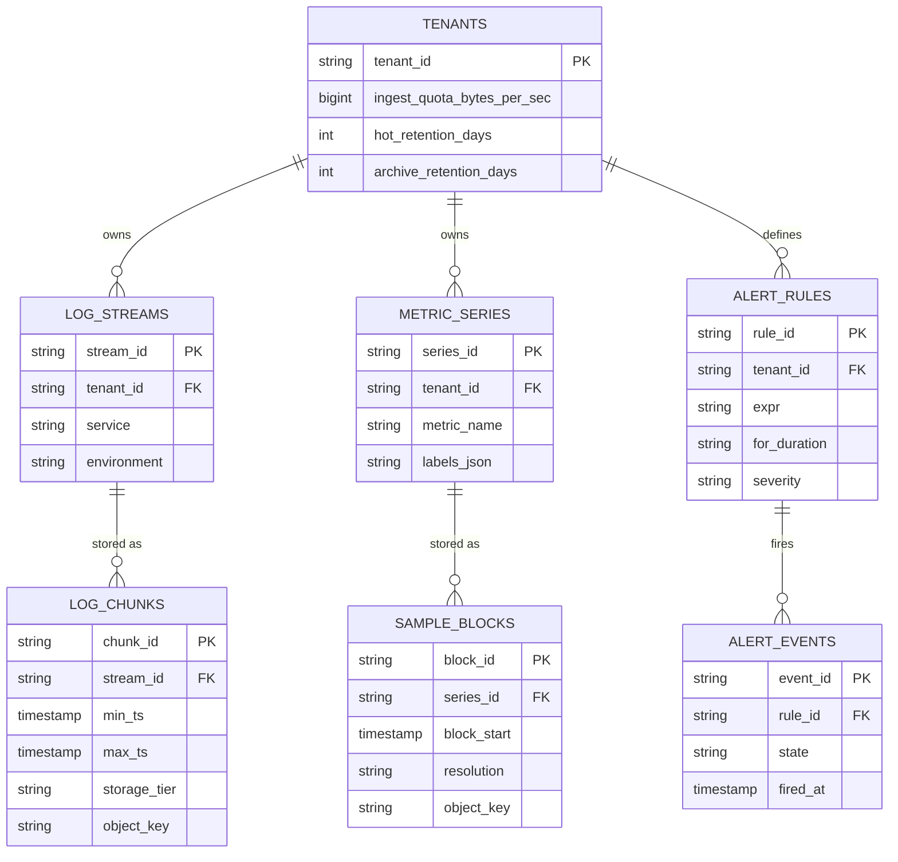

**Storage choices**

| Data | Store | Why |
|---|---|---|
| Recent logs (hot, 7 days) | Elasticsearch/OpenSearch (inverted index) **or** Loki-style (index labels only, compressed chunks in object storage) | Full-text search vs much cheaper label-based search — see deep dive |
| Older logs (warm/cold) | Object storage (S3) in compressed columnar/chunk format (Parquet/zstd) | ~10–20x cheaper; queried rarely via scan engines |
| Metrics | Time-series DB (Prometheus TSDB, VictoriaMetrics, M3, Mimir/Thanos with object storage) | Delta-of-delta + XOR compression, ~1–2 bytes/sample; fast range aggregations |
| Rules, tenants, dashboards | Postgres | Small relational config data |
| Alert state | TSDB/ruler state + Postgres for history | Needs dedup and silencing state |

### 11.5 High-Level Architecture

> **Level:** 🟢 Essential

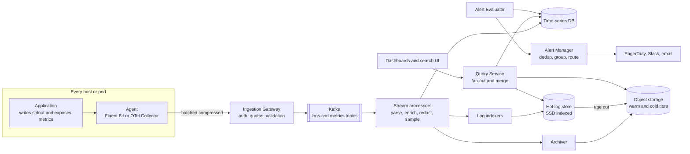

| Component | Responsibility |
|---|---|
| Agent (Fluent Bit / OTel Collector) | Tails log files/stdout, scrapes or receives metrics, batches, compresses, buffers to local disk when the platform is slow |
| Ingestion Gateway | Authenticates tenant keys, enforces quotas (rate limiting), validates, writes to Kafka, returns 202 |
| Kafka | Durable buffer that decouples bursty producers from slower indexers; replay if indexing fails |
| Stream processors | Parse JSON, add metadata (k8s pod, region), redact PII, drop/sample noisy debug logs, derive metrics from logs |
| Log indexers | Build index segments and write to the hot store |
| Archiver | Writes compressed chunks to object storage (the long-term copy) |
| Time-series DB | Stores metric samples, handles downsampling and retention |
| Query Service | Parses queries, plans which tiers/shards to hit, fans out, merges, enforces per-tenant limits |
| Alert Evaluator + Alert Manager | Runs rule expressions on a schedule; dedups, groups, silences, routes notifications |

### 11.6 Request Flows

> **Level:** 🟢 Essential

**Flow A — Log ingestion**

```mermaid
sequenceDiagram
    participant App as Application
    participant A as Agent
    participant G as Ingestion Gateway
    participant K as Kafka
    participant SP as Stream processor
    participant IX as Log indexer
    participant H as Hot store
    participant OS as Object storage
    App->>A: write log line to stdout
    A->>A: batch 1 s or 1 MB, compress
    A->>G: POST /logs/ingest batch
    G->>G: auth tenant, check quota
    alt within quota
        G->>K: produce to logs topic partitioned by tenant and stream
        K-->>G: ack after replication
        G-->>A: 202 Accepted
    else over quota
        G-->>A: 429 Retry-After
        A->>A: buffer on local disk, retry with backoff
    end
    K->>SP: consume batch
    SP->>SP: parse, enrich, redact PII, sample
    SP->>IX: structured events
    IX->>H: write index segment
    SP->>OS: append compressed chunk for archive
```

**Walkthrough**

1. Apps write to stdout (or a local file) — never synchronously to the network; the app must not slow down if logging is slow.
2. The agent batches and compresses, and **buffers to disk** if the gateway is unavailable (bounded, oldest-dropped-first when full).
3. The gateway acks only after Kafka has replicated the batch — from here on, data is durable.
4. Processors and indexers consume at their own pace; if indexing falls behind, Kafka absorbs the backlog (consumer lag) instead of dropping data.

**Flow B — Alert evaluation**

```mermaid
sequenceDiagram
    participant R as Alert Evaluator
    participant T as Time-series DB
    participant AM as Alert Manager
    participant P as PagerDuty
    loop every 30 s per rule group
        R->>T: evaluate error-rate expression
        T-->>R: 0.034 for service payment
        R->>R: condition true - pending for 2 min
        alt pending for at least 5 min
            R->>AM: fire PaymentErrorRateHigh
            AM->>AM: dedup, group by service, check silences
            AM->>P: page payments on-call
        end
    end
```

The `for: 5m` clause prevents paging on a single noisy spike — an alert must stay true across several evaluations.

### 11.7 Deep Dives

> **Level:** 🔴 Advanced

#### Deep dive 1 — Logs: inverted index vs label-only index

**Inverted index (Elasticsearch):** For every token in every log line, store a postings list of document IDs containing it — like the index at the back of a book.

```
"payment"  → [doc1, doc7, doc9, ...]
"failed"   → [doc1, doc4, ...]
query "payment failed" → intersect lists → doc1
```

- ✅ Arbitrary full-text search in milliseconds.
- ❌ The index can be as big as the data (1–1.5x), indexing is CPU-heavy, and you pay that cost for every line, though >90% of logs are never searched.

**Label-only index (Loki style):** Index only a few labels (`tenant, service, env, level`) → find the matching compressed chunks in object storage → brute-force grep inside them in parallel.

- ✅ 10x+ cheaper storage and ingest; object storage scales indefinitely.
- ❌ Free-text search over large time ranges scans a lot of data; queries must narrow by labels and time.

**Recommended answer:** Hot tier (last 1–3 days) in an inverted index for fast incident debugging; everything else in compressed chunks in object storage with a label/time index, queried by scanning. Or Loki-style throughout if cost is the top priority. State the trade-off: **index cost at write time vs scan cost at read time**.

#### Deep dive 2 — Hot, warm, cold tiered storage

```mermaid
flowchart LR
    ingest["Ingest"] --> hot["Hot - 0 to 3 days<br/>SSD, fully indexed, replicas"]
    hot -->|"rollover by age"| warm["Warm - 3 to 30 days<br/>HDD or object storage, fewer replicas"]
    warm -->|"lifecycle policy"| cold["Cold - 30 to 365 days<br/>object storage archive tier"]
    cold -->|"retention expired"| deleted["Deleted"]
    query["Query planner"] -.->|"recent - fast"| hot
    query -.->|"older - slower"| warm
    query -.->|"rehydrate on demand"| cold
```

- Data is written into **time-based indices/chunks** (one per day per tenant), so moving and deleting whole time slices is cheap — never delete row by row.
- Elasticsearch ILM (index lifecycle management) or S3 lifecycle rules automate tier transitions.
- The query planner uses the time range to touch only the necessary tiers.
- Retention is per tenant: payment audit logs may require 1+ year; debug logs 3 days.

#### Deep dive 3 — Metrics storage, downsampling, and cardinality explosion

**How a TSDB stores data:** a series = metric name + label set, e.g. `http_requests_total{service="payment", status="500", region="ap-south-1"}`. Samples are `(timestamp, value)` pairs appended in time order and compressed in 2-hour blocks (delta-of-delta timestamps, XOR-encoded floats) to ~1–2 bytes per sample.

**Downsampling:** after 15 days, keep 5-minute rollups (min, max, sum, count per window); after 90 days, 1-hour rollups. A one-year graph then reads ~8,760 points instead of ~2M raw samples — fast and cheap.

**Cardinality explosion (the #1 operational risk):** each unique label combination is a separate series held in memory indexes.

```
service (50) × endpoint (100) × status (10) × region (5) = 250,000 series  ✅ fine
... × user_id (10M)                                       = 2.5 trillion    ❌ the TSDB falls over
```

**Defenses:**

1. Never put unbounded values (user IDs, request IDs, full URLs, emails) in metric labels — those belong in logs or traces.
2. Per-tenant **series limits** at ingestion; reject or drop new series beyond the quota and alert the team.
3. Relabeling rules in the agent/processor to drop or aggregate high-cardinality labels.
4. Cardinality dashboards ("top metrics by series count") so teams see their footprint.

#### Deep dive 4 — Backpressure, sampling, and protecting producers

- **Golden rule:** the logging pipeline must never take down the application. Agents use bounded memory and disk buffers; when full, they drop (oldest or lowest severity first) and increment a `dropped_logs_total` metric rather than block the app.
- **Backpressure chain:** indexer slow → Kafka lag grows (fine, that's what it's for) → if lag exceeds retention risk, scale indexers or shed load at the processor (sample DEBUG/INFO, keep all WARN/ERROR).
- **Sampling:** keep 100% of errors, 10% of successful-request logs for high-volume services; use **trace-aware sampling** so all logs for a sampled trace are kept together.
- **Quotas:** per-tenant ingest rate limits at the gateway (token bucket), so one team's runaway debug logging can't starve everyone else — the noisy-neighbor problem. See [Rate Limiting](02_networking_and_communication.md#14-rate-limiting).

#### Deep dive 5 — Multi-tenancy and the query layer

- **Isolation:** tenant ID is attached at ingestion from the API key (never trusted from the payload). Every query is forced to include `tenant_id`; storage is partitioned by tenant (index per tenant per day, or tenant prefix in object keys).
- **Query protection:** limit time range, max bytes scanned, and concurrency per tenant; cancel runaway queries; cache results of repeated dashboard queries (step-aligned so they're cacheable).
- **Fan-out and merge:** the query service splits a time range into sub-ranges and shards, runs them in parallel, and merges results (sorted logs, or aggregated series). Partial results are returned with a warning if a shard times out — better than nothing during an incident.
- **Correlation:** a `trace_id` field in every log line links logs to distributed traces ([Observability](06_architecture_reliability_and_security.md#8-observability)).

### 11.8 Scaling Strategy

> **Level:** 🟡 Intermediate

| Layer | Strategy |
|---|---|
| Agents | Batch, compress, local disk buffer; pre-aggregate metrics at the edge |
| Ingestion gateway | Stateless; scale horizontally behind an L4/L7 load balancer |
| Kafka | Partition by tenant + stream; add partitions/brokers with volume; retention ~24–72 h as replay buffer |
| Processing and indexing | Consumer groups scale with partition count; autoscale on consumer lag |
| Hot store | Time-based indices; shard size ~30–50 GB; add nodes; replicas for query load |
| TSDB | Shard series by hash of labels across ingesters; long-term blocks in object storage (Thanos/Mimir pattern) |
| Query | Query frontends with result caching, query splitting, and per-tenant limits |
| Cost | Tiering, compression, sampling, retention per tenant, show teams their bill (chargeback) |

### 11.9 Bottlenecks and Failure Handling

> **Level:** 🟡 Intermediate

| Failure / bottleneck | Impact | Mitigation |
|---|---|---|
| Ingestion gateway or network down | Logs can't leave hosts | Agent disk buffer, retries with backoff and jitter; app unaffected |
| Indexers fall behind | Search freshness degrades | Kafka absorbs lag; autoscale consumers; temporarily sample low-severity logs |
| Kafka broker failure | Possible ingest errors | Replication factor 3, `acks=all`, min in-sync replicas 2 |
| Hot store node failure | Slower queries | Replicas; shard relocation; recent data is also in Kafka for replay |
| Cardinality spike from a bad deploy | TSDB memory exhaustion | Per-tenant series limits, reject new series, alert the owning team |
| Noisy tenant | Starves others | Quotas, per-tenant partitions, separate ingestion pools (bulkheads) |
| Expensive query | Query cluster overloaded | Bytes-scanned limits, timeouts, cancellation, query queueing |
| The monitoring platform itself is down during an incident | Blind on-call | Separate, minimal "meta-monitoring" stack in another region; alerting has its own path and doesn't depend on the log pipeline |
| PII in logs | Compliance breach | Redaction in processors, field allowlists, access control, retention limits |

### 11.10 Trade-offs and Alternatives

> **Level:** 🟡 Intermediate

| Decision | Chosen | Alternative | Trade-off |
|---|---|---|---|
| Buffer | Kafka between ingest and indexing | Agents write straight to the store | Durability and burst absorption vs one more system to operate |
| Log index | Full inverted index for hot tier only | Index everything / index nothing | Fast recent search vs storage cost |
| Metrics collection | Pull (Prometheus scrape) inside clusters + push (remote-write/OTLP) across them | Push only | Pull gives "is the target up?" for free and server-controlled load; push works for short-lived jobs and across firewalls |
| Retention | Tiered with downsampling | Keep everything raw | Massive cost savings vs losing fine-grained old data |
| Delivery | At-least-once (duplicates possible) | Exactly-once | Simplicity and throughput; duplicate log lines are tolerable, and dedup by event ID is possible if needed |
| Sampling | Severity- and trace-aware | Keep 100% | Cost vs occasionally missing a low-severity line |
| Build vs buy | Build on open source (OTel, Kafka, OpenSearch, Prometheus/Mimir) | SaaS (Datadog, Splunk) | Control and cost at scale vs operational burden |

### 11.11 Interviewer Follow-ups

> **Level:** 🔴 Advanced

**Q1. Why put Kafka between the agents and the storage?**
> Log traffic is bursty — a deploy gone wrong can 10x error logs instantly. Kafka absorbs bursts, decouples producers from indexer speed, and lets us replay data if an indexer bug corrupts a day's index. Without it, a slow store pushes backpressure all the way into the agents and they start dropping logs exactly when we need them most.

**Q2. Why not use Elasticsearch for metrics too?**
> Metrics are numeric series with repetitive structure; a TSDB compresses them to ~1–2 bytes per sample and computes rates and percentiles over time ranges efficiently. Storing each sample as a JSON document in an inverted index would cost 50–100x more storage and make aggregation much slower. Different data shapes deserve different engines.

**Q3. A team accidentally adds `user_id` as a metric label. What happens and how do you protect the platform?**
> Series count explodes — each user creates new series — and TSDB ingesters run out of memory, potentially affecting every tenant. Protection: per-tenant active-series limits enforced at ingestion, relabel rules that drop known high-cardinality labels, and cardinality alerts. The fix for the team is to move per-user detail into logs or traces and keep metrics aggregated.

**Q4. How do you make sure logging never slows down the application?**
> The app writes asynchronously to stdout or a local file with a non-blocking appender; a separate agent ships it. The agent has bounded buffers and drops with a counter instead of blocking. Ingestion acks quickly after Kafka. The application's latency is never coupled to the platform's health.

**Q5. How would you search 1 year of logs for a specific trace ID cheaply?**
> Old logs are in compressed chunks in object storage partitioned by tenant/service/day. A small secondary index (or bloom filters per chunk) on high-value fields like `trace_id` lets the query skip chunks that definitely don't contain it, then scan only candidates in parallel. Searching a year is then minutes and pennies rather than keeping a year in an expensive hot index.

**Q6. How do you avoid alert fatigue?**
> Alert on symptoms users feel (error rate, latency SLO burn rate) rather than causes (CPU at 80%); use `for` durations to ignore blips; group related alerts in the Alert Manager; route by severity (page vs ticket); and review noisy alerts regularly. SLO burn-rate alerts are the gold standard ([SLI, SLO, SLA and Error Budgets](06_architecture_reliability_and_security.md#9-sli-slo-sla-and-error-budgets)).

**Q7. How do you monitor the monitoring system?**
> A separate, minimal meta-monitoring stack (in another region/account) watches the platform's own health: ingest lag, dropped events, query errors. It has an independent alerting path, so if the main platform dies, we still get paged about it. A "dead man's switch" alert — one that is always firing — confirms the alert pipeline itself is alive.

### 11.12 Quick Revision

- Write-heavy, read-rarely: **optimize ingest throughput and cost per GB**.
- Pipeline: **agent (batch, compress, disk buffer) → gateway (auth, quotas) → Kafka → processors (parse, redact, sample) → stores**.
- Logs: **inverted index for hot data** vs **label index + object storage chunks** for the rest; **hot/warm/cold tiers**, time-partitioned.
- Metrics: **TSDB**, compressed samples, **downsampling**, and guard against **cardinality explosion**.
- Never block the app; backpressure via Kafka lag and sampling; per-tenant quotas; meta-monitoring.

---

**Previous:** [Interview Problems Part 1](07_interview_problems_part1.md) · **Next:** [Interview Prep and Cheat Sheet](09_interview_prep_and_cheatsheet.md)
