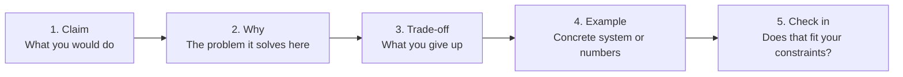
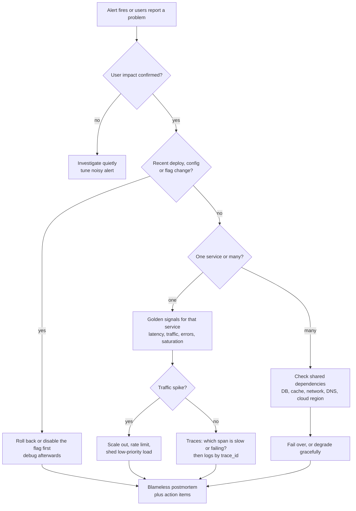
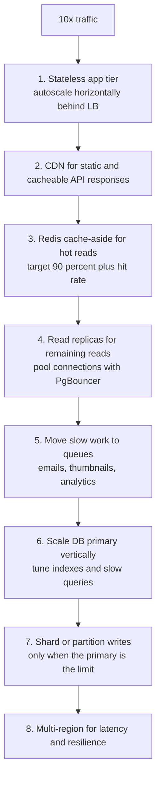
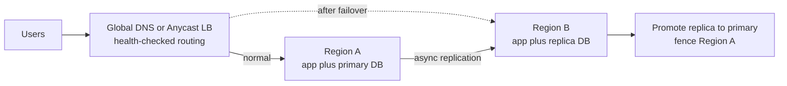
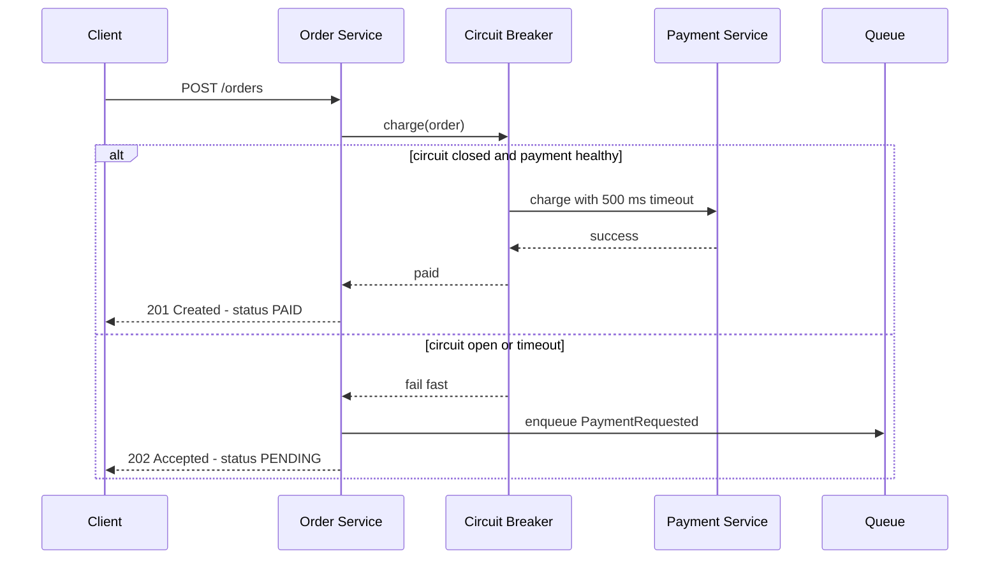
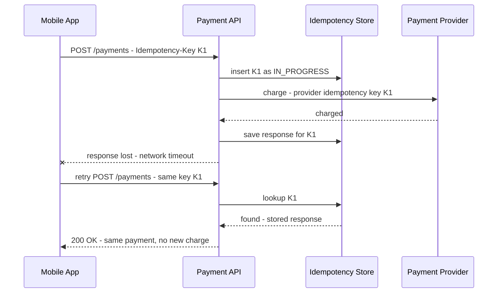
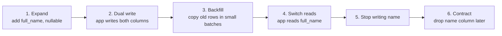
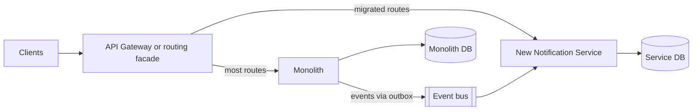
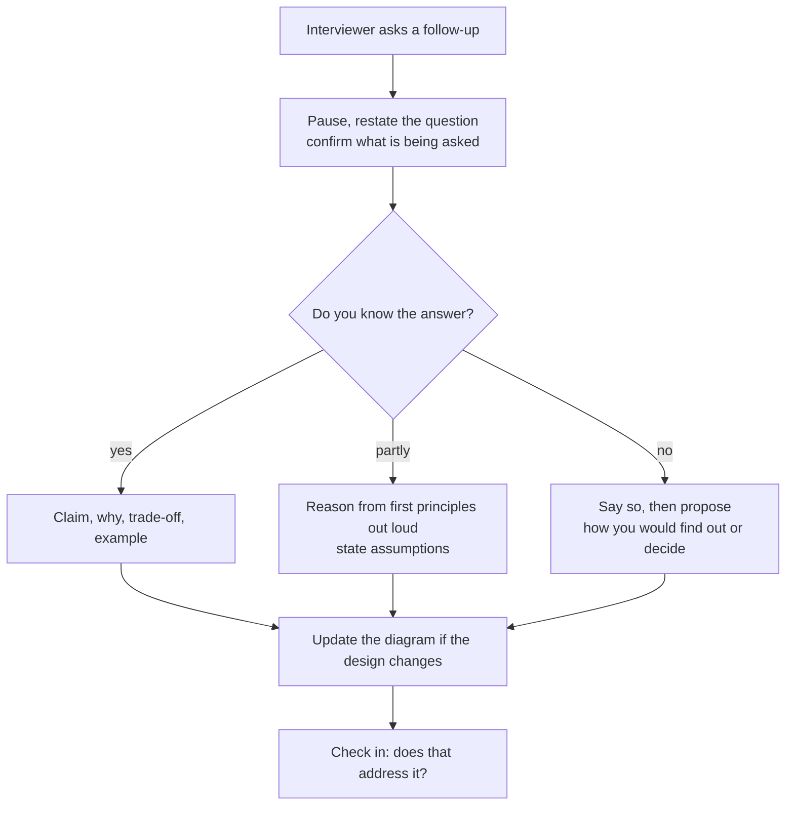

# System Design Interview Prep and Cheat Sheet

> **Part 9 of 10** in the System Design interview notes — see [README](README.md) for the roadmap.
> **What you'll learn:** 125 interview questions with strong sample answers (beginner → senior), 18 production scenarios plus an incident playbook, how to handle follow-ups, side-by-side trade-off tables, the mistakes that sink candidates, the numbers you should know by heart, and a one-sitting cheat sheet.
> **Level legend:** 🟢 Essential (asked in almost every interview) · 🟡 Intermediate · 🔴 Advanced / senior
> **Related:** [Fundamentals](01_system_design_fundamentals.md) · [Distributed Systems](05_distributed_systems_and_messaging.md) · [Interview Problems Part 1](07_interview_problems_part1.md) · [Interview Problems Part 2](08_interview_problems_part2.md)

This file is a **question bank and revision sheet**. It does not re-teach concepts — every answer links to the section in files 01–06 where the concept is explained in depth.

---

## Table of Contents

1. [How to Use This File](#1-how-to-use-this-file)
2. [Beginner Questions](#2-beginner-questions)
   - [2.1 Fundamentals and Requirements](#21-fundamentals-and-requirements)
   - [2.2 Networking and APIs](#22-networking-and-apis)
   - [2.3 Databases and Caching Basics](#23-databases-and-caching-basics)
   - [2.4 Architecture, Security and Observability Basics](#24-architecture-security-and-observability-basics)
3. [Intermediate Questions](#3-intermediate-questions)
   - [3.1 Networking, APIs and Traffic](#31-networking-apis-and-traffic)
   - [3.2 Databases](#32-databases)
   - [3.3 Caching](#33-caching)
   - [3.4 Consistency and CAP](#34-consistency-and-cap)
   - [3.5 Messaging](#35-messaging)
   - [3.6 Resilience Patterns](#36-resilience-patterns)
   - [3.7 Architecture, Auth and Observability](#37-architecture-auth-and-observability)
4. [Senior Questions](#4-senior-questions)
   - [4.1 Distributed Systems Internals](#41-distributed-systems-internals)
   - [4.2 Data Consistency Across Services](#42-data-consistency-across-services)
   - [4.3 Scale and Reliability Design](#43-scale-and-reliability-design)
   - [4.4 Security and Multi-Tenancy](#44-security-and-multi-tenancy)
5. [Scenario-Based Questions](#5-scenario-based-questions)
6. [Handling Follow-up Questions](#6-handling-follow-up-questions)
7. [Trade-off Comparison Tables](#7-trade-off-comparison-tables)
8. [Common Interview Mistakes](#8-common-interview-mistakes)
9. [Numbers Every Engineer Should Know](#9-numbers-every-engineer-should-know)
10. [Last-Minute Cheat Sheet](#10-last-minute-cheat-sheet)

---

## 1. How to Use This File

> **Level:** 🟢 Essential

### 1.1 Two Ways to Use It

| Mode | When | How |
|---|---|---|
| **Study mode** | Weeks before the interview | Read a question, **answer it out loud first**, then compare with the sample answer. If you couldn't explain *why*, follow the 📖 link and re-read the concept. Mark weak questions and revisit them in 3 days. |
| **Night-before mode** | 12–24 hours before | Skip the question bank. Read [7. Trade-off Comparison Tables](#7-trade-off-comparison-tables), [8. Common Interview Mistakes](#8-common-interview-mistakes), [9. Numbers](#9-numbers-every-engineer-should-know) and [10. Last-Minute Cheat Sheet](#10-last-minute-cheat-sheet). Then do one full mock design from [Part 1](07_interview_problems_part1.md) in 45 minutes. |

**Suggested order by level:**
- New to system design → [2. Beginner Questions](#2-beginner-questions) only, plus the cheat sheet.
- 2–5 years of experience → Beginner skim + all of [3. Intermediate Questions](#3-intermediate-questions) + [5. Scenarios](#5-scenario-based-questions).
- Senior / staff → Everything, with emphasis on [4. Senior Questions](#4-senior-questions), scenarios and follow-ups.

### 1.2 The Answer Formula

Interviewers are not grading whether you know a definition. They grade whether you can **make and defend a decision**. Every strong answer has four parts:



1. **Claim** — answer the question directly in one sentence. "I'd use cursor-based pagination."
2. **Why** — tie it to the requirement. "Because this is an infinite-scroll feed with constant inserts, and offset pagination would skip or duplicate items."
3. **Trade-off** — say what it costs. "The trade-off is users can't jump to page 50, which a feed doesn't need."
4. **Example** — make it concrete. "Twitter and Instagram feeds work this way; the cursor encodes the last seen `(created_at, id)`."
5. **Check in** (optional) — invite correction. "Does the product need page jumping anywhere?"

> **Weak answer:** "I'll use Redis."
> **Strong answer:** "I'll put Redis in front of the database using cache-aside, because reads outnumber writes 100:1 and the same 20% of keys get most traffic. The trade-off is up to 60 seconds of staleness from the TTL, which is fine for product descriptions but not for stock counts — those I'd read from the DB."

### 1.3 How Questions Are Formatted

- Questions are numbered globally (**Q1 … Q125**) so you can track weak ones.
- Each answer is in a blockquote. **Follow-up:** lines show what the interviewer usually asks next.
- 📖 links point to the in-depth explanation.
- Questions marked *(original)* came from the earlier notes and have been corrected and expanded; others were added to fill common interview gaps.

---

## 2. Beginner Questions

> **Level:** 🟢 Essential — every candidate, at every level, must answer these cleanly in under two minutes each.

### 2.1 Fundamentals and Requirements

**Q1. What is system design, and what is the interviewer actually evaluating?**
> System design is deciding the components of a software system — services, databases, caches, queues, networks — and how they interact so the system meets its functional needs at the required scale, reliability, and cost. In an interview, the evaluation is less about the "right" architecture (there isn't one) and more about: do you clarify requirements before designing, do you estimate scale, do you reason about trade-offs, do you find bottlenecks and failure modes, and can you communicate a structured design?
>
> **Follow-up:** "How is this different from low-level design?" — LLD is about classes, interfaces and patterns inside one service ([Part 10](10_low_level_design_and_patterns.md#2-solid-principles)); HLD is about services and infrastructure across machines.
>
> 📖 [What Is System Design](01_system_design_fundamentals.md#1-what-is-system-design)

**Q2. What's the difference between functional and non-functional requirements? Give examples.** *(original)*
> Functional requirements define **what** the system does — features such as "a user can shorten a URL" or "visiting the short URL redirects to the original." Non-functional requirements define **how well** it does it — availability (99.99% uptime), latency (redirect under 10 ms at p99), scalability (100M users), durability (links never lost), consistency, and security. NFRs drive most architectural decisions: "read-heavy with sub-10 ms latency" is what makes you add a cache and CDN, not the feature list.
>
> **Follow-up:** "Which NFRs matter most for a payment system vs a social feed?" — payments: consistency, durability, auditability; feed: availability and latency, eventual consistency is fine.
>
> 📖 [Requirements](01_system_design_fundamentals.md#2-requirements)

**Q3. Why do you state assumptions before starting a design?** *(original)*
> Because the right design depends on context. A system for 1,000 users looks nothing like one for 100M users. Stating assumptions ("100M DAU, 100:1 read/write, eventual consistency acceptable for counts, global users") aligns you with the interviewer, prevents designing for the wrong scale, and gives them a chance to correct you early — which costs 10 seconds instead of 20 minutes of wasted design. Interviewers explicitly reward this.
>
> 📖 [The System Design Interview Framework](01_system_design_fundamentals.md#10-the-system-design-interview-framework)

**Q4. What is the difference between availability, reliability, durability and fault tolerance?**
> - **Availability** — is the system up and answering right now? Measured as % uptime (99.9%).
> - **Reliability** — does it do the *correct* thing consistently over time? A system that is up but returns wrong results is available but not reliable.
> - **Durability** — once data is acknowledged as saved, is it never lost? S3 advertises 11 nines of durability.
> - **Fault tolerance** — the ability to keep working (possibly degraded) when components fail, via redundancy and failover.
>
> Example: a bank that is up 100% of the time but occasionally double-posts transactions is available but unreliable.
>
> 📖 [Core Quality Attributes](01_system_design_fundamentals.md#3-core-quality-attributes)

**Q5. What does 99.99% availability mean in practice?**
> It allows about **52.6 minutes of downtime per year** (~4.3 min/month). 99.9% allows ~8.76 hours/year; 99.999% allows ~5.3 minutes/year. Each extra nine roughly multiplies cost and complexity, because you must remove every single point of failure, automate failover (humans are too slow for 4 nines), and deploy safely. Also remember availability compounds: if a request depends on 3 services each at 99.9% in series, the end-to-end availability is about 99.7%.
>
> **Follow-up:** "How do you get higher availability than your dependencies?" — redundancy in parallel (two independent replicas at 99% each give ~99.99%), caching, graceful degradation.
>
> 📖 [Core Quality Attributes](01_system_design_fundamentals.md#3-core-quality-attributes)

**Q6. What's the difference between latency and throughput?**
> **Latency** is how long one request takes (ms). **Throughput** is how many requests the system completes per unit of time (requests/sec). They're related but different: a highway's latency is how long your trip takes; throughput is cars per hour. You can raise throughput by adding parallelism (more lanes) without improving latency, and batching often *raises* throughput while *hurting* latency. Little's Law ties them together: concurrent requests in flight = throughput × latency.
>
> 📖 [Latency, Throughput and Performance](01_system_design_fundamentals.md#4-latency-throughput-and-performance)

**Q7. Vertical vs horizontal scaling — which would you choose?**
> Vertical scaling (scale up) means a bigger machine — more CPU/RAM. It's simple, needs no code change, but has a hardware ceiling, gets expensive at the top end, and remains a single point of failure. Horizontal scaling (scale out) means more machines behind a load balancer — near-unlimited capacity and fault tolerance, but the service must be stateless and you take on distribution complexity. My default: scale **stateless app servers horizontally** from day one (it's cheap), and scale **databases vertically first**, then read replicas, then sharding only when forced.
>
> 📖 [Vertical vs Horizontal Scaling](01_system_design_fundamentals.md#5-vertical-vs-horizontal-scaling)

**Q8. What does it mean for a service to be stateless, and why does it matter for scaling?** *(original)*
> A stateless service keeps no per-user state in its own memory or local disk between requests; every request carries what's needed (e.g., a JWT), and shared state lives in Redis, a database or object storage. This means any instance can serve any request, so you can add, remove or restart instances freely and the load balancer can use simple round robin. Without it, you need sticky sessions, which create uneven load and lose sessions when an instance dies. Test: if you can kill any instance and users don't notice, it's stateless.
>
> 📖 [Vertical vs Horizontal Scaling](01_system_design_fundamentals.md#5-vertical-vs-horizontal-scaling)

**Q9. Why does knowing the read:write ratio matter?** *(original)*
> It tells you where to optimize. A 100:1 read-heavy system (URL shortener, product catalog) needs caching, CDNs and read replicas. A write-heavy system (metrics ingestion, chat, IoT) needs write-optimized storage (LSM-tree databases like Cassandra), partitioning, batching and async ingestion via queues. Getting it wrong means optimizing the wrong path — e.g., adding read replicas to a system whose primary is choking on writes.
>
> 📖 [Capacity Estimation](01_system_design_fundamentals.md#6-capacity-estimation)

**Q10. Walk me through estimating QPS for a system with 100M daily active users.** *(original)*
> Assume each user makes 10 requests/day → 1B requests/day. Divide by ~86,400 s/day (round to 10^5 for mental math) → ~11,500 QPS average. Apply a 2–3× peak factor → ~25,000–35,000 peak QPS. Then split by read/write ratio. That number tells me: a single app server handles maybe a few thousand simple requests/sec, so I need ~10–20 servers with headroom; and a single Postgres primary can't take 30K reads/sec of complex queries, so I need a cache.
>
> **Follow-up:** "Why 2–3× for peak?" — traffic follows daily cycles and events; use real peak data if the interviewer gives it.
>
> 📖 [Capacity Estimation](01_system_design_fundamentals.md#6-capacity-estimation)

**Q11. A URL shortener creates 100M new URLs per day. Estimate storage.** *(original — corrected)*
> Each record: short code (7 B) + long URL (~200 B) + user ID, created/expiry timestamps and overhead (~40 B) ≈ **250 bytes**. Per day: 100M × 250 B = **25 GB/day**. Over 5 years: 25 GB × 365 × 5 ≈ **~45 TB** (before replication; ×3 for replicas ≈ 135 TB raw). That's too large for comfortable single-node storage, so I'd use a horizontally partitioned key-value store (DynamoDB/Cassandra) keyed by short code, or shard Postgres by short code hash.
>
> *Correction:* the original notes said "125 GB over 5 years" — that assumed 100M URLs per **year**, contradicting the 100M per **day** used earlier. Always keep your units consistent and say which assumption you're using.
>
> **Follow-up:** "How much cache?" — cache the hot ~20% of a day's read working set: if 1B reads/day touch ~100M distinct URLs, 20% × 100M × 250 B ≈ 5 GB — fits in one Redis node; use a small cluster for availability.
>
> 📖 [Capacity Estimation](01_system_design_fundamentals.md#6-capacity-estimation) · [URL Shortener design](07_interview_problems_part1.md#1-url-shortener)

### 2.2 Networking and APIs

**Q12. What happens when you type a URL into a browser and press Enter?**
> 1. **DNS resolution** — browser cache → OS cache → recursive resolver → root → TLD → authoritative server returns the IP (often of a CDN edge or load balancer).
> 2. **TCP handshake** (SYN, SYN-ACK, ACK) — or QUIC over UDP for HTTP/3.
> 3. **TLS handshake** — certificate verified, session keys agreed.
> 4. **HTTP request** sent; it may hit a CDN, then a load balancer / reverse proxy, then an app server, which may consult cache and database.
> 5. **Response** returned; browser parses HTML, fetches CSS/JS/images (mostly from CDN), renders.
>
> Interviewers use this to see breadth; mention caching at every layer and that keep-alive / HTTP/2 reuse connections to avoid repeating handshakes.
>
> 📖 [How a Request Travels the Internet](02_networking_and_communication.md#1-how-a-request-travels-the-internet)

**Q13. How does DNS work, and how is it used in system design?**
> DNS maps names to IP addresses through a hierarchy (root → TLD like `.com` → authoritative nameserver), with heavy caching at every level controlled by **TTL**. In system design it's also a traffic tool: **GeoDNS / latency-based routing** sends users to the nearest region, **weighted records** enable gradual migrations, and **health-checked failover records** redirect traffic away from a dead region. The trade-off is caching — a low TTL (30–60 s) enables fast failover but increases DNS query load, and some clients ignore TTLs, so DNS failover is never instant.
>
> 📖 [DNS](02_networking_and_communication.md#2-dns)

**Q14. TCP vs UDP — when would you use each?**
> **TCP** is connection-oriented, reliable and ordered (retransmissions, flow and congestion control) — use it for APIs, databases, file transfer, anything where every byte matters. **UDP** is connectionless with no delivery or ordering guarantees but minimal overhead and no head-of-line blocking — use it for real-time voice/video, gaming, DNS lookups, metrics (StatsD), where a late packet is useless anyway. QUIC (HTTP/3) builds reliability on top of UDP to get TCP's guarantees without its head-of-line blocking and with faster handshakes.
>
> 📖 [TCP, UDP and IP](02_networking_and_communication.md#3-tcp-udp-and-ip)

**Q15. What is TLS and what does it protect against?** *(original)*
> TLS is the cryptographic protocol behind HTTPS. It provides **confidentiality** (traffic is encrypted with session keys), **integrity** (tampering is detected), and **authentication** (the server's certificate, signed by a trusted CA, proves identity). It protects against eavesdropping, man-in-the-middle attacks and tampering in transit. TLS 1.3 reduces the handshake to one round trip, removes weak ciphers and requires forward secrecy. It does **not** protect data at rest or a compromised endpoint.
>
> 📖 [TLS and mTLS](02_networking_and_communication.md#5-tls-and-mtls)

**Q16. When would you choose GraphQL over REST?** *(original)*
> When multiple clients need different data shapes — a mobile app wants a few fields to save bandwidth, a web dashboard wants deeply nested data — and you want to avoid over-fetching and multiple round trips. GraphQL lets the client ask for exactly the fields it needs in one request. For simple CRUD, public APIs, or when HTTP caching matters, REST is simpler: GraphQL usually POSTs to one endpoint, which defeats CDN/HTTP caching, and it needs protection against expensive queries (depth limits, query cost analysis) and the N+1 resolver problem (DataLoader batching).
>
> 📖 [GraphQL](02_networking_and_communication.md#8-graphql) · [Choosing an API Style](02_networking_and_communication.md#10-choosing-an-api-style)

**Q17. How do you version a REST API without breaking existing clients?** *(original)*
> Prefer **additive, backward-compatible changes** (new optional fields, new endpoints) that need no new version at all. For breaking changes, use URL path versioning (`/api/v1/users` → `/api/v2/users`) for public APIs because it's explicit and easy to route; header-based versioning keeps URLs clean but is less visible. Run both versions in parallel through a published deprecation window (often 6–12 months), communicate via `Deprecation`/`Sunset` headers and changelogs, monitor v1 traffic, and retire it only when usage is near zero.
>
> 📖 [REST API Design](02_networking_and_communication.md#7-rest-api-design)

**Q18. Explain offset vs cursor-based pagination.** *(original)*
> Offset pagination (`?page=3&limit=20` → `LIMIT 20 OFFSET 40`) is simple and allows jumping to any page, but the database still scans and discards all skipped rows, so deep pages get slow, and inserts/deletes between requests cause skipped or duplicated items. Cursor (keyset) pagination (`?cursor=<opaque>&limit=20` → `WHERE (created_at, id) < (:ts, :id) ORDER BY created_at DESC, id DESC LIMIT 20`) uses an index seek, so every page is equally fast and results are stable under concurrent writes — ideal for feeds and infinite scroll. Trade-off: no random page access, and the cursor must encode a unique, indexed sort key.
>
> 📖 [REST API Design](02_networking_and_communication.md#7-rest-api-design)

**Q19. What status code should a rate-limited request return, with which headers?** *(original)*
> `429 Too Many Requests`, with `Retry-After` (seconds or date until retry is allowed) and rate-limit headers such as `X-RateLimit-Limit`, `X-RateLimit-Remaining`, `X-RateLimit-Reset` (or the IETF standard `RateLimit-*` headers). These let well-behaved clients back off precisely instead of hammering. Use `503 Service Unavailable` instead when the *server* is overloaded (load shedding) rather than the *client* exceeding a quota.
>
> 📖 [Rate Limiting](02_networking_and_communication.md#14-rate-limiting)

**Q20. Which HTTP methods are idempotent, and why does it matter?**
> GET, HEAD, OPTIONS, PUT and DELETE are idempotent by specification — repeating them leaves the server in the same state. GET/HEAD/OPTIONS are also *safe* (no side effects). POST is not idempotent; PATCH usually isn't. It matters because networks fail and clients, proxies and SDKs retry: retrying an idempotent call is safe, but retrying `POST /payments` can charge twice unless you add an **idempotency key**. Note "idempotent" is about server state, not the response — a second DELETE may return 404 and still be idempotent.
>
> 📖 [REST API Design](02_networking_and_communication.md#7-rest-api-design) · [Delivery Guarantees, Idempotency and Deduplication](05_distributed_systems_and_messaging.md#13-delivery-guarantees-idempotency-and-deduplication)

**Q21. What does a load balancer do, and which algorithm would you choose if some servers are overloaded while others are idle?** *(original — merged)*
> A load balancer spreads traffic across healthy instances, removes failed instances via health checks, and gives clients one stable address. Round robin ignores how busy each server is, so with variable request costs or long-lived connections some servers pile up work. I'd switch to **least connections** (or least outstanding requests / "power of two random choices"), which routes to the server with the fewest in-flight requests. Use **weighted round robin** if servers have known different capacities, and **consistent hashing** when you need key affinity (e.g., caches).
>
> 📖 [Load Balancers](02_networking_and_communication.md#12-load-balancers)

**Q22. What is a CDN, and when would you use one?**
> A Content Delivery Network is a global fleet of edge servers that cache content close to users. Use it for static assets (images, JS, CSS, video segments) and cacheable API responses — it cuts latency (a user in Mumbai is served from Mumbai, not Virginia), offloads origin bandwidth and absorbs traffic spikes and DDoS. Push CDNs pre-upload content; pull CDNs fetch from origin on first miss. Trade-offs: cost, cache invalidation delay, and it doesn't help personalized, uncacheable responses.
>
> 📖 [CDN and Edge Computing](02_networking_and_communication.md#15-cdn-and-edge-computing) · [CDN Caching](04_caching.md#10-cdn-caching)

### 2.3 Databases and Caching Basics

**Q23. When would you choose NoSQL over SQL?** *(original)*
> Choose by **access pattern**, not fashion. SQL (Postgres, MySQL) is the default when data is relational, you need multi-row ACID transactions, ad-hoc queries and joins — orders, payments, inventory. NoSQL fits when you need massive horizontal write scale with simple, known access patterns (key lookups, time-ordered partitions), a flexible schema, or a specialized model: key-value (Redis, DynamoDB) for sessions and lookups, wide-column (Cassandra) for write-heavy time-series like activity logs, document (MongoDB) for variable product catalogs, graph (Neo4j) for relationship traversal. Many modern SQL databases also scale out (CockroachDB, Spanner, Vitess), so "SQL can't scale" is outdated.
>
> 📖 [SQL vs NoSQL](03_databases_and_storage.md#2-sql-vs-nosql) · [Database Types](03_databases_and_storage.md#3-database-types)

**Q24. What is an index, and how do you decide whether a column should be indexed?** *(original)*
> An index is an auxiliary data structure (usually a B+ tree) that lets the database find rows without scanning the whole table — O(log n) instead of O(n). Index a column when it appears often in `WHERE`, `JOIN ON` or `ORDER BY`, has high selectivity (email, not a boolean), and the table is large. Every index slows writes (it must be updated on each insert/update/delete) and uses storage, so don't index write-hot columns or low-cardinality flags unless it's a partial index. Verify with `EXPLAIN`, don't guess.
>
> 📖 [Indexing](03_databases_and_storage.md#5-indexing)

**Q25. What does ACID mean?**
> - **Atomicity** — a transaction's operations all succeed or all roll back (debit *and* credit, never one).
> - **Consistency** — the transaction moves the database from one valid state to another (constraints like "balance ≥ 0" hold).
> - **Isolation** — concurrent transactions don't see each other's intermediate states; strength depends on the isolation level.
> - **Durability** — once committed, data survives crashes (write-ahead log flushed to disk).
>
> Note the "C" in ACID (constraint validity) is different from the "C" in CAP (every read sees the latest write).
>
> 📖 [Transactions, ACID and Isolation Levels](03_databases_and_storage.md#6-transactions-acid-and-isolation-levels)

**Q26. What is a read replica and what problem does it solve?** *(original)*
> A read replica is a copy of the primary database, kept in sync by replicating the primary's write log, that serves read queries. It solves read scaling: writes go to the primary, reads spread across replicas, and analytics queries can be isolated on their own replica. It also provides a failover candidate. Replication is usually asynchronous, so replicas lag by milliseconds to seconds — fine for product pages, not for "show me my balance right after I paid." For that, route the user's own reads to the primary for a short window (read-your-writes).
>
> 📖 [Replication and Read Replicas](03_databases_and_storage.md#8-replication-and-read-replicas)

**Q27. What is normalization vs denormalization, and when would you denormalize?**
> Normalization splits data into tables so each fact is stored once (no duplication, no update anomalies) — the default for write-heavy transactional systems. Denormalization deliberately duplicates data (e.g., storing `author_name` on each post, or a precomputed `follower_count`) to avoid joins and make reads fast. Denormalize when reads vastly outnumber writes, when data lives in a NoSQL store without joins, or across microservices/shards where joins are impossible. The trade-off is keeping copies in sync — via events, triggers or batch jobs — and accepting brief inconsistency.
>
> 📖 [Data Modeling, Normalization and Denormalization](03_databases_and_storage.md#4-data-modeling-normalization-and-denormalization)

**Q28. Why add a cache, and how does the cache-aside pattern work?**
> A cache keeps hot data in memory (Redis: sub-millisecond) so most reads never hit the database, cutting latency and DB load. In **cache-aside** (lazy loading) the application: (1) checks the cache; (2) on hit, returns; (3) on miss, reads the DB, writes the result to the cache with a TTL, and returns. On writes, it updates the DB and **deletes** the cache key so the next read reloads it. It's the most common pattern because it caches only what's actually requested and the DB stays the source of truth. Trade-off: the first read after a miss is slow, and data can be stale for up to the TTL.
>
> 📖 [Caching Patterns](04_caching.md#3-caching-patterns)

**Q29. Which eviction policy would you choose for a session cache, and why?** *(original)*
> **TTL-based expiry** first — sessions should naturally expire after an inactivity window (e.g., 30 minutes, sliding on each request). Behind it, use **LRU** (Redis `volatile-lru` or `allkeys-lru`) so memory pressure evicts sessions that haven't been touched recently. I'd avoid LFU here: a session that was very active an hour ago would outrank a new session that just logged in. Also size the cache so eviction is rare — evicting live sessions logs users out.
>
> 📖 [Eviction Policies](04_caching.md#5-eviction-policies)

**Q30. Object storage vs file storage vs block storage — what's the difference?**
> - **Block storage** (AWS EBS) — raw disk volumes attached to one machine; lowest latency; used for databases and OS disks.
> - **File storage** (NFS, AWS EFS) — a shared hierarchical filesystem many machines can mount; used for shared content and legacy apps.
> - **Object storage** (S3, GCS) — flat namespace of immutable objects with metadata, accessed over HTTP; practically unlimited scale, very high durability, cheap; used for images, videos, backups, data lakes.
>
> Rule: store **files in object storage and only their metadata/URL in the database**. Let clients upload directly to object storage with pre-signed URLs so large bytes never pass through your app servers.
>
> 📖 [Object, File and Block Storage](03_databases_and_storage.md#13-object-file-and-block-storage)

### 2.4 Architecture, Security and Observability Basics

**Q31. What's the difference between a monolith and a modular monolith?** *(original)*
> A plain monolith is one deployable unit whose code often has no enforced internal boundaries — any class can call any other, leading to a "big ball of mud." A modular monolith is still one deployable, but organized into modules with explicit public interfaces and owned data (e.g., separate schemas); modules never reach into each other's internals or tables. You keep the operational simplicity of one deployment and in-process calls, while building the domain boundaries that make extracting microservices later far less painful.
>
> 📖 [Architecture Styles](06_architecture_reliability_and_security.md#1-architecture-styles)

**Q32. What's the difference between authentication and authorization?**
> **Authentication (AuthN)** answers "who are you?" — verifying identity via password + MFA, OAuth/OIDC login, or a client certificate. **Authorization (AuthZ)** answers "what are you allowed to do?" — checking roles or policies (RBAC/ABAC) against the requested resource. AuthN happens first and usually produces a token or session; AuthZ is checked on every request. HTTP mirrors this: `401 Unauthorized` really means unauthenticated; `403 Forbidden` means authenticated but not permitted.
>
> 📖 [Authentication and Authorization](06_architecture_reliability_and_security.md#10-authentication-and-authorization)

**Q33. What are the three parts of a JWT and what does each contain?** *(original)*
> `header.payload.signature`. **Header**: token type and signing algorithm (`HS256`, `RS256`) plus often a `kid` key ID. **Payload**: claims — `sub` (user ID), roles, `iss`, `aud`, `iat`, `exp`. **Signature**: a cryptographic signature over header + payload, proving the token wasn't modified and was issued by someone holding the key. Critically, the payload is only **Base64URL-encoded, not encrypted** — anyone can read it — so never put secrets or sensitive PII in a JWT. Always validate signature, `exp`, `iss` and `aud`, and reject `alg: none`.
>
> 📖 [Authentication and Authorization](06_architecture_reliability_and_security.md#10-authentication-and-authorization)

**Q34. Why should you never store passwords in plain text, and what should you use instead?** *(original)*
> A breach would expose every user's password — and since people reuse passwords, their other accounts too. Fast hashes (MD5, SHA-1, SHA-256) are also wrong because GPUs can try billions per second. Use a slow, salted, purpose-built password hash: **Argon2id** (preferred), **bcrypt** (cost ~12) or **scrypt**. The per-password salt defeats rainbow tables; the deliberate slowness (~100–300 ms) is trivial at login but makes brute force impractical. Hashing is one-way — you verify by hashing the input and comparing, never by decrypting.
>
> 📖 [Security Fundamentals](06_architecture_reliability_and_security.md#11-security-fundamentals)

**Q35. Explain SQL injection and how to prevent it.** *(original)*
> SQL injection happens when user input is concatenated into a SQL string, so input like `' OR '1'='1` changes the query's logic — dumping data, bypassing login, or dropping tables. Prevent it with **parameterized queries / prepared statements**, where the database treats parameters strictly as data. JPA/Hibernate parameter binding does this by default, but native queries built with string concatenation are still vulnerable. Add least-privilege DB users and input validation as defence in depth.
>
> 📖 [Security Fundamentals](06_architecture_reliability_and_security.md#11-security-fundamentals)

**Q36. What's the difference between encryption at rest and encryption in transit?** *(original)*
> **In transit** protects data moving over a network — TLS/HTTPS for external traffic and, increasingly, mTLS between internal services — against eavesdropping and tampering. **At rest** protects stored data — disk/volume encryption, database TDE, S3 server-side encryption with KMS keys, or application-level field encryption for card numbers — against stolen disks, leaked backups or unauthorized storage access. You need both: encrypting only in transit means a compromised database or backup exposes everything.
>
> 📖 [Security Fundamentals](06_architecture_reliability_and_security.md#11-security-fundamentals)

**Q37. What are the three pillars of observability and how do they differ?** *(original)*
> **Metrics** — numeric time series (request rate, error rate, p99 latency, CPU); cheap, great for dashboards and alerting — they tell you *that* something is wrong. **Traces** — the path of one request across services as a tree of timed spans — they tell you *where* it's wrong. **Logs** — timestamped structured event records with context — they tell you *why*. Link them with a shared `trace_id` so you can jump from an alert to the slow trace to the exact log lines.
>
> 📖 [Observability](06_architecture_reliability_and_security.md#8-observability)

**Q38. What is a message queue, and why would you make a call asynchronous?**
> A message queue is a durable buffer between a producer and consumers: the producer writes a message and moves on; consumers process it at their own pace. Make work async when the caller doesn't need the result right now — sending emails, generating thumbnails, updating analytics. Benefits: lower user-facing latency, **decoupling** (the producer doesn't care if the consumer is down — messages wait), **load leveling** (absorb spikes), and independent scaling of consumers. Trade-offs: eventual consistency, harder debugging, and you must handle duplicates and failures (idempotent consumers, DLQ).
>
> 📖 [Synchronous vs Asynchronous Communication](05_distributed_systems_and_messaging.md#9-synchronous-vs-asynchronous-communication) · [Message Queues, Pub-Sub and Event Streaming](05_distributed_systems_and_messaging.md#10-message-queues-pub-sub-and-event-streaming)

---

## 3. Intermediate Questions

> **Level:** 🟡 Intermediate — expected from engineers with 2+ years of experience. Interviewers will push for mechanisms and trade-offs, not definitions.

### 3.1 Networking, APIs and Traffic

**Q39. What's the difference between an L4 and an L7 load balancer? When would you use each?** *(original — corrected)*
> An **L4** (transport layer) load balancer routes TCP/UDP connections using only IPs and ports. It's extremely fast, handles millions of connections, and preserves arbitrary protocols — use it for databases, gRPC/WebSocket pass-through, gaming, or as the first tier in front of L7 proxies. An **L7** (application layer) load balancer parses HTTP: it can route by path, host or header (`/api` → API fleet, `/images` → media service), do canary splits, add headers, enforce auth, and retry idempotent requests. Use it for web apps and microservices.
>
> *Correction:* the original notes said L4 can't terminate TLS. L4 balancers **can** terminate TLS (e.g., AWS NLB TLS listeners); what they can't do is route based on HTTP content.
>
> 📖 [Load Balancers](02_networking_and_communication.md#12-load-balancers)

**Q40. Short polling vs long polling vs Server-Sent Events vs WebSockets — how do you choose?**
> - **Short polling** — client asks every N seconds. Simple, works everywhere, but wastes requests and adds up to N seconds of delay.
> - **Long polling** — server holds the request open until there's data or a timeout. Near real-time over plain HTTP; each message costs a new request.
> - **SSE** — one long-lived HTTP response streaming server→client events; auto-reconnect and event IDs built in. Great for one-way pushes: notifications, live scores, stock tickers, LLM token streaming.
> - **WebSockets** — full-duplex persistent connection. Needed for two-way low-latency traffic: chat, multiplayer games, collaborative editing.
>
> Trade-off: WebSockets need stateful connection servers, a connection registry (which server holds which user), and a pub/sub backplane (Redis, Kafka) to deliver messages to whichever server holds the recipient's socket. Choose the simplest option that meets the latency and direction requirement.
>
> 📖 [Real-Time Communication](02_networking_and_communication.md#6-real-time-communication)

**Q41. When would you use gRPC instead of REST?**
> For **internal service-to-service** calls where performance and strict contracts matter. gRPC uses HTTP/2 (multiplexed streams over one connection) and Protocol Buffers (compact binary, schema-first with generated clients), and supports streaming in both directions plus deadlines that propagate across calls. Payloads are typically much smaller than JSON and faster to serialize. Keep REST/JSON for public and browser-facing APIs: browsers need gRPC-Web plus a proxy, payloads aren't human-readable, and HTTP caching doesn't apply. A common pattern is REST at the edge (API gateway) and gRPC inside.
>
> 📖 [gRPC](02_networking_and_communication.md#9-grpc) · [Choosing an API Style](02_networking_and_communication.md#10-choosing-an-api-style)

**Q42. What does an API Gateway do, and why is it important in microservices?** *(original)*
> It's the single entry point for client traffic, handling cross-cutting concerns once instead of in every service: TLS termination, authentication (validating JWTs), rate limiting and quotas, routing to the right service, request/response transformation, response aggregation, logging and metrics. It hides internal topology, so services can be split or moved without changing client URLs. Trade-offs: it's an extra hop, must be highly available (multiple instances behind an L4 LB), and shouldn't accumulate business logic. The **BFF** variant gives each client type (mobile, web, partner) its own gateway tailored to its needs.
>
> 📖 [API Gateway and BFF](02_networking_and_communication.md#13-api-gateway-and-bff)

**Q43. Reverse proxy vs load balancer vs API gateway — aren't they the same thing?**
> They overlap, and one product (Nginx, Envoy) can play all three roles. A **reverse proxy** sits in front of servers and forwards requests on their behalf — TLS termination, compression, caching, hiding backends. A **load balancer** is a reverse proxy whose main job is distributing load across a pool with health checks. An **API gateway** is an L7 reverse proxy specialized for APIs — auth, rate limiting, API keys, versioning, request transformation. In a design, name the *responsibility* you need, then pick the component.
>
> 📖 [Reverse Proxy](02_networking_and_communication.md#11-reverse-proxy)

**Q44. Compare rate-limiting algorithms. How do you rate limit across many gateway instances?**
> - **Token bucket** — tokens refill at a fixed rate up to a capacity; each request takes one. Allows bursts up to capacity; the most common choice for APIs.
> - **Leaky bucket** — requests drain at a constant rate; smooths output, good for protecting a fragile downstream.
> - **Fixed window counter** — count per minute; simple but allows a 2× burst at window boundaries.
> - **Sliding window log** — exact, but stores every timestamp (memory-heavy).
> - **Sliding window counter** — weighted blend of current and previous windows; accurate enough and cheap.
>
> Across instances, keep counters in a shared store — **Redis with an atomic Lua script** (or `INCR` + `EXPIRE`) per `user:window` key — so all gateways see the same count. At very high scale, use local buckets with periodic sync to Redis, accepting slight over-admission. Decide fail-open vs fail-closed if Redis is down (usually fail-open for normal APIs, fail-closed for abuse-sensitive endpoints like login).
>
> 📖 [Rate Limiting](02_networking_and_communication.md#14-rate-limiting) · [Rate Limiter design](07_interview_problems_part1.md#2-rate-limiter)

**Q45. Why is idempotency critical in payment APIs, and how do you implement an idempotency key?** *(original — expanded)*
> A client whose request times out can't know whether the payment succeeded. If it retries a non-idempotent `POST /payments`, the user may be charged twice. With an **idempotency key**:
> 1. Client generates a UUID per logical operation and sends `Idempotency-Key: <uuid>`.
> 2. Server atomically inserts the key with status `IN_PROGRESS` (unique constraint or Redis `SET NX`). If the key already exists, return the stored response — or `409 Conflict` if still in progress.
> 3. Execute the charge, store the final response against the key (TTL ~24 h), return it.
> 4. Check the request body matches the original for that key; reject mismatches.
>
> Store the key in the **same database transaction** as the business write where possible, so "charge recorded" and "key recorded" can't diverge. Pass the key on to the payment provider (Stripe supports this) so the downstream is protected too.
>
> 📖 [Delivery Guarantees, Idempotency and Deduplication](05_distributed_systems_and_messaging.md#13-delivery-guarantees-idempotency-and-deduplication)

**Q46. How does HTTP caching work? Explain Cache-Control and ETag.**
> `Cache-Control` tells browsers and CDNs whether and how long they may cache: `max-age=3600` (fresh for an hour), `s-maxage` (shared caches only), `private` (browser only, for per-user data), `no-store` (never cache), `no-cache` (cache but revalidate every time), `immutable` (for fingerprinted assets like `app.3f9a.js`). An **ETag** is a version identifier for a response; when the cached copy is stale, the client sends `If-None-Match: <etag>` and the server replies `304 Not Modified` with no body if unchanged — saving bandwidth. Best practice: fingerprinted static assets get a long `max-age` + `immutable`; HTML and APIs get short TTLs + ETag.
>
> 📖 [HTTP Caching](04_caching.md#9-http-caching)

### 3.2 Databases

**Q47. What is a covering index and why is it useful?** *(original)*
> A covering index contains every column a query needs, so the database answers it from the index alone without fetching table rows (an "index-only scan"). Example: `INDEX(user_id, status, created_at)` covers `SELECT status, created_at FROM orders WHERE user_id = 123`. It removes random-I/O row lookups and can make hot queries dramatically faster. Trade-off: wider indexes use more storage and slow writes more, so reserve them for high-frequency queries. Postgres supports `INCLUDE (...)` columns for exactly this.
>
> 📖 [Indexing](03_databases_and_storage.md#5-indexing)

**Q48. Why does column order matter in a composite index?**
> A B-tree composite index on `(last_name, first_name)` is sorted by `last_name` first, then by `first_name` within each last name — like a phone book. It supports `WHERE last_name = ?` and `WHERE last_name = ? AND first_name = ?`, but **not** `WHERE first_name = ?` alone (the leftmost-prefix rule). Order columns as: equality predicates first, then range/sort columns (`WHERE user_id = ? ORDER BY created_at DESC` → `(user_id, created_at)`).
>
> 📖 [Indexing](03_databases_and_storage.md#5-indexing)

**Q49. What does the REPEATABLE READ isolation level prevent?** *(original — corrected)*
> By the SQL standard, Repeatable Read prevents **dirty reads** (seeing uncommitted data) and **non-repeatable reads** (a row changing between two reads in your transaction), but permits **phantom reads** (new rows matching your query appearing). Real engines differ: **PostgreSQL's Repeatable Read is snapshot isolation**, which also prevents phantoms but still allows **write skew**; **MySQL InnoDB** (where RR is the default) uses consistent snapshots for plain reads and next-key/gap locks for locking reads to limit phantoms. Only **Serializable** prevents all anomalies, including write skew.
>
> 📖 [Transactions, ACID and Isolation Levels](03_databases_and_storage.md#6-transactions-acid-and-isolation-levels)

**Q50. What are lost update and write skew anomalies, and how do you prevent them?**
> **Lost update**: two transactions read `stock = 10`, each subtracts 1 and writes 9 — one decrement is lost. Prevent with an atomic update (`UPDATE items SET stock = stock - 1 WHERE id = ? AND stock > 0`), `SELECT ... FOR UPDATE`, or optimistic locking with a `version` column (`UPDATE ... WHERE id = ? AND version = ?`, retry when 0 rows change).
>
> **Write skew**: two transactions each read a condition that's true ("at least one other doctor is on call"), then each write something that together violates it (both go off call). Locks on what you *write* don't help because they write different rows. Prevent with Serializable isolation, locking the rows you *read* (`FOR UPDATE`), or a constraint that materializes the rule.
>
> 📖 [Transactions, ACID and Isolation Levels](03_databases_and_storage.md#6-transactions-acid-and-isolation-levels)

**Q51. What's the difference between horizontal partitioning (sharding) and vertical partitioning?** *(original)*
> **Horizontal partitioning / sharding** splits *rows* across nodes — users 1–10M on shard 1, 10M–20M on shard 2, or by hash of `user_id`. Each shard has the same schema and a subset of data; this scales writes and storage. **Vertical partitioning** splits *columns or tables* — keep hot core columns in one table and move large, rarely read blobs or activity logs elsewhere (or split by domain into separate databases). It improves cache efficiency and separates concerns but doesn't scale one huge table. "Partitioning" within one database (Postgres declarative partitions) is the same row-splitting idea on a single node.
>
> 📖 [Partitioning and Sharding](03_databases_and_storage.md#9-partitioning-and-sharding)

**Q52. When would you use hash-based vs range-based sharding?** *(original)*
> **Range-based** (by date or ID range) keeps adjacent keys together, so "orders in March" hits one shard — but sequential keys create **hotspots** (all new writes land on the latest shard). **Hash-based** (`hash(user_id)`) spreads keys evenly and avoids hotspots for point lookups, but range queries must scatter-gather across all shards. Choose by dominant query: time-series with range scans → range (often with a hash prefix to spread writes); user-centric point lookups → hash. **Directory-based** sharding (a lookup table) gives maximum flexibility at the cost of an extra, highly available lookup service.
>
> 📖 [Partitioning and Sharding](03_databases_and_storage.md#9-partitioning-and-sharding)

**Q53. What problem does consistent hashing solve? What are virtual nodes?** *(original — expanded)*
> With `hash(key) % N`, changing N (adding or losing a node) remaps almost every key — catastrophic for a cache cluster (mass misses → database stampede) or a sharded store (mass data movement). Consistent hashing places nodes and keys on a hash ring; each key belongs to the first node clockwise. Adding or removing a node moves only about **1/N** of keys, from its neighbour. **Virtual nodes** give each physical node many ring positions (e.g., 100–256), which evens out load, spreads a failed node's keys across *all* survivors instead of one neighbour, and lets bigger machines take more vnodes. Used by Cassandra, DynamoDB and client-side Memcached sharding. (Redis Cluster uses fixed hash slots instead — see Q61.)
>
> 📖 [Consistent Hashing](03_databases_and_storage.md#10-consistent-hashing)

**Q54. What is connection pooling, and how do you size a pool?**
> Opening a database connection costs a TCP + TLS handshake and authentication, and each Postgres connection is a separate backend process using memory. A pool (HikariCP in Spring Boot) keeps open connections that requests borrow and return. Size it **small**: a database can only execute roughly (CPU cores × 2) queries truly in parallel, so 10–30 connections per app instance is typical — more connections just queue inside the database. Watch the multiplication: 50 pods × 20 connections = 1,000 connections, which can exhaust Postgres; put a pooler like **PgBouncer** or RDS Proxy in between. Set a connection-acquire timeout so threads fail fast instead of hanging.
>
> 📖 [Connection Pooling](03_databases_and_storage.md#11-connection-pooling)

**Q55. What is a hot partition, and how do you fix it?**
> A hot partition is one shard or partition receiving a disproportionate share of traffic — a celebrity's user ID, a viral product, or today's date in a date-keyed table — so it saturates while others idle, and adding nodes doesn't help. Fixes: choose a higher-cardinality partition key; **salt** hot keys (`product123#0..9`) to spread writes across N sub-keys and aggregate on read; cache hot reads in front; split the partition; or give known hot entities a dedicated path. Detect it by monitoring per-partition throughput, not cluster averages.
>
> 📖 [Partitioning and Sharding](03_databases_and_storage.md#9-partitioning-and-sharding)

**Q56. What is read-your-writes consistency and when is it important?** *(original)*
> A guarantee that after *you* write something, *your* subsequent reads reflect it — even if other users may briefly see older data. It matters in user-facing flows: after updating your profile or posting a comment, seeing the old version looks like a bug. Implementations: route the user's reads to the primary for a short window after a write (e.g., 10 s, tracked by a cookie/timestamp); read from a replica only if its replication position is at least the user's last write position; or have the client render its own write optimistically.
>
> 📖 [Consistency Models](01_system_design_fundamentals.md#8-consistency-models)

### 3.3 Caching

**Q57. How does cache-aside fail under concurrency? What is a cache stampede?** *(original)*
> If a hot key expires, thousands of concurrent requests all miss at once and all query the database — a **cache stampede** (thundering herd) that can take the database down. Separately, a race between a reader repopulating an old value and a writer deleting the key can leave stale data cached until TTL. Fixes: **single-flight / mutex** — only one request (via a Redis `SET NX` lock or in-process request coalescing) recomputes while others wait or serve the stale value; **probabilistic early refresh** or background refresh before expiry; **TTL jitter** so keys don't expire together; short TTLs plus delete-on-write to bound staleness.
>
> 📖 [Cache Failure Modes](04_caching.md#8-cache-failure-modes)

**Q58. Compare write-through, write-behind and write-around caching.** *(original — expanded)*
> - **Write-through** — write to the cache and the DB synchronously as one operation. Reads after writes are almost always hits and the cache stays fresh. Cost: higher write latency and a cache full of data that may never be read. It's *not* truly strongly consistent — a failure between the two writes, or concurrent writers, can still make them diverge.
> - **Write-behind (write-back)** — write to the cache, acknowledge, flush to the DB asynchronously in batches. Very fast writes and fewer DB writes, but data is lost if the cache node dies before flushing — use only for loss-tolerant data (view counters) or with a durable log behind it.
> - **Write-around** — write only to the DB and let reads populate the cache (cache-aside on the read side). Avoids polluting the cache with write-once data like logs; the trade-off is that a read right after a write is a miss.
>
> 📖 [Caching Patterns](04_caching.md#3-caching-patterns)

**Q59. What is cache penetration and how do you prevent it?** *(original — expanded)*
> Penetration is repeated requests for keys that **don't exist** — nothing gets cached, so every request hits the database. Often malicious (random IDs). Fixes: **cache negative results** (a "null" marker with a short TTL, e.g., 60 s); put a **Bloom filter** of all valid keys in front — it answers "definitely not present" with certainty (and "maybe present" with a small false-positive rate), so invalid IDs are rejected without touching the DB; validate ID formats at the API; and rate limit abusive clients.
>
> 📖 [Cache Failure Modes](04_caching.md#8-cache-failure-modes)

**Q60. What is a cache avalanche, and how is it different from a stampede?**
> A **stampede** is many requests for *one* hot key that just expired. An **avalanche** is *many* keys failing at once — because they were loaded together with the same TTL (e.g., a nightly warm-up) and expire together, or because the cache cluster itself goes down — so a huge fraction of traffic suddenly hits the database. Prevent it with TTL jitter (e.g., 3600 s ± 10%), a highly available cache (replicas across AZs), multi-level caching (a small in-process cache in front of Redis), circuit breakers and rate limits protecting the DB, and serving stale or degraded responses while the cache recovers.
>
> 📖 [Cache Failure Modes](04_caching.md#8-cache-failure-modes)

**Q61. How does Redis Cluster distribute data?** *(original)*
> Redis Cluster divides the key space into **16,384 hash slots**; a key's slot is `CRC16(key) mod 16384`, and each primary owns a subset of slots (with replicas for failover). Clients cache the slot map and talk directly to the right node; a `MOVED` redirect updates them after resharding. Adding a node migrates some slots to it — only the keys in those slots move. This is **not** consistent hashing, though it achieves the same goal of limited data movement. Multi-key operations only work when keys share a slot; force that with **hash tags**: `{user:42}:cart` and `{user:42}:profile`.
>
> 📖 [Redis](04_caching.md#6-redis) · [Distributed Caching](04_caching.md#7-distributed-caching)

**Q62. When data changes, should you update the cache or delete it?**
> Usually **delete** (invalidate) after writing the database and let the next read repopulate. Updating the cache on write has a race: two concurrent writers can update the DB in one order and the cache in the other, leaving wrong cached data until TTL. Deleting is idempotent and safe to retry. Remaining risk: a slow reader can repopulate stale data right after the delete — mitigate with short TTLs, a "delayed double delete", or invalidation driven by the database change stream (CDC → invalidate), which also catches writes made by other services. Always keep a TTL as a safety net.
>
> 📖 [Cache Invalidation and Expiration](04_caching.md#4-cache-invalidation-and-expiration)

### 3.4 Consistency and CAP

**Q63. Explain the CAP theorem in simple terms.** *(original)*
> In a distributed data store, when a **network partition** splits nodes so they can't talk, you must choose: **Consistency** — refuse requests that can't be guaranteed to see the latest write — or **Availability** — keep answering every request, possibly with stale data. Partitions aren't optional in a real network, so the real choice is CP vs AP *during a partition*. Without a partition you can have both. CAP says nothing about latency — that's what PACELC adds.
>
> 📖 [CAP Theorem and PACELC](01_system_design_fundamentals.md#7-cap-theorem-and-pacelc)

**Q64. Is it possible to build a CA (consistent and available) distributed system?** *(original)*
> Not in practice. "CA" assumes partitions never happen, which no real network can promise. The moment two nodes can't communicate, the system must either stop serving some requests (giving up A) or serve possibly stale data (giving up C). A single-node database is "CA" only because it isn't distributed — and when that node fails, it's simply unavailable.
>
> 📖 [CAP Theorem and PACELC](01_system_design_fundamentals.md#7-cap-theorem-and-pacelc)

**Q65. Give an example of a system that should be CP and one that should be AP.** *(original)*
> **CP**: a bank ledger, reserving the last concert seat, or a lock/coordination service (ZooKeeper, etcd) — acting on stale data causes real harm, so an error is better than a wrong answer. **AP**: a social feed, like counts, shopping cart, product catalog, DNS — briefly stale data hurts no one, while being down loses users and money. One product often mixes both: an e-commerce site is AP for browsing and CP for payment and stock decrement.
>
> 📖 [CAP Theorem and PACELC](01_system_design_fundamentals.md#7-cap-theorem-and-pacelc)

**Q66. What is the difference between strong and eventual consistency? Give a real-world analogy.** *(original)*
> **Strong consistency**: once a write succeeds, every later read anywhere returns it — like a shared whiteboard in one meeting room; everyone sees the same thing at once. It needs synchronous replication or consensus, costing write latency and availability during failures. **Eventual consistency**: replicas converge if writes stop, but reads may briefly return old values — like a notice pinned to boards in several offices, updated one at a time. Example: a follower sees your tweet 2 seconds after you post it. Cheaper, faster, more available.
>
> 📖 [Consistency Models](01_system_design_fundamentals.md#8-consistency-models)

**Q67. What does PACELC add to CAP?**
> CAP only describes behavior during a **P**artition: choose **A** or **C**. PACELC adds: **E**lse (normal operation), choose between **L**atency and **C**onsistency — because strong consistency needs synchronous coordination across replicas even when nothing is broken. DynamoDB and Cassandra with default settings are **PA/EL** — available under partition, low latency normally. Spanner, etcd and a single-primary Postgres with synchronous replicas are **PC/EC**. It's the more honest everyday model: partitions are rare, latency costs are constant.
>
> 📖 [CAP Theorem and PACELC](01_system_design_fundamentals.md#7-cap-theorem-and-pacelc)

### 3.5 Messaging

**Q68. What is the key difference between Kafka and RabbitMQ?** *(original)*
> **Kafka** is a distributed, partitioned, append-only **log**: messages are retained for a configured period (not deleted on consumption), many consumer groups read independently by tracking offsets, consumers can **replay** history, and ordering is per partition. It excels at high-throughput event streaming, event sourcing, CDC and analytics pipelines. **RabbitMQ** is a **message broker**: exchanges route messages to queues (direct, fanout, topic, headers) and messages are deleted once acknowledged. It excels at task queues, flexible routing, per-message acks, priorities and request/reply. Rule of thumb: "events many systems react to and may replay" → Kafka; "jobs to be done once by a worker" → RabbitMQ or SQS.
>
> 📖 [Apache Kafka](05_distributed_systems_and_messaging.md#11-apache-kafka) · [RabbitMQ and Amazon SQS](05_distributed_systems_and_messaging.md#12-rabbitmq-and-amazon-sqs)

**Q69. What does at-least-once delivery mean and how do you handle it?** *(original)*
> The broker guarantees a message is never lost but may deliver it more than once — e.g., the consumer processes a message, then crashes before committing its offset/ack, so it's redelivered. Make the consumer **idempotent**: record processed message IDs in a dedup table in the *same transaction* as the side effect (`INSERT ... ON CONFLICT DO NOTHING`), use upserts instead of inserts, prefer "set to X" over "increment by 1", and pass an idempotency key to downstream APIs. At-least-once + idempotent consumers is the standard production combination.
>
> 📖 [Delivery Guarantees, Idempotency and Deduplication](05_distributed_systems_and_messaging.md#13-delivery-guarantees-idempotency-and-deduplication)

**Q70. What is a partition key in Kafka and why does it matter?** *(original)*
> The partition key decides which partition a message goes to (`hash(key) mod partitions`), and Kafka guarantees order **only within a partition**. Keying by `order_id` ensures `OrderCreated → OrderPaid → OrderShipped` for one order are consumed in order. The key also determines balance: a low-cardinality or skewed key (e.g., `country`) creates hot partitions. And partition count caps parallelism — a consumer group has at most one active consumer per partition — while adding partitions later changes the key-to-partition mapping and breaks per-key ordering during the transition.
>
> 📖 [Apache Kafka](05_distributed_systems_and_messaging.md#11-apache-kafka)

**Q71. What is a Dead Letter Queue and when would you use it?** *(original)*
> A DLQ is where a message goes after failing processing more than a maximum number of attempts, or when it's malformed and can never succeed (a "poison message"). Without one, a poison message is retried forever and can block a partition. With one, the main flow continues and the bad message is isolated for investigation. Practices: alert on DLQ depth, store error context with the message, build a **redrive** tool to replay messages after fixing the bug, and separate transient failures (retry with backoff, perhaps via delay queues) from permanent ones (straight to DLQ).
>
> 📖 [Dead Letter Queues and Backpressure](05_distributed_systems_and_messaging.md#14-dead-letter-queues-and-backpressure)

**Q72. How does SQS handle a consumer that crashes mid-processing?** *(original)*
> Via the **visibility timeout**. When a consumer receives a message, SQS hides it from others for the timeout (default 30 s). The consumer must delete it after processing; if it crashes and never deletes it, the message becomes visible again and another consumer receives it — at-least-once delivery, so consumers must be idempotent. Set the timeout above the worst-case processing time (or extend it with `ChangeMessageVisibility` heartbeats) and configure a redrive policy (`maxReceiveCount`) to send repeat failures to a DLQ. *(FIFO queues add ordering per message group and deduplication within a 5-minute window — exactly-once processing, not magic exactly-once delivery.)*
>
> 📖 [RabbitMQ and Amazon SQS](05_distributed_systems_and_messaging.md#12-rabbitmq-and-amazon-sqs)

**Q73. When would you use pub/sub instead of a point-to-point queue?** *(original)*
> Use **pub/sub** when several independent services must react to the same event — `OrderPlaced` goes to payment, inventory, notifications and analytics, each with its own subscription, and the publisher doesn't know who's listening; adding a subscriber needs no publisher change. Use a **point-to-point queue** when each task should be processed by exactly one of many competing workers, e.g., resizing an uploaded image. They combine: SNS fan-out to one SQS queue per service, or Kafka, where every consumer group gets every message while consumers *within* a group share partitions.
>
> 📖 [Message Queues, Pub-Sub and Event Streaming](05_distributed_systems_and_messaging.md#10-message-queues-pub-sub-and-event-streaming)

**Q74. What is backpressure, and how do you implement it?**
> Backpressure is how a slow consumer makes a fast producer slow down, instead of buffering without limit until memory runs out or latency explodes. Mechanisms: **bounded queues** that block or reject when full; returning `429`/`503` so clients back off; pull-based consumption (Kafka consumers fetch at their own pace — lag grows but nothing crashes); reactive streams with demand signaling (Project Reactor's `request(n)`); and **load shedding** — dropping low-priority work when saturated. The key design choice is what happens when full: block, drop oldest, drop newest, or reject — which depends on how critical the data is.
>
> 📖 [Dead Letter Queues and Backpressure](05_distributed_systems_and_messaging.md#14-dead-letter-queues-and-backpressure)

### 3.6 Resilience Patterns

**Q75. What is a circuit breaker and what states does it have?** *(original)*
> A circuit breaker wraps calls to a dependency and stops calling it when it's failing, so your threads don't pile up on a dead service and cascade the failure. **Closed**: calls flow; failures and slow calls are counted over a sliding window. **Open**: the failure rate crossed a threshold (e.g., 50% of the last 100 calls), so calls fail immediately with a fallback (cached data, a default, "try later") for a cool-down period. **Half-open**: after the cool-down, a few trial calls go through — success closes the circuit, failure reopens it. In Spring Boot: Resilience4j `@CircuitBreaker(name = "payment", fallbackMethod = "fallback")`.
>
> 📖 [Circuit Breaker](05_distributed_systems_and_messaging.md#16-circuit-breaker)

**Q76. Why use exponential backoff with jitter instead of fixed retry intervals?** *(original)*
> Fixed-interval retries from many clients arrive in synchronized waves — a **thundering herd** that keeps a recovering service overloaded. Exponential backoff (`base × 2^attempt`, capped: 100 ms, 200 ms, 400 ms, 800 ms…) lowers the retry rate over time, and **jitter** (randomizing each wait, e.g., "full jitter": random between 0 and the backoff) de-synchronizes clients so load spreads out. Also cap attempts and use a **retry budget** (e.g., retries ≤ 10% of requests) — with 3 layers each retrying 3 times, one failing call becomes up to 27.
>
> 📖 [Timeouts, Retries and Exponential Backoff](05_distributed_systems_and_messaging.md#15-timeouts-retries-and-exponential-backoff)

**Q77. When should you NOT retry a failed operation?** *(original — corrected)*
> Don't retry: **non-idempotent operations without an idempotency key** (risk of duplicates); **permanent errors** — most 4xx such as 400 validation errors, 401/403 auth failures, 404, 409 business-rule conflicts; and once the caller's overall deadline has passed. *Nuance:* some 4xx are retryable — **408 Request Timeout** and **429 Too Many Requests** (respect `Retry-After`) — as are 502/503/504 and connection resets. And don't retry while the circuit breaker is open or the retry budget is exhausted.
>
> 📖 [Timeouts, Retries and Exponential Backoff](05_distributed_systems_and_messaging.md#15-timeouts-retries-and-exponential-backoff)

**Q78. What is the bulkhead pattern and why does it matter?** *(original)*
> Like watertight compartments in a ship, bulkheads isolate resources per dependency or workload — separate thread pools, connection pools or semaphores for the payment client, the recommendation client and so on. If the payment provider hangs, it exhausts only its own pool of, say, 20 threads; calls to other dependencies keep working. Without bulkheads, one slow dependency consumes the shared request-thread pool and the whole service stops responding. It applies at the infrastructure level too: separate clusters for critical vs batch traffic, per-tenant quotas.
>
> 📖 [Bulkhead](05_distributed_systems_and_messaging.md#17-bulkhead)

**Q79. How do you choose timeout values?**
> Every network call needs a timeout — many clients default to "infinite," which turns a slow dependency into hung threads. Base it on observed latency: a bit above the dependency's p99 (p99 = 200 ms → timeout 300–500 ms), not an arbitrary 30 s. Set a short connect timeout (~1 s) and a separate request timeout. Propagate a **deadline** through the call chain so downstream work stops once the user's request has timed out (gRPC does this natively). Inner timeouts must be shorter than outer ones, and timeout × retries must fit in the caller's budget.
>
> 📖 [Timeouts, Retries and Exponential Backoff](05_distributed_systems_and_messaging.md#15-timeouts-retries-and-exponential-backoff)

### 3.7 Architecture, Auth and Observability

**Q80. When should you NOT use microservices?** *(original)*
> When you're early and still discovering domain boundaries — splitting too early freezes the wrong boundaries, and fixing them across network APIs is expensive. When the team is small — microservices add per-service CI/CD, monitoring, tracing, service discovery, distributed transactions and on-call load (the "microservices tax"). When you don't have a problem they actually solve: independent deployment for many teams, or very different scaling needs per component. Start with a well-structured modular monolith and extract services where team or scaling pain is real.
>
> 📖 [Architecture Styles](06_architecture_reliability_and_security.md#1-architecture-styles)

**Q81. What is Conway's Law and how does it apply to microservices?** *(original)*
> "Organizations design systems that mirror their communication structure." Service boundaries should align with team boundaries and business capabilities — the payments team owns the payment service end-to-end. If one team owns pieces of many services, or many teams must coordinate to change one, you get chatty APIs and lock-step deployments that cancel the benefits. The "inverse Conway maneuver" deliberately shapes teams to get the architecture you want.
>
> 📖 [Architecture Styles](06_architecture_reliability_and_security.md#1-architecture-styles)

**Q82. What is a cold start in serverless and how do you mitigate it?** *(original)*
> When a function hasn't run recently (or must scale out), the provider creates a new execution environment — fetch code, start the runtime, run your initialization — adding roughly 100 ms to a few seconds to that request. Mitigate with provisioned concurrency (pre-warmed instances), smaller packages and fewer dependencies, faster-starting runtimes (Node.js, Python, Go; for Java use SnapStart or GraalVM native images), and initializing clients outside the handler so warm invocations reuse them.
>
> 📖 [Architecture Styles](06_architecture_reliability_and_security.md#1-architecture-styles)

**Q83. What's the difference between client-side and server-side service discovery?** *(original)*
> In **client-side discovery**, the caller queries a registry (Eureka, Consul), gets the healthy instances and load-balances itself (Spring Cloud LoadBalancer) — fewer hops and smarter routing, but every language needs a client library. In **server-side discovery**, the caller hits a stable address (load balancer or DNS name) that routes to a healthy instance — simpler clients, one extra hop. Kubernetes Services are server-side: call `http://payment-service` and cluster DNS + kube-proxy route it. (Modern Spring Cloud auto-registers with Eureka once the dependency is on the classpath; `@EnableEurekaClient` is no longer needed.)
>
> 📖 [Service Discovery](05_distributed_systems_and_messaging.md#8-service-discovery)

**Q84. Why is "database per service" important, and what's wrong with a shared database?** *(original — merged)*
> With a **shared database**, services are coupled through tables: one team's schema change breaks others, nobody deploys independently, and one service's heavy query slows everyone. With **database per service**, each service owns its schema (and can pick the right engine), exposes data only through its API or events, and deploys independently. The costs: no cross-service joins (use API composition or a CQRS read model built from events), no cross-service ACID transactions (use sagas), and deliberate data duplication kept in sync by events.
>
> 📖 [Microservices Building Blocks](06_architecture_reliability_and_security.md#2-microservices-building-blocks)

**Q85. What is the sidecar pattern and how does a service mesh use it?** *(original)*
> A sidecar is a helper container deployed next to the app container in the same pod, sharing its network and lifecycle, handling infrastructure concerns — log shipping, proxying, certificate rotation — without the app knowing. A **service mesh** (Istio, Linkerd) injects a proxy sidecar (Envoy) next to every service; all traffic flows through it, giving automatic **mTLS**, retries, timeouts, circuit breaking, traffic splitting for canaries and uniform telemetry — with no application code changes. Trade-offs: extra latency per hop, resource overhead per pod, and real operational complexity (newer "ambient" meshes reduce the per-pod cost).
>
> 📖 [Microservices Building Blocks](06_architecture_reliability_and_security.md#2-microservices-building-blocks)

**Q86. What's the difference between an access token and a refresh token?** *(original)*
> **Access tokens** are short-lived (5–60 min), sent on every API call and usually validated statelessly (JWT signature), so they can't easily be revoked — the short life limits damage if stolen. **Refresh tokens** are long-lived (days to weeks), sent only to the auth server to get new access tokens, stored securely (httpOnly + Secure + SameSite cookie, or the OS keychain on mobile), and tracked server-side so they **can** be revoked. Use **refresh token rotation**: each use returns a new refresh token and invalidates the old; reuse of an old one signals theft and revokes the whole token family.
>
> 📖 [Authentication and Authorization](06_architecture_reliability_and_security.md#10-authentication-and-authorization)

**Q87. Walk me through the OAuth 2.0 Authorization Code flow.** *(original)*
> 1. User clicks "Login with Google"; the app redirects to Google's authorize endpoint with `client_id`, `redirect_uri`, `scope`, `state` (CSRF protection) and a PKCE `code_challenge`.
> 2. User authenticates with Google and consents to the scopes.
> 3. Google redirects back to `redirect_uri` with a short-lived, single-use **authorization code**.
> 4. The app's backend exchanges the code (plus `client_secret` or the PKCE `code_verifier`) for an **access token** (plus refresh token, plus an **ID token** with OpenID Connect) in a server-to-server call.
> 5. The app calls the resource API with `Authorization: Bearer <access_token>`.
>
> The code exchange keeps tokens out of browser URLs and history. OAuth 2.0 is about **authorization** (delegated access); **OpenID Connect** adds the ID token for **authentication** ("who is this user").
>
> 📖 [Authentication and Authorization](06_architecture_reliability_and_security.md#10-authentication-and-authorization)

**Q88. What is PKCE and why is it needed?** *(original)*
> Proof Key for Code Exchange protects the authorization code flow for public clients that can't keep a `client_secret` — mobile apps and SPAs. The client creates a random `code_verifier`, sends `code_challenge = BASE64URL(SHA256(code_verifier))` with the authorize request, and later sends the raw verifier with the code exchange. The auth server checks the hash matches, so an attacker who intercepts the code (e.g., a malicious app registered for the same redirect scheme) can't exchange it. OAuth 2.1 recommends PKCE for all clients.
>
> 📖 [Authentication and Authorization](06_architecture_reliability_and_security.md#10-authentication-and-authorization)

**Q89. Explain RBAC and how you'd implement it in Spring Boot.** *(original)*
> Role-Based Access Control assigns permissions to roles and roles to users (`ADMIN → {users:read, users:write, users:delete}`), so you manage a few roles instead of per-user permissions. In Spring Boot, roles come from JWT claims (mapped by a `JwtAuthenticationConverter`) or the user store, and are enforced with URL rules in the `SecurityFilterChain` (`.requestMatchers("/admin/**").hasRole("ADMIN")`) and method security (`@PreAuthorize("hasRole('ADMIN')")` with `@EnableMethodSecurity`). For ownership rules ("users can edit only their own posts"), add ABAC-style checks such as `@PreAuthorize("#post.authorId == authentication.name")` or a policy engine (OPA).
>
> 📖 [Authentication and Authorization](06_architecture_reliability_and_security.md#10-authentication-and-authorization)

**Q90. Why use percentiles (p95, p99) instead of averages for latency?** *(original)*
> Averages hide the tail. Nine requests at 10 ms and one at 500 ms average 59 ms — "looks fine" — but 10% of users waited half a second. p99 means "99% of requests finished within X," which reflects real experience. The tail matters more than it looks: a page that fans out to 50 backend calls hits some backend's p99 on most page loads, and the slowest users are often the heaviest ones. Define SLOs on p95/p99, compute percentiles from histograms (you can't average percentiles across hosts), and watch p99.9 on critical paths.
>
> 📖 [Observability](06_architecture_reliability_and_security.md#8-observability)

**Q91. What is a trace, and how is trace context propagated across services?** *(original)*
> A trace is the full journey of one request, made of **spans** — one per unit of work (service call, DB query) with start time, duration, attributes and a parent span ID, forming a tree. Context travels in request metadata: the W3C `traceparent` header (`00-<trace-id>-<span-id>-<flags>`) over HTTP/gRPC, and message headers for Kafka/SQS so async hops stay connected. OpenTelemetry (Micrometer Tracing in Spring Boot) instruments this automatically and exports to Jaeger, Zipkin, Tempo or a vendor. Use sampling (head-based, or tail-based to keep all errors and slow traces) to control cost.
>
> 📖 [Observability](06_architecture_reliability_and_security.md#8-observability)

**Q92. What is the difference between SLI, SLO and SLA?** *(original)*
> **SLI** — the measured indicator: "fraction of requests that succeed in under 300 ms." **SLO** — the internal target: "99.9% over 30 days." **SLA** — the external contract with consequences: "99.5% or customers get credits" (deliberately looser than the SLO). The **error budget** = 1 − SLO: 0.1% of requests, or ~43 minutes/month. Burning budget too fast → freeze risky launches and invest in reliability; budget left → you can ship faster. Alert on **burn rate**, not raw error spikes.
>
> 📖 [SLI, SLO, SLA and Error Budgets](06_architecture_reliability_and_security.md#9-sli-slo-sla-and-error-budgets)

**Q93. What are the Four Golden Signals?** *(original)*
> From Google's SRE book: **Latency** (time to serve requests — track successes and failures separately, at p95/p99), **Traffic** (demand — requests/sec, messages/sec), **Errors** (rate of failed requests, including "200 with wrong content"), and **Saturation** (how full the most constrained resource is — CPU, memory, thread pool, connection pool, queue depth). If all four are healthy for a user-facing service, it's almost certainly healthy. Related: RED (Rate, Errors, Duration) for services and USE (Utilization, Saturation, Errors) for resources.
>
> 📖 [Observability](06_architecture_reliability_and_security.md#8-observability)

**Q94. What is CSRF and how does SameSite prevent it?** *(original)*
> Cross-Site Request Forgery tricks a logged-in user's browser into sending a request to a site where they're authenticated — evil.com auto-submits a form to `bank.com/transfer` — and the browser attaches the bank's session cookie automatically. `SameSite=Strict` (never send the cookie on cross-site requests) or `SameSite=Lax` (only on top-level GET navigations — the modern browser default) stops the cookie riding along, so the forged request arrives unauthenticated. Defence in depth: CSRF tokens for cookie sessions, `Origin` checks, and never changing state on GET. APIs authenticated with `Authorization: Bearer` headers (not cookies) aren't exposed to classic CSRF.
>
> 📖 [Security Fundamentals](06_architecture_reliability_and_security.md#11-security-fundamentals)

**Q95. How do you add cross-cutting concerns (logging, auth, metrics) without modifying every service?** *(original)*
> At the code level: AOP, proxies and decorators — Spring's `@Transactional`, `@Cacheable` and custom aspects are proxies around your beans — plus servlet filters and interceptors (Chain of Responsibility) for request-level concerns. At the platform level, push concerns *out* of services: the **API gateway** for edge auth and rate limiting, a **service mesh** sidecar for mTLS, retries and telemetry, and OpenTelemetry auto-instrumentation for traces and metrics. Shared "chassis" libraries also work but couple every service to a library version.
>
> 📖 [Microservices Building Blocks](06_architecture_reliability_and_security.md#2-microservices-building-blocks) · [Structural Patterns](10_low_level_design_and_patterns.md#7-structural-patterns)

**Q96. Compare rolling, blue-green and canary deployments.**
> - **Rolling** — replace instances a few at a time. No extra capacity; both versions run during rollout so they must be compatible; rollback is another rolling deploy (slow).
> - **Blue-green** — run the new version (green) fully beside the old (blue), test it, then switch all traffic at the load balancer or DNS. Instant rollback, but double capacity during the switch, and the database schema must work for both.
> - **Canary** — send a small slice of traffic (1% → 5% → 25% → 100%) to the new version, compare errors and latency against the baseline, auto-rollback on regression. Smallest blast radius; needs good metrics and L7/mesh traffic splitting.
>
> Pair any of them with **feature flags** to separate *deploying* code from *releasing* features.
>
> 📖 [Deployment Strategies](06_architecture_reliability_and_security.md#7-deployment-strategies)

---

## 4. Senior Questions

> **Level:** 🔴 Advanced / senior — expected at senior, staff and principal level. The interviewer wants failure modes, edge cases and the reasoning behind trade-offs, often with "and what if *that* fails?" follow-ups.

### 4.1 Distributed Systems Internals

**Q97. What's the difference between synchronous and asynchronous replication?** *(original)*
> **Synchronous**: the leader waits for follower(s) to persist the write before acknowledging the client — no acknowledged data is lost if the leader dies, but write latency includes the slowest required follower, and the leader stalls if that follower is down. **Asynchronous**: the leader acknowledges immediately and ships changes in the background — fast writes, but a leader crash can lose the last few acknowledged writes, and replicas serve stale reads. Most production systems use **semi-synchronous** (at least one replica confirms, others async — e.g., Postgres `synchronous_standby_names` with `ANY 1`) or quorum/consensus replication, which tolerates a minority of slow nodes.
>
> **Follow-up:** "What's your RPO with async replication?" — roughly the replication lag at the moment of failure (often sub-second, but unbounded under load).
>
> 📖 [Replication Strategies](05_distributed_systems_and_messaging.md#2-replication-strategies)

**Q98. What is split-brain and how do you prevent it?** *(original)*
> Split-brain is when two nodes both believe they're the leader — typically after a partition, when followers elect a new leader while the old one is still alive — and both accept writes, creating divergent, conflicting data. Prevent it with: **quorum-based election** (a leader needs a majority, and only one side of a partition can have a majority, so the minority side can't elect or keep a leader); **leases** (the old leader stops serving when its lease expires without renewal); **fencing tokens / epochs** (every leadership term gets a higher number and storage rejects writes with an older one); and **STONITH** ("shoot the other node in the head" — forcibly power off the old leader). Always use an odd number of voters (3 or 5).
>
> 📖 [Consensus and Leader Election](05_distributed_systems_and_messaging.md#6-consensus-and-leader-election)

**Q99. Explain quorum reads and writes. With N=3, W=2, R=2, do you always get the latest data?** *(original — expanded)*
> With N replicas, a write waits for W acknowledgments and a read queries R replicas. If **W + R > N**, every read set overlaps every write set in at least one replica, so the reader sees the latest acknowledged write (picking the newest by version/timestamp). With N=3, W=2, R=2 → 4 > 3, so yes, under normal conditions. Caveats a senior should mention: **sloppy quorums with hinted handoff** (Dynamo-style) can write to non-home nodes during failures, breaking the overlap; concurrent writes still need conflict resolution; and a write that failed overall may have partially landed. Tuning: W=N,R=1 for read-heavy; W=1,R=N for write-heavy; majority/majority for balance. Cassandra exposes this as `ONE`, `QUORUM`, `LOCAL_QUORUM`, `ALL`.
>
> 📖 [Quorum Reads and Writes](05_distributed_systems_and_messaging.md#3-quorum-reads-and-writes)

**Q100. What happens during a network partition in a Cassandra cluster?** *(original)*
> Cassandra is AP by default: nodes on both sides keep accepting reads and writes that can meet their consistency level (with `ONE`, nearly always; with `QUORUM`, only the side holding a majority of each key's replicas can succeed). Writes for unreachable replicas are kept as **hints** and delivered later (hinted handoff). When the partition heals, replicas converge through **read repair** (fixing stale replicas found during reads) and **anti-entropy repair** (Merkle-tree comparison). Conflicts are resolved per cell by **last-write-wins on timestamps**, so concurrent writes on both sides mean one is silently discarded — and clock skew can make the "wrong" one win.
>
> 📖 [Network Partitions and Reconciliation](05_distributed_systems_and_messaging.md#4-network-partitions-and-reconciliation)

**Q101. What is the Raft consensus algorithm used for, and how does it work?** *(original)*
> Raft lets a cluster agree on an ordered log of commands despite node failures, as long as a majority is alive — the foundation of etcd (Kubernetes), Consul, CockroachDB, TiKV and Kafka's KRaft controller. **Leader election**: followers that miss heartbeats for a randomized timeout become candidates, increment the **term**, and request votes; a majority makes a leader (randomized timeouts avoid split votes). **Log replication**: the leader appends client commands, sends `AppendEntries` to followers, and **commits** an entry once a majority has stored it, then applies it and replies. A node only votes for candidates whose log is at least as up to date as its own, so committed entries are never lost. A 5-node cluster tolerates 2 failures.
>
> 📖 [Consensus and Leader Election](05_distributed_systems_and_messaging.md#6-consensus-and-leader-election)

**Q102. How would you implement leader election for a set of worker instances?**
> Don't build consensus yourself. Options, from simplest: (1) a **lease in a strongly consistent store** — etcd/ZooKeeper/Consul (ephemeral nodes or leases with TTL), or Kubernetes `Lease` objects (what controllers use); the holder renews periodically and others take over when it expires. (2) A database row lock or `UPDATE leader SET owner=?, expires_at=? WHERE expires_at < now()` — fine for low-stakes jobs. (3) Redis `SET NX PX` — simple, but Redis replication is async, so failover can grant two leaders; acceptable only if double execution is harmless. In all cases, the leader must stop work when it can't renew, and downstream writes should carry a **fencing token** so a paused old leader can't corrupt state.
>
> 📖 [Consensus and Leader Election](05_distributed_systems_and_messaging.md#6-consensus-and-leader-election)

**Q103. How do distributed locks work, and why are fencing tokens needed?**
> A distributed lock gives one process exclusive access across machines — e.g., Redis `SET lock:job123 <uuid> NX PX 30000`, released only if the value still matches (Lua compare-and-delete). The danger: a lock holder can pause (GC stop-the-world, VM freeze) past the lease expiry; another process acquires the lock; the first wakes and writes, believing it still holds it. **Fencing tokens** fix this: the lock service issues a monotonically increasing number with each grant, and the protected resource rejects writes carrying a token lower than the highest it has seen. Use Redis locks for **efficiency** (avoid duplicate work); for **correctness**, use a consensus-backed lock (etcd, ZooKeeper) plus fencing, or avoid locks entirely with DB constraints, conditional writes or single-writer partitioning.
>
> 📖 [Distributed Locks](05_distributed_systems_and_messaging.md#7-distributed-locks)

**Q104. Why can't you rely on wall-clock time to order events across machines? What are the alternatives?**
> Machine clocks drift and are corrected by NTP, sometimes jumping backward; skew of tens of milliseconds (or far more on a misconfigured host) is normal. So "latest timestamp wins" can discard a genuinely later write, and timestamps can't prove one event caused another. Alternatives: **Lamport clocks** (a counter incremented on each event and on message receipt — gives an order consistent with causality); **vector clocks** (one counter per node — can detect *concurrent* writes that need merging, used in Dynamo/Riak); **hybrid logical clocks** (physical time + logical counter, used by CockroachDB); **TrueTime** (Spanner — bounded clock uncertainty via GPS/atomic clocks, waiting out the uncertainty on commit); or avoid the problem by routing all writes for a key through one leader/partition that assigns sequence numbers.
>
> 📖 [Time, Clocks and Ordering](05_distributed_systems_and_messaging.md#5-time-clocks-and-ordering)

**Q105. In multi-leader replication, how do you resolve write conflicts? What are CRDTs?**
> When two leaders (e.g., two regions) accept conflicting writes to the same record, you need a deterministic resolution: **last-write-wins** (simple, but silently loses data and depends on clocks); **merge by application logic** (union shopping carts, let the user pick — like Git conflicts); **avoid conflicts by routing** each record's writes to one "home" leader; or **CRDTs** (Conflict-free Replicated Data Types) — data structures whose merge is mathematically commutative, associative and idempotent, so replicas converge regardless of order: G-counters and PN-counters (likes), OR-sets (tags, carts), sequence CRDTs (collaborative text editors). Trade-off: CRDTs only fit certain data shapes and can carry metadata overhead.
>
> 📖 [Replication Strategies](05_distributed_systems_and_messaging.md#2-replication-strategies)

### 4.2 Data Consistency Across Services

**Q106. Why not use distributed transactions (2PC) across microservices?** *(original — corrected)*
> Two-phase commit has a coordinator ask every participant to **prepare** (lock and vote), then **commit** if all voted yes. It's **blocking**: participants hold locks until the coordinator's decision arrives, and if the coordinator dies after prepare, participants are stuck in doubt. Its availability is the *product* of all participants' availability, it adds synchronous round trips to every transaction, and many modern stores and brokers don't support XA at all. It's not "never use" — databases use 2PC internally across shards (Spanner, CockroachDB, with consensus-replicated participants), and XA works in tightly controlled single-org setups. Across independently owned microservices, prefer **sagas** with compensations plus the **outbox** pattern.
>
> 📖 [Distributed Transactions 2PC vs Saga](05_distributed_systems_and_messaging.md#18-distributed-transactions-2pc-vs-saga)

**Q107. When would you choose saga orchestration vs choreography?** *(original)*
> A saga is a sequence of local transactions, each with a **compensating action** that semantically undoes it (refund payment, release stock) if a later step fails. **Choreography**: services react to each other's events (`OrderCreated` → payment → `PaymentCompleted` → inventory…). Loose coupling, no central component — good for 2–4 simple steps — but the flow is implicit, hard to trace, and cyclic dependencies creep in. **Orchestration**: a coordinator (often a durable workflow engine like Temporal, Camunda, or AWS Step Functions) tells each service what to do and tracks state. Explicit, testable and observable — better for complex flows with timeouts and branching — at the cost of a central component to operate. Either way: steps and compensations must be idempotent, and some steps (sending an email) can't truly be undone, so order irreversible steps last.
>
> 📖 [Distributed Transactions 2PC vs Saga](05_distributed_systems_and_messaging.md#18-distributed-transactions-2pc-vs-saga)

**Q108. What is the transactional outbox pattern and what problem does it solve?**
> The **dual-write problem**: a service updates its DB and publishes an event to Kafka, but these are two systems — if the publish fails after the commit (or the commit fails after the publish), the DB and the event stream disagree forever. The outbox fixes it: in the **same local transaction** as the business change, insert the event into an `outbox` table. A separate relay — a poller, or CDC like Debezium tailing the DB log — reads the outbox and publishes to the broker, marking rows as sent. The publish is at-least-once (the relay can crash after publishing but before marking), so consumers must be idempotent. This is the standard way to make sagas and event-driven systems reliable.
>
> 📖 [Transactional Outbox and CDC](05_distributed_systems_and_messaging.md#19-transactional-outbox-and-cdc)

**Q109. What is Change Data Capture (CDC) and when would you use it?**
> CDC streams every row-level change (insert/update/delete) from a database's transaction log — Postgres WAL via logical decoding, MySQL binlog — into a stream such as Kafka (Debezium is the common tool). Uses: implementing the outbox relay; keeping a search index (Elasticsearch), cache or data warehouse in sync without dual writes; migrating databases with live sync; building CQRS read models; and invalidating caches. Advantages: no application changes and no missed writes, since it reads the log of record. Trade-offs: schema changes flow downstream (you need schema management), events are low-level row changes rather than business events, and you must monitor replication slots (a stalled consumer can make the Postgres WAL grow until the disk fills).
>
> 📖 [Transactional Outbox and CDC](05_distributed_systems_and_messaging.md#19-transactional-outbox-and-cdc)

**Q110. What problem does CQRS solve?** *(original)*
> Command Query Responsibility Segregation separates the **write model** (commands that validate business rules against a normalized store) from one or more **read models** (denormalized views optimized for specific queries — a search index, a materialized dashboard table, a Redis feed), updated from the write side's events. It helps when read and write patterns differ sharply — complex joins and aggregations for thousands of reads/sec vs. occasional writes with strict invariants — or when you need data from several services in one query. The trade-offs: read models are eventually consistent (design the UI for that, or use read-your-writes tricks), plus more moving parts and the need to rebuild projections. Don't apply it to simple CRUD.
>
> 📖 [CQRS](06_architecture_reliability_and_security.md#4-cqrs)

**Q111. What is event sourcing, and what are its drawbacks?** *(original — corrected)*
> Instead of storing current state, you store the immutable sequence of events that produced it (`AccountOpened`, `Deposited 1000`, `Withdrew 500`) and derive state by replaying them (with periodic **snapshots** for speed). Benefits: a complete audit trail, time travel ("balance on March 3rd"), rebuilding new read models by replaying history, and a natural fit with event-driven systems. *Correction:* the **event store itself is strongly consistent** (appends per aggregate are ordered, usually with optimistic concurrency on a version number); it's the **projections/read models** that are eventually consistent. Drawbacks: event schema evolution (old events live forever — you need upcasters/versioning), growing storage, harder querying (needs projections), GDPR deletion is awkward (crypto-shredding), and a steep learning curve. Use it for ledgers, audit-heavy domains and workflows — not as a default.
>
> 📖 [Event Sourcing](06_architecture_reliability_and_security.md#5-event-sourcing)

**Q112. Is exactly-once delivery possible?**
> Exactly-once **delivery** over an unreliable network isn't possible — a sender can't distinguish "message lost" from "ack lost," so it must either risk loss (at-most-once) or risk duplicates (at-least-once). What systems achieve is **exactly-once processing (effectively-once)**: at-least-once delivery + deduplication or idempotent side effects. Kafka's "exactly-once semantics" — idempotent producers plus transactions that atomically write output records and consumer offsets — is exactly-once *within Kafka* (read-process-write between topics); once you call an external API or database, you need idempotency keys or a dedup table again. Saying this precisely is a strong senior signal.
>
> 📖 [Delivery Guarantees, Idempotency and Deduplication](05_distributed_systems_and_messaging.md#13-delivery-guarantees-idempotency-and-deduplication)

### 4.3 Scale and Reliability Design

**Q113. Active-passive vs active-active multi-region — how do you choose?**
> **Active-passive**: one region serves traffic; a standby region gets replicated data and takes over on failure. Simpler, with no cross-region write conflicts, but failover takes minutes (DNS, promotion, warm-up), async replication means some data loss (RPO > 0), and the idle region costs money and may not actually work when needed unless you test it. **Active-active**: all regions serve traffic, giving low latency for global users and near-zero RTO, but writes must be handled — either partition users to a **home region** (each record has a single writer region), use a globally consistent database (Spanner, CockroachDB) and accept cross-region write latency, or accept multi-leader conflicts with CRDTs/LWW. Choose based on RTO/RPO targets, consistency needs, and team maturity; many companies run active-active for stateless/read paths and active-passive for the core database.
>
> 📖 [Designing for Failure](06_architecture_reliability_and_security.md#6-designing-for-failure)

**Q114. What are RTO and RPO, and how do they drive your backup strategy?**
> **RTO (Recovery Time Objective)** — how long you can be down. **RPO (Recovery Point Objective)** — how much data (measured in time) you can lose. They drive cost: RPO of 24 h → nightly backups suffice; RPO of minutes → continuous WAL/binlog archiving with point-in-time recovery; RPO ≈ 0 → synchronous replication. RTO of hours → restore from backup; minutes → warm standby with automated failover; seconds → active-active. Also: keep backups in another account/region and immutable (ransomware, accidental deletes — replication faithfully replicates a `DROP TABLE`), encrypt them, and **test restores regularly** — an untested backup is a hope, not a backup.
>
> 📖 [Disaster Recovery, Backups, RTO and RPO](06_architecture_reliability_and_security.md#12-disaster-recovery-backups-rto-and-rpo)

**Q115. What is graceful degradation, and how does load shedding work?**
> Graceful degradation means that when a dependency fails or capacity runs out, the system keeps its **core function** working with reduced features rather than failing completely: Netflix shows a generic "popular" row if personalized recommendations are down; an e-commerce page hides reviews but still sells. Implement with fallbacks (circuit breaker fallbacks, cached or default data), feature flags / kill switches for expensive features, and timeouts on non-critical calls. **Load shedding** deliberately rejects some requests early (fast `503`) when saturated — by priority (keep checkout, drop analytics beacons), by queue age (drop requests that have already waited longer than the client will), or by concurrency limits — so the requests you do accept still finish quickly instead of everyone timing out.
>
> 📖 [Designing for Failure](06_architecture_reliability_and_security.md#6-designing-for-failure)

**Q116. How would you find nearby drivers or restaurants efficiently?**
> Plain `WHERE lat BETWEEN ... AND lng BETWEEN ...` doesn't index well in two dimensions. Use a **spatial index**: **Geohash** encodes lat/lng into a string where a shared prefix means proximity (precision 6 ≈ 1.2 km × 0.6 km cells) — query the user's cell plus its 8 neighbours to handle edge cases; **quadtrees** adapt cell size to density (small cells downtown, big ones in rural areas); **Uber's H3** uses hexagons with uniform neighbour distances; or use built-in support — Redis `GEOSEARCH`, PostGIS, Elasticsearch geo queries. For moving drivers sending updates every few seconds, keep current locations in memory (Redis geo sets sharded by city/region) rather than a disk-based database, and expire stale entries.
>
> 📖 [Ride-Hailing design](08_interview_problems_part2.md#8-ride-hailing-application)

**Q117. Where do Bloom filters show up in system design?**
> A Bloom filter is a compact bit array with k hash functions that answers set membership with **no false negatives** and a tunable false-positive rate (~1% at roughly 10 bits per element) — "definitely not in the set" or "probably in it." Uses: rejecting nonexistent keys to stop cache penetration; LSM-tree databases (Cassandra, RocksDB, HBase) skipping SSTables that can't contain a key; checking whether a username or short URL is taken before hitting the DB; web crawlers skipping already-seen URLs; CDNs avoiding caching one-hit wonders. Limits: standard Bloom filters can't delete (use counting or cuckoo filters) and must be sized for the expected element count.
>
> 📖 [Cache Failure Modes](04_caching.md#8-cache-failure-modes)

**Q118. Fan-out on write vs fan-out on read for a news feed — how do you choose?**
> **Fan-out on write (push)**: when someone posts, insert the post ID into each follower's precomputed feed (e.g., a Redis list). Reads are instant, but a celebrity with 50M followers turns one post into 50M writes, and you waste work for inactive users. **Fan-out on read (pull)**: build the feed at read time by merging recent posts from everyone the user follows — no write amplification, but slow and expensive reads for users who follow thousands. The standard answer is **hybrid**: push for normal accounts, pull for celebrities (merge their recent posts in at read time), and skip pushing to inactive users. Then justify it with the read:write ratio and follower distribution.
>
> 📖 [News Feed design](07_interview_problems_part1.md#5-news-feed)

**Q119. How do you generate unique IDs in a distributed system?**
> Options: **database auto-increment** (simple, but a single point of contention, and it leaks business volume); **UUIDv4** (no coordination, but 128-bit and random — poor B-tree locality causes index page splits); **UUIDv7 / ULID** (time-ordered prefix + randomness — sortable and index-friendly, a good modern default); **Snowflake-style** 64-bit IDs = timestamp (41 bits) + machine/worker ID (10 bits) + per-millisecond sequence (12 bits) — roughly time-sortable, compact, about 4 million IDs/sec per worker, but needs unique worker IDs and handling of clock moving backward; **ticket servers / range allocation** (each server leases a block of 1,000 IDs from a central counter). For URL shorteners, base62-encode a unique counter or Snowflake ID to get short codes.
>
> 📖 [URL Shortener design](07_interview_problems_part1.md#1-url-shortener)

**Q120. How would you do zero-downtime deployments and signing-key rotation for a JWT-based system?** *(original — corrected)*
> **Keys**: use **asymmetric signing** (RS256/ES256) so services verify with a public key and only the auth server holds the private key. Publish keys at a **JWKS endpoint**; tokens carry a `kid` header naming their key. Rotation: (1) add the new key to JWKS while still signing with the old; (2) after verifiers have refreshed their cached JWKS, start signing with the new key; (3) remove the old key once the longest-lived token signed with it has expired. No downtime and no shared secret to distribute. (With symmetric HS256 you'd have to dual-validate both secrets during the overlap — workable but worse.)
> **Deploys**: rolling or blue-green/canary, with the new version backward-compatible for requests, events and DB schema (expand → migrate → contract), health/readiness checks gating traffic, connection draining on shutdown, and fast automated rollback.
>
> 📖 [Authentication and Authorization](06_architecture_reliability_and_security.md#10-authentication-and-authorization) · [Deployment Strategies](06_architecture_reliability_and_security.md#7-deployment-strategies)

### 4.4 Security and Multi-Tenancy

**Q121. How does multi-tenancy affect JWT and data-access design?** *(original)*
> Put a `tenant_id` claim in the token, issued and signed by the auth server, so clients can't forge it. On each request, a filter validates the token and stores the tenant in a request-scoped context (a `ThreadLocal`-backed `TenantContext` in Spring, cleared after the request). Every data access is scoped by tenant: `WHERE tenant_id = ?` enforced centrally (Hibernate filters, a repository base class), never left to individual developers to remember. Also scope caches (`tenant:{id}:...` keys), message topics or headers, search indexes and object-storage prefixes. Pick the isolation model — shared tables with `tenant_id`, schema-per-tenant, or database-per-tenant — based on compliance, noisy-neighbour risk and tenant size; big enterprise tenants often get dedicated databases.
>
> 📖 [Authentication and Authorization](06_architecture_reliability_and_security.md#10-authentication-and-authorization)

**Q122. How would you secure a multi-tenant API so tenants can never see each other's data?** *(original)*
> Defence in depth: (1) a signed `tenant_id` claim in the JWT; (2) validation in a gateway/filter that also checks that any tenant ID in the URL matches the token; (3) mandatory tenant filtering at the repository layer; (4) **PostgreSQL row-level security** (`CREATE POLICY ... USING (tenant_id = current_setting('app.tenant_id'))`) so even a forgotten `WHERE` clause returns only the current tenant's rows; (5) tenant-scoped cache keys and storage prefixes; (6) automated tests that try cross-tenant access and expect `403`/`404`; and (7) audit logging and per-tenant encryption keys for sensitive tenants. Return `404` rather than `403` for other tenants' resources to avoid revealing that they exist.
>
> 📖 [Security Fundamentals](06_architecture_reliability_and_security.md#11-security-fundamentals)

**Q123. What is SSRF and how would you defend a URL-fetching feature against it?** *(original)*
> Server-Side Request Forgery: an attacker supplies a URL your server fetches — link previews, webhooks, image imports — pointing at internal targets such as `http://169.254.169.254/latest/meta-data/` (cloud credentials), `http://localhost:6379`, or internal admin panels behind the firewall. Defences: resolve the hostname and **block private, loopback and link-local ranges** (10/8, 172.16/12, 192.168/16, 127/8, 169.254/16, IPv6 equivalents) *after* DNS resolution, and re-check on every redirect (to defeat DNS rebinding and redirect tricks); allowlist schemes (http/https only) and, where possible, domains; run fetchers in an isolated network segment with no internal access through an egress proxy; and on AWS require **IMDSv2** (session-token metadata), which blocks simple SSRF.
>
> 📖 [Security Fundamentals](06_architecture_reliability_and_security.md#11-security-fundamentals)

**Q124. How should secrets be managed in production?** *(corrected from the original)*
> Never commit secrets to git or bake them into images. Store them in a secrets manager — HashiCorp Vault, AWS Secrets Manager / Parameter Store, GCP Secret Manager — with access controlled by workload identity (IAM roles, Kubernetes service accounts), not by more static secrets. Inject them at runtime as mounted files or environment variables (env vars are standard *when injected at runtime from a manager*; the problem is plaintext committed to config). Prefer **short-lived, dynamic credentials** (Vault generating a DB user per pod with a 1-hour TTL, IAM roles instead of access keys), rotate automatically, audit all access, and scan repos for leaked secrets (gitleaks, GitHub secret scanning). Kubernetes Secrets are only Base64 by default — enable etcd encryption or use the External Secrets Operator / CSI driver.
>
> 📖 [Security Fundamentals](06_architecture_reliability_and_security.md#11-security-fundamentals)

**Q125. How do you secure service-to-service communication? What is zero trust?**
> **Zero trust** means no implicit trust from network location — being "inside the VPC" proves nothing; every request is authenticated and authorized. For service-to-service: **mTLS** so both sides present certificates (workload identities, e.g., SPIFFE IDs), usually automated by a service mesh that issues and rotates short-lived certs; **authorization policies** on top ("only order-service may call payment-service `POST /charges`"); propagating end-user identity with a signed token (token exchange or an internal JWT) so downstream services can make user-level decisions; plus network policies as an extra layer. The goal is that a single compromised pod can't freely move laterally through the system.
>
> 📖 [TLS and mTLS](02_networking_and_communication.md#5-tls-and-mtls) · [Security Fundamentals](06_architecture_reliability_and_security.md#11-security-fundamentals)

---

## 5. Scenario-Based Questions

> **Level:** 🟡 Intermediate → 🔴 Advanced — scenarios test whether you can *operate* systems, not just draw them. Seniors are judged heavily on these.

Every scenario answer follows the same five steps. Saying the steps out loud shows structure even before you have the answer:

| Step | What you say |
|---|---|
| **1. Clarify** | Scope, numbers, what "down" or "slow" means, what changed recently |
| **2. Diagnose** | Which signals you check and in what order — metrics → traces → logs |
| **3. Immediate mitigation** | Stop the bleeding in minutes: roll back, fail over, shed load, scale out, flip a flag |
| **4. Long-term fix** | Remove the root cause and prevent recurrence; add the alert or test that would have caught it |
| **5. Trade-offs** | What the fix costs: money, complexity, consistency, latency |

### 5.1 A Universal Incident Playbook

> **Level:** 🟢 Essential



**Walkthrough:**
1. **Confirm user impact** using SLO dashboards — don't wake people up for a CPU graph.
2. **Recent change is the most common cause.** If something was deployed or a flag was flipped in the last hour, roll it back *first* — mitigation beats diagnosis during an incident.
3. **Blast radius**: many services failing at once points to something shared (database, cache, DNS, network, cloud provider); one service points to its code, its traffic or its own dependency.
4. **Signals in order**: metrics show *what* and *when*, traces show *where*, logs show *why*.
5. Every incident ends with a blameless postmortem and concrete actions (an alert, a test, a guardrail).

### 5.2 Traffic Grows 10x

> **Level:** 🟢 Essential

**Clarify:** Is it sudden (launch, viral event, marketing push — hours) or organic (months)? Read or write heavy? Which endpoints? What's the current bottleneck at 1×?

**Diagnose:** Find the first component that saturates. Load test at 2×, 5× and 10× in staging, and check per-component headroom: app CPU, DB CPU and connections, cache hit rate, queue lag, third-party rate limits.



**Immediate mitigation** (for a sudden spike): raise autoscaling limits and pre-scale; enable CDN caching on hot read endpoints, even with short TTLs (even a 5-second TTL absorbs huge read spikes); rate limit per client; shed non-critical work (analytics, recommendations); turn on degraded modes via feature flags; ask third-party providers for higher quotas.

**Long-term fix:** Walk up the scaling ladder above — cheapest and least risky steps first. Make the app tier stateless, cache aggressively, offload async work, and shard only when write throughput or data size truly demands it. Run regular load tests and capacity planning, not just reactive scaling.

**Trade-offs:** Caching and replicas add staleness; sharding adds operational complexity and makes cross-shard queries hard; over-provisioning costs money — so autoscale with headroom rather than running at 10× permanently.

### 5.3 A Read-Heavy Service at 50,000 QPS *(original)*

> **Level:** 🟡 Intermediate

> *"A service gets 50,000 read QPS but only 500 write QPS. Walk through your scaling approach."*

1. **Cache first.** Redis cache-aside for hot data — with a typical 90–95% hit rate, the database sees only 2,500–5,000 reads/sec.
2. **Read replicas** for the remaining reads — 2–4 replicas, with connection pooling so app instances don't exhaust the DB connection limit.
3. **Stateless app tier** scaled horizontally behind a load balancer.
4. **CDN / HTTP caching** if responses are shareable across users.
5. **Writes are fine:** 500 write QPS is comfortable for a single well-tuned primary. Monitor, and only consider partitioning or write queues if writes grow 10× or more.

**Trade-off:** Cache and replicas introduce staleness; for read-after-write flows, route the writer's own reads to the primary briefly.

### 5.4 Primary Database Goes Down

> **Level:** 🟢 Essential

**Clarify:** Is it a crash, a hang, a full disk, or a network partition? Is there a replica? Managed (RDS, Cloud SQL) or self-managed? What are the RPO/RTO targets?

**Diagnose:** DB health and replication metrics; is the instance reachable at all? Did storage fill up (WAL growth, logs)? Are connections exhausted (it may be "up" but refusing new connections)? Is the problem the DB or the network path to it?

**Immediate mitigation:**
- **Fail over** to the most up-to-date replica — automatic with managed Multi-AZ (typically 30–120 s), or Patroni/orchestrator for self-managed. Make sure the old primary is **fenced** so it can't accept writes when it comes back (split-brain).
- Apps reconnect through a stable endpoint (DNS name, proxy); expect a burst of errors during the switch — retries with backoff smooth it out.
- Meanwhile: serve reads from cache and replicas, put writes into a queue if the business allows ("order received, confirming shortly"), or switch to read-only mode with a clear message.

**Long-term fix:** Multi-AZ synchronous or semi-synchronous standby; automated failover that is tested regularly (game days); disk and connection alerts *before* exhaustion; PITR backups; and connection-pool settings tuned for fast reconnect.

**Trade-offs:** Synchronous standby gives zero data loss but adds write latency; async failover is faster to set up but can lose the last seconds of writes (RPO > 0). Read-only mode keeps the product partially usable but needs to be designed in advance.

### 5.5 A Whole Region Goes Down

> **Level:** 🔴 Advanced

**Clarify:** RTO/RPO targets? Is the setup active-active or active-passive? Where does the source-of-truth data live? Are there regulatory constraints on where data may be served from?



**Walkthrough:**
1. Health checks detect Region A failing; global traffic management (Route 53 failover or latency records, or a global load balancer with Anycast) stops sending users there.
2. Region B's app tier must already be running (warm standby) or scale up fast — cold standby turns a 5-minute RTO into an hour.
3. The database replica in B is promoted to primary. Because replication was async, writes from the last few seconds may be missing (that's the RPO) — reconcile them later from logs or queues if possible.
4. Region A must be fenced so it doesn't come back as a second primary.

**Immediate mitigation:** Execute the runbook: shift DNS/LB, promote the database, scale B, freeze deploys, communicate status.

**Long-term fix:** Regularly rehearse region evacuation; keep infrastructure as code so B is identical to A; consider active-active with home-region partitioning for faster recovery; and make sure out-of-region dependencies (auth, secrets, CI) don't secretly live only in A.

**Trade-offs:** Multi-region roughly doubles infrastructure cost and adds replication lag and complexity; active-active adds conflict handling. Many businesses accept a regional RTO of 15–60 minutes instead.

### 5.6 Designing for 99.99 Percent Availability *(original)*

> **Level:** 🔴 Advanced

99.99% allows about **52 minutes of downtime per year** — too little for manual intervention, so recovery must be automated.
1. **No single points of failure:** multiple app instances across ≥ 3 availability zones behind a redundant load balancer; DB primary with an automatically promoted standby; Redis with replicas (Sentinel or Cluster); queue clusters replicated across AZs.
2. **Health checks + auto-healing:** the LB removes unhealthy instances; autoscaling groups or Kubernetes replace them.
3. **Protect against your dependencies:** timeouts, retries with backoff, circuit breakers, bulkheads, graceful degradation — so a failing non-critical dependency doesn't take the core path down.
4. **Safe change management** (most outages are self-inflicted): canary deployments with automated rollback, feature flags, backward-compatible schema migrations.
5. **CDN** for static assets and DDoS protection at the edge.
6. **Observability and runbooks:** SLO-based alerting, a runbook per failure mode, regular game days. Availability is as much about **fast detection and recovery** (MTTD, MTTR) as about prevention.
7. Remember the compounding math: a chain of five services at 99.99% each yields ~99.95% end-to-end — critical-path dependencies need higher targets, or redundancy.

### 5.7 The Cache Cluster Fails

> **Level:** 🟡 Intermediate

**Clarify:** Total failure, or partial (one shard, one AZ)? Is the cache holding derived data only, or also sessions/state? What's the DB's headroom without the cache?

**Diagnose:** Cache hit rate collapses, DB QPS and latency spike, app latency rises — a classic **avalanche**. Check whether the cache is down, evicting heavily (memory full), or network-partitioned from the app.

**Immediate mitigation:** Protect the database first — rate limit and shed non-critical reads; enable circuit breakers so requests fail fast instead of piling onto the DB; serve stale data from a local in-process cache (Caffeine) if present; restore the cache and **warm it gradually** (hot keys first), with request coalescing so each key is loaded once.

**Long-term fix:** Replicated cache across AZs with automatic failover; TTL jitter; two-tier caching (local L1 + Redis L2); capacity alerts for memory and evictions; and a load test that runs the DB with the cache disabled so you know the true headroom.

**Trade-offs:** Replicas double cache cost; local L1 caches add another staleness layer. Never store the only copy of important state in a cache that's configured as a cache (eviction allowed).

### 5.8 A Hot Key or Celebrity Post

> **Level:** 🔴 Advanced

**Clarify:** Read-hot (millions reading one post) or write-hot (millions liking or commenting on it)? One key, or one partition?

**Diagnose:** One Redis shard or DB partition at 100% CPU while others idle; per-key metrics (Redis `--hotkeys` with an LFU policy, or client-side sampling).

**Immediate mitigation:**
- *Read-hot:* add a small **local in-process cache** for that key (seconds-long TTL) on every app server, so the hot shard sees one request per server per few seconds; put the content on a CDN; or **replicate the key** under N suffixes (`post:123#0..7`) and read a random copy.
- *Write-hot:* **shard the counter** — write likes to `likes:123#{0..15}` and sum on read (or aggregate periodically); buffer increments in memory and flush in batches; accept approximate counts in the UI.

**Long-term fix:** Automatic hot-key detection and promotion to a local cache; a hybrid fan-out strategy for celebrities in feeds (pull, not push); partition keys with high cardinality.

**Trade-offs:** Local caches and batched counters trade freshness and exact accuracy for survival — the right call for like counts, the wrong one for inventory.

### 5.9 Kafka Consumer Lag Keeps Growing

> **Level:** 🟡 Intermediate

**Clarify:** Did producer traffic increase, or did consumers slow down? Is lag growing on all partitions or a few? What's the freshness SLO for this pipeline?

**Diagnose:**
- Lag on **all** partitions + increased input rate → under-provisioned consumers.
- Lag on **all** partitions + steady input → consumers got slower: a slow downstream DB/API, a new code path, GC pauses, or **frequent rebalances** (consumers exceeding `max.poll.interval.ms` get kicked out of the group, triggering rebalance storms).
- Lag on **a few** partitions → key skew (a hot key) or a poison message being retried repeatedly.

**Immediate mitigation:** Scale consumers up to the partition count (more consumers than partitions sit idle); fix or bypass the slow dependency; move poison messages to a DLQ; increase batch sizes; temporarily pause non-critical consumer groups competing for the same downstream.

**Long-term fix:** Enough partitions for future parallelism (increasing them later reshuffles keys); idempotent, batched writes downstream; parallel processing within a partition by key (e.g., Confluent's parallel consumer) where ordering allows; lag-based autoscaling (KEDA); alerting on lag *in time* ("data is 5 minutes behind"), not just message count.

**Trade-offs:** More partitions raise broker overhead and rebalance cost; parallelizing within a partition gives up strict ordering across keys.

### 5.10 A Slow Downstream Dependency Causes Cascading Failure *(original)*

> **Level:** 🟡 Intermediate

> *"The order service calls the payment service synchronously, and the payment service is slow. What do you do?"*

**Diagnose:** Traces show long payment spans; the order service's request threads and connection pool are saturated waiting on payment; its own latency and errors climb, and *its* callers start timing out too — a cascade.



**Immediate mitigation:** Tight **timeouts** on payment calls (slightly above normal p99); a **circuit breaker** (Resilience4j) that fails fast once the error/slow-call rate passes a threshold; a **bulkhead** so payment calls can only use a bounded pool of threads; and a fallback — accept the order as `PENDING`.

**Long-term fix:** Decouple with async messaging: the order service writes the order in `PENDING` state plus a `PaymentRequested` event via the **outbox**, and the payment service processes it and emits `PaymentCompleted` or `PaymentFailed`; the order transitions accordingly (a saga). Users get an immediate response; a payment outage no longer stops order intake.

**Trade-offs:** Async flows mean eventual consistency and more states for the UI to handle ("payment processing…"), plus the saga's compensation logic. Synchronous is simpler when the dependency is fast and reliable.

### 5.11 Error Rate or p99 Latency Spikes After a Deploy *(original, expanded)*

> **Level:** 🟢 Essential

1. **Mitigate first:** if the spike lines up with a deploy, **roll back** (or stop the canary) immediately — diagnose afterwards with less pressure.
2. **Metrics (Grafana):** when did it start? Which endpoints, which instances, which version? Is it errors, latency, or both? Is saturation rising (CPU, GC, DB pool, thread pool)?
3. **Traces (Jaeger/Tempo):** pick slow or failed traces — which span is the problem? A new N+1 query? A new synchronous call? A dependency?
4. **Logs:** filter by `trace_id` from step 3 for the exact exception, stack trace and inputs.
5. **Correlate infrastructure:** DB slow-query log, connection pool exhaustion, cache hit rate drop (did the deploy change cache keys and cause a cold cache?), config differences.
6. **Long-term:** canary analysis with automatic rollback on SLO regression; performance tests in CI for hot paths; dashboards that annotate deploys.

This moves you from "something is wrong" to "exactly what and why" in minutes.

### 5.12 Duplicate Payments Are Reported

> **Level:** 🔴 Advanced

**Clarify:** How many? From which client versions or paths? Are they duplicates in our ledger, at the provider, or both? Same amount within seconds (a retry) or minutes apart (a user double-click, or replayed messages)?

**Diagnose:** Look for the retry source: mobile client retrying on timeout, a gateway or SDK retrying POSTs, a queue consumer reprocessing after a crash (at-least-once delivery), or a saga step re-executing. Check whether idempotency keys exist and whether they're generated per *attempt* (bug) or per *operation* (correct).



**Immediate mitigation:** Refund confirmed duplicates; disable the offending retry path; add a temporary dedup check (same user + amount + merchant within N minutes → hold for review).

**Long-term fix:** Client-generated idempotency key per logical payment, enforced with a unique constraint in the same transaction as the payment record; forward the key to the provider; idempotent queue consumers with a processed-message table; reconciliation jobs comparing our ledger with provider settlement reports daily.

**Trade-offs:** The idempotency store adds a write per request and a retention policy to manage; reconciliation adds batch infrastructure — both are non-negotiable for money.

### 5.13 Zero-Downtime Schema Migration

> **Level:** 🔴 Advanced

> *"Rename column `name` to `full_name` on a 500M-row table with no downtime."*

Never do a breaking change in one step — old and new app versions run at the same time during a rolling deploy. Use **expand → migrate → contract**:



**Walkthrough:**
1. Add the new column (nullable, no default rewrite — instant in modern Postgres/MySQL).
2. Deploy code that writes both columns.
3. Backfill in batches (e.g., 10K rows per transaction, throttled, resumable) to avoid long locks and replication lag.
4. Deploy code that reads the new column (verify with shadow reads or checksums first).
5. Deploy code that stops writing the old column.
6. Drop the old column in a later release, once rollback to the old version is no longer needed.

Also: create indexes concurrently (`CREATE INDEX CONCURRENTLY`), use online schema tools for MySQL (gh-ost, pt-online-schema-change), set lock timeouts on DDL, and run migrations separately from app deploys.

**Trade-offs:** Six steps and several deploys instead of one — slower, but every step is reversible and no request ever fails.

### 5.14 Infrastructure Cost Must Drop 40 Percent

> **Level:** 🔴 Advanced

**Clarify:** Where does the money go? Get a cost breakdown by service and resource (compute, database, storage, data transfer, third-party). Which SLOs must not regress?

**Diagnose and act, biggest levers first:**
1. **Right-size** over-provisioned instances and databases (CPU often sits at 10–20%); use autoscaling instead of peak-sized fleets.
2. **Purchasing:** reserved instances / savings plans for the steady baseline; spot/preemptible instances for stateless and batch workers.
3. **Storage tiering:** lifecycle policies to move old objects to infrequent-access or archive tiers; delete orphaned snapshots and volumes; compress logs and shorten retention; downsample old metrics.
4. **Data transfer:** cross-AZ and cross-region traffic and egress are frequently hidden top costs — keep chatty services in the same AZ where safe, cache at the CDN, compress payloads.
5. **Caching** to shrink database size and load (a smaller DB instance is often the biggest single saving).
6. **Architecture:** batch instead of real-time where freshness allows; turn off idle non-prod environments at night; consolidate low-traffic microservices.
7. **Observability costs:** sample traces, drop debug logs in prod, reduce high-cardinality metric labels.

**Trade-offs:** Spot instances can be reclaimed (need graceful interruption handling); less headroom means less tolerance for spikes; fewer replicas means lower availability — state which SLO each change affects.

### 5.15 Data Is Inconsistent Between Services

> **Level:** 🔴 Advanced

> *"Orders show as PAID in the order service, but the payment service has no record — or the other way round."*

**Diagnose:** Look for the classic causes — **dual writes** (DB commit succeeded, event publish failed); consumers that dropped or failed messages without a DLQ; out-of-order events (a `Cancelled` event processed before `Created` because of different partition keys); non-idempotent consumers double-applying events; a saga missing a compensation path.

**Immediate mitigation:** Quantify the affected records with a reconciliation query; repair them with a controlled script or by replaying events from the log or DLQ; pause the faulty consumer if it's still corrupting data.

**Long-term fix:** Transactional outbox (or CDC) for every state change that emits events; partition keys by aggregate ID so events for one entity stay ordered; idempotent consumers with version checks (ignore events older than the current version); sagas with explicit compensations and timeouts; and a **scheduled reconciliation job** that compares the services and alerts on drift — in distributed systems, detection is part of correctness.

**Trade-offs:** Outbox and reconciliation add infrastructure; tolerating brief eventual consistency is the price of service autonomy. If the business truly needs atomicity, reconsider the service boundary — perhaps those two entities belong in one service.

### 5.16 The Service Is Under a DDoS Attack

> **Level:** 🟡 Intermediate

**Clarify:** Volumetric (L3/L4 floods saturating bandwidth) or application-layer (L7 — many valid-looking HTTP requests to expensive endpoints)? Which endpoints? Is legitimate traffic affected?

**Immediate mitigation:** Make sure traffic passes through a DDoS-protected edge (Cloudflare, AWS Shield + CloudFront, Google Cloud Armor), which absorbs volumetric floods; enable WAF rules and bot challenges (CAPTCHA, JS challenges); rate limit by IP, ASN, API key and user; geo-block if attack sources are concentrated and you have no users there; cache aggressively at the edge so attacks hit cached responses; temporarily disable expensive endpoints (search, report generation).

**Long-term fix:** Never expose origin IPs directly (allow traffic only from the CDN's ranges); autoscaling with sane caps; per-endpoint cost-aware limits; anomaly detection on traffic patterns; a DDoS runbook with the provider's response team.

**Trade-offs:** Aggressive blocking can hit real users (shared NAT IPs, legitimate traffic from blocked regions); CAPTCHAs add friction; edge protection costs money — but far less than downtime.

### 5.17 Migrating a Monolith to Microservices

> **Level:** 🔴 Advanced

**Clarify:** *Why* migrate? (Deploy contention between teams, scaling one hot component, reliability isolation.) If there's no concrete pain, the honest answer may be "modularize the monolith instead."

Use the **strangler fig** pattern — grow the new system around the old one and retire the old piece by piece, never a big-bang rewrite:



**Walkthrough:**
1. Put a routing facade (gateway) in front of the monolith — no behavior change yet.
2. Pick a first service with clear boundaries and low risk (notifications, search) — not the core billing logic.
3. Build it with its own database; sync data from the monolith via events or CDC; run it in shadow mode and compare results.
4. Shift routes gradually at the facade (with canaries), and keep the old code path as a fallback until confidence is high.
5. Remove the code from the monolith; repeat for the next domain, guided by team boundaries (Conway's Law).

**Prerequisites:** CI/CD per service, centralized logging, tracing, service discovery, and on-call ownership — otherwise you've built a distributed monolith.

**Trade-offs:** Running both systems for months costs effort; data synchronization is the hardest part; network calls replace in-process calls, bringing latency and new failure modes.

### 5.18 Caching a Product Catalog *(original)*

> **Level:** 🟢 Essential

> *"Design a caching strategy for 1M products — mostly reads, updated every few hours."*

- **Cache-aside with Redis**, one key per product (`product:{id}`), TTL ~1 hour as a safety net.
- **Invalidate on update:** the catalog service deletes the key after committing the DB change (or a CDC consumer does it, so no writer can forget).
- **Pre-warm** the homepage and top-selling products with a background job after bulk updates, so the first users don't hit cold keys.
- **TTL jitter** (e.g., ±5 minutes) so a bulk import doesn't make a million keys expire simultaneously — avoiding an avalanche.
- **CDN / HTTP caching** for product pages and images with short `max-age` and ETags.
- **Don't cache stock counts** with a long TTL — read live inventory (or a very short TTL) at checkout, where correctness matters.

Size check: 1M products × ~5 KB ≈ 5 GB — fits comfortably in one Redis primary with a replica.

### 5.19 Designing a Resilient Payment Service *(original)*

> **Level:** 🔴 Advanced

Layer the resilience patterns, each solving a different failure:

| Layer | Pattern | Failure it handles |
|---|---|---|
| Edge | Rate limiter at the API gateway | Abuse, traffic spikes |
| Request | Idempotency key on every payment request | Client and network retries causing double charges |
| Call to provider | Timeout + retry with exponential backoff and jitter (idempotent calls only) | Transient network errors |
| Call to provider | Circuit breaker with fallback (queue the payment, mark PENDING) | Provider outage, slow responses |
| Resources | Bulkhead — dedicated thread and connection pools | One slow provider exhausting all threads |
| Business flow | Saga across order, payment and inventory, with compensations | Partial failure across services |
| Events | Transactional outbox | Lost or phantom events |
| Ongoing | Daily reconciliation against provider settlement reports | Anything the above missed |

Use the **Strategy pattern** to select among providers (Stripe, Razorpay) behind one interface, which also enables failover to a secondary provider. See [Part 10](10_low_level_design_and_patterns.md#8-behavioral-patterns) and the [E-Commerce design](08_interview_problems_part2.md#9-e-commerce-platform).

---

## 6. Handling Follow-up Questions

> **Level:** 🟢 Essential

Follow-ups are where interviews are won or lost. The interviewer isn't trying to catch you out — they're probing how deep your understanding goes and how you reason under uncertainty.

### 6.1 The Response Loop



### 6.2 The Probes You Will Hear and How to Answer Them

| Probe | What they're testing | How to answer |
|---|---|---|
| **"What happens if this component fails?"** | Failure thinking | Name the blast radius → detection (health check, alert) → automatic recovery (replica, failover, retry) → degraded behavior for users → data impact (RPO). |
| **"How would you scale this to 10× / 100×?"** | Bottleneck identification | Say which component breaks *first* and why (with a number), fix that, then name the next bottleneck. Don't list every technique. |
| **"Why not use X instead?"** | Whether your choice was deliberate | Acknowledge X's strengths honestly, then state the requirement that tips it: "Cassandra would scale writes better, but we need multi-row transactions for bookings, and 2K writes/sec fits Postgres." |
| **"Where's the bottleneck?"** | Quantitative reasoning | Go back to your estimates: QPS per component vs. its capacity. |
| **"How do you keep X and Y consistent?"** | Distributed data | Name the consistency level needed, then the mechanism: transaction, outbox + idempotent consumer, saga, CDC, reconciliation. |
| **"How would you monitor this?"** | Operability | Golden signals per service, business metrics (orders/min), SLO alerts on burn rate, tracing on the critical path, dashboards with deploy markers. |
| **"How do you test it?"** | Engineering maturity | Unit + contract tests between services, load tests at target peak, chaos/game days for failover, canary releases in production. |
| **"What would you do differently with more time / a bigger team?"** | Prioritization | Name what you deliberately simplified and when you'd revisit it ("I'd add multi-region once we have users in Europe"). |
| **"What's the hardest part of this design?"** | Self-awareness | Pick a real one (hot keys, ordering, exactly-once payments) and show you've thought about it. |
| **"Is this over-engineered?"** | Judgment | Be willing to simplify: "For an MVP I'd drop Kafka and use the DB plus a simple job queue; Kafka earns its place at ~X events/sec." |

### 6.3 When You Don't Know the Answer

- **Don't bluff.** Interviewers detect it immediately, and it destroys trust in everything else you said.
- **Say what you do know and reason from it:** "I haven't used Spanner, but if it gives external consistency across regions, writes must pay cross-region latency to coordinate, so I'd expect higher write latency — I'd check whether our 50 ms write SLO allows that."
- **Offer a way to decide:** "I'd benchmark both under our access pattern" or "I'd check the documented consistency guarantees for that mode."
- **Steer to adjacent strength:** connect it to something you have done.

### 6.4 When the Interviewer Pushes Back

- Pushback is often a hint, not a verdict. Ask: "Are you concerned about the write volume on that table?"
- If they're right, **update the design gracefully**: "Good point — at 50K writes/sec a single primary won't hold. Let me partition by user ID."
- If you still think you're right, **hold your position with reasoning**, politely, and state what would change your mind. Changing answers at the first push signals you didn't believe your own design.

---

## 7. Trade-off Comparison Tables

> **Level:** 🟢 Essential — reread these the night before. Each table ends with the one-line decision rule.

### 7.1 SQL vs NoSQL

| Dimension | SQL (Postgres, MySQL) | NoSQL (DynamoDB, Cassandra, MongoDB) |
|---|---|---|
| Data model | Tables, relations, fixed schema | Key-value, document, wide-column, graph; flexible schema |
| Transactions | Multi-row, multi-table ACID | Usually single-item/partition; some offer limited multi-item transactions |
| Queries | Ad-hoc SQL, joins, aggregations | Designed around known access patterns; few or no joins |
| Scaling | Vertical + read replicas; sharding is manual (or NewSQL) | Horizontal partitioning built in |
| Consistency | Strong by default | Often tunable; eventual by default in many |
| Best for | Orders, payments, inventory, anything relational | Massive scale, simple lookups, time-series, flexible documents |

**Rule:** Start with SQL unless a specific scale or access pattern requires NoSQL — then name that pattern.

### 7.2 Caching Strategies

| Strategy | Read path | Write path | Freshness | Risk | Use for |
|---|---|---|---|---|---|
| Cache-aside | App checks cache, loads DB on miss | Write DB, delete key | Stale up to TTL | Stampede on hot misses | Default for most read-heavy data |
| Read-through | Cache loads from DB itself | — | Same as aside | Cache library coupling | When the cache layer supports loaders |
| Write-through | Usually hit | Write cache and DB synchronously | Fresher | Slower writes, cache pollution | Read-after-write heavy data |
| Write-behind | Hit | Write cache, flush DB async | Fresh in cache | **Data loss** if cache dies | Counters, loss-tolerant high-write data |
| Write-around | Miss after write | Write DB only | Stale until loaded | First read slow | Write-once, read-rarely data |
| Refresh-ahead | Hit | — | Fresh for hot keys | Wasted refreshes | Predictable hot keys |

**Rule:** Cache-aside + delete-on-write + TTL with jitter, unless you have a specific reason.

### 7.3 Kafka vs RabbitMQ vs SQS

| Dimension | Kafka | RabbitMQ | Amazon SQS |
|---|---|---|---|
| Model | Partitioned, replicated log | Broker with exchanges and queues | Managed queue |
| After consumption | Retained (time/size based) | Deleted on ack | Deleted on delete call |
| Replay | ✅ Reset offsets | ❌ | ❌ |
| Multiple independent consumers | ✅ Consumer groups | Via fanout exchanges (copies) | Via SNS fan-out to multiple queues |
| Ordering | Per partition | Per queue (single consumer) | FIFO queues: per message group |
| Throughput | Very high (millions msgs/sec per cluster) | High (tens of thousands per node) | Standard: nearly unlimited; FIFO: 300/s per API action, 3,000 with batching, more in high-throughput mode |
| Ops burden | High self-managed (MSK/Confluent help) | Medium | None |
| Best for | Event streaming, CDC, analytics, event sourcing | Task queues, complex routing, RPC | Simple decoupling on AWS |

**Rule:** Many consumers and replay → Kafka. Routing and work queues → RabbitMQ. Zero-ops on AWS → SQS (+ SNS for fan-out).

### 7.4 REST vs GraphQL vs gRPC

| Dimension | REST | GraphQL | gRPC |
|---|---|---|---|
| Transport / format | HTTP + JSON | HTTP (usually POST) + JSON | HTTP/2 + Protobuf (binary) |
| Contract | OpenAPI (optional) | Strongly typed schema | `.proto` schema, generated code |
| Fetching | Fixed resource shapes; over/under-fetching | Client picks fields; one round trip | Fixed RPC messages |
| HTTP caching | ✅ Easy | ❌ Hard | ❌ |
| Streaming | SSE / WebSocket alongside | Subscriptions | ✅ Native bidirectional |
| Browser support | ✅ | ✅ | Needs gRPC-Web + proxy |
| Best for | Public APIs, CRUD | Varied clients, nested data, BFFs | Internal low-latency service-to-service |

**Rule:** REST outside, gRPC inside, GraphQL when many clients need different shapes.

### 7.5 Short Polling vs Long Polling vs SSE vs WebSocket

| Dimension | Short polling | Long polling | SSE | WebSocket |
|---|---|---|---|---|
| Direction | Client pull | Client pull, server holds | Server → client | Bidirectional |
| Latency | Up to poll interval | Near real-time | Real-time | Real-time |
| Overhead | High (many empty requests) | Medium (request per message) | Low | Lowest per message |
| Server state | None | Held requests | Open connections | Open stateful connections |
| Infra complexity | Lowest | Low | Low–medium | Highest (sticky routing, connection registry) |
| Best for | Rare updates, simplicity | Legacy real-time | Notifications, feeds, live scores, token streaming | Chat, games, collaborative editing |

**Rule:** Use the simplest one that meets direction and latency needs: SSE for one-way push, WebSocket only for two-way.

### 7.6 Synchronous vs Asynchronous Communication

| Dimension | Synchronous (REST/gRPC call) | Asynchronous (queue/event) |
|---|---|---|
| Caller waits | Yes | No |
| Coupling | Temporal — both must be up | Decoupled in time |
| Latency to user | Sum of the chain | Fast acknowledgment; work finishes later |
| Failure handling | Timeouts, retries, circuit breakers | Retries, DLQ, idempotent consumers |
| Consistency | Immediate result | Eventual |
| Debugging | Straightforward | Harder; needs tracing across messages |
| Use when | Caller needs the answer now (auth check, price quote) | Side effects, fan-out, long-running work, spike absorption |

**Rule:** Sync for queries the user is waiting on; async for everything that can happen "shortly after."

### 7.7 Monolith vs Modular Monolith vs Microservices vs Serverless

| Dimension | Monolith | Modular monolith | Microservices | Serverless |
|---|---|---|---|---|
| Deployment | One unit | One unit | Per service | Per function |
| Scaling | Whole app | Whole app | Per service | Automatic, per function |
| Team fit | Small team | Small–medium | Many autonomous teams | Any; event-driven workloads |
| Data | One DB | One DB, owned schemas | DB per service | Managed stores |
| Ops complexity | Low | Low | Very high | Low infra, high observability effort |
| Main risk | Big ball of mud | Boundary erosion | Distributed monolith, network failures | Cold starts, limits, lock-in |

**Rule:** Modular monolith first; extract microservices where team or scaling pain is proven.

### 7.8 Strong vs Eventual Consistency

| Dimension | Strong | Eventual |
|---|---|---|
| Guarantee | Every read sees the latest write | Replicas converge over time |
| Mechanism | Single leader, sync replication, consensus | Async replication, leaderless, multi-leader |
| Write latency | Higher (coordination) | Lower |
| Availability during partition | Lower (CP) | Higher (AP) |
| Use for | Money, inventory decrement, uniqueness, locks | Feeds, likes, catalogs, analytics, caches |

**Rule:** Strong where acting on stale data causes harm; eventual everywhere else — and make it explicit per data type.

### 7.9 Fan-out on Write vs Fan-out on Read

| Dimension | Fan-out on write (push) | Fan-out on read (pull) | Hybrid |
|---|---|---|---|
| Work at post time | O(followers) writes | O(1) | Push for normal users only |
| Work at read time | O(1) read of precomputed feed | Merge from all followees | Precomputed feed + merge celebrity posts |
| Celebrity problem | Severe write amplification | None | Solved |
| Freshness | Fast for readers | Always fresh | Fresh |
| Best for | Users with modest follower counts | Users following few accounts, or celebrities | Real social networks |

**Rule:** Hybrid — push to active followers of normal accounts, pull celebrity content at read time.

### 7.10 2PC vs Saga

| Dimension | Two-phase commit | Saga |
|---|---|---|
| Atomicity | All-or-nothing (atomic) | Eventually all-or-compensated |
| Isolation | Locks held across participants | None — intermediate states are visible |
| Availability | Blocking; coordinator failure stalls participants | Non-blocking local transactions |
| Coupling | Tight; all participants must support the protocol | Loose; events or an orchestrator |
| Complexity | Protocol complexity in infrastructure | Compensation logic in the application |
| Use for | Inside one database / tightly controlled XA | Business workflows across microservices |

**Rule:** Saga + outbox across services; let the database do 2PC internally.

### 7.11 L4 vs L7 Load Balancers

| Dimension | L4 | L7 |
|---|---|---|
| Sees | IP, port, protocol | Full HTTP — path, host, headers, cookies |
| Routing | By connection | By request content |
| TLS | Pass-through **or** termination | Termination (and re-encryption) |
| Performance | Very high, low latency | Slightly more overhead |
| Features | Simple, protocol-agnostic | Path routing, canaries, header rewrites, auth, retries |
| Examples | AWS NLB, HAProxy TCP mode | AWS ALB, Nginx, Envoy |

**Rule:** L7 for HTTP services; L4 for non-HTTP protocols, extreme throughput, or in front of an L7 tier.

### 7.12 Server-Side Sessions vs JWT

| Dimension | Server-side session (cookie + store) | JWT access token |
|---|---|---|
| State | Server stores the session (Redis) | Self-contained claims, stateless verification |
| Revocation | Instant — delete the session | Hard — wait for expiry, or keep a deny-list |
| Scaling | Needs a shared session store | Any service verifies with the public key |
| Size | Small cookie (session ID) | Larger token on every request |
| Security pitfalls | CSRF (mitigate with SameSite and tokens) | Token theft, algorithm confusion, long expiry |
| Best for | Traditional web apps, instant logout needs | Microservices, mobile clients, third-party APIs |

**Rule:** Short-lived JWT access tokens + revocable refresh tokens, or plain sessions for a single web app — both are valid when justified.

### 7.13 Active-Passive vs Active-Active

| Dimension | Active-passive | Active-active |
|---|---|---|
| Traffic | One site serves | All sites serve |
| RTO | Minutes (detect, promote, shift traffic) | Seconds — traffic simply moves |
| RPO | Replication lag | Near zero with sync or conflict resolution |
| Write conflicts | None | Must be handled (home region, consensus DB, CRDTs) |
| Cost | Standby capacity idles | All capacity used, but more complexity |
| Best for | Most systems; strict consistency | Global low latency, very high availability |

**Rule:** Active-passive by default; active-active when latency or RTO requirements justify the conflict-handling cost.

### 7.14 Range vs Hash vs Directory Sharding

| Dimension | Range | Hash | Directory |
|---|---|---|---|
| Distribution | Can be uneven, hotspots on newest range | Even | Whatever you choose |
| Range queries | ✅ Efficient | ❌ Scatter-gather | Depends |
| Resharding | Split ranges | Consistent hashing or slots limit movement | Update the lookup table |
| Extra component | No | No | Lookup service (must be HA) |
| Best for | Time-series, ordered scans | Point lookups by user or entity ID | Multi-tenant placement, rebalancing flexibility |

**Rule:** Hash by the entity ID you look up most; range only when range scans dominate (and add a hash prefix to spread writes).

---

## 8. Common Interview Mistakes

> **Level:** 🟢 Essential

### 8.1 Process Mistakes

| Mistake | Why it hurts | Do this instead |
|---|---|---|
| Jumping straight into boxes and arrows | You design for the wrong problem | Spend the first 5–8 minutes on requirements, scale and scope |
| Never stating numbers | Choices look arbitrary | Do a quick estimate: QPS, storage, bandwidth — then *use* it to justify choices |
| Designing in silence | The interviewer can't follow your reasoning | Think out loud; narrate decisions and trade-offs |
| Going deep too early | You run out of time before a complete design | High-level end-to-end first, then deep-dive where the interviewer points |
| Ignoring the interviewer's hints | Misses what they want to evaluate | Treat questions as steering; ask "should I go deeper on X or Y?" |
| No time management | Unfinished design | Rough budget: 5–8 min requirements and estimates, 10–15 min high-level design, 15–20 min deep dives, 5 min wrap-up |
| Not summarizing at the end | Leaves a messy impression | Recap the design, the key trade-offs and what you'd improve next |

### 8.2 Design Mistakes (including the original HLD anti-patterns)

| Mistake / anti-pattern | What it looks like | Do this instead |
|---|---|---|
| **Golden hammer** | "We'll use Kafka / microservices / Cassandra" for everything | Choose by requirement, and say why the alternative loses here |
| **Premature optimization** | Sharding and caching before you know the bottleneck | Estimate, then optimize the component that actually saturates first |
| **Overengineering** | Ten services, three databases for an MVP-scale problem | Start simple; show the path to scale ("at 10× we'd add…") |
| **Shared database across services** | Multiple services writing the same tables | Database per service; integrate via APIs and events |
| **Chatty services** | One page load triggers 30 synchronous internal calls | Coarse-grained APIs, aggregation (BFF), denormalized read models |
| **Synchronous everything** | A chain of 5 blocking calls per request | Async messaging for side effects and long-running work |
| **No idempotency** | Retries cause double payments and duplicate orders | Idempotency keys, dedup tables, idempotent consumers |
| **Cascading failures ignored** | One slow dependency takes down everything | Timeouts, circuit breakers, bulkheads, graceful degradation |
| **Single points of failure** | One load balancer, one DB with no replica | Redundancy at every layer, automated failover |
| **Ignoring hot keys** | "Hash sharding means even load" | Plan for celebrities and viral items: local caches, salting, hybrid fan-out |
| **Hand-waving consistency** | "It'll be eventually consistent" with no mechanism | Name the mechanism and the user-visible window; strong where money is involved |
| **Forgetting the read path or the write path** | Beautiful ingestion design, no idea how data is queried | Trace both flows end to end |
| **No observability or security** | Never mentioning monitoring, auth, rate limits | Add a sentence on metrics, alerts, auth and abuse protection to every design |
| **Misusing CAP** | "We choose CA" or treating CAP as the general trade-off model | CAP is about behavior *during partitions*; use PACELC for everyday latency vs consistency |
| **Caching without invalidation** | "Add Redis" and stop | State the pattern, TTL, invalidation trigger and stampede protection |

### 8.3 Communication Mistakes

- **Buzzword stacking** without explanation — "Kafka, Kubernetes, CQRS, event sourcing" in one sentence signals memorization, not understanding.
- **Defending a flawed design** after a valid challenge — adapt instead.
- **Dismissing simple solutions** — "Postgres with a good index" is often the best answer, and saying so shows maturity.
- **Not asking clarifying questions** — or asking 20 of them. Ask the 3–5 that change the design.

---

## 9. Numbers Every Engineer Should Know

> **Level:** 🟢 Essential — these are **rough orders of magnitude** for back-of-the-envelope reasoning. Real numbers depend on hardware, payload size, query complexity and configuration. Always say "roughly" in an interview.

### 9.1 Latency Numbers

| Operation | Approximate time |
|---|---|
| L1 cache reference | 0.5–1 ns |
| Branch mispredict | ~5 ns |
| L2 cache reference | ~4–7 ns |
| Mutex lock/unlock | ~25 ns |
| Main memory reference | ~100 ns |
| Compress 1 KB (fast codec) | ~2–3 µs |
| Send 1 KB over a 1 Gbps network | ~10 µs |
| Read 4 KB randomly from NVMe SSD | ~20–100 µs |
| Read 1 MB sequentially from memory | ~10–50 µs |
| Round trip within the same datacenter / AZ | ~0.5 ms |
| Redis GET over the network | ~0.2–1 ms |
| Simple indexed DB query | ~1–5 ms |
| Read 1 MB sequentially from SSD | ~0.2–1 ms |
| HDD seek | ~10 ms |
| Round trip across regions (e.g., US East ↔ US West) | ~60–80 ms |
| Round trip across continents (e.g., US ↔ Europe) | ~80–150 ms |
| Round trip US ↔ India / Australia | ~200–250 ms |
| TLS handshake (new connection, cross-region) | 1–2 round trips extra |

**Takeaways:** memory is ~100× faster than SSD random reads, and a same-DC network hop is ~5,000× slower than memory. Cross-region round trips dominate everything — that's why CDNs, regional deployments and connection reuse matter.

### 9.2 Throughput Rules of Thumb

| Component | Rough capacity (single node, typical hardware) |
|---|---|
| Web/app server (simple JSON API) | ~1K–10K requests/sec per instance, depending on work per request |
| Nginx / Envoy proxy | ~10K–100K+ requests/sec |
| PostgreSQL / MySQL (indexed point reads) | ~10K–50K queries/sec on a large instance; far fewer for complex queries |
| PostgreSQL / MySQL writes | ~1K–20K transactions/sec, depending on durability settings and indexes |
| Redis | ~100K+ simple ops/sec per node (more with pipelining) |
| Kafka | ~100K–1M+ messages/sec per broker for small messages; a cluster handles millions |
| Cassandra | ~10K–100K writes/sec per node |
| Elasticsearch | ~thousands of complex searches/sec per cluster, depending on index size |
| A single WebSocket server | ~10K–100K+ concurrent idle connections (memory bound) |
| 1 Gbps network link | ~125 MB/s; 10 Gbps ≈ 1.25 GB/s |

### 9.3 Availability Nines

| Availability | Downtime per year | Per month | Per day |
|---|---|---|---|
| 99% (two nines) | ~3.65 days | ~7.3 hours | ~14.4 min |
| 99.9% (three nines) | ~8.76 hours | ~43.8 min | ~1.44 min |
| 99.95% | ~4.38 hours | ~21.9 min | ~43 s |
| 99.99% (four nines) | ~52.6 min | ~4.38 min | ~8.6 s |
| 99.999% (five nines) | ~5.26 min | ~26 s | ~0.86 s |

- **Serial dependencies multiply:** A (99.9%) → B (99.9%) → C (99.9%) ≈ 99.7%.
- **Parallel redundancy:** two independent replicas at 99% → 1 − (0.01 × 0.01) = 99.99%.

### 9.4 Storage Sizes and Data Units

| Item | Approximate size |
|---|---|
| ASCII character | 1 byte |
| UUID | 16 bytes binary, 36 as text |
| Long / timestamp | 8 bytes |
| Tweet-sized text post with metadata | ~0.5–1 KB |
| Typical JSON API response | 1–10 KB |
| Compressed photo (phone, web-optimized) | ~200 KB–2 MB |
| 1 minute of 1080p video (streaming bitrate ~5 Mbps) | ~40 MB |
| 1 hour of 1080p video | ~2–3 GB |
| 1 KB × 1 million | 1 GB |
| 1 KB × 1 billion | 1 TB |
| 1 MB × 1 billion | 1 PB |

Powers of two: 2^10 ≈ 1 thousand (KB), 2^20 ≈ 1 million (MB), 2^30 ≈ 1 billion (GB), 2^40 ≈ 1 trillion (TB), 2^50 ≈ PB.

### 9.5 Time Conversions for Estimation

| Quantity | Exact | Use for mental math |
|---|---|---|
| Seconds per day | 86,400 | ~10^5 |
| Seconds per month | ~2.6 million | ~2.5 × 10^6 |
| Seconds per year | ~31.5 million | ~3 × 10^7 |
| 1M requests/day | ~12 req/s | — |
| 100M requests/day | ~1,200 req/s | — |
| 1B requests/day | ~12,000 req/s | — |

**Quick formulas:**
- QPS = daily requests ÷ 86,400; peak ≈ 2–3× average.
- Storage = new items/day × item size × retention days × replication factor.
- Bandwidth = QPS × average payload size.
- Servers ≈ peak QPS ÷ per-server capacity, × 1.3–1.5 headroom (plus N+1 for failures).
- Cache memory ≈ hot fraction (often 20%) × daily distinct items × item size.

📖 [Capacity Estimation](01_system_design_fundamentals.md#6-capacity-estimation)

---

## 10. Last-Minute Cheat Sheet

> **Level:** 🟢 Essential — the one page to read right before the interview.

### 10.1 The Framework in 10 Steps

1. **Clarify functional requirements** — 3–5 core features; confirm what's out of scope.
2. **Clarify non-functional requirements** — scale, latency, availability, consistency, durability, security.
3. **State assumptions** — DAU, read:write ratio, data sizes, regions.
4. **Estimate** — QPS (avg and peak), storage, bandwidth, cache size.
5. **Define APIs and data model** — key endpoints, entities, access patterns, partition keys.
6. **Draw the high-level architecture** — clients → CDN/LB/gateway → services → cache/DB/queue/storage.
7. **Walk through the request and data flows** — write path and read path, end to end.
8. **Find bottlenecks and single points of failure** — use your numbers.
9. **Scale and harden** — caching, replication, sharding, async, redundancy, failover, rate limiting, observability.
10. **Discuss trade-offs and wrap up** — why each choice, what you'd change at 10×, what you'd do with more time.

📖 [The System Design Interview Framework](01_system_design_fundamentals.md#10-the-system-design-interview-framework)

### 10.2 Problem to Pattern Map

| Problem | Reach for |
|---|---|
| Read-heavy, same data requested repeatedly | Cache-aside (Redis), CDN, read replicas |
| Write-heavy ingestion | Queue/log buffer (Kafka), batching, LSM-tree DB (Cassandra), partitioning |
| Downstream service slow or down | Timeouts + **circuit breaker** + fallback |
| Temporary network failure | **Retry with exponential backoff and jitter** (idempotent operations only) |
| Thread pool exhaustion from one dependency | **Bulkhead** |
| Traffic spike or abuse | **Rate limiter**, load shedding, autoscaling, CDN |
| Duplicate requests on retry | **Idempotency** keys, dedup table |
| Business transaction across services | **Saga** + transactional **outbox** |
| DB write and event publish must agree | **Transactional outbox** or CDC |
| Very different read and write models | **CQRS** |
| Full audit trail, time travel | **Event sourcing** |
| Need one active worker | Leader election with a lease (etcd/ZooKeeper/K8s Lease) + fencing |
| Mutual exclusion across nodes | Distributed lock + fencing token, or avoid with conditional writes |
| Single table too big or too write-hot | **Sharding** by high-cardinality key |
| Adding/removing cache or storage nodes | **Consistent hashing** with virtual nodes |
| Real-time server → client push | SSE (one-way) or WebSocket (two-way) + pub/sub backplane |
| Large file upload/download | Object storage + pre-signed URLs + CDN, chunked/multipart upload |
| Proximity search | Geohash / quadtree / H3, Redis GEO |
| "Does this key exist?" at huge scale | **Bloom filter** |
| Unique IDs across machines | Snowflake / UUIDv7 / ULID |
| Celebrity or hot key | Local cache, key replication/salting, hybrid fan-out |
| Cross-cutting concerns | API gateway, service mesh sidecar, AOP |

### 10.3 If You Hear X, Think Y

| You hear… | Think… |
|---|---|
| "Read-heavy", "100:1" | Cache, CDN, replicas; denormalize the read path |
| "Real-time", "live", "instant" | WebSocket or SSE, pub/sub, presence service |
| "Global users", "low latency worldwide" | CDN, GeoDNS, multi-region, data locality |
| "Must never lose data" | Synchronous or quorum replication, durable queue, backups + PITR, RPO ≈ 0 |
| "Money", "payment", "booking", "inventory" | Strong consistency, ACID, idempotency, saga, reconciliation, audit log |
| "Spiky traffic", "flash sale", "ticket drop" | Queue/waiting room, rate limiting, pre-scaling, reservation with TTL |
| "Feed", "timeline" | Fan-out on write vs read, hybrid for celebrities, cursor pagination |
| "Search", "autocomplete" | Inverted index (Elasticsearch), trie / prefix index, CDC to sync |
| "Analytics", "dashboards", "metrics" | Columnar/time-series store, stream processing, pre-aggregation, downsampling |
| "Uploads", "media", "files" | Object storage, pre-signed URLs, async transcoding pipeline, CDN |
| "Location", "nearby" | Geospatial index, in-memory location store, sharding by region |
| "Exactly once" | At-least-once + idempotency/deduplication |
| "Ordering matters" | Single partition per key (Kafka key), sequence numbers |
| "Multi-tenant" | Tenant ID everywhere, isolation model, noisy-neighbour quotas, RLS |
| "Audit", "compliance" | Append-only log, event sourcing, encryption, access logs, retention policies |
| "Third-party dependency" | Timeouts, circuit breaker, bulkhead, fallback, idempotency keys |

### 10.4 One-Line Definitions to Have Ready

- **CAP** — during a network partition, choose consistency or availability. **PACELC** — otherwise, choose latency or consistency.
- **Quorum** — W + R > N guarantees reads overlap the latest write.
- **Consistent hashing** — adding a node moves ~1/N of keys; virtual nodes even out load.
- **Idempotent** — doing it twice has the same effect as doing it once.
- **Circuit breaker** — closed → open (fail fast) → half-open (test) → closed.
- **Saga** — local transactions with compensating actions instead of a distributed transaction.
- **Outbox** — write the event in the same DB transaction, publish it asynchronously.
- **CQRS** — separate write model and read models; read side eventually consistent.
- **RTO / RPO** — how long you can be down / how much data you can lose.
- **SLO / error budget** — internal reliability target / the allowed unreliability (1 − SLO).
- **p99** — 99% of requests are faster than this; the tail users feel.

### 10.5 Closing Checklist

Before you say "that's my design," check:

```
□ Did I confirm functional and non-functional requirements and scope?
□ Did I state assumptions and estimate QPS, storage and bandwidth?
□ Did I define the key APIs and the data model with partition keys?
□ Did I walk through both the write path and the read path?
□ Is there any single point of failure left? What happens when each component dies?
□ Where is the first bottleneck at 10x, and what is my answer?
□ Is the consistency requirement explicit for each type of data?
□ Did I handle retries, duplicates and idempotency?
□ Did I mention caching with its invalidation strategy?
□ Did I mention security (authN, authZ, rate limiting, encryption)?
□ Did I mention observability (metrics, logs, traces, alerts)?
□ Did I summarize the key trade-offs and what I would improve next?
```

---

**Previous:** [Part 8 — Interview Problems Part 2](08_interview_problems_part2.md) · **Next:** [Part 10 — Low-Level Design and Patterns](10_low_level_design_and_patterns.md) · **Home:** [README](README.md)
