# Low-Level Design, SOLID and Design Patterns

> **Part 10 of 10** in the System Design interview notes — see [README](README.md) for the roadmap.
> **What you'll learn:** how to design clean classes and objects — SOLID, composition, coupling and cohesion, the Gang of Four (GoF) design patterns, anti-patterns — and how to answer Low-Level Design (LLD) interview questions with Java / Spring Boot examples.
> **Level legend:** 🟢 Essential (asked in almost every interview) · 🟡 Intermediate · 🔴 Advanced / senior
> **Related:** [Distributed Systems and Messaging](05_distributed_systems_and_messaging.md) · [Architecture, Reliability and Security](06_architecture_reliability_and_security.md) · [Interview Prep and Cheat Sheet](09_interview_prep_and_cheatsheet.md)

> **Scope note — LLD vs HLD.** This file is about **low-level design**: how classes, interfaces and objects inside *one* service are structured. *High-level design* (HLD) is about how *services, databases, caches and queues* fit together — covered in files 01–08.
>
> The original notes mixed both. The **system-level resilience and data patterns** have moved to their own homes:
>
> | Pattern | New location |
> |---|---|
> | Circuit Breaker | [05 › Circuit Breaker](05_distributed_systems_and_messaging.md#16-circuit-breaker) |
> | Retry + Exponential Backoff | [05 › Timeouts, Retries and Exponential Backoff](05_distributed_systems_and_messaging.md#15-timeouts-retries-and-exponential-backoff) |
> | Bulkhead | [05 › Bulkhead](05_distributed_systems_and_messaging.md#17-bulkhead) |
> | Idempotency | [05 › Delivery Guarantees, Idempotency and Deduplication](05_distributed_systems_and_messaging.md#13-delivery-guarantees-idempotency-and-deduplication) |
> | Rate Limiter | [02 › Rate Limiting](02_networking_and_communication.md#14-rate-limiting) and the full design in [07 › Rate Limiter](07_interview_problems_part1.md#2-rate-limiter) |
> | Saga and 2PC | [05 › Distributed Transactions 2PC vs Saga](05_distributed_systems_and_messaging.md#18-distributed-transactions-2pc-vs-saga) |
> | CQRS | [06 › CQRS](06_architecture_reliability_and_security.md#4-cqrs) |
> | Event Sourcing | [06 › Event Sourcing](06_architecture_reliability_and_security.md#5-event-sourcing) |

---

## Table of Contents

1. [Why Design Patterns Matter](#1-why-design-patterns-matter)
2. [SOLID Principles](#2-solid-principles)
   - [2.1 S — Single Responsibility](#21-s--single-responsibility-principle)
   - [2.2 O — Open-Closed](#22-o--open-closed-principle)
   - [2.3 L — Liskov Substitution](#23-l--liskov-substitution-principle)
   - [2.4 I — Interface Segregation](#24-i--interface-segregation-principle)
   - [2.5 D — Dependency Inversion](#25-d--dependency-inversion-principle)
3. [Composition vs Inheritance](#3-composition-vs-inheritance)
4. [Coupling and Cohesion](#4-coupling-and-cohesion)
5. [Pattern Categories Overview](#5-pattern-categories-overview)
6. [Creational Patterns](#6-creational-patterns)
   - [6.1 Singleton](#61-singleton) · [6.2 Factory Method](#62-factory-method) · [6.3 Abstract Factory](#63-abstract-factory) · [6.4 Builder](#64-builder) · [6.5 Prototype](#65-prototype)
7. [Structural Patterns](#7-structural-patterns)
   - [7.1 Adapter](#71-adapter) · [7.2 Facade](#72-facade) · [7.3 Proxy](#73-proxy) · [7.4 Decorator](#74-decorator) · [7.5 Bridge, Composite and Flyweight](#75-bridge-composite-and-flyweight) · [7.6 Structural Pattern Comparison](#76-structural-pattern-comparison)
8. [Behavioral Patterns](#8-behavioral-patterns)
   - [8.1 Strategy](#81-strategy) · [8.2 Observer](#82-observer) · [8.3 Command](#83-command) · [8.4 Chain of Responsibility](#84-chain-of-responsibility) · [8.5 Template Method](#85-template-method) · [8.6 State](#86-state) · [8.7 Iterator, Mediator, Memento and Visitor](#87-iterator-mediator-memento-and-visitor) · [8.8 Behavioral Pattern Comparison](#88-behavioral-pattern-comparison)
9. [Anti-Patterns](#9-anti-patterns)
10. [Pattern Selection Cheat Sheet](#10-pattern-selection-cheat-sheet)
11. [LLD Interview Questions](#11-lld-interview-questions)

---

## 1. Why Design Patterns Matter

> **Level:** 🟢 Essential

### 1.1 The Real Problem

Real software faces constant change:
- Requirements evolve under time pressure
- New developers join and leave
- Code lives for years across many teams

**Without structure:** small changes break many files, refactoring feels risky, and bugs multiply.

### 1.2 What Patterns Are — and Are Not

A **design pattern** is a named, reusable solution to a problem that keeps recurring in object-oriented design. It is a *template for thinking*, not a library you import.

| Patterns ARE | Patterns ARE NOT |
|---|---|
| Battle-tested solutions to recurring problems | Fancy or clever code |
| A shared vocabulary for teams ("let's use a Strategy here") | Over-engineering for its own sake |
| Tools for surviving change | Mandatory rules |
| Ways to reduce coupling | A substitute for thinking |

> **Core insight:** Design patterns exist because developers kept facing the **same problems** in large, long-lived systems. They are solutions extracted from real experience — the "Gang of Four" (GoF) book (1994) catalogued 23 of them.

### 1.3 Guiding Principles Behind All Patterns

| Principle | Meaning | Quick example |
|---|---|---|
| **DRY** — Don't Repeat Yourself | Every piece of knowledge has one authoritative place | Tax rate defined once in config, not in 6 classes |
| **KISS** — Keep It Simple, Stupid | Prefer the simplest design that works | A `switch` with 2 cases doesn't need a Strategy hierarchy |
| **YAGNI** — You Aren't Gonna Need It | Don't build for imagined future needs | No plugin system until a second plugin actually exists |
| **Law of Demeter** — "talk only to friends" | A method should call only its own fields, parameters, and objects it creates — not reach through chains | `order.getCustomer().getAddress().getCity()` ❌ → `order.shippingCity()` ✅ |
| **Program to an interface** | Depend on abstractions, not concrete classes | `List<String> x = new ArrayList<>()` |
| **Favor composition over inheritance** | Build behavior by combining objects | See [Section 3](#3-composition-vs-inheritance) |

> **Balance:** DRY and patterns push toward abstraction; KISS and YAGNI push back. Good engineers introduce a pattern *when the second or third variation appears*, not before.

**Quick revision**
- Patterns = shared vocabulary + proven structure for recurring problems.
- They exist to make code survive change, mainly by reducing coupling.
- Use them when variation is real; KISS/YAGNI guard against overuse.

---

## 2. SOLID Principles

> **Level:** 🟢 Essential

SOLID is the **foundation** on which most design patterns are built. Five principles, coined by Robert C. Martin.

| Letter | Principle | One-Line Summary | Memory trick |
|---|---|---|---|
| **S** | Single Responsibility | One class = one reason to change | CPNO split |
| **O** | Open/Closed | Extend without modifying | "Add new class, don't touch old class" |
| **L** | Liskov Substitution | Child must behave like parent | "Replace child without breaking code" |
| **I** | Interface Segregation | Small, focused interfaces | "Split big interface into small pieces" |
| **D** | Dependency Inversion | Depend on abstractions, not concretions | "Depend on Interface, not Implementation" |

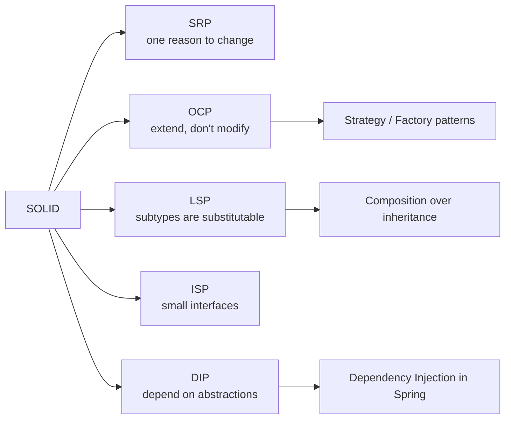

**Walkthrough:** each principle leads naturally to a technique — OCP is usually implemented with Strategy or Factory; DIP is implemented with dependency injection; LSP violations are usually fixed by switching to composition or a better abstraction.

---

### 2.1 S — Single Responsibility Principle

> **Level:** 🟢 Essential

**What is it?** A class should have only **one reason to change** — it should serve one actor / one concern.

**Why do we need it?** When unrelated concerns live in one class, a change to one (e.g., switching email provider) forces you to edit, retest and redeploy code that handles another (e.g., invoice math).

#### ❌ Violation
```java
class InvoiceService {
    void calculateInvoice() {}  // business logic
    void saveToDB() {}          // persistence
    void sendEmail() {}         // notification
}
```
A DB change forces you to touch the same class as an email provider change — unrelated concerns are coupled.

#### ✅ Correct Design
```java
class InvoiceCalculator {          // business logic only
    double calculateTotal(Invoice invoice) { ... }
}

class InvoiceRepository {          // persistence only
    void save(Invoice invoice) { ... }
}

class EmailService {               // notification only
    void sendInvoice(Invoice invoice) { ... }
}

class InvoiceService {             // orchestration only
    private final InvoiceCalculator calculator;
    private final InvoiceRepository repository;
    private final EmailService emailService;

    InvoiceService(InvoiceCalculator c, InvoiceRepository r, EmailService e) {
        this.calculator = c; this.repository = r; this.emailService = e;
    }

    void processInvoice(Invoice invoice) {
        double total = calculator.calculateTotal(invoice);
        invoice.setTotal(total);
        repository.save(invoice);
        emailService.sendInvoice(invoice);
    }
}
```

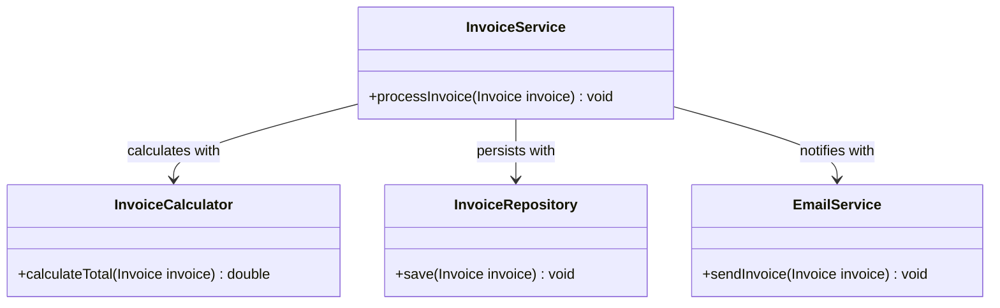

**Memory trick — CPNO:** **C**alculator · **P**ersistence · **N**otification · **O**rchestrator

**Common mistakes**
- Interpreting SRP as "one method per class" — it's one *reason to change*, not one function.
- Splitting so aggressively that a simple flow is spread over 12 tiny classes (low cohesion).

---

### 2.2 O — Open-Closed Principle

> **Level:** 🟢 Essential

**What is it?** Software entities should be **open for extension, closed for modification** — you add new behavior by adding new code, not by editing tested code.

#### ❌ Violation
```java
class PaymentService {
    void pay(String type) {
        if (type.equals("CARD")) { ... }
        else if (type.equals("UPI")) { ... }
        // Adding Wallet → must modify this class ❌
    }
}
```

#### ✅ Correct Design
```java
interface Payment {
    void pay(double amount);
}

class CardPayment implements Payment { ... }
class UpiPayment implements Payment { ... }

// Adding Wallet → new class, no existing code touched ✅
class WalletPayment implements Payment { ... }

class PaymentService {
    void processPayment(Payment payment, double amount) {
        payment.pay(amount);   // depends on abstraction
    }
}
```

**Pattern used:** Strategy Pattern (see [8.1](#81-strategy))
**Memory trick:** "Add new class, don't touch old class."

**Common mistakes:** Making *everything* extensible "just in case" (violates YAGNI). Apply OCP at the points where variation has actually appeared.

---

### 2.3 L — Liskov Substitution Principle

> **Level:** 🟢 Essential

**What is it?** A child class must be usable **wherever its parent is expected**, without breaking the caller's expectations.

#### ❌ Classic Violation — Rectangle / Square
```java
class Rectangle {
    protected int width, height;
    void setWidth(int w)  { this.width = w; }
    void setHeight(int h) { this.height = h; }
    int getArea() { return width * height; }
}

class Square extends Rectangle {
    @Override void setWidth(int w)  { this.width = w; this.height = w; } // side effect!
    @Override void setHeight(int h) { this.width = h; this.height = h; } // side effect!
}

// Breaking behavior:
Rectangle r = new Square();
r.setWidth(5);
r.setHeight(10);
System.out.println(r.getArea()); // expected 50, got 100 ❌
```

#### ✅ Correct Design
```java
interface Shape { int getArea(); }

class Rectangle implements Shape {
    private final int width, height;
    Rectangle(int w, int h) { this.width = w; this.height = h; }
    public int getArea() { return width * height; }
}

class Square implements Shape {
    private final int side;
    Square(int side) { this.side = side; }
    public int getArea() { return side * side; }
}
```

**Key insight:** Square is NOT a proper Rectangle *in terms of behavior* (even if it is mathematically). Both are Shapes — use the right abstraction. Immutability also removes the problem.

**Behavioral contract rules for child classes:**

| Rule | Meaning |
|---|---|
| Preconditions | Child must not require stricter inputs than parent |
| Postconditions | Child must not return weaker results |
| Exceptions | Child must not throw unexpected exceptions |
| Side effects | Child must not change expected behavior |

**Red flags in code reviews:** overridden methods that throw `UnsupportedOperationException`, `instanceof` checks before calling a method, empty overrides.

**Memory trick:** "Replace child without breaking code."

---

### 2.4 I — Interface Segregation Principle

> **Level:** 🟢 Essential

**What is it?** Clients should not be forced to depend on methods they don't use. Prefer several small, role-specific interfaces over one "fat" interface.

#### ❌ Violation
```java
interface Worker {
    void work();
    void eat(); // Robot doesn't eat!
}

class RobotWorker implements Worker {
    public void work() { ... }
    public void eat() { /* empty — forced, meaningless */ } // ❌
}
```

#### ✅ Correct Design
```java
interface Workable { void work(); }
interface Eatable  { void eat();  }

class HumanWorker implements Workable, Eatable { ... }
class RobotWorker implements Workable { ... }   // only what it needs
```

**Real-world example:** Spring Data splits `CrudRepository`, `PagingAndSortingRepository`, `ListCrudRepository` so you extend only what you need.

**Memory trick:** "Split big interface into small pieces."

---

### 2.5 D — Dependency Inversion Principle

> **Level:** 🟢 Essential

**What is it?** High-level modules (business logic) should not depend on low-level modules (DB drivers, HTTP clients). **Both should depend on abstractions.** The abstraction is owned by the high-level side.

#### ❌ Violation
```java
class UserService {
    private MySQLDatabase db = new MySQLDatabase(); // concrete, tight coupling ❌
}
```

#### ✅ Correct Design
```java
interface Database { void save(String data); }

class MySQLDatabase implements Database { ... }
class MongoDatabase implements Database { ... }

class UserService {
    private final Database db;
    public UserService(Database db) { this.db = db; } // injected ✅
}
```

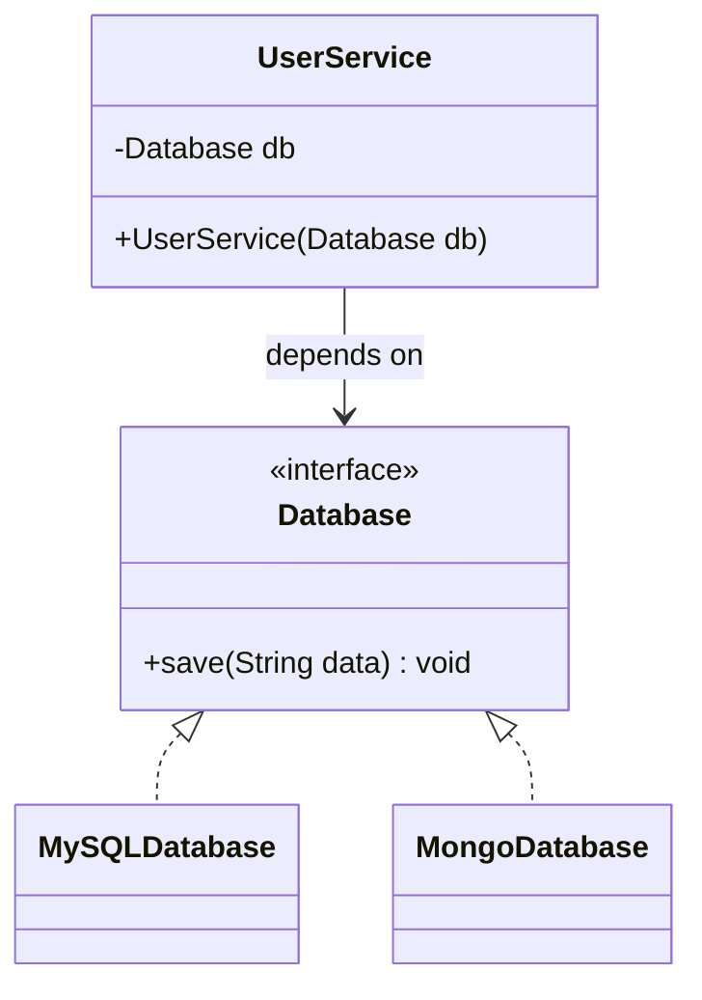

**Walkthrough:** the arrow from `UserService` points to the *interface*, and the concrete databases point *up* to the same interface — the dependency direction is "inverted" compared to `UserService → MySQLDatabase`.

**Spring Boot applies DIP via Dependency Injection (DI):**
```java
public interface UserRepository { void save(User user); }

@Repository
class JpaUserRepository implements UserRepository { ... }

@Service
class UserService {
    private final UserRepository repo;
    public UserService(UserRepository repo) { this.repo = repo; } // Spring injects
}
```

> **DIP vs DI:** DIP is the *principle* (depend on abstractions). DI is a *technique* (someone else passes the dependency in). Inversion of Control (IoC) containers like Spring automate DI.

**Memory trick:** "Depend on Interface, not Implementation."

**Quick revision — SOLID**
- SRP: one reason to change (CPNO).
- OCP: add classes, don't edit old ones (Strategy).
- LSP: subtypes keep the parent's contract (Rectangle/Square).
- ISP: small role interfaces (Robot doesn't eat).
- DIP: depend on interfaces; Spring injects implementations.

---

## 3. Composition vs Inheritance

> **Level:** 🟢 Essential

**What is it?** *Inheritance* models an **IS-A** relationship (`Dog extends Animal`). *Composition* models a **HAS-A** relationship (`Car` has an `Engine`) — behavior comes from objects you hold and delegate to.

**Why prefer composition?** Inheritance is fixed at compile time and tightly couples the child to the parent's implementation ("fragile base class" problem: a parent change silently breaks children).

| Feature | Inheritance (IS-A) | Composition (HAS-A) |
|---|---|---|
| Relationship | Child IS a type of parent | Class HAS a behavior |
| Flexibility | Low — fixed at compile time | High — changeable at runtime |
| Coupling | Tight | Loose |
| Testability | Harder | Easier (mock the component) |
| Reusability | Limited (single inheritance in Java) | High |

### 3.1 Why Inheritance Can Fail

```java
class Bird { void fly() {} }

class Ostrich extends Bird {
    @Override
    void fly() { throw new UnsupportedOperationException(); } // ❌ breaks LSP
}
```

### 3.2 Composition Solution

```java
interface FlyBehavior { void fly(); }

class CanFly    implements FlyBehavior { public void fly() { System.out.println("Flying"); } }
class CannotFly implements FlyBehavior { public void fly() { System.out.println("Cannot fly"); } }

class Bird {
    private FlyBehavior flyBehavior;

    public Bird(FlyBehavior flyBehavior) { this.flyBehavior = flyBehavior; }

    public void setFlyBehavior(FlyBehavior flyBehavior) {  // enables runtime change
        this.flyBehavior = flyBehavior;
    }

    public void performFly() { flyBehavior.fly(); }
}

// Usage
Bird sparrow = new Bird(new CanFly());
Bird ostrich = new Bird(new CannotFly());

// Runtime flexibility ✅ (e.g., an injured sparrow)
sparrow.setFlyBehavior(new CannotFly());
sparrow.performFly(); // "Cannot fly"
```

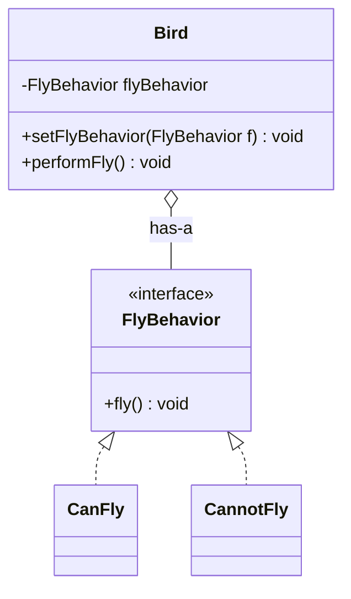

> **Rule of thumb:** Use inheritance only for true IS-A relationships where the child honors the full parent contract. Use composition when you need flexibility and loose coupling. (This exact structure *is* the Strategy pattern.)

**Interview perspective**
> **Q: Why prefer composition over inheritance?**
> Inheritance couples a child to the parent's internals and fixes behavior at compile time — a change in the parent can break all children, and impossible behaviors (an Ostrich that "flies") lead to LSP violations. Composition injects behavior through an interface, so it can be swapped at runtime and mocked in tests. I still use inheritance for genuine IS-A hierarchies, like a framework's abstract base class in Template Method.

---

## 4. Coupling and Cohesion

> **Level:** 🟢 Essential

**Coupling** = how strongly classes depend on each other. **Cohesion** = how strongly the responsibilities *inside* one class belong together. The goal: **low coupling, high cohesion.**

### 4.1 Tight vs Loose Coupling

| Feature | Tight Coupling ❌ | Loose Coupling ✅ |
|---|---|---|
| Depends on | Concrete class | Interface |
| Testing | Hard to mock | Easy to mock |
| Change impact | High — ripples everywhere | Low — isolated |
| Scalability of codebase | Limited | High |

**How to achieve loose coupling**
1. Program to **interfaces**, not implementations
2. Use **Dependency Injection**
3. Prefer **Composition** over Inheritance
4. Apply **Design Patterns** (Strategy, Factory, Repository, Observer…)
5. Communicate via events when the sender shouldn't know the receivers (Observer)

> **One-liner:** "Tight coupling means classes depend on concrete implementations, making change difficult. Loose coupling means classes depend on abstractions, making the system flexible and testable."

### 4.2 Cohesion

| Low cohesion ❌ | High cohesion ✅ |
|---|---|
| `Utils` class with date formatting, email sending, and tax math | `TaxCalculator` containing only tax rules |
| Methods share no fields | Methods operate on the same data |
| Hard to name the class | The name describes everything it does |

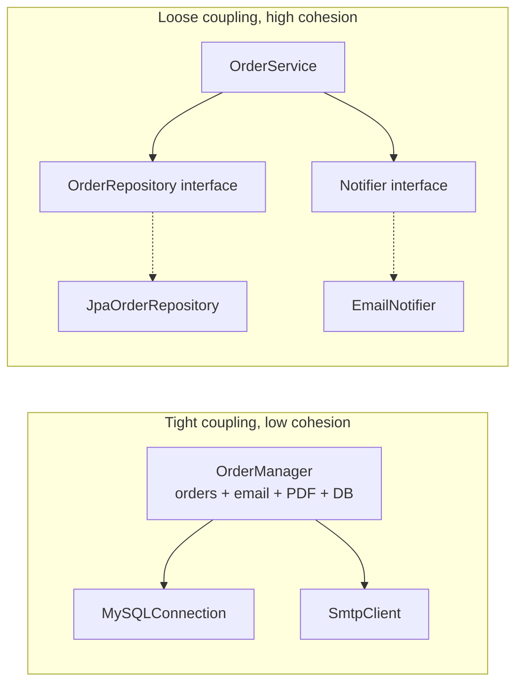

**Walkthrough:** on the left one class does four jobs and wires itself to concrete libraries. On the right each class has one job and depends on interfaces; implementations (dotted lines) can be swapped.

**Common mistakes:** confusing "loose coupling" with "no dependencies" — classes must collaborate; the point is to depend on stable abstractions.

---

## 5. Pattern Categories Overview

> **Level:** 🟢 Essential

| Category | Purpose | Patterns (★ = most asked) | Memory Acronym |
|---|---|---|---|
| **Creational** | Control *how objects are created* | Singleton★, Prototype, Builder★, Abstract Factory, Factory Method★ | **SPBAF** |
| **Structural** | Manage *relationships/composition* between objects | Adapter★, Bridge, Composite, Decorator★, Facade★, Flyweight, Proxy★ | **ABCDFFP** |
| **Behavioral** | Control *how objects communicate* and distribute responsibility | Strategy★, Observer★, Command, Chain of Responsibility★, State, Iterator, Mediator, Memento, Template Method★, Visitor | — |

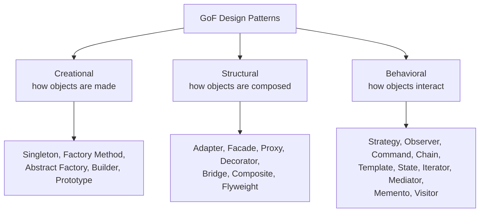

> **Interview focus:** you are rarely asked about all 23. Know the ★ patterns deeply (code + diagram + Spring example + when not to use); know the others at one-sentence level.

---

## 6. Creational Patterns

> **Why they exist:** Object creation becomes complex, spreads everywhere (`new` scattered across the codebase), and increases coupling. Creational patterns **centralize and control** how and when objects are created.

---

### 6.1 Singleton

> **Level:** 🟢 Essential

**Intent:** Ensure only **one instance** of a class exists in the application, with a global access point.

**Problem it solves:** some resources are shared, expensive to create, and must be consistent — e.g., a configuration registry, a connection-pool manager, a logger, an in-process cache.

**How does it work?**
1. Make the constructor `private` so nobody else can call `new`.
2. Hold the single instance in a `static` field.
3. Expose a `static getInstance()` that returns it.

#### Version 1 — Synchronized lazy (simple, but locks on every call)
```java
public class Logger {
    private static Logger instance;

    private Logger() {}

    public static synchronized Logger getInstance() {
        if (instance == null) instance = new Logger();
        return instance;
    }
}
```

#### Version 2 — Eager initialization (thread-safe, simplest)
```java
public class Logger {
    private static final Logger INSTANCE = new Logger(); // created at class-load time
    private Logger() {}
    public static Logger getInstance() { return INSTANCE; }
}
```

#### Version 3 — Double-checked locking (lazy + fast; `volatile` is mandatory)
```java
public class Logger {
    private static volatile Logger instance; // volatile prevents seeing a half-constructed object

    private Logger() {}

    public static Logger getInstance() {
        if (instance == null) {                 // 1st check, no lock
            synchronized (Logger.class) {
                if (instance == null) {         // 2nd check, with lock
                    instance = new Logger();
                }
            }
        }
        return instance;
    }
}
```

#### Version 4 — Initialization-on-demand holder (lazy, thread-safe, no locks) ✅ preferred class-based form
```java
public class Logger {
    private Logger() {}

    private static class Holder {               // loaded only when getInstance() is first called
        private static final Logger INSTANCE = new Logger();
    }

    public static Logger getInstance() { return Holder.INSTANCE; }
}
```

#### Version 5 — Enum singleton (Joshua Bloch's recommendation; safe against reflection and serialization)
```java
public enum AppConfig {
    INSTANCE;
    private final Properties props = load();
    public String get(String key) { return props.getProperty(key); }
}
// AppConfig.INSTANCE.get("db.url");
```

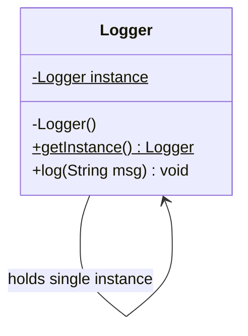

**⚠️ When NOT to use Singleton:**

| Reason | Why It Fails |
|---|---|
| Shared mutable state | Causes race conditions and hard-to-trace bugs |
| Testing | Singleton holds state across tests, making tests order-dependent and hard to mock |
| Scalability | A synchronized singleton becomes a contention bottleneck; hard to parallelize |
| Multiple implementations | Can't have a MySQL singleton AND a Mongo singleton behind one access point |
| Distributed systems | "One instance" is only per JVM — with 10 pods you have 10 "singletons" |

> **Senior answer:** "Singleton is often overused. In Spring, beans are singleton-scoped by default, so I let the container manage scope and inject the bean instead of writing `getInstance()` manually — I get one instance *and* testability."

**Common mistakes:** forgetting `volatile` in double-checked locking; assuming a JVM singleton is cluster-wide (for cluster-wide uniqueness you need [leader election or a distributed lock](05_distributed_systems_and_messaging.md#7-distributed-locks)).

**Interview one-liner:** *Singleton guarantees one instance per class loader; prefer the holder idiom or enum, and in Spring let the container manage it.*

---

### 6.2 Factory Method

> **Level:** 🟢 Essential

**Intent:** Define an interface for creating an object, but let a factory (subclass or configuration) decide **which concrete class** to instantiate.

**Problem it solves:** the type of object depends on runtime conditions (user input, config, a type flag), and you don't want `if/else + new` duplicated across the codebase.

```java
interface PaymentGateway { void pay(double amount); }

class CardPayment   implements PaymentGateway { public void pay(double a) { ... } }
class UpiPayment    implements PaymentGateway { public void pay(double a) { ... } }
class WalletPayment implements PaymentGateway { public void pay(double a) { ... } }

class PaymentGatewayFactory {
    public static PaymentGateway getGateway(String type) {
        return switch (type) {
            case "CARD"   -> new CardPayment();
            case "UPI"    -> new UpiPayment();
            case "WALLET" -> new WalletPayment();
            default -> throw new IllegalArgumentException("Unknown type: " + type);
        };
    }
}

// Client
PaymentGateway gw = PaymentGatewayFactory.getGateway(request.getType());
gw.pay(request.getAmount());
```

> Strictly, the snippet above is a **Simple (static) Factory**. The GoF **Factory Method** puts an abstract `createX()` method on a creator class and lets subclasses override it. Interviewers usually accept both under "Factory" — mention the distinction for bonus points.

```java
// GoF Factory Method form
abstract class NotificationSender {
    protected abstract Channel createChannel();          // the factory method
    public void send(String msg) { createChannel().deliver(msg); }
}
class EmailSender extends NotificationSender { protected Channel createChannel() { return new EmailChannel(); } }
class SmsSender   extends NotificationSender { protected Channel createChannel() { return new SmsChannel(); } }
```

**Spring-flavored version (no switch at all — open/closed):**
```java
@Component
class PaymentGatewayFactory {
    private final Map<String, PaymentGateway> gateways;
    // Spring injects all PaymentGateway beans keyed by bean name: "CARD", "UPI", ...
    PaymentGatewayFactory(Map<String, PaymentGateway> gateways) { this.gateways = gateways; }

    PaymentGateway get(String type) {
        PaymentGateway g = gateways.get(type);
        if (g == null) throw new IllegalArgumentException("Unknown type: " + type);
        return g;
    }
}
@Component("CARD") class CardPayment implements PaymentGateway { ... }
```

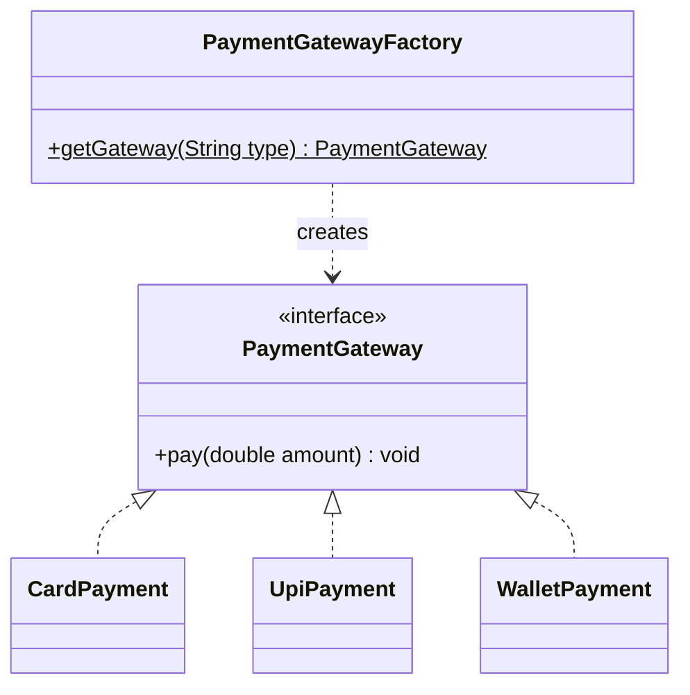

**Benefit:** Adding a new payment method = new class + one line in the factory (or zero lines with the Spring map). No business logic touched.

**⚠️ When NOT to use:** only one implementation exists; simple object with no variation.

**Real-world:** `Calendar.getInstance()`, `NumberFormat.getInstance()`, Spring's `FactoryBean`, `BeanFactory`.

**Interview one-liner:** *Factory hides which concrete class gets created, so callers depend only on the interface.*

---

### 6.3 Abstract Factory

> **Level:** 🟡 Intermediate

**Intent:** Create **families of related objects** without specifying their concrete classes — and guarantee you never mix families.

**Problem it solves:** you must switch between entire product families consistently (e.g., all Stripe components vs all Razorpay components; all dark-theme widgets vs all light-theme widgets). Mixing a Stripe processor with a Razorpay refund would be a bug.

```java
interface PaymentProcessorFactory {
    PaymentProcessor  createProcessor();
    RefundProcessor   createRefundProcessor();
    SettlementService createSettlement();
}

class StripeFactory implements PaymentProcessorFactory {
    public PaymentProcessor  createProcessor()       { return new StripeProcessor(); }
    public RefundProcessor   createRefundProcessor() { return new StripeRefund(); }
    public SettlementService createSettlement()      { return new StripeSettlement(); }
}

class RazorpayFactory implements PaymentProcessorFactory { ... }

// Client chooses the family once (e.g., per tenant / region config)
PaymentProcessorFactory factory = tenant.isIndia() ? new RazorpayFactory() : new StripeFactory();
factory.createProcessor().charge(order);
factory.createRefundProcessor().refund(order); // guaranteed same provider
```

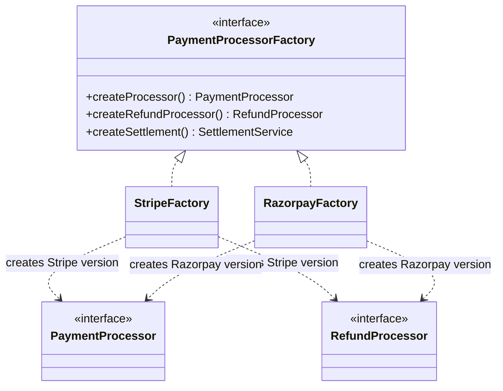

> **Difference from Factory Method:** Factory creates *one* product. Abstract Factory creates *a family* of related products that must be used together.

**When NOT to use:** only one product type varies — a plain factory is enough. Adding a *new product type* to the family means changing every factory (the pattern's main downside).

---

### 6.4 Builder

> **Level:** 🟢 Essential

**Intent:** Construct complex objects **step by step**, separating construction from representation.

**Problem it solves:** objects with many (especially optional) fields lead to "telescoping constructors" whose arguments are unreadable and easy to swap by mistake.

```java
// Without Builder ❌
new User("Alice", "alice@mail.com", 28, "Mumbai", "+91...", "ADMIN", "ACTIVE");
// What does each argument mean? Swapping two Strings compiles fine and is a bug.

// With Builder ✅
User user = User.builder()
    .name("Alice")
    .email("alice@mail.com")
    .role("ADMIN")
    .build();
```

**Hand-written builder (shows what Lombok generates, plus validation):**
```java
public final class User {
    private final String name;
    private final String email;
    private final String role;

    private User(Builder b) { this.name = b.name; this.email = b.email; this.role = b.role; }

    public static Builder builder() { return new Builder(); }

    public static final class Builder {
        private String name, email, role = "USER";   // defaults
        public Builder name(String n)  { this.name = n;  return this; }
        public Builder email(String e) { this.email = e; return this; }
        public Builder role(String r)  { this.role = r;  return this; }
        public User build() {
            if (name == null || email == null) throw new IllegalStateException("name and email required");
            return new User(this);                   // immutable result
        }
    }
}
```

**Lombok shortcut (Spring Boot):**
```java
@Builder
@Value          // immutable; use @Data only if you really need setters
public class User {
    String name;
    String email;
    String role;
}
```

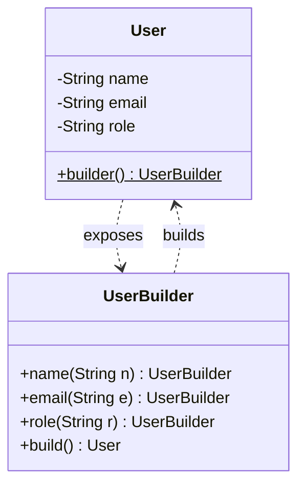

**Real-world:** `StringBuilder`, `HttpRequest.newBuilder()`, `WebClient.builder()`, `ResponseEntity.ok().header(...).body(...)`, `Jwts.builder()`.

**⚠️ When NOT to use:** object has only 2–3 required fields; performance-critical inner loops (extra allocation).

**Common mistakes:** no validation in `build()`; builder producing a mutable object with setters (defeats the purpose).

---

### 6.5 Prototype

> **Level:** 🟡 Intermediate

**Intent:** Create new objects by **cloning an existing object** instead of creating from scratch.

**When to use**
- Object creation is **expensive** (DB calls, API calls, heavy computation)
- You need **many similar objects** with small changes
- You want to **avoid repeating setup logic**

#### ❌ Without Prototype
```java
User user1 = new User("Alice", "ADMIN", loadPermissions());
User user2 = new User("Bob",   "ADMIN", loadPermissions());
```
Problems: ❗ repeated expensive operations · ❗ duplicate code · ❗ hard to maintain.

#### ✅ With Prototype
```java
User template = new User("Template", "ADMIN", loadPermissions()); // expensive once

User user1 = template.clone();
user1.setName("Alice");

User user2 = template.clone();
user2.setName("Bob");
```
Benefits: ✔ faster object creation · ✔ reuse existing configuration · ✔ cleaner code.

#### Shallow Copy vs Deep Copy ⚠️

**Shallow copy ❌** — copies the *reference* to the permissions list; mutating one user's permissions mutates all clones:
```java
@Override
public User clone() {
    return new User(this.name, this.role, this.permissions); // same List shared!
}
```

**Deep copy ✅** — copies the mutable internals:
```java
@Override
public User clone() {
    return new User(
        this.name,                          // String is immutable — safe to share
        this.role,
        new ArrayList<>(this.permissions)   // new list; fine if Permission objects are immutable
    );
}
```
> If the list contains *mutable* objects, deep-copy those too. Many teams avoid `Cloneable`/`Object.clone()` altogether (it's awkward: shallow by default, checked exception) and use a **copy constructor** or a `copy()` method as above.

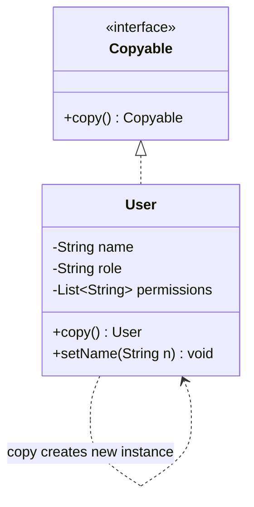

**Real-world examples:** 🕹 game objects (enemy templates) · 📄 document templates (invoice, reports) · ⚙️ Spring `@Scope("prototype")` beans (note: Spring's *prototype scope* means "new instance per injection/lookup" — related in name, but it doesn't clone).

| Feature | Builder | Prototype |
|---|---|---|
| Purpose | Step-by-step creation | Clone existing object |
| Use case | Complex construction with many options | Reuse expensive configuration |
| Cost per object | Full construction each time | Copy cost only |

**Common mistakes:** ❌ not using deep copy · ❌ sharing mutable objects between clones · ❌ using it when object creation is simple.

**Interview one-liner:** *Prototype creates objects by cloning existing instances, improving performance when object creation is costly — just make sure the copy is deep where it matters.*

---

## 7. Structural Patterns

> **Why they exist:** To integrate systems safely and extend behavior **without breaking existing code** — by wrapping, translating, or composing objects.

---

### 7.1 Adapter

> **Level:** 🟢 Essential

**Intent:** Convert one interface into another that a client expects. Makes incompatible interfaces work together.

**Problem it solves:** you need to integrate a third-party or legacy system whose interface doesn't match yours, and you can't (or shouldn't) change either side.

**Real-life analogy:** a travel plug adapter — your laptop plug doesn't change, the wall socket doesn't change; the adapter translates.

```java
// What your system expects
interface PaymentGateway {
    void pay(double amount);
}

// What the third-party SDK provides
class RazorpaySdk {
    void createOrder(Map<String, Object> params) { ... }
}

// Adapter: translates your interface to the SDK's
class RazorpayAdapter implements PaymentGateway {
    private final RazorpaySdk sdk;

    public RazorpayAdapter(RazorpaySdk sdk) { this.sdk = sdk; }

    @Override
    public void pay(double amount) {
        Map<String, Object> params = Map.of(
            "amount", Math.round(amount * 100),  // SDK expects the smallest currency unit
            "currency", "INR");
        sdk.createOrder(params); // translates the call
    }
}
```

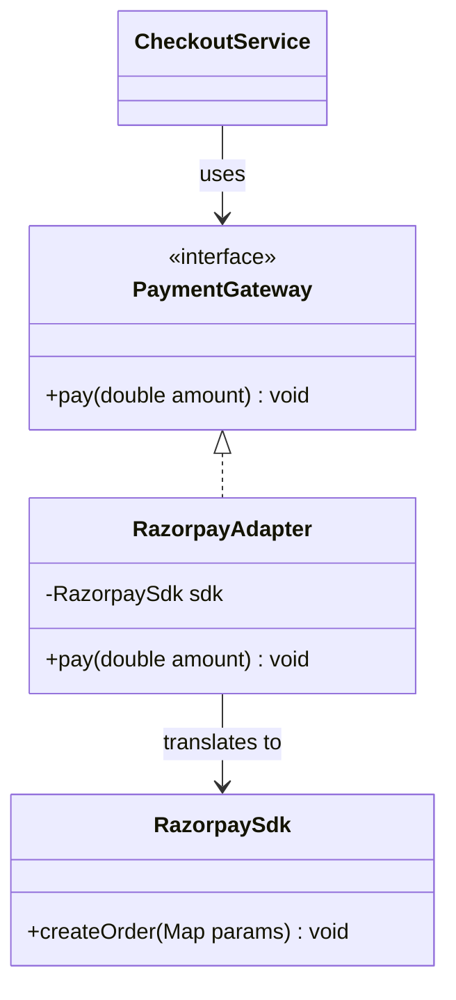

**Real-world:** `Arrays.asList()` (array → List), `InputStreamReader` (byte stream → character stream), Spring MVC's `HandlerAdapter`, anti-corruption layers in Domain-Driven Design.

**Benefit:** if you switch from Razorpay to Stripe, you write a `StripeAdapter`; `CheckoutService` never changes. Your domain stays free of vendor types.

> **Mindset:** "I will translate, not modify."

---

### 7.2 Facade

> **Level:** 🟢 Essential

**Intent:** Provide a **simplified interface** to a complex subsystem.

**Problem it solves:** a subsystem has many classes/steps and every consumer must know the right order of calls — duplication and errors. A facade exposes one clean entry point.

```java
// Complex internals
class AuthService       { void authenticate() {} }
class ValidationService { void validate() {} }
class OrderService      { void createOrder() {} }
class PaymentCapture    { void capture() {} }

// Facade — hides all complexity
class PaymentFacade {
    private final AuthService auth;
    private final ValidationService validator;
    private final OrderService order;
    private final PaymentCapture capture;

    PaymentFacade(AuthService a, ValidationService v, OrderService o, PaymentCapture c) {
        this.auth = a; this.validator = v; this.order = o; this.capture = c;
    }

    public void pay(double amount) {
        auth.authenticate();
        validator.validate();
        order.createOrder();
        capture.capture();
    }
}
// Client only calls: paymentFacade.pay(100);
```

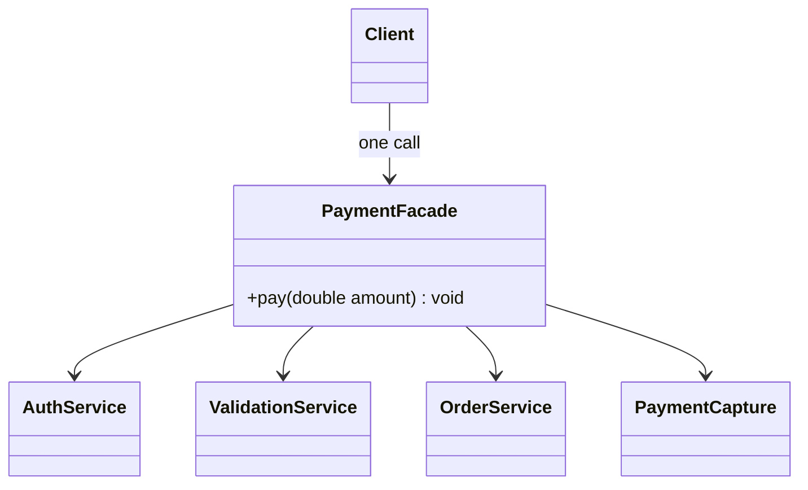

**Real-world:** `JdbcTemplate` is partly a facade over JDBC's Connection/Statement/ResultSet dance; SLF4J is a facade over logging frameworks; at the system level an [API Gateway / BFF](02_networking_and_communication.md#13-api-gateway-and-bff) plays a facade role for microservices.

> **Important:** Facade does NOT remove complexity — it **hides** it. Consumers can still use the subsystem directly if they need advanced features.

**Common mistake:** the facade growing into a God Object that contains business logic. Keep it as thin orchestration.

---

### 7.3 Proxy

> **Level:** 🟢 Essential

**Intent:** Provide a **surrogate or placeholder** for another object to **control access** to it. The proxy has the *same interface* as the real object.

**Problem it solves:** you need to add auth, caching, lazy loading, logging, or rate limiting **around** an object without modifying it.

**Proxy flavors:** *protection proxy* (access control), *caching proxy*, *virtual proxy* (lazy creation of an expensive object), *remote proxy* (local stub for a remote object, e.g. gRPC/RMI stubs).

```java
interface OrderService { Order getOrder(String id); }

class RealOrderService implements OrderService {
    public Order getOrder(String id) { /* DB call */ }
}

class CachingOrderServiceProxy implements OrderService {
    private final OrderService real;
    // ConcurrentHashMap: proxies are usually shared singletons called by many threads.
    // A plain HashMap with computeIfAbsent is NOT thread-safe.
    private final Map<String, Order> cache = new ConcurrentHashMap<>();

    CachingOrderServiceProxy(OrderService real) { this.real = real; }

    public Order getOrder(String id) {
        return cache.computeIfAbsent(id, real::getOrder);
    }
}
```
> Production note: this cache never expires or evicts — use Caffeine (or Spring's `@Cacheable`) with size limits and TTLs. See [04 › Eviction Policies](04_caching.md#5-eviction-policies).

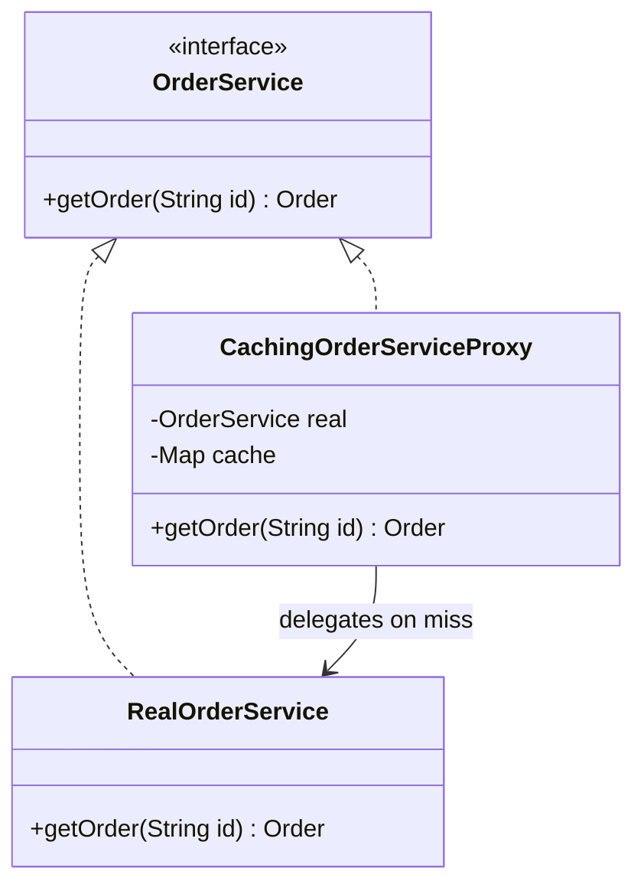

**Spring uses proxies everywhere:** `@Transactional`, `@Cacheable`, `@Async`, `@PreAuthorize` all work by Spring wrapping your bean in a JDK dynamic proxy or CGLIB subclass proxy that runs extra logic before/after your method.

> **Classic Spring gotcha:** calling a `@Transactional` method from *another method in the same class* (`this.save()`) bypasses the proxy, so no transaction starts. Self-invocation doesn't go through the proxy.

**Real-world example (system level):** an API Gateway acts as a proxy — auth, rate limiting, logging — before forwarding to backend services. See [02 › Reverse Proxy](02_networking_and_communication.md#11-reverse-proxy).

---

### 7.4 Decorator

> **Level:** 🟢 Essential

**Intent:** Attach additional responsibilities to an object **dynamically by wrapping it**. Decorators share the interface of the wrapped object and can be **stacked**.

**Problem it solves:** you need to add features (logging, auth, metrics, compression) in a combinable way. With inheritance you'd need `LoggingAuthHandler`, `LoggingMetricsHandler`, `AuthMetricsHandler`… — a **subclass explosion** (2ⁿ combinations).

```java
interface RequestHandler { void handle(Request req); }

class CoreHandler implements RequestHandler {
    public void handle(Request req) { /* business logic */ }
}

class LoggingDecorator implements RequestHandler {
    private final RequestHandler wrapped;
    LoggingDecorator(RequestHandler wrapped) { this.wrapped = wrapped; }
    public void handle(Request req) {
        log("Incoming: " + req);
        wrapped.handle(req);
    }
}

class AuthDecorator implements RequestHandler {
    private final RequestHandler wrapped;
    AuthDecorator(RequestHandler wrapped) { this.wrapped = wrapped; }
    public void handle(Request req) {
        authenticate(req);
        wrapped.handle(req);
    }
}

// Stack decorators — order matters (outermost runs first)
RequestHandler handler = new LoggingDecorator(
                           new AuthDecorator(
                             new CoreHandler()));
```

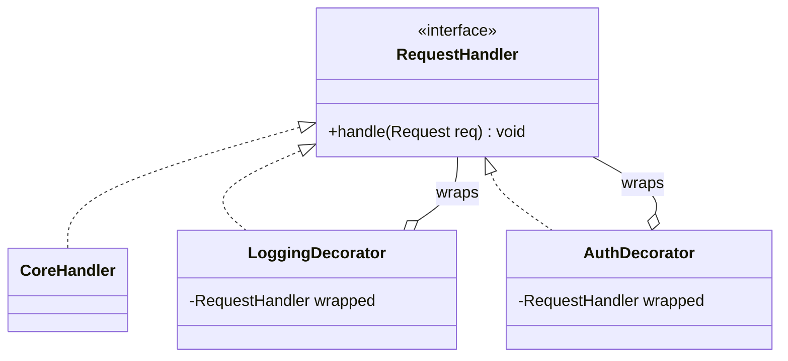

**Walkthrough:** every decorator *is* a `RequestHandler` and *has* a `RequestHandler`. A call enters `LoggingDecorator` → `AuthDecorator` → `CoreHandler`, each adding its behavior.

**Real-world:** Java I/O — `new BufferedInputStream(new GZIPInputStream(new FileInputStream(f)))`; `Collections.unmodifiableList(list)`; Spring's `HttpServletRequestWrapper`; filter/middleware pipelines.

**Common mistakes:** decorators that change the *meaning* of the interface (then it's an adapter); deep stacks that are hard to debug; depending on decorator order without documenting it.

---

### 7.5 Bridge, Composite and Flyweight

> **Level:** 🟡 Intermediate (know the one-liner and one example)

#### Bridge
**Intent:** split an abstraction from its implementation so both can vary independently — two hierarchies connected by composition instead of one multiplied hierarchy.

**Example:** `Notification` (Alert, Reminder, Marketing) × `Channel` (Email, SMS, Push). Without Bridge you get 9 classes (`EmailAlert`, `SmsAlert`…); with Bridge, 3 + 3.

```java
interface Channel { void deliver(String to, String body); }
class EmailChannel implements Channel { public void deliver(String to, String body) { ... } }
class SmsChannel   implements Channel { public void deliver(String to, String body) { ... } }

abstract class Notification {
    protected final Channel channel;                    // the bridge
    Notification(Channel channel) { this.channel = channel; }
    abstract void send(User u);
}
class AlertNotification extends Notification {
    AlertNotification(Channel c) { super(c); }
    void send(User u) { channel.deliver(u.contact(), "ALERT: " + u.alertText()); }
}
// new AlertNotification(new SmsChannel()).send(user);
```

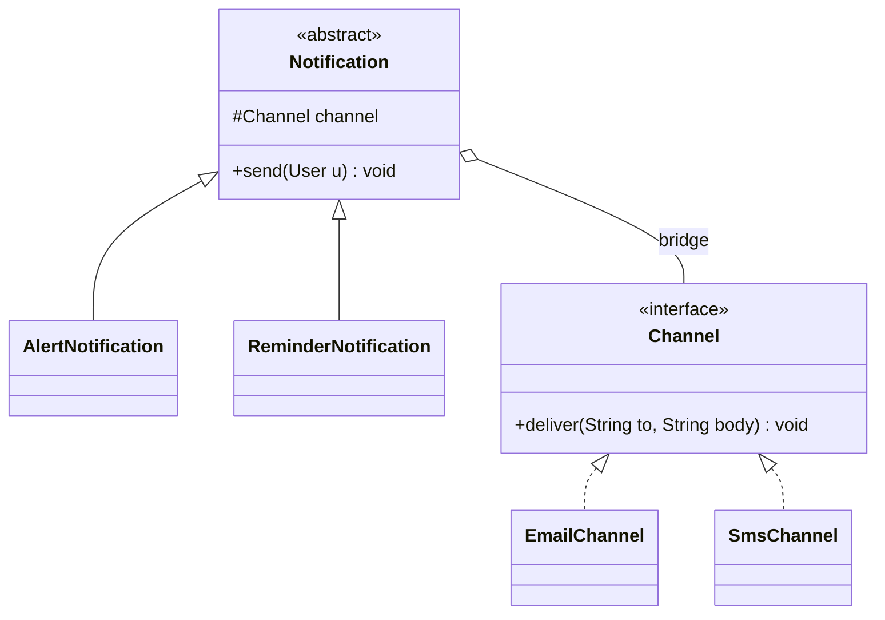

**Real-world:** JDBC — your code uses the `java.sql` abstraction; drivers are the implementations. SLF4J API vs Logback/Log4j bindings.

#### Composite
**Intent:** treat individual objects and groups of objects **uniformly** through a tree structure.

**Example:** a file system where `File` and `Folder` both implement `size()`; a folder's size is the sum of its children. Also: UI component trees, org charts, nested product bundles, permission groups.

```java
interface Node { long size(); }
class FileNode implements Node {
    private final long bytes;
    FileNode(long bytes) { this.bytes = bytes; }
    public long size() { return bytes; }
}
class FolderNode implements Node {
    private final List<Node> children = new ArrayList<>();
    void add(Node n) { children.add(n); }
    public long size() { return children.stream().mapToLong(Node::size).sum(); } // recursion
}
```

#### Flyweight
**Intent:** share common, **immutable** state across many objects to save memory. Split state into *intrinsic* (shared — e.g., a font glyph's shape) and *extrinsic* (per-use — e.g., the character's position).

**Real-world:** `Integer.valueOf(-128..127)` returns cached instances; the Java String pool; map tiles / game sprites sharing one texture.

**Common mistake:** making flyweights mutable — every holder would see the change.

---

### 7.6 Structural Pattern Comparison

> **Level:** 🟢 Essential

| Pattern | Problem Solved | Interface Change | Key Distinction |
|---|---|---|---|
| **Adapter** | Interface mismatch | Changes interface | Translates for compatibility |
| **Facade** | Complex subsystem | New simple interface | Simplifies access |
| **Proxy** | Access control | Same interface | Controls/guards the real object |
| **Decorator** | Add behavior dynamically | Same interface | Stacks additional responsibilities |
| **Bridge** | Two dimensions of variation | Separate hierarchies | Avoids class explosion |
| **Composite** | Part-whole trees | Same interface for leaf and group | Uniform recursion |
| **Flyweight** | Memory blow-up from many similar objects | Same | Shares immutable state |

**Interview scenario map:**

| Question | Answer |
|---|---|
| Integrate third-party SDK? | Adapter + Facade |
| Add auth/logging without touching business code? | Proxy or Decorator |
| Simplify a complex module for consumers? | Facade |
| Proxy vs Decorator? | Proxy *controls access* (often decides whether to call at all); Decorator *adds responsibility* and is designed to be stacked |
| Notification types × channels? | Bridge |
| Nested categories / folder sizes? | Composite |

---

## 8. Behavioral Patterns

> **Why they exist:** To change **how objects behave and communicate** at runtime without modifying existing code — replacing `if/else` chains, hard-wired calls, and duplicated workflows with swappable objects.

---

### 8.1 Strategy

> **Level:** 🟢 Essential — the single most asked pattern

**What is it?** Define a family of algorithms, encapsulate each one in its own class, and make them **interchangeable at runtime**.

**Idea:** same task → multiple ways to do it → switch anytime.

**Problem it solves:** you have multiple ways to do the same task (payment, sorting, load balancing, discount rules, pricing per country) and the code is a growing `if/else` or `switch`. Each new rule means editing — and risking — the same method (violates OCP).

**How does it work?**
1. Define a strategy interface for the task.
2. Write one class per algorithm.
3. The *context* class holds a reference to the interface and delegates to it.
4. Swap the strategy via constructor, setter, or a factory/config.

#### Example 1 — Sorting (simple)
```java
interface SortStrategy {
    void sort(int[] arr);
}

class AscendingSort implements SortStrategy {
    public void sort(int[] arr) {
        Arrays.sort(arr);
        System.out.println("Sorting Ascending");
    }
}

class DescendingSort implements SortStrategy {
    public void sort(int[] arr) {
        Integer[] boxed = Arrays.stream(arr).boxed().toArray(Integer[]::new);
        Arrays.sort(boxed, Collections.reverseOrder());
        for (int i = 0; i < arr.length; i++) arr[i] = boxed[i];
        System.out.println("Sorting Descending");
    }
}

class Sorter {                                   // the context
    private SortStrategy strategy;
    Sorter(SortStrategy strategy) { this.strategy = strategy; }
    void setStrategy(SortStrategy strategy) { this.strategy = strategy; }
    void sort(int[] arr) { strategy.sort(arr); }
}

// Usage
Sorter sorter = new Sorter(new AscendingSort());
sorter.sort(arr);                       // first → ascending

sorter.setStrategy(new DescendingSort()); // change at runtime
sorter.sort(arr);                       // then → descending; Sorter's code never changed
```

#### Example 2 — Load-balancing strategy (system flavor)
```java
interface LoadBalancingStrategy {
    Server select(List<Server> servers);
}

class RoundRobin   implements LoadBalancingStrategy { ... }
class LeastConn    implements LoadBalancingStrategy { ... }
class RandomSelect implements LoadBalancingStrategy { ... }

class LoadBalancer {
    private LoadBalancingStrategy strategy;

    public LoadBalancer(LoadBalancingStrategy strategy) {
        this.strategy = strategy;
    }

    public void setStrategy(LoadBalancingStrategy strategy) {
        this.strategy = strategy; // change at runtime ✅
    }

    public Server getServer(List<Server> servers) {
        return strategy.select(servers);
    }
}
```
(The algorithms themselves are explained in [02 › Load Balancers](02_networking_and_communication.md#12-load-balancers).)

#### Example 3 — Discount rules in Spring (strategy selected per request)
```java
public interface DiscountStrategy {
    boolean supports(Order order);
    BigDecimal apply(Order order);
}

@Component class FestivalDiscount implements DiscountStrategy { ... }
@Component class FirstOrderDiscount implements DiscountStrategy { ... }

@Service
class PricingService {
    private final List<DiscountStrategy> strategies;   // Spring injects all implementations
    PricingService(List<DiscountStrategy> strategies) { this.strategies = strategies; }

    BigDecimal price(Order order) {
        return strategies.stream()
            .filter(s -> s.supports(order))
            .map(s -> s.apply(order))
            .max(Comparator.naturalOrder())
            .orElse(order.getTotal());
    }
}
```

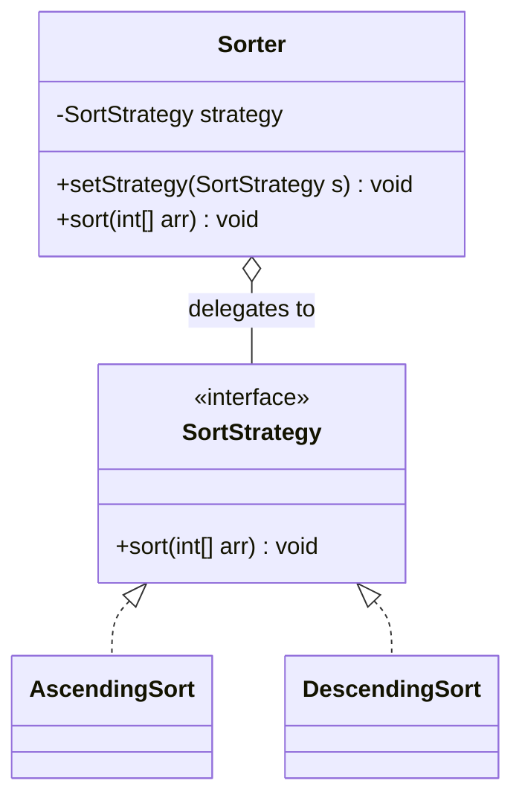

**Benefits:** ✔ no if-else logic · ✔ easy to extend (add a new strategy class) · ✔ each algorithm testable in isolation · ✔ runtime behavior change without redeployment (if selected via config).

**When NOT to use:** two stable branches that never change — a simple `if` is clearer (KISS).

**Real-world:** `Comparator` passed to `Collections.sort`, Spring Security's `PasswordEncoder`, Spring's `ResourceLoader`, retry/backoff policies in Resilience4j.

> **Key benefit:** Replaces if-else chains with polymorphism. Same task, different behavior, chosen at runtime.

**Interview one-liner:** *Strategy lets you swap algorithms at runtime behind one interface — it's OCP in action.*

---

### 8.2 Observer

> **Level:** 🟢 Essential

**What is it?** Define a **one-to-many** dependency so that when one object (the *subject*) changes state or an event occurs, all its dependents (*observers / listeners*) are notified automatically.

**Idea:** one event → many reactions.

**Problem it solves:** multiple independent components must react to an event, and you don't want the publisher to know about (and be edited for) each one.

**Example — order system:** when an order is placed → 📧 email sent · 📱 SMS sent · 📦 inventory updated · 📊 analytics updated.

```java
interface OrderEventListener {
    void onOrderPlaced(Order order);
}

class EmailService implements OrderEventListener {
    public void onOrderPlaced(Order order) { System.out.println("Send Email"); }
}
class SmsService implements OrderEventListener {
    public void onOrderPlaced(Order order) { System.out.println("Send SMS"); }
}
class InventoryService implements OrderEventListener { public void onOrderPlaced(Order o) { ... } }
class AnalyticsService implements OrderEventListener { public void onOrderPlaced(Order o) { ... } }

class OrderService {                           // the subject
    private final List<OrderEventListener> listeners = new CopyOnWriteArrayList<>();

    public void addListener(OrderEventListener l) { listeners.add(l); }
    public void removeListener(OrderEventListener l) { listeners.remove(l); }

    public void placeOrder(Order order) {
        // business logic: validate, save
        listeners.forEach(l -> l.onOrderPlaced(order)); // notify all
    }
}

// Flow
OrderService service = new OrderService();
service.addListener(new EmailService());
service.addListener(new SmsService());
service.placeOrder(order);   // → "Send Email", "Send SMS"
```

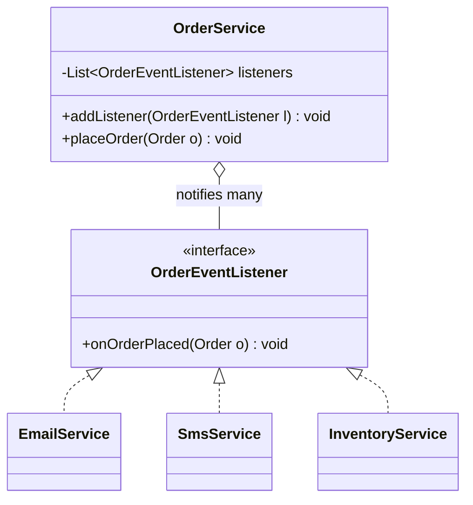

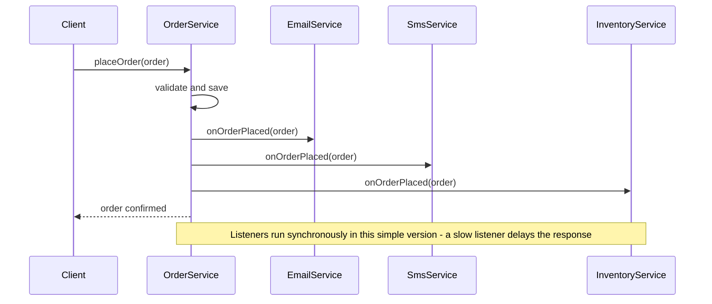

**Walkthrough:** the client calls only `placeOrder`. `OrderService` loops over registered listeners; it doesn't know what they do. **Failure note:** in-process, synchronous observers mean one slow or throwing listener blocks/breaks the others — wrap each call in try/catch, or make listeners async.

**Spring version — `ApplicationEvent`:**
```java
public record OrderPlacedEvent(String orderId) {}

@Service
class OrderService {
    private final ApplicationEventPublisher publisher;
    OrderService(ApplicationEventPublisher publisher) { this.publisher = publisher; }

    @Transactional
    public void placeOrder(Order order) {
        repo.save(order);
        publisher.publishEvent(new OrderPlacedEvent(order.getId()));
    }
}

@Component
class EmailListener {
    // Runs only after the DB transaction commits — no email for a rolled-back order
    @TransactionalEventListener(phase = TransactionPhase.AFTER_COMMIT)
    @Async
    public void on(OrderPlacedEvent e) { emailClient.sendConfirmation(e.orderId()); }
}
```

> **Adding a new observer:** create one new class, register it. No change to `OrderService`.

**Observer vs Pub-Sub:** Observer is *in-process* — the subject holds direct references to observers. **Pub-Sub** puts a broker (Kafka, RabbitMQ, SNS) in the middle, so publishers and subscribers are in different services and don't know each other. In-process events are lost if the JVM crashes; for cross-service or durable events use a broker plus the [Transactional Outbox](05_distributed_systems_and_messaging.md#19-transactional-outbox-and-cdc). See [05 › Message Queues, Pub-Sub and Event Streaming](05_distributed_systems_and_messaging.md#10-message-queues-pub-sub-and-event-streaming).

**Common mistakes:** ❌ forgetting to register listeners · ❌ too many synchronous listeners (latency) · ❌ memory leaks from never unregistering · ❌ assuming listener execution order.

**Interview one-liner:** *Observer notifies multiple objects automatically when an event occurs, keeping the publisher decoupled from its reactions.*

---

### 8.3 Command

> **Level:** 🟡 Intermediate

**What is it?** Encapsulate a **request/action as an object**. Idea: action → object → can execute, store, queue, log, undo.

**Problem it solves:** you need to queue operations, schedule them, retry them, log/audit every action, or implement **undo/redo** — impossible if the action is just a direct method call.

#### Example — Bank transfer with undo
```java
interface Command {
    void execute();
    void undo();
}

class TransferMoneyCommand implements Command {
    private final Account from, to;
    private final BigDecimal amount;

    TransferMoneyCommand(Account from, Account to, BigDecimal amount) {
        this.from = from; this.to = to; this.amount = amount;
    }

    public void execute() {
        from.debit(amount);
        to.credit(amount);
    }

    public void undo() {        // compensating action
        to.debit(amount);
        from.credit(amount);
    }
}

class CommandQueue {           // the invoker
    private final Deque<Command> history = new ArrayDeque<>();

    void execute(Command c) {
        c.execute();
        history.push(c);        // store in history
    }

    void undoLast() {
        if (!history.isEmpty()) history.pop().undo();
    }
}

// Usage
CommandQueue queue = new CommandQueue();
queue.execute(new TransferMoneyCommand(alice, bob, new BigDecimal("500"))); // debit/credit
queue.undoLast();                                                           // reversed
```

**Flow:** execute command → store in history → undo when needed.

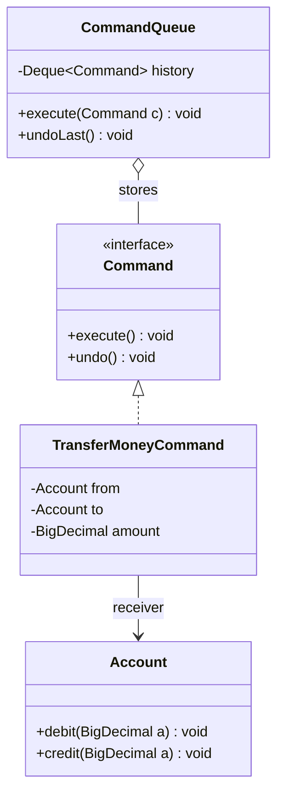

**Roles:** *Command* (the object), *Receiver* (`Account`, does the real work), *Invoker* (`CommandQueue`, triggers and stores), *Client* (creates the command).

**Real-world:** `Runnable`/`Callable` submitted to an `ExecutorService` (queued commands); text-editor undo stacks; job queues where a serialized message *is* a command; the **compensating actions** of a [Saga](05_distributed_systems_and_messaging.md#18-distributed-transactions-2pc-vs-saga) are the same "undo" idea at system level.

**Benefits:** ✔ supports undo/redo · ✔ easy to log/audit actions · ✔ can queue, schedule and retry operations.

**Interview one-liner:** *Command turns actions into objects to support undo, logging, and queuing.*

---

### 8.4 Chain of Responsibility

> **Level:** 🟢 Essential

**What is it?** Pass a request along a **chain of handlers**; each handler decides to process it, reject it, or pass it on to the next.

**Real-life analogy — airport security:** 🪪 ID check → 🎒 bag scan → 🛂 boarding-pass check. Fail at any step → you're stopped. Pass → go to the next.

**Problem it solves:** a request must go through multiple steps (auth, rate limit, validation, business logic) that should be independent, reorderable, and individually testable — instead of one giant method.

```java
abstract class RequestHandler {
    private RequestHandler next;

    public RequestHandler setNext(RequestHandler next) {
        this.next = next;
        return next;            // returning next enables fluent chaining
    }

    protected void passToNext(Request req) {
        if (next != null) next.handle(req);
    }

    public abstract void handle(Request req);
}

class AuthHandler extends RequestHandler {
    public void handle(Request req) {
        if (!authenticated(req)) throw new UnauthorizedException();
        passToNext(req);
    }
}

class RateLimitHandler extends RequestHandler {
    public void handle(Request req) {
        if (rateLimitExceeded(req)) throw new TooManyRequestsException();
        passToNext(req);
    }
}

class ValidationHandler extends RequestHandler {
    public void handle(Request req) {
        if (!valid(req)) throw new BadRequestException();
        passToNext(req);
    }
}

// Chain setup
RequestHandler chain = new AuthHandler();
chain.setNext(new RateLimitHandler()).setNext(new ValidationHandler());
chain.handle(request);
```

```mermaid
classDiagram
    class RequestHandler {
        <<abstract>>
        -RequestHandler next
        +setNext(RequestHandler n) RequestHandler
        +handle(Request req) void
    }
    class AuthHandler
    class RateLimitHandler
    class ValidationHandler
    RequestHandler <|-- AuthHandler
    RequestHandler <|-- RateLimitHandler
    RequestHandler <|-- ValidationHandler
    RequestHandler --> RequestHandler : next
```

```mermaid
sequenceDiagram
    participant C as Client
    participant A as AuthHandler
    participant R as RateLimitHandler
    participant V as ValidationHandler
    C->>A: handle(request)
    alt not authenticated
        A-->>C: 401 Unauthorized
    else authenticated
        A->>R: passToNext
        alt limit exceeded
            R-->>C: 429 Too Many Requests
        else within limit
            R->>V: passToNext
            V-->>C: valid - continue to business logic
        end
    end
```

**Walkthrough:** each handler either short-circuits with an error or forwards. Adding a new step (e.g., `TenantResolverHandler`) = a new class inserted in the chain; no existing handler changes.

**Real-world:** Servlet `FilterChain` and Spring Security's filter chain; Express.js / Spring WebFlux middleware; logging frameworks' appender chains; approval workflows (manager → director → VP based on amount).

**Order matters:** run cheap rejections first (e.g., rate limiting before expensive auth lookups if abuse is the main risk), and auth before anything that reveals data.

**Common mistakes:** forgetting to call `passToNext` (request silently dies); no terminal handler; chains so long that debugging is hard.

**Interview one-liner:** *Chain of Responsibility passes a request through independent handlers, each of which can handle, reject, or forward it — it's how middleware works.*

---

### 8.5 Template Method

> **Level:** 🟢 Essential

**What is it?** Define the **skeleton of an algorithm** in a base class, and let subclasses override **specific steps** without changing the overall flow.

**Real-life analogy — tea vs coffee:** the steps are the same — boil water → add main ingredient → pour into cup → add extras. Only some steps differ: tea → tea leaves 🍃, coffee → coffee powder ☕. Same flow, different steps.

```java
abstract class Beverage {
    public final void prepare() {      // template method — final so the flow can't change
        boilWater();
        addMainIngredient();           // varies
        pourIntoCup();
        addExtras();                   // varies (hook)
    }
    private void boilWater()   { System.out.println("Boiling water"); }
    private void pourIntoCup() { System.out.println("Pouring"); }
    protected abstract void addMainIngredient();
    protected void addExtras() {}      // optional hook with default
}
class Tea    extends Beverage { protected void addMainIngredient() { System.out.println("Tea leaves"); } }
class Coffee extends Beverage {
    protected void addMainIngredient() { System.out.println("Coffee powder"); }
    protected void addExtras()         { System.out.println("Milk and sugar"); }
}
```

**Business example — reports:**
```java
abstract class ReportGenerator {
    // Template method — defines the skeleton
    public final void generate() {
        fetchData();
        processData();
        formatReport();   // subclasses override this
        exportReport();   // subclasses override this
    }

    protected abstract void formatReport();
    protected abstract void exportReport();

    private void fetchData()   { /* common logic */ }
    private void processData() { /* common logic */ }
}

class PdfReport   extends ReportGenerator { ... }
class ExcelReport extends ReportGenerator { ... }
```

```mermaid
classDiagram
    class ReportGenerator {
        <<abstract>>
        +generate() void
        -fetchData() void
        -processData() void
        #formatReport()* void
        #exportReport()* void
    }
    class PdfReport {
        #formatReport() void
        #exportReport() void
    }
    class ExcelReport {
        #formatReport() void
        #exportReport() void
    }
    ReportGenerator <|-- PdfReport
    ReportGenerator <|-- ExcelReport
```

**Real-world in Spring:** `JdbcTemplate`, `RestTemplate`, `TransactionTemplate`, `KafkaTemplate` — the framework owns the fixed flow (open connection, handle exceptions, close resources) and you supply the variable part (a callback such as `RowMapper`). Strictly, these use *callbacks* (composition) rather than subclassing — a modern, more flexible take on Template Method. `AbstractController`-style base classes are the classic inheritance form.

> **Limitation:** behavior is fixed at compile time via inheritance. Use Strategy instead if you need runtime switching.

**Interview one-liner:** *Template Method fixes the order of steps in a base class and lets subclasses fill in the variable steps.*

---

### 8.6 State

> **Level:** 🟡 Intermediate

**What is it?** Let an object **change its behavior when its internal state changes** by delegating to a state object. It appears to change class.

**Problem it solves:** methods full of `if (status == PENDING) ... else if (status == SHIPPED) ...` repeated in every operation (`cancel()`, `ship()`, `refund()`); invalid transitions slip through.

**Example — order lifecycle:**

```mermaid
stateDiagram-v2
    [*] --> Created
    Created --> Paid : pay
    Created --> Cancelled : cancel
    Paid --> Shipped : ship
    Paid --> Cancelled : cancel and refund
    Shipped --> Delivered : deliver
    Delivered --> [*]
    Cancelled --> [*]
```

```java
interface OrderState {
    default void pay(Order o)    { throw new IllegalStateException("Cannot pay in " + name()); }
    default void ship(Order o)   { throw new IllegalStateException("Cannot ship in " + name()); }
    default void cancel(Order o) { throw new IllegalStateException("Cannot cancel in " + name()); }
    String name();
}

class CreatedState implements OrderState {
    public void pay(Order o)    { o.setState(new PaidState()); }
    public void cancel(Order o) { o.setState(new CancelledState()); }
    public String name() { return "CREATED"; }
}
class PaidState implements OrderState {
    public void ship(Order o)   { o.setState(new ShippedState()); }
    public void cancel(Order o) { o.refund(); o.setState(new CancelledState()); }
    public String name() { return "PAID"; }
}
class ShippedState   implements OrderState { public String name() { return "SHIPPED"; } /* deliver() ... */ }
class CancelledState implements OrderState { public String name() { return "CANCELLED"; } }

class Order {
    private OrderState state = new CreatedState();
    void setState(OrderState s) { this.state = s; }
    void pay()    { state.pay(this); }
    void ship()   { state.ship(this); }
    void cancel() { state.cancel(this); }
    void refund() { /* ... */ }
}
```

```mermaid
classDiagram
    class Order {
        -OrderState state
        +pay() void
        +ship() void
        +cancel() void
    }
    class OrderState {
        <<interface>>
        +pay(Order o) void
        +ship(Order o) void
        +cancel(Order o) void
    }
    class CreatedState
    class PaidState
    class ShippedState
    class CancelledState
    Order o-- OrderState : current state
    OrderState <|.. CreatedState
    OrderState <|.. PaidState
    OrderState <|.. ShippedState
    OrderState <|.. CancelledState
```

**State vs Strategy:** same class structure, different intent. In **Strategy** the *client* picks the algorithm and it usually doesn't change by itself. In **State** the *states themselves* trigger transitions, and the set of allowed operations depends on the current state.

**Real-world:** order/payment/booking lifecycles, TCP connection states, the [Circuit Breaker](05_distributed_systems_and_messaging.md#16-circuit-breaker) (Closed → Open → Half-Open), Spring Statemachine. In databases, persist the state as an enum column and guard transitions with optimistic locking.

---

### 8.7 Iterator, Mediator, Memento and Visitor

> **Level:** 🟡 Intermediate (one-liner level is usually enough)

| Pattern | Intent | Everyday example |
|---|---|---|
| **Iterator** | Traverse a collection without exposing its internal structure | `Iterator<T>` / for-each over `List`, `Set`; paginated API cursors |
| **Mediator** | Objects talk through a central mediator instead of to each other (many-to-many → many-to-one) | Air-traffic control tower; a chat room object routing messages between users; Spring's `DispatcherServlet` coordinating handlers |
| **Memento** | Capture and restore an object's state without exposing its internals | Editor undo snapshots; game save points; saga checkpoints |
| **Visitor** | Add new operations to a stable class hierarchy without modifying it (double dispatch) | Compiler AST passes (type-check, optimize, print); exporting shapes to SVG/PDF; Java's `FileVisitor` |

```java
// Iterator — custom collection exposing traversal only
class Playlist implements Iterable<Song> {
    private final List<Song> songs = new ArrayList<>();
    public Iterator<Song> iterator() { return Collections.unmodifiableList(songs).iterator(); }
}
for (Song s : playlist) { play(s); }

// Memento — snapshot + restore
record EditorMemento(String content, int cursor) {}
class Editor {
    private String content = ""; private int cursor;
    EditorMemento save()            { return new EditorMemento(content, cursor); }
    void restore(EditorMemento m)   { this.content = m.content(); this.cursor = m.cursor(); }
}

// Visitor — new operation (area export) without touching Shape classes again
interface ShapeVisitor<R> { R visitCircle(Circle c); R visitSquare(Square s); }
interface Shape { <R> R accept(ShapeVisitor<R> v); }
record Circle(double r) implements Shape { public <R> R accept(ShapeVisitor<R> v) { return v.visitCircle(this); } }
record Square(double side) implements Shape { public <R> R accept(ShapeVisitor<R> v) { return v.visitSquare(this); } }
class AreaVisitor implements ShapeVisitor<Double> {
    public Double visitCircle(Circle c) { return Math.PI * c.r() * c.r(); }
    public Double visitSquare(Square s) { return s.side() * s.side(); }
}
```

> **Modern Java note:** sealed interfaces + pattern-matching `switch` (Java 21) often replace Visitor: `switch (shape) { case Circle c -> ...; case Square s -> ...; }` — the compiler checks exhaustiveness.

---

### 8.8 Behavioral Pattern Comparison

> **Level:** 🟢 Essential

| Pattern | What Changes | When |
|---|---|---|
| **Strategy** | Algorithm / logic | Runtime — chosen by config or context |
| **Observer** | Reactions to events | Event-driven; one-to-many notification |
| **Command** | Request handling | Queuing, undo, logging, retry |
| **Chain of Responsibility** | Processing steps | Pipelines, middleware, approvals |
| **Template Method** | Individual steps of a fixed flow | Compile-time — fixed flow via inheritance/callbacks |
| **State** | Behavior per lifecycle state | Objects with a state machine |
| **Mediator** | Who talks to whom | Many objects with tangled interactions |

---

## 9. Anti-Patterns

> **Level:** 🟢 Essential

> **Why this matters:** senior engineers are defined by what they **avoid**, not just what they add. Anti-patterns look right initially but cause long-term damage.

### 9.1 Code-Level Anti-Patterns

| Anti-Pattern | What It Looks Like | Problem | Fix |
|---|---|---|---|
| **God Object** | One class does everything — business logic, DB access, API calls, emails | Hard to test, change, or reason about | Apply SRP; split into Service, Repository, Validator, Orchestrator |
| **Spaghetti Code** | Deeply nested if-else, no clear flow | Debugging nightmare; hard to onboard | Extract methods; use Strategy / Chain of Responsibility / State |
| **Golden Hammer** | "We always use Kafka / microservices / Singleton" | Over-engineering; wrong tool for the job | Choose tools based on the problem |
| **Premature Optimization** | Caching, sharding, complex structures before measuring | Wrong bottleneck optimized; extra complexity | Measure → profile → optimize hotspots only |
| **Over-engineering** | Too many patterns, layers and abstractions | Slower development; hard to understand | Start simple; apply YAGNI |
| **Tight Coupling** | `new MySQLDatabase()` inside a service | Hard to test, change, or swap | Depend on interfaces; use DI |
| **Hardcoded Business Rules** | `if (amount > 10000) applyDiscount()` | Requires redeploy for every rule change | Strategy Pattern; config-driven rules |
| **Singleton Abuse** | Global mutable state via `getInstance()` everywhere | Hidden dependencies, flaky tests | Container-managed beans + constructor injection |
| **Anemic Domain Model** 🔴 | Entities are only getters/setters; all logic in "manager" services | Business rules scattered and duplicated | Put behavior that guards invariants on the entity (`order.cancel()`) |
| **Leaky Abstraction** | Repository interface returning JPA-specific types or SQL exceptions | Callers coupled to the implementation | Return domain types; translate exceptions |

### 9.2 Architecture-Level Anti-Patterns (summary)

These are covered in depth in [06 › Architecture Styles](06_architecture_reliability_and_security.md#1-architecture-styles) and [06 › Designing for Failure](06_architecture_reliability_and_security.md#6-designing-for-failure).

| Anti-Pattern | Problem | Fix |
|---|---|---|
| **Shared Database** across services | Schema changes break all services; no independent deploys | Database per service; replicate via events |
| **Chatty Services** | Dozens of network calls per request → high latency | Coarse-grained APIs; aggregation layer / BFF |
| **Cascading Failures** | One service down brings everything down | [Circuit Breaker](05_distributed_systems_and_messaging.md#16-circuit-breaker), [Bulkhead](05_distributed_systems_and_messaging.md#17-bulkhead), graceful degradation |
| **No Idempotency** | Retries cause double payments / duplicate orders | [Idempotency keys and dedup](05_distributed_systems_and_messaging.md#13-delivery-guarantees-idempotency-and-deduplication) |
| **Synchronous Everything** | Blocking calls across 5 services per request → fragile, slow | [Async messaging](05_distributed_systems_and_messaging.md#9-synchronous-vs-asynchronous-communication) where the caller doesn't need the result now |
| **Distributed Monolith** | Microservices that must be deployed together | Fix boundaries; contract versioning; events |

> **One-liner:** "Knowing anti-patterns shows engineering maturity more than knowing patterns."

---

## 10. Pattern Selection Cheat Sheet

> **Level:** 🟢 Essential

### 10.1 By Problem Type

| Problem | Pattern |
|---|---|
| Runtime algorithm/logic change | Strategy |
| Multiple components react to one event | Observer (in-process) / Pub-Sub (cross-service) |
| Sequential processing steps (middleware) | Chain of Responsibility |
| Add behavior without modifying an existing class | Decorator / Proxy |
| Third-party / legacy integration | Adapter |
| Simplify a complex subsystem | Facade |
| Shared single resource | Singleton (or DI-managed singleton scope) |
| Complex object construction | Builder |
| Choose implementation by type at runtime | Factory |
| Family of related objects | Abstract Factory |
| Expensive object, many similar copies | Prototype |
| Queue / undo / audit operations | Command |
| Lifecycle with allowed transitions | State |
| Same flow, different steps | Template Method |
| Two independent dimensions of variation | Bridge |
| Tree / part-whole structures | Composite |
| Downstream service failures | [Circuit Breaker](05_distributed_systems_and_messaging.md#16-circuit-breaker) — system pattern |
| Transient failures | [Retry + Backoff](05_distributed_systems_and_messaging.md#15-timeouts-retries-and-exponential-backoff) — system pattern |
| Thread exhaustion from one dependency | [Bulkhead](05_distributed_systems_and_messaging.md#17-bulkhead) — system pattern |
| Duplicate requests | [Idempotency](05_distributed_systems_and_messaging.md#13-delivery-guarantees-idempotency-and-deduplication) — system pattern |
| Distributed business transaction | [Saga](05_distributed_systems_and_messaging.md#18-distributed-transactions-2pc-vs-saga) — system pattern |
| High read/write asymmetry | [CQRS](06_architecture_reliability_and_security.md#4-cqrs) — system pattern |
| Full audit trail / replay | [Event Sourcing](06_architecture_reliability_and_security.md#5-event-sourcing) — system pattern |

### 10.2 Patterns That Commonly Go Together

| Scenario | Pattern Combination |
|---|---|
| Payment service | Strategy (provider) + Adapter (SDK) + Circuit Breaker + Retry + Idempotency |
| API Gateway / request pipeline | Proxy + Rate Limiter + Chain of Responsibility |
| Order placement | Saga + Observer (notifications) + Builder (request) + State (order lifecycle) |
| Notification system | Observer + Strategy (channel selection) + Bridge (type × channel) + Template Method (send flow) |
| Multi-tenant / multi-provider system | Abstract Factory + Factory |

```mermaid
flowchart TD
    q1{"What is varying?"} -->|"how an object is created"| c["Creational<br/>Factory, Builder, Prototype"]
    q1 -->|"how objects are wired or wrapped"| s{"Same interface?"}
    q1 -->|"behavior or communication"| b{"Chosen by whom?"}
    s -->|"different interface"| ad["Adapter or Facade"]
    s -->|"same, control access"| px["Proxy"]
    s -->|"same, add features"| dc["Decorator"]
    b -->|"client picks algorithm"| stg["Strategy"]
    b -->|"object's own lifecycle"| sta["State"]
    b -->|"event fan-out"| obs["Observer"]
    b -->|"sequence of handlers"| cor["Chain of Responsibility"]
```

**Walkthrough:** start by naming *what varies*. Creation → creational. Wrapping → check whether the interface changes (Adapter/Facade) or stays the same (Proxy controls, Decorator adds). Behavior → who decides: the client (Strategy), the object's state (State), an event (Observer), or a pipeline (Chain).

---

## 11. LLD Interview Questions

> Answers are concise but explain *why*. 🆕 marks questions added beyond the original notes.

### 11.1 SOLID and OOP

**Q1. What is the Single Responsibility Principle? Give a real example.** 🟢
> A class should have only one reason to change. I separate `InvoiceCalculator` (business logic), `InvoiceRepository` (persistence), and `EmailService` (notification), and keep `InvoiceService` as a thin orchestrator — rather than putting all three concerns inside one class. Now switching email providers can't break invoice math, and each piece is unit-testable.

**Q2. Explain the Open/Closed Principle with a payment example.** 🟢
> OCP means you can add behavior without modifying existing, tested code. Each payment type (Card, UPI, Wallet) implements a `Payment` interface. Adding Crypto = one new class; `PaymentService` never changes. In Spring I inject a `Map<String, Payment>` so even the selection code doesn't change.

**Q3. What is the Liskov Substitution Principle and why does Square extending Rectangle violate it?** 🟢
> LSP says you must be able to replace a parent with its child without breaking callers. Square overrides `setWidth`/`setHeight` to keep both sides equal, so `r.setWidth(5); r.setHeight(10); r.getArea()` returns 100 instead of the expected 50 — the child broke the parent's behavioral contract. The fix is a common `Shape` abstraction (ideally immutable), not inheritance.

**Q4. Difference between OCP and LSP?** 🟡
> OCP is about *extending* a system without modifying it. LSP is about *correctness* of that extension — subtypes must honor the parent's contract. They work together: OCP relies on polymorphism, and LSP ensures the polymorphism doesn't break callers.

**Q5. Why prefer composition over inheritance?** 🟢
> Inheritance tightly couples children to the parent's implementation and fixes behavior at compile time — parents changing can break children ("fragile base class"). Composition injects behavior through an interface, so it can be swapped at runtime and mocked in tests. Example: `Bird` with a `FlyBehavior` works for Ostrich too, unlike `Ostrich extends Bird` throwing from `fly()`.

**Q5a. What is the difference between DIP, DI and IoC?** 🆕 🟡
> DIP is the principle — high-level code depends on abstractions. Dependency Injection is the technique — dependencies are passed in (preferably via constructor) instead of created with `new`. Inversion of Control is the broader idea that a framework controls object creation and lifecycle; Spring's IoC container implements DI to help you follow DIP.

**Q5b. What are cohesion and coupling, and what should you aim for?** 🆕 🟢
> Coupling is how much classes depend on each other; cohesion is how closely the responsibilities inside one class belong together. Aim for low coupling (depend on interfaces, inject dependencies) and high cohesion (a class's methods all work on the same concept). A `Utils` class with date formatting and email sending is low cohesion.

### 11.2 Creational Patterns

**Q6. Why is Singleton considered problematic?** 🟢
> It creates global mutable state, which makes tests order-dependent, prevents mocking (hidden dependency via `getInstance()`), and can become a contention bottleneck. It's also only one-per-JVM, not one-per-cluster. In Spring I let the container manage scope (`@Service` is singleton-scoped by default) and inject the bean. If I must hand-write one, I use the holder idiom or an enum.

**Q6a. How do you make a lazy Singleton thread-safe?** 🆕 🟡
> Three good options: (1) the initialization-on-demand holder idiom — a nested static class holds the instance and the JVM's class-loading guarantees lazy, thread-safe init without locks; (2) an enum singleton — also safe against reflection and serialization; (3) double-checked locking with a `volatile` field — without `volatile`, another thread may see a partially constructed object due to instruction reordering.

**Q7. When would you use the Builder pattern over a constructor?** 🟢
> When a class has more than 4–5 fields, especially optional ones, or when I want an immutable object with validation at creation. `User.builder().name("A").role("ADMIN").build()` is far more readable and less error-prone than a 7-argument constructor where swapping two `String` arguments still compiles.

**Q8. Factory vs Abstract Factory — what's the difference?** 🟡
> Factory creates one product; Abstract Factory creates a family of related products consistently. Factory → `PaymentGatewayFactory.get("CARD")`. Abstract Factory → `StripeFactory` that returns Stripe's `PaymentProcessor`, `RefundProcessor`, and `SettlementService` — all Stripe-specific, no mixing with Razorpay components.

### 11.3 Structural Patterns

**Q9. When would you use Adapter vs Facade?** 🟢
> Adapter: two incompatible interfaces need to work together — my `PaymentGateway` interface vs a Razorpay SDK with a different API. It *translates* one interface. Facade: I want to *simplify* a complex subsystem — hiding auth, validation, order creation and capture behind one `pay()` method. Adapter is about compatibility; Facade is about simplicity. They're often combined.

**Q10. What's the difference between Proxy and Decorator?** 🟢
> Both wrap an object with the same interface. Proxy is about **controlling access** — auth, caching, lazy loading, remote access — and may decide not to call the real object at all. Decorator is about **adding responsibilities** — logging, metrics, compression — and is designed to be stacked. Spring AOP (`@Transactional`, `@Cacheable`) is implemented with proxies; Java I/O streams are classic decorators.

**Q11. How does middleware in Express.js or Spring's filter chain relate to a design pattern?** 🟢
> It's Chain of Responsibility — each handler (auth, rate limit, validation) does one thing and either rejects the request or passes it to the next. Adding a step = a new handler class in the chain; no existing code is touched. Each filter can also be seen as a decorator around the rest of the chain.

**Q11a. Decorator vs inheritance — why not just subclass?** 🆕 🟡
> With n optional features, inheritance needs up to 2ⁿ subclasses to cover combinations (`LoggingAuthHandler`, `LoggingMetricsHandler`…), and the combination is fixed at compile time. Decorators are composed at runtime in any order and each feature lives in one class. The trade-off is many small objects and order-dependent behavior that must be documented.

### 11.4 Behavioral Patterns

**Q12. You have 15 if-else blocks for different discount rules. What pattern applies?** 🟢
> Strategy. Each discount rule becomes a class implementing `DiscountStrategy` (with `supports()` and `apply()`). Spring injects `List<DiscountStrategy>`; the pricing service picks the applicable one(s). A new discount = a new class only; each rule is unit-tested in isolation. If the rules change very frequently and are owned by business users, I'd go further to config- or rules-engine-driven strategies.

**Q13. How does the Observer pattern enable loose coupling in a notification system?** 🟢
> `OrderService` publishes an event without knowing who listens. `EmailService`, `SmsService`, and `AnalyticsService` subscribe independently. Adding a new channel = a new observer, no change to `OrderService`. In Spring I'd use `ApplicationEventPublisher` with `@TransactionalEventListener(AFTER_COMMIT)` so notifications only fire for committed orders; across services I'd use Kafka with an outbox for durability.

**Q14. When would you use Template Method vs Strategy?** 🟢
> Template Method: the flow is fixed and only specific steps vary — define the skeleton in a base class (`ReportGenerator.generate()`). Strategy: you need to swap the whole algorithm at runtime. Template = inheritance, compile-time flexibility; Strategy = composition, runtime flexibility. Spring's `JdbcTemplate` blends them: fixed flow, variable step passed as a callback.

**Q14a. State vs Strategy — they look identical in a class diagram. What's the difference?** 🆕 🟡
> The structure is the same (context delegates to an interface), the intent differs. In Strategy, the *client* chooses the algorithm and it rarely changes during the object's life. In State, the *state objects drive transitions* themselves (`CreatedState.pay()` sets `PaidState`), and which operations are legal depends on the current state. Use State for lifecycles like orders, bookings, or a circuit breaker.

**Q14b. Where does Spring use design patterns internally?** 🆕 🟡
> Singleton — default bean scope. Factory — `BeanFactory`, `FactoryBean`. Proxy — AOP for `@Transactional`, `@Cacheable`, `@Async`, `@PreAuthorize`. Template Method / callbacks — `JdbcTemplate`, `RestTemplate`, `TransactionTemplate`, `KafkaTemplate`. Observer — `ApplicationEventPublisher` and `@EventListener`. Chain of Responsibility — Spring Security's filter chain and `HandlerInterceptor`s. Adapter — `HandlerAdapter` in Spring MVC. Builder — `UriComponentsBuilder`, `WebClient.builder()`. Front Controller — `DispatcherServlet`.

**Q14c. Why doesn't `@Transactional` work when I call the method from the same class?** 🆕 🔴
> Because Spring implements it with a proxy. External callers go through the proxy, which starts the transaction; `this.method()` inside the bean calls the target directly and skips the proxy. Fixes: move the method to another bean, inject the bean's own proxy, or use `TransactionTemplate` programmatically. The same applies to `@Async` and `@Cacheable`.

**Q14d. How would you implement undo/redo in a text editor?** 🆕 🟡
> Command pattern: each edit (insert, delete, format) is a command with `execute()` and `undo()`. Keep two stacks: executing pushes onto the undo stack and clears redo; undo pops from undo, calls `undo()`, pushes to redo; redo does the reverse. For complex state where inverse operations are hard, store Mementos (snapshots) instead — trading memory for simplicity.

**Q14e. Design a parking lot — which patterns would you use?** 🆕 🟡
> Strategy for the fee calculation (hourly, flat, weekend) and the spot-allocation policy (nearest, by vehicle size); Factory to create the correct `Vehicle`/`Spot` types; State for a spot or ticket lifecycle (FREE → OCCUPIED → RESERVED); Observer to update display boards when spots change; Singleton-scoped `ParkingLot` bean if there's one lot per deployment. I'd start from the entities (Lot, Floor, Spot, Vehicle, Ticket, Payment) and add patterns only where variation is real.

### 11.5 Anti-Patterns and Trade-offs

**Q23. What is a God Object and how do you fix it?** 🟢
> A class that does too much — holds business logic, talks to the DB, calls APIs, sends emails. It's hard to test, change, or reason about, and every team edits it (merge conflicts). Fix: apply SRP — split into focused Service, Repository, Validator, and Orchestrator classes; move invariant-guarding behavior into domain objects.

**Q24. What does "premature optimization" mean and why is it harmful?** 🟢
> Adding caching, sharding, or complex data structures before measuring where the actual bottleneck is. It optimizes the wrong thing, adds complexity, and makes code harder to debug. Correct approach: set a target (SLO), measure → profile → optimize the actual hotspot, then re-measure. (Designing obviously scalable structures, like avoiding N+1 queries, is not premature — it's competence.)

**Q26. How do you add cross-cutting concerns (logging, auth, metrics) without modifying every service?** 🟡
> Use Proxy or Decorator, or AOP (Aspect-Oriented Programming) in Spring. Define the concern once and apply it declaratively. `@Transactional` and `@Cacheable` are AOP — the Proxy pattern applied transparently. At the HTTP layer I'd use filters / interceptors (Chain of Responsibility); across services, a gateway or service-mesh sidecar.

### 11.6 Scenario-Based

**Q28. How would you explain why you picked Strategy over a large if-else block to a non-technical stakeholder?** 🟢
> "Each if-else branch was a different business rule. When we added a new rule, we risked breaking the existing ones and had to retest everything. Now each rule is its own isolated unit — adding one doesn't touch the others, so new promotions ship faster with much less regression risk."

**Q29. You inherit a 3,000-line `OrderManager`. How do you refactor it safely?** 🆕 🔴
> First add characterization tests around current behavior (even if ugly) so refactoring can't silently change outcomes. Then extract along responsibilities: persistence into a repository, notifications behind an event/observer, pricing rules into strategies, status `if` chains into a State model. Do it incrementally behind the existing public methods (strangler approach) with small PRs, keeping the facade stable for callers until the old class is empty.

---

## Quick Revision

- **SOLID:** SRP (CPNO) · OCP (add class, don't edit) · LSP (Rectangle/Square) · ISP (Robot doesn't eat) · DIP (depend on interfaces; Spring injects).
- **Composition over inheritance** — HAS-A is flexible at runtime; inheritance only for true IS-A.
- **Low coupling, high cohesion**; DRY, KISS, YAGNI, Law of Demeter.
- **Creational:** Singleton (holder/enum; prefer Spring scope) · Factory (pick impl at runtime) · Abstract Factory (families) · Builder (many optional fields, immutable) · Prototype (clone, deep copy).
- **Structural:** Adapter translates · Facade simplifies · Proxy controls access · Decorator stacks features · Bridge splits two dimensions · Composite trees · Flyweight shares immutable state.
- **Behavioral:** Strategy swaps algorithms · Observer fans out events · Command objectifies actions (undo/queue) · Chain pipes through handlers · Template fixes the flow · State drives lifecycle transitions.
- **Spring map:** proxies (AOP), templates (`JdbcTemplate`), events (Observer), filter chain (Chain), `FactoryBean` (Factory), singleton scope.

---

**Previous:** [09 — Interview Prep and Cheat Sheet](09_interview_prep_and_cheatsheet.md) · **Back to:** [README](README.md)
