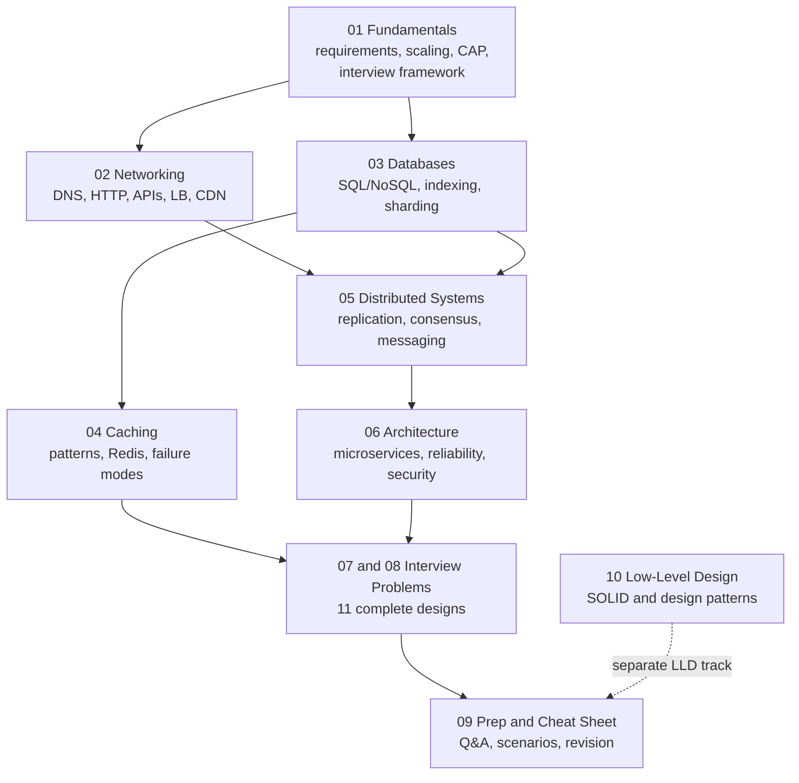

# System Design Interview Notes — Roadmap

> A complete, interview-focused System Design resource that goes from first principles to senior-level depth.
> Every concept follows the same pattern: **what → why → how → diagram → example → trade-offs → when to use → interview answers → mistakes → quick revision**.
> **Stack context:** Java / Spring Boot backend engineer.

**Level legend** (shown under every concept heading):

| Tag | Meaning | Who should study it |
|---|---|---|
| 🟢 Essential | Asked in almost every system design interview | Everyone, first |
| 🟡 Intermediate | Expected from mid-level engineers (2–5 YOE) | After the essentials |
| 🔴 Advanced | Senior / staff depth — great for follow-up questions | Once the basics are solid |

---

## Table of Contents

| # | File | What it covers |
|---|---|---|
| 1 | [System Design Fundamentals](01_system_design_fundamentals.md) | Requirements, quality attributes (availability, reliability, durability…), latency vs throughput, scaling, capacity estimation, CAP/PACELC, consistency models, **the 10-step interview framework + worked example** |
| 2 | [Networking and Communication](02_networking_and_communication.md) | DNS, TCP/UDP, HTTP/1.1/2/3, TLS/mTLS, polling/SSE/WebSockets, REST/GraphQL/gRPC, API design, reverse proxy, load balancers, API gateway, rate limiting, CDN |
| 3 | [Databases and Storage](03_databases_and_storage.md) | SQL vs NoSQL, database types, data modeling, normalization, indexing, ACID & isolation, replication, sharding, consistent hashing, connection pooling, scaling ladder, object/file/block storage |
| 4 | [Caching](04_caching.md) | Cache layers, cache-aside / read-through / write-through / write-back / write-around, invalidation, eviction, Redis, distributed caching, stampede / penetration / avalanche, HTTP & CDN caching |
| 5 | [Distributed Systems and Messaging](05_distributed_systems_and_messaging.md) | Replication, quorum, partitions, clocks, consensus/leader election, distributed locks, service discovery, queues/pub-sub/streams, Kafka/RabbitMQ/SQS, delivery guarantees, retries/backoff, circuit breaker, bulkhead, 2PC vs Saga, outbox/CDC |
| 6 | [Architecture, Reliability and Security](06_architecture_reliability_and_security.md) | Monolith vs microservices vs serverless, service mesh, event-driven architecture, CQRS, event sourcing, failover & graceful degradation, deployments, observability, SLOs, authN/authZ (JWT, OAuth2, RBAC), security, disaster recovery (RTO/RPO) |
| 7 | [Interview Problems — Part 1](07_interview_problems_part1.md) | URL shortener · Rate limiter · Notification service · Chat app · News feed · File storage & sharing |
| 8 | [Interview Problems — Part 2](08_interview_problems_part2.md) | Video streaming · Ride-hailing · E-commerce · Ticket booking · Distributed logging & metrics |
| 9 | [Interview Prep and Cheat Sheet](09_interview_prep_and_cheatsheet.md) | 110+ Q&A by level, scenario questions (10x traffic, DB outage…), follow-up handling, trade-off tables, common mistakes, numbers to know, last-minute cheat sheet |
| 10 | [Low-Level Design and Patterns](10_low_level_design_and_patterns.md) | SOLID, composition vs inheritance, coupling/cohesion, GoF creational/structural/behavioral patterns, anti-patterns, LLD Q&A |

---

## How the Files Fit Together

**How to read it:** files 01–06 teach the building blocks, from basics to distributed systems. Files 07–08 combine those blocks into full designs. File 09 is for testing yourself and revising. File 10 is a separate low-level design (object-oriented) track, often a separate interview round.

---

## Suggested Study Plans

### Plan A — Learning from scratch (≈ 3 weeks)

| Week | Focus | Files |
|---|---|---|
| 1 | Fundamentals, networking, databases — 🟢 sections only | 01, 02, 03 |
| 2 | Caching, distributed systems, architecture — 🟢 + 🟡 | 04, 05, 06 |
| 3 | One interview problem per day, out loud, using the 10-step framework; then Q&A | 07, 08, 09 |
| Ongoing | LLD round prep | 10 |

### Plan B — Interview in one week

1. Day 1: [The 10-step framework](01_system_design_fundamentals.md#10-the-system-design-interview-framework) and the [worked example](01_system_design_fundamentals.md#11-worked-example-applying-the-framework).
2. Day 2: All 🟢 sections in 02–04.
3. Day 3: All 🟢 sections in 05–06.
4. Days 4–6: Two problems per day from 07–08. Draw the diagram yourself *before* reading the solution.
5. Day 7: [Scenario questions](09_interview_prep_and_cheatsheet.md#5-scenario-based-questions) and the [last-minute cheat sheet](09_interview_prep_and_cheatsheet.md#10-last-minute-cheat-sheet).

### Plan C — The night before

Read every **Quick revision** block, the [trade-off tables](09_interview_prep_and_cheatsheet.md#7-trade-off-comparison-tables), [common mistakes](09_interview_prep_and_cheatsheet.md#8-common-interview-mistakes), and the [cheat sheet](09_interview_prep_and_cheatsheet.md#10-last-minute-cheat-sheet).

---

## How to Practise (the part that actually makes you good)

1. **Don't memorize designs.** Memorize the *framework* and the *trade-offs*. Every design in 07–08 is derived from the same 10 steps.
2. **Talk out loud.** Set a 45-minute timer and design a problem from 07–08 without reading it. Then compare your design with the notes.
3. **Always say "the trade-off is…"** after each decision. Interviewers grade the reasoning, not the technology you pick.
4. **Practise failure questions.** For each box in your diagram, ask: *what happens if this dies, gets slow, or receives 10x traffic?*
5. **Revisit 🔴 sections** once 🟢 and 🟡 feel easy. They are what separate senior answers in follow-up questions.

---

## Where the Original Notes Went

These notes merge and replace the earlier `01_system_desigine.md`, `02_system_design.md`, and `03_system_design.md`. The originals are in git history.

| Original section | New home |
|---|---|
| Old 01 — SOLID, composition, coupling, GoF patterns, code anti-patterns, LLD Q&A | [10 Low-Level Design](10_low_level_design_and_patterns.md) |
| Old 01 — Circuit breaker, retry/backoff, bulkhead, idempotency, Saga, 2PC | [05 Distributed Systems](05_distributed_systems_and_messaging.md) |
| Old 01 — Rate limiter | [02 Networking](02_networking_and_communication.md#14-rate-limiting) and [07 Rate Limiter design](07_interview_problems_part1.md#2-rate-limiter) |
| Old 01 — CQRS, event sourcing, architecture anti-patterns | [06 Architecture](06_architecture_reliability_and_security.md) |
| Old 02 — Day 8 requirements and trade-offs, Day 9 estimation, Day 13 scaling, Day 14 CAP and consistency | [01 Fundamentals](01_system_design_fundamentals.md) |
| Old 02 — Day 10 API design, Day 14 load balancing | [02 Networking](02_networking_and_communication.md) |
| Old 02 — Day 11 databases, Day 13 sharding and consistent hashing | [03 Databases](03_databases_and_storage.md) |
| Old 02 — Day 12 caching | [04 Caching](04_caching.md) |
| Old 03 — Day 15 distributed core, Day 16 messaging, service discovery | [05 Distributed Systems](05_distributed_systems_and_messaging.md) |
| Old 03 — Days 17–21: architecture, microservice patterns, auth, observability, security | [06 Architecture](06_architecture_reliability_and_security.md) (TLS details in [02](02_networking_and_communication.md#5-tls-and-mtls), API gateway in [02](02_networking_and_communication.md#13-api-gateway-and-bff)) |
| All original Q&A (old 02 Q1–35, old 03 Q1–40, old 01 HLD questions) | [09 Interview Prep](09_interview_prep_and_cheatsheet.md) |

**Start here:** [01 — System Design Fundamentals](01_system_design_fundamentals.md)
